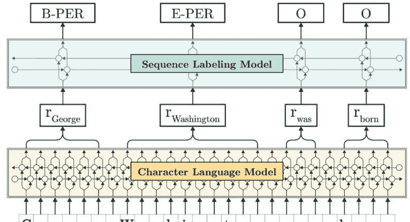

Flair 简介

There are few **Natural Language Processing** (**NLP**) frameworks out there as easy to learn and as easy to work with as **Flair**。Packed with pre-trained models, excellent documentation, and readable syntax, it provides a gentle learning curve for NLP researchers who are not necessarily skilled in coding; software engineers with poor theoretical foundations; students and graduates; as well as individuals with no prior knowledge simply interested in the topic. But before diving straight into coding, some background about the motivation behind Flair, the basic NLP concepts, and the different approaches to how you can set up your local environment may help you on your journey toward becoming a Flair NLP expert.

在 Flair 的官方 GitHub README 中，该框架被描述为：

> "用于最先进自然语言处理的非常简单的框架"

此描述会引起一些注意。NLP 研究人员会立即有兴趣了解该框架在哪些具体任务中实现了最先进的结果。工程师会被 *非常简单* 的标签所吸引，但会想知道需要哪些步骤才能开始使用以及可以在哪些环境中使用。那些不了解 NLP 的人会想知道他们是否能够掌握理解 Flair 试图解决的问题所需的知识。

在本章中，我们将通过以下部分来回答所有这些问题，涵盖基本 NLP 概念和术语，提供 Flair 的概览，并设置我们的开发环境：

- NLP 简介
- 什么是 Flair？
- 准备工作

## 技术要求

开始之前，您需要一个配备 Python 3.6+ 的开发环境。有关安装 Python 的特定于平台的说明可在 https://docs.python-guide.org/starting/installation/ 找到。

您不需要配备 GPU 的开发机器，但拥有一个将显著加快本书后面描述的一些训练相关练习的速度。

您需要访问命令行。在 Linux 和 macOS 上，只需启动终端应用程序。在 Windows 上，按 Windows + R 打开运行框，输入 cmd 然后单击确定。

Flair 的官方 GitHub 仓库可通过以下链接访问：https://github.com/flairNLP/flair。本章中我们将安装 Flair 0.11 版本。

本章涵盖的代码示例可在本书的官方 GitHub 仓库中的以下 Jupyter 笔记本中找到：https://github.com/PacktPublishing/Natural-Language-Processing-with-Flair/tree/main/Chapter01。

## NLP 简介

在深入了解 Flair 的功能及其如何利用其功能之前，我们将进行 NLP 的简要介绍，为不熟悉 Flair 解决的所有 NLP 技术和任务的读者提供一些背景信息。NLP 是人工智能、语言学和软件工程的一个分支，有助于机器理解人类语言。当我们人类阅读一个句子时，我们的大脑会立即理解许多看似微不足道的问题，例如以下内容：

- 该句子是否使用我能理解的语言书写？
- 如何将句子拆分为单词？
- 单词之间的关系是什么？
- 各单词的含义是什么？
- 这是一个问题还是一个答案？
- 单词被分配到哪些词性类别？
- 句子的抽象含义是什么？

人类大脑擅长共同且通常无缝地解决这些问题，使我们意识不到仅仅通过阅读句子就理解了所有这些内容。

即使现在，机器在同时解决所有这些问题方面仍然不如人类。因此，为了教会机器理解人类语言，我们必须将自然语言的理解拆分为一组更小、机器可理解的任务，以便逐一回答这些问题。

在本节中，您将找到一些重要 NLP 任务的列表，重点介绍 Flair 支持的任务。

## 分词

**分词**是将句子或文档分解为称为 **词元** 的有意义单元的过程。词元可以是段落、句子、搭配或仅仅是一个单词。

例如，词分词器会将句子 *Learning to use Flair* 拆分为词元列表 `["Learning", "to", "use", "Flair"]`。

分词必须遵守特定语言的规则，并且很少是微不足道的任务。例如，对于无空格语言，词边界不以空格定义，很难确定一个词何时结束下一个词何时开始。明确定义的词元边界是大多数旨在处理单词、搭配或句子的 NLP 任务的先决条件，包括本章中解释的以下任务。

## 文本向量化

**文本向量化**是将单词、句子或文档从其书面形式转换为机器可理解的数值表示的过程。

文本向量化最简单的形式之一是 **独热编码**。它将单词映射到长度等于词典中单词数量的二进制向量。向量中的所有元素均为 0，除了表示该单词的元素设置为 1——因此得名 *one-hot*。

例如，取以下词典：

- Cat
- Dog
- Goat

单词 **cat** 将是我们词典中的第一个单词，其独热编码为 `[1, 0, 0]`。单词 **dog** 将是我们词典中的第二个单词，其独热编码为 `[0, 1, 0]`。单词 **goat** 将是我们词典中的第三个也是最后一个单词，其独热编码为 `[0, 0, 1]`。

然而，这种方法存在高维度的問題，因为向量的长度随词典中单词数量线性增长。它也不捕获单词的任何语义含义。为了应对这一问题，大多数现代最先进的方法使用称为词或文档嵌入的表示。每个嵌入通常是一个由实数组成的固定长度向量。虽然这些数字乍一看对人类来说难以理解，但在某些情况下，一些向量维度可能代表单词的某些抽象属性——例如，词嵌入向量的一个维度可以表示单词的总体（积极或消极）情感。给定两个或多个嵌入，我们可以使用称为 **余弦相似度** 的距离度量来计算它们之间的相似性或距离。在包括 **Flair** 在内的许多现代 NLP 解决方案中，嵌入被用作更高级别 NLP 任务（如命名实体识别）的底层输入表示。

早期词嵌入方法的主要问题之一是多义词（多义词）仅限于单一且恒定的嵌入表示。**Flair** 中解决此问题的方法之一是使用上下文字符串嵌入，其中单词由其周围文本进行上下文化，这意味着在不同的周围文本下它们将具有不同的表示。

## 命名实体识别

**命名实体识别**（NER）是一种 NLP 任务或技术，用于在文本中识别命名实体并为其标记相应的类别。命名实体类别包括但不限于 *地点*、*人名*、*品牌*、*时间表达* 和 *货币值*。


下图说明了使用彩色背景和与单词关联的标签的 NER：


图 1.1 – NER 标注的可视化

在前面的示例中，我们可以看到识别并标注了三个实体。第一个和第三个标签特别有趣，因为它们都代表同一个词 Berkeley，但第一个明显指的是一个组织，而第三个指的是一个地理位置。人脑在根据上下文区分不同实体类型方面表现出色，并且几乎可以无缝地做到这一点，而机器在几十年里一直为此苦苦挣扎。上下文字符串嵌入的最新进展，Flair 的核心部分，在解决这一问题上取得了巨大飞跃。

## 词义消歧

词义消歧（WSD）是一种 NLP 技术，关注于识别具有多种含义的给定词的预期词义。

例如，来看给定的句子：

*George 试图返回柏林归还他的帽子。*

WSD 的目标是识别单词 return 第一次使用时的词义，指归还某物的行为，以及第二次 return 的词义，指返回同一地点的行为。

## 词性标注

词性标注（POS）是一种与 WSD 和 NER 密切相关的技术，旨在将单词标注为对应特定词性的类别，例如名词、动词、形容词、副词等。


图 1.2 – POS 标注的可视化

实际的 POS 标注器提供的标签信息远不止将单词与名词/动词/形容词类别关联。例如，宾州树库项目语料库，是最广泛使用的 NER 语料库之一，区分了 36 种不同的 POS 标签类型。

## 切分

另一种与 POS 标注密切相关的 NLP 技术是 **chunking**。与 **parts of speech (POS)** 不同，后者识别单个 POS，在切分中我们识别完整的短语，例如名词短语。在 *图 1.2* 中，短语 *A lovely day* 可以被视为一个 chunk，因为它是一个名词短语，并且在与其他词的关系中，其作用方式与名词相同。

## 词干提取和词形还原

**Stemming** 和 **lemmatization** 是 NLP 中使用的两种密切相关的文本规范化技术，用于将词还原为其共同的基础形式。例如，单词 *play* 是单词 *playing*、*played* 和 *plays* 的基本词。

两种技术中更简单的一种，**stemming**，只是通过截断单词的末尾或开头来实现这一点。这种简单的解决方案通常有效，但并非万无一失。例如，单词 *ladies* 永远无法仅通过词干提取转变为单词 *lady*。因此我们需要一种理解单词的 POS 类别并考虑其上下文的技术。这种技术称为 *词形还原*。词形还原的过程可以用以下示例来演示。

取以下句子：

```
this meeting was exhausting
```

词形还原将前一句还原为以下内容：

```
this meeting be exhaust
```

它将单词 *was* 还原为 *be*，并将单词 *exhausting* 还原为 *exhaust*。另请注意，单词 *meeting* 用作名词，因此映射到相同的单词 *meeting*，而如果单词 *meeting* 用作动词，则会被还原为 *meet*。

一个流行且易于使用的用于使用 Python 执行词形还原的库是 **spaCy**。其模型在大型语料库上训练，能够区分不同的 POS，从而取得令人印象深刻的结果。

## 文本分类

文本分类是一种 NLP 技术，用于将文本或文档分配给一个或多个类别或文档类型。文本分类的实际用途包括垃圾邮件过滤、语言识别、情感分析以及根据语法进行编程语言识别。

在介绍了基本 NLP 概念和术语之后，我们现在可以继续了解 Flair 是什么以及它如何以最先进的结果解决 NLP 任务。

## 介绍 Flair

Flair 是一个功能强大的 NLP 框架，以 Python 包的形式发布。它提供了一个简单、友好、易于使用的界面，适合各种背景的人使用，包括编程知识很少的人。它在 MIT 许可证下发布，这是最宽松的自由软件许可证之一。

Flair 作为 NLP 框架具有多种工具和用途。它可以按以下方式定义：

- *它是一个用于 NLP 研究的 NLP 框架，用于生成在多种 NLP 任务中实现最先进结果的模型，例如跨多种语言和数据集的 POS 标注、NER 和 chunking。* 在 Flair 的 GitHub 仓库中，您可以找到逐步说明，了解如何重现这些结果。
- *它是一个用于训练、验证和分发 NER、POS 标注、chunking、词义消歧和文本分类模型的工具。* 它具有有助于简化训练和验证过程的工具，例如自动语料库下载工具，以及有助于模型调优的工具，例如超参数优化工具。它支持日益增长的语言数量。
- *它是一个用于下载和使用最先进的预训练模型的工具。* 模型可以无缝下载，这意味着它们将在您第一次使用时自动下载并保留供将来使用。
- *它是所提出的最先进的 Flair 嵌入的平台。* Flair 在许多 NLP 任务中取得的最先进结果在很大程度上可归因于其提出的 Flair 上下文字符串嵌入，论文 *用于序列标注的上下文字符串嵌入* 中有更详细的描述。作者将其称为 Flair 的“秘密酱料”。
- *它是一个用于处理生物医学数据的 NLP 框架。* Flair 的一个特殊部分专门用于处理生物医学数据，并提供了一套实现最先进结果的预训练模型，以及一些语料库和关于如何训练自定义生物医学标注模型的全面文档。
- *它是对 NLP 的一个很好的实践介绍。* Flair 的详尽在线文档、简单界面、对大量语言的包容性支持以及能够在非 GPU 设备上执行大量任务的能力，都使其成为希望通过实践动手实验学习 NLP 的人的绝佳切入点。

## 设置开发环境

现在您已经对框架提供的功能有了基本了解，并且对基本 NLP 概念也有了了解，您现在准备好进入下一步，为 Flair 设置开发环境。

要能够按照本节中的说明操作，请首先确保您的设备上已安装 Python 3.6+，如 技术要求 部分所述。

## 创建虚拟环境

在 Python 中，通常建议在虚拟环境中安装包，这样您当前正在处理的项目依赖项不会影响您的全局 Python 依赖项或将来可能处理的其他项目。

我们将使用 venv 工具，它是 Python 标准库的一部分，无需安装。要创建虚拟环境，只需创建一个新目录，进入其中，然后运行以下命令：

```
$ python3 -m venv learning-flair
```

然后，要在 Linux 或 macOS 上激活虚拟环境，请运行以下命令：

```
$ source learning-flair/bin/activate
```

如果您运行的是 Windows，请运行以下命令：

```
$ learning-flair\Scripts\activate.bat
```

您的命令行应以 (learning-flair) $ 为前缀，您的虚拟环境现已激活。

## 在虚拟环境中安装已发布的 Flair 版本

您现在应该准备好使用以下单个命令安装 Flair 版本 0.11：

```
(learning-flair) $ pip install flair==0.11
```

安装现在应该开始，并且根据您的互联网连接速度，大约一分钟内即可完成。


你可以通过运行以下命令来验证安装情况，该命令将显示包含其版本的包属性列表：

```
(learning-flair) $ pip show flair
Name: flair
Version: 0.11
Summary: A very simple framework for state-of-the-art NLP
Home-page: https://github.com/flairNLP/flair
...
```

如上所示的命令输出表明该包已成功安装在你的虚拟环境中。

## 直接从 GitHub 仓库安装（可选）

在某些情况下，我们希望在 Flair 中使用的功能可能已经在 GitHub 上的某个分支中实现，但这些更改可能尚未作为发布在 PyPI 上的 Python 包的一部分发布。我们可以直接从 Git 仓库分支安装具有这些功能的 Flair。

例如，这里是如何从 master 分支安装 Flair：

```
(learning-flair) $ git clone https://github.com/flairNLP/flair.git
(learning-flair) $ cd flair
(learning-flair) $ git checkout master
(learning-flair) $ pip install .
```

> **重要提示**
> 从未经过审查的分支安装代码可能会引入不可靠或不安全的代码。在从开发分支安装 Flair 时，请确保你安装的代码来自可信来源。另请注意，Flair 的未来版本（大于 0.11 的版本）可能与本书中提供的代码片段不兼容。

将术语 master 替换为任何其他分支名称，即可从你选择的分支安装包。

## 使用 Flair 运行代码

使用 Flair Python 包的代码与运行任何其他类型的 Python 代码没有区别。

本书中代码片段的推荐运行方式是将其作为代码单元在 Jupyter notebook 中执行，你可以按如下方式安装和运行它：

```
(learning-flair) $ pip install notebook
(learning-flair) $ jupyter notebook
```

然后你可以创建一个新的 Python 3 笔记本并运行你的第一个 Flair 脚本来验证包是否成功导入：

```
import flair
print(flair.__version__)
```

执行后，前面的代码应打印出你当前使用的 Flair 版本，表明 Flair 包已成功导入，你已准备好开始。

## 摘要

在本章中，你熟悉了基本 NLP 术语和任务。随着你学习 Flair，你经常会遇到诸如 tokenization、NER 和 POS 等术语，本章获得的知识将帮助你理解它们的含义。

你现在也了解了 Flair 在 NLP 领域中的位置，它解决的问题以及它擅长的领域。最后，你学会了如何从 PyPI 包或 Git 分支在虚拟环境中安装 Flair。你现在准备好开始使用 Flair 编程了！

在下一章中，我们将介绍 Flair 的基本语法和基本对象，即所谓的 base types。

## 2

## Flair 基础类型

对于任何 NLP 框架来说，一个良好的起点是熟悉代码中频繁使用的基本对象和方法。在 Flair 中，第一步是熟悉其 **base types**。这些是用于定义句子或文本片段并通过分词形成 token 的基本对象。

NLP 当今面临的主要挑战之一是对代表性不足语言的支持。大多数最先进的预建 NLP 模型通常仅针对部分使用最广泛的语言构建，而未能为地球上约 7,000 种其他语言提供支持。虽然 Flair 以其出色的语言覆盖范围和多语言嵌入工作而脱颖而出，但在 *语料库可用性*、*分词方法* 和 *预建序列标注模型* 等领域，它仍远未支持所有可能的语言。对于 Flair 目前不支持特殊分词规则的语言形成 token，你需要实现自己的分词器。幸运的是，在 Flair 中这样做再简单不过了。

在本章中，你将学习 `Sentence` 对象，它用于表示句子或文本片段，以及 `Token` 基础类型，它用于表示分词后的句子中的单词。你将学习如何实现自定义分词器以及如何使用它们。你还将了解 Flair 中的 `Corpus` 对象以及如何使用其辅助函数加载和交互语料库和数据集。

本章涵盖以下主题：

- Sentence and Token 对象
- 使用自定义分词器
- Corpus 对象

## 技术要求

对于本章，你需要安装了 **Flair version 0.11** 的 **Python** 环境以及稳定的互联网连接，因为我们将下载语料库。

本章中的代码示例可以在本书的官方 GitHub 仓库中找到，具体在以下 Jupyter notebook 中：https://github.com/PacktPublishing/Natural-Language-Processing-with-Flair/tree/main/Chapter02。

## Sentence 和 Token 对象

**Sentence** 和 **Token** 对象可以被视为 **Flair** 语法中最常见的对象。前者用于表示句子或任何其他文本片段，例如段落。它们本质上是 Token 对象的列表及其对应的标签分配。

如果你想知道对象、类和方法是什么意思，这只是说明你对 **面向对象编程 (OOP)** 并不是特别熟悉。幸运的是，**OOP** 在 Python 中非常容易掌握。在 **OOP** 中，存储和/或处理数据的代码片段被组织成称为类的蓝图。类的一个例子可以是 Word 类，它可以存储和处理单个单词。OOP 中的类可以包含几个称为方法的过程。Word 类方法的一个例子可以是 get_length()，它只会返回单词的长度。类还可以包含一种特殊类型的方法，称为构造函数，在类被实例化时会被调用。实例化类的结果是一个对象。例如，调用 word_1 = Word('potato') 会调用构造函数并将 'potato' 作为第一个参数值，返回一个 Word 对象并将其存储为 word_1。然后我们可以使用这个变量来调用该对象的方法，例如 word_1.get_length()。

这篇关于 OOP 的简要介绍应该能让你获得足够的理解，以便直接深入 Flair arguably 最基础的实体——Sentence 类。

## 了解 Sentence 类

Sentence 类构造函数接受以下参数：

- text: 原始字符串（句子）或字符串 token（单词）列表。
- use_tokenizer: 要使用的分词器。如果为 True，则使用 SegTokTokenizer。如果为 False，则改用 SpaceTokenizer。如果提供了 Tokenizer 对象，则将使用它作为自定义分词器。
- language_code: 用于某些嵌入的语言代码（可选）。
- start_position: 句子在文档中的起始字符偏移量（可选）。

例如，让我们创建一个简单的 Sentence 对象并检查其字符串表示行为：

```
from flair.data import Sentence

sentence = Sentence('Some nice text.')
print(sentence, len(sentence))
```

前面的脚本应打印出以下内容：

```
Sentence: "Some nice text ." 4
```

前面的输出表明句子已被拆分为四个 token，其中一个是句号。单独的 . token 是未提供 use_tokenizer 参数的直接结果，如果留空，则默认为使用 SegTokTokenizer。

## 了解 Token 类

Token 类表示分词句子中单个实体，例如单词。

每个 token 可以有零个、一个或多个标签。例如，Flair 允许对同一个 Sentence 对象同时进行 POS 标注和 NER。这意味着单个 token 理论上可以同时具有命名实体标签和词性标签。

Token 对象的对应文本可以通过引用其 Token.text 属性轻松获得。

我们现在对这两种基础类型的工作方式有了模糊的了解。但要完全理解基础类型的工作方式，我们需要更深入地研究 Flair 中的分词技术。


## Flair 中的分词

根据你的需求和所用语言的类型，你可以从 Flair 中提供的以下任何分词器中选择：

- `SpaceTokenizer()`: 一个简单的分词器，按空格字符分割文本。请注意，此分词器仅按空格字符 (" ") 分割。它不会按包含在 Python 的 `string.whitespace` 中的字符分割，该字符常用于分割或格式化文本的方法中。空白字符（连同空格字符）还包括换行符和制表符，而 `SpaceTokenizer` 不会考虑这些。
- `SpacyTokenizer(model)`: 使用一个名为 **spaCy** 的常用 NLP 库的分词器。它接受一个名为 `model` 的参数，该参数可以是表示 **spaCy** 模型（例如，`en_core_web_sm`）的字符串，也可以是 spaCy `Language` 对象。
- `SciSpacyTokenizer()`: 使用 spaCy 的 **`en_core_sci_sm`** 模型的分词器，并扩展了诸如 `(, )` 和 `-.` 等特殊字符。这些用作额外的词元分隔符。
- `SegtokTokenizer()`: 使用 Flair 依赖项 **segtok** 的分词器，该依赖项专注于分割（印欧语系）文本。
- `JapaneseTokenizer(tokenizer, sudachi_mode)`: 使用 **konoha** 库的分词器类，并为日语提供多种分词器选择。`tokenizer` 参数可以是 `mecab`、`janome` 或 `sudachi`。

现在我们对 Flair 中可用的分词器有了很好的了解，让我们尝试使用非默认分词器使用 Sentence 对象：

```python
from flair.data import Sentence
from flair.tokenization import SpaceTokenizer

tokenizer = SpaceTokenizer()
s = Sentence('Some nice text.', use_tokenizer=tokenizer)

### 使用魔术方法 __str__ 获取字符串表示
print(s, len(s))
```

上述脚本使用 SpaceTokenizer，应该打印出以下内容：

```
Sentence: "Some nice text." 3
```

这与 SegtokTokenizer 不同，由于仅按空格字符分割，它将 text. 字符串视为单个词元。

在下一节中，我们将了解如何从 Sentence 和 Token 对象中提取信息以及如何为其添加标签。

## Sentence 和 Token 对象辅助方法

Sentence 对象有几个有用的方法和属性。最直接的一个，也是我们在前面的示例中已经使用过的，是 __str__ 魔法方法的实现，它返回对象的字符串表示形式，例如在尝试打印它时。

为了能够完全理解 Sentence 对象的字符串表示格式，我们需要为至少一个词元添加标签。为此，我们将使用 get_token(n) 方法获取第 n 个词元的 Token 对象，然后使用 add_label(label_type, value) 方法为词元分配标签：

```python
from flair.data import Sentence

sentence = Sentence('A short sentence')
sentence.get_token(1).add_label('manual-pos', 'DT')
print(sentence)
```

上述脚本将打印出以下内容：

```
Sentence: "A short sentence" → ["A"/DT]
```

打印字符串的第一部分显示整个句子在其原始形式，而句子的第二部分显示带有相应标签的词元。在此代码示例中，我们手动标记了第一个词元以测试对象的字符串表示，而在 Flair 中，词元通常会由序列标注器进行标记。

类似的 Sentence 对象字符串表示也可以通过调用 to_tagged_string() 方法直接获得。

> **重要提示**
> get_token(n) 方法使用基于 1 的索引，这意味着 n=1 将检索第一个词元，而 n=0 将返回 None。使用 get_token(n) 的基于 0 的索引替代方案是使用索引运算符。例如，要获取名为 sentence 的 Sentence 对象的第一个词元，我们可以简单地调用 sentence[0]。

标记化的 Sentence 对象中的词元也可以通过使用其 __iter__() 魔法函数获得，这使我们可以通过简单地迭代对象来获取所有词元。我们例如可以通过使用 for 循环来做到这一点。

让我们使用前一个脚本中的相同 sentence 变量运行以下脚本：

```python
for token in sentence:
    print(token)
```

脚本将打印出以下内容：

```
Token[0]: "A" → DT (1.0)
Token[1]: "short"
Token[2]: "sentence"
```

这使我们能够清楚地了解原始字符串是如何被分词的。

在使用 Sentence 对象时，了解使用 len() 方法的行为很重要。它将返回词元数量，而不是原始字符串的长度。这意味着使用前一个脚本中的变量调用 len(sentence) 将返回 3。如果您希望获取实际句子（即原始文本）的长度，则需要运行 len(sentence.to_original_text())。

如果这里描述的任何分词器都不适合你，Flair 也能满足你的需求。你需要做的只是实现自己的自定义分词器并将其传递给 Flair。让我们学习如何操作。

## 使用自定义分词器

虽然 Flair 随附了支持最常用语言的多个分词器，但你可能正在处理一种使用目前未被 Flair 覆盖的分词规则的语言。幸运的是，Flair 提供了一个简单的接口，允许我们实现自己的分词器或使用第三方库。

### 使用 TokenizerWrapper 类

TokenizerWrapper 类为构建自定义分词器提供了一个简单的接口。要构建一个，你只需通过传递 tokenizer_func 参数来实例化该类。该参数是一个函数，它接收整个句子文本作为输入并返回一个词元字符串列表。

作为练习，让我们尝试实现一个将文本拆分为字符的自定义分词器。此分词器将把每个字符视为一个词元：

```python
from flair.data import Token
from flair.tokenization import TokenizerWrapper

def char_splitter(sentence):
    return list(sentence)

char_tokenizer = TokenizerWrapper(char_splitter)
```

在前面的代码中，我们实现了 space_splitter 函数，它只是将句子拆分为字符列表。最后，我们通过使用新的函数实例化 TokenizerWrapper 类来创建新的分词器对象。

现在，我们可以通过使用 Sentence 对象并打印生成的词元来测试我们的分词器：

```python
from flair.data import Sentence

text = "Good day."
sentence = Sentence(text, use_tokenizer=char_tokenizer)

for token in sentence:
    print(token)
```

结果脚本将打印出以下内容：

```text
Token[0]: "G"
Token[1]: "o"
Token[2]: "o"
Token[3]: "d"
Token[4]: " "
Token[5]: "d"
Token[6]: "a"
Token[7]: "y"
Token[8]: "."
```

打印的文本表明我们的分词器按预期执行并且与 Sentence 对象兼容。

> **关于分词器的重要提示**
> 语言的分词规则通常很复杂并且包含许多边缘情况。因此，强烈建议使用来自成熟 NLP 包的第三方分词器，而不是自己实现。

现在我们已经介绍了分词以及 Sentence 和 Token 基础类型，是时候继续深入了解 Corpus 对象了。

## 理解 Corpus 对象

Corpus 对象是 Flair 中在内存中存储语料库的主要对象。每个 Corpus 都是三个数据集的集合，这些数据集的行为类似于 Sentence 对象列表。可以通过以下属性访问这些数据集：

- **train** 属性，其中包含将用于训练模型的数据集。
- **test** 属性，其中包含独立于 train 数据集的数据集。它用于模型验证。
- **dev** 属性，其中包含用于超参数调优的数据集。

这三个数据集理想情况下包含来自相同数据源的数据并遵循相同的概率分布。

可以通过加载 Flair 的其中一个准备好的数据集来获得示例语料库对象：

```python
from flair import datasets

corpus = datasets.UD_ENGLISH()
```

可以通过简单地打印对象来获得语料库摘要：

```python
print(corpus)
```

这应该打印出以下内容：

```
Corpus: 12543 train + 2002 dev + 2077 test sentences
```

语料库的训练数据集可以通过简单调用 train 属性获得：

```
train_dataset = corpus.train
```

然后，可以使用索引运算符获取数据集的第 n 个句子。例如，可以使用以下代码获取第 101 个句子：

```
sentence = train_dataset [100]
```

```
print(sentence)
```

前述脚本将打印出训练数据集中第 101 个句子。

该对象还附带了多个辅助方法。其中最广泛使用的是 downsample(percentage) 方法，它可以减小语料库的大小，其中 percentage 是介于 0 和 1 之间的值，用于确定新语料库的大小。

> 注意
> downsample(percentage) 方法会修改并返回原始的 Corpus 对象。这意味着多次调用它会多次对语料库进行下采样。

例如，如果我们想将语料库下采样到 1%，我们将使用以下代码：

```
corpus.downsample(0.01)
```

```
print(corpus)
```

这将打印出以下内容：

```
Corpus: 125 train + 20 dev + 21 test sentences
```

这是原始语料库大小的 1%。

Flair 附带了多种技术和 Corpus 对象的实例，允许我们从 CSV 文件加载数据并读取自己的序列标注数据集。它提供了大量准备好的数据集，这些数据集将在本书后面更详细地介绍。

## 摘要

在本章中，我们介绍了 Flair 的基础类型，例如 `Sentence` 和 `Token` 对象，解释了如何初始化和使用它们，并尝试了一些基本辅助方法。这应该使我们在转向更复杂主题时能够更轻松地处理、转换和理解 Flair 中的数据。我们还介绍了在 Flair 中使用自定义分词器并实现了我们自己的基于字符的分词器。最后，我们初步了解了 Flair 的数据集和 `Corpus` 对象可以做什么。我们学习了如何加载语料库和数据集，评估其大小，提取和读取单个句子，以及对整个数据集进行下采样。

我们现在对语法、基本对象和辅助方法足够熟悉，可以继续学习 Flair 最强大的 NLP 技术——序列标注。我们将在下一章介绍这一点。

## 3

## Embeddings in Flair

Embeddings 是 **Natural Language Processing (NLP)** 任务中 **Flair** 的核心概念。理解不同嵌入的工作原理、可用的类型以及在何种情况下使用何种类型，对于成为一名熟练的 Flair 用户非常重要。

虽然该框架提供了大量不同类型的嵌入，但其中一种是绝对必不可少的，并在实现 Flair 在 NLP 任务上的出色性能中发挥着关键作用。这种称为 Flair 嵌入的嵌入类型，被主要作者称为 *the secret sauce of Flair*。理解 Flair 嵌入的来龙去脉将帮助你更好地理解 Flair 在众多 NLP 任务中取得成功的背后原因，并在训练自定义模型时帮助你选择合适的嵌入。

在本章中，我们将学习不同类型的嵌入、它们的工作原理，以及如何在 Flair 中使用各个嵌入技术来生成词、句子和文档嵌入。阅读本章后，你将对在何种情况下使用何种嵌入有更深入的理解。我们将演示如何使用词嵌入上的算术运算来理解词语的含义和关系，使用 “king is to man as queen is to woman” 这一类比。我们将学习如何通过堆叠嵌入将多个现有嵌入组合成新的嵌入类型。我们还将介绍文档嵌入以及如何使用它们为整个文档生成嵌入。

该框架提供了一系列可以分为多个类别的嵌入：*classic word embeddings*、*Flair embeddings*、*stacked embeddings*、*document embeddings* 和 *other embeddings*。这些类别在以下主题中介绍：

- 理解词嵌入
- Flair 嵌入
- 堆叠嵌入
- 文档嵌入
- Flair 中的其他嵌入

### 技术要求

本章使用的所有 Python 库都是 Flair 0.11 版本的直接 Flair 依赖项，只要机器上已安装 Flair，就无需特殊设置。本章介绍的代码示例可在本书官方 GitHub 仓库的以下 Jupyter 笔记本中找到：https://github.com/PacktPublishing/Natural-Language-Processing-with-Flair/tree/main/Chapter03。

### 理解词嵌入

**Word embeddings** 是词语的机器可解释表示，使得语义相似的词对的嵌入会相似，而语义不相似的词的嵌入会截然不同。

在第一章中，我们介绍了嵌入的基础知识，我们将嵌入松散地定义为特定字符、词语、句子、段落或文本文档的向量表示。这些向量通常由数百或数千个实数组成。向量中的每个位置称为一个维度。

到目前为止，你可能想知道我们如何判断两个词嵌入是否相似或不同。有几种指标，例如余弦相似度、欧几里得距离和 Jaccard 距离，试图量化这一点。**Cosine similarity** 通常是最常用的方法。

### 余弦相似度

给定两个嵌入向量 A 和 B，余弦相似度定义如下：

$similarity(\mathbf{A},\mathbf{B}) = \frac{\mathbf{A}\cdot\mathbf{B}}{\|\mathbf{A}\|\|\mathbf{B}\|} = \frac{\sum_{i=1}^n A_i B_i}{\sqrt{\sum_{i=1}^n A_i^2}\sqrt{\sum_{i=1}^n B_i^2}}$

这里，分子的上部分是两个向量的点积，分母的下部分是每个向量的幅度的乘积。

 resulting 相似度分数的值介于 -1 和 1 之间。-1 的值表示向量完全相反。0 的值表示向量正交，意味着没有相关性。1 的值表示向量相似。

例如，如果我们比较代表两位客户音乐品味的两个嵌入向量，其中他们对不同歌曲进行了评分，我们将得到以下结果：

- *similarity*(**A**, **B**) = 1；表示客户对完全相同的歌曲给出了完全相同的评分。
- *similarity*(**A**, **B**) = −1；表示客户对同一首歌曲的评分方式相反。
- *similarity*(**A**, **B**) = 0；表示客户音乐品味之间没有相关性，意味着他们可能在某些歌曲上达成一致，但在其他歌曲上不一致。

你现在应该对嵌入在 NLP 中的作用和价值有了高层次的理解。现在是时候将理论付诸实践，并通过 Flair 获得处理嵌入的实践经验了。

### “king – man ≈ queen – woman” 类比

设计良好且训练充分、维度足够高的嵌入不仅代表或唯一标识某个词或句子，还包含有关词的含义及其语义属性的抽象信息。令人惊讶的是，我们可以使用词向量的算术运算来形成新词。这意味着理论上，如果我们将两个词向量相加，应该会得到一个新词，其含义是这两个词含义的总和。同样，如果我们从一个嵌入向量中减去另一个嵌入向量，我们会得到一个包含第一个词含义减去第二个词含义的新嵌入。这就引出了 king – man ≈ queen – woman 类比。

如果我们取词 *king* 的词嵌入并从该嵌入向量中减去词 *man*，我们应该会得到一个代表某种性别中性君主的词嵌入。同样，如果我们取词 *queen* 的词嵌入并从中减去词 *woman*，我们也应该得到一个性别中性君主词的表示。

利用前述假设，我们可以得出以下等式：

*king − man ≈ queen − woman*

**Important note**
请注意我们使用了 *approximately equal to* 符号。这意味着即使该说法成立，两个嵌入也只会近似相等。其主要原因在于词嵌入并不是词的完美表示，并且受其维度、训练偏差和训练数据的完整性的限制。两个词对之间的关系也极不可能完全相同。

这个类比所说的是，词 *king* 与 *man* 之间的关系与词 *queen* 与 *woman* 之间的关系非常相似。换句话说，我们可以说：

*king is to man as queen is to woman*

理论上，我们应该能够将这一概念应用于任何共享相似匹配关系的两个词对。为了进一步验证这一假设，让我们用词占位符 *A*、*B*、*C* 和 *D* 替换我们的君主、*man* 和 *woman*：

*A − B ≈ C − D*

这使我们能够转换该等式以计算 *D*：

*D ≈ B + C − A*

换句话说，假设我们有以下陈述：

*A is to B as C is to D*

我们现在可以根据词 A、B 和 C 的词嵌入来计算词 D 的词嵌入。一旦我们得到词 D 的词嵌入，找到其对应的词就很简单了。我们只需搜索整个词汇表的词嵌入并找到匹配最接近的词。

现在是时候用 Flair 来测试我们的类比求解器了。

## 实现

我们将实现一个算法，给定词 A、B 和 C，计算词 D，使得 A 比 B 如同 C 比 D 的类比成立。例如，给定输入 King is to man as queen is to...，算法将返回 woman。该算法包含以下步骤：

- 1. 选择并实例化我们在 Flair 中使用的嵌入类
- 2. 获取词 A、B 和 C 的词嵌入
- 3. 使用 D = B + C − A 公式计算词 D 的近似词嵌入
- 4. 获取 Flair 中所有英语词的词嵌入
- 5. 找到最匹配的词

### 选择并初始化嵌入类

选择嵌入类型时，重要的是我们选择一种非上下文相关的技术，因为我们将独立于可能出现的上下文来计算新词。

因此我们将使用 crawl ID 选择一组经典的随机词嵌入。crawl 嵌入是在网络爬虫数据上训练的英语词嵌入。嵌入对象可以通过运行以下代码简单初始化：

```
from flair.embeddings import WordEmbeddings
fasttext = WordEmbeddings('crawl')
```

首次执行此代码时，Flair 将下载嵌入模型，这会占用一些空间，并且完全下载可能需要几分钟。

为了避免我们再次下载模型，Flair 在下次使用时会确保使用本地存储的版本。

一旦嵌入对象加载完成，我们可以将其保留在内存中并重复使用并传递给后续的辅助函数以节省执行时间。

### 获取词 A、B 和 C 的词嵌入并计算词嵌入 D

正如我们在前几章学到的，我们可以通过先将词包装在 `Sentence` 对象中来在 Flair 中嵌入词。例如，给定一个如前所述定义的 `fasttext` 对象，我们的 `Sentence` 对象可以用 `sentence = Sentence('word')` 定义。然后，我们可以通过运行 `fasttext.embed(sentence)` 来嵌入 `Sentence` 对象中的词。我们还可以通过调用 `sentence[0].embedding` 来获取句子中第一个词的词嵌入。这将返回一个 **PyTorch** `torch.Tensor` 对象。它可以通过调用 `sentence[0].embedding.tolist()` 转换为向量分量的列表。

有了这些知识，我们可以实现一个 `compute_embedding_for_D(A, B, C, embedding)` 函数，该函数接收我们的三个词（A、B 和 C）以及一个嵌入对象，并返回计算得到的词 D 的词嵌入向量。

该方法的实现如下：

```python
from flair.data import Sentence

def compute_embedding_for_D(A, B, C, embedding):
    wordsABC_sentence = Sentence(' '.join([A, B, C]))
    embedding.embed(wordsABC_sentence)

    A_embedded = wordsABC_sentence[0].embedding
    B_embedded = wordsABC_sentence[1].embedding
    C_embedded = wordsABC_sentence[2].embedding

    D_embedding = B_embedded + C_embedded - A_embedded

    return D_embedding.tolist()
```

在此辅助函数的第一部分中，我们定义了 `wordsABC_sentence` 对象，其中包含一个包含我们三个输入词 A、B 和 C 的以空格分隔的字符串。然后我们继续嵌入该句子中的所有词并提取我们三个输入词的词嵌入，从而获得名为 `A_embedded`、`B_embedded` 和 `C_embedded` 的词嵌入。使用我们的 $D = B + C - A$ 公式和 Python 的算术运算符，我们然后简单地计算 `D_embedding` 并将其作为列表返回。

要测试我们的方法，我们可以运行以下代码：

```python
from flair.embeddings import WordEmbeddings
fasttext = WordEmbeddings('crawl')
D = compute_embedding_for_D('king', 'man', 'queen', fasttext)
print(D)
```

这应该打印出我们的 D 词嵌入——一个长数字列表，看起来像这样：

```
[0.13569998741149902, -0.3856000006198883, -0.102299957203865,
-0.13539999723434448, -0.01410001516342163,
-0.04699999839067459, ...]
```

鉴于我们的 King is to man as queen is to woman 类比， resulting embedding 应该与词 woman 的词嵌入相似。为了验证这一点，我们需要先计算英语词汇表的词嵌入，然后找到最匹配的词。

### 在 Flair 中获取所有英语词的词嵌入

为了获得在英语中在合理程度上可以预期的词列表，我们将从一个大型英语语料库中提取词汇表。这样，我们将获得一套几乎完整的常用英语词，同时去掉英语中很少使用的词，而我们极不可能遇到这些词，从而减少搜索空间并加快代码运行速度。

然后我们将把这些词作为包含词汇表以空格分隔的列表的单个句子的一部分进行嵌入。这只能在使用非上下文词嵌入时完成。如果我们使用上下文字符串嵌入，则必须为每个词单独定义一个 Sentence 对象。

我们将把解决方案实现为 get_embedded_english_vocab(embedding) 函数，该函数接收嵌入对象并返回一个 Sentence 对象，其中包含我们的整个词汇表作为标记以及相应的词嵌入：

```python
from flair import datasets
from flair.data import Sentence

def get_embedded_english_vocab(embedding):
    dataset = datasets.UD_ENGLISH()
    vocab_list = dataset.make_vocab_dictionary().get_items()
```

```
vocab = Sentence(' '.join(vocab_list))
embedding.embed(vocab)
return vocab
```

get_embedded_english_vocab(embedding) 函数使用 Flair 的 UD_ENGLISH 英语通用依存树库数据集。它将数据集的整个词汇表连接成一个以空格分隔的字符串，然后将其标记化并作为 Sentence 对象的一部分进行嵌入。

可以通过运行以下代码来测试前述函数：

```
from flair.embeddings import WordEmbeddings
fasttext = WordEmbeddings('crawl')
print(get_embedded_english_vocab(fasttext)[6].embedding)
```

在这里，我们初始化一个词嵌入类并将其传递给 get_embedded_english_vocab 函数。然后该片段最终将打印出我们词汇表中第七个词的词嵌入。

鉴于我们现在可以访问英语中可以合理预期的所有词的词嵌入，我们现在可以计算最接近我们计算得到的 D 词嵌入的词。

### 找到最匹配的词

一旦我们计算出 D 词嵌入，我们最终需要找到词嵌入所代表的词。因为词嵌入极不可能与词汇表中的词完全匹配，所以我们需要使用某种相似度度量来找到最匹配的词。我们将使用余弦相似度。为了找到最匹配的词，我们只需计算 D 与词汇表中每个词之间的余弦相似度，并选择相似度分数最高的词。这将实现为 find_closest_matching_word(D, vocab, ABC)，其中 D 是我们计算得到的词嵌入，vocab 是我们嵌入的词汇表，ABC 是词 A、B 和 C 的列表：

```python
from sklearn.metrics.pairwise import cosine_similarity as sim
def find_closest_matching_word(D, vocab, ABC):
    max_match = -1
```

```
for word in vocab:
    match = sim([D], [word.embedding.tolist()])[0][0]
    if match > max_match and word.text not in ABC:
        max_match = match
        closest_matching_word = word.text
return closest_matching_word
```

前述代码简单地遍历我们的 vocab 对象并计算 D 词嵌入与 vocab 对象中每个词之间的相似度。然后我们选择并返回 closest_matching_word，即我们类比求解器的解决方案。

> 提示
> 虽然我们使用算术运算来解决类比的想法在理论上是有意义的，但在实践中结果往往不如你预期的那么合理。经常发生的情况是，新计算的词嵌入实际上最接近我们原始词中的一个。当然，我们希望 D 是一个新词，而不是原始词 A、B 或 C 中的一个。当这种情况发生时，我们可以简单地忽略最匹配的词并选择第二、第三或第四最匹配的词。我们通过在前述 if 语句中检查 word.text not in ABC 来实现这一点，从而避免结果是原始词之一并增加产生合理结果的机会。

在实现了类比求解器所需的所有逻辑后，我们现在可以编写一个简单的辅助函数，将所有函数集成在一起并打印出类比谜题的解决方案：

```python
def A_is_to_B_as_C_is_to(A, B, C):
    fasttext = WordEmbeddings('crawl')
    result = compute_embedding_for_D(A, B, C, fasttext)
    vocab = get_embedded_english_vocab(fasttext)
    D = find_closest_matching_word(result, vocab, {A, B, C})
    
    print(f'{A} is to {B} as {C} is to {D}')
```


## 速度优化

请注意，在前面的函数中，我们只实例化了一次 WordEmbeddings 对象，然后直接将其传递给我们的函数。这提高了求解器的性能。我们还可以做许多其他优化，主要是关于我们如何找到最匹配的词。不是使用 for 循环遍历词汇表并为每个词计算余弦相似度，我们本可以将整个词汇表传递给 cosine_similarity 方法，该方法允许一次计算多个嵌入对的相似度。

现在是时候尝试我们的解决方案了！

## 尝试类比求解器

我们现在可以尝试几个示例，看看我们的类比求解器在实际中的表现如何：

- `A_is_to_B_as_C_is_to("king", "man", "queen")` 结果如下：
  ```
  king is to man as queen is to woman
  ```
- `A_is_to_B_as_C_is_to("do", "did", "go")` 结果如下：
  ```
  do is to did as go is to went
  ```
- `A_is_to_B_as_C_is_to("bread", "baker", "meat")` 结果如下：
  ```
  bread is to baker as meat is to butcher
  ```
- `A_is_to_B_as_C_is_to("London", "England", "Ljubljana")` 结果如下：
  ```
  London is to England as Ljubljana is to Slovenia
  ```
- `A_is_to_B_as_C_is_to("life", "death", "beginning")` 结果如下：
  ```
  life is to death as beginning is to ending
  ```
- `A_is_to_B_as_C_is_to("big", "bigger", "small")` 结果如下：
  ```
  big is to bigger as small is to smaller
  ```
- `A_is_to_B_as_C_is_to("man", "actor", "woman")` 结果如下：
  ```
  man is to actor as woman is to actress
  ```

前面的代码展示了一些求解器表现惊人良好的示例。然而，公平地说，我们采用了一个小技巧，确保预测的词永远不会是原来的三个词之一，如果没有这个技巧，通常就会出现这种情况。

在本次练习中，我们获得了使用 Flair 进行实践的经验，并加深了对词嵌入的理解和知识。

我们现在将介绍 Flair 支持的各种不同的嵌入类型。

## Flair 中的经典词嵌入

Flair 中最简单的仍包含词语义信息的嵌入类型称为 **经典词嵌入**。这些嵌入是预训练的、无上下文的，并且不需要预处理。无上下文的特性意味着一个词始终映射到一个预计算的嵌入，而与上下文无关。要使用它们，我们只需通过传入所选嵌入的 ID 来实例化一个 `WordEmbeddings` 类。然后，我们只需将文本封装到一个 `Sentence` 对象中，并在我们的 `WordEmbeddings` 类上调用 `embed(sentence)` 方法。

让我们使用 FastText "crawl" 嵌入为几个随机词获取嵌入：

```
from flair.data import Sentence
from flair.embeddings import WordEmbeddings

embedding = WordEmbeddings('crawl')
sentence = Sentence("one two three one")
embedding.embed(sentence)

for token in sentence:
    print(token.embedding)
```

前面的代码将打印出词 one、two、three 和 one 的嵌入。请注意，我们打印了 one 词元两次。因为 `WordEmbeddings` 类是无上下文的，所以第一个和第四个词元的嵌入是相同的。

我们可以用一个简单的检查来验证这一点：

```
token1 = sentence[0]
token4 = sentence[3]
print(token1.embedding.tolist() == token4.embedding.tolist())
```

前面的代码将打印出 True，表明同一个词的两个嵌入是等价的。

> **注意**
> 首次加载嵌入时，Flair 会下载嵌入模型并将其存储在本地。后续调用将使用本地存储的版本。

Flair 目前支持以下类型的经典词嵌入：

- GloVe 嵌入：
  - ID: `glove` (英语)
- Komninos 嵌入：
  - ID: `extvec` (英语)
- Twitter 嵌入：
  - ID: `twitter` (英语)
- Turian 嵌入（小型）：
  - ID: `turian` (英语)
- 基于网络爬取的 FastText 嵌入：
  - ID: `crawl` (英语)
- 基于新闻和维基百科数据的 FastText 嵌入：
  - ID: `ar` (阿拉伯语), `bg` (保加利亚语), `ca` (加泰罗尼亚语), `cz` (捷克语), `da` (丹麦语), `de` (德语), `es` (西班牙语), `en` (英语), `eu` (巴斯克语), `fa` (波斯语), `fi` (芬兰语), `fr` (法语), `he` (希伯来语), `hi` (印地语), `hr` (克罗地亚语), `id` (印度尼西亚语), `it` (意大利语), `ja` (日语), `ko` (韩语), `nl` (荷兰语), `no` (挪威语), `pl` (波兰语), `pt` (葡萄牙语), `ro` (罗马尼亚语), `ru` (俄语), `si` (斯洛文尼亚语), `sk` (斯洛伐克语), `sr` (塞尔维亚语), `sv` (瑞典语), `tr` (土耳其语), `zh` (中文)

你现在应该对如何使用 Flair 的经典词嵌入方法在多种语言中生成简单的词嵌入有了良好的理解。我们现在有了基础和理解，可以继续进入一个稍微复杂但也更有趣的话题，这个话题被认为是 Flair 卓越序列标注性能背后的原因，即 Flair 的所谓秘密武器 – Flair 嵌入。

## Flair 嵌入

**Flair 嵌入** 是一种特殊的上下文字符串嵌入，它将词建模为字符序列。它们是 Flair 卓越序列标注性能背后的原因，也是引入 Flair NLP 框架的本质动机。由 Flair 的原创者撰写的 *Contextual String Embeddings for Sequence Labeling* 论文，一篇有趣且易读的文章，精彩地解释了 Flair 嵌入的内部工作原理。但要从 NLP 工程师的角度把握 Flair 嵌入，我们只需要理解其两个属性：上下文相关性和字符级序列建模。

### 理解 Flair 嵌入的上下文相关性

上下文字符串嵌入背后的思想是，每个词嵌入应不仅由其句法-语义含义定义，还应由其出现的上下文定义。这意味着每个词在每种出现的上下文中都会有不同的嵌入。

每个预训练的 Flair 模型都提供一个 **正向** 版本和一个 **反向** 版本。假设你正在处理一种语言，就像这本书一样，使用从左到右的书写方式。正向版本会考虑词之前的上下文——在左侧。反向版本则相反。它会考虑词之后的上下文——在词的右侧。

如果这是真的，那么在两个不同句子的开头出现的两个相同词应该具有相同的正向嵌入，因为它们的上下文为空。让我们来测试一下：

```
from flair.data import Sentence
from flair.embeddings import FlairEmbeddings

embedding = FlairEmbeddings('news-forward')
s1 = Sentence("nice shirt")
s2 = Sentence("nice pants")

embedding.embed(s1)
```
```
embedding.embed(s2)

print(s1[0].embedding.tolist() == s2[0].embedding.tolist())
```

在前面的代码中，我们实例化了 news-forward Flair 嵌入，并计算了 nice shirt 上下文中词 nice 的嵌入，以及 nice pants 上下文中词 nice 的嵌入。因为我们使用的是正向模型，它只考虑词之前出现的上下文。此外，因为我们的词在其在句子中的位置左侧没有上下文，所以两个嵌入是相同的，代码假设它们是相同的，确实打印出了 True。

现在让我们在我们关注的词之前加上一些上下文。相同词的不同上下文应该导致两个不同的嵌入：

```
s1 = Sentence("very nice shirt")
s2 = Sentence("pretty nice pants")

embedding.embed(s1)
embedding.embed(s2)

print(s1[1].embedding.tolist() == s2[1].embedding.tolist())
```

在前面的代码中，我们定义了两个句子，它们对词 nice 具有不同的前置上下文，并且因为我们使用的是 news-forward 嵌入模型，所以词 nice 的两个嵌入应该是不同的。我们在最后一行验证了这一点，该行假设词 nice 的两个嵌入是等价的。该操作的结果为 False。这表明正向类型的 Flair 嵌入确实考虑了词左侧的上下文。

### Flair 嵌入中的字符级序列建模

Flair 嵌入中使用字符级序列建模有很多好处，但其最容易观察到的优势是它能异常好地处理 **词汇表外 (OOV)** 词。一些词嵌入技术，例如 **GloVe**，对 OOV 词不提供支持，并为词汇表中不存在的词返回零向量。OOV 支持不仅为从未出现在原始训练集中的词提供良好的性能，还为拼写错误的词提供支持。


Flair 的优秀 OOV 词性能可以在以下实验中观察到。我们将为一个正确拼写的词获取一个嵌入，例如词 `potato`。然后，我们将获取其拼写错误版本的嵌入，例如词 `potatoo`。然后我们将使用余弦相似度来计算这两个词在语义上的相似程度。我们的假设是，一个好的嵌入模型能够识别出第二个词与第一个词非常相似。余弦相似度大于 0.8 可以合理地被视为相似嵌入的指标：

```
from sklearn.metrics.pairwise import cosine_similarity as sim

s1 = Sentence("eating potato")
s2 = Sentence("eating potatoo")

embedding = FlairEmbeddings('news-forward')
embedding.embed(s1)
embedding.embed(s2)
e1 = s1[1].embedding.tolist()
e2 = s2[1].embedding.tolist()

print(sim([e1], [e2]))
```

前述代码打印出 `eating potato` 上下文中词 `potato` 与 `eating potatoo` 上下文中词 `potatoo` 之间的余弦相似度。打印出的相似度分数为 0.865，表明这两个词嵌入之间存在强关联。

## 池化 Flair 嵌入
为了获得更好的性能，您还可以使用 `PooledFlairEmbeddings`。它使用完全相同的语法接口并支持与 `FlairEmbeddings` 相同的模型集合，但通常能提供轻微的性能提升。请注意，`PooledFlairEmbeddings` 需要大量内存，这意味着性能的边际提升可能并不总是值得额外的内存消耗。

## 可用的 Flair 嵌入
框架中支持的 Flair 嵌入集合不断变化，到您阅读本书时，完整的列表很可能已经过时。但通常，您很可能在以下某一类别中找到所需的嵌入：
- 在 10 亿词语料库上训练的英语 Flair 嵌入：
  - ID: `news-DIRECTION`
- 在 Wikipedia、Opus 或其他大型语料库上训练的 Flair 嵌入：
  - ID: `LANGUAGE_CODE-DIRECTION`。
  - 例如，对于德语 Flair 嵌入的前向版本，使用 `de-forward`。
- 在生物医学 PubMed 摘要上训练的 Flair 嵌入：
  - ID: `pubmed-DIRECTION`
- 支持 300 多种语言的多语言 Flair 嵌入：
  - ID: `multi-DIRECTION`

请注意，使用嵌入 ID 时，术语 `DIRECTION` 需要替换为 `backward` 或 `forward`。

若要获取支持的 Flair 嵌入的完整且最新的列表，您应查阅 Flair 的官方文档 at https://github.com/flairNLP/flair/blob/master/resources/docs/embeddings/FLAIR_EMBEDDINGS.md。

在前面的练习中，我们介绍了 Flair 嵌入的基本用法。但您可能问过自己：如何使用 Flair 嵌入以利用出现在词前后完整上下文的方式？这些问题以及许多其他问题将在下一节中得到解答。

## 堆叠嵌入
**堆叠嵌入** 是一种元嵌入类型，允许我们通过组合两个或多个嵌入来形成新的嵌入。这些元嵌入，正如名称所示，只是将多个嵌入堆叠在一起。它们非常适合组合 Flair 嵌入的前向和后向版本。它们还可以用于添加其他嵌入类型，例如将上下文字符串嵌入与经典词嵌入混合。事实上，这正是 Flair 建议的组合类型，并且通常能产生最先进的结果。

要使用堆叠嵌入，只需实例化一个 StackedEmbeddings 类，并传入一个嵌入对象列表。然后您就可以以与在 Flair 中使用任何其他嵌入完全相同的方式使用此元嵌入。

让我们在 Flair 推荐的最佳性能嵌入集合上尝试一下。我们将堆叠 glove 词嵌入与 news-forward 和 news-backward Flair 嵌入：

```python
from flair.embeddings import FlairEmbeddings, WordEmbeddings
from flair.embeddings import StackedEmbeddings

glove = WordEmbeddings('glove')
news_fw = FlairEmbeddings('news-forward')
news_bw = FlairEmbeddings('news-backward')

combined_embeddings_list = [glove, news_fw, news_bw]

stack = StackedEmbeddings(combined_embeddings_list)
```

然后您可以在 Sentence 对象上运行 stack.embed(sentence)，就像使用 Flair 中的任何其他嵌入类型一样。

我们现在已经介绍了 Flair 中的主要词嵌入类型。现在是时候提升一个层次，学习如何计算的不仅是词的嵌入，还有整个文档的嵌入。

## 文档嵌入
文档嵌入与词嵌入类似，唯一的区别是，我们不是为每个词获取一个嵌入，而是为整个文档获取一个嵌入。

在 Flair 中，文档可以在 Sentence 对象内部定义。不是通过 sentence[n].embedding 访问嵌入（这将返回第 n 个词的嵌入），我们只需运行 sentence.embedding 或 sentence.get_embedding()。

Flair 目前支持以下嵌入类型：
- TransformerDocumentEmbeddings, 使用预训练的 Hugging Face transformers 的文档嵌入类。
- DocumentPoolEmbeddings, 一个元文档嵌入类，接收词嵌入对象，计算每个词的嵌入，并返回所有词嵌入的平均值。
- DocumentRNNEmbeddings, 一个元文档嵌入类，接收词嵌入对象，在整个文档上训练循环神经网络，并将最终状态作为该文档的嵌入返回。
- SentenceTransformerDocumentEmbeddings, 使用外部 sentence-transformers 库的文档嵌入类。该库需要单独安装。

Flair 建议在文档分类任务中使用 TransformerDocumentEmbeddings 类。让我们尝试一下：

```
from flair.data import Sentence
from flair.embeddings import TransformerDocumentEmbeddings

embedding = TransformerDocumentEmbeddings('bert-base-uncased')

sentence = Sentence('Example sentence .')
embedding.embed(sentence)

print(sentence.embedding)
```

前述代码将打印出代表我们句子的单个嵌入。

请注意，在前述代码示例中，我们将 bert-base-uncased 嵌入 ID 传递给了 TransformerDocumentEmbeddings 类。这是我们决定使用的变换器模型名称。您可以从 Hugging Face transformer 模型库中选择任何其他兼容模型。

## Flair 中的其他嵌入
在本章中，我们介绍了 Flair 最先进性能背后的大多数嵌入类型和技术，尽管本书中仍有许多其他嵌入类型未作解释。

包括以下内容：
- ELMoEmbeddings: 使用双向 LSTM 的上下文嵌入
- OneHotEmbeddings: 每个词都是 one-hot 向量的嵌入
- BytePairEmbeddings: 在子词级别预计算的嵌入
- `TransformerWordEmbeddings`: 使用基于变换器架构的嵌入
- `CharacterEmbeddings`: 每次初始化类时随机设置的字符级嵌入

虽然这些嵌入的内部工作原理超出了本书的范围，即使不完全理解它们的工作原理，您现在也应该能够像使用 Flair 中的任何其他嵌入对象一样使用它们，因为它们都共享相同的接口。

## 总结
在本章中，我们介绍了 Flair 中的嵌入。它们是所有 NLP 任务的核心概念。我们通过动手实践练习了解了嵌入的行为方式、其作用以及如何在 Flair 中使用它们。

我们实现了一个 NLP 类比求解器，可以使用算术运算和词嵌入之间的关系预测类比中的最后一个词。通过这样做，我们不仅复习了如何在实践中使用 Flair 的基本类型，还说明了词嵌入是什么以及如何从中推导出含义。然后我们还介绍了 Flair 中的所有嵌入类型。我们首先介绍了经典词嵌入，然后是 Flair 嵌入。

使用元嵌入方法，我们使用了堆叠嵌入并将多个嵌入组合成新的嵌入——这是一种在 Flair 中实现最先进结果的技术。然后我们获得了在 Flair 中形成文档嵌入的实践经验，并以超出本书范围的嵌入类型列表结束了本章。

在下一章中，我们将学习 Flair 如何利用这些嵌入来生成 NLP 中性能最佳的序列标注器之一。


## 4
## 序列标注

**序列标注** (或 **序列标记**) 指的是一组 **自然语言处理** (**NLP**) 任务，它们为文本的词元或其他单元分配标签或标记。当标签为命名实体时，我们就是在处理 **命名实体识别** (**NER**) 。当标签为词性时，此任务称为 **词性** (**PoS**) 标注。与以无监督方式训练的嵌入不同，序列标注器使用监督训练技术进行训练，使其更容易评估和比较。

**序列标注** 是 **Flair** 真正大放异彩的领域。**Flair** 利用 **Flair** 嵌入的巧妙设计（在上一章中解释），在许多不同的序列标注任务和语言中实现最先进的结果。

在本章中，我们将简要解释 **Flair** 中序列标注器的工作原理。这将使我们在介绍 **NER**、**PoS** 标注、分块以及 **Flair** 中找到的其他序列标注技术时，能够充分理解其内部工作原理。这些部分获得的知识将帮助您了解 **Flair** 解决的序列标注任务范围以及可供您使用的预训练模型。我们随后将展示在 **NLP** 中通常用于衡量和比较序列标注器性能的指标。

我们将在以下部分介绍 Flair 中的序列标注：

- 理解 Flair 中序列标注的工作原理
- Flair 中的命名实体识别
- Flair 中的词性标注
- Flair 中的其他序列标注器
- 序列标注指标

### 技术要求

对于本章，您需要一个安装了 Flair 版本 0.11 的 **Python** 环境。

本章涵盖的代码示例可在本书官方 GitHub 仓库的以下 **Jupyter Notebook** 中找到：

```
https://github.com/PacktPublishing/Natural-Language-Processing-with-Flair/tree/main/Chapter04.
```

### 在 Flair 中理解序列标注

在直接深入了解如何在 Flair 中使用序列标注器之前，让我们先简要解释序列标注（也称为序列标记）的工作原理。从工程角度来看，序列标注器是一个工具，它接收文本作为输入并返回一系列分配，其中每个分配包含一个标签名称和一个跨度，指示标注的文本单元（通常是单词）的开始和结束位置。

Flair 中序列标注的架构和设计可以用下图最好地解释：



图 4.1 - Flair 中序列标注的概述

上图显示了由两个组件组成的序列标注架构：语言模型（黄色）和序列标注（标记）模型（蓝色）。双向字符语言模型接收原始文本作为输入，并为每个单词计算上下文嵌入（r_George, r_Washington, r_was, r_born）。然后将它们传递给 BiLSTM-CRF 序列标注器。这种特殊的标注器是一种新颖的序列标注方法，它使用双向 LSTM（BiLSTM）循环神经网络模型与条件随机场（CRF）——一种组合算法相结合。它输出与各个单词对应的标签的概率分布。然后为每个单词选择最可能的标签（如前图所示的顶行所示）。例如，在前图中，单词 Washington 被标记为 E-PER，其中 PER 表示该词与人相关，E 标记了双词命名实体块的结尾。单词通常还会被标记为特殊标签 O（意为其他），用于不被视为命名实体或不属于任何定义类别的命名实体的单词。

上图用最常见的序列标注应用之一——NER 说明了序列标注器的设计。让我们在下一节学习如何在 Flair 中使用它。

### 在 Flair 中进行命名实体识别

NER 是一种特殊的序列标注任务，用于识别和标记命名实体。命名实体是现实世界中的对象，例如人、地点或组织。可能的不同命名实体的集合没有严格定义，可能因模型而异。Flair 附带丰富的预训练 NER 模型，以及训练自定义模型的工具。在本节中，我们将重点介绍预训练模型，以及如何解释和理解其输出。

为了很好地理解 Flair 中 NER 标注的工作原理，让我们作为练习的一部分来尝试一下。我们将从标记一个明显是命名实体的单个单词开始。

```
from flair.data import Sentence
from flair.models import SequenceTagger

tagger = SequenceTagger.load('ner')
sentence = Sentence('Berlin')
tagger.predict(sentence)

print(sentence.to_tagged_string())
```

在前面的脚本中，我们通过调用 SequenceTagger.load('ner') 将 Flair 的默认英文 NER 标注器加载到内存中。然后我们用单个单词 Berlin 标记了一句话。最后，我们打印出了标记后的句子。输出如下：

```
Sentence: "Berlin" → ["Berlin"/LOC]
```

第一次使用 ner 标注器时，您还会看到下载进度条以及模型托管在 HuggingFace ModelHub 上的通知。

前面的 NER 标注代码片段打印出："Berlin"/LOC。这表明标注器认为在给定上下文（或缺乏上下文）中，单词 Berlin 是一个地点，因为它被标记为 LOC。

NER 类别集会因模型而异，即使在 Flair 内部也是如此，但大多数 NER 标注器会使用以下类别对实体进行分类：

- 人
- 地点
- 组织
- 杂项

让我们看另一个例子，这是介绍 Flair 给 NLP 世界的论文中使用的例子。它展示了一个案例，其中 Flair 出色的词义消歧性能真正大放异彩：

```
tagger = SequenceTagger.load('ner')
text = 'George Washington was born in Washington.'
sentence = Sentence(text)
tagger.predict(sentence)

print(sentence.to_tagged_string())
```

前面的脚本将打印：

```
Sentence: "George Washington was born in Washington ." → ["George Washington"/PER, "Washington"/LOC]
```

上述输出清楚地显示了 Flair 如何区分作为地点的 Washington（标记为 LOC）和作为人的 Washington（标记为 PER）。

### Flair 中的 NER 标注器类型

Flair 的预训练 NER 模型分为单语或多语 NER 模型。

**单语 NER 模型** 是在单一语言上训练的。它们经过调优以实现该单一语言的最佳性能，同时不提供对任何其他语言的支持。

最值得注意的预训练单语 NER 标注器如下：

- 在 Conll-03 数据集上训练的英文（4 类）NER 标注器。
  ID: ner.
- 在 Conll-03 数据集上训练的英文（4 类）NER 标注器，尺寸减小，速度提高，但准确率降低。
  ID: ner-fast.
- 在 Conll-03 数据集上训练的英文（4 类）NER 标注器，准确率提高，但速度降低且尺寸增加。
  ID: ner-large.
- 在 Ontonotes 数据集上训练的英文（18 类）NER 标注器。
  ID: ner-ontonotes.
- 在 Conll-03 数据集上训练的德文（4 类）NER 标注器。
  ID: de-ner.
- 在 WikiNER 数据集上训练的法文（4 类）NER 标注器。
  ID: fr-ner.
- 在 Conll-03 数据集上训练的西班牙文（4 类）NER 标注器。
  ID: es-ner-large.

与前面的单语模型不同，Flair 还支持多语 NER 模型。它们在每种特定语言上的准确率确实明显较低，但带来的好处是可以让我们使用单一模型处理多种语言。Flair 的多语 NER 模型在英语、德语、荷兰语和西班牙语上训练。这些模型可以使用 ner-multi 和 ner-multi-fast ID 加载。

您现在应该很好地了解如何在 Flair 中使用 NER 标注器并解释其结果。我们现在可以继续介绍标注器，它们不是标记命名实体，而是标记词性。


## Flair 中的词性标注

PoS 标注器负责为词元标注/标记其对应的词性。简化的词性类别集合包括名词、动词、形容词和副词。然而，Flair 中的大多数标注器使用更大、更具描述性的标签集。例如，Penn 标签集包含 36 种不同的标签。

标注过程和 PoS 标注语法与 Flair 中的 NER 或任何其他标注任务没有区别。加载 PoS 标注器时唯一的差别在于选择与我们所选 PoS 标注器相对应的正确标注器 ID。

让我们使用 pos 标注器 ID 来尝试 Flair 中的默认英语 PoS 标注器：

```python
from flair.data import Sentence
from flair.models import SequenceTagger

tagger = SequenceTagger.load('pos')
sentence = Sentence('Making a living')
tagger.predict(sentence)

print(sentence.to_tagged_string())
```

在前面的脚本中，我们加载了 Flair 的默认英语 pos 标注器并对一个示例句子进行了标注。然后我们打印出了 resulting 标注句子。输出结果以及首次使用标注器时的下载条如下：

```
Sentence: "Making a living" → ["Making"/VBG, "a"/DT, "living"/NN]
```

从前面的输出中，我们可以看到我们的句子，由 Making、a 和 living 词元组成，被分别标注为 VBG、DT 和 NN 标签。这意味着单词 Making 被标注为现在分词的动词，单词 a 被标注为限定词，单词 living 被标注为单数名词。这表明标注器很好地处理了词义消歧，因为单词 living 根据上下文可以是动词也可以是名词。

为了充分理解 Flair 中英语 PoS 标注器产生的每个单独标签的含义，我们需要参考 Penn 标签集的文档。

## 词性标注标签集

前面脚本中的 PoS 标注器使用 **Penn Treebank Project PoS tag set**。它是一个标准化的标签集，包含 36 种不同的 PoS 标签。它允许研究人员使用一个标准，以便在不同标注器之间比较结果。它最初用于标注 **The Penn Treebank Project** 中的语料库，但今天已在许多不同的数据集中使用。

Penn 标签集包含以下 36 个标签：

- CC: 并列连词
- CD: 基数词
- DT: 限定词
- EX: 存在性 there
- FW: 外来词
- IN: 介词或从属连词
- JJ: 形容词
- JJR: 形容词，比较级
- JJS: 形容词，最高级
- LS: 列表项标记
- MD: 情态动词
- NN: 名词，单数或不可数
- NNS: 名词，复数
- NNP: 专有名词，单数
- NNPS: 专有名词，复数
- PDT: 前限定词
- POS: 所有格结尾
- PRP: 人称代词
- PRP$: 所有格代词
- RB: 副词
- RBR: 副词，比较级
- RBS: 副词，最高级
- RP: 小品词
- SYM: 符号
- TO: To
- UH: 感叹词
- VB: 动词，原形
- VBD: 动词，过去时
- VBG: 动词，动名词或现在分词
- VBN: 动词，过去分词
- VBP: 动词，非第三人称单数现在时
- VBZ: 动词，第三人称单数现在时
- WDT: 疑问词限定词
- WP: 疑问词代词
- WP$: 所有格疑问词代词
- WRB: 疑问词副词

大多数英语 PoS 标注器可能会使用此标签集或其略有修改的版本。然而，与 NER 标注不同，NER 类别通常在多种语言中使用，Penn 集标签非常特定于英语，不能有效地直接用于许多非英语语言。解决此问题的方法是通用 PoS 标签集。它定义了一个简化的通用标签集，可在多种语言中使用。

通用 PoS 标签集定义了以下 PoS 标签：

- VERB: 动词（所有时态和语气）
- NOUN: 名词（普通名词和专有名词）
- PRON: 代词
- ADJ: 形容词
- ADV: 副词
- ADP: 介词（介词和后置词）
- CONJ: 连词
- DET: 限定词
- NUM: 基数词
- PRT: 小品词或其他功能词
- X: 其他：外来词、拼写错误、缩写
- .: 标点符号

前面的标签不那么特定于英语，可在多种语言中使用。它们用于 Flair 的多语言 PoS 标注器（将在下一节中详细介绍）。

## Flair 中的 PoS 标注器类型

Flair 提供了多个预训练的 PoS 标注器。就像 NER 标注器一样，Flair 的 PoS 标注器可分为单语言或多语言标注器。

Flair 中的单语言预训练 PoS 标注器在单一语言上训练，并且经常使用特定于语言的标签集。

一些常用的标注器描述如下：

- 在 `Ontonotes` 数据集上训练的英语 PoS 标注器，使用 Penn 标签集。
  ID: `pos`
- 英语 PoS 标注器的更快、更轻但准确率较低的版本，在 `Ontonotes` 数据集上训练，使用 Penn 标签集。
  ID: `pos-fast`
- 使用通用 POS 标签集训练的英语 PoS 标注器。
  ID: `upos`
- 使用通用 POS 标签集的 `upos` 标注器的更快、更轻但准确率较低的版本。
  ID: `upos-fast`
- 在 `UD German - HDT` 数据集上训练的德语 PoS 标注器。
  ID: `de-pos`

前面的标注器在它们所训练的语言上会达到最佳性能，但在任何其他语言上都不会表现良好。为了处理多语言语料库，Flair 提供了一组多语言 PoS 标注器。它们在 12 种语言上训练：英语、德语、法语、意大利语、荷兰语、波兰语、西班牙语、瑞典语、丹麦语、挪威语、芬兰语和捷克语。要加载它们，只需使用 `pos-multi` 或 `pos-multi-fast` 标注器 ID 即可。

## Flair 中的其他标注任务

虽然 PoS 和 NER 标注是最常用的两种序列标注任务，但 Flair 支持许多其他任务。这在 Flair 中成为可能，因为其序列标注架构并非针对特定的序列标注任务而设计。它可以处理任何任务，只要训练语料库和标注以与 Flair 兼容的格式存储即可。

Flair 预训练模型解决的其他序列标注任务包括分块、语义框架检测，以及生物医学文本中的否定和推测标注等领域特定标注器。

Flair 官方文档中提到的每个序列标注器都附带一个准确率分数。根据你感兴趣的序列标注器，用于计算的指标可能不同。为了充分理解这些分数的含义，我们需要了解用于计算它们的指标。我们将在下一节中介绍这一点。

## 序列标注指标

在比较一个序列标注器与另一个时，我们不能简单地手动尝试并随意猜测哪个表现更好。它们的性能需要使用相同的数据集进行评估，并使用相同的预定义指标计算。序列标注中最常用的指标是准确率和 F1 分数。

## 序列标注任务的准确率测量

准确率是一个介于 0 到 1 之间的度量，简单地计算正确标注词元的比例。

假设 `correctly_tagged_tokens` 是正确标注词元的数量，`all_tokens` 是所有词元的总数量，准确率可以定义为：

accuracy = correctly_tagged_tokens / all_tokens

前面的公式简单且提供易于解释的结果，但在处理不平衡数据集（类别/标签名称代表不均等的数据集）时，该指标可能会具有误导性。这在 NER 中尤其明显，其中大多数词元属于单一类别。例如，准确率为 85% 的 NER 标注器听起来相当不错。但当我们查看 NER 数据集中标签的分布时，会注意到大多数词元都被标记为 O（其他）标签，表示非命名实体。假设语料库中 85% 为非命名实体，一个将所有词元都标记为 O 的模型默认即可达到 85% 的准确率。为了解决这个问题，我们可以使用另一种称为宏观 F1 分数的指标。


## 衡量序列标注任务的 F1 分数

F1 分数是另外两个指标称为 *精确率* 和 *召回率* 的调和平均值。其取值范围从 0（最差可能分数）到 1（最佳可能分数）。

在序列标注中，*精确率* 定义为学习系统找到的命名实体中正确的百分比。其定义如下：

$$precision = \frac{tp}{tp + fp}$$

*召回率* 是语料中存在的命名实体被系统识别出的百分比。其定义为：

$$recall = \frac{tp}{tp + fn}$$

以下适用：

- **真阳性** (*tp*)：被正确标注为特定标签的 token 数量。例如，如果某个 token 在训练数据中被标注为名词，而我们的标注器也将其标注为名词标签，则视为真阳性。
- **假阳性** (*fp*)：被错误标注为特定标签的 token 数量。例如，如果某个 token 在训练数据中被标注为动词，但我们的标注器却将其标注为名词标签。
- **假阴性** (*fn*)：本应被标注为特定标签但未被标注的 token 数量。例如，如果某个 token 在训练数据中被标注为名词，但我们的标注器却将其标注为动词标签。

F1 分数随后被定义为精确率和召回率的调和平均值。

$$F1 = 2 \cdot \frac{precision \cdot recall}{precision + recall}$$

因此计算 F1 分数的过程涉及以下步骤：

- 统计真阳性、假阳性和假阴性
- 使用上述公式计算 *精确率* 和 *召回率*
- 将 F1 分数计算为 *精确率* 和 *召回率* 的调和平均值

如果我们分别计算每个标签（例如每个命名实体）的 F1 分数，然后对所有 F1 分数取平均，就得到宏观 F1 分数。该指标考虑了语料中标签表示不均的情况。

如果我们将所有标签的总真阳性、假阴性和假阳性合并计算 F1 分数，就得到 *微观 F1 分数*。该指标在单标签问题（标注器中一个 token 最多只能分配一个标签）中的值与准确率相同。

下次评估报告的序列标注器结果时，请注意 F1 分数指的是微观还是宏观变体。Flair 结果中（在未明确指定时）最常使用的变体是微观 F1 分数。

## 摘要

通过本章获得的知识，我们不仅能够使用 Flair 中提供的许多预训练序列标注器，还能够解释和理解其输出。

在本章中，我们从不同角度介绍了 Flair 中的序列标注。我们涉及了 Flair 提出的序列标注器的设计和架构。然后我们介绍了 NER 的动机和理论，以及可在 Flair 中找到的预训练 NER 标注器。我们对词性标注也做了同样的处理，其中我们介绍了最著名的标签集，例如宾州标签集和通用词性标签集，然后介绍了 Flair 中找到的重要预训练词性标注器。最后我们研究了用于评估序列标注器最常用的两个指标，并强调了区分微观和宏观 F1 分数的重要性。

在下一章中，我们将研究如何使用 Flair 来训练、存储和重用您自己的序列标注模型。
