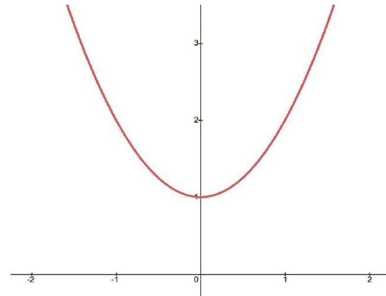

## 6 Flair 中的超参数优化

理解序列标注的概念并对其工作原理有一个基本的了解通常不是一个大问题。不那么直接的是理解控制模型训练的所有参数并选择能产生期望结果的值。一种称为 **超参数优化**（也称为 **超参数调优**）的特殊技术可以帮助我们实现这一点。

我们将首先提供超参数调优是什么、为什么有用以及有哪些不同的优化方法的总体概述。然后我们将深入探讨如何使用 **Hyperopt** 库在 Python 中进行调优。我们将以一个动手练习结束本章，在该练习中我们将在 Flair 中为 **词性（POS）** 标注器找到最优超参数。

在本章中，我们将作为以下部分的一部分介绍 Flair 中的超参数优化：

- 理解超参数调优
- Python 中的超参数调优
- Flair 中的超参数优化

## 技术要求

本章使用的所有 Python 库都是 Flair 0.11 版本的直接依赖项，前提是你的机器上已安装 Flair，无需特殊设置。本章涵盖的代码示例可在本书的官方 GitHub 仓库中的以下 Jupyter 笔记本中找到：https://github.com/PacktPublishing/Natural-Language-Processing-with-Flair/tree/main/Chapter06。

## 理解超参数调优

当第一次面对长长的模型训练参数列表及其可能取值时，你可能会认为为了成功训练模型，你需要一种特殊超能力来帮助你为正确场景选择正确的参数。这并不一定是真的。虽然经验可能帮助你缩小可能超参数的范围，但通常没有可靠的方法事先确定最佳超参数。

让我们想象最简单的场景——一个序列标注模型训练器接收单个参数——比如学习率。这通常是一个介于 0（不包括）和 1 之间的值。为了创建一个可能的超参数值集合，我们只需将范围离散化为 10 个可能的超参数值：`[0.1, 0.2, 0.3, 0.4, 0.5, 0.6, 0.7, 0.8, 0.9, 1.0]`。然后我们可以通过训练 10 个不同的模型来执行最简单的超参数优化类型——每个模型都使用不同的学习率值进行训练。我们评估每个模型的性能，并将表现最好的模型声明为具有最优学习率值的模型。

这种超参数调优类型称为 **网格搜索**，在 https://en.wikipedia.org/wiki/Hyperparameter_optimization#Grid_search 有更详细的描述。它是一种穷举搜索算法，意味着它尝试整个搜索空间。我们之前的示例说明了在非常简化的问题下超参数调优的过程。不幸的是，现实世界的超参数选择通常没有那么宽容，原因如下：

- 固定数量的（在我们的示例中为 10 个）不同的学习率值可能不足以找到最优学习率。
- 离散均匀分布（可能值离散且等间距的分布）并不总是最佳的。
- 我们很快就会遇到维度灾难。大多数现实世界的模型训练器控制的训练不仅仅是单个超参数。这就是事情变得复杂的地方。在我们只有一个超参数的简化示例中，我们有 10 个可能的选项的搜索空间。让我们想象一个有两个此类超参数的问题。可能的超参数组合数量将为 10²。给定三个此类超参数，可能的组合数量将为 10³。这清楚地表明了指数增长，可能很快就会失控。这个问题被称为维度灾难，因为每增加一个参数，我们就增加了一个需要探索的维度。

幸运的是，有更复杂的优化方法可以帮助我们缓解这些问题。

> **重要说明**
> 在进行超参数调优评估时，最好使用一个与最终模型将使用的数据完全不同的数据集。该数据集称为开发集（也称为验证集）。将用于超参数调优的数据与用于训练和评估的数据分开有助于我们避免过拟合，否则会导致选择会过拟合测试数据集的超参数。

总之，NLP 中的超参数调优只是一个过程，它接收搜索空间、优化方法和目标函数。然后它使用优化（搜索）方法使用多种不同的超参数选项组合训练模型，并返回导致最佳性能模型的超参数集合。

## 优化方法

超参数调优利用以下一些常用的优化方法：

- 网格搜索
- 随机搜索
- 贝叶斯优化
- 进化算法

让我们详细了解每种方法。


## 网格搜索

这是一种穷举搜索（意味着它会探索整个搜索空间），简单地遍历预定义参数选项的所有可能组合。它明显受维度灾难的影响。网格搜索的优点是它可以完全并行化。

## 随机搜索

一种非穷举搜索算法，简单地采样随机超参数值并评估每个组合。它重复此过程指定次数的步骤并返回导致最佳模型的一组超参数值。

## 贝叶斯优化

一种使用贝叶斯定理执行搜索以找到最佳超参数集的技术。它构建一个概率模型，将超参数值映射到 `objective`（损失）函数。

贝叶斯优化的一个特殊变体是 **Tree-structured Parzen Estimator** (**TPE**)。它常用于流行的 Python 超参数优化 `hyperopt` 库中。该库的源代码和文档可以在 `https://github.com/hyperopt/hyperopt` 找到。

## 进化算法

超参数优化方法的另一种思路是进化算法方法。该算法遵循以下步骤：

- 1. 生成一组随机选择的超参数值。
- 2. 为种群中的每个个体成员训练并评估模型。
- 3. 用新形成的个体替换得分最低的个体，这些个体是表现良好的个体的突变或交叉变体（意味着多个个体的组合）。
- 4. 跳到步骤 2 并重复，直到获得期望的分数、看不到改进或达到迭代限制。

我们现在对超参数调优的工作原理有了基本了解。但如果想象手动实现，所有这些新想法和概念听起来可能有点令人生畏。幸运的是，有很多方法可以利用 Python 中现成的库来实现这一点。

## Python 中的超参数调优

让我们感受一下超参数调优在实践中是什么样的。我们将使用最流行的 Python 超参数优化库之一 Hyperopt。首先，让我们对如何在实践中使用它有一个大致的了解。

Hyperopt 是一个 Python 库，提供易于使用的 API，需要以下三个对象：

- 搜索空间
- 目标函数
- 优化方法

让我们详细查看每个要求：

- **搜索空间** 只是优化器将在其中搜索不同超参数选项的空间。库提供以下参数表达式：
  - **分类参数** – 参数值纯粹是分类的，甚至可以是非标量（它们不需要是数字）。它们通过 `hyperopt.hp.choice` 方法提供。
  - **整数参数** – 通过诸如 `hyperopt.hp.quniform` 或 `hyperopt.hp.qlognormal` 等方法获得的整数值参数。
  - **浮点参数** – 通过诸如 `hyperopt.hp.normal`（从正态分布采样）和 `hyperopt.hp.uniform`（从均匀分布采样）等方法获得的十进制浮点数。
- **目标函数** 确定特定超参数值组合的性能如何。在深度学习中，这通常是损失函数。
- **优化方法** 是在搜索空间内执行搜索的算法。hyperopt 中的选项有：随机搜索（`hyperopt.rand.suggest`）、TPEs（`hyperopt.tpe.suggest`）和 Adaptive TPEs（`hyperopt.atpe.suggest`）。

前述三个概念实际上就是 Hyperopt 为您找到最佳超参数所需的一切。让我们将其作为 Python 中的动手练习付诸实践。

## Python 中超参数调优动手实践

为了说明超参数调优在其最简单形式中的工作原理，我们将提出一个非常简单的人工问题。我们将使用仅依赖于该单个超参数的简单目标函数来优化单个超参数，并且我们已经知道其最优（最小）值。让我们选择这个简单的二次函数：

$f(x) = x^2 + 1$



图 6.1 – $x^2 + 1$ 函数

很明显 $x^2 + 1$ 的最小值是 $x = 0$ 时的 1。这现在使我们能够在 Python 中定义目标函数：

```
def objective(value):
    return value ** 2
```

然后我们可以为单个超参数定义搜索空间。为了保持简单，我们将选择均匀分布并采样一个我们知道最小值所在的范围，例如 -100 到 100：

```
from hyperopt import hp
```

```
### 为单个超参数定义搜索空间
space = hp.uniform('param1', -100, 100)
```

前面的代码片段将在您之前安装了 Flair 的情况下成功执行。如果没有，请确保在运行之前在控制台中运行 pip3 install flair==0.11。

最后，我们现在可以选择优化方法：

```
from hyperopt import tpe

### Tree of Parzen Estimators (TPE) 算法
optimization_method = tpe.suggest
```

定义了所有三个必需对象后，我们可以启动优化过程并打印结果：

```
from hyperopt import fmin

### 在 1000 次评估中最小化目标函数
best_params = fmin(objective,
                space,
                algo=optimization_method,
                max_evals=1000)

### 打印最佳超参数值
print(best_params)
```

前面的代码片段打印出以下内容：

```
{'param1': 0.01084844145467706}
```

这表明，根据 Hyperopt，我们目标函数的最佳值是 0.01084844145467706。该值非常接近我们已知的实际最佳值 0。获得的值也比随机搜索的预期最佳值更接近实际最佳值（0）。这意味着 TPE 在优化我们的目标函数方面做得很好。

## Flair 中的超参数优化

我们现在对超参数调优的工作原理有了高层次的理解。当然，在现实世界中，超参数并不是用于寻找简单二次函数的最小值。让我们了解一下它们在 Flair 中用于训练序列标注模型的方式。

正如我们在 *第 5 章，训练序列标注模型* 中学到的，模型训练的成功往往取决于大量正确设置的超参数。这就产生了找到能产生最佳性能的超参数值集的需求。我们可以使用超参数优化来实现这一点。幸运的是，Flair 开箱即用地提供超参数调优。让我们学习如何操作。

Flair 中的超参数优化本质上是 Hyperopt 的一个包装器，我们在上一节中简要介绍了它。该包装器的额外优势是它已经将一些序列标注特定信息馈送到 Hyperopt，因此我们不必这样做。在简陋的 Hyperopt 编码练习中，我们必须提供所有三个对象：搜索空间、优化方法和目标函数。但在 Flair 中，我们只需要定义搜索空间，框架就会完成其余工作。

## Flair 中超参数调优动手实践

Flair 中的超参数优化最好通过代码来解释。因此让我们做一个简单的编码练习，我们训练一个英语 PoS 标注器并使用 Flair 的超参数优化功能找到最佳模型的隐藏层大小和学习率。

我们将通过以下步骤实现这一点：

- 1. 加载语料库
- 2. 定义搜索空间
- 3. 定义 `SequenceTaggerParamSelector` 对象
- 4. 启动优化过程

我们首先，就像在 *第 5 章，训练序列标注模型* 中的序列标注练习一样，需要将英语 Corpus 对象加载到内存中。它包含一个带标签的英语语料库，分为测试、训练和开发数据集：

```
from flair.data import Corpus
from flair.datasets import UD_ENGLISH

corpus = UD_ENGLISH()
```


```
tag_type = 'pos'
### 将语料库下采样到原始大小的 1%
corpus.downsample(0.01)
```

在前面的代码片段中，我们将英语语料库加载到 corpus 变量中，将标签类型定义为 PoS 标注，然后将语料库下采样到原始大小的 1%，以加快演示目的的训练过程。

然后我们可以使用 hp.choice 参数表达式定义搜索空间：

```
from flair.embeddings import WordEmbeddings
from flair.hyperparameter.param_selection import \
    SearchSpace, Parameter
from hyperopt import hp

search_space = SearchSpace()
search_space.add(Parameter.HIDDEN_SIZE,
                 hp.choice,
                 options=[128, 256])
search_space.add(Parameter.LEARNING_RATE,
                 hp.choice,
                 options=[0.05, 0.1, 0.15, 0.2])
search_space.add(Parameter.EMBEDDINGS,
                 hp.choice,
                 options=([WordEmbeddings('en')]))
```

前面的代码片段定义了我们的搜索空间，由三个超参数组成。我们决定为学习率和模型的隐藏层大小想出一些可能有用的值。尽管使用诸如 hyperopt.hp.quniform 和 hyperopt.hp.uniform 之类的参数表达式可能会产生更好的结果，但它们也会大大增加搜索空间的大小。我们的搜索空间现在非常小。只有八种可能的超参数组合（两个乘以四个，因为有两个隐藏层大小参数选项和四个学习率选项）。

> **重要说明**
> 在进行超参数优化时，Flair 中的某些超参数是强制性的。这包括 `Parameter.EMBEDDINGS` 和 `Parameter.LEARNING_RATE` 参数。如果您不想优化这些参数，只需为这些超参数的搜索空间传递一个选项即可。

我们现在准备定义我们的 SequenceTaggerParamSelector 对象：

```
from flair.hyperparameter.param_selection import \
    SequenceTaggerParamSelector

param_selector = SequenceTaggerParamSelector(corpus,
                                              tag_type,
                                              'paramopt')
```

这使用我们加载的语料库、我们定义的 PoS 标签类型以及 `paramopt` 文件夹名称（相对于运行代码的目录）定义了我们的超参数优化对象，超参数调优结果将写入该文件夹。

我们现在只需通过传入搜索空间和要执行的评估次数来启动优化过程。在我们的例子中，搜索空间是离散的，数字选项明确定义为 8。然而，在大多数情况下，使用非离散参数值时，可能的超参数组合数量是无限的，评估次数需要通过经验来选择：

```
param_selector.optimize(search_space, max_evals=8)
```

前面的代码将使用 8 种不同的超参数组合训练 8 个不同的序列标注器。它将使用 loss 作为 `objective` 函数并在开发数据集上进行评估。它将为每次运行训练 50 个 epoch。Flair 对 Hyperopt 的实现使用 TPE 优化器。在普通 CPU 上，执行时间大约在 10 到 30 分钟之间。

超参数优化完成后，结果将写入 `paramopt/param_selection.txt`。该文件包含每次评估运行的详细信息以及以下摘要：

```
best parameter combination
    embeddings: 0
hidden_size: 1
learning_rate: 3
```

前面的摘要表明，最佳隐藏层大小是第二个选项（因为摘要显示为 1，我们使用零索引，这意味着 1 指的是第二个选项）：256。最佳学习率是第四个选项 – 0.2。对于嵌入，当然，因为我们只有一个选项可供选择，因此第一个也是唯一一个选项被选为最佳。

这是否意味着我们应该始终将隐藏层大小用作 256，并将 0.2 作为英语的最佳学习率？简短的回答是否定的。最佳超参数值将取决于使用的数据、试图解决的问题以及用于解决该问题的技术。还记得前面我们加载语料库并将其从 100% 减少到原始大小的 1% 的代码片段吗？通过这样做，我们大大提高了模型训练的速度，这使我们能够更快地进行超参数优化，但与此同时，我们也将模型集中在非常小且可能有偏的数据子集上。要对英语数据集进行适当的超参数调优，我们需要在 100% 语料库大小下进行，并考虑更多超参数选项。这将大大增加我们的搜索空间和执行时间，但也会提高我们模型的性能。这些发现导致了以下结论。

## 摘要

超参数调优是一种非常有用的技术，可用于寻找最佳超参数，不仅在序列标注中，而且在机器学习的许多领域中。然而，它是有代价的；它非常昂贵。从本质上讲，它会执行训练和评估过程数十次、数百次甚至数千次。但在现实世界中，探索每个可能有用的超参数值可能需要数月时间来执行，并且搜索空间通常会缩小到一组有限的可能有用的选项。因此，超参数调优是一个需要一定专业知识和经验的过程，这将帮助您在探索（尝试不同尚未探索的选项）和利用（将参数值缩小到通常似乎有效的那些）之间实现正确的权衡。

作为本章的一部分，我们学习了为什么超参数调优有用、何时使用它以及如何使用它。我们学习了如何在 Python 中以最纯粹的形式使用超参数调优库，以及如何通过 Flair 调优序列标注模型。

在下一章中，我们将介绍超参数调优证明有用的又一个 NLP 问题 – 训练嵌入。
