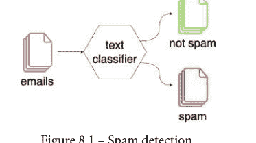

## 8 Flair 中的文本分类

在涵盖了超参数调优、嵌入和序列标注模型训练等复杂主题之后，我们现在准备转向自然语言处理（NLP）中一个稍微更直接、更容易理解的部分。在本章中，我们将介绍**文本**（也称为**文档**）**分类**。虽然 Flair 的传统优势在于**序列标注**，但该库提供的解决方案利用了 Flair 嵌入以及其他第三方解决方案，使其在文本分类中也能取得不错的结果。其优势之一在于训练的简易性，另一优势则在于零样本和少样本分类器——这些分类器几乎不需要或不需要训练数据。

我们将首先介绍文本分类是什么、它可用于什么、如何训练以及如何评估成功。随后我们将介绍 Flair 在文本分类方面能提供什么，并介绍不同类型的文本分类器。我们将通过动手练习训练我们自己的分类器。最后，我们将探索一种几乎不需要或不需要训练数据的文本分类新方法。

我们将作为以下内容的一部分学习文本分类以及如何在 Flair 中训练和使用文本分类器：

- 理解文本分类
- Flair 中的文本分类
- 在 Flair 中训练文本分类器
- 使用几乎不需要训练示例的文本分类器

让我们开始吧！

## 技术要求

本章使用的所有 Python 库都是 Flair 0.11 版本的直接依赖项，只要机器上已安装 Flair，就无需特殊设置。本章涵盖的代码示例可在本书官方 GitHub 仓库的以下 Jupyter 笔记本中找到：https://github.com/PacktPublishing/Natural-Language-Processing-with-Flair/tree/main/Chapter08。

你可以使用 CPU 运行本章的大部分代码并训练大部分模型。然而，最后一个练习确实需要配备 GPU 的机器。

## 理解文本分类

文本或文档分类仅仅是将一个或多个标签（通常称为类别）分配给一段文本（通常称为文档）的过程。文本分类器是一种机器学习模型，它接收文本作为输入并计算一组类别上的概率分布。

文本分类有许多实际应用，并被积极用于解决以下问题：

- **主题分类** – 将主题分配给文档的过程
- **垃圾邮件检测** – 检测不需要的电子邮件的过程
- **情感分析** – 将文本情感分类为积极和消极
- **仇恨言论检测** – 在文本中识别仇恨言论
- **语言识别** – 确定文档使用何种语言书写

以下是文本分类在现实世界中的一个例子：



图 8.1 – 垃圾邮件检测

关于文档的分类方式，我们知道三种不同的文本分类类型：

- **二元分类** – 在二元分类中只有一个可能的类别。每个文档要么属于该类别，要么不属于该类别。
- **多类分类** – 仅将众多可能类别中的一个分配给文档。
- **多标签多类分类** – 一个文档可以同时属于多个类别。

现在应该很清楚，文本分类虽然是一个概念上相当简单的概念，但仍是 NLP 的重要组成部分。但在我们直接深入 Flair 中如何对文本进行分类之前，让我们先快速了解一下文本分类器通常是如何训练的。

## 训练文本分类器

文档或文本分类是一种监督式机器学习形式。这意味着机器学习模型在充当地面真实的标记数据上进行训练。例如，对于垃圾邮件检测分类器，每个文档将被标记为 *spam* 或 *not-spam*。

文本分类中没有规则定义可以定义多少个类别以及如何定义类别来解决特定问题。可能的类别集合通常是人为构建的，以便以最优方式解决某个业务问题。因此，文本分类与其他形式的监督式机器学习不同，因为通常除了标记数据本身之外没有客观的地面真实。例如，对于词性标注，地面真实，即词语应该如何被标注的解决方案，是由语法定义的，并且对于句子中每个词应该被分类为什么词性有一个明确的答案。但在文本分类中，类别通常是抽象的高层次概念，没有明确的定义或边界。因此，类别分配通常是主观的。例如，在情感分析中，我们需要将句子分类为 *positive* 和 *negative*。然而，不同的人对某些句子是积极还是消极会有不同的看法。因此，对于分类问题，通常除了标记数据本身之外没有地面真实。这也是文本分类器容易受到标注偏差影响的原因之一。这意味着如果我们训练文本中的类别标签包含偏差，无论我们如何训练模型，我们的预测都会有偏差。

检测和缓解偏差是一个复杂的问题，超出了 NLP 的范围，更不用说本书的范围了。在这里，我们计划介绍模型的训练方法，以及更重要的是，训练后如何以及依据什么进行评估。

训练文本分类器的过程与训练序列标注器并没有太大区别。我们从一个具有随机初始化权重的深度学习模型开始，然后以适应训练数据的方式训练模型。当然，为了避免过拟合，我们不希望模型过度拟合训练数据。这就是为什么在测试数据集上评估模型很重要。为了评估模型并确定其是否按预期工作，我们使用以下其中一种指标。

## 单标签和多标签文本分类的指标

可以应用于包括文本分类在内的许多分类问题的最简单、最易于理解的指标是 **准确率**。准确率仅仅是被正确分类的数据的比例。它可以使用以下公式计算：

$$\frac{correctlyClassified}{(incorrectlyClassified + correctlyClassified)}$$

这里，`correctlyClassified` 是被分配正确标签的示例数量，而 `incorrectlyClassified` 是被分配错误标签的示例数量。虽然该指标的结果在 0 到 1 之间，但可以乘以 100 并以百分比（%）值表示。

对于具有平衡类别分布（训练数据中每个类别的示例数量相同）的文本分类问题以及单类分类问题，该指标通常已经足够好。但当我们开始处理多标签（为每个训练示例分配多个类别）分类或不平衡数据集时，我们可能会进一步考虑其他指标，例如 **F1score**。

F1 分数已在 *第 4 章，序列标注* 中得到充分解释，并且在那里适用于序列标注的相同 F1 分数概念也适用于此处的文本分类。该分数是另两个指标 **精确率** 和 **召回率** 的调和平均值。其范围从 0（最差分数）到 1（最佳分数）。

为了充分理解 F1 分数在分类方面的含义，我们需要单独评估每个类别标签。对于每个预测标签，我们检查它是否是所讨论的标签（意味着正例）还是不是（意味着负例）。然后我们计算以下指标。

在分类中，`precision` 是被标记为正例的示例中真正为正例的比例：

$$precision = \frac{tp}{tp + fp}$$

而 `recall` 是真正为正例的示例中被正确分类的比例：

$$recall = \frac{tp}{tp + fn}$$

其中：

- **真正例 (TP)**：被预测为正例且实际为正例的样本数量
- **假阳性 (FP)**：被预测为正例但实际为负例的样本数量
- **假阴性 (FN)**：被预测为负例但实际为正例的样本数量

F1 分数随后被定义为精确率和召回率的调和平均数：

$F1 = 2 \cdot \frac{precision \cdot recall}{precision + recall}$

计算 F1 分数的过程与序列标注中使用的方法相同，涉及以下步骤：

- 1. 统计真正例、假阳性和假阴性
- 2. 使用上述公式计算精确率和召回率
- 3. 将 F1 分数计算为精确率和召回率的调和平均数

如果我们分别对每个类别标签计算 F1 分数，然后对所有 F1 分数取平均，就得到 **宏 F1 分数**。该指标考虑了我们数据集中类别分布不平衡的情况。

如果我们对所有类别一起计算 F1 分数，将总的真正例、假阴性和假阳性合并计算，就得到 **微 F1 分数**。在单标签分类中，该指标的值与准确率相同。

让我们看看这一理论在实践中如何表现，使用最简单但功能强大的 NLP 库之一。

## Flair 中的文本分类

Flair 提供了使用预训练模型以及训练自定义文本分类器的简单接口。虽然 Flair 的秘诀——前向和后向 Flair 嵌入——并不是文本分类任务的最佳工具，但 Flair 可以利用其他第三方方法来实现文本分类的出色性能。

让我们先学习如何训练和使用 Flair 的预训练模型。

### 使用预训练的 Flair 文本分类模型

Flair 中可用的预训练文本分类模型集合相当小，很可能你想要的模型并不在其中。即使如此，以下语法仍然很有价值，因为加载和使用 Flair 预训练模型的 API 与加载和使用自定义训练模型的 API 相同。我们将在下一节中训练这些模型。

Flair 目前提供以下稳定的预训练模型：

- sentiment – 用于将英文文本分类为正面和负面的情感分析模型
- sentiment-fast – sentiment 文本分类模型的一个略小版本，推理速度更快
- de-offensive-language – 用于将德语文本标记为冒犯性或非冒犯性的文本分类模型——例如，模型会将包含粗俗用语的句子标记为冒犯性

了解 Flair 中当前可用的文本分类模型名称后，我们现在可以使用以下语法加载和使用模型：

```
from flair.models import TextClassifier
from flair.data import Sentence

classifier = TextClassifier.load("sentiment")
sentence = Sentence("Flair is pretty cool!")
classifier.predict(sentence)

print(sentence.labels)
```

前面的代码片段首先使用 TextClassifier.load() 函数通过传入 sentiment 模型名称来加载分类器。第一次加载此模型时，Flair 会从其 Web 服务器将其下载到我们的本地机器上。这些模型随后将被缓存到磁盘以供将来使用。

然后我们使用一个明确传达积极信息的句子初始化 Sentence 类。接下来，我们将使用 TextClassifier.predict() 方法生成预测并将其存储为 Sentence 对象的部分内容。

最后，我们只需打印出对象即可预测类别标签概率。它产生以下输出：

```
['Sentence: "Flair is pretty cool !"/'POSITIVE' (0.9991)]
```

前面的消息显示，我们的 Flair is pretty cool! 句子被分配了单个 POSITIVE 类别标签。该消息还表明我们的模型对其决策有 99.9% 的信心。

我们可以用一个极其负面的句子尝试完全相反的情况：

```
sentence = Sentence("I don't get enough sleep.")
classifier.predict(sentence)
print(sentence.labels)
```

这会打印出以下内容：

```
['Sentence: "I don't get enough sleep ."/'NEGATIVE' (0.9911)]
```

这表明我们的模型有 99.1% 的把握认为前一条消息具有负面含义。

就是这样！几行代码我们就可以进行文本分类。Flair 预训练文本分类模型的缺点是可供选择的模型实在少得可怜。幸运的是，Flair 提供了易于使用的接口来训练新的自定义模型，我们可以训练任意多个！让我们先学习如何利用 Flair 中执行文本分类所需的底层技术——文档嵌入——来学习如何做到这一点。

## Flair 中的文档嵌入

与词嵌入是 Flair 中生成序列标注模型的关键部分的方式相同，许多文本分类模型也利用了类似的概念——文档嵌入。

文档嵌入本质上是文档的向量表示。术语文档 simply 指的是一串词。这些文档的长度可以从单个词到整本书或语料库不等。

Flair 提供了一套不同类型的文档嵌入，如以下小节所述。

### DocumentPoolEmbeddings

这是最简单的文档嵌入类型。它是一段代码，为文档中的每个词计算词嵌入并返回平均值。例如，如果我们有一个包含两个词的文档，第一个词的嵌入为 [1, 2]，第二个词的嵌入为 [3, 0]，那么 DocumentPoolEmbeddings 嵌入将为 [2, 1]。除了计算平均嵌入（称为平均池化）之外，这种类型的文档嵌入还可以使用其他池化方式，例如最小池化（意味着对每个嵌入维度取最小值）和最大池化（意味着对每个嵌入维度取最大值）。要使用 DocumentPoolEmbeddings，你只需要训练好的词嵌入。文档嵌入本身不需要训练，这是一个巨大的优势！

```python
from flair.data import Sentence
from flair.embeddings import (DocumentPoolEmbeddings,
                               WordEmbeddings)

glove = WordEmbeddings('glove')
document_embeddings = DocumentPoolEmbeddings([glove])
sentence = Sentence('two words')
glove.embed(sentence)

print((sentence[0].embedding + sentence[1].embedding) / 2)
```

在前面的代码片段中，我们自己实现了使用平均池化的文档嵌入。我们只需加载一个词嵌入对象并为两个词（词 two 和词 words）计算词嵌入。然后我们将两个词嵌入相加并将结果嵌入除以二——从而对两个嵌入取平均或执行平均池化。我们可以使用 DocumentPoolEmbeddings 类完成完全相同的事情：

```python
document_embeddings = DocumentPoolEmbeddings([glove])
document_embeddings.embed(sentence)

print(sentence.embedding)
```

前面的代码片段使用 DocumentPoolEmbeddings 类为我们的文档计算嵌入。打印出嵌入的输出显示，结果与我们之前通过对两个词嵌入向量取平均计算出的嵌入相同。

但是使用 DocumentPoolEmbeddings 的便利性是有代价的——它们通常不能像以下嵌入方法那样提供良好的性能。

### DocumentRNNEmbeddings

DocumentRNNEmbeddings 是一种特殊的文档嵌入类型，由 Flair 实现，使用循环神经网络形成文档向量表示。

它通常比 DocumentPoolEmbeddings 产生更好的性能，并且以相同的方式接收词嵌入对象作为输入。然而，开箱即用的 DocumentRNNEmbeddings 是无用的——新初始化的嵌入对象本质上是一个具有随机权重的未训练神经网络模型。该模型需要训练后才有用。

但与其被训练另一种嵌入类型分散注意力，不如探索 Flair 中另一种文档嵌入，它既是预训练的，又能产生出色的性能。

### TransformerDocumentEmbeddings

解决任何问题的良好方法是不要重新发明轮子，而是利用已经有效的工作技术。近年来取得巨大进展的一种特殊 NLP 模型是 transformers。Flair 提供了一个包装类，能够直接从预训练的 Transformer 为整个文档计算嵌入。

TransformerDocumentEmbeddings 的使用方式与 Flair 中任何其他嵌入类相同——它可用于使用 .embed(sentence) 方法嵌入句子。让我们使用 roberta-base Transformer 模型尝试此嵌入：

```
from flair.embeddings import TransformerDocumentEmbeddings

embedding = TransformerDocumentEmbeddings('roberta-base')
sentence = Sentence('two words')

embedding.embed(sentence)

print(sentence.embedding)
```


The preceding code snippet will print out a 768-dimensional vector representation of our sentence. The class uses **Hugging Face** transformers and thus allows us to use a wide variety of models, which are fetched directly from the publicly available Hugging Face Models Hub. We will cover a lot more about Hugging Face and learn how to publish our own models on the Models Hub in Chapter 10, *动手练习 – 使用 Flair 构建交易机器人*.

There is a number of transformer-based pre-trained embedding models that are used by the `TransformerDocumentEmbeddings` class. The most notable examples are the following:

- `bert-base-uncased`
- `roberta-base`
- `distilbert-base-uncased`
- `xlnet-base-cased`

We have now covered an essential underlying NLP concept that fuels Flair text classifiers. We're now ready to dive deeper and explore how Flair text classifiers are designed.

## Flair 中的文本分类器

Most text classifiers in Flair utilize the `TextClassifier` class. It is responsible for providing the tools for defining and using text classifiers in Flair. Unlike many other concepts in Flair, it is a surprisingly simple design. `TextClassifier` is a model that utilizes a single linear neural network layer, taking the document embeddings as input and returning the class labels as output.

Let's learn how to train text classifiers in Flair as part of a hands-on exercise. Let's build our own sentiment analysis text classifier!

## Training a text classifier in Flair

In this section, we will be training a sentiment analysis text classification model capable of labeling text as *正面* or *负面*. Text classifier training follows a sequence of steps very similar to how sequence labeling models are trained.

The steps required to train text classifiers in Flair include the following:

- 1. Loading a tagged corpus and computing the label dictionary map
- 2. Loading and preparing the document embeddings
- 3. Initializing the `TextClassifier` class
- 4. Training the model

The process, given what we covered as part of sequence labeling model training, should look very familiar – and indeed it is. Let's start by loading the data required to train the classifier.

### 加载标注语料库

Training text classification models requires a set of text documents (typically, sentences or paragraphs) where each document is associated with one or more classification labels. To train our sentiment analysis text classification model, we will be using the famous **互联网电影数据库 (IMDb)** dataset, which contains 50,000 movie reviews from IMDB, where each review is labeled as either positive or negative. References to this dataset are already baked into Flair, so loading the dataset couldn't be easier:

```
from flair.data import Corpus
from flair.datasets import IMDB
import _locale

### 针对罕见的 Windows 仅有的 Flair 编码错误的解决方法
_locale._getdefaultlocale = lambda *_: ['en_US', 'utf8']

corpus = IMDB()
corpus.downsample(0.05)
lbl_type = 'sentiment'
label_dict = corpus.make_label_dictionary(label_type=lbl_type)
```

The preceding code snippet loads the IMDB dataset into memory. It also creates the `label_dict` object, which is a dictionary containing all possible class labels. This will be required later when we build the classifier.

> **重要说明**
> 
> In this code example, we utilized the `downsample()` method. The method downsamples the dataset. It reduces the number of items in our dataset, and by doing that, we also reduce the amount of data our model will be able to learn from. As a result, the model is likely to perform worse. This method should, unless there really is too much data, only be used for learning and demonstration purposes. We used a downsample rate of 0.05, meaning we only keep 5% of the original data.

Let's now move on to loading the document embeddings into memory.

### 加载和准备文档嵌入

In the previous section, we covered all the different types of document embeddings that we can use in Flair. To keep this exercise simple, we will use DocumentPoolEmbeddings. They require no training prior to training the classification model itself:

```
from flair.embeddings import (DocumentPoolEmbeddings,
                              WordEmbeddings)

glove = WordEmbeddings('glove')
document_embeddings = DocumentPoolEmbeddings([glove])
```

In the preceding code snippet, we used GloVe embeddings. We passed them to the DocumentPoolEmbeddings class, which, if you remember the previous section well, simply computes an average of all the word embeddings in the document.

With document embeddings out of the way, we can now define our text classification model.

### 初始化 TextClassifier 类

This is the point where all the variables defined in the previous sections come together as part of a newly initialized object – TextClassifier:

```
from flair.models import TextClassifier

classifier = TextClassifier(document_embeddings,
                            label_dictionary=label_dict,
                            label_type=lbl_type)
```

In the preceding code snippet, we define our text classifier object, which initializes as a fully functioning classifier with randomized weights. Classifiers such as TextClassifier need to know the total number of classes in advance, as it affects the neural network architecture – hence the need to provide label_dict. We also need to pass in the document embeddings class at the point of defining the model so that the model knows the embedding length, which defines the number of input nodes. Finally, we also pass in the lbl_type variable, which is used at a later point.

Our model is actually a fully functional text classification model now. The tiny problem is that its weights are randomly initialized, which means that the output it produces will be useless. To make our model useful, we need to train it.

### 训练模型

Training the text classifier model involves two simple steps:

- 1. Defining the model trainer class by passing in the classifier model and the corpus
- 2. Setting off the training process passing in the required training hyperparameters

The following classification model training syntax is very similar to how we trained sequence labeling models in the previous chapters:

```python
from flair.trainers import ModelTrainer

trainer = ModelTrainer(classifier, corpus)

trainer.train('classifier',
    learning_rate=0.1,
    mini_batch_size=32,
    max_epochs=40)
```

The preceding code snippet sets off the training process where we pass in a number of training-related hyperparameters, all of which were explained in detail in Chapter 5, Training Sequence Labeling Models. The training process will now run for 40 epochs or until the model stops improving and will store the final model in the classifier directory.

> **重要说明**
> 
> In the preceding exercise, we used the `DocumentPoolEmbeddings` document embeddings. However, if you ever plan to use `TransformerDocumentEmbeddings` (which is almost guaranteed to offer better performance), you should use the `ModelTrainer.fine_tune()` method instead of `ModelTrainer.train()`, which presets some of the training hyperparameters to aid fine-tuning transformers.

Training should take about 30 minutes on an average CPU. When done, we'll be ready to test the new classifier out.

Upon completion, the model trainer will print out a bunch of metrics. The simplest and most telling metric to look out for is the test_score metric. It shows the classification accuracy of the test dataset. In our case, test_score was 0.672, although be aware that yours will be slightly different due to the randomly initialized weights.

## Loading and using custom text classifiers

After training the text classification model, the resulting classifier will already be stored in memory as part of the classifier variable. It is possible, however, that your Python session exited after training. If so, you'll need to load the model into memory with the following:

```
from flair.models import TextClassifier
classifier = TextClassifier.load('classifier/best-model.pt')
```

We can now generate predictions on some made-up text input:

```
from flair.data import Sentence
sentence = Sentence("great")
classifier.predict(sentence)
print(sentence.labels)
```

The preceding code snippet tests our sentiment analysis classifier on the most trivial problem we could think of. We are classifying a single word, great, which, we can all agree, is unambiguously positive. The code snippet will print out the predicted class along with the prediction probability:

```
['Sentence: "great"/'POSITIVE' (0.9999)]
```

This indicates that the model is 99.9% positive that the label is... well, POSITIVE.

But be aware that the model was initialized on random weights and trained on a significantly downsampled dataset. The results will, therefore, likely be a little different every time you run this code.

We can give another simple example a go using the exact opposite. We can test whether our classifier behaves as expected when given an unambiguously negative message:

```
sentence = Sentence("bad")
classifier.predict(sentence)
print(sentence.labels)
```


你不需要是情感分析专家就能判断单词 bad 应该标记为 NEGATIVE，我们的模型也是如此。它输出如下：

```
[ 'Sentence: "bad" / 'NEGATIVE' (0.9998) ]
```

这表明模型有 99.9% 的把握认为单词 bad 是负面的，虽然这并不特别令人震惊。

我们应该在稍微复杂一点的示例上测试我们的模型：

```
sentence = Sentence("Not quite my cup of tea")
classifier.predict(sentence)
print(sentence.labels)
```

前面的代码示例提出了一个更复杂的情感分析问题，因为它试图为一份文档预测标签，而该文档不一定包含任何本身为正面或负面的词。

我们对前面句子的预测如下：

```
[ 'Sentence: "Not quite my cup of tea" / 'POSITIVE' (0.7513) ]
```

显然不正确。前一句明显带有负面含义。很可能当你自己运行代码并且权重初始化不同时，结果会有所不同，但预测置信度（在我们的例子中为 75%）会始终保持较低。

我们可以采取几个步骤来提高分类器的预测质量。最明显的选择可能是简单地减少对语料库的下采样并花更多时间进行训练。这是一个有效的选择，但不太可能在很大程度上帮助我们提高预测质量。在这种情况下，提高分类准确性的最大瓶颈是文档嵌入的选择。我们在练习中使用了 DocumentPoolEmbeddings。它使用起来快速简单，但只能做到这一点。当以获得良好结果为目标训练文本分类模型时，你应该改用 TransformerDocumentEmbeddings。

在前面的文本分类练习中，我们使用了一种称为 `downsampling` 的方法来减小语料库的大小，这显著加快了训练过程，但也显著影响了我们的预测质量。为了提高分类质量，我们可以简单地减少对语料库的下采样。最初，我们丢弃了 95% 的数据集。为了获得更好的预测质量，我们可以只丢弃 80%，也许只有 50%，或者也许根本不丢弃任何数据。但到这一点，我们就会撞上砖墙。我们无法通过在更多数据上训练来改进分类器，因为根本没有更多数据。在我们的例子中，作为练习的一部分，我们能够利用数百人时的工作成果，人们逐条手工标注了整个数据集。但在现实世界中，你试图解决的问题很可能不会有标记数据集等着你利用。更糟糕的是，标记数据成本高昂。昂贵到有时，手工标注数据甚至不值得付出努力，构建模型所需的资源会超过收益。

但如果有一种方法可以在不需要依赖许多或任何训练示例的情况下训练分类器怎么办？实际上有办法。它被称为 **任务感知句子表示 (TARS)**。让我们学习如何将其用于 Flair。

## 需要很少或不需要训练数据的文本分类器的工作

在前几章提到 Flair 及其优势时，我们主要关注解决序列标注任务的各种强大方法。然而在谈论文本分类时，Flair 通常被呈现为一个不错的文本分类工具，尽管与其实序列标注能力相比没有什么特别之处。这确实是事实——直到现在。Flair 最近引入了一种名为 TARS 的新颖文本分类方法。该概念在 *任务感知句子表示用于通用文本分类* 论文中有深入描述，可在 `https://aclanthology.org/2020.coling-main.285/` 获取，值得一读。

Flair 中的基于 Transformer 的文本分类器利用 Transformer 模型顶部的特殊线性层来生成类别概率分布。这种方法存在两个问题：第一，当向问题中引入新的类别标签，或尝试使用不同的类别标签（这在现实世界的机器学习中经常发生）时，我们基本上需要丢弃该线性层并从头开始训练。第二，这种方法中，模型仅基于训练示例与手工标注类别标签之间的联系来学习类别的含义。它不会从类别标签词背后的语义含义中提取任何知识。例如，在上一节的练习中，我们使用 IMDB 数据集并使用 `NEGATIVE` 和 `POSITIVE` 类别标签执行了情感分析。在经典的文本分类方法中，类别标签只是类别的唯一标识符，没有语义含义。如果我们调整标记语料库并将 NEGATIVE 重命名为 CLASS_1，将 POSITIVE 重命名为 CLASS_2，结果将完全相同。TARS 通过一种新颖的文本分类技术克服了这两个问题，该技术使用 Transformer 模型本身并利用 Transformer 中的类别标签词语义信息。

这使得 TARS 能够仅借助少量训练示例（少样本分类）进行文本分类，有时甚至完全不需要训练示例（零样本分类）。TARS 在小规模训练数据上优于之前的方法。最重要的是，它已在 Flair 中完全实现并可直接使用。

让我们尝试使用 TARS 进行少样本和零样本文本分类！

## 使用 TARS 进行零样本分类

使用 TARS 进行零样本分类利用预训练 Transformer 内部捕获的类别标签词的语义信息，而无需使用任何训练数据。

在 Flair 中使用 TARS 进行零样本文本分类再简单不过了。你需要遵循以下三个步骤：

- 1. 为正确的语言加载预训练的 TARS 模型。
- 2. 定义类别（希望 TARS Transformer 模型知道的）。
- 3. 使用 `predict_zero_shot()` 方法生成预测。

前面的步骤听起来可能很费力，或者至少需要一定程度的编码。实际上，每个步骤只是一行代码。

### 为正确的语言加载预训练的 TARS 模型

在对不需要任何训练数据抱有希望之前，我们首先需要确保有可供使用的模型适用于正确的语言。在 Flair 中，截至 0.11 版本，只有一个模型可用。它是一个英语模型，名为 **tars-base**。

让我们看看 tars-base 的零样本文本分类如何处理情感分析。

我们通过调用 `TARSClassifier.load()` 函数来加载 TARS 模型：

```
from flair.models import TARSClassifier

tars = TARSClassifier.load('tars-base')
```

这将下载 TARS 模型并将其存储在内存中，同时也将其存储到磁盘以供将来使用。我们现在可以定义类别标签。

### 定义类别

TARS 模型的类别标签只是一个字符串列表。因此我们可以将情感分析类别定义如下：

```
classes = ["positive", "negative"]
```

就这样——不需要训练或训练示例！让我们生成一些预测。

### 使用 TARS 生成零样本预测

让我们使用与测试基于 DocumentPoolEmbeddings 并利用 GloVe 嵌入的分类器相同的输入来测试我们的 TARS 模型。我们将看看 tars-base 是否也能正确分类这个单字句子 great：

```
from flair.data import Sentence

sentence = Sentence("great")
tars.predict_zero_shot(sentence, classes)

print(sentence)
```

我们使用 predict_zero_shot() 方法生成预测。前面的代码片段将打印出以下内容：

```
Sentence: "great" → positive (0.9691)
```

这表明预测的标签为 positive，置信度为 96.9%。

在零训练数据的情况下，这已经相当令人印象深刻了！让我们看看使用一个带有负面含义的单字句子是否也能取得同样的成功结果：

```
sentence = Sentence("bad")
tars.predict_zero_shot(sentence, classes)

print(sentence)
```


这会打印出以下内容：

```
Sentence: "bad" → negative (0.9037)
```

这清楚地表明单词 bad 与负面情感相关——或者更准确地说，与类别标签词 negative 的语义相关。

最后，我们可以在之前文本分类器并不太确定的 Not quite my cup of tea 句子上测试我们的零样本分类器：

```
sentence = Sentence("Not quite my cup of tea")
tars.predict_zero_shot(sentence, classes)
print(sentence)
```

这会打印出以下内容：

```
Sentence: "Not quite my cup of tea" → negative (0.9859)
```

耶！我们有一个明显的赢家。tars-base 明确地以 98.6% 的置信度预测句子 Not quite my cup of tea 为 negative——或者更准确地说，将该句子与单词 negative 的语义含义关联起来。当然，要确定我们的分类器确实比基本的 DocumentPoolEmbeddings 分类器表现更好，我们需要进行某种评估。但与其这样做，让我们探索如何使用少样本学习进一步改进我们的分类模型。

## 使用 TARS 进行少样本分类

TARS 模型允许我们仅使用少量标注示例来训练一个能够提供出色性能的文本分类器。

让我们通过解决上一节中处理的相同问题——对 IMDB 数据集进行情感分析，来探索 TARS 少样本学习。

训练 TARS 模型与我们训练 DocumentPoolEmbeddings 分类器时几乎没有区别。它涉及以下步骤：

- 1. 加载标注语料库并计算标签字典映射
- 2. 加载 TARS 模型并设置任务
- 3. 训练模型

### 加载标注语料库

让我们开始加载数据集。但请记住，我们需要的数据会比预期少得多得多。

我们将以与上一节相同的方式加载 IMDB 语料库。但这次，我们会对其进行更大幅度的降采样。毕竟，我们正在进行少样本学习。如果这些说法属实，我们应该能够仅使用几个训练示例就获得出色的性能。

让我们加载数据集并将其降采样到原始大小的 1%：

```
from flair.data import Corpus
from flair.datasets import IMDB
import _locale

### 针对罕见的 Windows 仅有的 Flair 编码错误的解决方法
_locale.getdefaultlocale = lambda *_: ['en_US', 'utf8']

corpus = IMDB()
corpus.downsample(0.01)
lbl_type = 'sentiment'
label_dict = corpus.make_label_dictionary(label_type=lbl_type)
```

通过前面的代码片段，我们加载了 IMDB 数据集，该数据集最初包含来自 IMDB 的 50,000 条电影评论。每条评论都标记为 POSITIVE 或 NEGATIVE 标签。然后我们将语料库降采样到原始大小的 1%——仅剩 500 条评论。然后我们计算标签字典，这在不久后会派上用场。

### 加载 TARS 模型并设置任务

我们现在将以与零样本学习示例相同的方式加载 TARS 模型。但这次，我们需要告诉模型它将被重新训练，目标是预测两个特定的标签。我们将通过使用 add_and_switch_to_new_task() 方法来实现这一点：

```
from flair.models import TARSClassifier
from flair.data import Sentence

tars = TARSClassifier().load('tars-base')
```

```
tars.add_and_switch_to_new_task(
    task_name="sentiment_analysis",
    label_dictionary=label_dict,
    label_type=lbl_type)
```

与之前相同，我们加载 tars-base 模型。但这次，我们传入了一些额外信息，告诉模型它将执行特定任务。它将把文本分类为 label_dict 变量中定义的部分类别。

我们现在准备训练实际模型。

### 训练少样本 TARS 模型

本身而言，训练少样本模型并不比在 Flair 中训练任何其他模型更复杂。唯一显著的区别是所需的计算能力。在本书之前的练习中，你可以用 CPU 进行模型训练，而唯一牺牲的是由于 epoch 较少或模型尺寸较小而导致的模型性能略有下降。但在这里，我们处理的是一个完整尺寸的 Transformer 模型，几乎没有办法减少所需的计算能力。

你需要一台配备 GPU 的机器或 Google Colab GPU 运行时才能成功运行以下代码。

此时本书中的以下训练语法应该看起来非常熟悉：

```
from flair.trainers import ModelTrainer

trainer = ModelTrainer(tars, corpus)
trainer.train(base_path='few-shot-tars',
            learning_rate=0.02,
            mini_batch_size=16,
            mini_batch_chunk_size=4,
            max_epochs=6)
```

在前面的代码片段中，我们指示模型训练器将我们的 TARS 模型训练六个 epoch（在训练生产模型时，此数字应设置得更高）。我们还将批量大小和批量块大小设置为非常低的值，以增加机器能够处理它的可能性。

这现在将开始训练，在平均 GPU 实例上大约需要 30 分钟。完成后，模型将存储在 few-shot-tars/best-model.pt 中，相对于你运行代码的位置。在 Google Colab 中，你可以通过将代码指向其位置 few-shot-tars/best-model.pt 作为同一运行时的部分来无问题地访问模型。但是，如果你重新启动 Colab 笔记本运行时，模型将会消失。

### 使用自定义少样本 TARS 模型

训练完成后，训练好的模型将存储在内存中。但如果由于某种原因你的 Python 会话崩溃，你可以通过运行以下命令从磁盘加载模型：

```
tars = TARSClassifier().load('few-shot-tars/best-model.pt')
```

很好。我们现在可以生成一些预测。让我们使用该模型并为其提供与之前训练的模型完全相同的输入，观察是否有任何改进。

让我们从最基本的例子开始。让我们用单词 great 进行预测：

```
from flair.data import Sentence

sentence = Sentence("great")
tars.predict_zero_shot(sentence, classes)

print(sentence)
```

这会打印出以下内容：

```
Sentence: "great" → positive (0.9991)
```

99.9% 的确定性！这明显优于零样本模型得到的 96.9%。

让我们再试一个简单的例子——单词 bad：

```
sentence = Sentence("bad")
tars.predict(sentence)

print(sentence)
```

这会打印出以下内容：

```
Sentence: "bad" → NEGATIVE (0.946)
```

不错！这又是零样本模型的又一次改进。现在，让我们尝试稍微复杂一点的句子：

```
sentence = Sentence("Not quite my cup of tea")
tars.predict(sentence)

print(sentence)
```

这会打印出以下内容：

```
Sentence: "Not quite my cup of tea" → NEGATIVE (0.9921)
```

这是迄今为止最好的结果！

> **重要说明**
> 在我们的练习中，我们经常通过比较仅基于几个示例的结果来评估模型性能。这只是为了说明我们的新模型在一般情况下的表现。要得出哪个模型表现最好的结论性答案，你应该始终使用适当的评估技术并在相同数据上评估模型。

我们的 TARS 少样本模型在仅使用原始数据集的 1% 并且仅训练六个 epoch 的情况下，实现了与之前模型相当或更好的性能。真是令人惊叹！

凭借这一卓越的、最先进的 NLP 技术，我们结束了文本分类主题的讨论。

## 总结

本章提供了 Flair 中文本分类方法的概述。我们首先介绍了为动手文本分类任务奠定基础的一些基础知识和理论。我们从探索经典文本分类技术开始，并在 IMDB 数据集上训练了我们自己的模型。后来，我们了解了 TARS 分类器，并见证了它们惊人的少样本和零样本分类能力。

这不仅结束了本书的文本分类部分；它还结束了探索 Flair 能做什么的整个部分。我们现在拥有了序列标注、词嵌入、Flair 的预训练模型集合、训练我们自己的序列标注模型、超参数调优等方面的知识和经验，以及更多、更多的内容。


没有什么能阻止我们把一些代码组合起来并在现实世界中部署一个 NLP 模型……好吧，除了我们不太确定如何将这些模型作为生产级服务的一部分进行部署、托管或维护之外。我们将在下一章学习关于这方面的内容。
