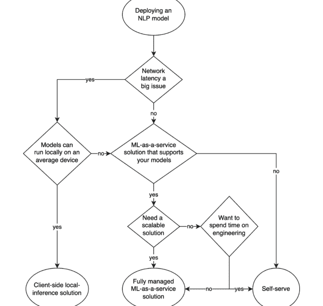
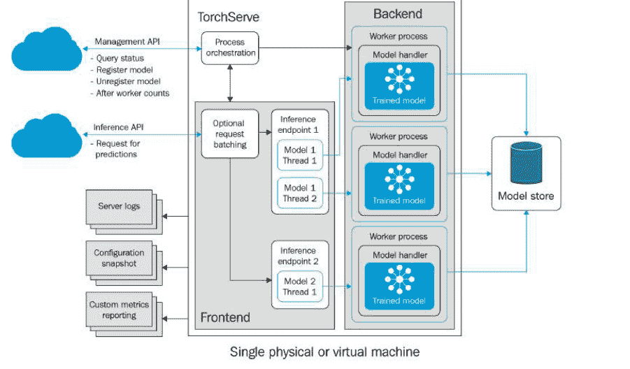
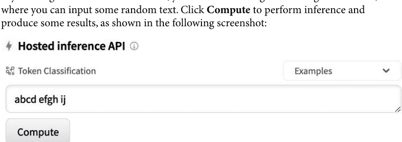

## 9 在生产环境中部署和使用模型

当 **自然语言处理** (**NLP**) 研究人员和科学家致力于改进某个 NLP 模型时，他们通常会花费大量时间来改进模型某个非常具体的部分或方面。工作完成后，结果会被收集并作为学术论文的一部分发表。然而，如果你计划将 NLP 用于实际目的，无论是作为商业解决方案还是作为个人项目的一部分，经过良好训练的模型通常只是你旅程的开始。

在本章的第一部分，我们计划介绍在使用 NLP 模型进行生产时通常遇到的典型问题，如何克服这些问题，以及如何使我们的模型公开可用。然后我们将通过构建自托管 NLP 解决方案从底层解决这个问题。我们将讨论可用于自托管的工具和库，以及你应该或不应该选择自托管的原因。最后，我们将介绍各种托管的 NLP 机器学习即服务解决方案，以及如何以及何时使用它们。我们将以一个动手练习作为总结，在该练习中我们使用 **Hugging Face 加速推理 API** 将 Flair 模型部署到生产环境。

在本章中，我们将讨论如何解决这些问题并轻松地将自己的 Flair 模型部署到生产环境，具体内容如下：

- 生产环境中 NLP 模型的技術考量
- 自托管 Flair 模型
- 使用托管服务部署和使用 Flair 模型

### 技术要求

运行本章代码，您需要使用 Flair 版本 0.11 的常规本地 Python 环境。您还需要一个额外的 Python 库，名为 Flask 版本 2.0.3。本章涵盖的代码示例可在本书官方 GitHub 仓库的以下 Jupyter 笔记本中找到：https://github.com/PacktPublishing/Natural-Language-Processing-with-Flair/tree/main/Chapter09。

### 生产环境中 NLP 模型的技術考量

部署机器学习（尤其是 NLP）模型与部署其他软件解决方案的不同之处在于一个关键领域——运行服务所需的资源。从理论上讲，为简单的移动或 Web 应用托管通用服务，可以由任何现代设备（如 PC 或手机）完成。只有当你开始扩展服务以满足更多受众时，才需要投入额外的思考、努力和资源来使其更具可扩展性。在提供机器学习模型服务时，事情往往从一开始就变得复杂。我们处理的模型非常庞大，以至于典型的 Web 服务器有时甚至无法将模型加载到内存中。每个请求都会消耗大量资源，但我们需要在按需、实时并面向大量受众的情况下提供请求。但该怎么做呢？

将本章主题与本书迄今为止所涵盖的内容进行比较时，您会注意到将模型部署到生产环境是一个全新的问题，需要略微不同的技能集。我们在前几章中所做的工作专注于数据的理解和处理，以及利用不同的机器学习和自然语言处理技术来实现特定目标。这些知识现在相关性较低。我们现在关心的是以能够尽可能快地、尽可能可靠地、尽可能少地使用资源的方式部署和维护 NLP 服务。简单，对吧？

实现这一目标所需的技能集通常与设计和训练 NLP 模型所需的技能集如此不同，以至于通常会交给完全不同的人——软件或 MLOps（机器学习、DevOps 和数据工程相结合的领域）工程师。Packt 出版了一本名为 Engineering MLOps 的优秀书籍，您可以在其中了解更多关于这个有趣的工程领域的信息。但虽然将 ML 模型部署到生产环境需要非常特定的技能集，但它本身并不是一个不可能的过程，任何遵循这些步骤的人都可以做到。

在做出有关部署 NLP 模型的任何决定之前，您需要先问自己以下问题：

- 推理（生成预测的过程）将在客户端还是服务端进行？
- 服务需要可扩展吗？
- 你是想通过这项工作来学习，还是仅仅实现一个目标？
- 你的模型能否部署在托管服务上？

所有这些决定在确定 NLP 模型部署的位置和方式方面都起着重要作用。让我们详细研究每个要点。

### 客户端与服务端推理

可能与部署 NLP 模型相关最重要的、同时也是最容易回答的问题是，它们是存储在客户端机器上并在本地执行推理，还是模型存储在服务器或托管云服务上并远程执行推理。

当机器学习推理在客户端机器（如手机、笔记本电脑、PC 或电子书阅读器）上本地执行时，我们称之为客户端推理。

当机器学习推理在服务器或托管云服务上远程执行时，我们称之为服务端推理。

这两种方法各有利弊，选择哪一种几乎总是取决于你试图用 NLP 模型解决的问题，因为此时你已经知道模型解决的是什么 NLP 问题；这意味着该决策通常非常直接。

因为机器学习模型通常很大且需要大量资源，ML 社区中普遍存在一种误解，即所有机器学习推理都需要在大型的 GPU 配备机器上在服务端完成。

毫无疑问，鉴于 Transformer 和其他 NLP 模型规模的近期增长，使用机器学习模型本地化的时代已经结束？我的手机或笔记本电脑永远无法处理生产级的机器学习模型，对吧？

尽管前一句听起来很合理，但它无可否认且完全是错误的。如果你正在使用电子设备阅读本书，那么你使用的机器很可能装满了机器学习模型。

现代电子设备使用本地存储的机器学习模型来解决多种不同的任务：

- *手机、笔记本电脑和 PC 上的面部识别*：现代电子设备使用针对低性能设备优化的计算机视觉模型来即时执行面部识别，无需网络连接。如果只有在互联网连接正常时才能解锁手机或笔记本电脑，那将是相当不幸的。
- *手机上的指纹识别*：指纹识别是另一种强调速度的解锁设备方法。用户期望指纹在毫秒内被识别。除了速度之外，存储指纹识别模型在本地的另一个主要原因是隐私。大多数用户如果意识到他们的指纹数据被传输到位于地球另一端的大型科技公司拥有的服务器上，即使公司的意图完全无害，也会感到震惊。低延迟和隐私对于指纹识别至关重要，这就是为什么制造商几乎总是选择客户端推理。
- *虚拟键盘的输入预测*：低延迟和隐私超过预测质量的另一个领域是虚拟键盘。软件键盘会下载并本地存储输入预测模型，这使用户即使在地下火车等离线环境中也能利用输入预测。
- *自动驾驶汽车*：自动驾驶汽车使用多种机器学习模型，使其能够对车辆导航做出决策。
- *手机上的 AI 相机应用*：现代手机相机应用利用专门的机器学习算法，根据环境选择正确的相机设置，然后使用基于机器学习的图像处理软件对图像进行后处理。模型需要快速、响应迅速且始终可用——这非常适合本地推理。


列表还在继续，这清楚地表明目前存在对专为本地推理设计的专用低资源机器学习模型的需求。完全有可能未来趋势会更偏向服务器端，但本地模型不太可能完全消失。这仅仅是因为支配理论最小信号延迟的物理定律。例如，即使在理论上最好的情况下，我们开发出将推理时间接近于零的服务器端机器学习服务，并构建以真空中光速传输信号的网络基础设施，从巴黎的设备向纽约的服务器发送推理请求并返回所需的时间仍将为 54 毫秒（光在真空中从巴黎到纽约再返回所需的时间）。因此，即使是服务器端推理在理论上最好的情况，对于自动驾驶汽车等某些应用来说仍然太慢。

服务器端推理和客户端推理显然各有一套优势和缺点，在仓促做出决定之前，权衡利弊非常重要。

### 使用本地推理的优势：
- *隐私：* 对了解网络协议和通信有多安全的普通工程师来说，自己的面部照片或指纹扫描通过互联网传输的想法并不令人反感或害怕。然而，对于非技术人员来说，这意味着灾难。当高度个人化或生物识别数据通过互联网传输的消息引起媒体关注时，对公司的影响将是巨大的。无论公司是否开发了最安全的算法，甚至可能比本地推理更安全，媒体和对此感到震惊的人都不会在意，损害已经造成。因此，在处理个人和生物识别数据时，必须仔细考虑这些数据将如何以及在何处传输和存储。完全避免这一问题的最好方法是根本不传输数据，而是改用本地推理。
- *无网络延迟：* 强大的服务器和超级计算机有可能比普通手机更快地进行推理，但如果我们选择远程推理路线，我们的请求和结果需要在互联网上传输，会产生网络延迟。通过完全不进行网络通信——即使用本地推理——我们可以完全消除网络延迟。
- *维护：* 为低资源设备优化模型很困难。但一旦做对，并构建出可在各种设备上运行的模型并成功部署，你的工作就完成了。使用本地推理时，没有需要维护的服务，也没有需要监控的网络峰值——只需坐下来放松即可。
- *成本节约：* 听起来很苛刻，但这是事实。当公司使用客户端推理而不是服务器端推理时，生成机器学习模型结果所需的所有计算都将在客户设备上完成。这些计算会使用电力。而电费是由……客户支付的。
- *按设计扩展：* 当我们使用服务器端推理从 1 个用户扩展到 10 个用户时，所需的计算能力将增加十倍。使用本地推理则不同。推理默认是分布式的。我们为每个用户都有一台专用的机器学习推理机器——他们自己的设备。无论是单个用户在其机器上进行推理，还是十亿用户，都无关紧要。这引出了一个有趣的结论——*本地推理按设计实现扩展。*

### 使用本地推理的缺点：
- *兼顾资源和性能限制：* 你计划部署的模型很可能需要在计算能力各不相同的多种设备上运行。你应该部署一个非常简单、功能受限的模型，让它能在所有设备上运行但性能不佳吗？你应该只在高端设备上部署模型，直接告诉低端设备用户无法使用该功能吗？还是应该为每种设备类型构建不同的模型——一些用于低端设备，一些用于高端设备？如果你选择本地推理路线，这些都是你需要回答的问题，而答案将取决于业务需求和要求。
- *因尺寸和资源限制导致预测质量受损：* 本地推理模型需要很小。它们需要能够装入手机等设备并存储在其非常有限的内存中。这意味着模型在参数数量方面将受到极大限制。为了优化本地推理模型，你可能需要大幅减小其尺寸。这无疑会对预测质量造成巨大打击。
- *模型更新的版本地狱：* 如果你将模型托管在远程服务上，要用更新、改进的版本更新模型，只需在远程服务上将旧模型替换为新模型即可。然而，使用本地推理，事情变得复杂。为了使模型更新成为可能，你首先需要实现一个管理更新的系统。然后你需要将新模型发布给拥有互联网连接并选择接收更新的所有设备，但你也需要考虑到仍有一部分用户由于没有互联网连接或拒绝接受更新而永远不会更新。因此，你的用户群将使用各种不同版本的模型，你需要全部支持它们。

相反，使用服务器端推理的优势列表也很长：
- *服务器端应用可以使用开箱即用的机器学习即服务解决方案：* 如果你选择服务器端推理，一个全新的现成解决方案世界将为你敞开，这些解决方案可能只需几次点击就能将你的模型从文件部署到生产服务。如果你计划在服务器端进行推理，可以使用大量托管服务，而对于本地推理，你至少在一定程度上需要重新造轮子。
- *你可以使用最先进的模型：* 当前最先进的 NLP 模型具有大量的参数，我们短期内无法期望它们中的任何一个能装入手机等设备。要在生产中使用最先进的 NLP 模型，你只能求助于服务器端推理。
- *更新简单且全面：* 与本地推理不同，要在服务器端更新模型，只需在一个点上将旧模型替换为新模型即可。一旦这样做，从那时起进行的所有推理都将使用新模型生成的结果。

在本节开头，我们提到在客户端推理或服务器端推理之间做出选择通常是一个简单的问题要回答。归根结底，无非是想要拥有巨大的高性能模型但伴随网络延迟，还是想要完全没有网络延迟但模型质量受损。

服务器端推理方法简化了 NLP 模型部署的许多方面，但也提出了许多新的问题。让我们在下一节中讨论这些问题。

## 何时使用托管服务，何时自行托管服务器端模型

另一个对你如何管理 NLP 服务产生巨大影响的重要决策，归结为你是否选择托管服务还是决定自行托管。

如果我们决定自行托管模型，这意味着我们将负责设置服务器基础设施，构建交付 NLP 结果的端点软件，构建对模型进行推理的软件，在用户群增长时扩展系统，以及更多、更多。我们本质上将手动负责整个机器学习生命周期。


相反地，托管或完全托管的服务是一种商业解决方案，可为其中大部分任务提供支持。完全托管的机器学习服务提供开箱即用的以下支持：

- *受管基础设施：* 在部署 NLP 服务时，最终模型很可能存放在数据中心某处的特定机器上。为了让我们的用户使用我们的服务，他们需要通过域名或 IP 地址访问这台机器的方式。要搭建自助式 NLP 服务，需要部署基础设施以确保正确的请求到达正确的服务器，从而将结果返回给用户。所有这些决策在托管服务中都已为我们处理好。
- *托管端点：* 从工程角度来看，机器学习模型是一个二进制文件，可以加载到内存中，并通过机器学习库执行推理。然而，由于我们采用的是服务端推理方法，这意味着如果用户需要从 NLP 模型获得预测，他们需要通过互联网发送请求。该请求需要到达服务，服务需要解释请求并以适当的结果作出响应。因此，客户端和服务之间需要达成一致的通信方式。一种流行的解决方案是使用名为 **REST** 的通信协议，它允许通过使用 **HTTP** 或 **HTTPS** 协议的 **REST API** 进行通信。但机器学习端点不仅仅负责客户端-服务器通信、解析请求、执行推理并将结果返回给用户。它们还有许多其他职责。它们需要返回适当的错误消息，如果出现问题（例如输入文本超过长度限制）。如果用户没有访问权限，它们需要返回适当的错误消息。它们需要能够同时处理大量请求并适当排队。它们需要执行诸如缓存之类的优化任务。

在构建生产级 NLP 服务时，你需要考虑这些问题并自行实施解决方案。托管服务会处理所有这些问题。

但值得一提的是，托管服务只能做到一定程度。虽然自托管很麻烦，但它允许你实现任何想要的功能并添加任何你能想到的特性。使用托管服务时，你仅限于使用服务提供的功能。

- *扩展：* 完全托管 ML 服务的最大卖点之一是可扩展性的承诺。它解决了自托管最大的问题之一，即陷入不可扩展的基础设施。例如，假设你在单台虚拟机上实现了一个简单的 ML 端点。该解决方案易于实现，并且对少数日常用户效果很好。但当你开始获得更多用户时，服务开始返回延迟结果，过多的流量迟早会导致服务拒绝。应用程序然后需要被修改以能够处理中等数量的日常用户。到该解决方案实施时，你将因服务不可用而失去大量客户。当能够处理中等流量量的解决方案实施后，你可能会意识到用户数量增长过快，整个解决方案需要再次重新实现以使其具备高流量处理能力。

完全托管的 ML 服务声称可以解决所有这些问题。它们宣传其服务默认可扩展。这意味着如果你的服务对 1 个日常用户效果很好，理论上对 100 万个日常用户也应同样有效。这使你能够将时间和资源花费在更有用的工作上。
- *部署模型和版本控制：* 大多数完全托管的 ML 服务都附带一套用于部署 ML 模型的工具和功能。在某些情况下，使用它们就像上传 ML 模型二进制文件并点击 **deploy** 一样简单。
- *监控：* 如果你决定自托管，你不可避免地还需要构建或设置监控工具。这些工具提供有关有多少用户使用该服务的洞察，并帮助你决定是否应该扩展。几乎所有托管服务都开箱即用提供此功能。
- *Freemium 定价计划和低设置成本：* 大多数完全托管的 ML 服务具有接近零的设置成本，并且采用按需付费的定价计划。此外，一些服务提供 Freemium 服务，其中前 *N* 个每日/每月请求是免费的。与自托管相比，这些服务的定价通常具有竞争力且价格实惠。只有当公司发展到相当大的规模（例如成为大型企业）时，完全托管服务才会变得比雇佣专门负责自托管的团队更不经济。

## 重要说明

完全托管的 ML 服务还提供完整的 ML 生命周期工具，其中包括数据标注、数据预处理、模型训练、部署和验证。这些功能在设计上在它们能做什么方面有限，并且通常仅支持有限的 NLP 任务集，例如文本分类，但可能不适用于序列标注等任务或专门训练 Flair 模型。

由于很少有流行的托管 ML 服务提供对 Flair 可以构建的所有类型模型整个 ML 生命周期的支持，我们计划仅关注将你的 NLP 模型部署到生产所需的步骤。设置用于维护和模型更新的自动化管道所需的步骤将被省略，因为它们与一个更通用的领域相关，称为 MLOps。

前面的项目符号列表显示了许多明显有利于完全托管服务的要点。这就引出了一个问题，为什么不在每次都使用托管服务而不是自托管？

对前面问题的一般回答是：如果可以，你应该这样做。然而，在某些情况下，自托管可能是一个更合理的选择。如果你符合以下情况，可以决定自托管：

- 你想从低级工程角度了解如何设置 ML 服务。
- 你拥有足够大的用户群，以至于使用托管 ML 服务变得不经济。
- 你正在使用的 ML 库、框架或任务不受托管服务支持。

除非你属于前面项目符号列表中描述的任何类别，否则你很可能最好直接使用完全托管的服务。

有了这些，让我们来看看你可以用哪些服务来部署 Flair 模型。

## Managed services for Flair models

用于托管 ML 模型的托管服务通常是由大型科技云平台或提供 ML 即服务的专业 ML 公司的商业解决方案提供的。

然而，可以与 Flair 一起使用的服务列表不断变化，用于交互和管理这些服务的用户界面也是如此。这意味着一个专注于如何与特定托管 ML 服务的 UI 或 API 交互的分步指南很可能在一年内就会过时。

不过你并不无计可施！有一个例外。有一种特定的服务与 Flair 紧密集成，并且很可能在未来几年内得到支持。它被称为 **Hugging Face Models Hub**。它是一个托管大量 ML 模型的存储库，同时还提供在网络浏览器中测试它们、查看如何训练它们的说明以及将其作为服务部署的工具。

稍后，我们将看看如何训练、托管和使用作为 Hugging Face Accelerated Inference API 服务一部分部署的 Flair 模型。

但在结束本节之前，让我们回顾一下本节中涵盖的所有建议、提示和技巧。

## 模型部署决策流程图

为了让 Flair 模型部署决策更容易，我们准备了一个流程图，帮助你决定将 Flair 模型部署到生产环境的正确路径。

根据你的业务需求、资源和抱负，你将有以下三种部署 Flair 模型的选项：

- 客户端部署与本地推理
- 完全托管的 ML 即服务解决方案
- 自托管


下面的流程图将使你更容易在前述三种方法之间做出选择：



图 9.1 – NLP 模型部署决策流程图

根据你的具体情况，你最终会使用三种机器学习部署类型之一。请记住，所提出的决策过程纯粹基于良好的实践和主观建议。每个人的情况都不同，你应始终使用自己的或其他专家的判断。

无论你选择哪种机器学习部署路线，了解每种可能选项至少达到一定程度都是很有用的。

让我们在以下动手练习中探索自助式服务和使用托管机器学习解决方案。

## 自助式 Flair 模型

无论你决定自助服务还是使用完全托管的服务，对 NLP 模型部署推理在生产环境中如何工作有基本的了解始终是有用的。

由于在生产环境中部署 NLP 模型更像是一项软件工程壮举而非 NLP 挑战，因此通用的软件工程规则适用——其中最主要的一条是，*不要重复造轮子。*

虽然自行实现 NLP 模型服务框架完全可行，但这样做需要大量的时间。很可能即使你竭尽全力实现一个解决方案，也无法构建出比由数百名不同贡献者打造的现有开源解决方案更好的产品。

用于自助式 NLP 模型的工具和包种类繁多，但有一个特定包因其对 **PyTorch** 包的支持（Flair 建立在 PyTorch 之上）以及对 Hugging Face 模型的支持而脱颖而出。该包名为 **TorchServe。**

## 使用 TorchServe 自助式服务 Flair 模型

PyTorch 是一个流行的开源机器学习框架。Flair 本身是一个 NLP 框架，建立在 PyTorch 之上，并利用其工具来设计、训练和存储神经模型。

由于 Flair 模型本质上是 PyTorch 模型，像 TorchServe 这样的工具似乎非常契合。让我们通过查看其设计图来了解 TorchServe 的工作原理：



单台物理或虚拟机

图 9.2 – TorchServe 设计

前述设计示意图展示了 TorchServe 框架的各个部分，如其官方文档 https://github.com/pytorch/serve 中所述。

让我们来看一下主要组件：

- **前端：**负责处理请求的组件。它接收用户的请求作为输入，对其进行解析，并将其传递给后端，后端返回模型输出，然后对输出进行处理、格式化并发送回用户。
- **推理端点：**前端的特定部分，可通过特定地址访问，负责处理请求并返回结果。
- **推理 API：**允许并定义客户端与前端之间通信的 API。
- **模型存储：**包含模型的目录。
- **后端：**一个线程组件，包含负责执行推理的模型处理器。
- **管理 API：**一个专用 API，面向应用程序所有者，允许我们配置服务。

使用 TorchServe 服务一次的事件流程如下。客户端首先使用推理 API 向前端发送请求。请求包含一个负载，其中包含将提供给 NLP 模型的输入。如果框架太忙而无法处理请求，则请求会被批处理（排队）。如果不忙，则请求会被传递到端点，在那里进行解析，并将负载传递给模型处理器。模型处理器对加载的 NLP 模型执行推理并将输出返回给端点。端点准备并格式化输出（通常使用 JSON 格式）并将其返回给用户。

前述对 TorchServe 设计的介绍提供了其工作原理以及如何用于服务 NLP 模型的高层次概述。TorchServe 的设置和安装过程可能非常依赖平台，并非几行代码就能轻松涵盖的内容。设置 TorchServe 的整个过程在 GitHub 上的官方文档中得到了精彩的描述。

但不要因为本书不会深入介绍 TorchServe 而感到沮丧。在接下来的部分中，我们将实现我们自己的用于服务 Flair 模型的概念验证工具。

## Flair 的概念验证自助服务工具

实现一个可靠、可扩展、安全且生产级的 NLP 自助服务工具是一个复杂的过程，需要数周甚至数月的精心思考和准备。在大多数情况下，与其自己实现解决方案，使用现有的开源工具如 TorchServe 会更好。

但有时，我们只是想构建一个概念验证。这是一个简单的工具，展示我们的模型能做什么，并使服务至少可供少数用户/客户使用。

为了了解这一点，让我们构建一个简单的服务，使用 Flair 的最先进的英语命名实体识别（NER）标注器执行命名实体识别。

该解决方案可按照以下步骤实现：

- 1. 安装所需的库
- 2. 定义序列标注函数
- 3. 定义端点
- 4. 启动服务

让我们逐步实现该解决方案。

## 安装所需库

除了 Flair 之外，这个概念验证工具还需要一个额外的库，该库不是 Python 标准库的一部分预装的；它也不是 Flair 的传递依赖（必需库的要求）。该库称为 Flask。它是一个轻量级的 Python 框架，用于设置端点，是一个完美的原型工具。

我们将通过运行以下命令安装版本 2.0.3：

```
pip install flask==2.0.3
```

这将安装 Flask 2.0.3 版本，确保你的代码行为一致。

## 定义序列标注函数

接下来，我们需要定义一个函数，对某些输入文本执行命名实体识别。我们将使用 Flair 默认的最先进的 NER 标注模型，该模型使用 ner 模型键：

```
from flair.data import Sentence
from flair.models import SequenceTagger

tagger = SequenceTagger.load('ner')

def tag_text(input_text):
    sentence = Sentence(input_text)
    tagger.predict(sentence)

    return sentence.to_tagged_string()
```

在前面的代码片段中，我们使用本书中多次使用的标准序列标注语法定义了 tag_text(input_text) 函数。该函数接收文本作为输入并返回标注后的文本作为输出。例如，对于输入文本 in New York，它将返回输入字符串的标注版本 – "in New York" → ["New York"/LOC]。

前面的代码围绕我们如何定义 tagger 对象展开。它在标注函数外部全局定义，确保模型只加载一次，可用于任意数量的请求。请注意，这种方法会导致生产级解决方案出现问题，其中多个进程尝试使用同一个 Flair 模型对象。

我们现在准备定义我们的端点。

## 定义端点

该端点负责在特定地址可用以接收请求，解析请求，将其传递给 tag_text() 函数，准备结果并将其传回用户：

```python
from flask import Flask, jsonify, request

app = Flask(__name__)
app.config['JSON_AS_ASCII'] = False

@app.route('/ner-service')
def query_example():
    text = request.args.get('input', '')

    tagged_text = tag_text(text).replace('"', '\'')

    return jsonify({"result": tagged_text})
```

前面的代码片段首先定义了 Web 服务的 app 对象。下面的函数是 Web 端点的定义。我们通过在函数定义前加上 @app.route('/ner-service') 装饰器来定义端点。这确保端点可在 /ner-service 地址访问。


我们然后直接从 URL 中获取输入文本，作为 `input` 查询字符串参数的一部分。这意味着如果用户向 `/ner-service?input=in+New+York` 发送 GET 请求，`text` 变量的值将是 *in New York*。

> **重要提示**
> 使用 GET 查询字符串参数作为接收客户端文本输入的方式几乎总是一个坏主意。我们在此代码示例中使用 GET 是因为仅使用 Web 浏览器进行调试很容易。对于生产级服务，您应该改用 POST。

该端点将输入文本传递给我们的 `tag_text()` 函数并以 **JSON** 格式返回结果，这使得结果既可被软件轻松解析，也可被人类阅读。

就这样！现在，我们只需要启动服务。

## 启动服务

然后可以通过运行以下命令启动服务：

```
app.run(debug=False, port=9002)
```

该代码将使用端口 `9002` 启动一个 Web 服务，并将在 `/ner-service` 地址注册一个先前定义的端点。请注意，前述命令将一直运行，直到我们的 Web 服务崩溃为止。如果您需要停止服务，只需终止代码片段的执行即可。

现在我们可以通过将浏览器指向我们自己的机器的本地 IP 地址 `127.0.0.1` 来测试我们出色的 NER 标注 Web 服务。

让我们首先在不提供任何输入文本的情况下访问我们的端点，将 Web 浏览器指向 `http://127.0.0.1:9002/ner-service`。

我们的服务返回以下内容：

```
{"result":""}
```

这表明返回的标注文本为空字符串。鉴于未提供输入，这是有意义的。现在，让我们使用一些实际输入进行测试，访问 `http://127.0.0.1:9002/ner-service?input=Never+been+to+Lima`。

我们期望前述请求的响应是一个字符串，其中单词 Lima 被标记为地点。让我们看看：

```
{"result":"Sentence: 'Never been to Lima' → ['Lima'/LOC]"}
```

耶！看起来我们的 NER 标注服务按预期工作。您现在可以在 Web 服务器上启动此服务，或将您自己的开发机器的 IP 地址公开——从而使服务面向全世界可用。

但在这样做之前，请记住，我们的概念验证解决方案有一长串缺点和问题，如果服务用于商业用途，这些问题将会出现。缺点包括：没有输入清理、没有请求授权、没有缓存、没有多线程可用性或线程安全、输出难以解析、没有日志或监控……等等。这清楚地表明此类代码只能用于原型设计。对于生产级代码，使用开箱即用的解决方案（如 TorchServe）几乎总是有意义的。

更好的办法是，您可以完全避免编写代码——通过使用托管服务。让我们在下一节学习如何做到这一点。

## 使用托管服务部署和使用 Flair 模型

与自托管不同，自托管需要手动处理机器学习生命周期的大多数方面，而托管和完全托管的机器学习服务则推销完整的开箱即用机器学习即服务解决方案的理念。

这些服务大多数提供关于服务可用性（服务保证正常工作的百分比）和可扩展性（无需每次用户群增长时都重构整个基础设施即可扩展的能力）的保证。一些服务还提供称为机器学习模型运营化（MLOps）管理的整个机器学习生命周期的管理。但一些托管服务可能难以提供对 Flair 能够解决的所有功能和任务的支持。这适用于几乎所有流行的机器学习即服务解决方案，只有一个例外——Hugging Face Models Hub。

## Hugging Face 模型库

Hugging Face 是一家以自然语言处理为导向的公司，拥有庞大的开源社区。该公司在发布其 transformers 库后变得广受欢迎（更多信息可参见 https://huggingface.co/）。他们还提供 Hugging Face Models Hub，这是一个 NLP 模型和数据集的集合，其中大多数是公开的，意味着它们可以免费下载供任何人使用。此外，托管在 Hugging Face Models Hub 上的模型可以使用 Accelerated Inference API。这是一项具有 Freemium 定价计划的托管 NLP 服务。该服务起初是免费的，只有当更多用户开始使用时才会开始收费。模型还可以在浏览器中使用浏览器小部件进行测试，这允许您在浏览器内输入文本并观察模型行为。

最好的是，Hugging Face Models Hub 完全支持 flair 模型。一旦您将模型上传到 Hugging Face Models Hub，模型将为：

- 可通过 Accelerated Inference API 作为 NLP 服务使用
- 可作为 Flair 中的预训练模型使用

让我们作为一次动手练习的一部分学习如何同时做到这两点，该练习包括以下内容：

- 1. 训练一个模拟 Flair 模型
- 2. 将模拟模型上传到 Hugging Face Models Hub
- 3. 将模型作为 Accelerated Inference API 的一部分使用
- 4. 在 Flair 中使用公共模型

立即开始吧。

## 训练模拟 Flair 模型

专注于部署和托管模型的练习首先需要一个实际模型。因为本次练习的目标是学习部署 Flair 模型，模型的实际质量并不重要。事实上，如果我们有一个极小的模型会更好，因为这会显著减少模型上传时间并让我们更快地完成本次练习。

因此，让我们训练 Flair 中可以产生的最小序列标注模型。该模型在标注文本方面会很糟糕，但对于本次练习来说这并不重要。

首先，让我们加载一个语料库并显著对其进行下采样以减少训练时间：

```python
from flair.datasets import UD_ENGLISH

corpus = UD_ENGLISH().downsample(0.001)

lbl_type = 'upos'
label_dict = corpus.make_label_dictionary(label_type=lbl_type)
```

然后，让我们选择我们的嵌入。我们将选择 CharacterEmbeddings。它在正确标注文本方面会很糟糕，但它会产生一个微小的模型，而这正是本次练习中我们真正关心的：

```python
from flair.embeddings import CharacterEmbeddings

### 使用轻量级嵌入以获得一个微小但无用的模型
embedding = CharacterEmbeddings()
```

然后，我们将以最快的方式定义并训练我们的序列标注模型——仅一个 epoch——以得到一个具有一维隐藏大小的微小序列标注器：

```python
import shutil
from flair.models import SequenceTagger
from flair.trainers import ModelTrainer

### 使用一维隐藏大小以生成微小模型
tagger = SequenceTagger(embeddings=embedding,
                        tag_dictionary=label_dict,
                        tag_type=lbl_type,
                        hidden_size=1)

trainer = ModelTrainer(tagger, corpus)

### 仅训练一个 epoch，因为此处质量无关紧要
trainer.train('tiny_model', max_epochs=1)
shutil.copy2('tiny_model/final-model.pt',
             'tiny_model/pytorch_model.bin')
```

前述代码将输出一个大约 100 KB 大小且标注文本很糟糕的微小序列标注模型——正好适合我们的练习。模型将以 `final-model.pt` 的名称保存在相对于运行此代码位置的 `tiny_model` 目录中。因为模型稍后将被上传到 Hugging Face Models Hub，在那里它需要命名为 `pytorch_model.bin`，因此前述代码片段还创建了 `final-model.pt` 文件的副本，命名为 `pytorch_model.bin`。

现在我们有了模型。是时候将其上传到 Hugging Face Models Hub 了。

## 将模型上传到 Hugging Face Models Hub

将模型上传到 Hugging Face Models Hub 的详细说明可在官方文档 https://huggingface.co/docs/hub/adding-a-model 中找到。

有三种方法可以将模型上传到 Hugging Face Models Hub：

- 使用 `huggingface-cli` 命令行界面工具
- 使用 `huggingface_hub` Python 库
- 使用 Hugging Face Web 界面

为了保持一致性并由于其易用性，我们将介绍使用 Web 界面的过程。

## 注册 Hugging Face

要为 Hugging Face Models Hub 做出贡献，您首先需要一个账户。只需作为常规注册流程的一部分进行注册即可。

在填写一个特定的表单项时请格外小心——您的用户名。用户名极其重要，因为它将定义模型通过 Accelerated Inference API 可用的地址，以及在 Flair 中使用此模型的公共版本时的模型键。

我们将选择一个随机用户名 `flairbook`，但请记住您的用户名需要是唯一的。

完成注册流程后，请务必使用发送到您电子邮件地址的链接验证电子邮件地址。

## 创建新的模型仓库

注册并验证电子邮件地址后，访问 Hugging Face 主页并点击 **New > Model**。


A Hugging Face model repository is a store of all binary files, documentation, metadata, license files, and any other files relating to a certain model. It uses **Git** and **Git Large File Storage (LFS)** to store the files. You can use it just like using any other Git software repository.

We'll create a new model repository and give it a random name, `flairmodel`. The user interface shows the model will be available via the `<username>/<reponame>` format, which in our case is `flairbook/flairmodel`.

Make sure to mark the model as public.

## 上传相关模型文件

After creating the repository, we will be redirected to the model home page. From the home page, we have the option to clone the repository to our local filesystem or to edit and upload the repository files through the web user interface. As part of this exercise, we'll be using the browser interface to upload files. But keep in mind that for a large model, using Git is highly recommended. We'll need to upload two files:

- 名称为 `pytorch_model.bin` 的模型二进制文件
- 名称为 `README.md` 的模型卡片

The model binary is our trained model and is stored at `tiny_model/pytorch_model.bin`. We will need to upload this file to the `root` of our Hugging Face repository. Using the web interface, this can be done by clicking the **Files and versions** tab and then clicking **Add file > upload file** to navigate to a form, where you can drag and drop the model binary. After dragging and dropping the file, click **Commit changes**, which will do the same as adding and pushing this file through Git.

The model card can now also be added by clicking on the **Model card** tab and clicking **Create model card**. This file is a model description file that contains metadata (information that tells Hugging Face about what type of model this is) and description (information that tells humans about what type of model this is).

Let's create a model card with the following content:

```
---
tags:
- flair
- token-classification
widget:
- text: "does this work"
---
## 测试模型 README
Some test README description
```

The top part of the preceding snippet, wrapped in the --- symbols, contains metadata that tells Hugging Face that this is a sequence tagging model trained by Flair. It also defines some default placeholder text for the browser widget. The bottom part of the snippet simply defines the part of the snippet visible to humans and acts as a description.

Make sure to click **Commit new file**, which will save the model card as README.md and make the description visible on the **Model card** tab.

We're now ready to test our model.

## 将模型作为 Accelerated Inference API 的一部分使用

At this point, your Hugging Face model repository should contain these two files:

- `pytorch_model.bin`
- `README.md`

The latter will tell Hugging Face that we're dealing with a sequence tagging model trained by Flair, and the former is the actual model binary that the hub will use.

If we did everything right, the model will, by default, be available on the Accelerated Inference API. Best of all, it can be tested using the browser widget with no code required.

If you navigate to the **Model card** tab, you will see the widget on the right-hand side, where you can input some random text. Click **Compute** to perform inference and produce some results, as shown in the following screenshot:



Figure 9.3 – The Hugging Face Models Hub widget producing test results

A working widget returning some tagged text will indicate that we did everything correctly so far. We can now use the same model as part of the Accelerated Inference API through code.

> **重要说明**
> When using the widget immediately after uploading the model, the widget may come back with an error message saying, `Pipeline is not defined for model flairbook/flairmodel`. If this happens, simply wait about 10 minutes and try again.

To use the API, we'll first need to create a token. This token is our means of telling Hugging Face who we are so that they can track how many requests we've made so far and bill us accordingly. The token can be generated by going to the user profile page on Hugging Face and clicking Edit profile and Access Tokens. We then generate a new token with a random name and read access. When the token is generated, it's important to copy it to a clipboard or store it somewhere safe.

We're now ready to use the Accelerated Inference API. Let's run some code that uses our newly created Flair sequence tagging service:

```python
import requests

API_URL = "https://api-inference.huggingface.co/models/flairbook/flairmodel"
h = {"Authorization": "Bearer <TOKEN>"}

def query(payload):
    response = requests.post(API_URL, headers=h, json=payload)
    return response.json()

print(query({"inputs": "abc def"}))
```

In the preceding code snippet, make sure to replace <TOKEN> with the Hugging Face token you just recently generated, flairbook with your Hugging Face username, and flairmodel with your model repository name.

> **重要说明**
> Just like with the widget, you may see an error when using the Accelerated Inference API immediately after uploading the model. The API may come back with an error message saying, `the model is currently loading.` If this happens, make sure to wait and try again in a few minutes.

The code snippet will send input text abc def to the API and receive tagged text formatted as a Python dictionary. The output will be different for each model trained and will look similar to the following:

```
[{'entity_group': 'PRON', 'word': 'abc', 'start': 0, 'end': 3, 'score': 0.24}, {'entity_group': 'ADP', 'word': 'def', 'start': 4, 'end': 7, 'score': 0.13}]
```

The output indicates that the first token was tagged as PRON and the second as ADP.

Our API appears to work! We now have an allowance of a certain number of free requests that we can use for development or even in production on a very small user base. As the number of requests grow, we'll need to update to a paid plan – but our code won't need to change one bit!

Our API is now live and available for public use as part of the Accelerated Inference API. But uploading a public Flair model to Hugging Face doesn't only achieve that. There is another great benefit from uploading the model to the Hugging Face Models Hub – the ability to use the model in Flair from anywhere.

## 在 Flair 中使用公共的 Hugging Face Models Hub 模型

When we successfully upload a Flair model – for example, a sequence tagger – to the Hugging Face Models Hub, the model not only becomes available as part of the Accelerated Inference API, it also becomes available for public use from within Flair. Anyone can now use our model in Flair by simply referring to it using the right key.

The key used for loading Hugging Face Models Hub models in Flair uses the <username>/<reponame> format, where username is our Hugging Face username and reponame is the name of our model repository. In our case, this results in flairbook/flairmodel.

It means that anyone can use our sequence tagger in Flair by loading it the same way any other pre-trained model is loaded:

```
from flair.data import Sentence
from flair.models import SequenceTagger

tagger = SequenceTagger.load('flairbook/flairmodel')

sentence = Sentence('abc')
tagger.predict(sentence)

print(sentence.to_tagged_string())
```

Make sure to replace flairbook with your Hugging Face username and flairmodel with your model repository name when running the preceding code snippet. It will download our public model from Hugging Face and use it to perform sequence tagging on the abc input. It will print out something similar to the following:

```
Sentence: "abc" → ["abc"/NUM]
```

This indicates that our sequence tagger works even as a publicly hosted model. Anyone can use it now – either as a fully managed NLP service or as a hosted pre-trained model. Do note that because we trained a mock model that isn't supposed to generate any meaningful results, the generated predictions will be different for each trained model.

It's now clear that hosting and deploying NLP services and models on platforms that are well integrated, such as the Hugging Face Models Hub, is truly as easy as advertised.

## 摘要

Throughout this book, we have covered several concepts, features, and ways of using Flair to solve NLP problems. We started with the base types and used the pre-trained Flair models. We explained the idea of sequence tagging and embeddings, including their role in the downstream NLP tasks. We learned how to train our own sequence tagging models and even train our own embeddings. We now know how to train models using the optimal training parameters by utilizing the Flair hyperparameter optimization tools. We also learned about text classifiers, including the few-shot and zero-shot Task-Aware Sentences (TARS) classifier, which delivers excellent performance, utilizing only a few training examples.

Finally, in this chapter, we learned about ways of deploying Flair models to production. We now not only know how to use Flair to build NLP models, but also how to make them widely available by deploying them to production.

In the upcoming chapter, we plan to combine all the knowledge and skills learned throughout this book and solve a real-world NLP problem with Flair through a hands-on exercise.


