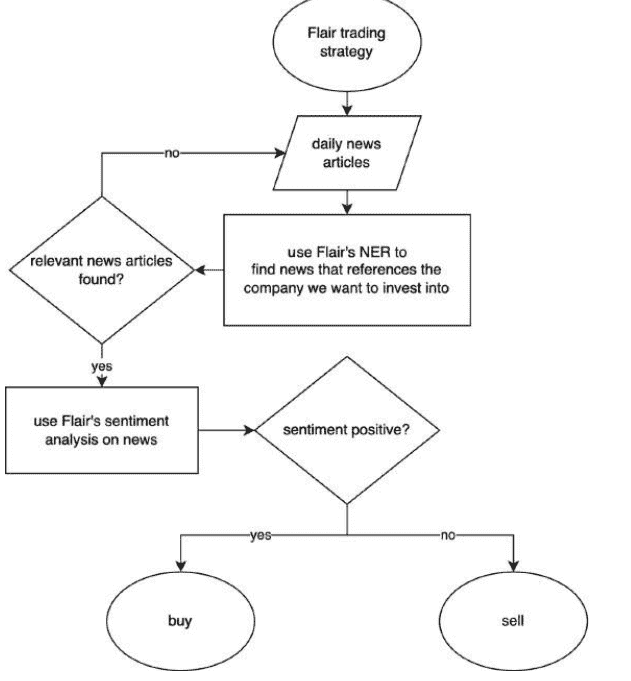

## 10 动手练习 – 使用 Flair 构建交易机器人

在本章中，我们将通过一个动手编程练习，利用 Flair 的多个预训练模型来构建一个实际应用。我们将构建一个简单的交易机器人，它使用 Flair 的命名实体识别（NER）和情感分析工具来做出交易决策。该交易策略包括将当天的新闻标题作为输入，并使用 NER 来判断新闻文章是否在讨论我们感兴趣的公司。然后我们将运行情感分析，帮助我们决定是否持有、买入或卖出该公司的股票。

在第一部分，我们将通过解释基于新闻情感的交易方法的动机来介绍我们的交易策略的细节。然后，我们将使用 Flair 实现一个交易机器人。我们计划用一份 Flair 编程速查表收尾，其中包含 Flair 中最常用的类列表。我们将在以下部分涵盖所有这些内容：

-   了解交易策略
-   实现 Flair 交易机器人
-   Flair 编程速查表

但在直接深入交易机器人的细节之前，让我们确保所有技术要求都已得到满足。

## 技术要求

本章使用的所有 Python 库都是 Flair 0.11 版本的直接依赖项，前提是 Flair 已安装在您的机器上，无需特殊设置。本章涵盖的代码示例可在本书官方 GitHub 仓库的以下 Jupyter 笔记本中找到：https://github.com/PacktPublishing/Natural-Language-Processing-with-Flair/tree/main/Chapter10.

## 了解交易策略

对于本次动手练习，我们将实现一种有趣的交易策略，该策略利用了 Flair NLP 框架的多个部分。该策略绝不是最佳、最优的交易策略，也不是保证让你致富的策略。然而，它确实清晰地展示了 Flair 如何轻松解决现实世界问题。

该策略将帮助我们做出股票交易决策。人们可以根据许多信息来源做出交易决策。一种特别有趣的交易策略类型利用 NLP 处理最新的新闻内容。这些交易策略的基本假设是，讨论某家公司的新闻文章包含有关可能影响公司股价事件的重要信息。与人类相比，自动化的 NLP 策略在投资方面具有诸多优势。这些优势主要归结于机器能够完成的交易速度和规模。一个好的 NLP 交易机器人可以在人类所需时间的一小部分内分析数千字的文本并做出交易决策。

然而，典型的 NLP 交易机器人在词义消歧问题上存在困难。人类历史上擅长利用上下文解读模糊的词义。但 NLP 的最新进展，例如 Flair 在下游 NLP 任务中使用的上下文字符串嵌入，使机器更进一步。例如，考虑以下陈述：*亚马逊森林砍伐由贪婪助长。*

前面的新闻标题对人类来说，显然是在谈论亚马逊雨林以及它如何受到森林砍伐的影响。然而，对一个天真的 NLP 交易机器人来说，这很容易听起来像是一篇讨论亚马逊科技公司的文章。当我们尝试交易以真实实体或物体命名的公司时，例如 Apple、Tesla、Visa 和 Shell，我们会遇到相同类型的问题。因此，一个好的交易机器人应该能够利用上下文来弄清一个词的真正含义，以确定新闻文章是否在谈论某家特定公司。基于上下文字符串嵌入的 Flair 上下文感知 NER 标注器将帮助我们做到这一点。

我们的 Flair 股票交易策略遵循以下步骤序列：

-   1. 查找可能包含有助于我们做出交易决策的有用信息的新闻文章。
-   2. 对新闻文章标题使用 Flair 的 NER 来确定新闻文章是否在谈论我们感兴趣的公司。
-   3. 执行情感分析以确定新闻文章的情感。
-   4. 如果情感分析结果为正面，则买入股票。如果结果为负面，则卖出。
-   5. 返回 *步骤 1*。

该策略最好用流程图来说明：



图 10.1 – Flair 交易机器人策略流程图

前面的流程图显示了我们的交易策略在原则上是多么简单。而且由于我们计划使用 Flair 来实现它，它肯定会如此。

让我们在下一节学习如何实现该策略。

## 实现 Flair 交易机器人

交易策略由三个主要逻辑独立的组件组成：

-   新闻文章获取组件
-   NER 组件
-   情感分析组件

第一个组件，即新闻获取，是非常特定于领域的代码。所使用的数据源很大程度上取决于我们感兴趣交易的公司类型。没有通用的新闻来源适用于所有股票。因此，我们计划将新闻获取部分移出我们的策略，并设计成新闻文本仅作为输入提供给我们的机器人。

我们的交易策略组件经常会访问相同的共享变量，例如我们感兴趣的公司名称。因此，使用面向对象的设计并将我们的策略作为 Python 类的一部分来实现是有意义的。我们将我们的交易策略类命名为 FlairTrader。类的构造函数方法将接收公司名称（我们想要交易的公司名称）并将其存储在内存中，同时存储一个 NER 标注器对象和一个情感分析分类器对象，后者将分别由命名实体识别和情感分析组件后续使用：

```python
from flair.data import Sentence
from flair.models import SequenceTagger
from flair.models import TextClassifier

class FlairTrader:
    def __init__(self, company_name):
        self.company_name = company_name
        self.tagger = SequenceTagger.load('ner')
        self.classifier = TextClassifier.load('en-sentiment')
```

在前面的代码片段中，我们简单地定义了 FlairTrader 类及其构造函数（在类实例化时被调用的一种方法）__init__。然后我们设置了三个类属性——名为 company_name 的公司名称变量、名为 tagger 的 Flair 默认英语 NER 标注器对象，以及名为 classifier 的 Flair 英语情感分析分类器对象。

Flair 目前仅支持英语情感分析模型。对于英语以外的语言，您需要使用 Hugging Face 等提供更广泛语言支持的其他 NLP 库。然而，Flair 确实支持多种语言的各种 NER 标注器。例如，您可以在前面的代码片段中将 ner 替换为 fr-ner 以使用法语 NER 标注。

现在是实现命名实体识别组件的时候了。它的唯一目的是，给定一些输入文本，确定该文本是否与我们想要投资的公司相关。它将通过查找名为 ORG 的命名实体标签来实现这一目标，该标签表示我们公司名称所使用的上下文指的是一个组织——即我们实际的公司。在相反的场景中，例如，当 Amazon 指的是亚马逊雨林而不是公司时，标签将为 LOC——表示位置：

```python
def _references_company(self, text):
    sentence = Sentence(text)
    self.tagger.predict(sentence)

    for entity in sentence.get_spans('ner'):
        if (entity.get_label('ner').value == "ORG" and
            entity.text == self.company_name):
            return True

    return False
```

前面的代码片段以新闻文章标题或文本作为输入，并使用 Flair 的默认英语 NER 标注器对其进行标注。然后它查找与我们的 company_name 匹配的词元，并检查是否有任何词元被标记为 ORG。如果是，该方法返回 True，表示文本确实引用了我们的公司。如果不是，该方法返回 False。

请注意，方法名称前面加上了 __。这在 Python 中通常用于私有类方法，这些方法仅由同一类的其他方法使用，而不打算从类外部直接调用。

> **重要说明**
> 前面的代码片段是一个类方法，这意味着代码不应作为独立代码片段——它属于 FlairTrader 类定义内部。这也是整个代码块缩进四个字符的原因。


我们现在可以测试命名实体识别组件的性能如何：

-   我们首先需要实例化 FlairTrader 对象。我们将使用 amazon 作为我们想要投资的公司名称进行测试。这仅仅是因为 Amazon 可能与亚马逊雨林或亚马逊河等地理位置混淆。我们可以通过运行以下代码来定义 FlairTrader 对象：

```python
ft = FlairTrader("amazon")
```

-   这现在允许我们通过运行以下内容来测试 NER 组件：

```python
print(ft._references_company("amazon river is deadly"))
```

前面的代码块打印出 False。理所当然，它表明在给定上下文中，单词 amazon 与亚马逊公司无关。让我们再试一个例子：

```python
print(ft._references_company("amazon is underpaying staff"))
```

前面的代码块打印出 True。Flair 正确地判断出前一句确实与亚马逊公司相关。再试一个：

```python
print(ft._references_company("amazon deforestation is bad"))
```

这个前面的代码块不出所料打印出 False。

在前面的代码中，我们可以清楚地看到，我们的命名实体识别组件在区分引用亚马逊河或亚马逊雨林的文本与讨论亚马逊科技公司的文本方面表现出色。

-   我们现在可以实现情感分析组件，其职责正如名称所示，进行情感分析并判断我们是否应该买入、卖出或持有。该方法将被优化，以便只有当我们认为输入文本与我们想要交易的公司相关时才会执行情感分析。如果不相关，它将返回 hold（意味着我们既不买也不卖股票）：

```python
def buy_or_sell(self, text):
    if self._references_company(text):
        sentence = Sentence(text)
        self.classifier.predict(sentence)
```

```python
if sentence.labels[0].value == "POSITIVE":
    return "buy"
elif sentence.labels[0].value == "NEGATIVE":
    return "sell"
else:
    return "hold"
```

该组件是一个名为 buy_or_sell(self, text) 的类方法。它接收文本作为输入，如果文本与我们的公司相关，则执行情感分析。如果情感分析分类器认为文本为正面，我们就买入。如果文本为负面，我们就卖出。如果文本与我们的公司不相关，我们就持有。这里需要注意的是，我们完全忽略了分类器的概率。有时分类器对其结果有 100% 的把握，有时它只是在做 51% 的猜测。好的策略会利用这些信息并使用一定的概率阈值。

> **Important Note**
> Make sure to add the preceding method to the FlairTrader class definition and not define it as a standalone piece of code.

我们的交易策略类现在已完成！

我们现在可以通过使用另一个公司名称，例如 Apple 来尝试它：

```python
ft = FlairTrader("apple")
```

让我们看看我们的交易策略表现如何：

```python
print(ft.buy_or_sell("this year's apple harvest"))
```

前面的代码块打印出 hold，这是有道理的。文本谈论的是苹果作为水果，而不是 Apple 公司，这意味着我们没有获得关于做出什么交易决策的信息。

现在，让我们试一个正面情感的例子：

```python
print(ft.buy_or_sell("apple stock is doing great"))
```

前面的代码块不出所料打印出 buy。

我们现在可以尝试一个稍微不那么直接的正面例子：

```python
print(ft.buy_or_sell("apple shows steady growth"))
```

该代码块也打印出 buy。它表明 Flair 能够捕捉到文本中更微妙的正面信号。

下面这个代码块，值得庆幸的是，打印出 sell：

```python
print(ft.buy_or_sell("apple is being sued by the EU"))
```

前面的例子展示了我们的交易策略在买入、卖出或持有股票的决策方面有多好。它在输入文本上表现尤其出色，例如新闻文章标题，其中英语单词通常大写，无法从大写推断含义。

在合适的每日新闻文章源下，FlairTrader 类为我们提供了一个出色的交易机器人基础，可在现实世界中使用。但在把全部积蓄投入这个交易机器人之前，你应该意识到现实世界的股票交易通常比看起来更复杂。好的交易机器人通常依赖于多种不同的指标，很少依赖单一的事实来源，例如新闻文章情感。一种方便的测试交易策略而无需投入真钱的方法是使用回测，其中策略在数月或数年的历史交易数据上进行测试，这让我们在投入真实资金之前对交易策略在现实世界中的预期有一个大致的了解。如果你想深入研究使用 Python 等语言进行交易的领域，你应该尝试 Packt 出版的优秀技术书籍《Python for Finance》。

但无论你的机器人在现实世界中是盈利还是亏损，实现过程清楚地展示了使用 Flair 如何让我们仅用几行简单的代码就能构建智能且功能强大的应用程序。

## Flair 编程速查表

在结束之前，我们应该快速回顾一下本书中使用的最重要的 Flair 类：

| Class | Description |
|---|---|
| Sentence | 用于存储文本的类，可以是单个单词、句子或整个段落。也包含与该对象所属 token 关联的潜在标签。 |
| Token | 表示 token 及其对应标签和嵌入的类。 |
| SpaceTokenizer | 仅基于空格字符的 tokenizer。 |
| WordEmbeddings | 静态词级嵌入。 |
| FlairEmbeddings | 最先进的 Flair 嵌入。 |
| StackedEmbeddings | 用于生成一个或多个嵌入的堆叠的类。 |
| TransformerDocumentEmbeddings | 基于 Transformer 的文档嵌入。 |
| SequenceTagger | 用于加载序列标注器并执行序列标注的类。 |
| Corpus | 用于存储数据集并执行简单操作的类。 |
| ModelTrainer | 负责在 Flair 中训练模型的类。 |
| SequenceTaggerParamSelector | 超参数选择类。 |
| LanguageModel | 用于定义和存储语言模型的类。 |
| LanguageModelTrainer | 负责训练语言模型的类，语言模型最常用于生成嵌入。 |
| TextClassifier | 用于加载和使用文本分类模型的工具集。 |
| TARSClassifier | 用于零样本和少样本文本分类的类。 |

这个常用的 Flair 类和命令的简短概述希望能作为本书中使用的最重要的 Flair 命令的易于记忆的列表。

## 总结

这个简单有趣的动手练习结束了我们对最先进的 NLP 库 Flair 的探索之旅。本书开始时，我们从一些动机开始，随后介绍了 Flair 基础类型，这些类型奠定了 Flair 中不同对象通常如何相互交互的基础。然后我们介绍了词嵌入和文档嵌入，它们是 Flair 的重要组成部分，也是其标注器在序列标注任务上实现最先进性能的主要原因之一。这使我们能够进入序列标注本身，在那里我们了解了 Flair 中所有不同类型的序列标注器。然而，我们并不局限于仅重用预训练模型；我们在下一章中很快学会了如何训练自己的序列标注器。这让我们被漫长的训练超参数列表所淹没，我们必须找到一种利用机器学习帮助我们找到最佳参数集的方法。我们通过掌握超参数调优并学习如何在 Flair 中进行它来实现这一点。


不久之后，我们深入到了本书最复杂的话题，即训练我们自己的嵌入向量。其后是 Flair 中稍显轻松的文本分类主题，该主题也是探索 Flair 功能和能力的最后一章。然后我们将重点转向 Flair 在现实世界中的适用性，通过学习如何在生产环境中部署 NLP 模型，最后通过实现一个简单的 Flair 交易机器人结束了本书。

尽管本书在相当高的层面上涵盖了大多数 Flair 功能，但您应注意，Flair 是一个不断发展的开源项目，拥有超过 170 名贡献者。它不断发展和改进，每月都会添加新功能。因此，这些最后的结语不应标志着您 Flair 之旅的结束。而应标志着一个新的开始。一个您对自己的 NLP 能力充满信心，并准备好通过 Flair 让它们变为现实的旅程的开始。
