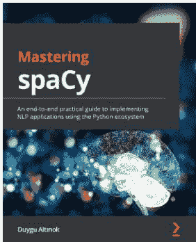

## 索引

### A

准确率
  关于 110
  测量，用于序列
    标注任务 52
客户端推理
  与服务器端推理对比 135-139
条件随机场 (CRF) 45
构造函数 14
Corpus 对象 20, 21
余弦相似度 6, 25
自定义嵌入
  在下游任务中使用 102, 103
自定义少样本 TARS 模型
  使用 128, 129
自定义 Flair 嵌入
  关于 92
  内在评估，执行 103-105
自定义 Flair 模型
  加载 73, 74
  使用 73, 74
自定义模型
  训练，动机 58, 59
自定义序列标注模型
  嵌入堆栈，构建 66, 67
SequenceTagger 对象，
  初始化 67-69
标签词典，加载 66
标注语料库，加载 65, 66
训练 64

### B

回测 166
反向模型 94
贝叶斯优化 82
双向 LSTM (BiLSTM) 45
BiLSTM-CRF 序列标注器 45
二分类 109
BIOES 标注方案 45

### C

切块 8
类 14, 108
经典词嵌入
  关于 33
  在 Flair 中 33-35
类标签
  定义 124
自定义文本分类器
  加载 120-122
  使用 120-122
自定义分词器
  使用 18

### D

数据集，属性
  dev 20
  test 20
  train 20
开发环境
  设置 10
文档嵌入
  关于 39, 40
  在 Flair 中 113
  加载 118
  准备 118
DocumentPoolEmbeddings 114, 115
DocumentRNNEmbeddings 64, 115, 116

### E

嵌入堆栈 94
轮次 62
进化算法 82
外在嵌入评估 96

### F

F1 分数
  关于 110
  测量，用于序列
    标注任务 53
假阴性 (fn) 53, 111
假阳性 (fp) 53, 111
少样本分类
  使用 TARS 125
少样本 TARS 模型
  训练 127
Flair
  关于 9, 14, 43
  经典词嵌入 33-35
  文档嵌入 113
  超参数调优 86-89
  命名实体识别 (NER) 45
  NER 标注器 47
  词性标注 (PoS) 48
  PoS 标注器 51
  序列标注 44, 45
  标注任务 52
  文本分类 111
  文本分类器，训练 116, 117
  分词器 16
  用于文本分类，使用 122, 123
Flair 代码
  运行 12
Flair 编程速查表 166, 167
Flair 嵌入
  关于 35, 38, 92, 93
  字符级序列
    建模 36, 37
  概念 93
  上下文相关性 35, 36
  语料库 94
  前向-后向嵌入堆栈 94
  Pooled Flair 嵌入 37
  训练，用于 Toki Pona 96
Flair 嵌入，为 Toki Pona 训练
  语料库，准备 98-100
  自定义嵌入，在
    下游任务中使用 102, 103
  词典，准备 97

### G

### H

### I

内在评估，执行于
  自定义 Flair 嵌入 103, 104
语言模型，训练 100-102
Flair 嵌入，类型
  关于 40, 41
  DocumentPoolEmbeddings 39
  DocumentRNNEmbeddings 40
  SentenceTransformer
    DocumentEmbeddings 40
  TransformerDocumentEmbeddings 39
Flair 嵌入训练
  词典 95
Flair 功能
  从 GitHub 仓库安装 11
Flair 模型
  部署，使用托管服务 143
  部署决策
    流程图 143, 144
  概念验证自助工具 146, 147
  公共 Hugging Face 模型
    Hub 157, 158
  使用 150
Flair 模型训练
  参数，使用 63, 64
  术语，使用 63, 64
Flair 已发布版本
  在虚拟环境中安装 10
Flair 交易机器人
  实现 162-166
Flask 147
前向-后向嵌入堆栈 94
前向模型 94
GitHub 仓库
  用于安装 Flair 功能 11
GloVe 36, 92
GloVe 嵌入 118
Google Colaboratory (Colab) 60
图形处理单元 (GPU) 59, 96
网格搜索
  关于 80, 82
  参考链接 80
隐藏状态 93
Hugging Face 163
Hugging Face 模型 Hub
  关于 46, 143, 151
  模拟 Flair 模型，训练 151-153
  模型，上传 153
  模型，作为加速的一部分使用
    推理 API 155-157
  URL 151
Hyperopt
  关于 83
  目标函数 83
  优化方法 83
  参考链接 82
  搜索空间 83
超参数 61
超参数调优
  关于 80, 81
  在 Flair 中 86-89
  在 Python 中 83-85
  优化方法 81
互联网电影数据库 (IMDB) 117
中断的训练会话
  恢复 74, 75
内在嵌入评估 95
内在评估
  执行，于自定义 Flair
    嵌入 103, 104
mini-batch 大小 63
模型
  训练 69-73
单语 NER 模型 47
单语预训练 PoS 标注器 51
多类分类 109
多标签多类分类 109
多标签文本分类
  指标 110, 111

### K

king – man ≈ queen – woman
  关于 25-27
  最接近匹配词，查找 30-32
  嵌入类，初始化 27
  嵌入类，选择 27
  英文词的嵌入，
    在 Flair 中获取 29, 30
  词的嵌入，计算 28, 29
  词的嵌入，获取 28, 29
  实验，使用类比
    求解器 32, 33
  实现 27

### L

语言模型 93
词形还原 8
长短期记忆 (LSTM) 93

### M

机器学习模型
  运营化 (MLOps) 150
macro F1 分数 111
托管服务
  使用 150
  使用，场景 139-142
  使用，部署 Flair 模型 143
micro F1 分数 54, 111

### N

命名实体 45
命名实体识别 (NER)
  关于 6, 7, 43, 58, 92
  在 Flair 中 45
自然语言处理 (NLP)
  关于 4, 5, 43
  切块 8
  词形还原 8
  命名实体识别 (NER) 6, 7
  词性标注 (PoS) 7
  词干提取 8
  文本分类 8
  文本向量化 5, 6
  分词 5
  词义消歧 (WSD) 7
NER 类别 46
NER 标注器
  在 Flair 中 47
NER 标注方案 45
神经模型训练 61, 62
NLP 模型
  技术考虑 134, 135

### O

面向对象编程 (OOP) 14
one-hot 编码 5
优化方法，
  超参数调优
  贝叶斯优化 82
  进化算法 82
  网格搜索 82
  随机搜索 82
词表外 (OOV) 36, 103

### P

词性 (PoS) 58,92
词性 (PoS) 标注
  关于 7,43
  在 Flair 中 48
  标签集 49,50
Penn 标签集 48-50
Penn Treebank 项目 PoS 标签集 49
性能指标
  评估 77
  比较 77
Pooled Flair 嵌入 37
PoS 标注器
  关于 48,49
  在 Flair 中 51
精确率 53,110
预训练 Flair 文本分类模型
  使用 112,113
预训练单语 NER 标注器 47
预训练 TARS 模型
  加载，用于正确语言 123,124
概念验证自助
  工具，Flair 模型
端点，定义 148,149
所需库，安装 147
序列标注函数，
  定义 147,148
服务，启动 149,150
公共 Hugging Face 模型 Hub
  使用，在 Flair 模型中 157,158
Python
  超参数调优 83-85
PyTorch 28

### R

随机搜索 82
召回率 53,110
循环神经网络 (RNN) 64

### S

搜索空间 83
搜索空间，参数表达式
  分类参数 83
  浮点参数 83
  整数参数 83
Flair 的秘诀 35
segtok 16
自助服务器端模型
  使用，场景 139-142
自助 Flair 模型
  关于 144
  TorchServe，使用 145,146
Sentence 类 15
Sentence 对象
  关于 14
  辅助方法 17,18
序列标注指标
  关于 52
  准确率 52
  F1 分数 53

- 序列标注任务
- 精度，52 处测量
- F1 分数，53 处测量
- SequenceTagger 对象
- 初始化 67-69
- 序列标注
- 关于 43
- 在 Flair 中 44, 45
- 服务器端推理
- 与客户端推理相比 135-139
- 单文本分类
- 指标 110, 111
- spaCy 16
- 堆叠嵌入 38
- 词干提取 8

### T

- 标签词典
- 加载 66
- 已标记语料库
- 加载 117, 126
- 标注任务
- 在 Flair 中 52
- 任务感知表示
- 句子 (TARS)
- 关于 122
- 用于，少样本分类 125
- 用于，生成零样本
- 预测 124, 125
- 用于，零样本文本分类 123
- tars-base 123
- TARS 模型
- 加载 126
- 任务
- 设置 126

- TensorBoard 70
- TensorFlow 70
- 文本分类
- 关于 8, 108
- 在 Flair 中 111-123
- 用法 108
- 文本分类，类型
- 二分类 109
- 多类分类 109
- 多标签多类分类 109
- TextClassifier 类
- 初始化 118
- 文本分类器模型
- 训练 119
- 文本分类器
- 在 Flair 中 116
- 训练 109
- 训练，在 Flair 中 116, 117
- 文本向量化 5, 6
- 宾夕法尼亚树库项目 49
- 词元 5
- Token 类 15
- 分词
- 关于 5
- 在 Flair 中 16
- TokenizerWrapper 类
- 使用 19, 20
- Token 对象
- 关于 14
- 辅助方法 17, 18
- Toki Pona 97
- TorchServe
- 关于 145
- 使用，用于自托管 Flair
- 模型 145, 146

交易策略

关于 160-162

组件 162

训练嵌入 92

训练损失

绘图 76

训练模型

硬件需求 59-61

训练输出文件 73

训练会话

损失，监控 76

树结构帕森
估计器 (TPE) 82

真正例 (tp) 53,111

### U

通用 PoS 标签集 50

### V

虚拟环境

创建 10

Flair 发布版本，安装 10

虚拟机 (VMs) 60

### W

词嵌入 24

词嵌入，评估方法

外部评估 96

内部评估 95

词义消歧 (WSD) 7

### Z

零样本预测

生成，使用 TARS 124,125

零样本文本分类

使用 TARS 123

Packt.com

订阅我们的在线数字图书馆，即可完全访问超过 7,000 本书籍和视频，以及行业领先的工具，帮助您规划个人发展并推进职业生涯。更多信息，请访问我们的网站。

## 为什么订阅？

- 花更少时间学习，花更多时间编码，使用来自 4,000 多名行业专业人士的实用电子书和视频
- 使用专为你打造的技能计划提升学习效果
- 每月获得一本免费电子书或视频
- 全文可搜索，便于快速获取重要信息
- 复制粘贴、打印和书签收藏内容

您知道 Packt 为每本出版的书籍提供电子书版本，支持 PDF 和 ePub 格式吗？您可以在 packt.com 升级到电子书版本，作为印刷书籍客户，您有权享受电子书的折扣。更多详情请联系我们 customercare@packtpub.com。

在 www.packt.com，您还可以阅读一系列免费技术文章，订阅各类免费通讯，并获得 Packt 书籍和电子书的独家折扣和优惠。

## 您可能喜欢的其他书籍

如果您喜欢这本书，您可能也会对 Packt 出版的其他书籍感兴趣：

## Mastering spaCy

Duygu Altinok

ISBN: 978-1-80056-335-3

- 安装 spaCy，轻松入门并编写第一个 Python 脚本
- 了解 spaCy 的核心语言学操作
- 了解如何将基于规则的组件与 spaCy 统计模型结合
- 精通命名实体和关键词提取
- 使用 spaCy 构建自己的机器学习管道
- 应用您所学的一切知识，使用 spaCy 设计聊天机器人

## Distributed Machine Learning with Python

By Guanhua Wang

ISBN: 978-1-80181-569-7

- 部署分布式模型训练和服务管道
- 掌握 TensorFlow 和 PyTorch 的高级功能
- 缓解并行模型训练和服务期间的系统瓶颈
- 在经典并行范式之上发现最新技术
- 探索 Megatron-LM 和 Mesh-TensorFlow 的高级功能
- 使用 NVLink、NVSwitch 和 GPU 等最先进硬件

## Packt 正在寻找像您这样的作者

如果您有兴趣成为 Packt 的作者，请访问 authors.packtpub.com 并立即申请。我们已与数千名开发者和技术专业人士合作，就像您一样，帮助他们与全球技术社区分享见解。您可以提交通用申请、申请我们正在招聘作者的特定热门主题，或提交您自己的想法。

## 分享您的想法

现在您已完成 *使用 Flair 进行自然语言处理*，我们很想听听您的想法！如果您在 Amazon 购买了本书，请点击此处直接前往该书的 Amazon 评论页面分享您的反馈，或在您购买的网站上留下评论。

您的评论对我们和技术社区非常重要，将帮助我们确保提供优质的内容。

