# OpenLayers 2.10： OpenLayers JavaScript 网络地图库 创建、优化和部署令人惊艳的跨浏览器网络地图

## 致谢

**作者**
Erik Hazzard

**编辑团队负责人**
Aanchal Kumar

**审阅者**
Xurxo Méndez Pérez
Alan Palazzolo
Ian Turton
Couzic Mikael

**项目团队负责人**
Priya Mukherji

**项目协调员**
Jovita Pinto

**收购编辑**
Usha Iyer

**校对**
Steve Maguire

**开发编辑**
Maitreya Bhakal

**图形**
Nilesh Mohite

**技术编辑**
Pallavi Kachare

**生产协调员**
Adline Swetha Jesuthas

**索引员**
Hemangini Bari
Rekha Nair

**封面工作**
Adline Swetha Jesuthas

## 关于作者

**Erik Hazzard** 是一名网页开发者-设计师、开源倡导者和 VI 用户。他喜欢学习、教学，并偶尔在他的网站 http://vasir.net/ 上写博客。作为一名有五年专业网页开发经验的开发者，Erik 专注于 Python 和 JavaScript，尽可能使用开源软件。当他不开发网络应用程序时，他经常在开发或设计电子游戏。

他在 FREAC（佛罗里达资源与环境分析中心）工作，那是一个拥有优秀团队、从事各种 GIS 和网络开发工作的绝佳地方。

我想感谢 OpenLayers 的开发者们，他们不断出色地开发着最好的网络地图框架。我还要感谢我的朋友和导师 Ian Johnson 和 David Arthur，他们给予了我进入网络开发所需的信心和支持。我要感谢 Georgianna Strode 和 Stephen Hodge 给予我的指导、建议以及让我有机会成为更好的网络开发者的机会。如果没有 Packt 的优秀团队的帮助，我不可能写出这本书；我希望每位作者都能像我一样幸运，拥有这样一支优秀的人才团队。我要感谢我的父母给予我永无止境的支持。最后，我要感谢我的爱人 Alisen，她的理解以及花时间帮助我确保本书尽可能易于阅读。

## 关于审阅者

**Xurxo Méndez Pérez** 出生于 1983 年，出生地是西班牙加利西亚南部的小镇 Ourense。他在那里生活到开始在 A Coruña 大学攻读信息技术学位，该学位于 2008 年完成。

在过去的两年里，他在 A Coruña 大学的计算机架构组工作，开发 GIS 应用程序（大量使用许多 OGC 标准），例如 Sitegal 和 SIUXFor（基于网络 GIS 的应用程序，用于管理加利西亚地区的土地产权并促进其良好利用）、MeteoSIX（一个 GIS 系统，提供加利西亚地区地理定位的观测和预报气象数据访问）等。

他还拥有 3 年以上移动应用程序开发经验，最初使用 JavaME，如今他专注于 Google Android，开发了十多款应用程序，其中一些结合了 GIS 和地理定位、实时响应和多用户需求等概念。

**Alan Palazzolo** 在过去五年里一直在构建大大小小的网络应用程序，其中大部分使用开源内容管理系统 Drupal，并在过程中积累了一些数据可视化和地图方面的经验。他是软件和生活方式中开源方法论的坚定信徒和倡导者。他参与了在双城地区启动 Free Geek 分会，并不断尝试使用技术，特别是互联网，来改善那些比大多数人更不幸的人的生活。

**Ian Turton** 是宾夕法尼亚州立大学的地理学研究员。他在近 20 年前偶然成为地理学家，到现在还没有逃脱。在此期间，他是 GeoTools 开源 Java 工具包的联合创始人，该工具包现已成为许多地理开源项目的基础。他继续担任该项目的项目指导委员会成员，并提交新代码和补丁。他还在宾夕法尼亚州立大学和利兹大学教授非常受欢迎的课程“开放网络地图”，使用开放标准和开源程序。

## www.PacktPub.com

## 支持文件、电子书、折扣优惠等

您可能想访问 www.PacktPub.com 获取与本书相关的支持文件和下载。

您知道 Packt 为出版的每本书都提供电子书版本，包含 PDF 和 ePub 文件吗？

您可以在 www.PacktPub.com 升级到电子书版本，作为印刷书籍客户，您有权享受电子书的折扣。请联系我们 service@packtpub.com 了解更多详情。

在 www.PacktPub.com，您还可以阅读一系列免费技术文章，订阅多种免费通讯，并获得 Packt 书籍和电子书的独家折扣和优惠。


http://PacktLib.PacktPub.com

您需要即时解决 IT 问题吗？PacktLib 是 Packt 的在线数字图书库。在这里，您可以访问、阅读和搜索 Packt 整个图书库。

## 为什么订阅？

- ♦ 可在 Packt 出版的每本书中完全搜索
- ♦ 复制粘贴、打印和书签内容
- ♦ 按需提供并可通过网络浏览器访问

## Packt 账户持有者免费访问

如果您在 www.PacktPub.com 有 Packt 账户，您可以使用它立即访问 PacktLib 并查看九本完全免费的书籍。只需使用您的登录凭据即可立即访问。

## 前言

Web mapping 是设计、实现、生成和在万维网及其产品上交付地图的过程。OpenLayers 是一个功能强大、由社区驱动、开源的纯 JavaScript 网络制图库。借助它，你可以轻松使用 WMS、Google Maps 和无数其他地图后端创建自己的网络地图混搭。对 OpenLayers 感兴趣吗？本书将帮助你从零开始学习 OpenLayers。

*OpenLayers 2.10 Beginner's Guide* 将以最简单和最高效的方式带你了解 OpenLayers 库。OpenLayers 的核心组件以详细的方式讲解，并配有示例，结构清晰，方便你日后随时查阅。

本书首先介绍 OpenLayers 库，最后指导你开发和部署一个功能齐全的网络地图应用，带你完成每一步。

在整本书中，你将学习 OpenLayers 库的每个组件。你将使用 WMS 等后端服务、Google Maps 等第三方 API，甚至从静态图像创建地图。你将从 KML 和 GeoJSON 文件加载数据，创建交互式矢量图层，并自定义地图的行为和外观。

混合位置数据与网络应用的趋势日益增长。*OpenLayers 2.10 Beginner's Guide* 将向你展示如何使用最好的网络制图库创建强大的网络地图。

本书将指导你轻松使用开源 JavaScript 库 OpenLayers 开发强大的网络地图。


## 本书所需

本书唯一需要的是一台计算机和文本编辑器。你的操作系统自带文本编辑器，任何一种都可以使用，但如果你使用 Windows，我推荐使用 Notepad++ (http://notepad-plus-plus.org/)，Linux 使用 VI，OSX 使用 Textmate。查看地图需要互联网连接，你还需要一个现代网页浏览器，例如 Firefox、Google Chrome、Safari 或 Opera。虽然需要现代浏览器才能充分利用该库，OpenLayers 甚至为非标准浏览器提供支持，例如 Internet Explorer（甚至在一定程度上支持 IE6）。

无需具备地理信息系统（GIS）知识，也不需要丰富的 JavaScript 经验。对 JavaScript 语法以及 HTML / CSS 有基本了解将极大有助于理解内容，但不是必需的。

## 本书涵盖内容

第 1 章：入门 OpenLayers。本章将介绍 OpenLayers 及其背后的一些编程概念。内容涵盖如何创建地图，并逐步讲解如何设置代码和配置各种设置。

第 2 章：使用 Firebug 修复错误。本章将介绍 Firebug 插件的设置，我们将在全书中使用它，以便进行简单调试并更好地理解 OpenLayers 背后的工作原理。

第 3 章：OpenLayers 中的“图层”。在这里，我们将介绍 OpenLayers 的核心类之一——Layer 类。我们将讨论什么是“图层”，如何使用图层以及不同的图层类。

第 4 章：理解投影。本章将介绍一些基础地理概念以及理解它们如何帮助我们使用 OpenLayers。我们还将介绍投影、它们为何被使用以及如何使用它们。

第 5 章：与第三方 API 交互。本章将重点介绍如何使用不同的第三方 API（如 Google Maps 和 OpenStreetMaps）创建 OpenLayers 地图。

第 6 章：控制控件。我们将介绍 OpenLayers 的另一个核心类——Control 类。我们将介绍控件是什么，并讨论各种类型的控件以及如何处理事件。

第 7 章：为控件添加样式。本章将逐步讲解 OpenLayers 如何使用 CSS 来设置控件样式。

第 8 章：探索地图类。本章将讨论 OpenLayers 的另一个核心组件——Map 类。我们将学习地图函数及其属性，以及如何在同一页面上设置多个地图。

第 9 章：使用矢量图层。在这里，我们将学习矢量图层是什么以及其工作原理。我们还将介绍如何处理数据，例如 KML 文件。

第 10 章：矢量图层样式指南。本章将介绍如何设置矢量图层的样式以及如何使用 Rule 和 Filter 类。

第 11 章：创建 Web 地图应用。本最终章将介绍如何从头构建 Web 地图应用，以及如何使用 OpenLayers 构建文件。

## 本书适合人群

本书适合任何对在网站上使用地图感兴趣的人，从业余爱好者到专业 Web 开发者。OpenLayers 提供了一套功能强大但易于使用的纯 JavaScript 和 HTML（无需第三方插件）工具包，可快速创建跨浏览器 Web 地图。对 JavaScript 有基本了解会有所帮助，但使用本书无需任何先验知识。如果你从未使用过地图，本书将介绍一些常见的地图主题，并温和地引导你学习 OpenLayers 库。如果你是有经验的应用开发者，本书也可作为 OpenLayers 核心组件的参考。

## 如何阅读本书

本书主要设计为从头到尾阅读，各章节相互构建，复杂度逐步增加。同时，各章节是模块化的，因此在学习完内容后，每一章也可作为参考。当然，本书最好先通读一遍，然后再作为参考使用。

## 惯例

在本书中，你会经常看到以下几个标题。

## 动手实践 – 标题

- 1. 操作 1
- 2. 操作 2
- 3. 操作 3

说明通常需要一些额外解释以便理解，因此后面会跟着：

## 发生了什么？

该标题解释了刚刚完成的任务或说明的工作原理。

你还会在书中找到一些其他学习辅助工具，包括：

## 测验 – 标题

这些是简短的问题，旨在帮助你测试自己的理解。

## 试一试 – 标题

这些设置了实践挑战，并为你尝试所学内容提供思路。

你还会发现多种文本样式，用于区分不同类型的信息。以下是这些样式的示例及其含义。

文本中的代码词显示如下："你可以将其下载为 tar.gz 或 .zip 格式。"

代码块设置如下：

```
Lines [21] to [23]
    if (!map.getCenter()) {
        map.zoomToMaxExtent();
    }
```

当我们希望引起你对代码块中特定部分的注意时，相关行或项目以粗体显示：

```
var wms_layer = new OpenLayers.Layer.WMS(
    'WMS Layer Title',
    'http://vmap0.tiles.osgeo.org/wms/vmap0',
    {layers: 'basic'},
    {}
);
```

**新术语** 和 **重要词汇** 以粗体显示。屏幕上显示的文字，例如菜单或对话框中的文字，在文本中如下所示："默认情况下，你的地图会添加一个 `argParser` 控件，该控件会尝试从永久链接中提取信息。"

警告或重要说明会以如下框形式出现。

## 读者反馈

我们非常欢迎读者的反馈。请告诉我们你对本书的看法——你喜欢或可能不喜欢的地方。读者反馈对我们开发你真正受益的书名非常重要。

如需发送一般反馈，只需发送电子邮件至 `feedback@packtpub.com`，并在邮件主题中提及书名。

如果你需要某本书并希望我们出版，请在 `www.packtpub.com` 上的 **建议书名** 表单中留言，或发送电子邮件至 `suggest@packtpub.com`。

如果你对某个主题有专长并有兴趣撰写或为书籍贡献内容，请参阅 `www.packtpub.com/authors` 上的作者指南。

## 客户支持

现在你已成为 Packt 书籍的自豪拥有者，我们提供多项帮助，让你充分利用购买。

## 下载本书示例代码

你可以从 `http://www.PacktPub.com` 上的账户下载所有已购买的 Packt 书籍的示例代码文件。如果你是在其他地方购买本书，可以访问 `http://www.PacktPub.com/support` 并注册，以便将文件直接发送到你的电子邮件。

## 勘误

虽然我们已尽最大努力确保内容的准确性，但错误仍可能发生。如果你发现我们书籍中的错误——可能是文本或代码中的错误——我们将非常感谢你向我们报告。这样做可以避免其他读者感到沮丧，并帮助我们改进后续版本。如果你发现任何勘误，请访问 http://www.packtpub.com/support，选择你的书籍，点击 **勘误提交表单** 链接，并输入勘误详情。一旦你的勘误得到验证，你的提交将被接受，勘误将被上传到我们的网站，或添加到该标题勘误部分的现有勘误列表中。任何现有勘误都可以通过从 http://www.packtpub.com/support 选择你的标题来查看。

## 盗版

互联网上版权材料的盗版是各媒体持续存在的问题。在 Packt，我们非常重视版权和许可的保护。如果你发现我们作品的任何非法复制品，无论形式如何，请立即提供位置地址或网站名称，以便我们采取补救措施。

请通过 copyright@packtpub.com 联系我们，并附上疑似盗版材料的链接。

我们感谢你帮助保护我们的作者，以及我们提供有价值内容的能力。

## 问题

如果你在本书的任何方面遇到问题，可以联系我们 questions@packtpub.com，我们会尽力解决。


# 1

# 使用 OpenLayers 入门

近几年，交互式网络地图的流行度爆炸式增长。过去，创建交互式地图是大型公司或拥有大量资金的专家才能做的事情。但现在，随着 Google 和 Yahoo! Maps 等免费服务的出现，在线地图对每个人来说都很容易获取。今天，有了合适的工具，任何人都可以轻松创建网络地图，而几乎不需要或完全不需要地理、制图或编程知识。

预计网络地图应快速、准确且易于使用。由于它们在线，因此预计它们几乎可以在任何平台上从任何地方访问。只有少数工具能满足所有这些期望。

OpenLayers 就是这样一种工具。它是免费的、开源的，并且非常强大。OpenLayers 为初级开发者和经验丰富的 GIS 专业人士提供了一个强大的库，使得创建现代、快速且交互式的网络制图应用程序变得容易。

本章我们将

- 了解 OpenLayers 是什么
- 讨论一些网络制图应用程序概念
- 制作我们的第一张地图
- 涵盖 OpenLayers 背后的概念，例如面向对象编程
- 提供本书以外的资源信息

## OpenLayers 是什么？

OpenLayers 是一个开源的、客户端 JavaScript 库，用于制作可在几乎任何网络浏览器中查看的交互式网络地图。由于它是客户端库，因此不需要特殊的服务器端软件或设置——你甚至无需下载任何东西即可使用它！最初由 Metacarta 开发，部分是对 Google Maps 的回应，它已发展成为一个成熟、流行的框架，拥有众多热情的开发者和非常有帮助的社区。

## 为什么使用 OpenLayers？

OpenLayers 使创建强大的网络制图应用程序变得简单有趣。它功能非常强大但也易于使用——你甚至不需要是程序员就能用它制作出很棒的地图。它是开源的、免费的，并且背后有一个强大的社区。因此，如果你想深入研究内部代码，甚至改进它，你会被鼓励这样做。跨浏览器兼容性由它处理——甚至在 IE6 上也能运行。

OpenLayers 不受任何专有技术或公司的束缚，因此你不必太担心应用程序会崩溃（除非是你自己弄坏的）。在撰写本文时，现代移动和触摸设备的支持正在开发中（已有许多概念验证示例），并且应该在不久的将来进入官方库——如果到你阅读本文时还没有，也很快就会有。

OpenLayers 允许你从头开始构建完整的制图应用程序，并且可以自定义地图的各个方面——图层、控件、事件等。你可以同时使用多种不同的地图服务器后端，包括强大的矢量图层。它使创建地图“拼贴”变得极其容易。

## 从技术上讲，OpenLayers 是什么？

我们说 OpenLayers 是一个客户端 JavaScript 库，但这是什么意思？

### 客户端

当我们说客户端时，我们指的是用户的计算机，特别是他们的网络浏览器。让 OpenLayers 正常工作所需的唯一东西就是 OpenLayers 代码本身和一个网络浏览器。你可以下载它并在本地计算机上使用，或者什么都不下载，只需链接到托管 OpenLayers 项目的网站上提供的 JavaScript 文件（http://openlayers.org）。OpenLayers 在几乎所有浏览器上都能运行，可以由任何 Web 服务器或你自己的计算机提供服务。推荐使用 Firefox、Google Chrome、Safari 或 Opera 等现代、基于标准的浏览器。

### 库

当我们说库时，我们的意思是 OpenLayers 是一个 API（应用程序编程接口），它为你提供工具来开发自己的网络地图。与从头开始构建制图应用程序相比，你可以使用 OpenLayers 来处理制图部分，而它由一群才华横溢的人维护和开发。

例如，如果你想写一个博客，你可以自己编写博客引擎，或者使用现有的如 WordPress 或 Blogger 并在其之上构建。同样，如果你想创建网络地图，你可以从头开始编写自己的地图，或者使用由拥有强大社区的开发者团队开发和测试过的软件。

通过选择使用 OpenLayers，你确实需要学习如何使用该库（否则你就不会在读这本书了），但好处远远大于成本。你可以使用一个丰富、经过高度测试和维护的代码库，而你所要做的只是学习如何使用它。希望这本书能帮助你做到这一点。

OpenLayers 用 JavaScript 编写，但如果你不太熟悉它也不必担心。你只需要了解一些基本语法知识，我们会在代码示例中尽量保持清晰。

> 如果你不熟悉 JavaScript，Mozilla 提供了出色的 JavaScript 文档，网址为 https://developer.mozilla.org/en/javascript。

## 网络制图应用程序的结构

首先——什么是“网络制图应用程序”？用直白的话说，它是一种利用地图的互联网应用程序。这可能是一个显示 Flickr 上最新地理标记图像的网站（我们将在第 11 章中实现），一个显示你去过的地方标记的地图，或一个跟踪入侵植物物种并将其显示出来的应用程序。如果它包含地图并且能做某事，你就可以说它是一个网络地图应用程序。该术语可以被相当广泛地使用。

那么 OpenLayers 究竟适合在哪里？我们知道 OpenLayers 是一个客户端制图库，但这意味着什么？让我们看一下下面的截图：

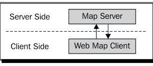

这被称为客户端/服务器模型，它本质上是所有 Web 应用程序运作的核心。在网络地图应用程序的情况下，某种地图客户端（例如 OpenLayers）与某种网络地图服务器（例如 WMS 服务器或 Google Maps 后端）进行通信。

### 网络地图客户端

OpenLayers 运行在客户端。客户端执行的主要任务之一是从地图服务器获取地图图像。从本质上讲，客户端必须向地图服务器请求你想要查看的内容。每当你在地图上导航或缩放时，客户端必须向服务器发出新的请求——因为你要求查看不同的内容。

OpenLayers 已为你处理了所有这些，并且是通过异步 JavaScript（AJAX）调用到地图服务器进行的。重申一下——基本概念是 OpenLayers 在你与地图交互时每次都向地图服务器发送请求以获取地图图像，然后 OpenLayers 将所有返回的地图图像拼凑在一起，使其看起来像一张大而无缝的地图。在第 2 章中，我们将更深入地介绍这一概念。

### 网络地图服务器

地图服务器（或地图服务）提供地图本身。有许多不同的地图服务器后端。一个小样本包括 WMS、Google Maps、Yahoo! Maps、ESRI ArcGIS、WFS 和 OpenStreet Maps。如果你不熟悉这些术语，不用担心。所有这些服务背后的基本原理都是它们允许你通过发送请求来指定你想要查看的地图区域，然后地图服务器返回包含地图图像的响应。使用 OpenLayers，你可以选择使用任意数量的不同后端以任何组合方式使用。

OpenLayers 不是网络地图服务器；它只从它们那里消费数据。因此，你需要能够访问某种类型的网络地图服务。别担心。幸运的是，有许多免费和/或开源的网络地图服务器可供远程托管或自行轻松设置，例如 MapServer。


> 在整本书中，我们经常会使用 OSGeo 提供的免费网络制图服务，因此不必担心需要自己提供。

对于许多网络地图服务器，你无需做任何事情即可使用它们——只需在 OpenLayers 中提供它们的 URL 就足够了。例如，OSGeo、OpenStreet Maps、Google、Yahoo! 和 Bing Maps 都提供对其地图服务器的访问（尽管在某些情况下某些服务可能适用一些商业限制）。

## 与 Google / Yahoo! / 以及其他制图 API 的关系

Google、Yahoo!、Bing 和 ESRI Mappings API 允许你连接到其地图服务器后端。它们的 API 通常还提供客户端界面（至少在 Google Maps 的情况下）。

例如，Google Maps API 功能相当强大。你可以添加标记、规划路线和使用 KML 数据（这些在 OpenLayers 中也可以做到）——但主要缺点是你的制图应用程序完全依赖于 Google。地图客户端和地图服务器由第三方提供。这本身并不是坏事，对于许多项目来说，Google Maps 等是一个不错的选择。

然而，有相当多的缺点。

- 你无法控制后端
- 你几乎无法自定义地图服务器后端，并且它可能随时更改
- 可能存在一些商业限制，或涉及一些费用
- 这些其他 API 也无法提供接近开源制图应用程序框架（即 OpenLayers）所提供的灵活性和定制性

## OpenLayers 中的图层

那么 OpenLayers 中的图层是怎么回事？OpenLayers 允许你的地图使用多个不同的“后端”服务器。要访问网络地图服务器，你创建一个图层对象并使用 OpenLayers 将其添加到地图中。

例如，如果你想在地图上同时显示 Google Maps 和 WMS 服务，你将使用 OpenLayers 创建一个 GoogleMaps 图层对象和一个 WMS 图层对象，然后将它们添加到你的 OpenLayers 地图。我们很快就会看到一个 WMS 图层的示例，所以如果你有点困惑也不用担心。


## 什么是图层？

就像洋葱的层一样，每个图层都在上方并会覆盖前一个图层；添加图层的顺序很重要。使用 OpenLayers，你可以任意设置任何图层的整体透明度，因此可以轻松控制图层相互覆盖的程度，并在任何时候动态更改图层顺序。

例如，你可以在地图上同时激活一个以 Google 地图为底图图层、一个半透明的卫星影像图层以及一个矢量图层。矢量图层是一个功能强大的图层，可让我们向地图添加标记和各种几何对象——我们将在第 9 章介绍它。因此，在此示例中，你的地图将有三个独立的图层。我们将在第 3 章更深入地介绍图层以及如何使用和组合它们。

## OpenLayers 网站

OpenLayers 的网站位于 http://openlayers.org/。首先，我们需要下载一份 OpenLayers 副本（或者，我们可以直接链接到库——但我们将下载本地副本）。你可以将压缩的库下载为 .tar.gz 或 .zip，两种格式包含相同的文件。

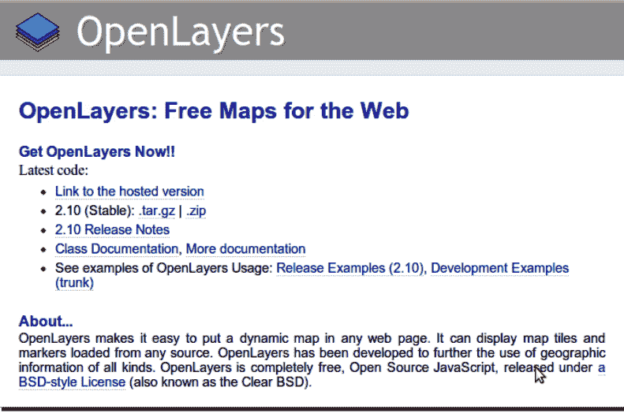

让我们回顾一下链接：

- **托管版本的链接：** 如果你不想实际下载 OpenLayers，可以通过在 `<script>` 标签中添加此脚本 URL 来链接到 OpenLayers 库。
- **2.10（稳定版） `.tar.gz` 或 `.zip`：** 这应显示最新的稳定版本（写作时为 2.10）。你可以将其下载为 `tar.gz` 或 `.zip`；如果不确定要下载哪个，应下载 `.zip` 版本。
- **2.10 发布说明：** 这突出了更改的内容、已修复的错误等。
- **类文档、更多文档：** 这些是 API 文档的链接，我们将在整本书中大量使用。我建议在练习示例时打开它并保持打开状态。
- **查看示例...：** OpenLayers 提供了丰富的示例来演示库的功能；如果你遇到困难或正在寻找好的示例——请到这里。

## 动手操作 – 下载 OpenLayers

让我们下载 OpenLayers 库。完成后，你应该在计算机上设置好 OpenLayers 库文件。

1. 前往 OpenLayers 网站（`http://openlayers.org`）并下载 `.zip` 版本（或如果你更喜欢 `.tar.gz` 版本）。
2. 解压你刚下载的文件。解压后，你会得到一个名为 OpenLayers-2.10（或你的版本）的文件夹。
3. 打开 OpenLayers 文件夹。进入后，你会看到很多文件夹和文件，但我们现在关注的是一个名为 `OpenLayers.js` 的文件和两个文件夹 `/img` 和 `/theme`。我们将把这些复制到新文件夹。

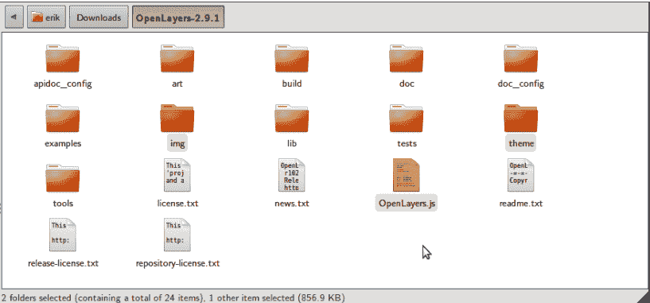

4. 在 OpenLayers 目录之外创建一个新文件夹；我们将使用 `~/code/`（如果你使用 Windows，则为 `c:/code`）。你可以随意命名该文件夹，但我们将其称为 `code` 文件夹。在 code 文件夹内，复制上一步中的 `OpenLayers.js` 和两个文件夹（`/img` 和 `/theme`）。你的新文件夹结构应类似于此：

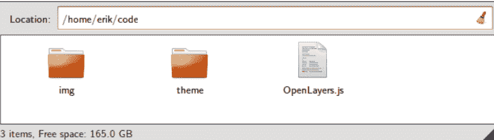

## 发生了什么？

我们刚刚通过复制一个预构建的压缩 JavaScript 文件“安装”了 OpenLayers，该文件包含整个 OpenLayers 库代码以及两个包含资源（图像和样式表）的目录。要使用 OpenLayers，至少需要 `OpenLayers.js` 文件和 `img` 和 `theme` 文件夹。

如果你打开 `OpenLayers.js` 文件，你会注意到它几乎无法阅读。这是因为这是一个 **压缩** 版本，基本上意味着多余的空白和不必要的字符已被删除以减小文件大小。虽然它不再可读，但它稍小，因此下载时间更短。如果你想查看未压缩的源代码，可以在你解压的 OpenLayers 源代码文件夹中查看。

正如我们将在本书最后一章看到的那样，你可以构建自己的库自定义配置，只包含你需要的东西。但现在，我们将直接使用整个库。现在我们已准备好使用 OpenLayers 库文件，让我们开始使用它们吧！

## 创建我们的第一张地图

使用 OpenLayers 创建地图的过程至少需要以下内容：

- 包含 OpenLayers 库文件
- 创建地图将显示在其中的 HTML 元素
- 从 Map 类创建地图对象
- 从 Layer 类创建图层对象
- 将图层添加到地图
- 定义地图的范围（设置地图初始显示的区域）

现在我们终于准备好创建第一张地图了！

## 动手操作 – 创建你的第一张地图

让我们深入 OpenLayers 并制作一张地图！完成本节后，你应该拥有一张可用的地图，它使用来自 OSGeo 的公开可用的 WMS 服务器后端。

1. 导航到包含 `OpenLayers.js` 文件、`/img` 和 `/theme` 目录的 `code` 目录。在此处创建一个名为 `index.html` 的文件。此目录（`/code`）将被视为我们的根目录，因为它是所有文件所在的基础（根）文件夹。
2. 在 `index.html` 中添加以下代码并将其保存为 `.html` 文件——如果你使用 Windows，我建议使用 Notepad++。不要尝试在 Microsoft Word 等程序中编辑文件，因为它无法正确保存。以下代码也将用作本书许多未来示例的基础模板代码，因此我们将经常回到它。

代码中的行号仅用于演示目的；在编写代码时不要输入它们。

```
1.<!DOCTYPE html>
2.<html lang='en'>
3.<head>
4.    <meta charset='utf-8' />
5.    <title>My OpenLayers Map</title>
6.    <script type='text/javascript' src='OpenLayers.js'></script>
7.    <script type='text/javascript'>

8.
9.        var map;
10.
11.        function init() {
12.            map = new OpenLayers.Map('map_element', {});
13.            var wms = new OpenLayers.Layer.WMS(
14.                'OpenLayers WMS',
15.                'http://vmap0.tiles.osgeo.org/wms/vmap0',
16.                {layers: 'basic'},
17.                {}
18.            );
19.
20.            map.addLayer(wms);
21.            if (!map.getCenter()) {
22.                map.zoomToMaxExtent();
23.            }
24.        }
25.
26.    </script>
27.</head>
28.
29.<body onload='init();'>
30.    <div id='map_element' style='width: 500px; height: 500px;'>
31.    </div>
32.</body>
33.</html>
```

3. 在你的网络浏览器中打开 `index.html`。你应该会看到类似以下内容：

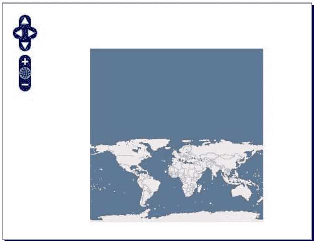

## 发生了什么？

我们刚刚使用 OpenLayers 创建了第一张地图！如果由于某种原因它对你不起作用，请尝试仔细检查代码并确保所有逗号和括号都已到位。你也可以参考前言，其中提供了本书中使用的代码示例的链接。默认情况下，如果我们不指定任何内容，我们会得到一些控件。我们将在整本书中的许多示例中使用我们创建的文件作为模板，因此请保存一份副本，以便以后可以轻松引用。

左侧的控件（导航按钮）称为 PanZoom 控件。你可以单击按钮在地图上导航，用鼠标拖动地图/使用滚轮放大，或使用键盘的箭头键。我们将在第 6 章更详细地介绍控件。

## 代码如何工作

现在，让我们逐行查看代码。在此之前，让我们先提供一个快速参考，说明上一节中的要求出现在哪些行号。这些是你拥有一个功能性地图需要做的核心事项。


我们用方括号表示行号——[x]，其中 x 为行号。

- 1. 包含 OpenLayers 库文件：
  行 [6]
  ```html
  <script type='text/javascript' src='OpenLayers.js'></script>
  ```
- 2. 为我们的地图创建 HTML 元素：
  行 [30] 和 [31]
  ```html
  <div id='map_element' style='width: 500px; height: 500px'>
  </div>
  ```
- 3. 从 Map 类创建地图对象：
  行 [12]
  ```javascript
  map = new OpenLayers.Map('map_element', { });
  ```
- 4. 从 Layer 类创建图层对象：
  行 [13] 至 [18]
  ```javascript
  var wms_layer = new OpenLayers.Layer.WMS(
    'WMS Layer Title',
    'http://vmap0.tiles.osgeo.org/wms/vmap0',
    {layers: 'basic'},
    {}
  );
  ```
- 5. 将图层添加到地图：
  行 [20]
  ```javascript
  map.addLayer(wms_layer);
  ```
- 6. 定义地图的范围：
  行 [21] 至 [23]
  ```javascript
  if (!map.getCenter()) {
    map.zoomToMaxExtent();
  }
  ```

## 按行理解代码

行 [1] 至 [5]：设置 HTML 页面。每个 HTML 页面都需要一个 <html> 和 <head> 标签，而你看到的额外代码指定了各种设置，用以告知浏览器此页面符合 HTML5 标准。例如，我们在第 [1] 行包含 DOCTYPE 声明，以指定页面符合 W3C 制定的标准。我们还指定了一个 <title> 标签，其中包含将在页面上显示的标题。

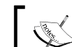

> 这是我们所有代码示例将遵循的结构，因此这个基本代码模板将在本书后续所有示例中被隐含假设。

行 [6]：`<script type='text/javascript' src='OpenLayers.js'></script>`

这包含了 OpenLayers 库。文件位置由 `src='OpenLayers.js'` 属性指定。这里，我们使用的是 **相对路径**。由于 index.html 页面与 `OpenLayers.js` 文件位于同一文件夹中，因此无需担心指定其路径。该文件可能在你的计算机上，也可能在另一台计算机上——这并不重要，只要浏览器能够加载它即可。

我们也可以使用 **绝对路径**，这意味着我们传入脚本所在位置的 URL。`OpenLayers.org` 也托管该脚本文件；我们可以使用以下代码行直接链接到库文件：

```
<script type='text/javascript' src='http://openlayers.org/api/OpenLayers.js'></script>
```

注意 src 指定了一个实际的 URL——这就是我们使用 **绝对路径** 的方式。两种方式都可行，然而在整本书中我们假设你使用的是相对路径，并且在自己的计算机/服务器上拥有 OpenLayers 库。如果你使用托管的 OpenLayers 库，就无法保证它始终可用，并且它可能会在一夜之间发生变化（并且在库更新时发生变化）——因此建议使用本地副本。

行 [7]：开始一个 `<script>` 块。我们将在其中设置所有代码以创建地图。由于 OpenLayers 库已在第 [5] 行包含，因此我们能够使用库中包含的所有类和函数。

行 [8]：`var map;`

这里我们创建了一个名为 `map` 的全局变量。在 JavaScript 中，每当我们 **创建** 一个变量时，都需要在其前面加上 `var`，以确保不会遇到 **作用域** 问题（哪些函数可以访问哪些变量）。当 **访问** 一个变量时，不需要在其前面加上 `var`。

由于我们在全局级别（在任何函数之外）将 map 定义为变量，因此可以在代码中的任何位置访问它。很快我们将把这个 map 变量变成我们的地图对象，但现在它只是一个空的全局变量。

行 [11]：创建一个名为 `init` 的函数。当页面加载时（通过 `body` `onload='init();'` 在第 [29] 行），此函数将被调用。该函数包含设置 OpenLayers 地图的所有代码。如果你熟悉 JavaScript，不必将所有代码放在函数调用中——例如，你可以只将代码放在页面底部，从而完全避免函数调用。创建在页面加载时被调用的函数是一种常见做法，因此我们在整本书中都会这样做。

行 [12]：`map = new OpenLayers.Map('map_element', { });`

记住那个全局 map 变量吗？好吧，现在我们将其变成一个地图对象，该对象由 `OpenLayers.Map` 类创建。它也被称为 Map 类的一个实例。我们将在本章后面的 *面向对象编程* 部分讨论这意味着什么。地图对象是我们 OpenLayers 应用的核心——我们调用其函数来指示地图缩放至区域、触发事件、跟踪图层等。

现在，让我们看一下等号 (=) 右侧：`new` 意味着我们正在从其后的类创建一个新对象。`OpenLayers.Map` 是我们正在从中创建对象的类名。注意括号内有内容：(`'map_element'`, `{}`)。这意味着我们向该类传递了两项内容（称为参数，以逗号分隔）。OpenLayers 中的每个类都期望传入不同的参数，有些类不需要任何参数。

**Map** 类期望两个参数。第一个参数 `map_element` 是地图将显示在其中的 HTML 元素的 ID。第二个参数 `{ }` 是地图 **选项**，由 `key:value` 对组成（例如 `{key:value}`）。这也称为 **JavaScript 对象表示法**，是一种即时创建对象的方式。我们将在下一节中更深入地介绍它。另外，如果该参数为空，则无需包含它（尽管我们刚刚这样做了），但我们在这里只是为了保持一致性而这样做。

因为我们将 `map_element` 作为第一个参数传入，所以我们将拥有一个 ID 为 `map_element` 的 HTML 元素（几乎总是 `<div>`）。HTML 元素 ID 可以是任何内容，但为了清晰并避免混淆，我们将其称为 `map_element`。

行 [13]：`var wms = new OpenLayers.Layer.WMS(`

这里，我们从 Layer 类的 WMS 子类为地图创建一个图层对象。在 OpenLayers 中，每个地图至少需要一个图层。图层指向 '后端'，即我们之前讨论过的服务器端地图服务器。图层可以是多种不同的服务中的任何一种，但这里我们使用的是 WMS。WMS 代表 **Web Map Service**，是由 **Open Geospatial Consortium (OGC)** 定义的国际标准。

我们可以为图层传入的参数取决于图层类——我们在第 3 章中详细介绍了图层。如果你不想等待，也可以查看 `http://dev.openlayers.org/docs/files/OpenLayers/Layer-js.html` 处的文档，以了解不同图层类期望的参数。

注意我们在创建图层对象时不会将所有内容放在一行中——这提高了可读性，使我们更容易看到传入的内容。唯一的区别是我们也在分隔参数的逗号后添加了新行，这不会影响代码（但使阅读更轻松）。

```
Line [14]: 'WMS Layer Title',
```

这是传入的第一个参数；图层的标题。大多数图层类期望传入的第一个参数是图层的标题。此标题可以是你想要的任何内容，其主要目的是为了人类可读性——它会显示在图层列表等控件中。

```
Line [15]: 'http://vmap0.tiles.osgeo.org/wms/vmap0',
```

URL 是 WMS 图层类期望接收的第二个参数。目前，我们使用的是 OSGeo 提供的公开 WMS 服务。我们将在第 3 章中深入介绍 WMS。目前你需要知道的是，这是一个基础 URL，图层将使用它。

```
Line [16]: {layers: 'basic'},
```

第三个参数是一个匿名对象，其中包含图层属性（格式与第 [12] 行之前的 options 对象类似），并且特定于 WMS 图层类。这些是 OpenLayers 请求地图图像时实际上（或多或少）直接添加到对地图服务器后端的 GET 调用中的内容。

## JavaScript 对象表示法

在 OpenLayers 中，我们经常向类传入匿名对象。在 JavaScript 中，匿名对象是以逗号分隔的 key:value 对，并按 {key1:value1, key2:value2} 的格式设置。它们基本上是在不从类派生的情况下创建的对象。此格式也称为 JavaScript 对象表示法。

当我们说 key1:value1 时，它类似于说 "key1 = value1"，但我们使用冒号而不是等号。我们也可以创建一个匿名对象并将其传入，而不是在同一行创建，例如：

```
var layer_parameters = {layers: 'basic'};
var wms = new OpenLayers.Layer.WMS('layer_title', 'url',
layer_parameters, ...);
```

对于 WMS 图层，我们至少需要传入一个 layers 键。在这种情况下，它的值为 'basic'。此图层参数指定地图服务器上存在的图层。因此，当你向 WMS 服务器请求包含图层 'basic' 的地图图像时，它会返回由该图层组成的图像。你也可以向地图服务器请求多个图层。在这种情况下，我们只希望 WMS 服务返回包含名为 'basic' 的图层的图像。


让我们回到代码。

**Line [17]:** `{ }`

第四个参数是一个可选的 **options** 对象，是我们在前面讨论过的格式的匿名对象。这些属性通常由每个 OpenLayers Layer 类共享。例如，无论 Layer 类型如何（例如 WMS 或 Google Layer），你都可以传入一个不透明度设置（例如 `{opacity: .8}` 表示 80% 不透明度）。因此，无论你使用的是 WMS 还是 Vector 层，此不透明度属性都可应用于任一层。


> 因为这是传递给 Layer 对象创建调用的最后一项，请确保没有前导或尾随逗号。尾随逗号是常见错误，且调试起来往往很费时。

此 **options** 对象是可选的，但我们经常会使用它，因此养成代码保持一致的习惯并提供一个空对象（使用 `{}`），即使我们暂时没有向其中传递任何内容，也是个好习惯。

**Line [18]:** `);`

这只是完成了对象创建调用。

**Line [20]:** `map.addLayer(wms);`

现在我们已经创建了 `wms_layer` 对象，需要将其添加到地图对象中。注意我们正在调用地图对象的一个函数。实际上，添加图层到地图对象有几种方法。我们可以使用上面的代码（通过调用 `map.addLayer`），其中我们传入单个图层，或者也可以使用 `map.addLayers`：

```js
map.addLayers( [layer1, layer2, ...] );
```

这里，我们传入一个图层数组。两种方法都有效，但在你有多个图层时，传入数组可能更容易。

你也可以在创建地图对象之前先创建图层对象，并在创建地图时将图层对象传入，例如：

```js
map = new OpenLayers.Map('map_element', {layers: [layer1, layer2,
...]});
```

所有方法都有效，但本书中我们通常会使用 `addLayer` 或 `addLayers`。

**Line [21] - [23]:**

```js
if (!map.getCenter()) {
  map.zoomToMaxExtent();
}
```

最后，我们必须指定地图的可视区域。这里实际移动地图的代码是 `map.zoomToMaxExtent()`，它会将地图缩放到地图的最大范围。它位于一个 `if` 语句中。此 `if` 语句检查地图是否已存在中心点。

我们添加此检查的原因是，默认情况下，你的地图可以接受一种特殊格式的 URL，其中可包含范围和要打开/关闭的图层。这在更常见的术语中被称为 `permalink`。如果我们不检查中心是否已设置，permalink 将无法工作。


> 默认情况下，你的地图会添加一个 **argParser** 控制，它会尝试从 permalink 中提取信息。我们将在第 6 章介绍它，但要立即看到其效果，你只需在 URL 中添加以下内容，即可将地图缩放到相同的坐标和缩放级别：`?zoom=4&lat=56&lon=-116`
> 
> 因此，你的 URL 可能看起来像 `c:/code/index.html?zoom=4&lat=56&lon=-116`

设置地图范围有几种方法。如果你知道想要显示所有内容，`map.zoomToMaxExtent()` 函数是一个快速且良好的方法。还有其他方法，例如

```
map.zoomToExtent(new OpenLayers.Bounds([minx,miny,maxx,maxy]));
```

还有更多方法。如果你知道地图起始的具体位置，这就是另一种方法：

```
map.setCenter(new OpenLayers.LonLat(x,y));
map.zoomTo(5);
```

其中 x、y 是经纬度值，5 是你希望缩放到的缩放级别。默认情况下，你的地图有 16 个缩放级别，可通过在创建地图对象时设置 `numZoomLevels` 属性来配置。

还有更多方法，但这些是最常见的策略。基本思路是你需要指定一个中心位置和缩放级别——设置范围可以实现这一点，显式设置中心和缩放级别也可以。

**Line [24]:** `}`

这只是完成了 `init()` 函数。

**Lines [26], [27]:**

这些行关闭了 script 标签和 head 标签。

**Line [29]:** `<body onload='init();'>`

这开始了 body 标签。当页面加载完成时，通过 `body` 标签中的 `onload='init();'` 属性，它将调用 JavaScript `init()` 函数。我们必须等到页面加载后才能执行此操作，因为在页面加载之前我们无法使用地图 div（或任何 HTML 元素）。另一种方法是将 `init()` 调用放在页面底部的 JavaScript 标签中（这也不会在页面加载前被调用），但两种方法都能达到相同的效果。

浏览器加载页面时是从上到下加载的。要在 JavaScript 中使用任何 **DOM (Document Object Model)** 元素（页面上的任何 HTML 元素），它们首先必须由浏览器加载。因此，在浏览器看到该元素之前，你不能用 JavaScript 引用 HTML。这类似于尝试访问尚未创建的变量。即使我们有在页面顶部引用 `map_element` div 的 JavaScript 代码，它实际上要等到页面加载后才会执行（因此需要 `onload` 和 `init()` 函数调用）。

**Line [30] and [31]:** `<div id='map_element' style='width: 500px; height: 500px'></div>`

要制作 OpenLayers 地图，我们需要一个 HTML 元素来显示地图。几乎总是这个元素是一个 `div`。你可以给它任何你想要的 ID，并且此 HTML 元素的 ID 会传入创建地图对象的调用中。你可以随意设置 div 的样式——例如将宽度和高度设置为 100%，如果你想要全页地图的话。最好使用 CSS 来设置元素的样式，但像这样内联设置 div 也能工作。

**Lines [32] and [33]:** 这些行通过关闭剩余的标签来完成页面。

## 背后原理——面向对象编程（OOP）

现在，让我们从更理论和技术层面谈谈这些东西是如何工作的。OpenLayers 采用 **Object Oriented Programming (OOP)** 技术，这意味着要使用该库，我们需要从 OpenLayers 提供的内置 **classes** 创建 **objects**。

这是什么意思？你已经熟悉类和对象是什么，只是可能不知道而已。把 **class** 和 **object** 的概念想象成词性部分。例如，思考名词的抽象概念——人、地点、事物或思想。名词本身（抽象概念）就是一个 **class**。但作为名词的具体、实际的词就是 **objects**。

### 与对象的交互

Ironman 和 Batman 是两个不同的词（或在 OOP 术语中是两个对象），但它们属于同一个名词类。类主要用于生成对象；我们与对象交互。考虑以下两个句子：

> "Noun was in a fight with noun."

> "Ironman was in a fight with Batman."

现在，第二句话更像是一句实际的句子。我们在句子中使用 Ironman 和 Batman 这两个词（它们是对象；它们是名词类的实例）。我们不会在句子中使用 noun（一个类），因为像这样与类交互是没有意义的。这是 OOP 的重要概念之一——我们与对象交互，并通过类生成对象。

### MadLibs

Madlibs，对于不熟悉的人来说，是一种游戏，你会得到一段文字，其中缺少一些词。目的是想出填入空白的词，但每个空白只能包含特定类型的词（名词、形容词、动词等）。词的类型是一个类，而你插入的实际词是一个对象。

### 动手实践 – 玩 MadLibs

通过用 verb 和 noun 'objects' 替换 verb 和 noun，完成这个句子：

I verb up to the noun. It's about 7 or 8 o'clock. I looked at my noun. I was there, to verb on my throne as prince of noun(place).

### 发生了什么？

你刚刚做了一个 Madlibs，演示了 OOP 的一些概念。正如你所见，把句子读成 "I verb up to the noun" 是没有意义的。因为 verb 和 noun 是类，我们不会在句子中使用实际的术语 verb 或 noun。

因此，想法是生成单独的对象，一个是 noun 类的对象，一个是 verb 类的对象。例如，前面的句子可以完成为："I pulled up to the house"。Pulled 和 house 是 verb 和 noun 类的实例，分别是对象。

我们使用属于这些类的词，它们是对象。另一种指代对象的术语是实例，它用于指定对象派生的类，例如，Frodo（一个人/霍比特人）是名词的一个实例。


## 使用面向对象编程

同样的概念也适用于编程。我们对一个类能真正做的唯一事情就是从它创建对象。对象是从类派生出来的——你可以与对象交互并对其进行操作，但不能对类进行操作。因此，在 OpenLayers 中，我们需要从内置类创建对象才能真正做任何事情。我们主要需要的是地图和图层对象。如果我们想创建 OpenLayers 地图，我们需要一个地图对象，并且我们按如下方式创建它：

```
var map = new OpenLayers.Map( ... );
```

new 声明意味着我们想从 OpenLayers.Map 类创建一个新对象。括号中的省略号（ . . . ）代表我们传入类以创建对象的东西，称为参数。每个类都期望传入不同的参数。这与 Madlibs 示例类似——名词类只接受某些单词。如果我们在 JavaScript 中创建一个单词对象，代码可能看起来像这样：

```
var my_word_object = new Noun('Ironman');
```

在这里，我们将 'Ironman' 传入名词类，现在我们有了单词对象。因为 Noun 类只接受名词，所以这样是可以的。如果我们尝试传入动词，例如，它将不起作用，因为名词类不能接受动词。同样，Map 类期望传入的参数与 Layer 类不同。

## 子类

还有子类，它们是从另一个类派生的类，并继承其继承的“基”类的所有属性。子类还可以覆盖它们继承的属性和方法。

例如，假设我们有一个 Dog 类，它是 Animal 类的子类。Dog 类将继承基类 Animal 的所有属性——例如，也许是一个 speak 方法。现在，Dog 类将覆盖 speak 方法，并在调用时发出吠叫声（或令人讨厌的“yap”声）。Dog 类还可能提供基类 Animal 中没有的额外方法，例如，也许是 wag_tail 方法。

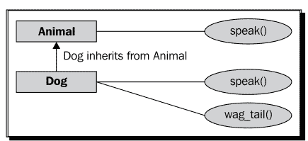

'Base' 类和 'Subclasses' 都是类；术语只是有助于澄清哪个类继承自哪个其他类。

OpenLayers 中有许多子类，例如，GoogleMap Layer 类是基类 **Layer** 的子类，而 **Navigation** 控制类是基类 **Control** 的子类。子类仍然是类，完全相同的概念适用；我们仍然需要从类生成对象才能使用它。

上一节只是对 OOP 的介绍。虽然你不一定需要了解更多关于 OOP 概念的内容来使用本书，但可以在 http://en.wikipedia.org/wiki/Object-oriented_programming 上找到一个很好的资源来了解更多关于这些概念的信息。

在 OpenLayers 代码中，类很容易识别。根据惯例，在 OpenLayers（以及许多其他地方）类名使用 `CamelCased`，这意味着每个单词的首字母大写，而对象则不是。例如，`MyClass` 就是类名的示例，而 `my_object` 就是对象的示例。

## 接下来呢？

我们对示例代码的介绍并不是要非常详尽；只是足以让你了解其工作原理。我们将在各章中更详细地介绍 OOP 概念，所以如果有什么不太清楚的地方，不必太担心。

由于 OpenLayers 是一个库并为你提供函数，了解这些函数是什么以及它们做什么很重要。有很多地方可以做到这一点，但最好的来源是 API 文档。

## API 文档

API 文档始终是最新的，并包含 OpenLayers 中所有类的详尽描述。当你有问题时，它通常是最好的第一个去处。你可以在 http://dev.openlayers.org/docs/files/OpenLayers-js.html 访问文档。它不断更新并包含大量信息。我们将在整本书中不断引用它，所以请保留该链接！然而，有时 API 文档可能看起来不够清晰，但有很多其他资源可以帮助你。

## 寻求帮助

书籍很棒，但它们基本上只是一种单向的交流形式。如果你有任何书中没有回答的问题，Google 是最好的第一个去处。邮件列表和 IRC 也是其他很好的资源。有时很难提出正确的问题，但有帮助！

## 本书网站

本书的扩展网站可以在 http://vasir.net/openlayers_book 找到。当前的、最新的更正和代码修复，以及更高级的教程和解释，都可以在那里找到——也在我的博客 http://vasir.net/blog 上。你也可以在 Packt Publishing 的书籍网站 https://www.packtpub.com/openlayers-2-1-javascript-web-mapping-library-beginners-guide/book 获取代码和有关本书的更多信息。

## 邮件列表

OpenLayers 邮件列表是一个宝贵的资源，让你不仅可以发布问题，还可以浏览他人提出（并回答）的问题。有两个主要的 OpenLayers 新闻组——Users 和 Dev。Users 列表是大多数问题被提出的地方。Dev 保留用于 OpenLayers 库本身的开发。如果你对如何使用 OpenLayers 有疑问，它们属于 Users 列表，而不是 Dev 列表。你可以在 http://lists.osgeo.org/mailman/listinfo/openlayers-users 订阅邮件列表。

有各种方式浏览内容，我更喜欢使用 Nabble。你可以在 http://osgeo-org.1803224.n2.nabble.com/OpenLayers-f1822462.html 查看列表。


发布问题前请彻底搜索，因为很可能与你的问题类似的问题已经被提出并解决。如果你对使用 OpenLayers 有疑问，请使用 User 列表。请不要向 Dev 列表发布问题，除非与 OpenLayers 库本身的开发严格相关。

发布问题时，请尽可能详细，说明你的问题、你已做过的事情以及相关的源代码（例如：“我在使用 WMS 图层时遇到问题。我尝试了这个和那个，这就是我的源代码的样子...”）。关于如何提出问题以最好地获得回复的良好指南可以在 http://www.catb.org/~esr/faqs/smart-questions.html 找到。

## IRC

Internet Relay Chat (IRC) 也是一个很好的去处，如果你对 OpenLayers 有疑问。IRC 用于团体通信；本质上是一个大聊天室。如果你已经用尽了 Google 和邮件列表，IRC 可以让你与对 OpenLayers 感兴趣的其他人实时交流。

通常，OpenLayers 聊天室里的人都很友好，但请在 IRC 中提问前先尝试找到答案。服务器是 irc.freenode.net，聊天室是 #openlayers。你可以在网上下载 IRC 客户端；一个不错的 Windows 客户端是 mIRC (http://mirc.com)。有关如何使用 IRC 的更多信息可以在 http://www.mirc.com/install.html 找到。

## OpenLayers 源代码仓库

传统上，OpenLayers 使用 SVN 作为其版本管理系统。然而，在撰写本文时，源代码仓库位置托管在 GitHub 上。你可以在 http://github.com/openlayers/openlayers 访问整个代码仓库。

随意下载一份副本自己玩玩。确实将你的代码永久添加到官方源代码库有一个流程，但下载代码库副本并自己查看以弄清它是如何真正工作的绝对不会有坏处！

## 总结

在本章中，我们介绍了 OpenLayers 并对其有了一些了解。我们看到了 Web 地图应用程序是什么以及它们如何工作。之后，我们使用 OpenLayers 创建了第一个地图，然后分析了代码的工作原理。然后我们介绍了一个基本概念，面向对象编程，在真正使用 OpenLayers 时我们需要了解它。最后，提供了本书之外的帮助和信息资源。

现在我们对 OpenLayers 有了基本了解，我们将直接进入调试 OpenLayers。通过这样做，我们将更彻底地介绍我们讨论过的许多概念，例如 OpenLayers 如何请求和接收地图图像，以及如何将它们组合在一起。


# 2

# 使用 Firebug 消除 Bug

OpenLayers 在根本层面上，并没有做任何概念上难以理解的事情。它从服务器获取地图图像并将它们组合起来。然而从技术层面来看，背后有大量工作在进行，可能会让人觉得它是如何如此完美地协同工作的，显得很神奇。

幸运的是，有许多工具可以消除我们可能产生的任何神奇思维，并向我们展示 OpenLayers 在幕后是如何工作的。Firebug 是一款免费的开源 Firefox 插件，就是这样一个优秀的工具。加快开发时间、查看网络通信以及消除错误只是 Firebug 和其他 Web 开发工具所做的事情，使它们难以缺少。

要真正有效地使用 OpenLayers 并发挥其全部潜力，我们需要了解它是如何工作的。在本章中，我们将尽力做到这一点，通过使用 Web 开发工具来检查 OpenLayers 的内部工作原理。通过这样做，我们将实现两件事。首先，我们将熟悉这些工具，这将在开发地图时显著帮助我们。其次，更重要的是，我们将更好地理解 OpenLayers 的工作原理。

本章将涵盖以下内容：

- Firebug 和其他开发工具是什么
- 设置 Firebug
- Firebug 的每个面板
- 使用 JavaScript 命令行控制台面板

### 什么是 Firebug？

**Firebug** 是 Firefox 的免费开源附加组件。如果你还没有 Firefox，我建议你下载它（它也是免费开源的）。然而，其他现代且基于标准的浏览器，如 Google 的 Chrome、Apple 的 Safari 和 Opera，也运行良好，并且拥有出色的内置开发者工具。

Firebug 以及其他 Web 开发工具使 Web 开发过程变得更加容易和快捷。我是什么意思？使用这些工具，我们可以在不编辑或保存任何文件的情况下，即时更改网站上的任何内容。我们可以使用命令行界面输入 JavaScript 代码并立即执行。我们可以查看网页向服务器发送的所有请求以及服务器的回复。例如，如果我们的地图无法从服务器获取地图图像，我们可以检查页面发出的请求，并找出是否存在拼写错误或地图图层设置不当的问题。

使用这些工具不仅可以更轻松地开发 OpenLayers 地图应用程序，还可以更轻松地开发任何 Web 应用程序，并且更容易修复开发过程中遇到的任何错误。本章我们将重点关注 Firebug，并在整本书中反复提及它，但像 Google Chrome 和 Apple Safari 的内置开发者工具等其他工具同样有效（尽管某些功能可能有所不同）。

### 设置 Firebug

由于 Firebug 是 Firefox 的扩展，你首先需要安装 Firefox。你可以在 http://getfirefox.com 免费下载它。之后，Firebug 可以在 http://getfirebug.com 免费下载。当你点击下载 Firebug 的链接时，Firefox 会提示你是否要安装该插件。安装后，你只需重新启动 Firefox 即可。

### 动手实践 – 下载 Firebug

如果你尚未安装最新版本的 Firefox，请现在安装。安装 Firefox 后，请按照以下步骤设置 Firebug：

- 1. 访问 http://getfirebug.com。
- 2. 点击 **Install Firebug for Firefox** 按钮。点击后，你应该会看到类似以下的消息：

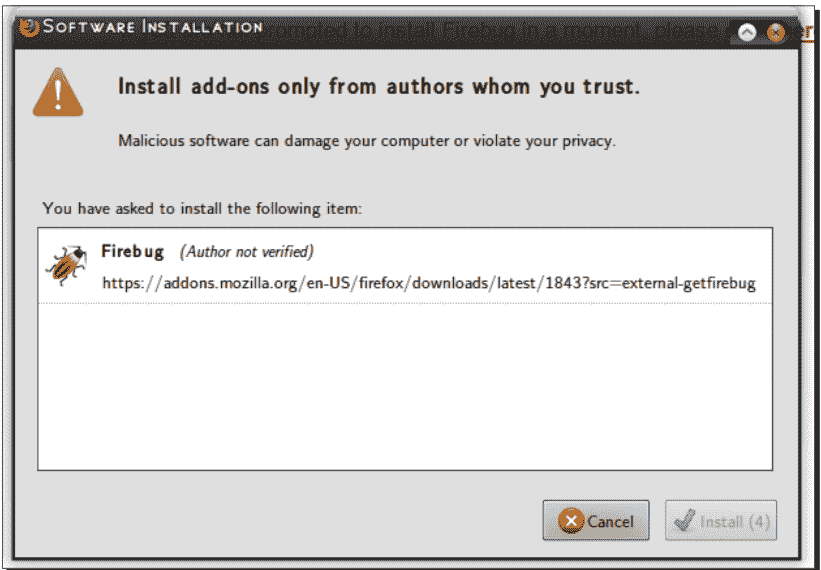

- 3. 点击 **Install**，等待安装完成，然后重新启动 Firefox。
- 4. 安装 Firebug 后，你应该会在屏幕右下角看到 Firebug 图标。

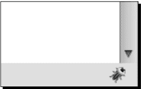

### 发生了什么？

当 Firebug 未启用时，Firebug 图标为灰色。启用时，它为橙色——这只是快速判断当前页面是否启用了 Firebug 的方法。

### 使用 Firebug 消除 Bug

当你点击 Firebug 图标（浏览器窗口右下角附近）时，Firebug 将打开，你可以开始使用它。但在开始之前，让我们先看看初始安装后点击 Firebug 图标时的样子：

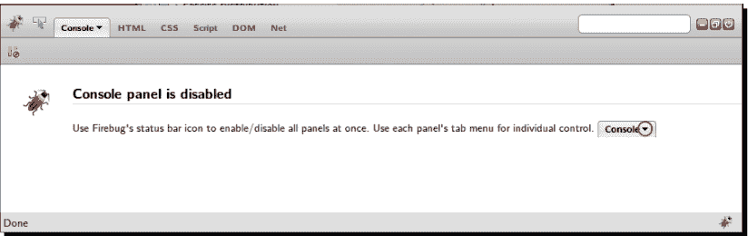

顶部行包含两个图标（Firebug 图标和页面检查器图标）、多个提供特定功能的面板（它们看起来和作用类似于标签页，但技术术语是“面板”）、一个搜索框，最后是最小化、最大化和关闭按钮。让我们逐一从左到右介绍这些项目。

> 随着 Firebug 的更新，图标的位置可能会随时间变化；但总体功能应保持（或多或少）不变。

### Firebug 控制

Firebug 图标：点击左上角的 Firebug 图标会显示与 Firebug 相关的各种命令和选项。

Page Inspector 图标：这个图标是一个位于矩形内的光标，是 HTML 检查器。点击它后，你的鼠标光标将识别网页上的 HTML 元素。因此，当你在网站上悬停鼠标时，该元素会以蓝色轮廓显示，并且 HTML 面板会打开并显示鼠标悬停的元素。

### 面板

下一组控件称为面板；每个面板提供不同类型的功能。面板的作用类似于标签页（这两个术语可以互换使用），但 Firebug 在文档中将其称为“面板”。让我们介绍每个面板，因为它们本质上构成了 Firebug。

### 控制台面板

Firebug 的 **Console panel** 是我们将花费大部分时间的地方。它充当强大的 JavaScript 命令行或解释器，这意味着我们可以输入 JavaScript 代码并立即执行——无需保存或编辑任何文件。

使它如此有用的一个原因是我们可以直接与 **DOM (Document Object Model)** 交互——网页上的任何 HTML 元素，包括页面包含的任何现有 JavaScript 代码。因此，这意味着我们可以即时与 OpenLayers 地图交互，发出命令并测试代码，以立即看到什么有效什么无效。可以想象，这节省了大量时间！

默认情况下，控制台面板处于禁用状态。要启用它，请点击 **Console** 文本附近的箭头并选择 **Enabled.**

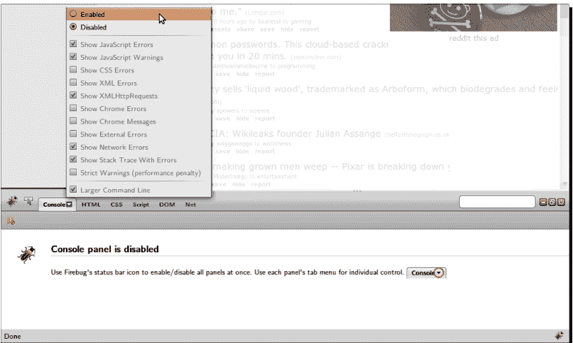

### HTML 面板

HTML 面板不仅提供 HTML 源代码的显示，还能快速编辑任何 HTML 元素及其相关样式。你可以添加和删除 HTML 元素、编辑 HTML 属性，并在无需保存文件的情况下更改页面上的几乎任何内容。它非常适合开发。

### 工作原理

Firebug 会根据你的 HTML 代码自动构建树形结构，允许你展开和隐藏每个 HTML 标签。需要注意的是，HTML 面板中看到的代码是生成的 HTML 代码——面板中的代码可能与页面的源代码不完全相同。

### HTML 面板内容

当在查看网页时打开 Firebug，HTML 标签页看起来如下：

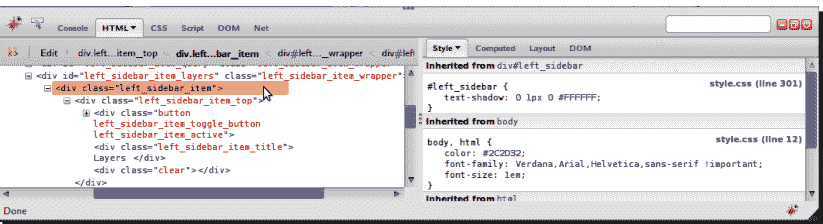

在左侧，Firebug 显示页面的 HTML。我们可以右键点击任何标签执行各种操作——例如将 HTML 复制到剪贴板、删除元素、更改标签属性等。

在右侧，我们看到所选元素的相关样式信息。在这里，我们可以修改或添加属性，它们会立即在页面上显示。在此示例中，我们选择了一个 class 为 'left_sidebar_item' 的 div 元素。查看右侧的 CSS，没有为 'left_sidebar_item' 类定义（如果有，我们会看到名为 .left_sidebar_item 的内容，前面有一个点以表示它确实是一个类）。不过，我们确实看到了 #left_sidebar 的定义，它是当前所选 div 的父级 div。

> 如果你不熟悉 HTML 或 CSS，w3schools 网站是一个很好的资源。有关 HTML 的更多信息，请访问 http://www.w3schools.com/html/default.asp，有关 CSS 请访问 http://www.w3schools.com/css/default.asp。

这是什么意思？Firebug 列出了所有继承的样式信息，父元素样式会传播到其所有子元素（每个子元素都具有其父元素的样式，除非子元素覆盖了样式，在此示例中并未发生）。这就是为什么我们还会看到 body、html 定义的原因，并且每个 div 都会显示这些，因为每个 div 都位于网页的 <html> 和 <body> 标签内。


通过双击 HTML 或 CSS 列表中的几乎任何内容，你可以快速更改值和名称。你所做的任何更改都会立即显示在页面上，这使得实时更改样式并查看页面受影响情况变得非常容易，而无需编辑和保存任何文件。多尝试一下——如果弄乱了什么，只需重新加载页面即可。

> 使用 Firebug 编辑页面时，刷新页面后你所做的任何更改都会消失。你并不是用 Firebug 编辑实际 Web 服务器的文件——相反，你编辑的是保存在你电脑上的副本，只有你在对其进行更改时才能看到。因此，如果你做了更改并希望保存，就必须编辑实际的源代码。

## CSS 面板

该面板提供了与我们刚才谈到的 HTML 面板中的 CSS 侧边栏类似的功能。它还提供了编辑与页面关联的任何 CSS 文档的选项，而不仅仅是所选元素的样式。我们不必过多讨论此面板，在本书的范围内我们也不会在这里花费太多时间。但如果你是网页设计师，这又是另一个功能强大的面板，可以大大加快你的开发速度。

## Script 面板

Script 面板非常强大。它不仅允许你查看与页面关联的所有 JavaScript 代码，而且是一个很棒的实时代码调试器。你可以设置监视表达式、查看堆栈、设置断点等。如果这些术语对你来说很陌生，不用担心，我们不会在这里花费太多时间。

不过，在我们进入下一个面板之前，我想快速谈谈启用错误中断。启用此选项后，只要遇到 JavaScript 错误，Firebug 就会停止网页。这使得快速精确定位页面崩溃的位置变得非常容易。要启用它，只需单击暂停按钮图标即可。

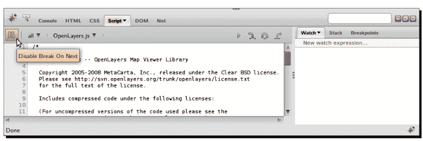

请注意你何时启用它——我在开发时曾多次因忘记它已被启用而感到沮丧。启用后，`Script` 文本会呈黄色发光，如上图所示的屏幕截图所示。你也可以通过 Console 面板启用/禁用它。

不幸的是（取决于你的观点），我们无法对这些工具进行更深入的探讨，因为它超出了本书的范围。但请随意尝试它们，因为 Firebug 的强大调试器是一个很好的资源。有关它的更多信息可在 http://getfirebug.com/errors 找到。

## DOM 面板

下一个面板是 Document Object Model 面板，或 **DOM** 面板。DOM 基本上是对 HTML 元素作为对象的表示。DOM 面板会自动设置树形结构来表示我们的 HTML 页面，使我们能够查看 HTML 页面包含的所有内容。我们还可以查看 JavaScript 变量及其值，以及函数、对象等。使用 DOM 面板时，属性和属性为黑色，函数和方法为绿色。

我们不会在这里深入探讨太多，但 DOM 面板是一个非常有价值的工具，尤其是在你想查看 JavaScript 组件时。通过使用 DOM 面板（并假设我们正在查看包含 OpenLayers 的页面），我们可以快速查看 OpenLayers 的所有类、函数等。它不是 API 文档的替代品，但作为快速查看此类信息的一种方式非常好。

## Net 面板

Firebug 的 **Net** 面板是我们将在本书中经常使用的工具。基本上，它提供了一种通过查看网页发出的所有请求和响应来监控网络活动的方法。我们可以看到页面发出的任何 Asynchronous JavaScript (**AJAX**) 请求。如果没有 AJAX，我们每次想对 OpenLayers 地图做任何事情时都必须刷新整个页面。因此，例如，每次你放大时，OpenLayers 都会向地图服务器发出一系列 **requests** 以获取新的地图图像，而地图服务器的 **response** 则是 OpenLayers 然后显示的新地图图像。这种请求/响应方法通过 AJAX 处理——如果没有它，我们每次请求后都必须刷新整个页面。


> AJAX 是一种方法，通过 JavaScript，你可以向服务器发送请求并在不实际刷新页面的情况下接收响应。传统上，如果你希望网页从服务器获取更新，就需要让页面本身发送请求。

Net 面板允许我们查看正在请求的 URL、GET 或 POST 参数、服务器的响应、响应的大小（以 KB 为单位）以及完成请求所需的时间。你可能还必须启用 Net 面板——它可以通过单击顶部选项卡上 Net 文本旁边的箭头以与我们启用 Console 面板类似的方式启用。让我们看看第 1 章示例的 Net 面板是什么样子的：

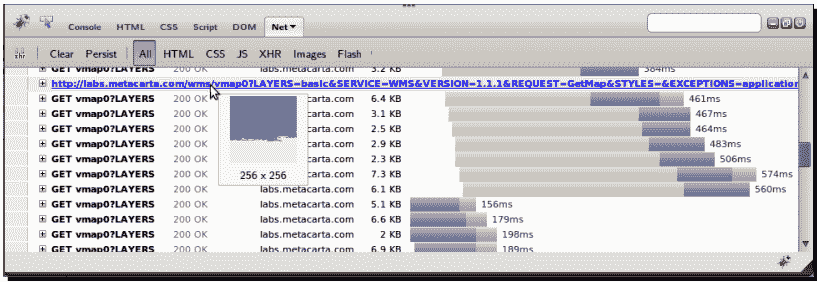

在我们谈论正在进行的请求之前，请看一下请求列表上方的工具栏——它包含 Clear、Persist、All、HTML 等链接。单击 Clear 会执行其名称所暗示的功能——清除请求列表。单击 Persist 会使请求列表在页面重新加载时保持不变，或不被删除。

下一组链接允许我们按类型过滤请求。因为在这种情况下我们只从地图服务器获取图像，所以你所看到的所有请求都属于 Images 选项。如果单击了 CSS 选项，我们将看不到这些请求，因为它们不是 CSS 文件。

现在，让我们分解实际的请求列表。

## 请求列表

请求列表显示页面发出的所有请求。上一张屏幕截图中的每个 URL 都是 OpenLayers 发出请求的 URL。通过单击每个请求旁边的 +（加号）符号，我们可以获取有关请求的更多信息，包括完整的请求 URL 和响应。当我们单击加号符号时，我们会得到一个包含 Params、Headers、Response 和 Cache 选项卡的框。Params 选项卡列出了 URL 包含的所有参数，或键/值对。Response 选项卡为我们提供了服务器对请求的响应。就本书而言，我们不需要担心另外两个选项卡。

## 参数

再次查看列表——在将鼠标悬停在屏幕截图中的文本上之前，标题包含 GET vmap0?LAYERS。GET 指定请求类型为 GET，这基本上意味着我们将变量嵌入到 URL 本身中，使用键=值对，以 & 符号分隔。

当我们将鼠标悬停在 URL 上时，我们可以看到更多内容——如前面的屏幕截图所示，我们看到了一堆格式为 key=value&key=value& ... 的变量。这些值对应于展开 URL 时 Params 选项卡中列出的值。

如果你查看我们将鼠标悬停的链接，你会注意到 URL 与第 1 章示例中的 URL 相同，http://labs.metacarta.com/wms/vmap0。然而，在 vmap0 之后还有额外的文本；一个问号后跟键=值对。问号表示 GET 请求中键=值对的开始。

让我们看看 URL 包含的一些变量。

```
?LAYERS=basic&SERVICE=wms . . .
```

LAYERS 键应该很熟悉，因为我们在第 1 章中指定了它。在那个示例中，我们使用了代码：

```
{layers: 'basic'},
```

当我们定义键:值对时，我们本质上是在告诉 OpenLayers 将什么传递到它生成的实际 URL 中。从生成的 URL 中，我们可以看到它确实传递了正确的图层名称。现在，正如我们之前讨论的，这个图层名称 basic 是我们想要从 WMS 服务获取的图层。我们在此处传递的图层名称会影响 WMS 服务器响应的图像。在这种情况下，我们将获得一个图层名为 basic 的图像。

请注意，参数（以 & 符号分隔）比我们传递的要多得多。OpenLayers 会自动为你添加这些参数，这样我们就可以在无需手动构建每个 URL 的情况下获得正确的地图图像。

要查看整个键:值对，或参数，请展开 URL 并查看 Params 选项卡。

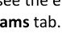

> 请注意，这些 GET 变量，例如 LAYERS 和 SERVICE 是 WMS 特有的。其他图层类型将使用不同的值。


## BBOX 参数

URL 中需要关注的一个重要变量是 BBOX，或边界框，参数。 通过点击其旁边的加号展开其中一个 URL，并在 Params 选项卡中查看。 这个 BBOX 数字是该单个地图图像块的范围。 你会看到以下格式的数字：

```
minx, miny, maxx, maxy
```

这四个数字形成一个矩形，包含地图图像的范围。 数字示例可能类似于 -73.5, 39.3, -67.5, 45。 这些数字取决于地图所在的投影——但现在不必太担心这个问题。

如果你查看其他 URL 的 BBOX 参数，你会注意到每个请求的 BBOX 值的一部分（或全部）都会发生变化。 请求列表中分组在一起的 URL 在其 BBOX 参数上共享一些值。 这类似于一个网格； 每个请求返回网格的一个单独单元格。 （此功能并非适用于 OpenLayers 中的所有图层类型，但这一基本概念适用于大多数图层类型，包括本示例中的 WMS 图层。）

## Pop Quiz– 面板

- 1. 如果你想执行 JavaScript 代码，你会使用哪个面板？
  - a. The Net panel
  - b. The Console panel
  - c. The DOM panel
  - d. The HTML panel

## 面板结论

每个面板都有其特定用途，Firebug 的所有面板都极其有用，但在整本书中我们将主要关注以下面板：

- Console panel (Command Line JavaScript)
- HTML panel
- Net panel

这三个面板在整本书中会被使用得最多。 我们偶尔会回到其他面板，但不会花太多时间在它们上面。 然而，在结束本章之前，让我们对 Console 面板更熟悉一些，因为在接下来的章节中我们会大量使用它。

## 使用 Console 面板

我们稍微谈了一下 console 面板是什么——本质上是一个 JavaScript 命令行。 我们可以执行任何我们想要的 JavaScript 代码，并与任何页面元素交互。 Console 面板有两个主要组件——控制台日志区域和输入区域。

控制台日志区域会显示任何错误的 information，以及输入的任何代码。 输入区域允许我们输入单行代码，或通过点击输入框右侧的红色箭头输入多行代码。

在开始使用控制台与地图之前，让我们通过执行一些 JavaScript 代码来熟悉控制台。

## 动手实践 – 在 Console 中执行代码

我们将通过 Firebug 控制台进行一些基本的 JavaScript 编码；具体来说，只是调用内置的 alert() 函数来显示一个警告。

- 1. 打开 Firefox。 此时你访问哪个网站（如果有的话）并不重要，因为我们将编写独立代码。
- 2. 通过点击 Firebug 图标打开 Firebug。 进入 Console 面板。 如果未启用，请启用它。
- 3. 现在，在屏幕底部你会看到一个可以输入代码的区域，用 >>> 表示。 点击该符号之后任意位置即可输入代码。
- 4. 输入以下代码，然后按 Enter。
- 5. 你应该会看到一个警告框弹出，文字为 `Narwhals like bacon`（或你传入 `alert` 函数的任何字符串）。 代码执行后，它会出现在输入行上方的日志中。

```
alert('Narwhals like bacon');
```

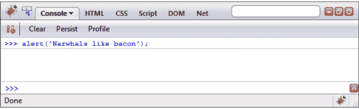

## 发生了什么？

我们刚刚在无需编辑和保存任何文件的情况下执行了一些 JavaScript 代码。 虽然我们做了一个简单的 alert，但我们能做的真的不受限制。 我们可以在 JavaScript 文件中保存的任何内容，都可以输入到 Console 中。

你还会注意到我们输入的相同代码出现在日志区域。 如果代码出现任何错误，我们也会收到错误信息——去试试吧！ 不要输入 alert('My alert'); 而是输入类似 fakealert('Boom');。 这会给出引用错误，因为函数 fakealert() 在任何地方都没有定义——而 alert() 另一方面是内置函数，所以我们可以从任何页面调用它。

基本上就是这样！ 其余内容都建立在这些原则之上。 在进入操作 OpenLayers 页面之前，让我们再做一件稍微复杂一点的事情。

## 动手实践 – 创建对象字面量

我们将介绍对象字面量并现在熟悉如何操作它们，以便更好地处理 OpenLayers 代码。

- 1. 打开 Firefox 和 Firebug 的 Console 面板（如果已禁用则启用它）——再次说明，现在你处于哪个页面并不重要。
- 2. 点击右下角 Firebug 图标上方的红色箭头。 这将打开一个侧面板，我们可以在其中输入多行代码。 在单行模式下，按 Enter 时代码不会被执行。 相反，我们可以通过按 Ctrl + Enter 或点击 Run 来执行代码。
- 3. 输入以下代码，然后按 Ctrl+Enter 或点击 Run 执行它。
```javascript
var my_parameters = {'answer': 42, 'question': null};
console.log(my_parameters);
```
- 4. 上述代码应在控制台日志区域显示类似 Object { answer=42 } 的内容。 点击它，DOM 面板将打开，显示你刚刚创建的对象的全部信息。
- 5. 点击 Console 面板返回。 在输入框中，将以下代码添加到现有代码中并执行它：
```javascript
console.log(my_parameters.answer);
```
- 6. 你应该会在控制台区域看到一行输出，包含数字 42。

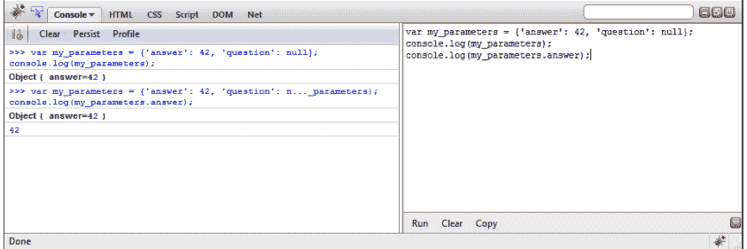

## 发生了什么？

我们刚刚创建了在 JavaScript 中称为匿名对象或对象字面量的东西。 现在，我们已经讨论过对象是如何从类创建的，并且在 JavaScript 中我们需要使用 new 关键字从类实例化对象。 但这里没有 new 关键字！

## 对象字面量

这里的关键概念是我们只是在创建一个不派生自类的单个对象。 由于对象字面量（匿名对象）不派生自类，本质上它是一个空对象。 它只包含我们明确定义的内容。 与键关联的值几乎可以是任何东西——字符串、整数、函数、数组，甚至是另一个对象字面量。

我们在第 1 章讨论 JavaScript 对象表示法时遇到了对象字面量——它们是用于定义图层和对象的参数和选项的 {key:value} 对。 唯一的区别是我们没有为它们分配变量；我们在创建图层对象时只是简单地传入它们。

对象字面量对于各种任务都非常有用，并且是打包信息为易于使用形式的好方法。 它们的形式为 {key:value, key2:value2}。 我们可以通过使用点表示法，以 my_object_literal.key 的形式访问对象字面量的任何属性。 键，如同之前一样，是 key:value 对中的键部分。 在上面的代码中，我们调用 console.log(my_parameters.answer); 并且键 answer 的值显示在控制台的日志区域。


> console.log(): Firebug 函数 `console.log()` 本质上是一个函数，它会将你传入的内容显示在控制台日志中。 你可以传入变量、字符串、对象；任何东西，它都会在日志中显示。 它经常派上用场，所以熟悉它是个好主意。

我们将在制作地图时经常使用对象字面量——所以如果它们现在还不太有意义，不用担心。 需要掌握的基本思想，以及我们主要使用它们的方式是，它们本质上是 `key:value` 对。 在结束本章之前，让我们做一个更快的示例，使用 Console 面板与 OpenLayers 地图进行交互。

## 动手实践 – 与地图交互

我们将使用第 1 章创建的地图来做这个示例，通过调用地图的各种函数与我们的 OpenLayers 地图交互。

- 1. 在 Firefox 中打开第 1 章的地图。 启用 Firebug 和 Console 面板。 如果愿意，你可以查看 Net 面板并查看网络活动，以查看页面发出的请求。
- 2. 进入 Console 面板，输入然后执行以下代码：
```
console.log(map);
```
- 3. 你应该会在控制台日志中看到地图对象信息。 点击它，花点时间查看它拥有的各种属性。 底部附近，你可以看到属于它的所有函数的列表（也称为方法）。
请注意函数名称，因为我们将使用它们。
- 4. 返回 Console 面板，输入并执行以下代码：
```
map.zoomIn();
map.getExtent();
```
- 5. 注意范围。 清除你输入的代码，然后输入以下内容并执行它：
```
map.zoomToMaxExtent();
map.getExtent();
```


6. 现在，让我们来看一下地图对象的一些属性。我们可以使用之前讨论过的 `dot notation` 来访问地图属性。清除到目前为止输入的代码，输入并执行以下代码：

```
console.log(map.id);
console.log(map.numZoomLevels);
```

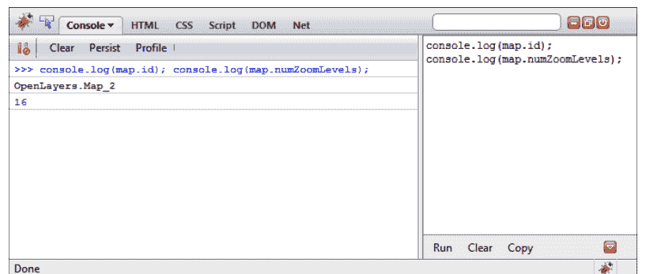

7. 回顾地图对象的函数（通过运行 `console.log(map);` 然后在日志区域点击输出）。尝试使用地图对象拥有的不同函数和属性进行实验。要访问函数，只需输入 `map.function();` 即可。

你也可以通过输入 `map.key` 来访问地图的属性，其中 `key` 可以是像 `id` 这样的内容（因此完整代码为 `map.id`）。在 DOM 面板中，属性为黑色，函数为绿色。

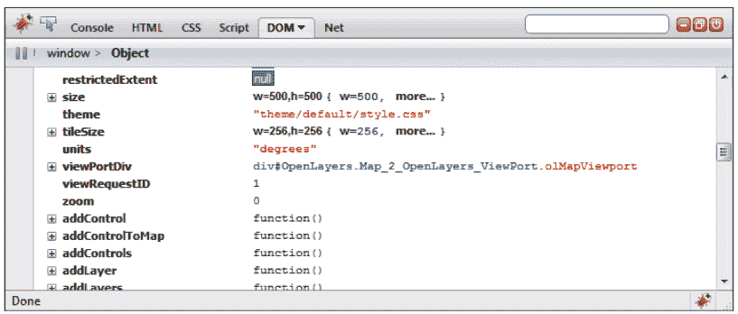

## 发生了什么？

我们刚刚执行了地图的一些函数并访问了它的一些属性。我们所要做的就是调用我们的对象 map，后跟一个句点，然后是它拥有的函数或属性。使用这种点记法（例如，`map.zoomIn()`），我们可以访问地图对象的任何属性或函数。

我们还看到了 DOM 面板如何派上用场，并查看了我们可以调用的函数，这些函数由地图对象拥有。列出的任何函数都可以通过 `map.functionname()` 调用，但有些函数需要传入参数，否则将无法工作。那么我们可以在哪里找到有关函数及其要求的更多信息呢？

## 试一试英雄 – 尝试函数

尝试调用你在 DOM 选项卡中看到列出的不同函数。许多函数如果不传入某些参数将无法工作，但不要害怕错误！在各种函数和属性中探索，并尝试使用控制台选项卡像上面的示例一样与它们交互。

## API 文档

Map 类的 API 文档，我们的地图对象由此派生（因此继承了该类的所有函数和属性），提供了有关属性、函数以及我们可以做什么的更详细解释。它们可以在 `http://dev.openlayers.org/apidocs` 找到。尽管 Firebug 是快速与代码交互并从中学习的好资源，但 API 文档提供了 Firebug 不一定能提供的额外信息层级。

## 总结

在本章中，我们更深入地了解了 OpenLayers 的工作原理。我们学习了如何设置和使用 Firebug 以及其他 Web 开发工具。

然后我们查看了 Firebug 提供的面板及其用途。最后，我们花时间使用控制台面板——你在整本书中（以及在开发自己的网络地图时）会大量使用它。

本章旨在为进入 OpenLayers 和通用 Web 开发提供 Web 开发工具的基础知识。像 Firebug 这样的 Web 开发工具是我们工具箱中最重要的资产之一。它们加快开发时间，帮助我们识别错误，更好地与代码交互等等。

> Firebug 和此类工具在你只是浏览网页时也会降低性能，因此最好在不使用时将其禁用。


对于后续章节中的代码练习，如果你先使用 Firebug 测试代码以了解其作用，将会非常有益。这样，你立刻就知道，换句话说，每个拼图块放在哪里；你知道每一行代码实际做什么，以及它如何影响整个项目。

在下一章中，我们将真正深入 OpenLayers，涵盖 OpenLayers 中也许最基础的主题：Layer 类。

# 3

# OpenLayers 中的“图层”

> *地图可能包含令人难以承受的信息量，但有些地图显示的信息却不够。弄清楚在地图上显示什么信息绝对是一门艺术，而制作信息平衡恰到好处的印刷地图则相当困难。*
> 
> *幸运的是，在这方面为网络创建地图稍微容易一些，因为我们可以让用户决定他们想看到什么信息。想象两个人正在看一张城市地图——一个人只关心公交路线，而另一个人只想了解自行车路线。与其创建两张地图，我们可以创建一个包含两个不同图层的单一地图，每个路线一个。然后用户可以决定是否想查看公交路线、自行车路线、两者或都不查看。*
> 
> *OpenLayers 为我们提供了多种可供选择和使用的图层类型。我们可以做各种事情——例如更改图层不透明度、打开或关闭图层、更改图层顺序等等。*

在本章中，我们将介绍图层是什么——既在抽象意义上也在具体意义上（通过 OpenLayers 的 Layer 类）。到最后，你将具备足够的专业知识来在地图上使用不同类型的图层并与之交互。在本章中，我们将：

- 了解图层是什么
- 展示基础图层和叠加图层之间的区别
- 谈论 WMS 图层类
- 了解图层类属性
- 涵盖其他类型的图层
- 讨论图层类函数

### 什么是图层？

图层基本上是一种以相互独立的方式显示多个信息层级的方法。图层不仅仅是制图或地图学概念；平面设计师和数字艺术家大量使用图层。

想象一张打印出来的城市地图。假设你还有两张透明纸。一张纸上有蓝色线条表示公交路线，另一张纸上有绿色线条表示自行车路线。现在，如果你把带有自行车路线的透明纸放在地图上，你就会看到一张描绘出自行车路线的城市地图。

放置或取下这些透明纸片相当于打开或关闭一个图层。你将纸片叠放的顺序也会影响地图的外观——如果两条线相交，你会看到绿色线在上或蓝色线在上。这就是图层的基本概念。

### OpenLayers 中的图层

OpenLayers 是一个 JavaScript 框架，如前所述，它是使用面向对象编程构建的。当我们想要实际创建一个图层时，我们从 OpenLayers Layer 类创建一个（或实例化）对象。

OpenLayers 有许多不同的 Layer 类，每个类允许你连接到不同类型的地图服务器“后端”。例如，如果你想连接到 WMS 地图服务器，你将使用 `Layer.WMS` 类，如果你想使用 Google 地图，你将使用 `Layer.Google` 类。每个图层对象都独立于其他图层对象，因此对一个图层所做的操作不一定会影响另一个图层。

> 我可以有多少个图层？
> 地图上一次可以拥有的图层最安全最大数量很大程度上取决于用户的机器（即其处理能力和内存）。图层过多也会让用户不知所措；许多流行的网络地图（例如 Google 和 Yahoo！）只包含几个图层。如果你需要使用大量图层（比如超过五十个），最好在必要时创建/销毁它们，因为图层过多可能会在某些机器上减慢地图速度。

无论你的网络地图应用程序的用途是什么，你都需要至少一个图层才能拥有可用的地图。没有图层的 OpenLayers 地图就像没有地图的地图集。你至少需要一个图层——至少一个基础图层。所有“位于”基础图层之上的其他图层称为叠加图层。这些是 OpenLayers 中的两种“图层类型”。

### 基础图层

基础图层位于图层列表的最底部，所有其他图层都在其之上。这就是我们前面示例中打印出来的地图。其他图层的顺序可以更改，但基础图层始终位于叠加图层下方。默认情况下，你添加到地图的第一个图层充当基础图层。然而，你可以更改地图上任何图层的属性使其充当基础图层（通过将 `isBaseLayer` 属性设置为 `true`）。

你也可以拥有 *多个* 基础图层。然而，一次只能有一个基础图层处于活动状态。当一个基础图层打开时，所有其他基础图层都会关闭。叠加图层（非基础图层）则不会这样——打开或关闭叠加图层不会影响其他叠加图层。基础图层类似于单选按钮——一次只能有一个处于活动状态。叠加图层类似于复选框——你可以随意打开或关闭任意多个。


> 在撰写本文时，有讨论将“基础图层”术语移除并替换为“互斥图层”。如果你在阅读本文时情况如此，想法和概念与基础图层/叠加图层概念相同。

### 叠加图层

任何不是基础图层的图层都称为叠加图层。就像我们谈到的那样，你向地图添加图层的顺序很重要。每次向地图添加图层时，它都会放置在前一个图层之上。


> 在本书的其余部分，我们将使用我们在第 1 章示例中创建的地图作为一种模板。唯一的变化是你将不会使用创建 WMS 图层并将其添加到地图的代码行。你需要自己删除这些代码行，或参考书中网站上的模板 `http://vasir.net/openlayers_book/`。

### 动手时间 – 创建一个包含多个图层的地图

让我们创建一个包含两个 WMS 图层的地图。一个图层将充当我们的基础图层，另一个将是包含国家、州和城市名称标签的叠加图层。

1. 复制你在第 1 章最后一个示例中创建的文件并删除现有的 WMS 图层代码（或使用来自 `http://vasir.net/openlayers_book/` 的模板）。你可以随意命名它，但我们将称其为 `chapter3_ex1_wms_layers.html`。确保它与你的 `OpenLayers.js` 文件位于同一目录中。


- 1. 首先我们要删除 init() 函数中的所有内容。你的函数现在应该如下所示：
```
function init() {
}
```
- 2. 接下来，在 init() 函数内部，我们将像之前一样设置我们的地图对象：
```
map = new OpenLayers.Map('map_element', {});
```
- 3. 现在我们要创建第一个图层。我们将使用 WMS 图层并向 WMS 服务器请求图层 'basic'（WMS 服务上的一个图层）。我们还将显式地将其设置为基础图层。
```
var wms_layer_map = new OpenLayers.Layer.WMS(
  'Base layer',
  'http://vmap0.tiles.osgeo.org/wms/vmap0',
  {layers: 'basic'},
  {isBaseLayer: true}
);
```
- 4. 现在让我们创建一个第二个图层对象。它也将是 WMS 图层。这次，我们将从 WMS 服务请求几个不同的图层——一堆标签。我们还将把 transparent 属性设置为 true，这样服务器返回的地图图像将是透明的。我们还将把不透明度设置为 50%（通过将 opacity 设置为 .5）。该图层将是一个覆盖图层。
```
var wms_layer_labels = new OpenLayers.Layer.WMS(
  'Location Labels',
  'http://vmap0.tiles.osgeo.org/wms/vmap0',
  {layers: 'clabel,ctylabel,statelabel',
   transparent: true},
  {opacity: .5}
);
```
- 5. 现在是时候将图层添加到地图了。我们将使用 addLayers 函数并传入一个图层对象数组。
```
map.addLayers([wms_layer_map, wms_layer_labels]);
```
- 6. 现在，让我们添加一个图层切换控件，以便显示地图上的图层。
```
map.addControl(new OpenLayers.Control.LayerSwitcher({}));
```
- 7. 最后，我们需要设置地图中心信息。这个最后一步需要在整本书的后续所有示例中重复——你需要确保包含它，即使没有明确要求。我们的所有地图都需要以某种方式设置其范围，而这是一种标准方法（请参阅第 1 章了解更多解释）。
```
if (!map.getCenter()) {
  map.zoomToMaxExtent();
}
```
- 8. 保存文件，然后在你的网络浏览器中打开它（最好是 Firefox，因为我们将使用 Firebug）。由于我们只是使用 HTML 和 JavaScript，你不需要将其放在服务器上。你可以直接从文件夹中用网络浏览器打开该文件。你应该会看到类似这样的内容：

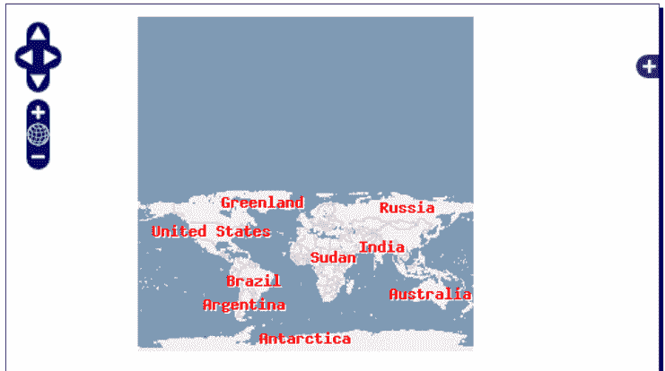

## 发生了什么？

我们刚刚创建了一个地图，其中包含两个 WMS 图层和一个图层切换控件，可让我们打开和关闭图层。控件是 OpenLayers 提供的功能，使我们能够实际与地图和图层交互。要使用控件，我们需要从不同的 Control 类创建对象。默认情况下，所有地图都会获得一个 Navigation 控件对象，该对象允许我们平移和缩放地图。在第 6 章中，我们将深入介绍控件。


> 在之前的示例中，我们的图层对象名为 `wms_base_layer` 和 `wms_overlay_layer`。在整本书中，我将使用此格式来命名对象——全部小写，使用下划线 (_)，没有空格。当然，你可以使用任何你喜欢的约定，只要你的命名方案保持一致即可。

## 创建图层对象

处理图层的过程包括两个步骤：

- 1. 创建图层对象。
- 2. 将图层对象添加到地图。你可以使用 `map.addLayer(layer)` 添加单个图层，或使用 `map.addLayers([layer1, layer2, ...])` 添加图层数组，如前例所示。

这两个步骤实际上可以合并为一个步骤（在调用 `addLayer` 函数时实例化图层对象——这可行，但我不推荐这样做，因为它会使处理图层对象变得稍微困难一些）。到目前为止，我们已经有一些从 WMS Layer 类实例化对象的经验。让我们看看创建我们的 `wms_base` 图层对象的代码。

```
var wms_layer_map = new OpenLayers.Layer.WMS(
  'Base layer',
  'http://vmap0.tiles.osgeo.org/wms/vmap0',
  {layers: 'basic'},
  {isBaseLayer: true}
);
```

括号内的每个项目，在 `OpenLayers.Layer.WMS(` 之后，都称为 **参数**，我们在创建对象时传入这些参数。但我怎么知道要传入哪些参数呢？

我们没有编写该类，所以我们不知道它期望接收什么。因此，就像几乎任何第三方库一样，我们必须参考文档来查看该类期望接收哪些参数。OpenLayers 拥有出色的文档，我们将在整本书中使用它。

由于我们使用的是 WMS Layer，让我们查看一下 WMS 类的文档，网址为 http://dev.openlayers.org/docs/files/OpenLayers/Layer/WMS-js.html。

## Layer.WMS 类

API 文档中有很多信息，但让我们具体查看标题为 **构造函数** 的部分。这将告诉我们如何创建 WMS 图层对象。不同类型的图层过程各不相同，但让我们先关注 WMS 类。查看 **参数** 子部分——它指定了该特定类期望接收的参数：

| 参数 | 描述 |
|------------|-------------|
| name | {String} 图层的名称。 |
| url | {String} WMS 的基础 URL（例如 http://vmap0.tiles.osgeo.org/wms/vmap0）。 |
| params | {Object} 一个包含键/值对的对象，表示 GetMap 查询字符串参数及其参数值。 |
| options | {Object} 要附加到图层的额外选项的哈希表。 |

这些参数告诉我们要传入参数的顺序，以及每个参数的含义。花括号 ({ }) 之间的词指的是参数的数据类型。所以，`{string}` 表示参数应为字符串。

让我们看看 `wms_base_layer` 图层的实例化代码，看看我们如何使用这四个参数。

## WMS 图层参数：

四个 WMS 图层参数如下：

### 名称

第一个参数是图层的 **名称**，它应为字符串。我们传入 `'Base Layer'`。注意我们如何用引号将 `Base Layer` 括起来——这就是表示它是一个字符串的方式。标题可以是你喜欢的任何内容——如果你有图层切换控件，标题将显示在其中。请记住，闭合引号后有一个逗号，这意味着我们已完成第一个参数，可以继续下一个参数。

这个 **名称** 参数几乎存在于所有 Layer 类中。

### URL

**URL** 是第二个参数，它也应为字符串。它指定 Web 地图服务器的 URL。我们传入 `'http://vmap0.tiles.osgeo.org/wms/vmap0'`。这个 URL 参数存在于大多数 Layer 类中。

### Params

Params 是第三个参数，它是一个由键:值对组成的匿名对象。该参数指定影响 WMS 服务器返回的地图图像的服务器端设置。你在此处传入的键:值对将被（或多或少地）附加到 OpenLayers 在向地图服务器发出请求时生成的 URL。

例如，在之前的示例中创建 `wms_layer_labels` 时，我们传入了 `{layers: 'clabel,ctylabel,statelabel'}`。在这种情况下，我们要求 WMS 服务器返回一张地图图像，其中服务器端图层 `'clabel,ctylabel,statelabel'` 已打开。我们指定了多个服务器端图层——不过请求什么或多少个服务器端图层并不重要，因为在客户端，OpenLayers 仍将 WMS Layer 对象视为单个图层对象。这个 params 参数存在于大多数 Layer 类中。

### 可能的 params 键和值

这个 params 对象的可能键和值取决于你正在使用的地图服务器。不幸的是，涵盖所有图层类型的所有内容超出了本书的范围。我们在整本书中只会使用几个 WMS 参数——layers（指定 WMS 服务应提供哪些图层）、transparent（请求透明图像，例如标签图层）和 srs（指定投影）。

目前，至少，我们的主要关注点只是弄清楚 WMS 服务器上的图层名称。为此，你可以在 URL 中发出 GETCAPABILITIES 请求（还必须指定 SERVICE=WMS）。例如，要获取我们迄今为止使用的 WMS 服务的可能图层，请访问以下 URL：

```
http://vmap0.tiles.osgeo.org/wms/vmap0?SERVICE=WMS&REQUEST=GETCAPABILITIES
```

如果你对 WMS 有更多兴趣，其规范可以在以下位置找到

```
http://www.opengeospatial.org/standards/wms.
```

### 选项

Options 是最后一个参数，它是一个匿名对象，指定图层对象的设置。你不需要传入此参数。

options 对象包含客户端 OpenLayers Layer 对象的属性。这些是图层对象本身的设置，因此所有 Layer 类都有此参数。要定义 OpenLayers Layer 对象的各种属性，我们使用此 options 参数。属性包括诸如 isBaseLayer、opacity 和 visibility 等设置。由于图层属性是客户端设置，WMS 服务器（或图层使用的任何地图服务器）都不知道这些设置。


The possible values are, basically, anything that you find in the API documentation for either the base **Layer** class (at http://dev.openlayers.org/docs/files/OpenLayers/Layer-js.html), or the specific subclass you're working with, e.g., the **WMS Layer Class**, at http://dev.openlayers.org/docs/files/OpenLayers/Layer/WMS-js.html.


> You can use this **options** parameter to initialize any of the layer parameters described in the API—the best way to get more familiar with it is to just play around with the different properties listed in the docs. The Layer class docs can be found at http://dev.openlayers.org/docs/files/OpenLayers/Layer-js.html.

## Parameters versus arguments

These two terms are often confused and used interchangeably (but usually, that's ok). **Parameters** are what the items are called during the class or function definition, but when we call the function, the actual values of the parameters are referred to as **arguments**. For example, this is how we create a function in JavaScript:

```
function add_numbers(a, b){
  return a + b;
}
```

This is referred to as the `add_numbers` function definition. Here a and b are referred to as **parameters**. Now, take a look at how we call it:

```
var the_sum = add_numbers(13, 37);
```

Here, 13 and 37 are referred to as the **arguments**. In the `add_numbers` function, 13 acts as a and 37 acts as b.

Both terms are technically talking about the same thing. **Parameter** is the term to use when talking about function definitions, and **argument** is the term to use when talking about function calls. The distinction is sort of like that of a meteoroid (when it's in space), a meteor (when it's in the atmosphere), and a meteorite (when it hits the ground)—these three terms refer to the same object.

Now, let's take a look at some of the different arguments we can pass in when creating our layer objects.

## Time for Action – configuring the options parameter

The options parameter is something that is present in all Layer classes, so let's get a bit more familiar with it. I suggest opening up the Layer documentation and following along, and even trying to add in the options yourself from the possible list of layer properties (at http://dev.openlayers.org/docs/files/OpenLayers/Layer-js.html).

- 1. Use the template (or code from Chapter 1 with the WMS layer code removed). We'll be adding some WMS layers, and we'll refer to this file as `chapter_3_ex2_options_config.html`.
- 2. First we'll add in a layer that contains the 'basic' layer from the WMS server, like in the previous example.
- 3. Next we'll create another layer object. We'll create a layer using labels, like in the previous example. This time though, let's set the layer's options to include `visibility: false`. This will cause the layer to be hidden by default. The layer definition should now look like:
- 4. Time to create another layer. We'll set the layer params to ask the WMS service for the stateboundary layer. Then, we'll specify the options so that it won't display in the layer switcher control (via `displayInLayerSwitcher: false`) and set a minimum scale at which it will be visible (via `minScale`). That means this layer will only show up once we've reached a certain scale. Add the following to your `init()` function.

```
// Setup our two layer objects
var wms_layer_map = new OpenLayers.Layer.WMS(
  'Base layer',
  'http://vmap0.tiles.osgeo.org/wms/vmap0',
  {layers: 'basic'},
  {isBaseLayer: true}
);
```

```
var wms_layer_labels = new OpenLayers.Layer.WMS(
  'Location Labels',
  'http://vmap0.tiles.osgeo.org/wms/vmap0',
  {layers: 'clabel,ctylabel,statelabel',
  transparent: true},
  {visibility: false, opacity:0.5}
);
```

```
var wms_state_lines = new OpenLayers.Layer.WMS(
  'State Line Layer',
  'http://labs.metacarta.com/wms/vmap0',
  {layers: 'stateboundary',
transparent: true},
{displayInLayerSwitcher: false,
minScale: 13841995.078125}
);
```

- 5. Now let's add a layer that will show a different layer from the WMS service and we'll set the layer object's opacity to .8 (or 80 percent):

```
var wms_water_depth = new OpenLayers.Layer.WMS(
'Water Depth',
'http://labs.metacarta.com/wms/vmap0',
{layers: 'depthcontour',
transparent: true},
{opacity:0.8}
);
```

- 6. Finally, we'll create a layer object that shows some road layers from the WMS service and has an options object containing the transitionEffect: resize property. This causes the layer to have a 'resize' animation when zooming in or out.

```
var wms_roads = new OpenLayers.Layer.WMS(
'Roads',
'http://labs.metacarta.com/wms/vmap0',
{layers: 'priroad,secroad,rail',
transparent: true},
{transitionEffect:'resize'}
);
```

- 7. Now we just add the layers to the map (replace the previous addLayers function call with this one):

```
map.addLayers([
    wms_layer_map,
    wms_layer_labels,
    wms_state_lines,
    wms_water_depth,
    wms_roads]);
```

- 8. Save the file and then open it in your web browser.

- 9. Zoom in a few times around the Gulf of Mexico. You'll start to notice black contour lines in the ocean when you zoom in, and you should see a resize effect from the base ground layer. Depending on where you zoom, you should see something like this:

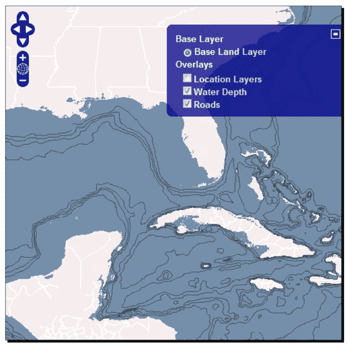

## What Just Happened?

We just created another map with a few more layers and demonstrated some more layer options. The map looks slightly different than the first example's map because we are using different WMS server side layers (which are configured in each layer's params argument).

For now, let's focus on the fourth argument passed in—the options argument. This argument is used in all Layer classes, so when we move on to other types of Layers you'll be able to use all the same properties we're talking about. The options argument controls the layer's object's properties.

## Configuring layer options

Let's take a look at a couple of the layer's options argument we passed in during the previous example.


> Pay close attention to the commas. Both arguments and key:value pairs are separated by a comma, but make sure you do not have a comma after the last pair. Trailing commas will usually break your map and are usually a pain to debug—so if your map isn't working and you don't see any helpful error messages in Firebug, check for trailing commas. A great site to help with your code is http://jslint.com.

## wms_state_lines layer options

This layer's options are:

```
{ displayInLayerSwitcher: false, minScale: 13841995.078125 }
```

The first property, displayInLayerSwitcher, can be either true or false, and determines if the layer will appear in the layer switcher control (if there is a layer switcher control). In our example, we do have a layer switcher control and you'll notice that we don't see it in the list of layers. The layer is still there, and we can programmatically turn it on or off through the setVisibility() function, e.g. wms_state_lines.setVisibility(false). In fact, when you turn on or off a layer through the layer switcher control, this setVisibility function is what is being called. This property is useful when you want to include layers in your map that you don't want to let the user control.

The second property is minScale: 13841995.078125. The value for this property is float, a number that can contain a decimal point. This minScale property determines the minimum scale the map must be at before the layer is displayed, which basically means how far we must be zoomed in before the layer will be turned on. There is also a maxScale property which determines how far we can zoom in before the layer is turned off. The term for this behavior is referred to as scale dependency.

## Scale dependency

Scale dependency can be controlled either from the client or server side (or both). You'll notice that the wms_water_depth layer (with black contour lines in the water to specify depth) does not turn on until we start to zoom in. We haven't set the minScale property for the wms_water_depth layer, so why don't we see it at all zoom levels? The reason is WMS server has its own scale dependencies on the server side, so even if we wanted to see this layer when the map is zoomed out we can't because the server does not allow it.


当我们在图层上设置 `minScale` 或 `maxScale` 属性时，我们是在指定客户端的比例依赖——因此即使服务器允许，我们也在告诉 OpenLayers 不要显示它。要确定地图的当前比例，可以调用 `map.getScale()` 函数，它会显示当前的比例值。

## wms_layer_labels 图层选项

本图层的 **options** 属性由以下内容组成：

```
{visibility: false,  opacity:0.5}
```

## 可见性属性

我们已经介绍过第一个属性，现在来谈谈 `visibility` 属性。它的值可以是 `true`（默认值）或 `false`。此可见性属性控制图层是否可见。将其设置为 `false` 会使其隐藏，但用户可以通过在图层切换控件中启用它来打开它。`map.getVisibility()` 和 `map.setVisibility({{Boolean}})` 函数引用此属性。`{{Boolean}}` 表示我们可以传入一个布尔值，换句话说，我们可以传入 `true` 或 `false`。

## 不透明度属性

下一个属性是 `opacity`。它接受一个介于 0 和 1 之间的浮点数。值为 0 表示图层将完全透明，值为 1 表示图层将完全不透明。我们在这里将其设置为 `0.5`，因此它将为 50% 不透明。如果你在地图中打开图层（你可以在图层切换器中点击图层来启用它），你会注意到标签有点半透明。这种不透明度设置有助于创建更美观的地图，因为通过启用多个图层并更改其不透明度，你可以产生一些很酷的效果。

## 地图瓦片

现在让我们稍作休息，谈谈一点理论。已经提到 OpenLayers 通过从后端地图服务器请求“地图瓦片”来工作，但我还没有深入说明这意味着什么。几乎所有图层都基于这种地图瓦片原理（Vector 图层和 Image 图层除外）。那么它到底是什么以及如何工作呢？

想象一下你如何从头开始创建一个网络地图——具体来说，你将如何处理地图图像本身？你可以有两种方法。第一种，你只需返回一张巨大的地图图像。如果用户放大，服务器会返回一张更大、更放大的地图图像。使用这种策略，每次用户放大时，你都会很快发送指数级增大的图像文件。这就是为什么这种方法并不真正实用。

## 多张图像构成一张地图

第二种方法是把所需的地图图像拆分成许多较小的图像，即地图瓦片。因此，无论用户放大到什么程度，服务器只需要发送相对较少量的图像。这种地图瓦片策略几乎是每个网络地图的做法——Google Maps、Yahoo! Maps、大多数 OpenLayers 图层等。当你请求新的范围时，OpenLayers 会请求一组新的地图图像。每张地图图像大小相同（例如 256 x 256 像素）；这被称为瓦片大小，可以在创建地图时指定。

让我们看一个基本的 OpenLayers 地图的例子。在我们的例子中，当你完全缩小时，整个可见区域将适合于一张地图瓦片图像。

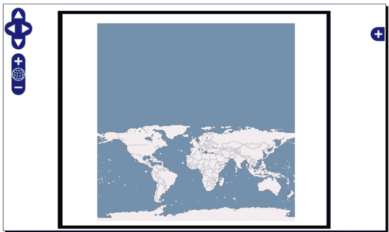

当客户端请求地图的最大范围时，只需要返回一个地图瓦片。OpenLayers 会计算出需要向地图服务器请求哪些范围。在这种情况下，它只需要请求一个地图瓦片，因为我们缩放到如此之远，整个世界都适合于一张地图图像。

## OpenLayers 中的“图层”

到目前为止，你可能会想知道将图像拆分为瓦片有什么好处，因为我们只得到一张图像。然而，当我们放大时，这就变得更清晰了。

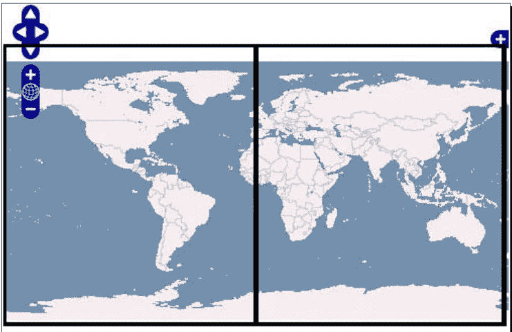

现在我们放大了一次。OpenLayers 必须弄清楚你的地图范围是多少，以及需要向地图服务器请求多少瓦片。OpenLayers 计算每个瓦片的范围，然后向地图服务器发送请求以获取请求范围的图像。因此，在此示例中，OpenLayers 确定需要向地图服务器发送两个请求。每个请求都会得到一张地图图像的响应，然后 OpenLayers 会将瓦片拼合在一起。

请记住，瓦片大小与之前的请求相同。你的地图只有一个瓦片大小，在这种情况下（也是默认值）它是 256 x 256 像素。你可以使用地图的 `tileSize` 属性更改瓦片的大小，我们将在第 8 章关于 **Map** 类的内容中更详细地讨论。那么当我们放大并稍微移动地图时会发生什么呢？

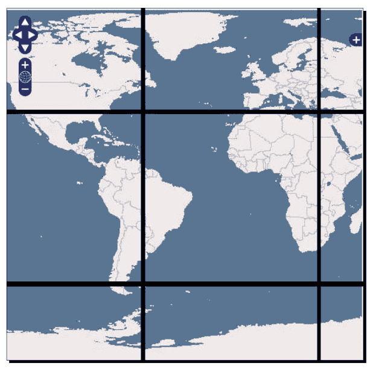

在这种情况下，OpenLayers 请求更多瓦片，因为总的地图区域超出了你可以看到的范围（称为视口）。瓦片仍然都是 256 x 256 像素，但现在瓦片位于地图可见范围之外。只要用户通过缩放或平移将地图移动到新区域，OpenLayers 就会计算出需要获取多少瓦片、每个瓦片的范围以及放置位置。

## 可用的图层属性

让我们回顾一下 OpenLayers 2.9 版本可用的属性，因为我们将在整本书中使用它们。这些属性可用于任何 Layer 类，因为所有 Layer 子类（如 WMS 和 Google Maps 图层）都继承自它们。

## 数据类型

在讨论图层属性之前，让我们快速回顾一下所使用的数据类型的表示法。大括号 { } 表示参数期望的 JavaScript 数据类型。数据类型如下：

- `{Array}`: 一个由逗号分隔并用方括号括起来的元素数组。例如：`[1,2,3]`
- `{Boolean}`: 可能的值为 `true` 或 `false`。
- `{Float}`: 可能的值为可以包含小数点的数字。例如：`42.5`
- `{Integer}`: 可能的值为整数（无小数）。例如：`42`
- `{Object}`: 一个匿名对象，键值对由逗号分隔，用大括号括起来。例如：`{'answer': 42, 'question': null}`
- `{OpenLayers.________}`: 从 OpenLayers 类实例化对象。空白可以是任何 OpenLayers 类。例如：`new OpenLayers.Control.LayerSwitcher({});`
- `{String}`: 可能的值为任何字符串，用引号括起来（单引号 ' 或双引号 "）。例如：`'This is a string'`

现在我们熟悉了一些数据类型，让我们来看看可供我们使用的 Layer 属性。

## OpenLayers.Layer 类属性

到目前为止我们只使用过 WMS Layer 类，但 OpenLayers 还有许多其他 Layer 类。以下属性适用于 *所有* 图层类。我们可以在创建图层时通过 **options** 参数设置这些属性，并且可以通过简单地调用 `layer_object.property` 在 Firebug 中访问它们。

下表是截至 OpenLayers 2.10 版本可用的图层属性。我们将在整本书中使用它们，并经常回顾它们，所以现在不必急于记住它们。最新的属性始终可以在 OpenLayers Layer 文档 http://dev.openlayers.org/docs/files/OpenLayers/Layer-js.html 中找到。

| 属性 | 属性数据类型 | 描述 | 默认值 |
|---|---|---|---|
| events | {OpenLayers.Event} | 一个 OpenLayers 事件对象。我们可以在此处传入一个事件对象，当发生诸如放大之类的事件时，它将调用一个函数。我们将在后面的章节中更多地讨论事件。 | - |
| map | {OpenLayers.Map} | 属于此图层的地图对象。当图层通过 setMap() 函数添加到地图时，此对象会自动设置。 |  |
| isBaseLayer | {Boolean} | 确定图层是否作为基础图层。 | false |
| alpha | {Boolean} | 指定图层的图像是否包含 alpha 通道。这最初是为了解决 IE 中的透明度问题而设计的，但会带来很大的性能损失。建议不要使用它。 | false |
| displayInLayerSwitcher | {Boolean} | 确定图层是否应在图层切换器中显示。 | true |
| visibility | {Boolean} | 确定图层在地图上是否可见以及在图层切换器控件中是否启用或禁用。 | true |
| attribution | {String} | 当 Attribution 控件已添加到地图时显示的文本。默认情况下，署名文本出现在右下角，每个图层的署名由逗号分隔。 | - |
| inRange | {Boolean} | 根据当前地图的分辨率是否在图层的最小和最大范围内，为 True 或 False。缩放级别更改时设置此值。 | - |
| imageOffset | {OpenLayers.Pixel} | 具有边距的图层的图像瓦片的位移。 | - |


| 属性 | 属性数据类型 | 描述 | 默认值 |
|---|---|---|---|
| `options` | `{Object}` | 可选对象，其属性将被设置在图层上。此 options 对象中可以定义这些图层属性中的任何一个。这就是我们在过去几页中讨论的同一个 options 对象。 | - |
| `eventListeners` | `{Object}` | 如果在图层对象创建期间设置此项，则会注册事件监听器。我们将在第 6 章中详细讨论此内容。 | - |
| `gutter` | `{Integer}` | 有时你可能会注意到地图请求的瓦片边缘周围出现伪影。当你设置 gutter 值时，OpenLayers 会请求比正常瓦片尺寸大两倍 gutter 值大小的瓦片。因此，如果你的默认瓦片尺寸为 256 x 256，并且 gutter 值为 10，则 OpenLayers 会请求尺寸为 276 x 276 的瓦片。不过，超出正常瓦片范围的部分（本例中为 256 x 256）不会显示，并且对 OpenLayers 来说瓦片尺寸仍为 256 x 256。这在遇到瓦片边缘附近出现伪影问题时才真正需要使用。非瓦片图层的 gutter 值始终为零。 | 0 |

| 属性 | 属性数据类型 | 描述 | 默认值 |
|---|---|---|---|
| projection | {OpenLayers.Projection} or {String} | 如果指定，这将覆盖地图的默认投影。你可能还需要设置 maxExtent、maxResolution 和 units 属性。如果传入字符串而不是投影对象，它将被转换为投影对象。投影用于将三维物体（地球）显示为二维（在我们的地图上）。不同的投影使用不同的坐标和测量单位。我们将在第 4 章中更详细地介绍投影。 | {EPSG:4326} |
| units | {String} | 地图图层所使用的单位。可能的值为 'degrees'（或 'dd'）、'm'、'ft'、'km'、'mi' 或 'inches'。 | 'degrees' |
| scales | {Array} | 包含地图比例尺，从最高到最低值。使用此属性时还必须设置 units 属性。建议改用 resolutions 属性。 | - |
| resolutions | {Array} | 包含地图分辨率（每像素的地图单位）数组，从最高到最低值。如果未设置，将根据其他属性（如 maxExtent、maxResolution 等）自动计算。 | - |

## OpenLayers 中的图层

| 属性 | 属性数据类型 | 描述 | 默认值 |
|---|---|---|---|
| maxExtent | {OpenLayers.Bounds} | 由 min x、min y、max x 和 max y 值组成的 OpenLayers.Bounds 对象，用于指定图层的范围。超出此边界框的任何坐标都不会显示。如果将 displayOutsideMaxExtent 属性设置为 false，则超出这些坐标的瓦片将根本不会被请求。 | - |
| maxResolution | {Float} | 设置最大分辨率（每像素的宽度或高度，以地图单位计）。默认最大值为 360 度/256 像素。如果未使用地理投影，请指定不同的值。 | - |
| numZoomLevels | {Float} | 指定图层具有的缩放级别数。如果地图的缩放级别大于此值，图层将不会显示。 | 16 |
| minScale | {Float} | 指定图层将开启的最小比例尺。 | - |
| maxScale | {Float} | 指定图层将被显示的最大比例尺。如果地图比例尺大于此值，图层将不会显示。 | - |
| displayOutsideMaxExtent | {Boolean} | 指定地图是否应请求完全超出图层 maxExtent 属性的瓦片。 | false |
| wrapDateLine | {Boolean} | 这将导致地图在日期线上环绕。这允许你无限地向左/右拖动地图，因为地图在自身上环绕。 | - |

| 属性 | 属性数据类型 | 描述 | 默认值 |
|---|---|---|---|
| transitionEffect | {String} | 指定在地图平移或缩放时使用的过渡效果。截至撰写时，可能的值为 null（无效果）和 'resize.' | null |
| SUPPORTED_TRANSITIONS | {Array} | 这是一个常量——不会改变。它包含可与 transitionEffect 属性一起使用的支持的过渡效果列表。 | - |
| metadata | {Object} | 允许你存储有关图层的额外信息。这对图层本身没有影响。 | - |

## 修改图层属性

现在你已经熟悉了一些图层属性，尝试修改第二个示例的代码，将额外的属性传递给 **options** 对象。打开之前的示例并使用 Firebug 访问单个图层属性，例如 `map.layers[1].propertyName`。在创建图层对象时，通过传递不同的属性给 **options** 对象进行尝试，不要害怕破坏你的代码！

## OpenLayers.Layer 类

到目前为止，我们在示例中只使用过 `OpenLayers.Layer.WMS` 类。这一直是我们迄今为止所有图层对象实例化代码的开头：

```
var wms = new OpenLayers.Layer.WMS(
```

注意 Layer 和 WMS 之间的句点：`Layer.WMS`。这意味着我们正在访问 `Layer` 超类的 `WMS` 子类。我说这是什么意思呢？嗯，`WMS` 类是 `Layer` 类的子类，所以让我们简要回顾一下关于子类的知识。

## 子类

在第 1 章中，我们提到了 **子类**。子类基本上是从某个基类派生的类。这个基类称为 **超类**。因此 Layer 类是所有 Layer **子类**的 **超类**（超类和子类仍然是类）。子类继承其超类的所有属性。

## Layer 类——子类和超类

因此 `Layer` 类是所有其他 Layer 类派生的超类。`Layer.WMS` 图层类与 `Layer.Image` 类不同，这两个类各自具有独特的属性和函数。但这两个图层也共享其 `Layer` 超类的所有属性——因此我们之前讨论的那些属性都适用于这两个类。

一些 Layer 类也以分层的方式从多个 Layer 类继承。例如，`Layer.WMS` 类继承自 `Layer.Grid` 类，而 `Layer.Grid` 类继承自 `Layer` 类。

## 其他图层类型

OpenLayers 支持多种不同的 Layer 类。如你在第 1 章中回忆的那样，每个 Layer 类都与不同的地图服务器后端相关联。`Layer.WMS` 类用于连接到 WMS 地图服务器，而 `Layer.Google` 类用于连接到 Google Maps 服务。

由于 OpenLayers 是一个积极开发的框架，有一些图层类已被弃用（不再推荐使用）。OpenLayers 的后续版本将弃用更多 Layer 类，因此我们将尝试专注于应该存在一段时间的类。我们无法涵盖每个 Layer 类，但我们将讨论常见的类。我们下面未提及的 Layer 类将不会在本 书中涵盖，因为它们已被弃用或超出了本书的范围。让我们来看看。

## Layer.ArcGIS93Rest

这是允许我们通过其 REST 接口与 ArcGIS Server 9.3 交互的类。与 REST 接口的交互是通过使用 URL 构造请求来处理的，其概念与 GET 请求的工作方式类似。

从此类实例化对象的结构与 `Layer.WMS` 类似，因为两者都继承自 `Layer.Grid` 类。ArcGIS Server 是 ESRI 的第三方专有软件，但 OpenLayers 为其提供了极佳的支持。ArcGIS 图层的 OpenLayers 文档可在 http://dev.openlayers.org/docs/files/OpenLayers/Layer/ArcGIS93Rest-js.html 找到。

> ArcGIS Server 的 REST API 文档可在 http://resources.esri.com/help/9.3/arcgisserver/apis/rest/index.html 找到。


## Layer.ArcIMS

此类层与 ArcGIS93Rest 类相似，允许我们显示来自 ArcIMS Mapping Services 的数据。ArcIMS 是 ESRI 的另一款专有软件产品。此 Layer 类的文档位于 http://dev.openlayers.org/docs/files/OpenLayers/Layer/ArcIMS-js.html。有关 ArcIMS 的更多信息可在 http://www.esri.com/software/arcgis/arcims/index.html 找到。

## Layer.Google

此层允许我们通过 Google Maps API 与 Google Maps 交互。此层类的文档位于 http://dev.openlayers.org/docs/files/OpenLayers/Layer/Google-js.html。

### 动手实践 – 创建一个 Google Maps 层

让我们看看如何创建一个 Google Maps 层。

- 1. 从现在开始，我假设当我说“创建一个新地图”时，你会使用来自 http://vasir.net/openlayers_book/ 的模板，或复制第 1 章的示例并删除 WMS 层调用（两者结果代码相同）。因此，创建一个新地图。
- 2. 我们需要做的第一件事是在 <head> 部分添加一个 script 标签，引用 Google API 库。这使我们能够实际使用 Google Maps 库：
```html
<script src="http://maps.google.com/maps/api/js?sensor=false"></script>
```
- 3. 现在，我们需要创建一个 Google Maps 层对象。我们不会传入任何额外设置，因此将使用默认设置。默认情况下，我们会看到 Google 的“街道”地图（我们可以要求航空影像图层、物理地形图层等——我们很快会介绍）。在你的 init 函数中添加以下内容：
```javascript
var google_map_layer = new OpenLayers.Layer.Google(
  'Google Map Layer',
  {}
);
```
- 4. 现在我们要做的就是将图层添加到地图中。在此之前，请确保已删除将 WMS 层添加到地图的现有代码行。我们只希望地图包含 google_map_layer。
```javascript
map.addLayer(google_map_layer);
```

你应该会看到类似这样的内容：

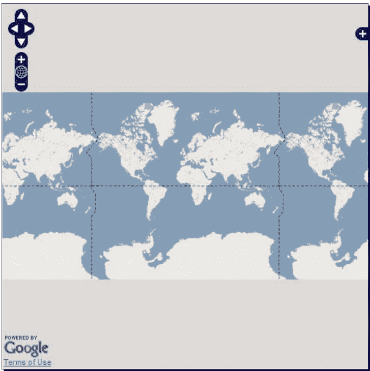

### 发生了什么？

我们刚刚使用 Google Maps API（版本 3）创建了一个包含单个 Google Maps 层对象的地图。Google 向我们展示的图层是名为 ROADMAP 的默认图层（也称为“街道”地图）。我们可以通过更改图层 options 对象中的 type 值来更改所见图层的类型。可以为 type 键设置的值有：

- `google.maps.MapTypeId.ROADMAP`（默认）
- `google.maps.MapTypeId.TERRAIN`
- `google.maps.MapTypeId.HYBRID`
- `google.maps.MapTypeId.SATELLITE`

你会注意到每个类型前面都有 `google.maps.MapTypeID.`，必须存在。例如，要指定你希望使用混合图层（卫星影像与 `ROADMAP` 图层结合），你可以使用：

```
var google_hybrid_layer = new OpenLayers.Layer.Google(
    "Google Hybrid",
    {type: google.maps.MapTypeId.HYBRID}
);
```

由于 Google Maps 和其他第三方 API 使用的投影，获取其他图层与其配合使用可能会有点棘手——我们将在第 4 章和第 5 章中更详细地讨论这个问题。简而言之，这是因为这些第三方 API 使用名为 `EPSG:900913` 的投影，该投影使用与 `EPSG:4326`（到目前为止我们的 WMS 层所在的投影）不同的坐标系统。因此，坐标不匹配。所以，我们不能直接将 WMS 层（位于 `EPSG:4326` 投影中）放置在 Google 层（位于 `EPSG:900913` 投影中）之上，因为坐标差异很大。在接下来的章节中，我们将解决这个问题。


> Google Maps 版本 3 API 可在 http://code.google.com/apis/maps/documentation/javascript/ 找到，关于可能的 Google Maps 层类型的更多信息可在 http://code.google.com/apis/maps/documentation/javascript/overlays.html 找到。

## Layer.Grid

这是一个基类，许多其他图层，例如 WMS，都继承自它。我们不会显式使用它，但知道它的存在很重要。它基本上通过构建一个网格并在网格中放置图块（地图图像）来工作。它使用 HTTPRequest 类与地图服务器通信，以获取构建地图所需的图块。

继承自它的类，例如 WMS，以类似的方式工作。因此，如果你熟悉如何使用 WMS 层，你就会熟悉如何使用几乎任何继承自 `Layer.Grid` 类的类。此类的文档位于 http://dev.openlayers.org/docs/files/OpenLayers/Layer/Grid-js.html。

## Layer.Image

此类允许我们使用图像作为地图图层。它与其他 OpenLayers 提供的图层类有点不同，因为它不严格遵循客户端/服务器模型。一旦对图像的初始请求发出，客户端就拥有了图像，OpenLayers 处理所有后续地图交互——在获取图像的第一次请求之后，不会再向服务器发出进一步请求。没有像其他栅格（非矢量，几乎是每个其他图层类）图层那样的图块。相反，只使用单个图像。

此类最初的用途（也是最佳用途之一）是为概览地图控件使用图像。但它可以用作不仅仅是这个——此类是 OpenLayers 的一个很好的例子，可以用于除制图之外的其他目的。

### 动手实践 – 使用图像图层

让我们使用图像图层创建一个图像查看器。

1. 首先我们需要添加一个图像图层。图像图层期望第一个参数为名称（如其他图层），接下来是图像的 URL，然后是一个 {OpenLayers.Bounds} 对象指定图像的范围，然后是一个 {OpenLayers.Size} 对象包含宽度、高度像素尺寸，最后是一个可选的 options 对象。

```
var image_layer = new OpenLayers.Layer.Image(
    'Wallpaper',
    'http://us.starcraft2.com/images/wallpapers/wall3/wall13-1920x1200.jpg',
    new OpenLayers.Bounds(-180,-112.5,180,112.5),
    new OpenLayers.Size(1920,1200),
    {numZoomLevels:7, maxResolution:.625}
);
```

2. 现在让我们再创建一个图像图层。我们将不透明度设置为 20%，并通过在 options 对象中设置 isBaseLayer: false 确保它不是基图层。我们还将使用不同的 URL：

```
var image_layer_2 = new OpenLayers.Layer.Image(
    'Wallpaper 2',
    'http://us.starcraft2.com/images/wallpapers/wall6/wall6-1920x1200.jpg',
    new OpenLayers.Bounds(-180,-112.5,180,112.5),
    new OpenLayers.Size(1920,1200),
    {numZoomLevels:7, maxResolution:.625, isBaseLayer:false,
opacity:0.2}
);
```

3. 最后，将图像图层添加到地图：

```
map.addLayers ([image_layer, image_layer_2]);
```

你应该会看到以下内容：

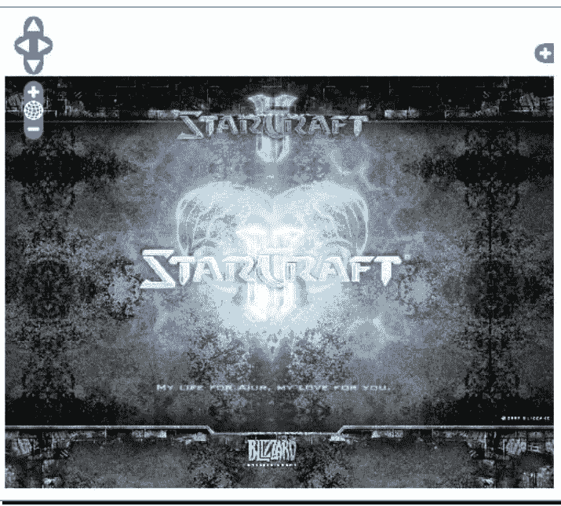

### 发生了什么？

我们刚刚创建了一个 OpenLayers 地图，它根本不是地图，而更像是一个图像查看器。不过它还有很多其他用途——你可以将图像叠加在 WMS 层之上，从由旧印刷地图的高分辨率扫描组成的图像图层创建地图等。创建图像图层所需的参数是：

### 图像图层参数

- name: {String} 图层的名称。
- url: {String} 图像的 URL。可以位于自己的计算机/服务器上，或外部服务器上。
- extent: {OpenLayers.Bounds} 图像的范围。
- size: {OpenLayers.Size} 图像的大小，以像素为单位。
- options: {Object} 一个包含图层属性设置的匿名对象。

让我们看看我们的 image_layer 对象的 extent、size 和 options 参数：

```
new OpenLayers.Bounds(-180,-112.5,180,112.5),
new OpenLayers.Size(1920,1200),
{numZoomLevels:7, maxResolution:.625}
```

extent 参数是一个 {OpenLayers.Bounds} 对象，通过 OpenLayers.Bounds(-180,-112.5,180,112.5) 创建。我们传入最小 x、最小 y、最大 x 和最大 y 值来创建边界框。对于图像，你可能需要根据图像的尺寸调整值。我们的图像比例为 1920/1200 = 1.6，因此我将边界设置为具有相似比例（180 / 112.5 = 1.6）。

size 参数 new OpenLayers.Size(1920,1200) 是一个 {OpenLayers.Size} 对象，我们传入图像的宽度和高度。

对于下一个参数 options，我们传入 {numZoomLevels:7, maxResolution:.625}。numZoomLevels 属性可以是你想要的任何值，但较高的值可能会让你过度放大图像。maxResolution 属性的值设置为 .625，这是我通过除以 1200/1920（宽度除以高度）得出的——只是粗略计算，使地图看起来大致合适。此层类的文档位于 http://dev.openlayers.org/docs/files/OpenLayers/Layer/Image-js.html。

### 试一试 – 制作你自己的基于图像的地图

使用前一个示例的代码，找到其他高分辨率图像并用它们创建类似的“图像查看器”。添加任意数量的图层，并尝试不透明度设置，看看图像图层如何相互作用。

## Layer.MapGuide

这是开源 MapGuide 平台的图层。我们不会在本書中介绍 MapGuide，但它是一个流行的项目，并且由于它是免费开源的，你可以随意在自己的计算机上安装它。它的行为与 Layer.WMS 类相似，具有相同的参数。它还继承自 Layer.Grid。此层类的文档可在 http://dev.openlayers.org/docs/files/OpenLayers/Layer/MapGuide-js.html 找到。有关 MapGuide 的更多信息可在 http://mapguide.osgeo.org/ 找到。


## Layer.TileCache

The TileCache layer allows you to interact with MetaCarta's TileCache, which is free open source software that caches WMS requests. TileCache provides enormous performance boosts because it caches requests to a WMS server. This means that once a request has been made, the response (the map image) is stored either on the server's hard drive or in memory and is immediately returned to the client.

The normal process of requesting a map image from a WMS server goes like this:

- 1. Client sends request to WMS server, asking for a specific part of the map.
- 2. WMS Server receives the request and generates an image based on the requested map extent.
- 3. WMS Server returns the rendered map image to the client.

The bottleneck is Step 2, the WMS server rendering the image based on the request. With caching (either through TileCache or by other means), the second step becomes a lot easier. With caching, the server only has to generate an image once, and then it saves it (in the hard drive or memory). So, instead of having to generate an image for every request, it simply grabs an image which it has already generated. This makes the request seem almost instantaneous, and most popular web maps use some form of caching—including Google Maps.

We will be discussing TileCache a little more in the last chapter, where we talk about deploying and using OpenLayers in a production environment. The documentation for this layer class is at http://dev.openlayers.org/docs/files/OpenLayers/Layer/TileCache-js.html. For more information on TileCache, head to http://tilecache.org/.

## Layer.Vector

The vector layer is one of the more powerful features of OpenLayers. It allows us to draw points and polygons on the map, style them however we want, retrieve and use KML and other geo data formats, etc. The vector layer makes use of Protocols (such as HTTP), Formats (such as KML), and Strategies (such as Clustering) to display and provide an interactive layer. The vector layer also allows us to create and edit vector features. In Chapter 9, our chapter on the Vector Layer class, we'll go into far more detail.

## Layer.VirtualEarth

This layer allows us to interact with Microsoft's VirtualEarth API. It works in a similar way to the Google Layer, so we won't spend more time discussing it here. Chapter 6 will fully cover this layer class.

## Layer.WFS

This is a class that is deprecated, so try to avoid using it, as it will soon no longer be supported. I wanted to explicitly mention it because it is on its way out, but I still see lots of code that uses it. WFS (Web Feature Service) allows us to interact with data that is stored on the server. If you would like to use WFS, the general procedure is to use the `Layer.Vector` class and use WFS as the format. We'll be covering this in detail in Chapter 9, our chapter on the Vector Layer class.

## Layer.WMS

This is the Layer class we've been using throughout the book so far. It inherits from `Layer.Grid`, and is similar to other classes we've mentioned. WMS is a popular standard and the way we interact with it is similar to how we interact with other Layer classes. We will be using this class throughout the book, so you haven't seen the last of it. Layer class documentation can be found at http://dev.openlayers.org/docs/files/OpenLayers/Layer/WMS-js.html. More information and specifications of the WMS protocol can be found at http://www.opengeospatial.org/standards/wms.

## Layer.Yahoo

This Layer class allows us to interact with the Yahoo! API. It works in a similar way to Layer.Google and Layer.VirtualEarth, and we'll be covering it in more detail in Chapter 6. Documentation for this layer class is at http://dev.openlayers.org/docs/files/OpenLayers/Layer/Yahoo-js.html. The Yahoo! Maps API can be found at http://developer.yahoo.com/maps/.

## 访问图层对象

The last topic to cover concerns the functions of the base Layer class. Before we do that though, let's go over how to access layer objects in Firebug. We'll be doing this often throughout the book, so it is quite important.

## 动手实践 – 访问 map.layers

Let's jump in to using some of the Layer class functions.

- 1. Open up the second WMS example, **chapter3_ex2_options_config.html** in Firefox. We won't be editing the code yet.
- 2. Enable Firebug and go to the Console panel.
- 3. In the console, input and run this line of code:
- `map.layers;`
- 4. You should then see a list of layers.

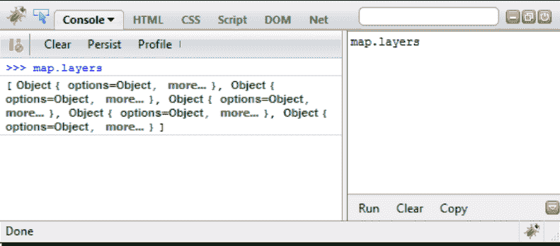

### 发生了什么？

You just accessed the `layers` property of the global `map` object. This is a property of the map object that contains an array of all the layers in the map. The list is ordered by the way you add layers to the map, so the first item in the list corresponds to the first layer we added to the map, the `wms_layer_map` layer. Not only will Firebug list the layer objects, you can also access any one of them by clicking on them.

## 动手实践 – 在 Firebug 中访问图层对象

Let's take a look at how to access an object in Firebug now.

Click on one of the items in the array of objects that was outputted from the previous Time for Action section. You should see something like this:

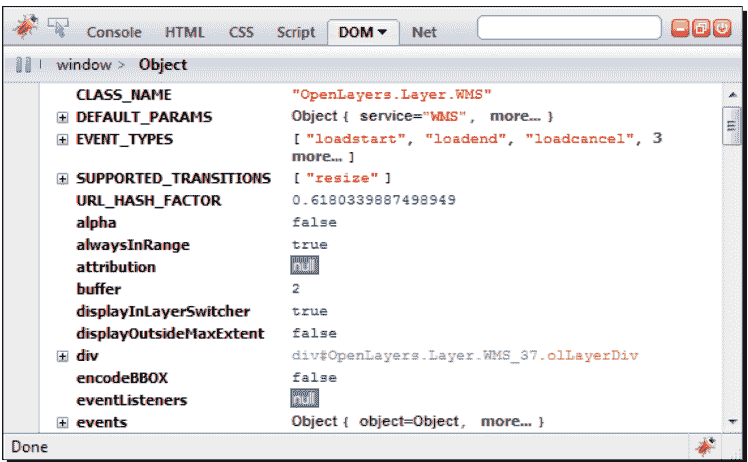

### 发生了什么？

We just accessed our map's wms_layer_map layer object. What you see in the DOM panel is a listing of all the properties and functions that layer object contains. The DOM panel is one way we can access a layer object's properties. The DOM panel is a great way to get a quick look at all the properties and values of any object we wish to know more about. You'll notice some of the properties have not yet been mentioned; this is because some properties are specific to the Layer.WMS class, and is not included in the base Layer class.

## 访问图层属性

There are two common ways to access a layer object's properties.

### map.layers

The first way is by accessing the layer object through the map.layers array, which we did in the previous example. Here, we are accessing the global map object, which was defined outside the init() function with var map;

If we know the index of a layer object we wish to view, we can use map.layers[n] to access the layer object (where n is the index). For example, if we wanted to access the wms_layer_map layer object, we know it is the first layer added to the map so its index is 0 (because array starts its index at 0), so we would type map.layers[0]. The next layer, wms_layer_labels, has an index of 1, and so on.

Accessing layers this way, however, is not advised. Adding a layer will change the array, as will deleting a layer. The best way to access layer objects is to store a reference to them, like we've been doing in all the examples (e.g., var my_layer = new OpenLayers.Layer(), as we'll go over now.

### 存储图层对象的引用

The second way is to define our layer objects as global variables, like how we did with our map object. So far, all our layer objects are defined inside the init() function, which means we can't access them or refer to them outside of the init() function. If we try to access the wms_base_ground layer object in Firebug, we will get an error because the wms_layer_map layer object is not a global variable as we are not 'inside' of the init() function in Firebug. This concept is referred to as scope.

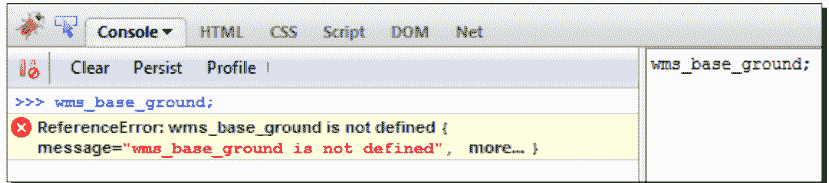

Let's look at our code to see how the map object is defined as a global variable.

```
var map;

function init() {
    //Setup our map object
    map = new OpenLayers.Map('map_element', {});

    // Setup our two layer objects
    var wms_layer_map = new OpenLayers.Layer.WMS( ...
```


So, the process for making an object global is to:

- 1. 在 `init()`（或任何函数）外部使用 var `variable_name` 定义对象/变量；
- 2. 在 `init()` 函数内部创建对象时，引用 `variable_name` 时不要指定 var。

注意我们创建 `wms_layer_map` 层对象的代码：`var wms_layer_map = new OpenLayers.Layer.WMS(...)` 由于我们在 `init` 函数内部使用了 var，对象只在此处创建，并且只能在 `init` 函数内部引用。`wms_layer_map` 对象只能在其被定义的相同作用域内访问。在本例中，由于它是在 `init()` 内部定义的，我们只能用 `init()` 函数内部的代码来引用它。要将其定义为全局以便在函数外部访问，我们可以这样做：

```
var map;
var wms_layer_map
function init(){
  map = new OpenLayers.Map ...
  wms_layer_map = new OpenLayers.Layer.WMS( ...
}
```


> 使用全局变量可以让事情变得更容易，但如果可能的话请尽量避免使用。如果确实使用它们，请跟踪它们并在命名时小心。

## 测验 – 变量作用域的工作原理

请看下面的代码。变量 `final` 的值会是什么？

```
var a = 3;

//Create a function that will set a variable called 'b' equal to 5
function set_variable(){
  var b = 5;
}

//Call the function
set_variable()
final = a + b;
```

- 1. 8
- 2. 3
- 3. 5
- 4. 将会报错，因为变量 b 不能在测试函数外部访问。

## 层类方法

我们已经介绍了基础层类的属性，并讨论了大多数层子类。到目前为止，剩下的主题是基础层类的函数或方法。由于我们将讨论层类的函数，所有层子类都继承并使用这些函数。在进入函数之前，让我们先介绍如何在 Firebug 中访问层对象。

> 函数和方法有什么区别？方法只是一个术语，指属于对象或类的函数。

## 动手实践 – 定义全局层对象变量

让我们使层对象成为全局变量，访问层的某些属性，并调用其中一个层的方法。

- 1. 复制 `chapter3_ex2_options_config.html`。在 `init()` 函数正上方添加以下行：
- 2. 在你的 `init()` 函数内部，删除每个层对象名称前面的 `var` 声明。例如，你的 `wms_layer_map` 定义的第一行现在应该看起来像这样：
- 3. 保存文件（我们将称其为 `chapter3_ex5_global_variables.html`）。
- 4. 在 Firefox 中打开它并启用 Firebug 控制台。
- 5. 在控制台面板中输入并运行：`wms_layer_map;`。你应该会看到类似这样的输出：
- 6. 在 Firebug 中输入并运行以下命令：

```
var wms_layer_map, wms_state_lines, wms_labels, wms_water_depth, wms_roads;
```

```
wms_layer_map = new OpenLayers.Layer.WMS(
```

```
Object { options=Object, more... }
```

```
wms_layer_map.name
```

- 7. 这里我们直接访问层的一个属性。你应该会看到层的 name 属性输出：
  
  `Base layer`
  
- 8. 在 Firebug 中输入并运行以下命令：
  
  `wms_layer_map.setVisibility(false);`
  
- 9. 假设你处于完整范围，现在你应该看不到该层了，因为你刚刚关闭了基础层的可见性。

## 发生了什么？

我们刚刚将 `wms_base_ground` 设为全局变量，访问了它的一个属性，并调用了它的方法。我们之前讨论的任何 Layer 类属性都可以通过 `layer_object.property;` 访问。

因此，现在我们对如何即时访问层属性和函数有了更多的了解，让我们回顾一下基础层类的方法。现在，就像属性一样，大多数层子类（例如 `Layer.WMS`）都有自己的函数集，但也继承了基础层类的所有函数。

## 层类方法定义

以下所有函数都可以像我们调用 `setVisibility()` 函数那样调用；通过调用 `layer_object.function_name()`；某些方法需要你传入参数。我们不会介绍基础层类的所有函数，因为有些已弃用、存在于 Map 类函数列表中，或超出本书范围。

所需的参数（如有）列在参数列下。

| 函数 | 描述/操作 | 参数 | 返回值 |
|---|---|---|---|
| `setName( newName )` | 根据传入的字符串为层设置新名称。这也会更新图层切换控件中层的显示名称，并可能触发 changelayer 事件。 | `newName`: `{String}` 层的新名称。 | - |
| addOptions( options ) | 为层添加附加选项。参数的行为类似于 options 参数，允许你设置层的属性。 | options: {Object} 包含层属性和值的键值对的匿名对象。 | - |
| redraw() | 重绘层。如果层成功重绘则返回 true，如果层无法重绘则返回 false。在向矢量层添加要素时需要调用此方法，我们将在第 9 章介绍。 | - | {Boolean} |
| getVisibility() | 检查层是否可见。返回 true 表示层可见，false 表示不可见。 | - | {Boolean} |
| setVisibility( visibility ) | 将可见性设置为 true 或 false，隐藏/显示层并重绘它。可见性决定层是否应显示。 | visibility: {Boolean} true 显示层，false 隐藏层。 | - |
| calculateInRange() | 如果层可以在地图当前分辨率下显示，则返回 true 或 false。如果 alwaysInRange 属性为 true，则始终返回 true。 | - | {Boolean} |
| setIsBaseLayer( is_base ) | 如果传入 true，将层转为基础层；如果传入 false，则不再使其成为基础层。 | is_base: {Boolean} 设置为 true 使层成为基础层，false 使其成为覆盖层。 | - |
| `setOpacity( opacity )` | 根据传入的值设置层的不透明度。传入的 `opacity` 值是一个浮点数，有效范围为 0 到 1，0 表示完全透明，1 表示完全不透明。0.5 表示 50% 透明。 | `opacity:` `{Float}` 期望的不透明度值。 | - |

## 勇敢尝试 – 调用一些函数

现在我们已经介绍了本书中将使用的一些 Layer 类函数，请尝试自己调用它们。打开 Firefox，启用 Firebug，并尝试在层对象上调用上述一些函数（通过 `map.layers` 数组或全局层对象本身访问层对象）。再次提醒，不要害怕尝试或破坏东西！

## 总结

本章我们讨论了 Layer 类。我们介绍了层的概念以及基础层和覆盖层之间的区别。我们深入探讨了 WMS Layer 类。我们讨论了 Layer 类的属性和方法，并介绍了各种层子类。

呼！这可能信息量很大。我们单独介绍了许多 Layer 类，但尚未使用不同类型的 Layer 类制作地图。这是 OpenLayers 擅长的一项功能，也是地图“拼贴”驱动因素。不过，要了解如何将不同层类组合在一起，我们需要对投影有一个基本了解——这是下一章的主题。

# 4

# 理解投影

当你看地图时，你看到的是一个三维物体（地球）的二维表示。因为我们在创建地图时本质上“丢失”了一个维度，所以没有地图能完美地表示地球。所有地图都有一些失真。

失真取决于你使用的投影（将地球表面表示在二维平面上的方法）。在本章中，我们将更详细地讨论投影是什么、为什么重要以及如何在 OpenLayers 中使用它们。我们还将介绍一些其他基本地理原理，以帮助更好地理解 OpenLayers。

本章将介绍：

- 地图投影的概念
- 投影类型
- 经度、纬度和其他地理概念
- OpenLayers 投影类
- 坐标转换

开始吧！


## 地图投影

没有任何地球地图是真正完美的再现；所有地图都有某种失真。其原因在于它们试图将三维物体（椭球体：地球）表示在二维中（平面：地图本身）。

**投影**是三维球体整个表面或部分表面在二维平面（或其他类型几何体）上的表示。

### 为什么要使用投影？

每张地图都有某种投影——这是地图固有的属性。想象剥开一个橘子然后把果皮摊平。会产生某种失真，如果你试图将果皮完全放入正方形或矩形（像一张平坦的二维地图）中，你会非常困难。

为了让果皮完美地贴合在平坦的正方形或矩形上，你可以尝试拉伸果皮的某些部分或剪掉果皮的一些碎片并重新排列它们。在尝试创建地图时也适用同样的想法。

实际上存在无限多种可能的地图投影；有无限多种方法可以将三维表面表示为二维，但没有一种是完全无失真的。

那么，既然有这么多不同的地图投影，我们如何决定使用哪一种？有没有最好的？答案是否定的。使用的“最佳”投影取决于你使用地图的上下文、你正在查看的内容以及你希望保留的特征。

### 投影特征

由于二维表示并非没有失真，每个投影都在某些特征之间做出权衡。而且当我们将地球投影到地图上时，我们会失去一个维度，因此我们必须在想要保留的特征之间做出某种权衡。有许多特征，但现在让我们关注其中三个。

### 面积

面积指的是地图上要素的大小。保留面积的投影被称为等面积投影（也称为等积、等价或同形投影）。如果例如在地图不同位置测量的一英寸覆盖相同的实际面积，则投影保留面积。因为面积保持不变，**角度**、**比例尺**和**形状**会失真。这就是等面积投影地图可能的样子：

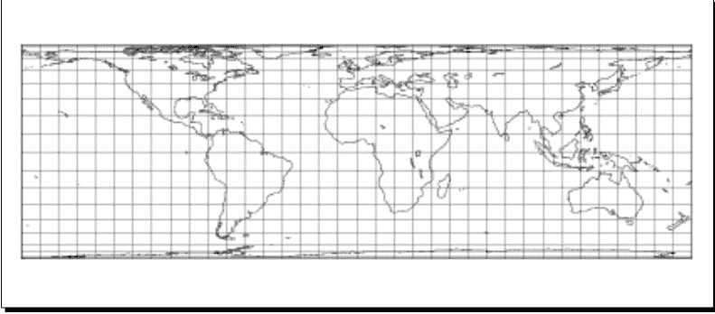

### 比例尺

比例尺是地图距离与实际距离的比率（例如，地图上一厘米可能等于实际一百米）。所有地图投影在地图的某些区域都会错误地显示比例尺；没有地图能在整个地图上显示相同的比例尺。然而，地图上有些部分比例尺保持正确——这些位置的放置可以减轻其他地方的比例尺误差。比例尺的变形还取决于被测绘的区域。如果投影在地图上某一点与每一点之间都保持真实比例尺，则称为**等距**投影。

### 形状

保留形状的地图被称为**保角**或**正形**。形状意味着地图上各点之间的相对角度是正确的。显示整个地球的大多数地图都是保角的，例如墨卡托投影（由 Google Earth 和其他常见网络地图使用）。根据具体投影，地图各处的面积通常会失真，但在某些地方可能正确。保角的地图不能同时是等面积的。我们迄今为止使用的地图都是保角的。

### 其他特征

投影还有许多其他特征，例如方位、距离和方向。这里需要记住的关键概念是，所有投影都在以牺牲其他特征为代价保留某些特征。例如，保留形状的地图不能完全保留面积。

没有“完美”的地图投影。投影的实用性取决于地图的使用上下文。特定投影可能在某些任务中表现出色，例如导航，但在其他用途中可能是不好的选择。

## 投影类型

投影是用二维表面表示三维的一种方式。投影被投影到某些几何表面，最常见的三种是**平面**、**圆锥**或**圆柱**。

想象一个圆柱体包裹在地球周围，其圆周的中心触及赤道。现在，地球被投影到该圆柱体的表面上，如果你将圆柱体从上到下垂直切开并展开，平铺开来，你就会得到一个常规的圆柱投影：

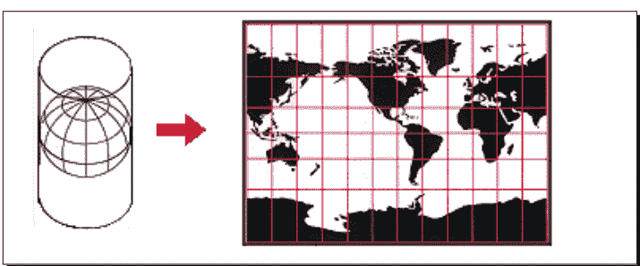

**墨卡托**投影是一种投影类型。如果你以前从未使用过投影，很可能你看到的大多数地图都采用这种投影。

由于其特性，在两极附近存在严重的失真。看前面的截图，你可以看到单元格逐渐变大，越接近北极和南极。对于例如，格陵兰看起来比南美洲大，但实际上它大约相当于墨西哥的大小。如果地图中面积失真很重要，你可以考虑使用我们之前提到的**等面积**投影。

> 有关投影的更多信息可以在**美国地质调查局（US Geological Survey）**网站 http://egsc.usgs.gov/isb/pubs/MapProjections/projections.html 上找到。

## EPSG 代码

正如我们提到的，实际上存在无限多种可能的投影。因此，建立一个 universally agreed upon 分类系统来跟踪投影信息是有意义的。有许多不同的分类系统，但 OpenLayers 使用 **EPSG** 代码。EPSG 指的是欧洲石油勘探集团，一个从事石油勘探的科学组织，该组织在 2005 年被 OGP（**国际石油天然气生产商协会**）接管。

对于 OpenLayers 来说，EPSG 代码被称为：

```
EPSG:4326
```

EPSG: 之后的数字（本例中为 4326）指的是投影识别号。该投影 EPSG:4326 是 OpenLayers 使用的默认投影。它一直是我们迄今为止所有示例中使用的投影，并使用熟悉的经度/纬度坐标系统，坐标范围为 -180° 至 180°（经度）和 -90° 至 90°（纬度）。

## 动手实践 – 使用不同的投影代码

让我们使用不同的投影创建一个基本地图。

- 1. 使用模板代码，按以下方式重新创建你的地图对象。我们将指定 `projection` 属性，以及 `maxExtent`、`maxResolution` 和 `units` 属性。如果我们使用非默认投影，我们需要告诉 OpenLayers 使用的坐标类型，设置 `maxExtent` 就是一种方法。我们将要使用的投影是 `EPSG:900913`，这是一种由 Google Maps 和其他第三方 API 使用的投影。
```javascript
map = new OpenLayers.Map('map_element', {
  projection: 'EPSG:900913',
  maxExtent: new OpenLayers.Bounds(-20037508, -20037508,
    20037508, 20037508.34),
  maxResolution: 156543.0339,
  units: 'm'
});
```
- 2. 保存文件，我们将其称为 `chapter4_ex1.html`。
- 3. 你应该会看到类似以下内容：

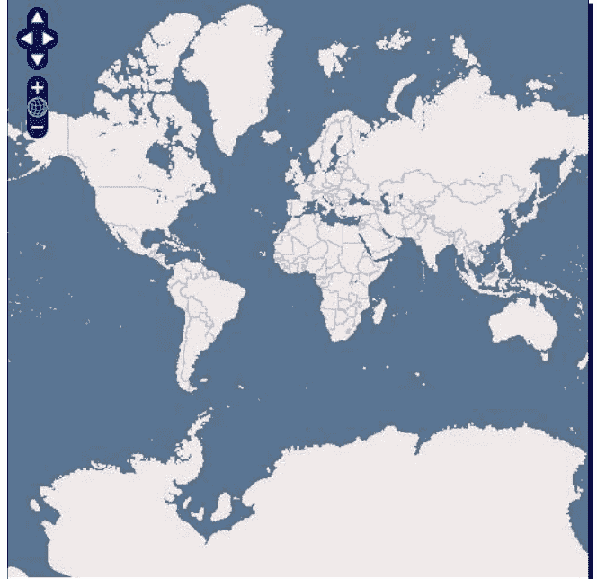

## 发生了什么？

我们刚刚创建了一个投影为 `EPSG:900913` 的地图。你会注意到它看起来与我们迄今为止制作的地图大不相同。这是因为它采用了不同的投影。

## 指定不同的投影

OpenLayers 支持任何投影，但如果你想使用除 `EPSG:4326` 之外的投影，必须指定以下三个选项：

- **maxExtent**: 默认值是 `-180,-90,180,90`
- **maxResolution**: 默认值是 `1.40625`
- **projection**: 默认值是 `EPSG:4326`


如果未指定这些选项，则使用默认值（迄今为止所有其他地图都使用默认值）。你还应指定 units 属性，就像我们使用 units: 'm' 一样，具体取决于你的投影使用的单位。

你必须指定这些属性的原因是不同的投影使用不同的坐标。在上面的示例中，我们将 maxExtent 设置为：

```
maxExtent: new OpenLayers.Bounds(-20037508, -20037508,
    20037508, 20037508.34)
```

这些值与默认值相差很大——它们不是经度和纬度值。相反，它们使用 x/y 坐标系统，对于 OpenLayers 而言，经度是 x 值，纬度是 y 值。

## 小测验 – 投影

给出一些你可能想要使用 EPSG:4326 以外的投影的原因。哪些区域不适合显示 EPSG:4326 投影？

## 经度/纬度

经度和纬度是大多数人都熟悉的两个术语，即使他们地理知识有限或对两者感到困惑。让我们先看一下下面的截图，然后再介绍这两个术语。

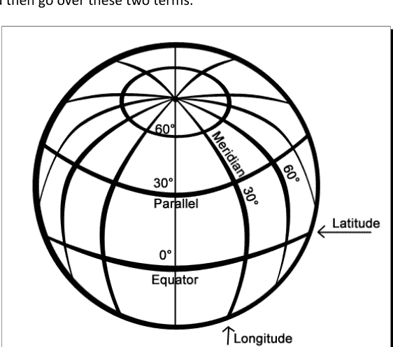

### 纬度

纬线是与赤道平行的假想线，也恰当地称为“纬线”。纬度分为 90 个“度”，或 90 个空间（或单元），位于赤道上方和下方。-90° 是南极，0° 是赤道，90° 是北极。

每个空间或单元（例如从 42° 到 43°）进一步细分为 60 分，每分钟细分为 60 秒。分钟和秒的术语与时间关系不大。在制图上下文中，它们只是用于精度的术语。纬度一度 的大小是恒定的。因为它们测量“南北”，所以 OpenLayers 将 y 坐标视为纬度。

### 经度

经线与纬线垂直。所有经线，也称为子午线，在北极和南极相交，并且与纬度不同，每条经线的长度相同。经度分为 360 个“度”，或空间。与纬度类似，每个空间也分为 60 分，每分钟分为 60 秒。

随着经线之间的空间变小，越接近两极，经度一度的大小就会发生变化。越接近两极，绕地球行走所需的时间就越短。

对于纬度，使用赤道作为 0° 是有意义的，但对于经度，没有一个地方比另一个地方更适合作为 0° 标记的起点。因此，虽然这个位置实际上是任意的，但今天英国格林威治天文台被普遍认为是 0° 经度。因为经度测量东西，所以 OpenLayers 将 x 坐标视为经度。

### 动手时间 – 确定 LonLat 坐标

让我们看一下来自我们之前地图的几个坐标示例。

- 1. 打开第 1 章的最终示例。
- 2. 在任何方向平移地图。然后，在 Firebug 中输入：
`map.getCenter();`
- 3. 根据你平移的位置，输出应类似于：
`lon=-72.8125, lat=19.6875`
- 4. 现在，打开本章开头的示例。
- 5. 平移地图，然后在 Firebug 中输入：
`map.getCenter();`

6. 你应该看到类似的内容：

```
lon=-9397474.0038099,lat=3595597.9798909
```

## 发生了什么？

我们刚刚查看了两个具有不同投影的地图中地图中心的经度和纬度值。当我们调用 map.getCenter() 时，我们会得到一个 OpenLayers LonLat 对象。

在第一张地图中，地图的最大范围经度在 -180° 到 180° 之间，纬度在 -90° 到 90° 之间。这些是 EPSG:4326 使用的值，它是一种经度/纬度类型的坐标系统。第二张地图中经度和纬度的值发生变化，因为它们不在同一投影中（它们使用的是 EPSG:900913）。

## OpenLayers 投影类

到目前为止，我们一直在讨论投影的抽象概念。让我们深入了解 OpenLayers 的 Projection 类 OpenLayers.Projection，这就是我们实际处理投影时使用的类。Projection 类依赖于一个名为 Proj4js 的外部库，可以在 http://proj4js.org 找到。首先，我们将讨论在没有 proj4js 库的情况下可以做什么，然后讨论使用它可以做什么。

### 创建投影对象

要实例化 Projection 类的对象，代码如下所示：

```
my_proj = new OpenLayers.Projection('EPSG:4326', {});
```

### 参数

让我们看一下 Projection 类的参数。

- **projectionCode: {String}**: 用于标识投影的众所周知的标识符（WKID）的字符串，例如形式为 `EPSG:4326` 的 EPSG 代码。
- **options: {Object}**: 一个可选对象。对于实例化投影对象，通常会省略它。

在创建地图并指定 projection 属性时，你可以传入一个投影对象（如上面创建的），也可以传入包含投影代码的字符串。此字符串，例如 EPSG:4326，也称为 SRS 代码。当传入代码时，就像我们在迄今为止的所有示例中所做的那样，OpenLayers 会自动将其转换为投影对象。

### 函数

Projection 类有许多方法，包括：

| 函数 | 描述 | 参数 |
|---|---|---|
| getCode() | 返回包含投影代码的 `{String}`，例如 'EPSG:4326' | - |
| getUnits() | 返回投影的单位字符串 `{String}`，例如 'degrees'。如果页面上未包含 Proj4js 库，则返回 null。 | - |
| addTransform(from, to, method) | 定义两个投影之间的自定义转换函数。通常不需要此操作，特别是如果你使用 Proj4js，除非你需要定义自定义投影转换。 | from: `{String}` 源投影代码
to: `{String}` 目标投影代码
method: `{Function}` 一个将源点转换到目标点的函数，保持原始点不变。 |
| transform(point, source, destination) | 调用此函数会将传入的点从传入的源投影转换到传入的目标投影。你也可以传入一个 `{Object}`，只要它包含 x 和 y 属性。此函数会就地转换点，意味着你传入的点将被转换。如果需要点的副本，应在调用 transform() 之前先通过调用点的 clone() 方法克隆它。 | point: `{Geometry.Point}` 来自 OpenLayers.Geometry.Point 类的对象，包含 x 和 y 坐标
source: `{OpenLayers.Projection}` 源投影的投影对象
destination: `{OpenLayers.Projection}` 目标地图投影的投影对象。 |

## 投影转换

转换点意味着你将一个投影中的坐标转换为另一个投影的坐标。除了 EPSG:4326 到 EPSG:900913 及其反向转换之外，OpenLayers 不提供开箱即用的其他投影转换支持——要转换其他投影，你需要包含 Proj4js（可在 http://proj4js.org/ 找到）。

在大多数情况下，处理投影转换是后端地图服务器的工作，但在客户端进行转换通常很有用或更快（例如矢量图层坐标转换的情况）。让我们看看如何使用 OpenLayers 将 EPSG:4326 转换为 EPSG:900913。

### 动手时间 – 坐标转换

对于此示例不需要 Proj4js，因为在这两个投影之间转换无需 Proj4js 即可实现。

- 1. 在 Firefox 中打开上一个示例。我们不会修改任何代码，因此包含 OpenLayers 库的任何页面都可以。
- 2. 打开 Firebug。在控制台中创建两个投影对象：
```
var proj_4326 = new OpenLayers.Projection('EPSG:4326');
var proj_900913 = new OpenLayers.Projection('EPSG:900913');
```
- 3. 现在让我们创建一个 LonLat 对象，其中将包含 EPSG:4326 坐标的点。
```
var point_to_transform = new OpenLayers.LonLat(-79, 42);
```
- 4. 现在让我们转换它。我们将从 EPSG:4326（我们的源 proj_4326 投影对象）转换到 EPSG:900913（我们的目标 proj_900913 投影对象）：
```
point_to_transform.transform(proj_4326, proj_900913);
```
- 5. 最后，我们将打印新值：
```
console.log(point_to_transform);
console.log(point_to_transform.lon, point_to_transform.lat)
```
- 6. 你的输出应类似于：
```
lon=-8794239.7714444,lat=5160979.4433314 { lon=-8794239.7714444, more...}
-8794239.7714444 5160979.4433314
```


## 发生了什么？

我们刚刚将 EPSG:4326 投影中的一个点转换到 EPSG:900913 投影中的一个点。让我们更仔细地查看我们在 point_to_transform 对象上调用的 transform 方法。

```
point_to_transform.transform(proj_4326, proj_900913);
```

这将把原始点从 proj_4326 投影转换到 proj_900913 投影。注意，我们调用的不是投影对象的 transform() 函数，而是 LonLat 对象的 transform() 函数。OpenLayers.LonLat 对象的 transform() 函数定义如下：

| 函数 | 描述 | 参数 |
|---|---|---|
| `transform(source, dest)` | 此函数原地转换一个点，意味着原始点将被转换；因此原始值将丢失。如果需要它的副本，请先使用 `.clone()` 方法。它返回自身。 | `source`: 源投影<br>`dest`: 目标投影。 |

在这种情况下，我们的源投影为 EPSG:4326，目标投影为 EPSG:900913。需要注意的是，如果不包含 Proj4js 库，使用 OpenLayers 只能对 EPSG:4326 和 EPSG:900913 这两种投影进行转换。

> 当创建地图时，你的所有栅格图层（基于图像的图层；几乎所有除矢量和图像图层之外的图层）必须与地图使用相同的投影。你可以使用坐标和矢量图层进行投影转换，但一旦 OpenLayers 从地图服务器获取到图像，它就无法自行重投影图像（这是地图服务器需要做的事）。

## Proj4js 库

Proj4js 库允许你将坐标从一个坐标系统转换到另一个坐标系统。Proj4js 网站位于 http://proj4js.org。只需在页面上包含 Proj4js 库（就像你使用 OpenLayers 一样），你就可以在 OpenLayers 中进行更多转换。并非所有 EPSG 代码都受支持，但有很多，如果你的目标代码不受支持，你可以为其添加投影定义。

> 网站 http://spatialreference.org 包含大多数 EPSG 代码的 Proj4js 定义。

理想情况下，你应该在整个地图中使用相同的投影，但在某些情况下，你可能希望以不同的投影显示坐标——例如使用矢量图层。让我们看看如何设置 Proj4js 库。

## 动手实践 – 设置 Proj4js.org

这一步与我们设置 OpenLayers 的方式类似。

- 1. 从 http://trac.osgeo.org/proj4js/wiki/Download 下载 Proj4js。截至撰写时，最新版本为 proj4js-1.0.1.zip，所以请继续下载（或下载最新版本）。
- 2. 解压它并将 proj4js 文件夹复制到你的根代码目录（即存放 OpenLayers.js 文件的文件夹）。
- 3. 在代码的 <head> 部分，在 OpenLayers 库包含代码之后添加以下行。
- 4. 现在，打开页面并启动 Firebug。输入并运行以下内容：
- 5. 你应该会看到如下输出：

```
<script type='text/javascript' src="proj4js/lib/proj4js-combined.js"></script>
```

```
var test_proj = new Proj4js.Proj('EPSG:4325');
console.log(test_proj);
```

```
Object { srsCodeInput="EPSG:4325", more...}
```

## 发生了什么？

我们刚刚包含了 Proj4js 库并测试它是否正常工作。如果你在尝试调用 new Proj4js.Proj() 时收到错误，这意味着 proj4js-combined.js 文件的位置错误。请确保目录设置正确（你的示例文件应与 proj4js 文件夹在同一目录中，而 proj4js 文件夹内应包含许多文件和文件夹，包括包含 proj4js-combined.js 文件的 lib 文件夹）。

## 定义自定义投影

现在 Proj4js 库已包含，你可以像在前一个示例中那样使用更多投影进行转换。并非所有投影都已定义；不过，你可以自行定义，例如：

```
Proj4js.defs["EPSG:27563"] = "+title=LAMB sud france +proj=lcc
+lat_1=44.1 +lat_0=44.1 +lon_0=0 +k_0=0.999877499 +x_0=600000
+y_0=200000 +a=6378249.2 +b=6356515 +towgs84=-168,-60,320,0,0,0,0
+pm=paris +units=m";
```

之后，你就可以像使用之前的示例中的 EPSG:4326 和 EPSG:900913 一样使用 EPSG:27563 进行投影转换。

有一些已经定义的投影，你可以在 http://proj4js.org 上更广泛地查看它们。更完整的列表（包含几乎任何 EPSG 代码的 Proj4js 定义）可以在 http://spatialreference.org/ 上找到。

## 总结

在本章中，我们讨论了投影。我们介绍了它们是什么以及各种不同类型的投影。经度、纬度和其他地理概念也被讨论过。虽然我们只是触及了这些相当复杂主题的表面，但你应该拥有足够的基础信息来理解如何使用投影。

我们还讨论了 Projection 类，以及如何转换坐标和使用 Proj4js 库。你经常会处理 EPSG:4326 以外的坐标系统中的数据，了解如何在其他投影中工作和转换数据非常重要。

在下一章中，我们将看看 Google Maps 和其他第三方 API，并将我们最近获得的关于投影的知识付诸实践。

# 5

# 与第三方 API 交互

*网络地图今天非常流行，并且日益流行。在 Google Maps 推出后，出现了交互式网络地图的爆炸式增长。Google 提供了用于与其地图服务交互的 API，其他公司现在也提供了类似的 API，而 OpenLayers 与其中大多数都能很好地配合使用。我们不仅可以将这些第三方 API 与 OpenLayers 一起使用，还可以在其上“mashup”其他图层。*

在本章中，我们将学习：

- 第三方地图 API 的概念
- 使用第三方 API 的图层类：Google、Microsoft 和 Yahoo！
- 如何使用 OpenStreetMap
- 使用球面墨卡托投影
- 组合不同的图层类

## 第三方地图 API

基于网络的地图今天已司空见惯。网络地图爆炸式增长的催化剂是 Google Maps 的推出。在此之前网络地图就已存在，但它们并不快速也不利于开发者。2005 年 6 月，Google 发布了 Google Maps 的 API，该 API 提供了前端客户端（OpenLayers 所扮演的角色）以及对后端地图服务器的访问。

这使得任何人不仅可以在其网站上插入 Google 地图，还可以添加自己的点数据并以其他方式操作地图。Google Maps 越来越受欢迎，其他公司，如 Microsoft 和 Yahoo！，纷纷效仿，创建了自己的网络地图 API。

## 地图 Mashup

术语 **mashup** 指的是将各种不同的数据源和功能组合在一起的应用程序。**map mashup** 是将不同图层和数据组合在一起的地图。第三方地图 API，如 Google 和 Yahoo！ Maps，使得人们更容易创建这些“map mashups”。例如，一个以 Google Maps 为底图并叠加标记以追踪你去过的地方的地图可以被视为一个地图 mashup。

OpenLayers 并未引入地图 mashup，但它能让我们轻松创建非常强大的 mashup。使用 OpenLayers 将 Google 的地图图层、WMS 图层和矢量图层组合起来非常简单。

## OpenLayers 与第三方 API

OpenLayers 允许你在地图应用程序中使用第三方地图 API，让你可以在自己的地图中使用它们的地图。主要限制是，截至撰写时，第三方 API 地图必须是底图层（但正如我们之前讨论的，你可以使用任意多个底图层）。

OpenLayers 可以通信的三个大型商业地图 API 是 **Google Maps**、**Yahoo! Maps** 和 **Bing (Microsoft) Maps**。还有另一个免费开源的 API，OpenLayers 与其配合良好（并且以与前三个类似的方式工作），称为 **OpenStreetMap**。

我们首先将逐一查看这四个图层类，然后再介绍如何将它们与其他图层类组合。

## Google Maps

Google Maps 背后的软件由客户端和服务器组成。客户端是你访问 `http://maps.google.com` 时使用的，它与 Google Maps 后端服务器通信。Google 提供了让你使用其客户端和后端服务器的 API，但由于我们使用 OpenLayers 作为客户端，我们只对与 Google 的后端地图服务器交互感兴趣。

> 根据你计划如何使用 Google Maps，可能存在法律限制。完整限制可在 `http://code.google.com/apis/maps/terms.html` 和 `http://www.google.com/intl/en_ALL/help/legalnotices_maps.html` 找到。


在之前的章节中，我们使用 Google Maps API 的版本 3（V3）设置了 Google 层。由于 Google Maps 会更新其 API，OpenLayers 也必须进行更新以适应所做的任何更改。基于本书的 OpenLayers 2.10 之前的版本使用 Google Maps API 的版本 2（V2）。然而 Google Maps V2 的使用已被弃用，因此我们将重点关注使用 V3。从我们的角度来看，我们的代码变化不大——OpenLayers 在幕后为我们处理所有特定版本的功能。

然而，你很可能会遇到使用 Google Maps 版本 2 创建的旧版 OpenLayers 地图，因此我们将介绍如何同时使用 V2 和 V3。再次提醒，请在创建新地图时仅使用 V3，因为 V2 最终将不再受支持。

## Google Maps 版本 2 与版本 3 之间的差异

从 Google Maps V3 切换到 V2（或反之）时，实际上只有三件事需要做不同：

- 1. 你添加以引用 Google Maps 库的 script 标签不同。使用 Google Maps API V3 时无需提供 API 密钥。
- 2. `type` 属性中使用的图层名称不同。例如，V3 中的 'terrain' 图层定义为 `type: google.maps.MapTypeId.TERRAIN`，而在 V2 中则是 `type: G_PHYSICAL_MAP`。
- 3. 图层使用球面墨卡托配置（我们稍后会介绍其含义）。

> 建议你使用 Google Maps API V3。官方 Google Maps V3 文档可在 http://code.google.com/apis/maps/documentation/javascript/ 找到。
> 
> 官方 Google Maps API V2 文档可在 http://code.google.com/apis/maps/documentation/javascript/v2/reference.html 找到。

## 动手实践 – 使用 Google Maps V3（标准方式）

让我们使用 Google Maps API V3 创建一个地图。我们已在第 3 章中完成过此操作，因此你应该对此有所了解。这是使用 Google Maps 层的标准方式，除非你特别需要 V3 尚未支持的 V2 中的图层类型，否则应使用此方法。

> 在 OpenLayers 2.10 之前的版本中，访问 Google Maps V3 可能无法工作。

1. Google Maps API 版本 3 不需要 API 密钥。然而，你仍必须在 <head> 部分包含以下内容，以便 OpenLayers 知道在哪里查找 Google Maps API 库。我们将请求地图的 API 并指定我们想要 Google Maps API 的 v3.2 版本（如果你希望 Google Maps 自动为你提供最新版本，可以保留 &v=3.2 参数）。在包含 OpenLayers 的脚本之前添加此内容：

```
<script
src="http://maps.google.com/maps/api/js?sensor=false&v=3.2"></script>
```

2. 让我们开始为地图添加一个混合图层。type 属性的形式为 google.maps.MapTypeId.TYPE，其中本例中的 TYPE 为 HYBRID：

```
var google_hybrid = new OpenLayers.Layer.Google(
    "Google Hybrid",
    {type: google.maps.MapTypeId.HYBRID}
);
```

3. 现在我们将添加一个物理（地形类型）图层：

```
var google_physical = new OpenLayers.Layer.Google(
    "Google Physical",
    {type: google.maps.MapTypeId.TERRAIN}
);
```

4. 添加卫星图层类型：

```
var google_satellite = new OpenLayers.Layer.Google(
    "Google Satellite",
    {type: google.maps.MapTypeId.SATELLITE}
);
```

5. 现在，我们将创建一个街道图层。如果未传入图层类型，则默认使用街道图层。如果你希望手动指定类型，街道地图类型为 google.maps.MapTypeId.ROADMAP。

```
var google_streets = new OpenLayers.Layer.Google(
    "Google Streets",
    {
});
```

6. 我们将把图层添加到地图：

```
map.addLayers([google_hybrid,google_physical,google_satellite,
    google_streets]);
```

7. 最后，添加一个图层切换控件。你还会注意到，我们添加到地图上的所有图层都是基础图层。默认情况下，第三方地图 API 图层作为基础图层。

```
map.addControl(new OpenLayers.Control.LayerSwitcher());
```

8. 打开页面。你应该会看到类似这样的内容：

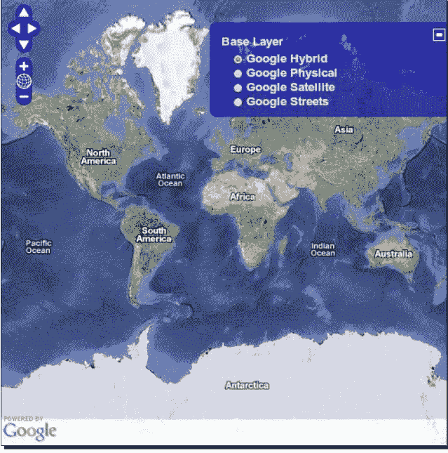

## 发生了什么？

我们刚刚使用 Google Maps API V3 创建了一个地图。我们只需要做两件事：

- 1. 包含 Google Maps V3 API `<script src="http://maps.google.com/maps/api/js?sensor=false&v=3.2"></script>`。这让 OpenLayers 可以访问 Google Maps API。
- 2. 设置 `type` 属性，例如 `type: google.maps.MapTypeId.HYBRID`。

包含 Google Maps API 使 OpenLayers 能够与 Google Maps 后端通信。由于我们包含了 Google Maps API，我们可以使用其中的变量。具体来说，`type` 属性的可能值直接来自 Google Maps API——例如，如果我们未包含 API，就无法使用 `google.maps.MapTypeId.HYBRID`。

请注意，如果你在 Firebug 中运行 `map.getCenter();`，返回的中心点坐标与我们习惯的非常不同——它们不是经度/纬度值。这是因为 `sphericalMercator` 已自动为我们设置，因此我们可以轻松地将其他图层（如矢量图层）叠加在第三方地图图层之上。在我们介绍其原因（这与其它第三方地图 API 相关）之前，让我们更详细地介绍 Google Maps 层类。

## 创建 Google Maps 层对象

创建 Google Maps 层对象的格式对于 Google Maps API 的 V2 和 V3 都是相同的。实例化 Google Maps 层的基本格式为：

```
var google_layer_object = new OpenLayers.Layer.Google(
    'Layer Name',
    {Properties}
);
```

第一个参数，与大多数 Layer 类一样，是图层的 **name**。第二个参数是一个 **properties** 对象。只有少数几个特定于 Google 层的属性，让我们来介绍一下。

## Google 层属性

由于 Google 层继承自基础 Layer 类，你可以使用 Layer 类提供的几乎任何属性——例如 `numZoomLevels` 或 `maxExtent`。我们只介绍特定于 Google Maps 层类的属性。**type** 属性的可能值取决于所使用的 Google Maps API 版本。

### sphericalMercator {Boolean}

该属性决定地图是否应作为墨卡托投影地图行为。设置为 true 将允许我们使用其他图层（如 Vector 层）与实际地图投影一起使用。球面墨卡托将在本章后面更深入地介绍。使用 Google Maps API V3 时，此属性会自动设置为 true。使用 V2 时，你需要手动将其设置为 true。示例：sphericalMercator: true。

### type {GmapType}

type 属性指定 Google Maps 层类型——Google 应提供给我们的图层。Google Maps API 的 V2 和 V3 具有不同的可能值。让我们先介绍版本 3 的值，然后再查看版本 2 的值。

### V3 GMapType 值

引用图层类型的标准 V3 方式形式为：

```
var google_layer_V3 = new OpenLayers.Layer.Google(
    'Google Maps V3 Layer',
    {type: google.maps.MapTypeId.TYPE}
);
```

要指定图层类型，我们只需更改 TYPE 属性。可能的 TYPE 值可以是以下之一：

| 类型 | 描述 |
|------|-------------|
| google.maps.MapTypeId.ROADMAP | 默认值，若未传入则使用。显示默认街道地图（与 G_NORMAL_MAP 相同）。 |
| google.maps.MapTypeId.HYBRID | 显示叠加在卫星图像上的半透明街道图层的地图（与 G_HYBRID_MAP 相同）。 |
| google.maps.MapTypeId.SATELLITE | 显示卫星图像（与 G_SATELLITE_MAP 相同）。 |
| google.maps.MapTypeId.TERRAIN | 显示具有地形等特征的地图（与 G_PHYSICAL_MAP 相同）。 |


> 最新可能的图层类型列表可在 Google Maps API 文档 http://code.google.com/apis/maps/documentation/javascript/maptypes.html#MapTypes 中找到。

在撰写本文时，非地球（月球、火星和天空）图层尚未从 Google Maps 提供。


## V2 GMapType 值

Version 2 of the Google Maps API provides various layers as well. Some of the layer types are even maps of other planets, but no extra work is required to view them inside the OpenLayers. To specify the map type for V2, use the following:

```
var google_layer_V2 = new OpenLayers.Layer.Google(
    'Google Maps V2 Layer',
    {type: TYPE}
);
```

可能的 TYPE 值如下：

| Type | Description |
|---|---|
| G_NORMAL_MAP | 默认值。如果未指定 GMapType，则使用此值。此地图类型将显示普通街道地图。 |
| G_SATELLITE_MAP | 显示卫星图像。 |
| G_AERIAL_MAP | 显示航空摄影。 |
| G_HYBRID_MAP | 显示在卫星图像上叠加半透明街道图层的地图。 |
| G_AERIAL_HYBRID_MAP | 显示在航空图像上叠加半透明街道图层的地图。 |
| G_PHYSICAL_MAP | 显示带有地形等特征的地图。 |
| G_MOON_ELEVATION_MAP | 显示月球地形图，海拔高度以颜色编码。 |
| G_MOON_VISIBLE_MAP | 显示从月球轨道拍摄的照片。 |
| G_MARS_ELEVATION_MAP | 显示火星地形图，海拔高度以颜色编码。 |
| G_MARS_VISIBLE_MAP | 显示从火星轨道拍摄的照片。 |
| G_MARS_INFRARED_MAP | 显示火星红外图像。温暖区域明亮，凉爽区域较暗。 |
| G_SKY_VISIBLE | 显示完整天球的地图。 |

要使用这些图层类型中的任何一种，只需在创建图层时传入类型名称即可。示例：type: G_NORMAL_MAP。


> 撰写本文时，前面的列表为支持的图层类型，但当前和最新的图层值可以在 Google Maps V2 API 文档中找到，网址为 http://code.google.com/apis/maps/documentation/javascript/v2/reference.html#GMapType。

## 动手实践 – 使用 V2 创建 Google 地图图层（已弃用）

让我们使用 Google Maps API V2 创建一个地图。这不是使用 Google Maps 图层的正确方法，但我将其包含在内，因为您很可能会遇到使用 V2 API 的代码。Google Maps V2 还提供了一些 V3 在撰写本文时未提供的不同图层类型（如月球图层）。

- 1. V2 的 Google Maps API 要求您注册一个 API 密钥，因此请在 http://code.google.com/apis/maps/signup.html 处免费获取一个。如果您没有域名，请使用 http://localhost。
- 2. 在 <head> 部分，在 OpenLayers 脚本标签之前，包含以下内容。将 YOUR_KEY 替换为步骤 1 中生成的密钥：
```
<script src='http://maps.google.com/maps?file=api&amp;v=2&amp;key=YOUR_KEY'></script>
```
- 3. 现在让我们创建一些图层。V2 中 type 属性的格式略有不同。我们将在此示例之后介绍可能的图层类型值。首先，让我们创建一些图层，从 'hybrid' 图层开始。混合图层的 type 值是 G_HYBRID_MAP。我们还将使用 numZoomLevels 属性指定 20 个缩放级别。不同的底图可以支持不同的缩放级别数量：
```
//Create Google Map Layer objects
var google_hybrid = new OpenLayers.Layer.Google(
  "Google Hybrid",
  {type: G_HYBRID_MAP, numZoomLevels: 20}
);
```
- 4. 现在让我们创建一个 'physical' 图层，这是一种地形/拓扑类型的图层。类型是 G_PHYSICAL_MAP，我们将指定不同的 numZoomLevels 属性：
```
var google_physical = new OpenLayers.Layer.Google(
  "Google Physical",
  {type: G_PHYSICAL_MAP, numZoomLevels: 22}
);
```
- 5. 我们将使用 G_SATELLITE_MAP 创建卫星图层：
```
var google_satellite = new OpenLayers.Layer.Google(
  "Google Satellite",
  {type: G_SATELLITE_MAP}
);
```
- 6. 如果我们不传入 type，则将使用默认的 'streets map' 图层。这是 Google 地图中的默认图层。如果您希望手动指定此图层类型，则称为 G_NORMAL_MAP。
```
var google_streets = new OpenLayers.Layer.Google(
  "Google Streets",
  {}
);
```
- 7. 现在让我们添加一个图层类型，该类型在撰写本文时不受 Google Maps API V3 支持——火星图层：
```
var google_mars = new OpenLayers.Layer.Google(
  "Google Mars",
  {type: G_MARS_VISIBLE_MAP}
);
```
- 8. 最后我们只需将图层添加到地图：
```
map.addLayers([google_hybrid,google_physical,google_satellite,
  google_streets,google_mars]);
```
- 9. 查看您的地图。您应该会看到类似以下内容：

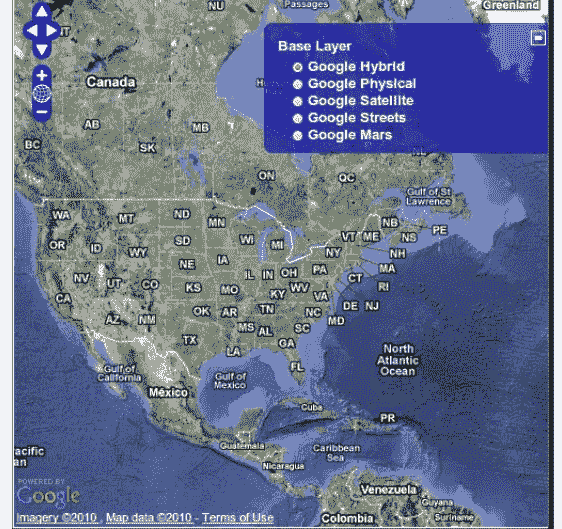

## 发生了什么？

我们刚刚使用 Google Maps V2 创建了一个地图，其中使用了几种可能的 Google Maps 图层类型。由于我们在这里使用的是不同版本的 API，您会注意到我们的代码与使用标准（V3）Google Maps API 时略有不同。具体来说，`type` 属性不同，因为 V2 API 支持的图层类型与版本 3 不同。

## Yahoo! Maps API

OpenLayers 也为我们提供了与 Yahoo! 映射 API 接口的简便方法。我们使用它的方式与使用 Google Maps Layer 类的方式类似。官方 Yahoo! Maps API 文档可在 http://developer.yahoo.com/maps/ 找到。让我们来看看！

## 动手实践 – 使用 Yahoo! Maps 图层

让我们使用 Yahoo! Maps Layer 类创建一个地图。

- 1. 在 `<head>` 部分，我们需要引用 Yahoo! Maps API 的位置。在 OpenLayers 包含脚本标签之前添加以下内容：
```html
<script src="http://api.maps.yahoo.com/ajaxmap?v=3.0&appid=euzuro-openlayers"></script>
```
- 2. 现在让我们设置一些 Yahoo! 图层对象。像 Google Maps Layer 一样，我们通过设置 `type` 属性来指定想要的图层类型。让我们创建一个混合图层。Yahoo! 图层的 `type` 属性以 `YAHOO_MAP_` 开头，后跟一个三字符代码：
```javascript
var yahoo_hybrid = new OpenLayers.Layer.Yahoo(
  "Hybrid",
  {type: YAHOO_MAP_HYB, numZoomLevels: 24}
);
```
- 3. 现在让我们创建一个卫星图层类型。卫星的三字符代码是 `SAT`。我们还将设置不同的缩放级别数量，以进一步说明每个底图可以有自己的缩放级别数量：
```javascript
var yahoo_satellite = new OpenLayers.Layer.Yahoo(
  "Satellite",
  {type: YAHOO_MAP_SAT, numZoomLevels: 20}
);
```
- 4. 接下来让我们添加一个默认图层。如果我们不传入 type，则将使用默认值，即 YAHOO_MAP_REG——类似街道的地图。
```
var yahoo_street = new OpenLayers.Layer.Yahoo(
  "Street",
  {}
);
```
- 5. 最后我们只需将图层添加到地图：
```
map.addLayers([yahoo_hybrid, yahoo_satellite, yahoo_street]);
```
- 6. 打开页面。您应该会看到类似以下内容：

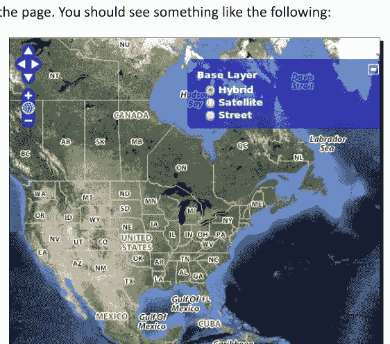

## 发生了什么？

我们刚刚使用 Yahoo! Maps 图层创建了一个地图。像 Google Maps 图层一样，我们需要包含指向 Yahoo! API 的链接——但我们不需要 API 密钥。我们通过以下方式包含了 API：
```
<script src="http://api.maps.yahoo.com/ajaxmap?v=3.0&appid=euzuro-openlayers"></script>
```
像 Google Maps API 脚本一样，此脚本允许 OpenLayers 与 Yahoo! Maps API 通信。它还为我们提供了可用于 type 属性的值。

## Yahoo! Maps Layer 类属性

像 Google Maps 一样，我们对这个图层类的主要关注点是 type 属性。让我们介绍一下可用的 type 值。

## Yahoo! Maps 图层类型

撰写本文时，Yahoo! Maps API 为我们提供了三种图层类型：

| Type | Description |
|---|---|
| YAHOO_MAP_HYB | 显示由卫星地图叠加常规街道地图组成的混合地图。 |
| YAHOO_MAP_SAT | 显示卫星照片。 |
| YAHOO_MAP_REG | 显示街道地图。这是默认的 type 值，因此如果未传入 type 将使用此值。 |

## Microsoft 的映射 API

Microsoft 也提供了其映射服务的接口。其映射服务以前被称为 Virtual Earth，但此后已重新命名为 Bing Maps。因此，在 OpenLayers 中，图层类称为 VirtualEarth，我们使用它的方式与创建 Google 和 Yahoo! 图层的方式相同。官方 Microsoft 文档可在 http://msdn.microsoft.com/en-us/library/dd877180.aspx 找到。

## 动手实践 – 创建 Bing/Virtual Earth 图层

- 1. 在您的 <head> 部分，在 OpenLayers 包含脚本之前，包含对 Microsoft Mapping API 的引用：
```html
<script src="http://ecn.dev.virtualearth.net/mapcontrol/mapcontrol.ashx?v=6.2&mkt=en-us"></script>
```
- 2. 现在让我们设置一些图层对象。我们像前面的示例一样指定 type 属性。对于此图层，type 以 VEMapStyle. 为前缀，表示 'Virtual Earth Map Style'。让我们创建一个 'shaded' 图层，在这种情况下它是带有阴影高程的街道/道路图层：
```javascript
var ve_shaded = new OpenLayers.Layer.VirtualEarth(
  "Shaded",
  {type: VEMapStyle.Shade}
);
```


3. 我们现在添加一个航空（卫星影像）图层：

```
var ve_aerial = new OpenLayers.Layer.VirtualEarth(
  "Aerial",
  {type: VEMapStyle.Aerial}
);
```

4. 现在，让我们创建一个默认图层。如果不传入 type，VEMapStyle.Road 图层将被使用。它类似于阴影图层，但没有阴影。我们还将使用另一个名为 animationEnabled 的属性，并将其设置为 false。默认情况下，该属性设置为 true，并控制是否对图层应用缩放动画（此动画是 Virtual Earth 图层特有的属性）：

```
var ve_road = new OpenLayers.Layer.VirtualEarth(
  "Road",
  {animationEnabled: false}
);
```

5. 让我们添加一个混合图层：

```
var ve_hybrid = new OpenLayers.Layer.VirtualEarth(
  "Hybrid",
  {type: VEMapStyle.Hybrid}
);
```

6. 最后，将图层对象添加到地图中：

```
map.addLayers([ve_shaded, ve_aerial, ve_road, ve_hybrid]);
```

7. 你应该会看到类似以下内容：

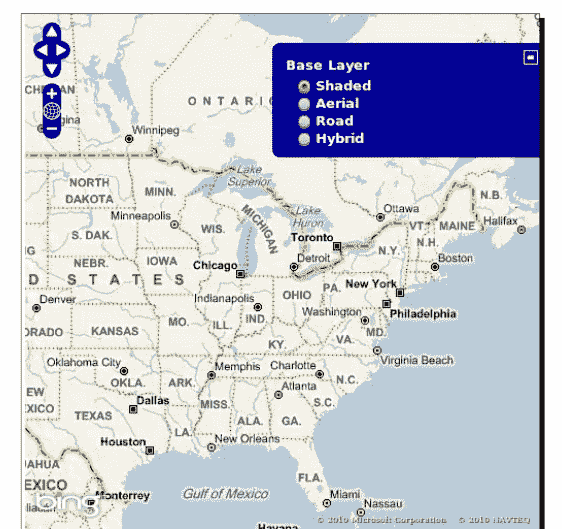

## 发生了什么？

我们刚刚使用 Microsoft Virtual Earth/Bing API 创建了一张地图。它的工作原理与 Google 和 Yahoo! Maps API 类似——通过提供指向 Microsoft 映射 API 的 script 标签。我们可以与 Microsoft 的地图服务器通信并使用不同的 type 值。让我们回顾一下属性，因为与其他第三方图层类不同，这里有一个新的属性。

## VirtualEarth 图层类属性

与之前的图层一样，type 属性控制从地图服务器获取的图层。然而，有一个独特的 animationEnabled 属性可与 VirtualEarth 图层一起使用。让我们来看看它：

| 属性 | 数据类型 | 描述 |
|---|---|---|
| animationEnabled | {Boolean} | 此属性决定是否应启用平移/缩放动画。默认情况下，值为 true。如果为 false，动画将与其它图层的动画相同。如果查看前面示例中的 Road 图层，你可以看到将此属性设置为 false 时的差异。 |

## 可能的 type 值

截至撰写本文时，`type` 属性的可能值如下。

| 类型 | 描述 |
|------|-------------|
| `VEMapStyle.Shade` | 显示阴影街道/道路地图，显示海拔。 |
| `VEMapStyle.Aerial` | 显示航空（卫星）影像。 |
| `VEMapStyle.Road` | 显示道路地图。 |
| `VEMapStyle.Hybrid` | 显示叠加了道路地图的航空图层。 |

在开始组合不同的图层之前，让我们再介绍一种图层类型——**OpenStreetMap** 图层。

## OpenStreetMap

OpenStreetMap（或 **OSM**）是由用户贡献内容驱动的免费、维基风格的世界地图。你可以使用自己的 OSM 瓦片或通过 OpenStreetMap 服务器提供的瓦片。与之前的第三方 API 不同，此图层没有需要指定的 `type` 属性。

自己设置 OpenStreetMap 服务和瓦片并不太困难，但超出了本书的范围（有关此内容的更多信息，请访问 http://wiki.openstreetmap.org/wiki/OpenLayers_Simple_Example）。然而，使用 OpenLayers 访问 OSM 却很简单。


> 有关 OpenStreetMap 的更多信息，可访问 http://www.openstreetmap.org/。

## 动手实践 – 创建 OpenStreetMap 图层

- 1. 对于 OpenStreetMap 图层，我们不需要包含脚本；我们可以直接访问它。
- 2. 这会很简单。我们只需要创建一个 OSM 图层对象：

```
var osm_layer = new OpenLayers.Layer.OSM(
    'OpenStreetMap Layer'
);
```

3. 然后，我们只需将图层对象添加到地图中。即使我们只传入一个图层对象，我们仍将使用 addLayers 函数以保持代码一致：

```
map.addLayers([osm_layer]);
```

4. 你应该会看到类似这样的内容：

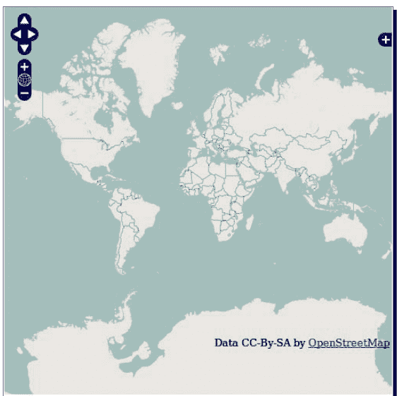

## 发生了什么？

我们刚刚创建的地图显示的是一个 OpenStreetMap 图层。与之前的图层不同，我们不需要提供 API 密钥或指向 OSM 特定文件的链接——OpenLayers 已经知道它了。OpenStreetMap 图层与其它第三方地图图层之间的另一个区别是，OSM 图层没有 type 属性。

## 访问你自己的 OSM 瓦片

上面的代码使用公开可用的 OSM 瓦片，但指向你自己的瓦片也很简单。为此，请按以下格式创建图层：

```
var osm_layer = new OpenLayers.Layer.OSM(
    'My OSM Layer',
    'http://URL_TO_TILES/${z}/${x}/${y}.png',
    {}
) ;
```

使用时，你需要将 URL_TO_TILES 替换为托管你 OSM 瓦片的服务器。${z}、${x}、${y} 是变量，OpenLayers 将用适当的值替换它们以引用特定的地图瓦片。

## 球面墨卡托

让我们谈谈 Spherical Mercator。我在整章中提到了它几次，但它是什么？它是指许多商业、第三方映射 API 使用的投影的术语。我们需要使用 Spherical Mercator 才能在第三方地图图层之上正确叠加数据和图层。

我们在本章中迄今为止使用的所有 API（Google、Yahoo!、VirtualEarth/Bing 和 OSM）都使用 Spherical Mercator 投影——一种将地球视为球体（而不是椭球体）的投影。

## Spherical Mercator—EPSG 代码

该投影的官方 EPSG 代码目前是 EPSG:3857，但在代码建立时被称为 EPSG:900913。EPSG:900913 代码仍可在 OpenLayers 中使用，因为 EPSG:3857 代码与之相同。Google 是（如果不是的话）第一个使用此投影发布地图的公司之一——注意 900913 如何类似于 'gOOgIE'（3 代表倒写的 'E'）。

> 你也可能会看到代表相同 Spherical Mercator 投影的其他 EPSG 代码。例如，ArcGIS 9.3 版本使用代码 EPSG:102113，你也可能会遇到标准 EPSG:3785。它们都指的是相同的 'Spherical Mercator' 投影，可以互换使用。

这对我们意味着什么？嗯，当我们使用这些第三方 API 时，我们使用的坐标看起来不像 Lon/Lat 坐标（它们是米为单位的 x、y）。由于在 Spherical Mercator 投影中地球被视为球体，计算会受到影响，如果我们不重新投影数据，其他来源的数据可能无法与之完美匹配。

我们需要在添加其他图层类并使它们正确对齐之前设置 Spherical Mercator，所以让我们来看看。

## 动手实践 – 使用 Spherical Mercator

让我们使用 Spherical Mercator 和 Yahoo! Maps 图层设置一张地图。使用 Google Maps 图层（V3）时，sphericalMercator 属性会自动设置为 true，因此你无需做额外操作。然而，在处理非 Spherical Mercator 投影的其他图层时，显式指定它是个好主意。

1. 由于我们将使用 Virtual Earth 图层类型，我们需要确保包含 Microsoft 映射 API：

```
<script
src="http://ecn.dev.virtualearth.net/mapcontrol/mapcontrol.ashx?v=6.2&mkt=en-us"></script>
```

2. 第一步是在创建地图对象时指定 maxExtent、maxResolution、units 和 projection 属性。如果还记得上一章，这些是我们指定除默认 EPSG:4326 投影之外的地图投影时必须设置的属性。我们还将 displayProjection 属性设置为 EPSG:4326 投影对象。此 displayProjection 属性指定各种控件（如 MousePosition 控件）以何种投影显示坐标。对于 EPSG: 900913 投影，(-)128 * 156543.0339 是最大范围。

```
map = new OpenLayers.Map('map_element',{
    maxExtent: new OpenLayers.Bounds(
        -128 * 156543.0339,
        -128 * 156543.0339,
        128 * 156543.0339,
        128 * 156543.0339),
    maxResolution: 156543.0339,
    units: 'm',
    projection: new OpenLayers.Projection('EPSG:900913'),
    displayProjection: new OpenLayers.Projection("EPSG:4326"),
});
```

3. 现在，我们将创建一个 Microsoft Virtual Earth（Bing）地图图层对象。这次，我们将指定 sphericalMercator: true，以便图层正确投影到投影上：

```
var ve_road = new OpenLayers.Layer.VirtualEarth(
    "Road",
    {sphericalMercator:true}
);
```

- 4. 打开地图，并在 Firebug 中运行命令：
  `map.getProjection();`
- 5. 你应该看到以下输出：
  `"EPSG:900913"`

## 发生了什么？

我们刚刚使用启用了球面墨卡托的 Yahoo! 地图图层设置了一个地图。使用不同的投影时，我们必须指定一些属性（如我们在上一章中讨论的）。让我们简要回顾一下与 EPSG:900913，即球面墨卡托投影相关的属性。

## 使用球面墨卡托图层的地图属性

由于我们使用的是不同的投影，因此必须告诉 OpenLayers 有关地图的一些信息，以便它知道如何设置。让我们看看上面代码中设置的地图属性。

### maxExtent

我们传入地图属性的第一个属性是：

```
maxExtent: new OpenLayers.Bounds(
    -128 * 156543.0339,
    -128 * 156543.0339,
    128 * 156543.0339,
    128 * 156543.0339),
```

maxExtent 属性告诉 OpenLayers 地图的边界。四个数字代表最小 x、最小 y、最大 x 和最大 y 坐标。我们在此使用的数字是 EPSG:900913 中世界范围的坐标——与经度/纬度坐标大不相同。如果不指定 maxExtent，我们的地图将无法正确显示，因为 OpenLayers 不会知道世界的边界在哪里。

### maxResolution

此属性设置地图的 maxResolution，其基于将地图范围适配到 256 像素。这是一个 {Float} 数据类型。例如，

```
maxResolution: 156543.0339,
```

有关此属性的更多信息可在第 8 章、关于 Map 类的章节中找到。

### units

这指定地图单位为米。它是一个 {String} 数据类型。

```
units: 'm',
```

默认情况下，units 属性设置为度。由于球面墨卡托是一种使用米的投影，因此我们需要在此处指定它。

### projection

在这里我们将地图的投影设置为 EPSG:900913，即球面墨卡托投影：

```
projection: new OpenLayers.Projection('EPSG:900913'),
```

如果我们希望使用经度/纬度，或在不同投影中使用其他图层类型，我们需要将坐标从 EPSG:900913 转换到适当的其他投影。一旦开始使用第三方地图 API，我们就只能使用球面墨卡托投影。

## 使用 Google Maps 和其他图层

让其他图层与这些第三方图层良好配合涉及三件事，其中两件我们已经完成了：

- 1. 设置正确的地图投影属性。
- 2. 确保第三方地图图层上的 sphericalMercator 设置为 true。
- 3. 确保所有栅格图层（任何非 Vector 或 Image 图层），如 WMS，都在地图的投影中。在这种情况下，我们需要确保向 WMS 服务器请求 EPSG:900913 投影的地图瓦片。

利用我们迄今为止学到的知识，让我们制作一个 mashup。我们将使用 Google Maps 图层作为底图图层，并使用 WMS 和 Vector 图层作为叠加图层。

## 动手实践 – 创建你的第一个 mashup

让我们制作一个包含 Google 地图图层、WMS 图层和 Vector 图层的地图“mashup”。

- 1. 首先，我们需要在 <head> 部分添加 Google Maps V3 脚本 API 标签：
  ```html
  <script src="http://maps.google.com/maps/api/js?sensor=false&v=3.2"></script>
  ```
- 2. 现在，使用与前一个示例类似的正确投影信息设置你的地图对象：
  ```javascript
  map = new OpenLayers.Map('map_element', {
      maxExtent: new OpenLayers.Bounds(
          -128 * 156543.0339,
          -128 * 156543.0339,
          128 * 156543.0339,
          128 * 156543.0339),
      maxResolution: 156543.0339,
      units: 'm',
      projection: new OpenLayers.Projection('EPSG:900913'),
      displayProjection: new OpenLayers.Projection("EPSG:4326"),
  });
  ```
- 3. 现在让我们创建一个 Google Maps 图层。由于我们使用的是 API V3，因此无需指定 sphericalMercator: true，因为它会自动设置为 true。
  ```javascript
  var google_streets = new OpenLayers.Layer.Google(
      "Google Streets",
      {numZoomLevels: 20}
  );
  ```
- 4. 我们现在将创建 WMS 图层并指定我们希望从 WMS 服务器获取基本图层和各种标签图层。我们还将不透明度设置为 .7，即 70% 不透明，并设置 isBaseLayer: false，以确保它是一个叠加图层。现在，我们没有在图层上指定投影属性，因为我们的图层将继承地图对象的投影。所有图层（Vector 图层除外）都应与你的地图使用相同的投影。我们使用的 WMS 服务器确实支持 EPSG:900913 投影，因此我们将获得正确的地图瓦片。如果 WMS 服务不支持此投影，我们就无法使用它——我们将在示例后更详细地讨论这个问题。现在创建 WMS 图层：
  ```javascript
  var wms_layer = new OpenLayers.Layer.WMS(
  'OpenLayers WMS',
  'http://vmap0.tiles.osgeo.org/wms/vmap0',
  {layers: 'basic,clabel,ctylabel,statelabel', transparent: true},
  {isBaseLayer: false,
  opacity: .7}
  );
  ```
- 5. 现在让我们添加一个 Vector 图层。它也将使用 EPSG:900913 投影，因为它继承自地图对象的投影。然而，我们可以为矢量图层指定不同的投影并实时重新投影矢量数据（我们不能对栅格图层，如 WMS 图层这样做）——但我们将把这个主题留到第 9 章，我们的 Vector 图层章节。创建矢量图层对象：
  ```
  var vector_layer = new OpenLayers.Layer.Vector(
  'Editable Vectors');
  ```
- 6. 我们现在将添加一个 EditingToolbar 控制，它允许我们通过工具栏向矢量图层添加点和多边形，该工具栏默认会出现在地图右上角。创建控制对象时，我们只需传入我们希望控制使用的矢量图层对象：
  ```
  //Add a vector editing control
  map.addControl(new OpenLayers.Control.EditingToolbar(vector_layer));
  ```
- 7. 最后，我们只需要将图层添加到地图中。
  ```
  map.addLayers([google_streets, wms_layer, vector_layer]);
  ```
- 8. 现在打开你的地图。你可以通过右上角的 **EditingToolbar** 控制向矢量图层添加点和多边形：

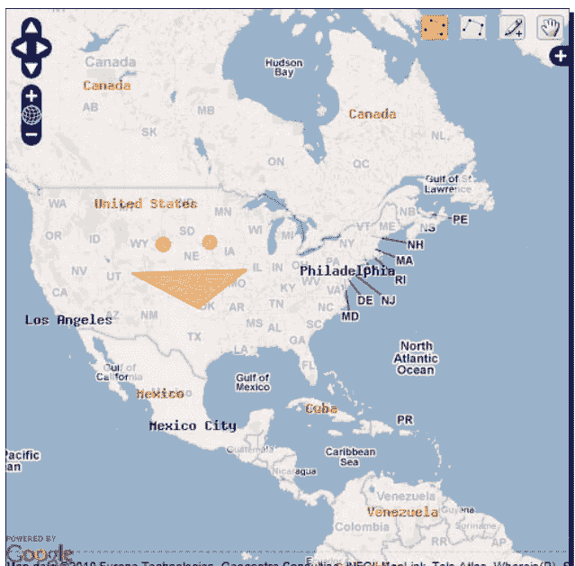

## 发生了什么？

我们刚刚使用 Google Maps、WMS 和 Vector 图层创建了一个地图。我们还将一个 **EditingToolbar** 控制连接到矢量图层对象，这将允许我们在矢量图层中创建点和多边形。我们创建的任何点或多边形（也称为 **features**）都将位于地图的投影 `EPSG:900913` 中，并与下方的 Google 地图图层对齐。

## 使用球面墨卡托/第三方地图图层的 WMS

我们还有一个设置为叠加图层的 WMS 图层。要在 Google Maps 图层（或任何其他第三方地图图层）之上使用 WMS 服务，WMS 服务必须支持 `EPSG:900913` 投影。我们使用的 WMS 服务 `http://vmap0.tiles.osgeo.org/wms/vmap0` 确实支持此投影，因此地图瓦片图像能够正确地与 Google Maps 图层对齐。如果 WMS 服务不支持 `EPSG:900913` 投影，地图瓦片图像将无法正确对齐。

> 要了解 WMS 服务支持哪些投影，你可以向服务器发出 `getCapabilities` 请求。要发出此请求，请在 URL 中指定 `request`、`service` 和 `version` 属性。例如，`http://wmserver/?request=GetCapabilities&service=WMS&version=1.1.1`。

## 总结

在本章中，我们讨论了第三方地图 API 是什么以及如何使用它们。我们学习了如何使用 Google、Yahoo! 和 Microsoft 地图 API，以及 OpenStreetMaps API。我们还讨论了球面墨卡托并演示了如何使用它。最后，我们创建了一个地图“mashup”，混合了各种不同的图层类型。

下一章将重点介绍 OpenLayers 的另一个部分——**Control** 类。这是 OpenLayers 有别于其他地图库的另一个特点。有了它，我们能够与地图交互，添加大量附加功能，甚至创建自己的自定义控件。


