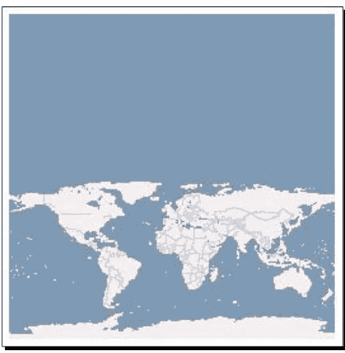
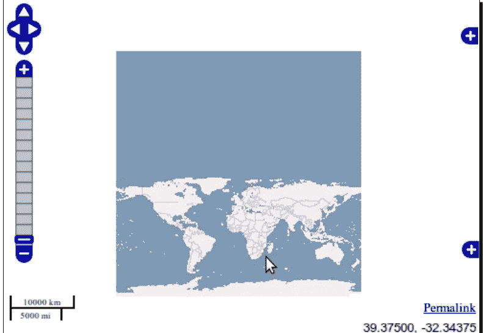
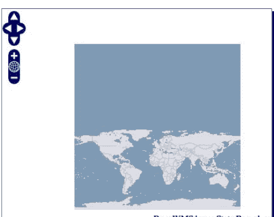
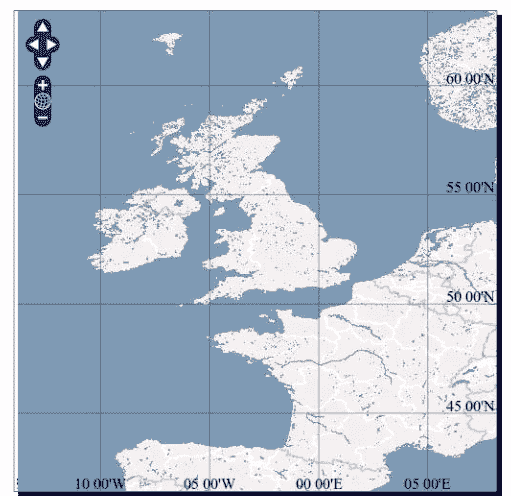
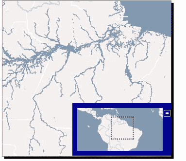
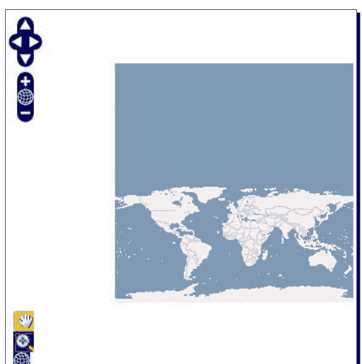
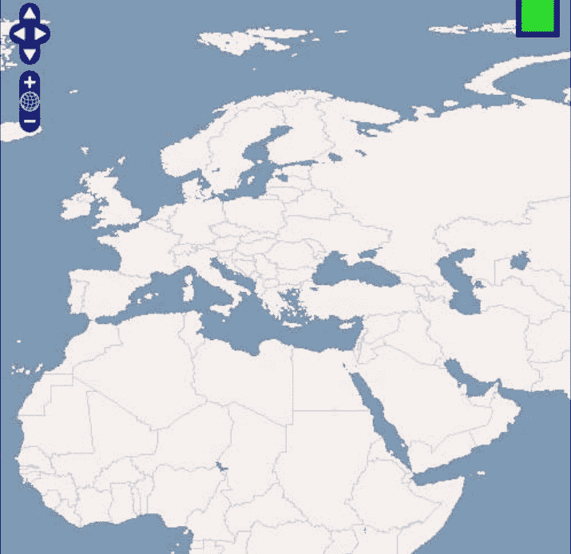
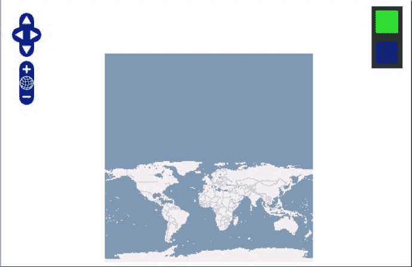

# 6 控制控件

*到目前为止，我们一直理所当然地认为拖动地图时地图会移动。或者只需在图层切换器中点击一个图层即可打开或关闭它。或者可以放大和缩小。我们尚未详细讨论地图交互背后的实际内容或其工作原理。*

*简单来说，OpenLayers Control 类使我们的地图具有交互性。有许多内置控件，每个控件都有其独特的功能。但不仅如此，你可以使用大量预制的控件，而且还可以轻松创建自己的控件。*

本章我们将介绍：
- 什么是控件
- 向地图添加控件
- Control 类及其子类
- 使用面板在地图外部添加控件
- 创建自定义控件

### 什么是控件？

**控件**允许我们与地图交互。它们还允许我们显示额外信息，例如使用 **ScaleLine** 控件显示比例尺。有些控件没有视觉外观，例如 **ArgParser** 控件，但也有一些有，例如 **OverviewMap** 控件。你可以在地图上添加任意数量的控件。甚至有些情况下你可能不想要任何控件——例如在页面中嵌入不可移动的地图，或显示用于打印的静态地图。

### 在 OpenLayers 中使用控件

大多数控件直接添加到地图中，例如 **Navigation** 控件。

其他控件添加到地图中，但也可以放置在地图外部的 `<div>` 标签中——就像概览地图控件一样。

其他控件类似于可以点击或切换开/关的按钮。这类控件可以放置在 **panel** 内，而该面板也可以放置在地图外部。

此外，我们甚至可以创建自己的控件，并将其直接放置在地图中或面板内部。我们将介绍所有这些内容以及更多内容，因此让我们开始学习如何向地图添加控件。

### 向地图添加控件

有两种方法向地图添加控件。

1. 在实例化地图对象时传入一个 OpenLayers Control 对象的 JavaScript 数组。
2. 在地图对象创建后，通过调用两个地图函数之一 `addControl()` 传入单个控件对象，或 `addControls()` 传入控件对象数组来向地图对象添加控件。

当你创建地图时，会自动添加四个控件对象。这四个控件是：

- `OpenLayers.Control.Navigation`：负责处理来自鼠标事件的地图交互，例如拖动鼠标、使用滚动条缩放和双击。
- `OpenLayers.Control.PanZoom`：在地图左上角添加平移/缩放条。包含用于平移的上下左右箭头，以及用于缩放的放大、缩小和缩放至最大地图范围按钮。
- **OpenLayers.Control.ArgParser**：允许地图根据调用地图的 URL 缩放到特定位置并打开/关闭图层。换句话说，当你使用 OpenLayers.Control.Permalink 控件生成 URL 时，ArgParser 控件将解析 URL 并根据 URL 中嵌入的参数操作地图。我们将在本章后面详细讨论这两个控件。
- **OpenLayers.Control.Attribution**：如果向图层对象传入任何署名，此控件将把图层的署名添加到地图中。

由于这些控件是在我们未显式添加的情况下添加的，我们如何选择不包含它们？最简单的方法是在实例化地图对象时向 `controls` 属性传入一个空数组。

### 动手实践 – 创建一个没有控件的地图

没有控件，我们的地图将不可交互。有时这正是你想要的，例如在打印机友好页面上显示地图时。

1. 首先，我们需要创建地图对象并向 `controls` 属性传入一个空数组：
```
map = new OpenLayers.Map('map_element', {
  controls: []
});
```
2. 现在，除非手动调用 `addControl` 或 `addControls`，否则不会向地图添加任何控件。让我们创建一个 WMS 图层并将其添加到地图中：
```
var wms_layer = new OpenLayers.Layer.WMS(
  'WMS Layer Title',
  'http://vmap0.tiles.osgeo.org/wms/vmap0',
  {layers: 'basic'},
  {}
);
map.addLayer(wms_layer);
```
3. 确保你也设置了范围——正如前几章所述，此步骤将在所有后续示例中被隐含：
```
if (!map.getCenter()) {
  map.zoomToMaxExtent();
}
```
4. 打开页面。你应该会看到一个没有控件的地图，并且由于地图没有控件，你将无法平移或放大，如下所示：



### 发生了什么？

我们刚刚创建了一个没有控件的地图。用户无法与地图交互——他们可以看到它，但无法导航或更改它。通过在实例化地图对象时 via controls: [] 传入一个空数组，我们覆盖了默认添加到地图的四个控件。

### 动手实践 – 向地图添加控件

OpenLayers 提供了大量其他控件，它们默认不会传入但仍然非常有用。让我们看看其中一些控件以及如何将它们添加到地图中。在介绍完如何操作后，我们将更详细地介绍每个 Control 类。

1. 我们现在要做的是创建一个控件对象数组，并在创建地图对象时传入。让我们先创建一个 NavigationControl 对象。这样，我们就可以在代码中的任何地方轻松引用该控件。接下来，我们将创建一个 JavaScript 数组，其中包含我们创建的 navigation_control 对象；以及另外四个我们将立即实例化的控件对象。因此，我们在 init() 函数内部需要做的第一件事就是创建一个控件对象数组：
```
var navigation_control = new OpenLayers.Control.Navigation({});
```
```
var controls_array = [
    navigation_control,
    new OpenLayers.Control.PanZoomBar({}),
    new OpenLayers.Control.LayerSwitcher({}),
    new OpenLayers.Control.Permalink(),
    new OpenLayers.Control.MousePosition({})
];
```
2. 现在我们将创建地图对象并传入刚刚创建的控件数组：
```
map = new OpenLayers.Map('map_element', {
    controls: controls_array
});
```
3. 创建并添加一个 WMS 图层，如前例所示。如果我在本章后续示例中要求你创建一个 WMS 图层，我将指的是这段代码。
```
var wms_layer = new OpenLayers.Layer.WMS(
    'WMS Layer Title',
    'http://vmap0.tiles.osgeo.org/wms/vmap0',
    {layers: 'basic'},
    {}
);

map.addLayer(wms_layer);
```
4. 在创建地图对象时传入控件对象数组是一种添加控件的方法，但正如你所知，我们也可以调用 addControl 或 addControls。让我们调用 addControl 并传入一个即时实例化的对象——我们不会创建变量来引用它。
```
map.addControl(new OpenLayers.Control.ScaleLine());
```
5. 让我们创建一个概览地图控件对象。我们将实例化它并使用变量保存对其的引用，然后通过将其传入数组并调用 addControls 将其添加到地图中。我们还将传入一个 KeyboardDefaults 控件，该控件将在 addControls 中实例化。这两种方法都有效——传入对控件对象的引用，或在方法调用中实例化对象：
```
var overview_map = new OpenLayers.Control.OverviewMap();
map.addControls([
    overview_map,
    new OpenLayers.Control.KeyboardDefaults()
]);
```
6. 打开页面。你应该会看到类似以下内容：



### 发生了什么？

我们通过在构造地图对象时传入控件对象数组，并通过调用 `map.addControl` 和 `map.addControls` 向地图添加了各种控件。这两个函数接收控件对象并将其添加到地图中，这也会导致 `map.control` 数组得到更新。

### 试一试 – 添加控件

添加和移除各种控件，看看你是否能确定哪些控件是哪些。查看 **Control** 类文档 http://dev.openlayers.org/docs/files/OpenLayers/Control-js.html 以查看所有可用控件类的列表（我们很快会介绍每个控件），并尝试向地图添加不同的控件。

使用 `map.removeControl()` 并传入你想要移除的控件对象。你可以使用变量名，或使用一种不太优雅的方法直接访问 `controls` 数组本身，例如：
```
map.removeControls(map.controls[2]);
```


这样做应该能清楚地说明为什么创建变量来实例化控制/图层对象是一种更好的方式，因为它使访问正确的对象变得容易得多。使用 controls 数组本身的另一个缺点是，移除一个控制会改变所有其他控制的索引，因此在确定实际移除的是哪个控制时可能会有很多猜测。总之，如果可以的话，避免以这种方式移除控制。

## 通过传入控制数组来添加控制

指定地图控制的第一种方式是在实例化地图对象时以数组形式传入。在创建地图对象时传入控制对象数组是添加控制的首选方式——它将所有控制对象保存在一个地方，使代码更易于阅读和维护。

在上面的示例中，我们创建了一个包含五个控制对象的数组，其中四个是在数组本身中实例化的：

```
var navigation_control = new OpenLayers.Control.Navigation({});
var controls_array = [
    navigation_control,
    new OpenLayers.Control.PanZoomBar({}),
    new OpenLayers.Control.LayerSwitcher({}),
    new OpenLayers.Control.Permalink(),
    new OpenLayers.Control.MousePosition({})
];
```

正如我们之前提到的，在将对象添加到地图之前，最好先为该对象（无论是控制对象还是图层对象）创建一个引用。我们在数组外部创建了 navigation_control 对象，因此只需引用它即可轻松访问它。

要访问其他控制，我们必须调用 controls_array[index] 或 map.controls[index]，其中 index 是要访问的控制的索引。如果可能，请尽量避免这种方法，因为数组可能会发生变化，导致索引出错。此外，以这种方式按索引访问控制会影响代码的可读性，因为不容易看出你试图访问的是哪个控制对象。

## 使用 addControl() 和 addControls() 向地图添加控制

在地图创建后，你可能希望动态地向地图添加控制。为此，我们可以使用地图对象的 addControl() 方法并传入单个控制对象，或者使用 addControls() 并传入对象数组。

在上面的示例中，我们调用了 addControl 并传入了一个 ScaleLine 控制对象，该对象是在运行时实例化的：

```
map.addControl(new OpenLayers.Control.ScaleLine({}));
```

我们还通过传入一个已实例化的控制对象以及在函数调用本身中创建的对象来使用 addControls：

```
var overview_map = new OpenLayers.Control.OverviewMap();
map.addControls([
  overview_map,
  new OpenLayers.Control.KeyboardDefaults()
]);
```

无论你使用哪种添加控制的方法，都应尽量将所有与控制相关的代码放在一起。你在编程中花费的大部分时间都是在阅读代码而不是编写代码。如果对代码进行组织，你的代码将更容易阅读和维护。组织代码没有“正确”的方法，但将相关内容（如与控制相关的代码块）分组在一起是一个很好的经验法则。

## 移除控制

那么，我们知道如何添加控制，但如何移除它们呢？有两种常见的方法可以做到这一点：

- 调用 `map.removeControl(map.controls[x])`；其中 x 是要移除的控制的索引。正如我们之前所说，以这种方式移除控制是不推荐的，因为不清楚实际移除的是哪个控制。
- 另一种方法是调用 `map.removeControl(control_object)`；其中 `control_object` 是你已实例化的控制对象的引用。请记住，如果你在函数内部使用 var 定义一个对象，你将无法在函数外部访问它。

现在我们熟悉了如何添加和移除控制，让我们深入了解 Control 类本身，并查看各种不同类型的控制。

## OpenLayers.Control 类

正如我们在前面的示例中看到的，我们可以使用相当多的控制。Control 类与 Layer 类的性质相似——存在一个基础 Control 类，所有其他控制子类都继承自它。由于大多数控制提供的功能完全不同，基础 Control 类不包含很多属性。

该类的官方最新文档可在 http://dev.openlayers.org/docs/files/OpenLayers/Control-js.html 找到。

## OpenLayers.Control 属性

与其他类的属性一样，你可以在实例化控制对象时指定这些属性。基础 OpenLayers.Control 类有几个属性，所有其他 Control 类都继承了这些属性：

| 名称 | 类型 | 描述 |
|---|---|---|
| autoActivate | {Boolean} | 将控制设置为添加到地图时激活。默认值是 false。 |
| div | {HTML Element} | 许多控制支持将自身放置在地图外部的 div 中的能力。（不过这并不适用于所有控制。）示例调用看起来像：{div: document.getElementById('my_control_div') } |
| id | {String} | 这指定将分配给控制的 HTML 元素的 ID。 |
| eventListeners | {Object} | 此对象指定要注册的事件监听器。事件将在本章后面介绍。 |
| displayClass | {String} | 指定控制将接收的 CSS 类。默认情况下，控制接收由 OlControl 加上控制名称组成的类名，例如 OlControlNavToolBar。我们将在第 7 章关于样式化控制的内容中更详细地介绍这一点。 |
| title | {String} | 你在此处设置标题将在工具提示（或适当的其他位置）中显示。 |
| type | {Number} | 指定控制的类型，这与控制的功能有关。在各种情况下使用，例如在处理按钮或面板时。我们将在本章后面关于面板的部分介绍这一点。 |

## OpenLayers.Control 函数

有几个函数是所有控制子类继承的，我们应该了解一下。

| 名称 | 描述 |
|---|---|
| destroy() | 这将执行任何清理操作（例如移除附加到控制的任何事件），然后将控制从地图中移除。由于控制已从地图中移除，因此在访问 map.controls 时它将不再显示。 |
| `moveTo(location)` | 此函数接收单个参数，`location`，一个 **OpenLayers.Pixel** 对象，并将控制移动到传入的像素坐标（按 x 坐标、y 坐标的顺序）。此函数只会影响具有可见组件的控制。示例调用可能是：`control_object.moveTo(new OpenLayers.Pixel(200,100))`；这将把控制移动到地图内部的 x、y 位置 200、100。原点是地图的左上角，因此它将向右移动 200 像素，向下移动 100 像素。 |
| `activate()` | 调用此函数将激活控制及其事件处理程序（如果已设置）。如果控制成功激活则返回 `true`，如果它已处于活动状态则返回 `false`。 |
| `deactivate()` | 停用控制及任何关联的事件处理程序。此行为在不同控制之间会有所不同。如果控制成功停用则返回 `true`，如果它已处于非活动状态则返回 `false`。 |
| `draw()` | 此函数初始化控制。你很少需要调用它，因为它通常会自动调用。然而，可能存在你希望手动发出调用的情况。它返回一个 `{DOMElement}`，即包含控制的 div 的引用（如果存在）。 |

## OpenLayers.Control 子类

OpenLayers 提供了许多不同类型的控制，最新列表始终可在 http://dev.openlayers.org/docs/files/OpenLayers/Control-js.html 找到。一些控制已弃用，不应使用，因此我们不会介绍在 OpenLayers 3.0 或更高版本中不受支持的控制。

一些控制的一些属性和函数主要面向高级用户，超出了本书的范围，因此我们不会全部介绍。一些其他控制仅与 Vector Layer 类一起使用——因此我们将在第 9 章介绍它们。然而，这仍然给我们留下了很多需要在这里介绍的内容，所以让我们开始吧！

## OpenLayers.Control.ArgParser

正如我们之前提到的，这是默认添加到地图的控制。它的命名很贴切；它解析通过 URL 传入的参数。例如，当在地图 URL 后附加 ?zoom=0&lat=0&lon=0&layers=B 时，ArgParser 控制将解析变量（即 zoom=0、lat=0、lon=0 和 layers=B）。


该控件随后会根据参数操纵地图——它会将地图缩放至 0 级，将纬度和经度设为 0，并打开某一图层。ArgParser 控件不处理这些 URL 参数的生成。它通常与 Permalink 控件一起使用。我们稍后会看到，Permalink 控件才是实际生成 URL 的控件。

示例调用：`var argparser_control = new OpenLayers.Control.ArgParser();`

## OpenLayers.Control.Permalink

Permalink 控件将在地图右下角创建一个 HTML 链接元素（一个锚点、一个 <a> 元素）。该链接包含嵌入了当前地图的经度、纬度、缩放值和图层信息（例如哪些图层已打开）的 URL。

当从其中一个生成的 URL 访问页面时，URL 会被我们刚才讨论的 ArgParser 控件读取。只要地图更新（缩放、平移、打开/关闭图层等），永久链接 URL 就会更改以反映地图的当前状态。

示例调用：`var permalink_control = new OpenLayers.Control.Permalink();`


使用 Permalink 控件时，ArgParser 控件将被自动添加到地图中。

## OpenLayers.Control.Attribution

这是默认添加到地图的另一个控件。它将在地图上显示图层署名（如果为图层指定了 attribution 属性）。图层署名只是一些字符串，将与此控件一起显示在地图上。您还可以通过设置 separator 属性来指定分隔符，它将分隔每个图层的署名。要使此控件有用，必须为要显示署名的图层指定 attribution 属性。

### 署名属性

| 名称 | 类型 | 描述 | 默认值 |
|---|---|---|---|
| separator | {String} | 用于图层署名文本之间的分隔符。 | ', ' |
| div | {HTML Element} | 放置此控件的 HTML 元素。示例：`document.getElementById('map_control_div');` |  |

## 动手实践 – 使用署名

让我们看看署名控件的实际使用情况。

- 1. 要使 **Attribution** 控件有用，我们必须在图层对象上指定一个 `attribution` 属性。因此，让我们创建一个 WMS 图层，并将此属性设置为 `'Base WMS Layer'`：
```js
var wms_base = new OpenLayers.Layer.WMS(
  'OpenLayers WMS',
  'http://vmap0.tiles.osgeo.org/wms/vmap0',
  {layers: 'basic'},
  {attribution: 'Base WMS layer'}
);
```
- 2. 现在，让我们添加另一个图层并将 `attribution` 文本设置为 `'State Boundary'`。
```js
var wms_state_lines = new OpenLayers.Layer.WMS(
  'State Line Layer',
  'http://vmap0.tiles.osgeo.org/wms/vmap0',
  {layers: 'stateboundary'},
  {attribution: 'State Boundary', isBaseLayer: false,
   opacity: .2}
);
```
- 3. 最后，将图层添加到地图：
```js
map.addLayers([wms_base, wms_state_lines]);
```
- 4. 您应该会看到如下内容，图层署名文本显示在地图右下角：



## 发生了什么？

您刚刚使用包含一个 `attribution` 属性的两个图层使用了署名控件。
地图右下角的文本显示当前活动图层的署名文本。
让我们继续介绍更多内置控件类。

## OpenLayers.Control.EditingToolbar

**EditingToolbar** 控件是一个由允许绘制和编辑矢量要素的工具组成的面板。它要求地图中存在矢量图层。我们将在第 9 章中详细介绍此控件及其使用方法。

## OpenLayers.Control.Graticule

这将在地图上显示经线和纬线（或投影的任何测量值）。与某些其他控件不同，此控件有相当多的属性可以设置以改变其行为。这是使用默认参数添加 Graticule 控件后地图的外观：



让我们介绍一下 **Graticule** 控件的属性。

### Graticule 属性

| 名称 | 类型 | 描述 | 默认值 |
|---|---|---|---|
| intervals | {Float Array} | 可能的格网宽度浮点数数组，以度为单位。不同的宽度将根据当前地图缩放级别使用。示例：intervals: [50,30,15,7,4,2,1,.5] | [45,30,20,10,5,2,1,0.5,0.2,0.1,0.05,0.01,0.005,0.002,0.001] |
| displayInLayerSwitcher | {Boolean} | 如果设置为 true，格网控件将在图层切换器中显示。 | true |
| visible | {Boolean} | 确定格网控件是否可见。 | true |
| numPoints | {Integer} | 指定每个格网线使用的点数。 | 50 |
| targetSize | {Integer} | 确定地图上网格的最大像素尺寸。 | 200 |
| layerName | {String} | 指定将在 LayerSwitcher 控件中显示的图层名称。 | null |
| labeled | {Boolean} | 确定是否应为格网线标注标签。 | true |
| labelFormat | {String} | 标签将显示的坐标格式。例如，可能的值为 'd'、'dm' 或 'dms'，分别代表 '度'、'分' 和 '秒'，决定坐标显示的精度。 | 'dm' |
| lineSymbolizer | {Symbolizer} | 指定用于渲染线的符号化器。符号化器指定样式信息。在第 10 章中，我们将详细介绍符号化器及其使用方法。 |  |
| labelSymbolizer | {Symbolizer} | 用于渲染标签的符号化器，控制标签样式。第 10 章详细讨论了符号化器（定义样式的对象）。 |  |

## OpenLayers.Control.KeyboardDefaults

此控件添加了由键盘控制的平移和缩放功能。通过按箭头键、加/减键或 Home 键，地图将被移动或缩放。我们应该查看一个相关属性。

### KeyboardDefaults 属性

| 名称 | 类型 | 描述 | 默认值 |
|---|---|---|---|
| slideFactor | {Integer} | 设置地图滑动的像素数。 | 75 |

## OpenLayers.Control.LayerSwitcher

此控件将创建一个图层列表，允许您打开/关闭地图图层。默认情况下，它在地图中创建一个可切换的窗口，但您可以传入一个 div HTML 元素，图层列表将在其中创建。

### LayerSwitcher 属性

| 名称 | 类型 | 描述 | 默认值 |
|---|---|---|---|
| ascending | {Boolean} | 更改图层的显示顺序。 | true |
| roundedCorner | {Boolean} | 指定图层切换器窗口是否应创建圆角。 | true |
| div | {HTML Element} | 如果指定，则放置此控件的 HTML 元素。如果使用此选项，应将 roundedCorner 属性设置为 false，否则圆角将在目标 div 内创建。示例：document.getElementById('map_control_div'); | null |

### LayerSwitcher 函数

我们可以手动调用一些函数来显示或隐藏 LayerSwitcher 控件。

- **minimizeControl()**：调用时，它会最小化图层切换器控件。特别是在您想要以编程方式隐藏图层切换器控件时很有用。
- **maximizeControl()**：显示图层切换器控件；它基本上与 `minimizeControl()` 相反。

## OpenLayers.Control.MousePosition

此控件显示鼠标当前所在位置的经度和纬度。默认情况下，控件在地图右下角显示位置。

### MousePosition 属性

| 名称 | 类型 | 描述 | 默认值 |
|---|---|---|---|
| prefix | `{String}` | 将添加到坐标文本开头的字符串。 | `''` |
| suffix | `{String}` | 将添加到坐标文本后的字符串。 | `''` |
| emptyString | `{String}` | 如果鼠标移出地图，则显示的文本将代替坐标。默认情况下，当鼠标移出地图时，最后已知的坐标仍会显示。 | null |
| separator | `{String}` | 将放置在经度和纬度之间的字符串。 | `','` |
| numDigits | `{Integer}` | 指定显示坐标的小数点后数字的位数（即精度）。 | 5 |


| 名称 | 类型 | 描述 | 默认值 |
|---|---|---|---|
| displayProjection | `{OpenLayers.Projection}` | 控制坐标将以何种投影显示。任何除 `EPSG:4326` 或 `EPSG:900913` 之外的投影都需要 Proj4js 库来正确地重新投影坐标。如果未设置此属性，则将使用地图的投影。 |  |
| div | `{HTML Element}` | 如果指定，则为放置此控件的 HTML 元素。 |  |

## OpenLayers.Control.Navigation

**Navigation** 控件是默认添加到地图的四个控件之一。此控件通过鼠标输入处理地图导航，例如拖动地图和滚动以放大。让我们看一下其中几个属性。

### Navigation 属性

| 名称 | 类型 | 描述 | 默认值 |
|---|---|---|---|
| documentDrag | `{Boolean}` | 确定当鼠标移出地图视口（即地图 HTML div 元素）时是否允许拖动地图。 | `false` |
| handleRightClicks | `{Boolean}` | 如果设置为 true，地图将拦截右键单击。双击右键时，地图将缩小。 | `false` |
| zoomWheel | `{Boolean}` | 指定鼠标滚轮是否会使地图缩放。 | `true` |
| autoActivate | `{Boolean}` | 确定控件在添加到地图时是否应被激活。在将此控件添加到面板时可能很有用。 | `true` |

## OpenLayers.Control.NavigationHistory

**NavigationHistory** 控件存储有关（正如你猜到的）地图导航的信息。它实际上是一个创建两个子控件的控件，分别称为 `next` 和 `previous`。你不需要直接访问这些子控件，通常只需要使用 **NavigationHistory** 控件对象本身的方法即可。通过调用 `nextTrigger()` 或 `previousTrigger()` 函数，你可以在导航历史中向前或向后（如果可能）移动。

### NavigationHistory 属性

| 名称 | 类型 | 描述 | 默认值 |
|---|---|---|---|
| limit | {Integer} | 指定要存储的历史状态限制。 | 50 |
| nextStack | {Array} | 包含下一个历史状态的数组。实例化对象时不使用。 |  |
| previousStack | {Array} | 包含上一个历史状态的数组。实例化对象时不使用。 |  |

### NavigationHistory 函数

有两种函数可以调用来访问导航历史记录。

- **nextTrigger()**：此函数将调用子 `next` 控件的 trigger() 函数（也可以通过 `nav_history_control.next.trigger()` 调用）。如果存在下一个位置，它将把地图移动到位置栈上的下一个位置。
- **previousTrigger()**：此函数将调用子 `previous` 控件的 trigger() 函数（也可以通过 `nav_history_control.previous.trigger()` 调用）。如果存在上一个位置，它将把地图移动到位置栈上的上一个位置。

### Time for Action – using the NavigationHistory control

让我们使用 **NavigationHistory** 控件的 `nextTrigger` 和 `previousTrigger` 方法来遍历我们的导航历史。

- 1. 打开之前的示例并启用 Firebug。我们将通过控制台创建一个 **NavigationHistory** 控件对象并将其添加到地图中。输入并运行以下代码：
```
var nav_history_control = new OpenLayers.Control.NavigationHistory();
map.addControl(nav_history_control);
```
- 2. 在地图上平移和缩放。每次更新地图时，**NavigationHistory** 控件都会存储有关你操作的信息。然后，在 Firebug 中发出以下命令：
- 3. 你应该会看到地图返回到之前的缩放级别和坐标。现在，让我们通过调用以下命令返回到之前的位置：
```
nav_history_control.previousTrigger();
```
```
nav_history_control.nextTrigger();
```

### What Just Happened?

我们刚刚创建并向地图添加了 **NavigationHistory** 控件，然后调用了 `previousTrigger()` 和 `nextTrigger()` 方法。

## OpenLayers.Control.NavToolbar

OpenLayers 的 **NavToolbar** 控件创建了一个导航控件按钮工具栏。默认情况下它包含两个按钮——一个用于平移，一个用于缩放。平移模式允许你像在 **Navigation** 控件中一样在地图上平移；而缩放控件让你可以选择要缩放的范围。如果希望为地图提供额外的自定义功能，此控件尤其方便。

## OpenLayers.Control.OverviewMap

**OverviewMap** 控件在地图右下角创建一个可切换的窗口，显示一个较小的、缩小的地图，其中包含一个可拖动的矩形，表示你在地图上的当前位置（即概览地图）。当你放大地图本身时，概览地图会相应更新（尽管，你可以通过在 `mapOptions` 属性中设置 `numZoomLevels` 属性来关闭此行为）。



你可能熟悉此工具，许多人期望它出现在网络地图上，因为 Google、Bing 等都有类似的控件——因此根据你的应用情况，包含它可能是一个好主意。我们应该介绍一些配置选项。

### OverviewMap 属性

| 名称 | 类型 | 描述 | 默认值 |
|---|---|---|---|
| size | {OpenLayers.Size} | 设置概览地图的大小，以像素为单位，格式为宽度、高度。示例调用为：`size: new OpenLayers.Size(300,300)`。这将增加概览地图本身的大小，但概览地图所在实际 div 元素的大小由 CSS 指定。 | `new OpenLayers.Size(180, 90)` |
| layers | {Array {OpenLayers.Layer}} | 指定从地图中用于概览地图的图层数组。如果此处未添加任何图层，默认情况下将使用底图作为概览地图。 | Uses the map base layer by default. |
| minRectSize | {Integer} | 此属性确定范围矩形的最小宽度或高度（以像素为单位），在此之前它将被 `minRectDisplayClass` 的值替换。数字越大，范围矩形在被替换前越大。此属性可与 `minRatio` 和 `maxRatio` 属性一起使用，以提供概览地图控件的更自定义行为。 | 15 |
| minRectDisplayClass | {String} | 这指定当达到 minRectSize 值时范围矩形将使用的类名。我们将在下一章关于样式化地图控件的部分更详细地讨论控件样式。 | 'RectReplacement' |
| minRatio | {Float} | 此属性有助于确定何时缩小概览地图。此比率通过将概览地图的分辨率除以底图的分辨率来计算。默认值是 8。这意味着如果概览地图的分辨率小于主地图分辨率的 8 倍，概览地图将缩小。 | 8 |
| maxRatio | {Float} | 此属性有助于确定何时放大概览地图。原则与上面相同。默认值是 32，意味着如果概览地图的分辨率大于主地图分辨率的 32 倍，概览地图将放大。 | 32 |
| mapOptions | `{Object}` | 这是一个对象，就像地图对象的 options 属性一样。它是一个匿名对象，可以包含地图可以包含的相同选项。设置其中一些选项非常有用，尤其是 `numZoomLevels` 属性。例如，`mapOptions: {numZoomLevels: 1}` 将导致概览地图永远不会放大或缩小，保持在最大范围。 | `{}` |
| autoPan | `{Boolean}` | 此属性确定是否自动平移概览地图以使范围矩形保持在中间。将此值设置为 `true` 将模仿 Google 地图中的概览地图行为。 | `false` |
| div | `{HTML Element}` | 如果指定，则为放置此控件的 HTML 元素。如果未指定，**OverviewMap** 控件位于地图右下角。 |  |

### OverviewMap 函数

- **minimizeControl()**：调用时，它将最小化图层切换控件。如果希望以编程方式隐藏图层切换控件，这尤其有用。
- **maximizeControl()**：它显示图层切换控件，本质上与 `minimizeControl()` 相反。

## OpenLayers.Control.PanPanel

此控件在地图左上角添加一个平移面板。它包含四张图片：上、左、右、下箭头。单击箭头将按箭头方向平移地图。


## PanPanel 属性

| 名称 | 类型 | 描述 | 默认值 |
|---|---|---|---|
| slideFactor | {Integer} | 类似于 **KeyboardDefault** 控制，它设置滑动的像素数。 | 50 |

## OpenLayers.Control.PanZoom

这是在默认情况下添加到地图上的四个控件之一。它在地图左上角添加了 **PanPanel** 和 **ZoomPanel** 控件。它包含 **PanPanel** 所具有的 `slideFactor` 属性。除此属性外，此控件没有其他需要介绍的属性。

## OpenLayers.Control.PanZoomBar

此控件与 **PanZoom** 控件类似；不过，它还添加了一个带滑块的缩放条，您可以上下移动它来指定缩放级别。我们来看一下其中的几个属性。

## PanZoomBar 属性

| 名称 | 类型 | 描述 | 默认值 |
|---|---|---|---|
| zoomWorldIcon | {Boolean} | 指定是否应显示缩放至最大范围世界图标。如果设置为 `false`，图标将被隐藏。 | true |
| div | {HTML Element} | 如果指定，则放置此控件的 HTML 元素。 |  |

## OpenLayers.Control.Scale

使用此控件时，地图将以比例形式显示当前地图比例尺（例如 Scale = 1:443M），默认放置在地图右下角。我们只需要查看一个相关属性。

## Scale 属性

| 名称 | 类型 | 描述 | 默认值 |
|---|---|---|---|
| geodesic | {Boolean} | 确定是否应使用大地测量。如果地图的投影为 `EPSG:900913`，则应将此值更改为 `true`。设置为 `true` 时，比例尺是根据像素到地图中心的水平尺寸计算得出的。 | false |

## OpenLayers.Control.ScaleLine

**ScaleLine** 控件在地图左下角添加了一条表示比例尺的线。它将使用 km 和 mi，或在放大时使用 m 和 ft（默认）来显示比例尺。通过指定不同的属性值，我们可以更改此行为；让我们来看一下。

## ScaleLine 属性

| 名称 | 类型 | 描述 | 默认值 |
|---|---|---|---|
| maxWidth | {Integer} | 控制比例尺线的最大宽度，以像素为单位。 | 100 |
| topOutUnits | {String} | 指定地图缩小时比例尺线顶部栏的缩放单位。 | km (kilometers) |
| topInUnits | {String} | 指定地图放大时比例尺线顶部栏的缩放单位。 | m (meters) |
| bottomOutUnits | {String} | 指定地图缩小时比例尺线底部栏的缩放单位。 | mi (miles) |
| bottomInUnits | {String} | 指定地图放大时比例尺线底部栏的缩放单位。 | ft (feet) |
| geodesic | {Boolean} | 确定是否应使用大地测量。如果地图的投影为 `EPSG:900913`，则应将此值更改为 `true`。 | false |
| div | {HTML Element} | 如果指定，则放置此控件的 HTML 元素。 |  |

## OpenLayers.Control.ZoomPanel

**ZoomPanel** 控件将在地图左上角添加一个缩放面板。它包含通过点击相应图标激活的 **ZoomIn**、**ZoomOut** 和 **ZoomToMaxExtent** 控件。它是默认添加到地图的 **PanZoom** 控件的一部分！我们对内置控件的概述到此为止！让我们继续另一个相关主题——**Panels**。

## Panels

到目前为止，我们已经介绍了最常用的控件，这些控件将在本书中反复使用。我们尚未讨论的另一种控件类型是 **panel** 控件。它是一个容器，一个控件，允许我们在（你猜对了）面板内添加和分组其他控件。我们实际上已经在讨论的一些控件中或多或少地遇到了面板控件。**PanPanel** 和 **ZoomPanel** 控件实际上是包含其他控件的面板。

## Control types

对于面板，每个控件都由一个图标表示（您可以随意设置样式）。当点击图标时，会调用该控件的 `activateControl` 方法。记住调用 `activateControl` 非常重要——大多数控件不会自行激活（我们很快会更详细地介绍这一点）。我们遇到的一些控件可以放在面板中，正如我们稍后会看到的那样。

面板中的每个控件都有三种“类型”之一：

- `OpenLayers.Control.TYPE_BUTTON`：这是一种按钮类型控件，其行为类似于按钮——当点击时，会触发某些事件。此类型的一个示例控件是我们在此 **ZoomPanel** 控件中遇到的 **ZoomIn** 和 **ZoomOut** 按钮。
- `OpenLayers.Control.TYPE_TOGGLE`：此类控件通过一次点击激活，通过另一次点击关闭。打开其中一个控件不会影响其他控件，您可以在同一面板中拥有任意数量的切换控件。
- `OpenLayers.Control.TYPE_TOOL`：这种类型的控件类似于上面的切换控件，但一次只能有一个 *工具* 类型控件处于活动状态。例如，**ZoomBox** 控件就是此类控件之一。

让我们看看如何创建面板以及如何向其中添加控件。

## Time for Action – using Panels

在此示例中，我们将演示如何创建和使用 Panel 类。我们将创建一个面板控件对象，该对象将放置在地图外的 div 中，然后向面板添加控件对象。我们将把面板放在地图外的 div 元素中。我们首先创建一个 HTML <div> 元素来包含我们的面板。在地图 div 之后添加一个新的 div，如下所示：

```
<div id='panel_div'></div>
```

1. 现在，我们需要创建一个面板控件对象。我们将首先创建一个 Navigation 控件对象，因为它将充当面板的“默认控件”，这意味着它将是默认激活的控件。然后，我们将创建面板对象并将其放置在之前创建的 panel_div HTML 元素内。在 init() 函数中添加一个 WMS 层，并在 map.addLayer() 调用之后放置以下代码。

```
var navigation_control = new OpenLayers.Control.Navigation();
var control_panel = new OpenLayers.Control.Panel({
    div: document.getElementById('panel_div'),
    defaultControl: navigation_control
});
```

2. 让我们向其中添加一些控件。Panel 控件有一个名为 addControls 的方法，它接受一个控件对象数组。让我们添加一个 ZoomBox 和 ZoomToMaxExtent 控件。请注意，我们传入了 navigation_control，即一个已实例化的对象，而不是即时实例化一个 Navigation 控件对象。此 navigation_control 对象与 defaultControl 属性指向的同一个控件对象相同。如果我们在这里即时实例化一个 Navigation 控件对象，defaultControl 属性将指向不同的控件对象。在此数组之外创建导航控件对象可确保我们使用相同的对象。

```
control_panel.addControls([
    navigation_control,
    new OpenLayers.Control.ZoomBox(),
    new OpenLayers.Control.ZoomToMaxExtent()
])
```

3. 现在我们已经创建了面板，只需将其添加到地图即可。面板控件有一个名为 autoActivate 的属性，当它被添加到地图时会激活面板控件。默认情况下，它设置为 true。面板必须被激活后才能使用，因此如果将此属性设置为 false，则必须调用面板的 activate() 方法。同样，如果您希望默认激活的控件不是 defaultControl，则可以调用面板的 activateControl() 方法并传入所需的控件。

```
map.addControl(control_panel);
```

4. 还有一件最后的事情要做。如果现在打开页面，您可能不会在面板中看到任何内容。这是因为控件尚未与任何样式关联。我们将在下一章中全面介绍其背后的原因以及如何自定义控件样式——但现在，只需在页面的 <head> 部分（<script> 标签之外）放置以下 CSS <style> 标签即可：

```
<style type='text/css'>
    /*Navigation Control*/
    #panel_div .olControlNavigationItemActive {
        background: #226699 url('http://dev.openlayers.org/releases/OpenLayers-2.9.1/theme/default/img/pan_on.png');
        width: 22px;
        height: 22px;
    }
    #panel_div .olControlNavigationItemInactive {
        background: #996622 url('http://dev.openlayers.org/releases/OpenLayers-2.9.1/theme/default/img/pan_off.png');
        width: 22px;
        height: 22px;
    }
    
    /*Zoom Box Control*/
    #panel_div .olControlZoomBoxItemInactive {
        width: 22px;
        height: 22px;
        background:#999933 url('http://dev.openlayers.org/releases/OpenLayers-2.9.1/img/drag-rectangle-off.png');
    }
    #panel_div .olControlZoomBoxItemActive {
        width: 22px;
        height: 22px;
        background:#999966 url('http://dev.openlayers.org/releases/OpenLayers-2.9.1/img/drag-rectangle-on.png');
    }
</style>
```


/*Zoom to Max Extent Control*/
#panel_div .olControlZoomToMaxExtentItemInactive {
  width: 18px;
  height: 18px;
  background:#333399 url('http://dev.openlayers.org/releases/OpenLayers-2.9.1/img/zoom-world-mini.png');
}
</style>

- 5. 现在打开页面，你应该会看到类似以下内容：



## 发生了什么？

我们刚刚创建了一个面板并在其中放置了三个控件。通过点击面板中的其中一个按钮，你可以激活该控件（具体来说，会调用 activateControl 方法）。当创建希望以编程方式激活的面板内部控件时，你必须调用面板的 activateControl 方法，并传入期望的控件对象。如果你点击 ZoomBox 控件按钮，你会注意到 Navigation 控件被停用了——一次只能有一个控件处于活动状态。

> 由于面板控件是一个添加到地图上的控件对象，因此面板控件可在 `map.controls` 数组中使用。对于添加到面板中的控件也是如此。

## 小测验 – zoomBox 控制类型

ZoomBox 控制是哪种类型的控件？

- 1. TYPE_BUTTON
- 2. TYPE_TOGGLE
- 3. TYPE_TOOL
- 4. 导航控件没有控制类型
- 5. TYPE_I_DONT_KNOW

提示：如果你不确定，可以查看 ZoomBox 控件对象的 `type` 属性。

## OpenLayers.Control.Panel

正如我们在前面的示例中看到的，我们能够创建一个面板并将其放置在地图外部的 `<div>` 元素内。如果我们不指定 `div` 属性，面板将直接添加到地图中。我们制作的面板非常简单，但即使创建更高级的面板也不是太困难。

在我们开始变得过于花哨之前，让我们先回顾一下面板类的属性和方法，这样我们就知道自己在处理什么。

## 面板属性

| 名称 | 类型 | 描述 | 默认值 |
|---|---|---|---|
| controls | {Array {OpenLayers.Control}} | 指定添加到面板中的控件对象数组。如前例所示，你可以在调用本身中实例化对象（通过 new OpenLayers.Control）或使用之前创建的对象。创建面板时，你需要使用此属性指定面板接收的控件，或使用面板的 addControls 方法。示例：controls: [new OpenLayers.Control.Navigation(), new OpenLayers.Control.ZoomBox()] | [] |
| autoActivate | {Boolean} | 确定面板在添加到地图时是否应被激活。如果未将其设置为 true，则在使用面板之前必须调用面板的 activate() 方法。 | true |
| defaultControl | {OpenLayers.Control} | 指定要激活的默认控件。这应指向面板将拥有或已拥有的控件。如上例所示，你应传入一个已经实例化的控件对象。如果你指定值时实例化对象，而不是传入已创建的对象，则不会发生任何事情，因为默认控件将指向与面板拥有的对象不同的对象。示例：defaultControl: my_control_object | null |
| saveState | {Boolean} | 如果此属性为 true，则面板内部控件的活动状态（即其状态）在面板被停用时将被保存，并在激活时恢复。它还将在首次激活后覆盖 defaultControl 属性（如果已设置），而是恢复之前处于活动状态的控件。 | false |

## 面板函数

Panel 类目前我们只需要知道两个函数。

-   - **Activate()**：此函数将激活面板控件本身。默认情况下，`autoActivate` 属性设置为 `true`，此函数将自动调用。但是，如果面板默认未激活，则必须调用此函数才能使用面板。
-   - **activateControl({OpenLayers.Control})**：此函数将激活传入的控件。传入的控件必须是属于该面板的控件。这是在用户点击面板内部控件时被调用的函数。如果你希望手动激活控件，将调用此函数。

## 现在怎么办？

呼！我们已经涵盖了 OpenLayers 提供的大多数控件，并介绍了如何使用面板。有很多内容需要消化，但不要感到不知所措。我们涵盖如此多的原因之一是为了以后如果需要复习如何使用控件或可以用控件做什么时，可以回头参考本章。

因此，现在我们已经完成了这些细枝末节的细节，让我们继续进行一些稍微复杂一点的内容。

## 创建自己的控件

到现在为止，你已经熟悉（或可能厌倦了）控件描述。让我们让事情变得更有趣一些，自己创建一个控件。计划如下：

- 1. 快速讨论 Button 控件类。
- 2. 创建一个具有自定义功能的 Button 控件。
- 3. 将按钮添加到面板中。
- 4. 哇！你刚刚创建了自己的自定义控件。

因此，在我们讨论创建自定义按钮之前，让我们先回顾一下上面部分中未涵盖的 **Button** 子类，我们将用它来创建自定义控件。

## OpenLayers.Control.Button

这里其实没什么好讲的，因为我们已经介绍过基础控件类。我们需要讨论的两个属性是 `type` 和 `displayClass` 属性。我们在创建自己的自定义控件时会使用这两个属性。

## 按钮属性

| 名称 | 类型 | 描述 | 默认值 |
|---|---|---|---|
| type | {Integer} | 这是一个整数，表示此按钮控件的类型。这是我们之前讨论的内容——按钮类型。OpenLayers.Control.TYPE_BUTTON 用 1 表示，OpenLayers.Control.TYPE_TOGGLE 用 2 表示，OpenLayers.Control.TYPE_TOOL 用 3 表示。默认情况下，作为 OpenLayers.Control.TYPE_BUTTON 控件，其值为 1。但是，通过更改此属性的值，你可以更改其控件类型。你可以通过使用 {Integer} 数字（如 2）或使用内置常量名称来指定类型。常量名称以 OpenLayers.Control 开头，后跟控件类型（如 OpenLayers.Control.TYPE_BUTTON）。两种方法都能达到相同的效果，但使用常量名称更简洁、更易读。 | 1 (or OpenLayers.Control.TYPE_BUTTON) |
| displayClass | {String} | 此字符串将指定按钮将被赋予的 CSS 类名称。例如为 'olControlMyButton'。你指定的任何类，OpenLayers 都会在末尾自动加上 'ItemInactive'。如果它是可切换的按钮，则在按钮激活时会在末尾加上 'ItemActive'。我们将在下一章详细介绍这一点。如果未定义此属性，它将获得默认值 'olControlButtonItem'（末尾加上 'Inactive' 或 'Active'）。 | olControlButtonItemInactive |

## 按钮函数

这里我们也只需要介绍一个函数。此函数的主要用途之一是我们通常在实例化按钮对象时将其传入。

-   - **trigger()**：此函数在点击控件按钮时被调用（假设它是一个 `OpenLayers.Control.TYPE_BUTTON` 控件）。如果我们在创建按钮时未定义它（或在按钮创建后定义它），点击按钮时不会发生任何事情。当在创建按钮对象时将此作为属性传入时，应传入函数返回代码（函数名称），而不是实际的函数。因此，要在实例化时定义它，请在 `new OpenLayers.Control.Button` 调用之外创建一个函数，然后将该函数名称作为 trigger 引用。例如，

```
var my_func = function(){ alert( 'Stop clicking me'); }
var my_button = new OpenLayers.Control.Button({ trigger: my_func
});
```

## 创建自定义按钮

你现在对 Button 类有了更多的了解，让我们将这些知识付诸实践。我们将创建一个相当简单的自定义按钮（控件类型为 `TYPE_BUTTON`），它将更新底图层的透明度并将地图缩放到随机位置。我们将介绍创建按钮时应包含的几个基本内容：

-   - 指定按钮的 `displayClass` 以赋予其样式（可选）
-   - 创建一个函数并将其设为触发函数
-   - 将按钮添加到面板中，然后将该面板添加到地图中

## 动手实践 – 创建一个简单按钮

让我们创建一个具有 CSS 类并且包含触发函数、点击时执行一些操作的简单按钮。

- 1. 使用第 1 章中的地图模板创建一个新页面。我们将创建一个按钮和一个放置按钮的面板（不过这次面板将在地图内部）。


2. 在创建按钮之前，让我们先创建一个函数，该函数将在通过 `trigger` 函数点击按钮时被调用。我们实际上要创建一个变量并为其分配一个函数——这正是 JavaScript 如此强大的原因之一。让我们让该函数更改地图图层的透明度并缩放至随机坐标。在 `init()` 函数内部，添加一个 WMS 图层，并在 `map.addLayer(wms);` 调用之后添加以下内容。它将生成一个随机坐标，将地图中心设置为该坐标，并更改 WMS 图层的透明度：

```js
var custom_button_func = function(){
    //Get a random coordinate from -90 to 90
    var random_lon = Math.floor(Math.random() * 360) - 180;
    var random_lat = Math.floor(Math.random() * 180) - 90;

    if(map.layers[0].opacity === 1){
        //If the layer opacity is 1 (fully opaque), then change it and zoom
        map.layers[0].setOpacity(.5);
        map.setCenter(new OpenLayers.LonLat(random_lon,
        random_lat), 3);
    }
    else{
        //If the layer opacity is anything but 1, change it and zoom
        map.layers[0].setOpacity(1);
        map.setCenter(new OpenLayers.LonLat(random_lon,
        random_lat), 3);
    }
};
```

3. 现在让我们创建按钮控件对象。我们将为其分配一个 CSS 类，并将 `trigger` 设置为我们刚刚创建的 `custom_button_func`。因此，当按钮被点击时，`custom_button_func` 函数将被调用。注意我们只是传入了函数名称（也称为函数的返回代码），并且在调用函数时通常使用的括号并没有使用。

```js
var custom_button = new OpenLayers.Control.Button({
    displayClass: 'olControlCustomButton',
    trigger: custom_button_func
});
```

4. 让我们创建一个面板来存储新创建的按钮。我们不会传入 div，因此它将直接添加到地图中。

```js
var control_panel = new OpenLayers.Control.Panel({});
```

5. 我们已经创建了面板，现在需要将自定义按钮添加到其中。即使我们只有一个控件，仍然必须调用 addControls，因为 Panel 类没有单一的 addControl 方法。

```
control_panel.addControls([
    custom_button
])
```

6. 几乎完成了！现在，让我们将面板添加到地图中：

```
map.addControl(control_panel);
```

7. 现在，默认情况下，面板将出现在地图的左上角。我们可以通过 CSS 来更改它，但让我们坚持到目前为止所涵盖的内容，使用 moveTo 函数，将面板向右移动 450 像素（原点是地图的左上角）。

```
control_panel.moveTo(new OpenLayers.Pixel(450,0));
```

8. 最后一点，如果我们现在查看地图，我们将看不到按钮。这是因为我们为其分配了自定义 CSS 类，但尚未定义该类。因此，让我们在 <head> 部分、<script> 标签之前添加以下内容。即使我们的 displayClass 设置为 olControlCustomButton，我们也必须定义 olControlCustomButtonItemInactive，因为这是 OpenLayers 为按钮非活动状态生成的实际类名。

```
<style type='text/css'>
  /*Custom Button*/
  .olControlCustomButtonItemInactive {
    background:#22dd22;
    border:5px solid #202020;
    cursor: pointer;
    height: 28px;
    width: 28px;
  }
</style>
```

9. 好的。查看地图。你应该在地图的右上角看到一个又大又难看的按钮：



## 发生了什么？

我们刚刚创建了一个相当简单的按钮控件，点击时它会更改地图的透明度和中心位置。在下一章中，我们将更详细地讨论如何使用 CSS 使其看起来像一个按钮，而不是一个丑陋的绿色方块。在结束本章之前，让我们再回顾一件事——创建一个控件类型与我们刚刚创建的 `TYPE_BUTTON` 控件不同的自定义按钮。

## 其他控件类型

因此，在之前的示例中，我们创建了一个类型为 `TYPE_BUTTON` 的按钮控件。它按我们期望的方式工作，但如果我们希望它可以切换呢？我们从本章前面知道，存在 `TYPE_TOOL` 和 `TYPE_TOGGLE` 按钮类型，并且我们提到过如何将按钮分配为这些类型之一。

## 创建其他按钮控件类型的流程

虽然有几种不同的方法可以实现这一点，但流程基本上归结为以下几点：

- 创建一个控件对象（通过扩展基础 Control 类——一种更高级的技术，或通过创建 Button 控件）并指定 `type`
- 指定在某些事件发生时将被调用的函数（例如，当控件被激活时）

为了保持简单并实现这一点，我们将像前一个示例中那样创建一个 Button 控件。然后，我们将指定 `eventHandlers`，当控件被激活时它们将调用函数。但什么是事件？

## 事件

事件基本上就是字面意思——某事正在发生。实际上，所有用户输入都是事件——按键、鼠标点击等都是事件。

使用 JavaScript，我们能够访问用户生成的事件，例如鼠标点击，并在事件发生时执行操作。事件驱动着 OpenLayers 中的交互——当你拖动地图时，你实际上是在发出一个鼠标事件，OpenLayers 会解释它然后相应地更新地图。

OpenLayers 有自己的 Event 类，这使得与事件的交互变得更容易，甚至使我们能够创建自己的自定义事件。我们现在不会深入探讨这个问题，但我们应该简要谈谈被称为事件处理程序的东西。

## 事件监听器和处理器

如果你理解了前面的段落，那么你可能能够猜出事件处理程序（和监听器）是什么。本质上，事件监听器是监听事件的东西，而事件处理程序是响应事件的东西。

考虑我们在前一个示例中创建的按钮控件。控件会等待有人点击它——这就是事件监听器。当按钮被点击时，`trigger` 函数会被调用——这就是事件处理程序。因此，在 OpenLayers 中，**事件监听器** 用于向某些事件类型（如点击或鼠标悬停）添加 **事件处理程序** 函数。

## 自定义事件

虽然用户创建的事件给了我们很多可操作的内容，但如果我们能处理除鼠标点击和按键之外的其他事件，生活会更轻松。如果我们能与由地图本身触发而不是由用户触发的事件进行交互，那么我们就可以做很多更有趣和巧妙的事情。当然，如果 OpenLayers 没有提供这种能力，我们也不会构建这个概念。

虽然我们在这里不会创建自己的自定义事件，但我们将使用自定义事件。当你点击一个 `TYPE_TOGGLE` 控件按钮时，会触发一个名为 `activate` 的自定义事件。反过来，如果我们想在那时调用某个函数，我们可以将 `eventHandler` 分配给 `activate` 事件。我们将在创建更高级的自定义控件时详细讨论这一点。

## 创建 TYPE_TOGGLE 控件

现在是时候使用 `TYPE_TOGGLE` 和 `TYPE_TOOL` 创建更多自定义控件了。要做到这一点，需要发生两件事——我们必须创建控件对象，然后必须分配在控件被激活时调用的函数（即事件处理程序）。上一节关于事件的内容用于解释事件背后的理论，但如果你有点困惑也不用担心。我们将通过代码来澄清我们将要讨论的内容。开始吧！

## 动手实践 – 创建自定义 TYPE_TOGGLE 控件

我们将创建一个 `TYPE_TOGGLE` 控件按钮。我们实际上将以两种方式使用事件。我们将使用事件在控件被激活/停用（即切换）时调用函数。这个激活/停用概念很重要，因为如果控件未被激活，我们就无法使用它们。

当切换控件被激活时，被调用的 `activate()` 函数将向地图添加一个事件处理程序。地图事件处理程序将查找点击事件，并在点击时调用一个函数，该函数更新基础图层的透明度。当控件被停用时，被调用的 `deactivate()` 函数将移除地图事件处理程序。

1. 打开之前的示例。我们将以此作为本示例的基础。我们实际上不需要在那里更改任何内容，所以让我们继续开始创建我们的按钮！


2. 首先，我们将创建在地图被点击时随机更改地图底图透明度的函数。这仅在我们的切换控件处于激活状态时发生。在 `map.addControl(control_panel);` 行之前插入以下内容：

```javascript
//Function that the map will call when the map is clicked (only when
// the toggle button is active though)
var map_event_function = function(){
    map.layers[0].setOpacity(Math.random());
}
```

3. 在创建 `TYPE_TOGGLE` 按钮之前，我们需要创建两个函数：一个在激活时调用，一个在停用时调用。这与我们在前一个示例中所做的类似。让我们在上一段代码之后这样做：

```javascript
//Create a function for the toggle button
var toggle_button_activate_func = function(){
    //Attach the map_event_function to the map
    map.events.register('click', map, map_event_function);
}

var toggle_button_deactivate_func = function(){
    //Remove the map_event_function from the map
    map.events.unregister('click', map, map_event_function);

    //Restore the layer's opacity
    map.layers[0].setOpacity(1);
}
```

4. 现在，我们需要创建切换控件本身。格式与之前类似，但我们将使用一些不同的属性。因为这是一个切换控件，我们不会使用触发函数。相反，我们将添加两个事件监听器——一个用于激活事件，另一个用于停用事件。我们还将类型设置为 `OpenLayers.Control.TYPE_TOGGLE`（`TYPE_TOGGLE` 类型——我们也可以将类型设置为 2 来实现同样的效果，但使用内置的常量名称可读性更高）。在下一行添加以下内容：

```javascript
//Create the toggle button object
var custom_toggle_button = new OpenLayers.Control.Button({
    displayClass: 'olControlCustomButtonToggle',
    eventListeners: {
        'activate': toggle_button_activate_func,
        'deactivate': toggle_button_deactivate_func
    },
    type: OpenLayers.Control.TYPE_TOGGLE
})
```

5. 你大概能猜到下一步——将控件添加到面板中。很容易！

```javascript
control_panel.addControls([custom_toggle_button]);
```

6. 现在，只需确保 control_panel 已添加到地图中：

```javascript
map.addControl(control_panel);
```

7. 最后，我们只需要添加适当的 CSS 类。我们给切换控件的类名是 olControlCustomButtonToggle，因此我们需要添加相应的类。因为这是一个切换控件，实际上我们需要两个 CSS 类——一个用于激活状态，另一个用于非激活状态。在 <head> 部分的 <style> 标签内添加以下内容：

```css
/*Custom Toggle Button*/

.olControlCustomButtonToggleItemActive {
    background:#336699;
    border:5px solid #202020;
    cursor: pointer;
    height: 28px;
    width: 28px;
}
.olControlCustomButtonToggleItemInactive {
    background:#003366;
    border:5px solid #202020;
    cursor: pointer;
    height: 28px;
    width: 28px;
}
```

8. 全部完成！当你点击新创建的控件时，activate() 事件会被触发，并且由于我们为其添加了事件监听器，相应的 toggle_button_activate_func 将被调用。它将向地图添加一个事件处理程序，等待点击。当鼠标点击事件触发时，底层的透明度将被设置为 0（完全透明）到 1（完全不透明）之间的某个随机值。然后，当再次点击切换控件时，它将被停用，图层将恢复完全不透明。



## 发生了什么？

你现在可能已经对我们刚刚制作的控件的工作原理有了一个很好的了解。快速回顾一下，发生以下情况：

- 1. `custom_toggle_button` 切换控件等待 `activate` 或 `deactivate` 事件被触发（这些是自定义的 OpenLayers 事件，而不是像鼠标点击那样的通用 JavaScript 事件）。这是通过使用 `map.events.register` 注册事件来完成的。
- 2. 当点击 `custom_toggle_button` 控件时（这会将其切换为开启），`activate_control` 事件被检测到，对应的 `toggle_button_activate_func` 函数将被调用。
- 3. 被调用的 `toggle_button_activate_func` 函数随后向地图添加一个事件监听器（再次使用 `map.events.register`）。
- 4. 此事件监听器将等待 `click`（鼠标点击，一个通用 JavaScript 事件），然后每次收到点击时触发 `map_event_function`。
- 5. 当 `custom_toggle_button` 控件按钮接收到 `deactivate` 事件时（即它被点击并切换为关闭），对应的 `toggle_button_deactivate_func` 函数将被调用。
- 6. `toggle_button_deactivate_func` 函数使用 `map.events.unregister` 移除之前添加的地图事件监听器。因此，监听器已不存在，地图上的鼠标点击将不再导致 `map_event_function` 被触发。

就这些了！


> 使用面板内的面板和控件时，请确保控件通过 `activate()` 或面板的 `activateControl()` 方法被激活。如果控件未被激活（或用户无法通过点击控件等方式激活），则控件无法使用。

## 摘要

本章我们涵盖了相当多的内容。我们讨论了控件背后的概念以及它们在 OpenLayers 中的使用方式。然后我们演示了如何将控件添加到地图中。我们深入介绍了 Control 类及其各种子类。我们还介绍了如何设置面板以及如何向其添加控件。为了结束本章，我们介绍了事件并学习了如何创建自己的自定义控件。

尽管本章已经相当详尽，但关于控件仍有更多内容需要学习——例如如何设置它们的样式。在第 9 章《Vector 层类》中，我们将介绍一些我们忽略的特定于 Vector 层的控件。本章内容可能很多，但下一章会短一些。我们将讨论使用 CSS 设置控件样式，并制作看起来像是应该被点击的控件，而不仅仅是大的绿色和蓝色方块。
