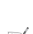
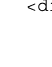
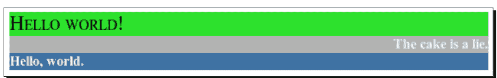
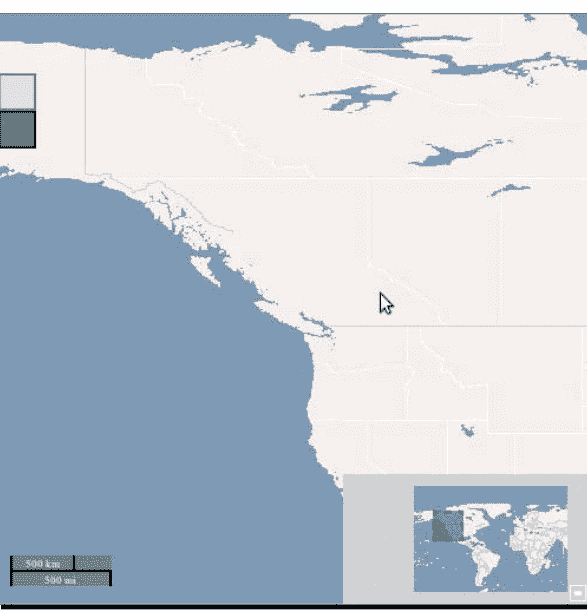
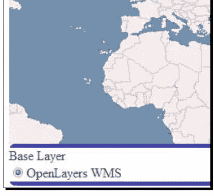
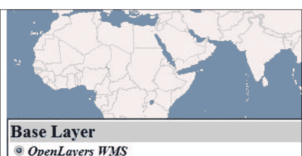

# 7 控件样式

*到目前为止，我们已经看到如何自定义 OpenLayers 提供的几乎所有内容——图层、控件等。然而，我们并没有太关心地图界面的实际外观。*

*OpenLayers 提供了外观相当不错的默认控件，因此你可能不需要更改它们。不过，与 OpenLayers 中的几乎所有其他内容一样，更改 Control 类使用的样式和图像也很简单。*

*我们在上一章讨论了 Control 类，在本章中我们将探讨 OpenLayers 如何为控件应用样式以及如何自定义控件。*

本章我们将：

- 讨论 CSS 是什么以及它的作用
- 讨论 HTML 如何使用 CSS
- 介绍 OpenLayers 如何使用 CSS
- 介绍 OpenLayers 为控件使用的命名方案
- 为控件提供一些自定义样式

让我们开始吧！

## 什么是 CSS？

**CSS** 是 **Cascading Style Sheets**（层叠样式表）的缩写。它是一种用于指定 HTML 元素外观的标记语言。CSS 其实相当简单，如果你能跟上本书到目前为止的内容，你绝对不会有任何问题。在更深入地了解之前，让我们先谈谈 CSS 的工作原理。

## CSS 和 HTML 背后的思想

**HTML**、**CSS** 和 **JavaScript** 各自服务于三个不同的目的。

- **HTML** 如我们所见，用于创建网页的结构和 *内容*
- **CSS** 另一方面，用于控制网站的 *呈现*，即页面应如何显示
- **JavaScript** 如本书所述，用于处理网站背后的 *逻辑*

因此，当你制作一个网站时，至少需要考虑三个独立的部分——背后的 HTML、为 HTML 赋予样式的 CSS，以及处理任何逻辑或用户交互的 **JavaScript**。目前，我们将重点关注 HTML 和 CSS。

理想情况下，HTML、CSS 和 JavaScript 不应混合（即，你不应在 HTML 中使用 style 标签或像 `<center>` 这样的标签）。你的 HTML 页面应链接到外部 JavaScript 和 CSS 文件，尤其是在生产环境中。遵循这一原则的一个优点是，如果你想更改网站的外观，只需在一个地方（外部文件）编辑 CSS，而不是在每个页面上编辑。缺点是如果所有内容都包含在同一个 HTML 文件中，编辑起来会稍微更容易、更快；这就是我们到目前为止一直这样做的原因。

但我们如何编辑 CSS，这到底是什么意思？

## 编辑 CSS

如果你熟悉 CSS，请随意跳过接下来的几页，直接进入关于 *OpenLayers 如何使用 CSS* 的第二部分。如果你不熟悉，也不用担心！它非常简单。

CSS 不是编程语言；事实上，你已经熟悉它的结构。让我们看看应用 CSS 样式的“模板”代码：

```
element {
    property: value;
    property-two: value;
}
```


看起来很熟悉吗？它本质上就是 JavaScript 中匿名对象 的样子。主要区别在于每行末尾需要分号（;）（而不是逗号）。


> 你会注意到我们这里也有 属性：值（键：值 对）。存在许多不同的可能属性和值。我们将在本章后面介绍常见的内容，但完整列表可以在 http://www.w3schools.com/css/css_reference.asp 找到。

另一个区别，你会注意到的是，在方括号前面有一个叫做 element 的东西。这指的是一个或多个 HTML 元素——通过标签名、类名或 ID。多个元素用逗号分隔。

## HTML 元素

到目前为止，我们只谈了一点点关于 HTML 中的元素。你的 HTML 页面中的每个 <tag> 都是一个元素（例如，<div id='my_div'>This div is an element</div>）。现在，要使用 CSS，我们必须有一种方法来引用我们想要设置样式的元素（们）。这是上面 CSS 代码大纲中的 element 部分。



> DOM（Document Object Model）是一种表示页面中对象（例如这些元素）的方式。我们现在不会深入讨论它，但如果你有兴趣了解更多，那么 http://w3schools.com/dom/default.asp 是一个很好的资源。

## HTML—ID 和类

我们可以通过两种主要方式引用特定元素：通过 ID 或类名。

### HTML ID

每个 HTML 元素都可以有一个 ID。ID 是唯一的，并且没有元素应该共享相同的 ID。例如，

```
<div id='map_element'></div>
```

使用这段代码，我们创建了一个 ID 为 'map_element' 的 div 元素——没有其他元素（无论是 div 还是其他）应该有相同的 ID。因此，当我们想要引用一个特定元素时，ID 非常有用。我们已使用 ID 属性来指定地图应该出现在哪一个 div 中（通过 <div id='map_element'></div> 并在实例化地图对象时指定 map_element）。

### HTML 类

还有另一种引用元素的方式，通过 **类名**。HTML 中的类与你在 JavaScript 中习惯的类几乎没有共同之处。你在 HTML 中关于类真正需要知道的只是，与 ID 不同，类名可以多次使用（这主要是它们的设计目的），并且一个元素可以有多个类名（用单个空格分隔）。

那么，这在 HTML 中看起来是什么样子的？

```
<div id='some_div' class='some_class_1'></div>
<div id='some_other_div' class='some_class1 some_class2'></div>
```

这里，我们有两个不同的 div 元素，每个都有不同的 ID。然而，这两个元素都共享类 `some_class1`，并且会接收该类包含的任何属性。第二个 div 也会继承类 `some_class2` 包含的任何属性。

## 使用 CSS 样式化 HTML 元素

现在我们知道了 HTML 如何使用类和 ID，我们可以学习如何将它们与 CSS 一起使用。具体来说，我们如何在 CSS 代码中引用 `element`？在 CSS 中指定元素有三种方式：

**元素类型**：单独指定元素的名称将把样式应用到所有该类型的元素。例如：

```
div {
  color: #ff0000;
}
```

这将把颜色 #ff0000（红色）应用到所有 div 元素。

**元素 ID**：指定 ID 将导致样式仅应用于具有指定 ID 的元素。为此，在期望的 ID 前放置一个八进制符号（井号或磅符号，#）。例如：

```
#map_element {
  height:500px;
  width:500px;
}
```

**元素类名**：指定类名将导致样式应用于所有具有期望类名的元素。为此，在类名前放置一个句点。例如：

```
.some_class1 {
  color:#0000ff;
}
```

## 在代码中使用 CSS

我们现在知道如何引用元素了，但如何在 HTML 中使用 CSS 呢？有三种方法：

- **包含外部 CSS 文件：** 这是在 HTML 页面中添加 CSS 的首选方式，因为如果我们需要更改样式，只需在一个地方更改即可。其原理与包含外部 JavaScript 文件的方式类似——我们基本上指向一个外部 CSS 文件，页面会读取它。为此，我们在 HTML 页面的 `<head>` 部分放置一个 `<link>` 标签。例如：

```
<link rel='stylesheet' href='style.css' />
```

`rel` 属性指定链接是一个样式表，而 `href` 指定 `.css` 文件本身的位置。

- **在 `<head>` 标签中 `<style>` 标签内包含 CSS：** 这是指定 CSS 的另一种方式，但是最不理想的方式，因为如果我们想更改某些样式，就必须在每个页面上更新它。然而，当只使用一个文件时，这并不是什么大问题，这也是为什么到目前为止我们在本书中一直这样做的原因。在 `<head>` 标签中，你可以添加一个 `<style>` 标签，其中包含所有 CSS 定义。`<style>` 标签内的所有内容都被解释为 CSS 代码，与 `<script>` 标签内的代码被视为 JavaScript 代码类似。

- **作为元素上的 style 属性包含“内联”CSS 定义：** 我们在前几章中见过这一点。style 属性引号内的所有内容都被视为 CSS 代码。一个例子是：

```
<div id='map_element' style='height:500px; width:500;' ></div>
```

```
<link rel='stylesheet' href='style.css' />
```

```
<div id='map_element' style='height:500px; width:500;' ></div>
```



对于熟悉 `<link>` 标签的人来说，你可能会注意到我们只包含了 rel 和 href 属性。在 HTML5 中，我们不需要指定 type 属性，HTML5 是写作时的当前 HTML 版本。

## 动手时间 – 使用外部 CSS 文件

让我们创建一个简单的页面，使用外部 CSS 样式表文件（一个 .css 文件），并使用 ID 和类。

- 1. 创建一个新、空的 HTML 文件。我们只需制作一个基本的 HTML5 页面，其中包含几个 `<div>` 标签来演示 CSS 继承。我们还将包含一个 `<link>` 标签，该标签将引用在下一步中创建的 CSS 文件，其中包含我们所有的 CSS 代码。
- 2. 首先，我们需要用一个 `DOCTYPE` 标签开始 HTML 页面，告诉浏览器这是一个 HTML5 标准页面。然后，我们需要一个 `html` 标签和一个 `head` 标签，其中包含一些元信息（例如 `title` 标签），以及我们的 JavaScript 和 CSS 文件链接。
- 3. 现在，我们需要创建一个 `body` 标签，其中将包含页面的实际内容。我们还将放入一些 `div` 标签，它们充当内容块。每个 `div` 元素将有一个唯一的 ID。每个 div 也将至少有一个类。类可以被多个元素使用，并且你可以通过用空格分隔类名来将多个类应用于一个元素：
- 4. 创建一个名为 `ex1_style.css` 的文件并放入以下代码。我们将为 `body` 标签指定一个 `background` 和文本 `color` 属性。因为元素从其父元素继承样式，所以每个元素都会收到这两个属性（但它们可以被覆盖）：

```
<!DOCTYPE html>
<html lang='en'>
<head>
    <meta charset='utf-8' />
    <link rel='stylesheet' href='ex1_style.css' />
    <title>Ugly_Webpage_01</title>
</head>
```

```
<body>
    <div id='title' class='background_green'>
        Hello world!
    </div>
    <div id='content' class='background_green align_left'>
        The cake is a lie.
        <div id='message' class='align_left'>
            Hello, world.
        </div>
    </div>
</body>
</html>
```

```
body {
    background:#ffffff;
    color:#000000;
}
```

- 5. 让我们通过 # 符号指定元素的样式，ID 用于指定单个元素。这将导致具有指定 ID 的元素被样式化；然而，我们将定义它。我们还将通过使用句点（.）来指定类的样式。在 CSS 中，类用于将样式应用于多个元素：

```
#title {
    font-size:1.5em;
    font-variant: small-caps;
}
#content {
    background:#ababab;
    color:#f0f0f0;
    font-weight:bold;
    text-align:right;
}
    #message {
        background:#336699;
    }
.background_green {
    background: #22dd22;
}
.align_left {
    text-align:left;
}
```

- 6. 你应该会看到类似这样的内容：



## 发生了什么？

我们演示了本章迄今为止所讨论的内容，包括包含外部 CSS 文件以及使用 ID 和类名引用元素。你可能想知道为什么有些样式被应用而有些没有。让我们快速回顾一下原因，然后继续学习 OpenLayers 如何使用 CSS。


> 在 CSS 中，你可以使用 /* 开始注释，并使用 */ 结束它。例如，/* This is a comment */

## 动手试试 – 在 Firebug 中查看 HTML 和 CSS

打开 Firebug 并访问任意网站。Firebug 会自动构建 HTML 树，并在 Style 选项卡中填充网站的样式信息。随意探索并尝试使用 Firebug 修改值，你就能立即看到站点外观根据 Firebug 应用的样式而发生变化。

## 级联样式表—继承

CSS 使用的继承方式与我们在 JavaScript 中的类类似。对于 CSS，子元素可以继承其父元素的属性，同时也可以覆盖它们。因此，如上例所示，我们的 body 元素文本颜色（color 属性）为黑色（#000000）。这意味着 body 元素内的任何元素（实际上是页面上几乎所有 HTML 元素）都会接收 color:#000000 属性，除非被覆盖。

这就是 CSS 中“级联”部分发挥作用的情况。样式会“级联”向下，因此子元素（最“底部”的元素）中发现的属性会覆盖其从父元素（其上方的元素）继承的属性。

## 继承顺序

在尝试确定元素将接收哪种样式时，任何来自类名的样式都会覆盖基础元素样式，而任何来自 ID 的样式都会覆盖类样式。请看以下代码：

```
<div id='my_element' class='random_class'> Some text </div>
<style>
.random_class { color: #00ff00; }
#my_element { color: #ff0000; }
div { color: #000000; }
</style>
```

在此代码中，该元素的最终颜色为 #ff0000。基础元素（div 样式）会被 .random_class 类样式覆盖，然后类样式会被 #my_element ID 样式覆盖。因此，重要性顺序为 ID > class > 基础元素类型。

在属性值后使用 !important 声明可确保该属性不会被其子元素覆盖。但是，如果其中一个子元素在该属性上包含 !important 声明，则它将被覆盖。

## 引用元素

我们可以用 CSS 做的一件非常有用的事情是使用我们刚刚谈到的继承。
更具体地说，我们可以写：

```
#my_element div {
  background: #2222ff;
}
```

这将仅对 #my_element 的子元素中的 div 元素应用背景颜色。
这种嵌套可以深浅随意——只需用空格分隔元素。例如：

```
#my_element #my_inner_element .random_class a {
  font-weight: bold;
}
```

这将应用于 #my_element 内的 ID 为 my_inner_element 的元素内的 class 为 random_class 的元素内的所有 a 元素（锚点标签，由 <a> 指定）。如果我们想将相同样式应用于多个元素，我们只需指定元素并在它们之间放置逗号：

```
#my_element1, #my_element2, .random_class {
  color:#cdcdcd;
}
```

好了，我们已经介绍了 CSS 和 HTML 元素引用的基础知识，那么让我们看看 OpenLayers 如何使用 CSS。

## 小测验 – 如何引用元素

请看以下代码。尝试想出至少三种不同的方式来引用 inner_most span 元素。提示——想想如何通过继承访问它。

```
<div id='outer_div'>
  <p class='paragraph_style'>
    <div id='middle_div'>
      <span id='inner_most'>
      </span>
    </div>
  </p>
</div>
```

## OpenLayers 与 CSS

OpenLayers 会为其创建的大多数 HTML 元素应用类名和 ID，因此一旦我们知道它如何生成类名和 ID，自定义地图的 UI 就非常容易。在谈论如何覆盖样式之前，我们需要知道样式文件本身在哪里。

## 样式化 OpenLayers—使用主题

在 OpenLayers 中，主题用于控制 UI 元素的外观。主题由 CSS 文件和任何相关的用户界面图像组成。OpenLayers 默认使用名为 `default` 的主题来为地图应用大量样式。创建自己的主题很容易。

如果你想为地图创建自定义 UI 样式，你基本上需要创建包含 CSS 文件和 UI 控件使用的图像（例如，平移箭头图像）的“主题文件夹”，或手动覆盖某些默认样式。主题文件夹可以放在任何你想要的位置，只需在 HTML 文件中引用它时记住其路径即可。

要使用自己的主题，你只需做三件事：

- 1. 在页面中包含 OpenLayers 后，添加指向包含自定义地图样式的 CSS 文件的链接。
- 2. 你必须告诉 OpenLayers 在哪里找到地图使用的图像。为此，通过向 JavaScript 代码中添加以下内容来指定图像所在文件夹（你的主题文件夹）的路径。路径相对于包含 JavaScript 代码的文件：
```
OpenLayers.ImgPath = 'path/to/your/theme_folder/';
```
- 3. 在创建地图对象时通过 `theme` 属性指定主题文件夹的位置。路径相对于包含 JavaScript 代码的文件。例如：
```
var map = new OpenLayers.Map('map_element', {theme:
'theme_folder'});
```

## 创建自己的主题

现在我们知道如何使用主题，但如何创建主题呢？答案很简单——我们只需创建一个 CSS 文件、一些图像，并创建一个存放它们的目录即可。图像将放在主题文件夹内的名为 img 的文件夹中。然后，我们只需告诉 OpenLayers 使用该主题。随着 OpenLayers 后续版本的发布，主题文件夹的预期结构可能会发生变化，因此弄清默认提供的图像（及其名称）的最佳方法是查看默认主题文件夹。你可以在下载的 OpenLayers 文件夹的 theme/default 文件夹中找到它。

但更大的问题是如何引用用户界面元素？答案在于了解 OpenLayers 如何为其创建的元素生成类名和 ID。

## OpenLayers—类名和 ID

要样式化一个元素，你必须引用它。如果我们想引用特定的 div，我们需要知道它的类和/或 ID。OpenLayers 会生成类名和 ID，因此我们只需要知道名称是如何生成的。最常见的方法是使用生成的类名来样式化控件。

## 生成的类名

OpenLayers 为控件生成的类名遵循以下形式

```
.olControlControlNameExtra
```

这意味着 .olControl 总是出现在类名的开头，ControlName 是控件类本身的名称。Extra 指控件的任何额外描述或元素（例如，在许多控件后添加的“Inactive”和“Active”，尤其是按钮控件）。

例如，如果我们想样式化比例尺线控件，我们会将其引用为

```
.olControlScaleLine
```

正如我们之前遇到的那样，对于按钮类型控件，我们在末尾添加“Inactive”或“Active”。其他控件，例如 OverviewMap 控件，也包含一个 OverviewMapElement 类名——元素指的是概览控件生成的 HTML 容器。LayerSwitcher 控件也有类似情况。快速确定元素类名的方法是使用 Firebug 检查页面并找到该元素。

我们很快会介绍常见控件的类名，但在那之前让我们谈谈引用控件元素的另一种方式：通过 ID。

## 生成的 ID

通过类名引用控件元素是样式化控件的首选方式，但通过 ID 样式化也是可能的。有两种方法可以实现：

- **Wrong way**: 使用生成的 ID。ID 的生成形式为 `OpenLayers.Control.ControlName_XX`，其中 `XX` 是一个基于各种因素（如控件顺序）分配的数字。数字可能会根据你制作地图的方式而改变。因此，如果你在样式声明中使用它并且 ID 发生变化，则样式将不再应用。
- **Right way**: 在创建控件时传入 ID 并引用它——换句话说，当你创建一个新控件时，传递 `id` 属性并赋予某个字符串值，该值将用作元素的 ID。这样，我们就不必担心生成的 `XX` 数字会改变，并且可以确定 ID 会是什么。

好了，现在我们知道如何引用元素，以及 OpenLayers 如何生成类名和 ID，让我们看一个示例来巩固概念。

## 动手操作 – 样式化控件

让我们练习样式化一些 OpenLayers 控件。我们这里不会创建主题；相反，我们只需链接到一个外部 CSS 文件，该文件将覆盖我们希望样式化的元素的默认样式。

- 1. 让我们先创建一个新页面。我们还将把所有自定义样式放在一个名为 **control_style.css** 的文件中。因此，每当添加样式时，请确保将其放入 **control_style.css** 中。另请确保在 `<head>` 部分使用以下方式包含 CSS 文件：
```
<link rel='stylesheet' href='control_style.css' />
```
- 2. 现在，让我们创建地图对象。我们在实例化时指定 controls 数组，因为在此示例中我们不想要 **PanZoombar** 控件。我们*不*使用自定义主题（我们只是通过外部 CSS 文件覆盖样式），但如果我们使用的话，也会指定 `theme` 属性。
```
map = new OpenLayers.Map('map_element', {
  controls: [new OpenLayers.Control.Navigation()]
});
```
- 3. 好了，让我们创建一些控件。我们将逐个介绍每个控件，以便可以看到涉及的所有步骤。首先，让我们创建一个 **ScaleLine** 控件。在 JavaScript 代码中使用以下内容创建一个默认的 **ScaleLine** 控件对象：
```
map.addControl(new OpenLayers.Control.ScaleLine());
```


4. 现在，让我们为其应用一些样式。因为我们没有传入类名或 ID，我们将使用自动生成的类名。这是一个标准控件，没有“active”或“inactive”状态，因此我们可以直接使用默认生成的名称 olControlScaleLine。在你的 control_style.css 文件中，添加以下内容：

```
.olControlScaleLine {
    background: #777777;
    color:#ffffff;
}
```

5. 大多数控件只需使用其主类名（即 .olControlControlName）即可设置样式。其他控件，例如按钮和具有 active/inactive 状态的控件，具有额外的类名。这是一件好事——你通常希望按钮在被点击时具有不同的样式。让我们使用 NavToolbar 控件——在你的 JavaScript 代码中，输入以下内容：

```
map.addControl(new OpenLayers.Control.NavToolbar());
```

6. 现在，让我们为 NavToolbar 控件设置样式。我们需要设置两件事——NavToolbar 控件本身（它实际上是一个面板）以及其包含的按钮的 Inactive/Active 状态。NavToolbar 控件还包含一个 ZoomBox 控件，我们也需要为其设置样式。它还包含需要设置样式的 Inactive/Active 状态。

默认情况下，按钮具有 left 和 top 属性。我们将用 0 替换这些值并添加 !important 值，这将确保我们新设置的值不会被覆盖。在你的 CSS 文件中，添加：

```
.olControlNavToolbar {
    top: 0;
}
.olControlNavigationItemInactive {
    background: #787878 !important;
    border: 2px solid #232323;
    cursor: pointer;
    left:0 !important;
    top:0 !important;
}
.olControlNavigationItemActive {
    background: #dedede !important;
    border: 2px solid #787878;
    cursor: pointer;
    left:0 !important;
    top:0 !important;
}
```

```
.olControlZoomBoxItemInactive {
    background: #336699 !important;
    border: 2px solid #232323;
    cursor: pointer;
    left:0 !important;
    top:0 !important;
}
.olControlZoomBoxItemActive {
    background: #77aadd !important;
    border: 2px solid #5588aa;
    cursor: pointer;
    left:0 !important;
    top:0 !important;
}
```

7. 让我们创建一个 **概览地图** 控件。在你的 JavaScript 代码中，添加以下内容：

```
map.addControl(new OpenLayers.Control.OverviewMap());
```

8. 现在，让我们为其设置样式。这是一个由几个不同元素组成的控件，但它们都有类名，因此我们可以随意设置样式。我们将设置打开概览地图时的背景（通过 `.olControlOverviewMap`）、概览地图上的范围矩形，以及最小化/最大化按钮的位置。将此添加到你的 CSS 中：

```
.olControlOverviewMapMaximizeButton,
.olControlOverviewMapMinimizeButton{
    bottom:0 !important;
}

.olControlOverviewMapElement {
    background: #cdcdcd !important;
}
.olControlOverviewMapExtentRectangle {
    background:rgba(60,90,120,.7);
    border:2px dashed #22dd22 !important;
}
```

9. 打开你的地图，移动一下并查看你的控件。你应该会看到类似这样的内容：



## 发生了什么？

我们制作了一些控件并为其添加了样式。我们以以下三种不同的方式应用了样式：

- 根据其类名设置控件本身的样式（例如，`olControlScaleLine`）
- 设置按钮控件的样式（其 Inactive 和 Active 状态）
- 设置控件创建的各种其他元素的样式

可能并不总是立即清楚使用什么类名来引用一个控件，但总是有可能弄清楚。其中最快、最简单的方法之一是使用 Firebug（或其他 Web 开发工具）检查页面的生成 HTML 并查找类名中包含控件名称的元素。

## 动手实践 – 设置 LayerSwitcher 控件的样式

现在让我们看看如何设置 LayerSwitcher 控件的样式。与之前的示例不同，我们将把此控件放置在地图外部的 div 元素中。

1. 开始一个新页面。我们将链接到一个外部 CSS 文件，该文件将覆盖基础 LayerSwitcher 控件样式，如之前的示例。包含一个 `<link>` 标签，引用一个名为 `ex3_layerswitcher_style.css` 的文件，我们稍后会创建它。
2. 接下来，我们需要创建一个 div 元素来容纳我们的控件。在 map_element div 之后创建一个 div 标签：
```html
<div id='layer_switcher_control'></div>
```
3. 现在，在你的 JavaScript 代码中，像往常一样创建地图和 WMS 层对象。添加一个 LayerSwitcher 控件，并将 layer_switcher_control 元素作为 div 属性传入：
```javascript
map.addControl(new OpenLayers.Control.LayerSwitcher({
  div: document.getElementById('layer_switcher_control')
}));
```
4. 现在，如果你打开地图，你应该会看到地图下方有图层切换控件：
5. 默认情况下，它看起来很朴素。它还有一个带圆角的边框。首先，我们需要通过传入 roundedCorner: false 来禁用圆角。
```javascript
map.addControl(new OpenLayers.Control.LayerSwitcher({
  div: document.getElementById('layer_switcher_control'),
```



```
roundedCorner: false
})) ;
```

6. 现在让我们创建 ex3_layerswitcher_style.css 文件。我们将在此处指定控件的样式。由于我们在创建控件时手动指定了 div 属性，我们首先要设置样式的是我们传入的 div（ID 为 layer_switcher_control）。因为是我们自己传入的，OpenLayers 不会为其应用任何默认样式。让我们为其添加实心边框和一些内边距。将此添加到样式文件中：

```
#layer_switcher_control {
    border:2px solid #454545;
    padding:2px;
}
```

7. 现在我们需要开始覆盖控件从 OpenLayers 继承的样式。首先，我们需要获取相关的类名。我们可以使用 Firebug 查看“Base Labels”文本位于 class 为 baseLbl 的 div 中。由于它是下面列出基础图层的标题，让我们让它大一点并赋予背景。它也位于我们的 layer_switcher_control div 内，因此在 CSS 中指定它时，让我们尽可能具体：

```
#layer_switcher_control .baseLbl {
    background:#cdcdcd;
    font-size:1.3em;
    font-weight:bold;
}
```

8. 让我们也为实际图层名称的标签文本设置样式。使用 Firebug，我们可以看到标签文本位于 class 为 labelSpan 的 <span> 标签内，它是 class 为 baseLayersDiv 的 div 的子元素。所有基础图层都将显示在此 div 中，而任何叠加图层将显示在名为 dataLayersDiv 的 div 中。利用这些信息，让我们为其应用样式，指定继承以访问该元素：

```
#layer_switcher_control .baseLayersDiv .labelSpan {
    font-style: italic;
    font-weight:bold;
}
```

9. 现在打开页面，你应该会看到样式化的图层切换器 div：



## 发生了什么？

我们刚刚在地图外部添加了一个 LayerSwitcher 控件并为其设置了样式。我们看到了如何设置我们创建的 div 元素的样式，以及通过获取 OpenLayers 生成的类名来设置元素的样式。LayerSwitcher 控件以及其他一些控件如 OverviewMap，比其他控件具有更多需要设置样式的元素。可能并不总是立即清楚需要设置哪些元素的样式，但我们始终可以使用 Firebug 检查 HTML 并确定类名。

## 勇敢尝试 – 添加图层

向你刚刚创建的地图添加更多图层。注意现在叠加图层有一个新的元素集合，位于 class 以 'dataLayers' 开头的元素中。你的所有叠加图层都被视为“data layers”并将显示在此处，而基础图层显示在 baseLayersDiv 中。利用你在前一个示例中学到的知识，为叠加图层 div 元素应用你自己的样式。

## 其他资源

CSS 的全面覆盖超出了本书的范围，但希望本章已提供了设置 OpenLayers 元素样式所需的必要信息。关于 CSS 的更详细信息可以在 W3Schools 网站找到，网址为 http://www.w3schools.com/css/default.asp。


具备熟练设计技能的开发者并不常见——幸运的是，有一些资源提供高质量、专业的用户界面元素。**GeoExt** 是一个第三方库，它将流行的 JavaScript 框架 **ExtJS** 与 OpenLayers 集成，并包含众多用户界面和 OpenLayers 地图组件。然而，它确实需要对 ExtJS 库有一定的熟悉程度。GeoExt 可在 http://www.geoext.org/index.html 找到，ExtJS 可在 http://www.sencha.com/products/js/ 找到。

## 摘要

本章我们讨论了 CSS 是什么以及它的用途。我们学习了如何将 CSS 和 HTML 结合使用，以及如何在 CSS 中引用元素。然后，我们讨论了 OpenLayers 如何使用 CSS，以及控制元素是如何命名。最后，我们为某些控件创建并应用了自己的自定义样式。

本章的目标是为理解如何使用 CSS 样式化控件提供基础。如果你之前很少使用过 CSS，或者不确定如何样式化其他类型的控件，不用担心。我们将在整本书中使用本章介绍的相同原则来样式化控件，因此你将获得更多实践经验。
