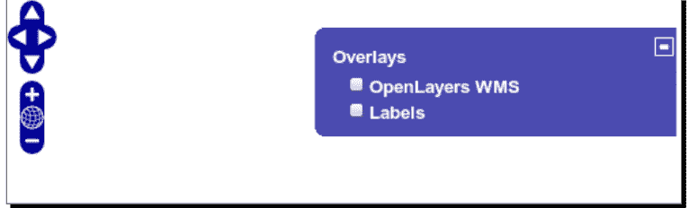
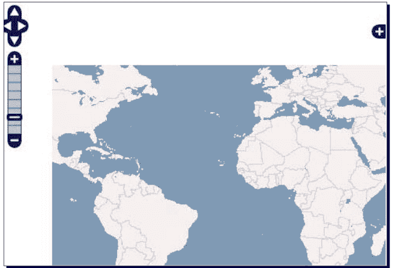
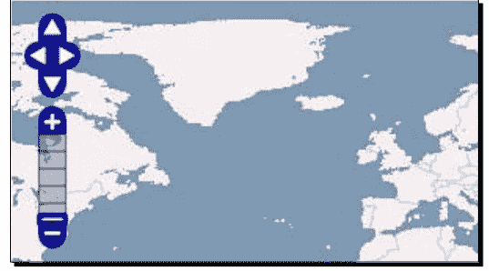
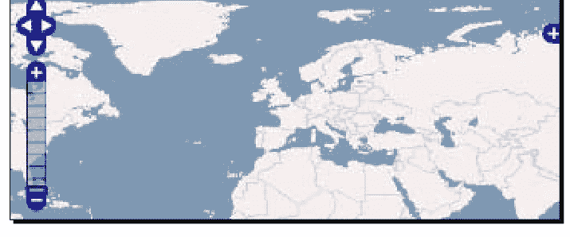
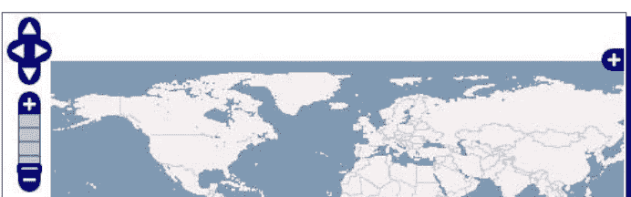
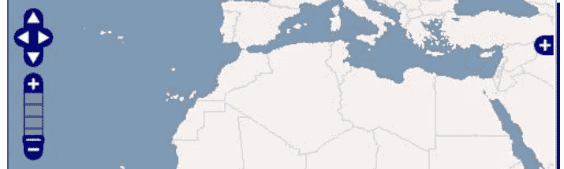
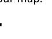
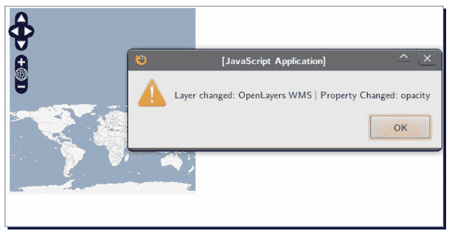
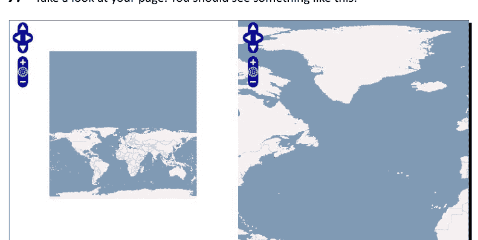
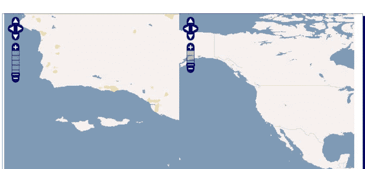

# 8 绘制地图类

> *地图类正如你现在可能已经猜到的，是地图背后的核心部分。你创建的地图对象(s)是你地图背后的最重要的东西，因为没有地图对象你就无法对图层或控件做任何事情。在本章中，我们将讨论地图类，而我们迄今为止一直将其视为理所当然。*
>
> *理解地图类将使我们能够为应用程序做更多酷炫的事情，并提供一种以编程方式告诉地图该做什么的方法。*

到目前为止，我们一直在本书中使用地图类，但实际上并不真正知道如何或为什么使用它。本章旨在不仅解释我们一直在做什么以及为什么这样做（例如使用 `map.zoomToMaxExtent()`），而且还全面介绍 OpenLayers 的核心部分之一——地图类。我们将查看

- 地图类是什么
- 地图类与我们讨论过的其他类之间的关系
- 访问地图类的属性
- 使用地图类的函数
- 使用事件来定义和扩展地图行为
- 创建一个包含多个地图的简单应用程序

### 地图类

OpenLayers 的地图类驱动着我们的地图。我们希望对地图做的所有事情——移动它们、缩放、添加图层——所有这些都由这个类实现。我们已经通过创建地图对象、向其添加控件和图层，然后告诉地图缩放至最大范围，广泛地使用过它。虽然我们已经相当详细地介绍了图层和控件，但我们尚未真正讨论地图类背后的功能，我们应用程序的核心组件。

在 OpenLayers 中，控件和图层对象属于一个地图对象。如果我们希望它们发挥作用，控件和图层对象必须连接到地图。因此，我们需要一个地图对象来真正制作一个有用的地图——正如你可能想象的那样，我们稍后在本章中会看到，使用多个地图对象制作应用程序是可能的。

### 创建地图对象

在我们深入之前，让我们回顾一下实例化地图对象的基代码。我们之前做过很多次，但一点回顾不会有坏处。

```
var map = new OpenLayers.Map('html_element', { options });
```

第一个参数是一个字符串，由你希望地图放置其中的 HTML 元素的 ID 组成（几乎总是 div 元素）。第二个参数是可选的，由一个对象字面量或匿名对象（键：值对）组成，其中包含属性和值设置。

所以，这里还没有什么新东西。这本质上是你设置地图对象所需的一切。然而，正如我们之前提到的，如果你使用的是 EPSG:4326 以外的投影，例如球面墨卡托，在创建地图对象时你还需要设置一些其他属性（例如 maxExtent 和 units）。

本章将涵盖通过地图类可用的大多数属性和函数，因此让我们从属性开始。

### 地图类属性

你可以传入的可能属性非常多，我们在书中已经见过其中一些。还有一些相当有用的属性我们尚未介绍。我将先介绍一些属性，然后我们将通过一些示例来实际操作它们。

在解释属性和方法时，我通常会将任意地图对象称为 `map`。如果你的地图对象叫其他名字，你只需将 `map` 替换为你的地图对象的名字。另一个快速说明；虽然我们将在创建地图对象时传入这些属性的上下文中讨论所有这些属性，但你可以随时调用它们来获取值（例如，调用 `map.tileSize` 将返回地图的瓦片大小）。

> 虽然我们将涵盖与本书中的所有示例和讨论相关的所有属性和函数，但要获取始终最新且完整的列表，你可以访问 http://dev.openlayers.org/docs/files/OpenLayers/Map-js.html 上的文档。

### 地图属性

让我们回顾一下在创建地图对象时通常会传入的地图属性。还有一些属性我们可以访问但不应在实例化时传入——我们稍后会介绍这些。现在，让我们专注于在实例化地图对象时使用的属性。

#### allOverlays

```
allOverlays: {Boolean} Default is false
```

`allOverlays` 属性指定地图是否可以在没有基础图层的情况下运行。到目前为止，我们在所有示例中都使用了基础图层，无论是显式还是隐式（让我们的图层自动设置为基础图层）。通过设置此属性，*所有* 图层都将作为覆盖图层运行。

可能有时候你希望使用它——只要记住，使用此属性时，用户有能力禁用所有图层，他们实际上可以看到一个空地图。通过将此属性设置为 `true`，第三方 API 图层也将作为覆盖图层运行。因此，如果你愿意，你可以将 Google 地图图层用作覆盖图层并使其半透明。

#### controls

```
controls: {Array {OpenLayers.Control}}
```

我们在第 6 章中介绍了控件，因此这里不需要深入讨论。我们可以在创建地图对象时定义地图的控件，也可以在地图对象实例化后通过 `addControl(s)` 添加它们。地图实例化后，我们可以通过调用 `map.controls` 访问其控件。如果你没有在创建地图时指定控件数组供地图使用，你的地图将获得四个默认控件：**Navigation**、**PanZoom**、**ArgParser** 和 **Attribution**。

#### displayProjection

```
displayProjection: {OpenLayers.Projection}
```

此属性主要由显示坐标信息的控件使用。通过在地图对象上设置此属性，任何具有 displayProjection 属性的控件都将被设置为此值。控件，例如 MousePosition 控件，可以在 displayProjection 中显示坐标。因此，你的地图可能使用与你希望显示坐标的投影不同的投影。然而，要使用 EPSG:4326 或 EPSG:900913 以外的 displayProjection，必须在你的页面上包含 Proj4js。

如果例如你的地图使用球面墨卡托投影（即 EPSG:900913），但你可能希望以另一个投影（如 EPSG:4326）显示坐标（以显示 lon/lat 坐标），此属性非常方便。

#### div

```
div: {HTML Element or String}
```

到目前为止，我们一直是这样创建地图的：

```
var map = new OpenLayers.Map('map_element', {});
```

使用 div 属性，我们可以改为在选项中传入 HTML 元素（或元素的 ID，如上所述）；即，

```
var map = new OpenLayers.Map({'div': 'map_element'});
```

这样做的一个优点是 div 属性是可选的，因此你可以创建一个地图对象并选择不将其放置在任何 div 中。如果你这样做，你可以使用 render() 方法稍后将地图放置在 div 中。

这实际上几乎与 OpenLayers 在我们传入 HTML 元素进行地图对象实例化时自动为我们做的事情相同。当我们指定此 div 属性时，OpenLayers 只是在此时调用 render() 方法——我们只是延迟了此操作，并在选择不指定 div 时手动调用它。这在我们只想在用户点击按钮后才显示地图时很有用，例如。

### 动手实践 – 使用 allOverlays 地图属性

让我们看看如何使用 allOverlays 属性并在创建地图时不指定 div。

- 1. 在你的 init() 函数中，让我们使用 allOverlays 设置为 true 并传入一些控件来创建我们的地图对象。我们也不会指定 HTML 元素：
- 
-       var map = new OpenLayers.Map({

```
allOverlays: true,
    controls: [new OpenLayers.Control.Navigation(),
new OpenLayers.Control.PanZoom(),
new OpenLayers.Control.LayerSwitcher()]
});
```

2. 现在，让我们创建几个图层，以便了解 allOverlays 属性的工作方式。我们假设在今后的示例中你会向地图添加 WMS 图层。

```
var wms_layer_all = new OpenLayers.Layer.WMS(
    'OpenLayers WMS',
    'http://vmap0.tiles.osgeo.org/wms/vmap0',
    {layers: 'basic'},
    {}
);
```

```
var wms_layer_labels = new OpenLayers.Layer.WMS(
    'Labels',
    'http://vmap0.tiles.osgeo.org/wms/vmap0',
    {layers: 'clabel,ctylabel,statelabel',
transparent:true},
    {}
);
```

```
map.addLayers([wms_layer_all, wms_layer_labels]);
```

3. 由于在实例化地图对象时没有指定 div，我们必须调用 render() 函数将地图放置在 div 中。该函数接受 HTML 元素或元素 ID 的字符串，因此让我们传入元素的 ID。

```
map.render('map_element');
```

4. 最后，检查是否已设置中心点。如果没有，则缩放至最大范围。我们假设你在今后的示例中也会执行此步骤。如果你愿意，可以将对 render() 函数的调用放在这段代码之后，它仍然会缩放至中心或最大范围——调用 render() 和设置地图位置的顺序由你决定。

```
if (!map.getCenter()) {
    map.zoomToMaxExtent();
}
```

5. 查看地图并打开图层切换器——你应该能够关闭两个图层并看到现在为空的地图。因为我们没有底图，并且所有叠加图层默认都是禁用的，所以在你启用图层之前你只会看到空白地图。



## 发生了什么？

我们刚刚查看了一些我们提到的属性——`allOverlays`、`controls`，以及（省略）`div` 属性。我们还看到了用户通过关闭所有图层可能完全看不到地图的方式。

地图不会自动渲染，因为我们没有传入 HTML 元素。相反，我们在创建地图对象后调用了 `render()` 方法并传入了 HTML 元素。可能有时候你希望延迟渲染地图，例如等待用户点击按钮，在这种情况下这是一种很好的做法。我们将在本章后面更详细地讨论地图方法，但让我们回到地图属性的讨论。

### 事件监听器

`eventListeners: {Object}`

此属性接受一个匿名对象，其中包含事件类型（作为键）和在触发这些事件时调用的函数（作为值）的键值对。我们在第 6 章中简要介绍了此属性，这里它的行为方式相同。一个示例是：

```
var map = new OpenLayers.Map('map_element', {
    eventListeners: { 'moveend': my_moveend_function }
});
```

上面的代码假设存在一个名为 `my_moveend_function` 的函数。我们将在本章的事件部分中更详细地介绍此属性以及可能的事件类型。

### 穿透

```
fallThrough: {Boolean} Default: true
```

fallThrough 属性决定 OpenLayers 是否允许地图上的事件向下传播（即“穿透”）到页面上的其他元素。

让我们通过一个示例来说明其含义。假设你的 map_element div 上附加了一个事件，当你点击它时会显示一个警告。这个事件在 OpenLayers 之外。现在，假设你创建一个地图对象并将其附加到该 map_element div。如果 fallThrough 设置为 true（默认情况下是这样），你通过点击地图会收到原始警告——鼠标点击事件将被允许“穿透”。如果将其设置为 false，你将不会收到警告，因为 OpenLayers 将会消耗该鼠标点击事件。

### 图层

```
layers: {Array {OpenLayers.Layer}}
```

我们已经在一定程度上遇到过此属性。地图实例化后，我们可以通过调用 map.layers 来访问其图层。到目前为止，我们一直是先创建地图对象，然后创建图层对象，然后使用 addLayer() 将图层添加到地图。然而，我们也可以在实例化地图时使用 layers 属性并传入图层对象的数组。

在创建地图对象时使用此属性传入图层或调用 addLayers 本质上做的是同一件事——使用你最熟悉的方法即可。一个示例是：

```
var map = new OpenLayers.Map('map_element', {
    layers: [my_layer_1, new OpenLayers.Layer.WMS({ ... })]
});
```

你可以传入已创建的图层对象（例如 my_layer_1，假设已创建了该名称的图层对象），或在调用中实例化图层对象（例如 new OpenLayers.Layer.WMS({...})）。


> 在上面的示例中，... 将被 WMS 图层的选项替换。

### 最大范围

maxExtent: {OpenLayers.Bounds} 默认值：以十进制度为单位的范围，(-180, -90, 180, 90)

设置此项将指定地图的最大范围。超出最大范围的瓦片不会被请求，用户也不能平移到位于 maxExtent 之外的坐标。如果你使用的是与默认投影不同的投影，你需要更改此设置以反映所需投影中世界的坐标。

maxExtent 属性的数据类型是 OpenLayers.Bounds 对象。OpenLayers.Bounds 类用于创建“bounds”对象，其中包含构成边界框的四个坐标。这四个坐标是最小 x（左）、最小 y（底）、最大 x（右）和最大 y（顶）。要实例化一个 bounds 对象，只需按以下顺序传入坐标：

```
var bounds_object = new OpenLayers.Bounds(minx, miny, maxx, maxy);
```

### 最小范围

minExtent: {OpenLayers.Bounds}

设置 minExtent 将指定地图的最小范围。此属性没有默认值。你通常不需要设置它，除非你使用 maxResolution 指定自定义分辨率——在这种情况下，你通常会将值设置为 (-1, -1, 1, 1)。

### 受限范围

restrictedExtent: {OpenLayers.Bounds}

此属性指定用户可以导航的范围——也就是说，用户只能在 restrictedExtent 属性指定的范围（如果给出，并且限制其导航是可能的）内平移。

设置此属性仍允许用户放大以查看超出受限范围的地图部分，但地图的中心将被设置为受限范围。如果你想限制缩放级别，可以设置 resolutions 数组、maxResolution 或 scales 属性（在后面的页面中介绍）。此属性类似于 maxExtent，然而，restrictedExtent 之外的瓦片仍会被请求，但用户不一定能够平移到它们。

### 缩放级别数

numZoomLevels: {Integer} 默认值：16

numZoomLevels 属性指定地图将拥有的可能缩放级别的数量。对于许多应用来说，给用户 16 个缩放级别并不总是理想的。在大多数情况下，只需指定 numZoomLevels（如果使用不同的投影，则连同 maxExtent）即可设置缩放级别的数量。随着我们查看其他属性，我们将看到更多指定缩放级别数量的方法（有些方法根本不使用此属性）。然而，让我们看看如何使用此属性来设置缩放级别的数量——非常简单！

## 动手实践 – 设置缩放级别和最大范围

1. 通过指定 numZoomLevels 并添加 PanZoomBar 控制来创建你的地图对象。我们还将 numZoomLevels 属性设置为 8，意味着只有八个缩放级别可用。最后，我们将 maxExtent 属性设置为仅包含世界的一部分，如下所示：

```
map = new OpenLayers.Map('map_element', {
    controls: [
        new OpenLayers.Control.Navigation(),
        new OpenLayers.Control.PanZoomBar(),
        new OpenLayers.Control.LayerSwitcher()
    ],
    numZoomLevels: 8,
    maxExtent: new OpenLayers.Bounds(-100, -30, 40, 30)
});
```

2. 打开页面，你应该会看到类似这样的内容：




## What Just Happened?

我们的地图只有八个缩放级别，最大范围为 (-100, -30, 40, 30)。你一定注意到地图起始的缩放级别比预期放大了几次。这主要是由于最远的缩放级别会显示超出地图最大范围的内容。让我们快速聊聊缩放级别是什么。

访问 map.zoom 属性（或调用 map.getZoom()）的缩放级别会显示你当前的缩放级别（一个 {Integer} 值）。缩放级别数字从 0 开始递减（'最远' 的缩放级别——地图通常在此级别开始），到最大缩放值减一（因为第一个值从 0 开始，而不是 1）。

在我们的示例中，我们可以拥有的最高缩放值为 7，因为我们的 numZoomLevels 设置为 8。由于缩放值从 0 开始，而不是 1，因此我们需要从最大缩放级别数中减去一来得到当前缩放级别值。

在 PanZoomBar 控件中，滑块的最底部项代表更远的缩放级别（我们称之为最小缩放级别）。你可以达到的最高级别将被称作最大缩放级别。现在，如果我们使用第三方 API 图层，我们可以简单地在这些图层属性上设置 minZoomLevel 和 maxZoomLevel，但要为地图（和其他非第三方 API 图层）设置这些值，我们使用 scales 或 resolutions 以及 min 或 maxScale 和 min 或 maxResolution。

## Map properties—Continued

让我们继续讨论地图属性。

## Resolutions

```
resolutions: {Array{Float}}
```

这是地图将使用的分辨率数组。数组中的每个值都是一个可能的缩放级别。如果你在实例化地图（或图层）时未传入此参数，它将根据其他属性（如 maxExtent）自动确定。设置此属性是指定地图缩放级别数量的另一种方式。分辨率数组从高值到低值递减。

分辨率是每个像素的地图单位宽度/高度——例如，150 英里除以 512 像素的分辨率为 0.29296875。如果使用瓦片缓存服务器，你需要指定瓦片被缓存的分辨率（同时设置 serverResolutions 属性，该属性指定服务器上瓦片被缓存的分辨率）。否则，你通常只需定义 numZoomLevels 来指定想要的缩放级别数量。


> 关于分辨率数组的另一个小提示是，数组中每个值都是前一项值的一半。因此，如果你的分辨率数组第一项为 0.703125，下一个值将为 0.3515625，再下一个为 0.17578125，以此类推。

## Time for Action – using resolutions array

设置分辨率数组是指定缩放级别数量的一种方式。让我们在实践中看看。

- 1. 在地图对象定义中按如下方式指定分辨率数组：
```
map = new OpenLayers.Map('map_element', {
    resolutions: [ 1.40625,0.703125, 0.703125, 0.3515625,
0.17578125, 0.087890625, 0.0439453125 ]
});
```
- 2. 在地图上缩放。因为我们只提供了五个可能的分辨率，你应该能够放大五次。

## What Just Happened?

使用分辨率数组，我们能够指定缩放级别的数量。除非我们使用缓存瓦片服务，否则这不一定是最简单的方式来指定缩放级别的数量。我们之前提到过我们也可以使用 scales，还可以使用 minResolution 和 maxResolution。

## Map/Layer property inheritance

Resolutions/scales/max extent 等属性可以在地图对象或图层对象中指定。最好在地图中指定它们，这样你就不必担心将属性应用到哪些图层上。然而，如果你在地图中未指定它们，则底图图层的设置将被应用到地图上。这不一定不好，但可能会有点模糊，难以确定哪些图层控制着分辨率，因为如果这些属性设置在覆盖图层中，它们不一定会被应用。

因此，为了安全起见，如果你在地图上设置这些属性，就不必担心将它们应用到图层上。主要例外是如果你使用第三方 API 图层——在这种情况下，你必须设置这些图层属性，例如 minZoomLevel、maxZoomLevel、（两个第三方 API 特定属性无法设置在地图上），以及 numZoomLevels。

如果你想设置模拟限制最小或最大缩放级别的属性，可以使用 max/minResolution 或 max/minScale，我们现在就来介绍。

## Map properties discussion—Continued

让我们回到查看一些剩余的地图属性。

## maxResolution

```
maxResolution: {Float or String (with value of 'auto')}. Default: 360 degrees / 256 px
```

maxResolution 属性指定地图的最大分辨率可以是多少。换句话说，地图可以放得多远。设置此属性会影响基础缩放级别是什么以及你可以放大的程度。如果你想获取此属性的值，可以缩放至所需缩放级别并调用 map.getResolution()；或在 Firebug 中访问 map.resolution 属性以获取当前缩放级别的分辨率。

将 maxResolution 设置为 'auto' 是确保地图范围完全 '适配' 地图 div 的一种方法。将属性设置为 'auto' 也可以与其他属性一起使用以自动生成缩放级别。

## minResolution

```
minResolution: {Float or String (with value of 'auto')}
```

指定此属性将限制地图的最小分辨率——用户可以放大的程度。此属性也可以设置为 'auto'，但如果是这样，则必须同时设置 minExtent 属性。如果未设置 minResolution，缩放级别的数量将由 numZoomLevels 设置、分辨率数组或 scales 属性决定。

## Time for Action – using Min and Max resolution

让我们看看如何使用 minResolution 和 maxResolution 属性以及它们如何影响我们的缩放级别。

- 1. 通过指定 min/max 分辨率属性来实例化你的地图对象：
//Create a map with an empty array of controls
map = new OpenLayers.Map('map_element', {
    controls: [
        new OpenLayers.Control.Navigation(),
        new OpenLayers.Control.PanZoomBar(),
        new OpenLayers.Control.LayerSwitcher()
    ],
    minResolution: 0.02197265625,
    maxResolution: 0.3515625
});
- 2. 你应该会看到类似以下内容，缩放级别受限：



- 3. 现在，让我们重新创建地图元素并设置 maxResolution 和 numZoomLevels 属性：
```
map = new OpenLayers.Map('map_element', {
    controls: [
        new OpenLayers.Control.Navigation(),
        new OpenLayers.Control.PanZoomBar(),
        new OpenLayers.Control.LayerSwitcher()
    ],
    maxResolution: 0.3515625,
    numZoomLevels:8
});
```
- 4. 地图现在应显示类似以下的缩放级别：



## What Just Happened?

我们刚刚使用 minResolution 和 maxResolution 属性来指定地图的缩放级别。除了使用分辨率之外，指定缩放级别的另一种方式是使用 scales 属性。

## scales

```
scales: {Array}
```

要指定比例尺，请传入一个比例尺值数组。使用此属性时，不要使用 minResolution、maxResolution、minScale、maxScale、numZoomLevels、minExtent 或 resolutions 属性。如果设置了这些属性，它们会覆盖 scales 属性且 scales 属性将不会被使用。如果你使用的投影单位不是 'degrees'，还应指定 unit 属性。

与分辨率数组类似，scales 按从高到低排序——从最放大到最放大。你可以使用 map.getScale() 获取当前缩放级别的比例尺。

## maxScale

```
maxScale: {Float}
```

这指定了地图的最大比例尺。此属性类似于 maxResolution——它限制用户可以放大的程度。如果你指定了 maxScale 属性，设置 maxResolution 或 minResolution 属性可能会导致错误。使用 scales 或 resolutions 其一，但避免混用。

## minScale

```
minScale: {Float}
```

此属性指定地图的最小比例尺。更具体地说，它决定用户可以放大的程度。如果你设置此属性，与 maxScales 相同——不要混用 scales 和 resolutions 属性。


> 设置 maxScale 和 minScale 时，minScale 值应大于 maxScale 值。


## 行动时间 – 使用比例尺

使用比例尺是控制地图缩放级别的另一种方式。让我们来看一下。

1. 使用 minScale 和 maxScale 按如下方式创建地图对象：

```
map = new OpenLayers.Map('map_element', {
    controls: [
        new OpenLayers.Control.Navigation(),
        new OpenLayers.Control.PanZoomBar(),
        new OpenLayers.Control.LayerSwitcher()
    ],
    maxScale: 27683990.15625,
    minScale: 221471921.25
});
```

2. 你应该会看到类似这样的内容：



3. 现在，让我们回到代码并重新创建地图对象。这次，我们将传入一个 scales 数组。

```
//Create a map with an empty array of controls
map = new OpenLayers.Map('map_element', {
    controls: [
        new OpenLayers.Control.Navigation(),
        new OpenLayers.Control.PanZoomBar(),
        new OpenLayers.Control.LayerSwitcher()
    ],
    scales: [ 55367980.3125, 27683990.15625, 13841995.078125, 6920997.5390625],
});
```

4. 你应该会看到类似这样的内容：



## 发生了什么？

我们刚刚使用比例尺来确定地图的缩放级别。当你想要指定最大或最小缩放级别，以及想要指定硬编码的缩放级别值数组时（尤其是在使用缓存瓦片服务器时），使用比例尺或分辨率非常有用。现在让我们谈谈一些其他与缩放级别无关的属性。

## panMethod

```
panMethod: {Function} Default: OpenLayers.Easing.Expo.easeOut
```

此属性指定平移地图时使用的缓动动画类型。默认值是一个名为 OpenLayers.Easing.Expo.easeOut 的函数，它会导致动画在平移结束时“缓出”（或减速）。截至撰写时，可能的值为 OpenLayers.Easing.Expo、OpenLayers.Easing.Quad 和 OpenLayers.Easing.Linear。这三个基本函数各自又分为三种类型：easeOut（'out' 表示动画结束时）、easeIn（in 表示动画开始时）以及 easeInOut（表示动画在两者时间都会发生）。http://dev.openlayers.org/docs/files/OpenLayers/Tween-js.html 上的文档将包含最最新的可能值。

指定此属性时，请使用基类和子类的完整组合，例如 OpenLayers.Easing.Quad.easeInOut。每当地图被平移时都会出现动画效果，例如使用平移箭头按钮时、用键盘平移地图时，或调用 panTo() 时。

## panDuration

panDuration: {Integer} Default: 50

指定此属性将控制平移完成所需的时间。与 `panMethod` 属性一样，此属性仅影响地图的平移动画。

## 行动时间 – 使用平移动画

OpenLayers 让我们能够在用户平移地图时使用不同类型的动画。利用我们刚刚讨论的属性，让我们学习如何自定义平移动画。

1. 从第 1 章的模板创建一个新页面。按如下方式定义地图对象，传入 `panMethod` 和 `panDuration` 属性：
2. 通过点击左上角控件中的一个箭头来平移地图。在 Firebug 中，调用以下 `panTo` 函数来平移地图并传入坐标：
3. 平移地图时你应该会看到动画。

```
map = new OpenLayers.Map('map_element', {
    panMethod: OpenLayers.Easing.Quad.easeInOut,
    panDuration: 100
});
```

```
map.panTo(new OpenLayers.LonLat(-18,42));
```

## 发生了什么？

我们刚刚使用 `panMethod` 和 `panDuration` 属性来自定义地图的平移动画。更改 `panDuration` 会影响动画本身的持续时间，而更改 `panMethod` 则决定使用哪种类型的动画。通过使用这些属性，你可以模仿 Google Maps 或其他第三方地图的功能。

## 试一试英雄 – 使用不同的动画类型

利用上一节学到的知识，尝试将 `panMethod` 属性更改为各种不同的可能值（例如 `OpenLayers.Easing.Expo.easeInOut`），以查看不同的动画样式。另请更改 `panDuration`，以查看不同值如何影响动画速度。

现在让我们回到更多地图属性。

## projection

```
projection: {String} Default: 'EPSG:4326'
```

我们在第 4 章投影章节中已深入介绍过此内容，因此这里无需花费太多时间。基本上，如果你使用的是除 EPSG:4326 之外的投影，则可以在此处设置 EPSG 代码来指定地图的投影。所有图层都应与地图的投影相同。如果你在此处设置投影，通常还必须指定相关属性，如 maxExtent、maxResolution 和 units（如果投影不是以度为单位）。

## theme

```
theme: {String or null} Default: 'theme/default/style.css'
```

此属性指定地图主题样式文件的相对路径（即，相对于地图页面所在的路径）——一个 CSS 文件。如果你使用自己的主题文件，应在此处指定 CSS 文件的路径，并设置 OpenLayers.ImgPath（任何自定义地图图像的路径）。

此属性也可以设置为 null，在这种情况下，你只需在页面中包含 CSS 文件链接标签（或将样式信息放在 <style> 标签中）。有关使用 CSS 样式化地图的更多信息，请参阅第 7 章。

## tileSize

```
tileSize: {OpenLayers.Size} Default: (256, 256)
```

指定此项将覆盖默认瓦片大小，即 256 x 256 像素。此默认大小 (256, 256) 是来自 Google 等第三方 API 的瓦片大小。如果你不使用第三方 API，可能有很好的理由更改此值。瓦片越大，需要向服务器发出的请求越少——但每个瓦片传输所需的时间越长。一些瓦片缓存服务器可能以 512 x 512 像素缓存瓦片；在这种情况下，你需要将地图大小设置为匹配。尽管如此，在大多数情况下你无需更改此项，但请随意尝试更改值以找到应用程序的“最佳”点。例如：

```
tileSize: new OpenLayers.Size(512,512);
```

## unit

```
unit: {String} Default: 'degrees'
```

这指定了地图的单位。除非你使用非默认投影，否则可能无需更改此项。可能的值为 'degrees' 或 ('dd')、'm'、'ft'、'km'、'mi'、'inches'。

## 地图函数

我们已经使用了 Map 类的一些方法，例如 `addLayers` 和 `zoomToMaxExtent`。事实上，我们在前几章中至少使用过几次更常见的方法。我们尚未详细介绍它们，而且还有一些我们尚未遇到但仍然非常有用的函数，尤其是在开发具有某种自定义功能的地图时。

本节分为相关功能组。每个组都有自己的标题，然后按字母顺序列出函数，以便你能快速找到所需函数。

## 与控件相关

- `addControl( control )`: Parameters—control `{OpenLayers.Control}`. 此函数接收单个控件对象并将其添加到地图。
- `addControls( controls )`: Parameters—controls `{Array {OpenLayers.Control}}`. 此函数接收一组控件对象并将其添加到地图。
- `getControl( match )`: Parameters—match `{String}`. 接受一个参数，即控件的 ID。它将返回一个与传入 ID 匹配的控件对象（如果找到）。**返回：** `{OpenLayers.Control}` 或 null。如果未找到匹配项，则返回 null。
- `getControlsBy( property, match )`: Parameters—property `{String}`, match `{String or Object}`. 这是一个有时被忽视但非常有用的函数。如果你需要获取符合某些条件的控件对象，这就是要使用的函数。它接受两个参数，一个 **属性**（例如 `'active'`），和一个 **匹配**（例如 `true`）。**匹配** 参数可以是字符串、正则表达式或布尔值。属性是控件的任何属性的字符串名称——因此，如果你想获取所有活动的控件，将调用 `map.getControlsBy('active', true);`。**返回：** `{{Array of OpenLayers.Control objects}}` 或 null。如果未找到匹配项，则返回 null；否则，返回匹配的控件对象数组。
- `getControlsByClass( match )`: Parameters—match `{String or Object}`. 与 `getControlsBy` 类似，但将按类名进行匹配。调用此函数并传入包含类名（或正则表达式）的字符串将返回 null 或控件对象数组。**返回：** `{Array of OpenLayers.Control objects}` 或 null。


◆ `removeControl( control )`: **参数**—`control` { `OpenLayers.Control` }。此函数接收单个参数，即 OpenLayers 控制对象，并将其从地图中移除。移除控件会影响 `map.controls` 数组，因此如果你在代码的其他地方使用索引引用控件对象，请注意这一点。这也是为什么创建变量来引用控件对象是首选的原因之一，因为你不必担心 `map.controls` 数组的顺序。

## 动手实践 – 使用控件方法

让我们通过一个快速示例来使用我们刚刚介绍的一些函数。

- 1. 打开一个已有的地图（任何地图都可以）。
- 2. 在 Firebug 中，输入并运行以下内容：
  ```js
  var returned_controls = map.getControlsBy('active', true);
  ```
- 3. 现在，如果该数组不为空，请调用以下内容。如果数组为空，则表示没有活动的控件。尝试向地图添加一些控件，直到此函数返回一个非空数组：
  ```js
  map.removeControl(returned_controls[0])
  ```

## 发生了什么？

我们刚刚获取了一个活动控件的数组，然后从地图中移除了返回数组中的第一项。如果 `returned_controls` 数组为空，调用 `removeControl` 不会执行任何操作（你无法移除一个 `null` 控件）。现在让我们来看一个更大的函数组。

## 范围/坐标/边界相关

以下函数在某种程度上都与移动地图或获取其位置信息相关。

其中一些函数会使用 **OpenLayers.LonLat** 类。此类用于创建坐标对象，其中包含经度和纬度值（或根据投影的不同为 x 和 y 值）。要实例化一个 **LonLat** 对象，只需调用该类并传入经度（x）和纬度（y）值（它们是 `{Float}` 数据类型）：

```
var my_lonlat_object = new OpenLayers.LonLat(-42.18, 42.20);
```

## 方法

方法如下：

- getCenter() : 返回 {OpenLayers.LonLat}。调用此函数将返回一个包含地图中心点的 LonLat 对象。
- getExtent() : 返回 {OpenLayers.Bounds}。返回地图当前的范围。
- getMaxExtent() : 返回 {OpenLayers.Bounds}。返回由地图最大范围组成的 Bounds 对象；本质上，它返回 map.maxExtent 属性的值。
- getMaxResolution() : 返回 {Float}。返回地图的最大分辨率。
- getNumZoomLevels() : 返回 {Integer}。返回地图包含的缩放级别数量。
- getResolution() : 返回 {Float}。返回地图当前的分辨率。
- getResolutionForZoom( zoom ) : 参数为 zoom { Integer }。此函数允许你传入一个缩放级别 zoom（一个 {Integer}），并接收该缩放级别的分辨率。返回：{Float}。返回传入缩放级别的分辨率。
- getScale() : 返回 {Float}。返回地图当前的比例尺值。
- getZoom() : 返回 {Integer}。返回当前的缩放级别值，这也是 map.zoom 属性的值。
- getZoomForExtent(bounds, closest) : 参数为 bounds {OpenLayers.Bounds}，closest {Boolean}（可选）。接收一个 OpenLayers.Bounds 对象和一个可选的 closest 参数（默认值 false），并返回适用于传入范围的级别。如果 closest 设置为 true，则会返回一个合适的缩放级别，该级别可能无法完全包含整个范围。返回：{Integer}。这会返回适用于传入范围的缩放级别。
- getZoomForResolution(resolution, closest): 参数为 resolution {Float}，closest {Boolean}（可选）。类似于 getZoomForExtent；接收一个分辨率和可选的 closest 参数并返回一个缩放级别。返回：{Integer}。返回适用于传入分辨率的缩放级别。
- isValidLonLat( lonlat ) : 参数为 lonlat {OpenLayers.LonLat}。接收单个 lonlat 对象并返回一个布尔值，指定传入的坐标是否在地图范围内。返回：{Boolean}。传入点是否在地图的 maxExtent 内。
- **isValidZoomLevel( zoomLevel )**: 参数为 zoomLevel {Integer}。此函数接受单个 zoomLevel 参数，如果传入的缩放级别在地图缩放级别范围内，则返回 true 或 false。返回：{Boolean}。传入的缩放级别是否在地图缩放级别范围内。
- **moveTo( lonlat, zoom, options )**: 参数为 lonlat {OpenLayers.LonLat}，zoom {Integer}，options {Object}（可选）。接收一个 OpenLayers.LonLat 对象、缩放级别和可选的 options 对象。此函数会将地图移动到指定的坐标和缩放级别，但不会显示平移动画。
- **pan( dx, dy, options )**: 参数为 dx {Integer}，dy {Integer}，options {Object}（可选）。此函数接收两个整数参数和一个可选的 options 对象。dx 参数指定在 x（经度）方向上平移地图的距离，可以为正或负。dy 参数指定在 y（纬度）方向上平移地图的距离。options 对象可以包含两个属性：animate {Boolean} 指定是否启用平移动画，默认值 true。第二个属性是 dragging {Boolean}，指定是否使用 dragging 调用 setCenter，默认值 false。
- **panTo( lonlat )**: 参数—lonlat {OpenLayers.LonLat}。将地图平移到传入的坐标（一个 OpenLayers.LonLat 对象）。如果传入的坐标在当前范围内，将执行相关的平移动画。
- **setCenter( lonlat, zoom, dragging )**: 参数—lonlat {OpenLayers.LonLat}，zoom {Integer}（可选），dragging {Boolean}（可选）。此函数会将地图中心设置为传入的坐标以及（可选的）缩放级别。如果 dragging 设置为 true（默认为 true），则会触发 movestart 和 moveend 事件。
- **zoomIn()**: 调用 zoomIn() 将使地图在可能的情况下放大到下一个缩放级别。
- **zoomOut()**: 调用 zoomOut() 将使地图在可能的情况下缩小一个缩放级别。
- **zoomTo( zoomLevel )**: 参数—zoomLevel {Integer}。接收一个缩放级别并将地图缩放到指定的缩放级别。
- **zoomToExtent( bounds, closest )**: 参数—bounds {OpenLayers.Bounds}，closest {Boolean}（可选）。缩放至传入的范围并重新居中地图。默认情况下，closest 设置为 false。如果为 true，将找到最接近匹配范围的缩放级别，但可能无法完全包含范围。
- zoomToMaxExtent( options ): 参数—options {Object}（可选）。缩放至地图的最大范围。可以传入一个可选的 options 对象，其中包含一个属性—restricted（默认为 true）。如果 restricted 设置为 true，此函数将缩放至地图的受限范围。

## 动手实践 – 使用坐标相关函数

让我们使用一些这些函数！

- 1. 打开一个已有的地图，任何页面都可以。
- 2. 在 Firebug 中，让我们调用 pan 函数。我们将在 x（经度）方向上移动 -30 度（向左 30 度），在 y（纬度）方向上向上移动 30 度。在 Firebug 控制台中，输入并运行以下内容：
  `map.pan(-30,30);`
- 3. 现在让我们看看 setCenter 函数的工作方式。
  `map.setCenter( new OpenLayers.LonLat(-42, 70), 2);`
- 4. 现在使用 zoomOut() 函数缩小：
  `map.zoomOut();`
- 5. 让我们检查地图最大范围之外的坐标是否有效。以下内容应返回 False：
  `map.isValidLonLat( new OpenLayers.LonLat(-190, 20) );`

```
map.pan(-30,30);
```

```
map.setCenter( new OpenLayers.LonLat(-42, 70), 2);
```

```
map.zoomOut();
```

```
map.isValidLonLat( new OpenLayers.LonLat(-190, 20) );
```

## 发生了什么？

正如你所见，调用我们想要的任何地图函数都很简单。之前的函数组相当长，但它是长度最长的组——我保证！我们将做一个快速测验，然后再查看一些其他函数。

## 快速测验 – 使用坐标相关函数

在大多数情况下，将是你的地图用户来导航地图。然而，以编程方式控制地图导航通常是必要或有用的。请描述两种将地图中心移动或设置为坐标 (-42, 52) 的可能方法。


## 与图层相关的函数

以下函数组涉及图层操作——添加图层、移除图层等。你已经见过其中大部分函数：

- `addLayer( layer )`: **参数**—layer `{OpenLayers.Layer}`。接收一个图层对象并将其添加到地图中。图层对象可以是一个已经实例化的对象，也可以在调用时即时实例化一个图层对象。
- `addLayers( layers )`: **参数**—layers `{Array{OpenLayers.Layer}}`。此函数接收一个图层对象数组并将其添加到地图中。与 `addLayer` 函数类似，你可以传入已实例化的图层或在调用时即时实例化。建议实例化图层对象以便按名称引用它们，但两种方式都可以接受。
- `raiseLayer( layer, delta )`: **参数**—layer `{OpenLayers.Layer}`，delta `{Integer}`。这允许你更改图层在地图上的显示顺序，从而将图层放置在其他图层的上方或下方。此函数根据传入的 delta 值更改图层的顺序。如果 delta 为正，则图层在 map.layers 数组中向上移动 delta 位。如果为负，则向下移动 delta 位。我们将在本书后面使用此函数来移动图层列表中的图层。
- `removeLayer( layer, setNewBaseLayer )`: **参数**—layer `{OpenLayers.Layer}`，setNewBaseLayer `{Boolean}`（可选）。此函数会从地图中移除传入的图层。它会移除关联的 HTML 元素，从地图的图层列表中移除图层，将图层的 map 值设为 null，并触发一个 `removelayer` 事件。`setNewBaseLayer` 属性是可选的，默认为 true，如果需要会尝试设置新的底图。
- `getNumLayers()`: **返回：** `{Integer}`。返回地图上的图层数量。

## 其他函数

以下函数也非常有用，将在整本书中使用，但不一定属于上述函数类别：

- `destroy()`: 调用 `destroy()` 会做你所想的事情——它会销毁地图对象。地图被销毁后，地图对象基本上变得无用。
- `getLonLatFromPixel( pixel )`: **参数**—pixel `{OpenLayers.Pixel}`。此函数基于传入的像素返回一个 `{OpenLayers.LonLat}` 对象——传入像素中的坐标将被返回。一个示例调用是 `map.getLonLatFromPixel(new OpenLayers.Pixel(250,250))`。我们将在本书后面使用此函数。
  **返回：** `{OpenLayers.LonLat}`。从传入的像素返回一个 LonLat 对象。
- `getPixelFromLonLat( lonlat )`: **参数**—`lonlat` `{OpenLayers.LonLat}`。此函数将根据传入的 `lonlat` 坐标返回一个像素位置。返回的像素坐标以视口坐标返回（意味着像素位置相对于地图 div 元素）。如果例如你想在指定坐标处在地图上方显示另一个 div，此函数非常有用。我们将在本书后面使用此函数。
  **返回：** `{OpenLayers.Pixel}`。它从传入的坐标返回一个 `OpenLayers.Pixel`。
- `render( element )`: **参数**—`element` `{HTML element or String (of ID of element)}`。此函数接收一个参数——一个 HTML 元素或你希望将地图渲染到的元素的 ID。我们在本章前面见过此函数的实际应用。如果你在创建地图对象时没有传入 HTML 元素（或 ID），你可以延迟渲染并稍后调用此 render 方法。此函数会将地图渲染到传入的元素上。
- `updateSize()`: 每当地图 div 的大小更新时都应调用此函数。例如，如果你有一个可调整大小的 div 且地图放置其中，那么你的代码应在该 div 调整大小时调用 `map.updateSize()`。

## 使用事件做事

在第 6 章中，我们介绍了事件的概念以及 OpenLayers 如何使用事件。核心上，OpenLayers 使用本质上两种类型的事件：浏览器事件和地图事件。**浏览器**事件例如用鼠标点击地图 div，而**地图**事件例如将地图缩放至某个坐标。我们在第 6 章中对事件做了一点工作，所以让我们扩展这些知识并为地图添加更多自定义功能。



> 我们不会过多介绍浏览器事件，但它们背后的思想本质上与地图事件相同。了解更多关于浏览器事件的绝佳资源可以在 https://developer.mozilla.org/en/DOM/event 找到。

## 地图事件类型

有多种受支持的地图事件类型。让我们先看看它们，然后我们将介绍如何在地图中使用它们。你也可以调用 `map.EVENT_TYPES`，它将返回一个有效的地图事件数组。某些事件类型会向事件监听器返回一个**事件对象**。如果返回了事件对象，它将在下面的事件类型描述中指定为 *Event Object*：

- **addlayer**：此事件在图层添加*之后*触发。*Event object*：包含一个引用已添加图层的 `layer` 属性。
- **changebaselayer**：在底图更改后触发。
- **changelayer**：此事件在图层的属性更改后触发。具体来说，每当其名称、顺序、不透明度、参数或可见性更改时就会触发。*Event object*：包含一个引用已更改图层的 `layer` 属性，以及一个引用所更改属性类型的 `property` 属性（顺序、不透明度等）。
- **mousemove**：每当鼠标在地图内部移动时触发此事件。
- **mouseout**：此事件在鼠标移出时触发；每当你的鼠标离开地图 div。
- **mouseover**：每当地图获得鼠标悬停事件时触发；每当你的鼠标首次进入地图 div。
- **movestart**：每当拖动、平移或缩放开始时，此事件就会触发。此事件指的是地图本身的移动，而不仅仅是鼠标。
- **moveend**：在拖动、平移或缩放完成之后触发。此事件指的是地图本身的移动，而不仅仅是鼠标。
- **move**：此事件在地图的任何拖动、平移或缩放时触发。
- **preaddlayer**：此事件在图层添加*之前*触发。*Event object*：包含一个引用将要添加图层的 `layer` 属性。
- **removelayer**：当图层已从地图中移除时，此事件会触发。*Event object*：包含一个引用已移除图层的 `layer` 属性。
- **zoomend**：此事件在地图缩放完成后触发。

## 使用地图事件

主要有两种常见的使用地图事件的方法。两种方法实现相同的目的——向地图添加监听器，以便在特定类型的事件触发时执行某些操作。一种方法是在创建地图对象时使用 `eventListeners` 属性。另一种方法是使用 `map.events.register(type, obj, listener)`。我们将介绍这两种方法。

## 使用 eventListeners 属性

如果你在初始创建地图对象时就知道想要为地图添加哪些事件，这是一种不错的方法。要使用此属性，传入一个匿名对象，由 eventType: listenerFunction（键：值）对组成。eventType 是我们在上一节中描述的事件类型之一，而 listenerFunction 是在该事件类型发生时将被调用的函数的名称。

## 动手实践 – 使用 eventListeners

让我们演示如何使用事件监听器。我们将从一个简单的示例开始，只要地图完成缩放就会发送一个警报。

- 1. 我们首先需要做的是创建一个函数，当某些事件发生时事件监听器会调用它。我们需要为 eventListeners 方法和稍后要讨论的 map.events.register 方法都这样做。让我们创建一个简单的函数，当用户放大时发送警报。将它放在你的 init() 函数的第一行，在 OpenLayers 地图代码之前：
- 2. 接下来，我们需要创建地图对象并传入一个 eventListeners 对象。我们希望监听 zoomend 事件类型，这是地图完成缩放时发生的事件。因此，我们 eventListeners 对象中的键将是事件类型，即 'zoomend'。值将是我们希望被调用的函数的名称。请确保不要包含括号，因为我们实际上并没有调用函数——我们只是将值设置为对函数的引用，该函数将在事件发生时稍后被调用：
- 3. 现在，当你访问地图并放大时，一个警报框会弹出，显示文本 'You finished zooming'。

```
function alert_on_zoom(event){ alert('You finished zooming'); }
```

```
map = new OpenLayers.Map('map_element', {
    eventListeners: {
        'zoomend': alert_on_zoom
    }
});
```


## 发生了什么？

我们刚刚使用地图对象的 `eventListeners` 属性为 `zoomend` 事件类型添加事件监听器。务必将值仅设置为函数名，不要包含括号，因为我们现在不想调用函数。当 `zoomend` 事件发生时，它会调用 `alert_on_zoom` 函数并传入事件对象。我们稍后会谈论事件对象包含的内容。

## 使用 map.events.register

使用 `map.events.register` 基本上与设置 `eventListeners` 属性做同样的事情，但我们可以在地图对象创建后设置它。

函数调用如下：

```
map.events.register(type, object, listener);
```

`type` 参数指的是 `eventType`，`object` 是对地图对象的引用——你几乎总是只需传入你的地图对象——而 `listener` 指的是事件触发时将被调用的函数。以下示例与之前事件监听器部分中的示例完全相同。像之前一样，我们创建一个函数，当 `zoomend` 事件发生时该函数将被调用。这里的不同之处在于，我们是在地图对象创建后才向其添加事件。

```
function alert_on_zoom(event){ alert('Map zoomed'); }
map.events.register('zoomend', map, alert_on_zoom);
```

现在，让我们谈谈传递给监听器函数的事件对象。

## 事件对象

处理事件时，通常了解发生了什么是有用的。事件对象为我们提供了有关事件的一些信息。根据事件类型，事件对象将具有不同的属性。

所有事件对象至少会有一个名为 `object` 的属性，它引用地图对象，以及一个 `element` 属性，它引用地图所在的 HTML 元素。此外，一些事件类型还包含更多属性。之前的 *地图事件类型* 部分包含了不同事件类型下事件对象属性的填充信息。

要访问事件对象的属性，只需使用 `event.property`，其中 property 是你想要访问的属性的名称。

## 动手实践 – 使用地图事件

- 1. 在地图对象实例化之前，让我们创建一个函数，当地图的 zoomend 事件被调用时该函数会被调用。首先，我们创建该函数：

```
function zoomend_event(event) {
  alert('Done zooming');
}
```

- 2. 让我们在之后再添加一个函数，当地图移动结束时，该函数会将第一层的透明度更新为随机值。首先，创建该函数：

```
function update_opacity(event) {
  map.layers[0].setOpacity(Math.random());
}
```

- 3. 现在我们将创建地图对象。使用以下代码实例化地图对象，并传入 zoomend 和 moveend 的事件监听器：

```
map = new OpenLayers.Map('map_element', {
  eventListeners: {
    'zoomend': zoomend_event,
    'moveend': update_opacity
  }
});
```

- 4. 确保向地图添加一个 WMS 图层，并像我们之前所做的一样设置范围。现在，打开地图并开始在其中导航。当你放大时，你应该会收到一个警告。当你完成平移时，图层的透明度应该会发生变化。现在，让我们看看我们刚刚创建的事件实际上如何触发其他事件。有了我们拥有的 moveend 事件监听器，每当用户完成平移时，图层的透明度就会发生变化。更改图层的透明度会触发图层的 changelayer 事件。因此，让我们演示它是如何工作的。创建一个函数，该函数将发送一个包含有关事件对象的一些信息的警告，即图层的名称和被更改的属性。

```
function show_layer_info(event) {
  alert('Layer changed: ' + event.layer.name + ' | Property Changed: ' + event.property);
}
```

- 5. 现在，我们需要注册 changelayer 事件。就像之前一样，我们将使用 map.events.register：

```
map.events.register('changelayer', map, show_layer_info);
```

- 6. 现在打开你的地图并开始触发事件。你可能很快就会对这些警告感到厌烦。



## 发生了什么？

我们刚刚演示了如何将事件监听器添加到地图，并在地图事件发生时触发函数。你可能也注意到，每当你移动地图时，`changelayer` 事件就会被调用。这是因为图层的透明度被更新，从而触发了 `changelayer` 事件。因此，一个重要的要点是事件可以（并且经常会）调用其他事件。我们将在整本书中使用更多事件，所以如果你现在对它们还不是完全熟悉——不用担心；它们还会再次出现。

## 多个地图

到目前为止，我们所有的示例中只使用了一个地图。对于大多数应用程序来说，只需要一个地图就足够了。不过，有时拥有两个地图是件好事——比如当你学习 Map 类的工作原理时（虽然，我相信你可以更有创意一些）。

## 使用多个地图对象

在页面上创建两个地图对象并不太难。我们只需要另一个元素来放置第二个地图元素，并向地图添加控件和图层——这些都是我们在整本书中一直在做的事情。

我们谈到过控件和图层对象属于单个地图对象。但如果想要多个地图对象使用相同的图层怎么办？单个图层对象一次只能属于一个地图对象，但幸运的是，有一种简单的方法可以在多个地图中使用“相同”的图层对象——通过调用图层（或控件）的 clone() 方法。

## 动手实践 – 使用多个地图对象

到目前为止，我们所有的示例中只使用了一个地图对象。添加多个地图对象并不难——让我们弄清楚如何做到这一点。

- 1. 我们首先需要为第二个地图添加另一个 HTML 元素，并为保持一致性重命名第一个地图元素的 ID。编辑你的 HTML div 元素：
- 2. 现在，在你的 JavaScript 代码中，让我们重命名全局 map 变量并添加另一个变量来保存我们的第二个地图（在 init() 函数正上方）：
- 3. 让我们创建第一个地图及其图层和控件。这里没有什么新东西，我们主要只是将地图对象重命名为 map_1，并向其添加图层并设置中心：

```html
<div id='map_1_element' style='height: 500px; float:left; width:400px;'></div>
<div id='map_2_element' style='height: 500px; float:left; width:400px;'></div>
<div style='clear:both;'></div>
```

```javascript
var map1, map2;
```

```javascript
map_1 = new OpenLayers.Map('map_1_element', {});

//Create a base layer
var wms_layer_all = new OpenLayers.Layer.WMS(
    'OpenLayers WMS',
    'http://vmap0.tiles.osgeo.org/wms/vmap0',
    {layers: 'basic'},
    {}
);

map_1.addLayer(wms_layer_all);

if (!map_1.getCenter()) {
    map_1.zoomToMaxExtent();
}
```

- 4. 现在，让我们创建第二个地图对象。

```
map_2 = new OpenLayers.Map('map_2_element', {});
```

- 5. 我们还没有向其添加任何图层。在这种情况下，我们希望使用第一个地图拥有的相同图层。然而，由于图层对象一次只能属于一个地图，因此我们需要调用图层的 clone() 方法，这基本上会创建一个重复的图层对象。

```
var wms_layer_all_map_2 = wms_layer_all.clone();
```

- 6. 添加图层，然后我们将使用第二个地图放大并将其设置为不同的位置：

```
map_2.addLayer(wms_layer_all_map_2);
map_2.setCenter(new OpenLayers.LonLat(-42, 42), 3);
```

- 7. 查看你的页面。你应该会看到类似这样的内容：



## 发生了什么？

我们刚刚在同一页面上创建了两个地图。我们使用了图层的 clone() 方法来复制图层对象，以便每个地图对象都有相同的图层，而无需手动重新创建图层对象。如果我们向地图添加控件对象，我们会使用控件对象的 clone() 方法来复制它们。虽然这是一个相当简单的示例，但在某些情况下并排显示地图会更有用。


## 多个地图和自定义事件

让我们创建一个稍微复杂一些的应用程序，使用多个地图并添加事件监听器。一个地图将显示一个国家的缩放视图，而旁边的地图将显示一个特写视图。每当一个地图被移动时，另一个地图的中心点会立即更新。这种类型的地图应用程序对于诸如数据录入流程等事情非常有用，在这些流程中，两个大地图可能比一个带概览地图的大地图更易用。

让我们把本章中学到的一些概念整合起来，创建一个类似类型的应用程序。

### 动手实践 – 创建多个地图和自定义事件应用程序

在本示例中，我们将制作一个应用程序，其中包含两个并排的地图，在移动时相互更新。

- 1. 复制之前的示例。我们将以此为基础进行工作。
- 2. 让我们重新创建第一个地图对象。对于本示例，我们将使第一个地图稍微放大一些并设置 maxResolution，以便地图不能缩放得比几次更多。我们还将使用两个控件——Navigation 和 PanZoomBar。
- 3. 让我们也更改中心点。我们将创建一个变量来存储起始中心坐标（也将由第二个地图使用）并更改 map.zoomToMaxExtent 行。在图层添加到地图后，使用以下代码：

```
map_1 = new OpenLayers.Map('map_1_element', {
    controls: [
        new OpenLayers.Control.Navigation(),
        new OpenLayers.Control.PanZoomBar()
    ],
    maxResolution:0.0054931640625,
    minResolution:0.00034332275390625
});
```

```
var map_center = new OpenLayers.LonLat(-120, 34);
if (!map_1.getCenter()) {
    map_1.setCenter(map_center);
}
```

- 4. 现在对于第二个地图，我们将使其处于更放大的级别并同样限制分辨率。将第二个地图的创建代码更改为以下内容：

```
map_2 = new OpenLayers.Map('map_2_element', {
    controls: [
        new OpenLayers.Control.Navigation(),
        new OpenLayers.Control.PanZoomBar()
    ],
    maxResolution: 0.17578125,
    minResolution: 0.0439453125
});
```

- 5. 接下来，让我们将 map_2 对象的中心点设置为与第一个地图相同的中心点：

```
map_2.setCenter(map_center);
```

- 6. 现在，我们的两个地图对象已按我们想要的方式设置——我们的工作完成了一半。如果打开地图，你应该会看到类似这样的内容：



- 7. 我们的下一个目标是向地图添加事件，以便在地图移动时使地图对象相互更新。这比乍一看要棘手一些。让我们先为每个地图创建一个函数，当触发 moveend 事件时会被调用。

调用 setCenter 时传递 true 作为第三个参数非常重要，这样 moveend 事件不会被触发。如果被触发，我们将陷入无限循环（不好）。

```
function update_map_1(event){
    map_2.setCenter(map_1.getCenter(), null, true);
}
```

```
function update_map_2(event){
    map_1.setCenter(map_2.getCenter(), null, true);
}
```

- 8. 最后，让我们通过为两个地图对象注册事件来完成工作。

```
map_1.events.register('moveend', map_1, update_map_1);
map_2.events.register('moveend', map_2, update_map_2);
```

- 9. 全部完成！打开页面并平移。当你用一个地图完成平移时，另一个地图将被更新。

### 到底发生了什么？

你刚刚创建了一个相当复杂的地图应用程序，其中包含两个地图对象和几个自定义事件。凭借本章和前几章中学到的所有知识，我们可以开始做一些相当有趣的事情。这个示例只是我们只需在 OpenLayers 中做一点工作就能实现的内容的一个小样本。

### 总结

这就结束了 OpenLayers 库的核心覆盖范围。此时，我们已相当详细地介绍了三个“核心”类——Layer、Control 和 Map。

本章专门介绍了 Map 类及其属性和方法。然后我们更详细地介绍了地图事件以及如何使用它们。最后，我们学习了如何在同一页面上使用多个地图对象。

现在我们已经掌握了基础知识，我们就可以开始应用这些概念并创建一些非常有趣的地图应用程序。下一章介绍 Vector 类，这是一个非常强大的图层类，允许我们做很多很棒的事情。
