# 9 使用向量图层

*此时，我们已经介绍了 OpenLayers 的基础。我们已经介绍了核心类——Map、Controls 和 Layers。本书的其余部分将更侧重于完善这些核心知识，扩展已介绍的概念并深入了解使用 API 可以做的更多“高级”事情。*

*我们将从本章开始深入研究这些高级主题，介绍 Vector Layer 类。有了它，我们的地图可以通过显示和允许与矢量数据交互来变得更具交互性、响应性和更精致。*

*我们将介绍如何创建矢量图层、在其中创建和交互对象、从外部文件（如 KML）加载数据等等。在本章中，我们将介绍许多不同类型的示例并在此基础上构建，以演示 Vector Layer 的工作原理。*

本章将介绍 Vector Layer 类以及另外几个相关的类。我们将：

- 讨论 Vector Layer 类是什么以及它如何工作
- 介绍 Vector Layer 类的属性、方法和事件
- 介绍 Feature 和 Geometry 类
- 讨论如何创建更高级的 Vector 图层
- 演示如何使用 Strategy 类
- 了解 Protocol 类
- 介绍 Format 类

### 什么是向量图层？

OpenLayers 的 Vector 类通常用于在地图顶部显示数据并允许实时与数据交互。这是什么意思？基本上，这意味着我们可以从诸如 KML 或 GeoJSON 文件之类的地理空间文件中加载数据，并在地图上显示其内容，并按我们喜欢的方式设置数据的样式。例如，看看这张地图：

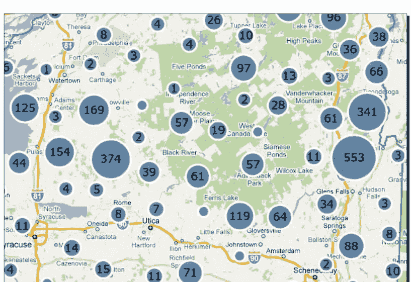

这显示了一张以 Google 图层作为底层底图并在其上叠加矢量图层的地图。数据（所有带数字的圆圈）是从 GeoJSON 文件加载的，这是一种许多其他应用程序支持的开放文件格式。在矢量图层中，地图上散布着许多数据点。地图上的每个点都是矢量图层中的一个对象，这些对象被称为 Features。

在这种情况下，每个要素实际上是一个数据点的集群——每个圆圈中的数字代表属于该集群的点数。这种聚类行为是 OpenLayers 可以通过 Strategy 类开箱即用地使用的，我们将在本章后面介绍它。在进入那一点之前，让我们谈谈将矢量图层与其他图层区分开来的主要事情之一。

### 向量图层有什么特别之处？

对于栅格图像，你所看到的就是你所得到的。如果你要在地图上查看一些近距离的卫星图像并看到一堆聚集在一起的建筑物，你不一定会知道关于那些建筑物的任何额外信息。你甚至可能不知道它们是建筑物。由于栅格图层由图像组成，因此解释你所看到的内容取决于用户。这不一定是坏事，但矢量图层提供了更多。

使用矢量图层，你可以显示建筑物的实际几何形状并附加额外信息——例如其价值、所有者、其平方英尺等。正如我们将在本章后面看到的那样，很容易将矢量图层放在现有的栅格图层之上并在特定位置创建要素。我们还将看到只需单击或将鼠标悬停在要素上即可获取有关要素的额外信息。

### 向量图层是客户端的

另一个根本区别是矢量图层通常用作客户端图层。这意味着通常与实际矢量数据的交互仅发生在客户端。例如，当你在地图上导航时，矢量图层不会向服务器发送请求以获取有关图层的更多信息。一旦你获得初始数据，它就存在于你的浏览器中，你通常不需要再次请求相同的数据（在大多数情况下，尽管 WFS 是一个例外；我们将在本章后面介绍）。

由于在大多数情况下矢量数据是在客户端加载的，因此与矢量图层的交互通常几乎是即时的。然而，存在一些限制。矢量图层依赖于用户的浏览器和计算机。虽然除 Internet Explorer 之外的大多数浏览器每天都在以惊人的速度进步并变得更加强大，但限制确实存在。

由于浏览器限制，矢量图层中的要素过多会开始变慢。要素数量没有硬性数字，但通常超过几百个要素就会在大多数计算机上开始变慢。然而，有很多方法可以解决这个问题，例如在不需要时删除要素，我们将在后面更深入地讨论性能问题。

### 其他用途

使用矢量图层，我们可以显示任何我们想要的几何对象——点、线、多边形、正方形、标记……任何你能想象的形状。我们可以使用矢量图层绘制线条或多边形，然后计算它们之间的距离。我们可以绘制形状然后使用多种格式导出数据，然后将该数据导入其他程序，例如 Google Earth。这些只是一些基本情况，而在本章中你将看到矢量图层可以多么强大。


## 什么是“向量”？

在图形方面，本质上只有两种类型的图像：栅格和矢量。你看到的大多数图像都是栅格图像——也就是说，从根本上讲，它们由像素网格组成，放大时质量会下降。例如，照片就是栅格图像。如果你放大它，它往往会变得模糊或被拉伸。大多数图像文件——.jpegs、.png、.gifs、任何位图图像——都是栅格图像。

矢量则不同，它使用基于数学方程的几何形状来构成图像。这意味着放大时质量得以保留。如果你放大一个圆形的矢量图像，线条始终看起来是弯曲的——而在栅格图像中，线条看起来会是直的，因为栅格图像由颜色网格组成。矢量图形不受网格限制，因此在所有比例下都能保持形状。

## 动手时间 – 创建矢量图层

让我们开始创建基本的矢量图层。在这个示例中，在你向矢量图层添加一些点和其他要素类型后，尝试放大。你会注意到，随着放大的进行，你添加的点不会失去质量。之后我们会讲解其工作原理。

- 1. 我们先使用一个基本的 WMS 图层：
```
var wms_layer = new OpenLayers.Layer.WMS(
    'OpenLayers WMS',
    'http://vmap0.tiles.osgeo.org/wms/vmap0',
    {layers: 'basic'},
    {}
);
```
- 2. 现在，让我们创建矢量图层本身。我们将使用默认投影和矢量图层的默认值，因此要创建图层，我们所需要做的就是创建它：
```
var vector_layer = new OpenLayers.Layer.Vector('Basic Vector Layer')
```
- 3. 现在将图层添加到地图：
```
map.addLayers([wms_layer, vector_layer]);
```
- 4. 如果我们现在查看地图，只会看到一张简单的地图——我们的矢量图层没有加载任何数据，而且我们也没有任何控件来让我们添加矢量数据。

- 5. 让我们向地图添加 **EditingToolbar** 控件，它允许我们在矢量图层上添加点并绘制多边形。要做到这一点，我们只需要从 `OpenLayers.Control.EditingToolbar` 实例化一个对象并传入一个矢量图层。我们将传入之前创建的 `vector_layer` 对象：
```
map.addControl(new OpenLayers.Control.EditingToolbar(vector_layer));
```
- 6. 现在查看地图。你应该能看到 `EditingToolbar` 控件（它基本上是一个带有控制按钮的面板控件）。选择不同的控件将允许你在矢量图层上放置矢量对象（称为要素）。尝试使用 `EditingToolbar` 控件并在地图上放置几个不同的点/多边形：

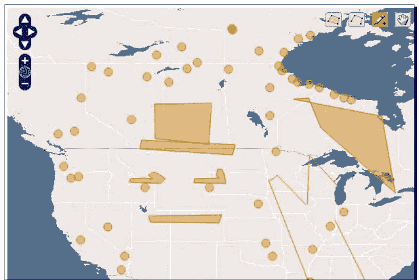

- 7. 现在，再进行最后一步。你已在地图上放置了一些要素（点/多边形/线等），但如果刷新页面它们就会消失。我们可以获取这些要素的信息，然后将其导出为地理空间文件。我们稍后会处理文件，但现在让我们获取我们创建的要素的信息。要访问矢量图层要素的信息，我们所需要做的就是访问其 `features` 数组。在 Firebug 中，输入并运行以下内容：
```
map.layers[1].features
```

- 8. 你应该会看到列出的一堆对象，每个对象都是你在地图上放置的一个要素：
```
[Object { layer=Object, more...}, Object { layer=Object, more...}, Object { layer=Object, more...}, ...]
```
- 9. 现在，如果你展开其中一个对象，你将获得有关要素的信息。`geometry` 属性是每个要素都有的一个匿名对象，其中包含几何信息。你还可以看到要素对象的方法——尝试使用不同的函数。你可以通过使用 `map.layers[1].features[x]` 来访问单个要素，其中 x 是 features 数组中要素的索引。例如，要销毁我们添加到地图上的第一个要素，我们可以使用：
```
map.layers[1].features[0].destroy();
```

## 刚才发生了什么？

我们刚刚演示了如何创建基本的矢量图层并使用 `EditingToolbar` 控件向其添加要素。使用矢量图层的 `features` 数组，我们还销毁了一些要素。正如你刚才看到的，开始使用矢量图层并不困难——事实上非常容易。本章的其余部分或多或少都是在此基础上构建的，所以无需感到畏惧。

## 小测验 – 为什么使用矢量图层？

矢量图层往往非常快，因为数据可以完全存储在客户端。交互是即时的，这可以极大地增强用户体验。想出几个你会使用矢量图层的情况。

现在，在我们深入矢量图层的更高级用法之前，先来看看它实际是如何工作的。

## 矢量图层的工作原理

要理解矢量图层的工作原理，我们主要需要涵盖四件事。

- 如何渲染矢量图层
- 矢量图层类本身
- 几何和要素类
- 如何使用相关的 Strategy、Protocol 和 Format 类

让我们来回顾渲染——幸运的是，这并不复杂。

## 矢量图层的渲染方式

正如我们之前讨论的，矢量图层不使用栅格图形。其他图层类型使用  标签（图像标签）来显示图像——在 HTML 中，图像标签只会显示栅格图像。因此，我们不能像其他图层那样只使用  标签。相反，我们必须使用矢量图像渲染器。正如我们之前提到的，矢量数据不仅仅是一张图像，还可以包含诸如数据坐标之类的附加信息。

矢量数据必须被渲染才能被看到。OpenLayers 支持三种渲染矢量图层的方式：SVG、Canvas 和 VML。

## SVG

渲染矢量图层的默认方式是使用 SVG 渲染器，它使用 <svg> 标签。SVG 是 Scalable Vector Graphics（可缩放矢量图形）的缩写，允许我们在浏览器中渲染矢量图像。所有浏览器（除 Internet Explorer 外）都支持 SVG，因此默认情况下 OpenLayers 使用 SVG 来渲染矢量图层。

## Canvas

我们可以使用 Canvas 渲染器，它使用 <canvas> HTML 标签。然而，使用这种渲染器往往会稍微慢一些，因为矢量实际上会被 canvas 标签转换为栅格——但在某些情况下这可能是可取的。

## VML

Internet Explorer 不遵循网络标准，并且在撰写本文时不支持 SVG 或 Canvas。幸运的是，默认情况下，OpenLayers 会检测用户网络浏览器是否不支持现代技术，并使用一个名为 VML 的后备渲染器（它类似于 SVG，但特定于 Microsoft）。SVG 通常比 VML 更快，因此你只想在 Internet Explorer 中使用时才使用 VML 而非 SVG。

## “Renderers” 数组

当你创建矢量图层时，它会查找一个名为 renderers 的数组，其中包含要使用的渲染器的名称，按顺序排列。默认情况下，renderers 数组设置为：
```
["SVG", "VML", "Canvas"]
```
这意味着 OpenLayers 会首先尝试使用 SVG，如果浏览器不支持 SVG，它将回退到 VML——如果不支持 VML，它将尝试使用 Canvas。

## 动手时间 – 更改 Renderers 数组

让我们使用 Canvas 渲染器，看看我们的地图是什么样子的。

- 1. 复制之前的示例。我们只会更改代码中的一行。
- 2. 我们需要做的唯一事情是在实例化矢量图层时设置 renderers 属性。默认情况下，它设置为 ['SVG', 'VML', 'Canvas']。让我们将 Canvas 设为默认渲染器。用以下内容替换你的矢量图层实例化代码：
- 3. 打开地图并绘制一些点。它可能看起来相似，但你可能会注意到线条不如使用 SVG 渲染器时那样清晰。如果使用 Firebug 检查地图元素，你会看到一个 <canvas> 标签：
```
var vector_layer = new OpenLayers.Layer.Vector('Basic Vector Layer', {
  renderers: ['Canvas', 'SVG', 'VML']
});
```
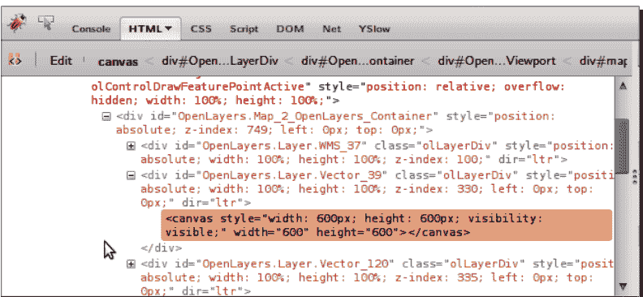

## 刚才发生了什么？

你刚刚看到了更改矢量图层所使用渲染器是多么容易——尽管通常没有必要更改它。

现在我们知道了矢量图层是如何渲染的，让我们谈谈它本身的类。


## Vector Layer class

向量图层本身与我们迄今为止讨论过的其他图层一样——但要充分利用它，我们将与其他类一起工作。

即使要让一个基本示例运行（就像本章中的第一个示例），我们也会使用其他几个类。具体来说，向量类使用 Feature 类在图层上显示对象。但 Feature 类要工作，需要使用 Geometry 类来创建几何对象。因此，你的向量图层中的实际向量对象是 Feature 对象，它们由 Geometry 对象组成——我们很快会介绍所有这些内容。

在此之前，让我们先介绍 Vector Layer 类本身。我们将首先介绍 Vector 类的属性，然后是方法（方式与第 3 章类似）。

## OpenLayers.Layer.Vector properties

让我们回顾一下 Vector 类包含的属性。其中一些是来自其他类的实例化对象，将在本章后面介绍。

- `drawn: {Boolean}`. 返回 `true` 或 `false`，取决于要素是否已被绘制。在实例化向量图层对象时不会设置此属性。
- `features: {Array {OpenLayers.Feature.Vector}}`. 这是属于向量图层的要素对象的数组。我们在之前的示例中见过它——通过访问此数组，我们可以了解向量图层包含的所有对象（要素）的信息。由于这是一个数组，你可以通过调用 `vector_layer.features[X]` 来访问单个要素，其中 X 是所需要素的索引。我们将在本章后面更深入地介绍如何与要素交互。
- `filter: {OpenLayers.Filter}`. 通过将过滤器对象分配给向量图层对象，你可以根据提供给过滤器对象的属性（正如名称所示）过滤掉某些数据。当你只想显示来自数据源的部分要素而不是全部时，这非常有用。我们将在第 10 章的 Filter 类部分详细讨论此属性。
- `isBaseLayer: {Boolean}`. 默认值为 `false`。指定图层是否为底图。你可以使用向量图层作为底图，从而拥有完全基于向量的地图，而不必依赖 WMS 或 Google Maps 图层作为底图。
- `isFixed: {Boolean}`. 默认值为 `false`。确定在拖动地图时向量图层是否会移动。如果例如你想在地图上放置一个始终保持在地图中心的标记，这会很有用（在这种情况下你会将此属性设置为 `true`）。
- `isVector: {Boolean}`. 如果图层是向量图层，则返回 `true`。在实例化向量图层时不会设置此属性。此属性主要用于检查已实例化的图层是否为向量图层。例如，如果你想遍历地图上的所有图层并确定某个图层是否为向量图层，你很可能会使用此属性。
- `protocol: {OpenLayers.Protocol}`. 指定向量图层使用的协议对象。在关于策略、协议和格式的部分中，我们将对此进行更深入的讨论。
- `renderers: {Array{String}}`. 指定包含要使用的渲染器的字符串数组。每个渲染器按顺序尝试，如果浏览器不支持，则尝试下一个渲染器。本章前面我们介绍了如何使用此属性。
- `rendererOptions: {Object}`. 渲染器将使用一个由属性组成的匿名对象。我们在本章中不会再谈论渲染器，但此对象可以包含的属性在 OpenLayers 文档中列出，每个渲染器类在 http://dev.openlayers.org/docs/files/OpenLayers/Renderer-js.html。
- `reportError: {Boolean}`. 默认值为 `true`。此属性指定如果渲染器加载失败是否报告错误消息。
- `selectedFeatures: {Array{OpenLayers.Feature.Vector}}`. 此属性包含图层中当前被选中的要素的数组。例如，可以通过单击要素来选择要素。此属性在关于与要素交互的部分中会更详细地讨论。
- `strategies: {Array{OpenLayers.Strategy}}`. 策略对象的数组。策略告诉向量图层如何行为，例如将要素聚类。在关于策略、协议和格式的部分中，我们将对此进行更深入的讨论。
- `style: {Object}`. 包含向量图层的样式信息。通过它，我们可以更改向量图层中要素的颜色、大小等。我们将在第 10 章中更详细地讨论这个问题。
- `styleMap: {OpenLayers.StyleMap}`. 定义向量图层将使用的样式的 stylemap 对象。第 10 章详细介绍了 Style 和 StyleMap 类。
- `unrenderedFeatures: {Object}`. 这包含未能渲染的要素的匿名对象（如果存在）。在实例化向量图层对象时不会设置此属性。

## OpenLayers.Layer.Vector methods

现在我们已经介绍了 Vector Layer 类的属性，让我们讨论可以调用的方法。我们只介绍特定于 Vector 图层的功能；从基础 OpenLayers.Layer 父类继承的功能可以在第 3 章中找到。

- `clone()`: 复制图层及其包含的要素。返回一个 `{OpenLayers.Layer.Vector}` 对象，即图层的副本。
- `getDataExtent()`: 此函数将返回一个 `{OpenLayers.Bounds}` 对象，其中包含包含图层所有要素的最大范围。
- `refresh(obj)`: 导致图层请求要素并重绘它们。如果图层可见且在地图范围之内，则会触发刷新事件。接受一个可选的 `obj` 对象，其中包含事件侦听器的属性。
- `assignRenderer()`: 根据图层的 `renderers` 属性为图层分配渲染器。
- `displayError()`: 显示一个警告，告知用户其浏览器不支持图层的渲染器。

## Working with features

我们将讨论的剩余方法涉及要素。正如我们之前看到的，要素是属于向量图层的对象。我们将先介绍方法，然后通过相关示例逐步说明如何正确使用它们。

**addFeatures(features, options)**: 调用此函数将向地图添加要素。你必须至少传入一个 `features` 对象数组，并且可以可选地传入一个 `options` 对象。`features` 参数是 `{Array{OpenLayers.Feature.Vector}}`，而 `options` 是一个匿名 `{Object}`。

## Time for Action – adding features

让我们手动向地图添加一些要素。

1. 复制第一个示例——我们只需要一个基本的 WMS 底图和一个向量图层。
2. 在 Firefox 中打开地图并启用 Firebug。我们将使用 JavaScript 控制台向向量图层添加要素。
3. 让我们先创建一些要素。为此，我们需要使用 OpenLayers.Geometry 类。让我们先创建一个 OpenLayers.Geometry.Point 对象，传入经度和纬度（在 Firebug 中输入并执行以下内容）：

```
var point = new OpenLayers.Geometry.Point(-72, 42);
```
4. 现在我们有了几何对象，可以从中创建一个要素对象。我们将使用 OpenLayers.Feature.Vector 类使用我们刚刚创建的点对象创建一个要素对象。实例化时，构造函数可以接受三个参数——geometry、attributes（可选）和 style（可选）。我们将在本章后面详细介绍 Feature 类。创建要素点，传入上面创建的几何对象：

```
var feature_point = new OpenLayers.Feature.Vector(point);
```
5. 好了，现在我们可以使用 addFeatures 将要素添加到地图了。即使我们只传入一个要素，仍然必须传入一个数组。像这样添加：

```
map.layers[1].addFeatures([feature_point]);
```
6. 你应该会看到点已添加到地图：

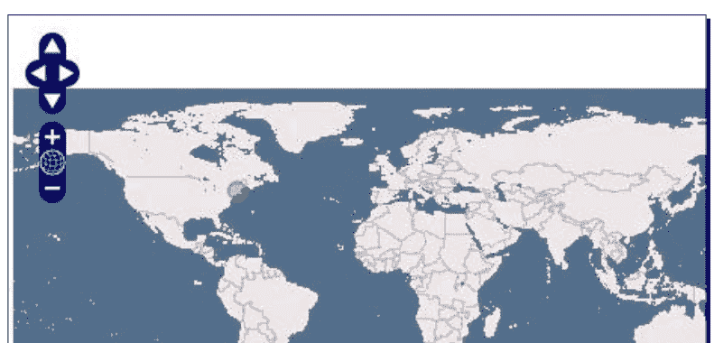

## What Just Happened?

我们刚刚使用 addFeatures 方法将从几何对象创建的要素添加到地图。如果 OpenLayers.Geometry 类对你来说是新的，不用担心——我们将在本章中介绍它，并提供更多示例。


## 动手试试 – 创建更多点

现在你已经知道如何向地图添加点，请尝试添加更多点。以之前的示例代码为指导，向地图添加多个 Geometry Point 对象。更改坐标并观察位置如何受影响。还尝试在地图范围外添加一个点，看看会发生什么。

让我们继续讨论关于矢量图层的方法。

## 矢量图层方法（续）

- **removeFeatures(features, options)**: 此函数将通过擦除传入的要素并将其从图层中移除来从矢量图层中移除要素（但要素本身*并未*被销毁）。对于每个要素都会触发两个事件——`beforefeatureremoved` 和 `featureremoved`。

此函数接收两个参数，与 `addFeatures` 方法类似。`features` 参数是一个 `{Array{OpenLayers.Feature.Vector}}`，而 options 是一个匿名 `{Object}`。`options` 参数可以接受一个 `silent` 属性，其类型为 `{Boolean}`，默认值为 `false`，用于决定是否触发事件。

- **removeAllFeatures(options)**: 调用此函数将从地图中移除所有要素。与上述方法类似，它不会销毁要素，但会将其从地图中擦除并从图层的要素数组中移除。它接收一个可选的 `options` 参数，可以接受一个 `silent` 属性，如果设置为 `true`，将抑制事件触发。

- **destroyFeatures(features, options)**: 此函数将擦除并销毁传入的任何要素。此函数与 `removeFeatures` 的区别在于，`destroyFeatures` 会同时从图层中移除要素*并*销毁要素本身——因此无法将已被销毁的要素重新添加到地图中。它接收两个参数——两者都是可选的。如果未传入 `features` 参数，图层的*全部*要素将被销毁。

## 动手实践 – 销毁要素

让我们演示 `removeFeatures` 与 `destroyFeatures` 之间的区别。

1. 打开本章的第一个示例。我们再次使用 Firebug。

2. 在移除要素之前，我们首先需要将它们添加到地图。我们将使用之前的示例中的相同代码。让我们创建一个要素对象。在 Firebug 中，输入并执行：
```javascript
var feature_point = new OpenLayers.Feature.Vector(new OpenLayers.Geometry.Point(-72, 42));
```

3. 现在，让我们将其添加到地图：
```javascript
map.layers[1].addFeatures([feature_point]);
```

4. 现在地图上已有要素，让我们看看 removeFeatures 的工作原理。我们可以调用此函数，并传入来自 map.layers[1].features 数组的要素，或传入我们已创建的要素对象。让我们使用第二种方法：
```javascript
map.layers[1].removeFeatures([feature_point]);
```

5. 现在你应该在地图上看不到任何要素。如果我们检查 map.layers[1].features 数组，它应该为空：
```javascript
>>>map.layers[1].features;
[]
```

6. 正如我们所预期的那样，我们最初添加到地图的要素已不再在 features 数组中。然而，该要素本身仍然存在。我们可以通过简单地输入要素对象的名称来检查这一点：
```javascript
>>>feature_point
Object { data=Object, more... }
```

7. 这就是 removeFeatures 与 destroyFeatures 之间主要区别所在——调用 removeFeatures 时，要素本身仍然存在于内存中。如果计划不再使用该要素，这不是一件好事。让我们看看使用 destroyFeatures 会发生什么。首先，我们必须将要素重新添加到地图：
```javascript
map.layers[1].addFeatures([feature_point]);
```

8. 现在我们可以销毁它。我们将在调用 destroyFeatures 时使用 map.layers[1].features 数组来传入要素：
```javascript
map.layers[1].destroyFeatures([map.layers[1].features[0]]);
```

9. 要素现在应该已从地图中移除。不过要素对象本身也会被销毁。如果我们尝试访问该要素，所有属性都为 null。

```
>>>feature_point.data
null
>>>feature_point.geometry
null
```

## 发生了什么？

我们刚刚演示了 `removeFeatures` 与 `destroyFeatures` 之间的区别。前者将要素从图层中移除，而后者同样会移除要素并销毁要素本身，因此无法再次将其添加到地图中。

继续。

## 矢量图层方法（续）

- **drawFeature(feature, style)**: 此函数将绘制/重绘传入的要素到图层。只有在要素样式发生变化时才应使用此函数——它不会将要素添加到图层，并且仅在要素已被添加后才有效。`feature` 参数是要绘制的要素，`style` 参数是一个可选的样式 `{Object}`。如果未传入样式，则使用图层的默认样式。

- **eraseFeatures(features)**: 此函数接收一个要素对象数组并将其从地图中擦除。它*不会*从图层对象中移除要素，也不会销毁要素对象本身。使用此函数，你可以从地图中移除要素，但保留要素在图层的要素列表中——然后可以将已擦除的要素传入 `drawFeature` 方法以重新显示它。

- **getFeatureById(featureId)**: 此函数接受一个由要素 ID 组成的 `{String}`。它将返回一个对应的 `{OpenLayers.Feature.Vector}` 对象（要素对象）——如果未找到，则返回 `null`。如果在创建要素对象时未设置 ID，ID 将是一个自动生成的字符串，类似于 `OpenLayers.Feature.Vector_42`——数字也基本上是随机的，因此你可能只有在创建要素时设置了 ID 时才需要使用此函数。否则，你可能想使用 `getFeatureByFid` 方法。

- **getFeatureByFid(featureFid)**: 此函数与 `getFeatureById` 函数类似，但查找的是 FID 而不是 ID。FID 是一个字符串，通常指定要素在 `features` 数组中的索引（如果不是从外部源加载数据，可能需要手动设置）。与 `getFeatureById` 类似，它接受一个由要素 Fid 组成的 `{String}`。它将返回一个对应的 `{OpenLayers.Feature.Vector}` 对象（要素对象）——如果未找到，则返回 `null`。

- **getFeatureFromEvent(event)**: 调用此函数将返回在 `{Event}` 发生时经过的要素，或返回 `null`。例如，如果传入了 `featureselected` 事件，此函数将返回被选中的要素。我们将在下一节介绍矢量图层事件。

- **onFeatureInsert(feature)**: 此方法将在要素插入到矢量图层后*立即*被调用。默认情况下，它是一个空函数。如果提供一个函数，它将在要素插入后被调用。`feature` 参数将传入到你创建的任何函数中。覆盖此函数的示例调用如下：

```
map.layers[1].onFeatureInsert = function(feature){ alert(feature);
};
```

上述代码将导致显示一个 alert，显示插入到地图中的要素。下一个 *动手实践* 示例将使用此函数。

- **preFeatureInsert(feature)**: 此方法将在要素插入到矢量图层前*立即*被调用。默认情况下，它是一个空函数。如果提供一个函数，它将在要素插入前被调用。`feature` 参数将传入到你创建的任何函数中。覆盖此函数的示例调用如下：

```
map.layers[1].preFeatureInsert = function(feature){ alert(feature);
};
```

上述代码将导致显示一个 alert，显示将要插入到地图中的要素。下一个 *动手实践* 示例将使用此函数。

## 动手实践 – 处理要素事件

让我们快速回顾一下之前的几个 Vector 类方法。

1. 打开本章的第一个示例——我们将使用 Firebug，并且只需要一个矢量图层和 EditingToolbar 控制。我们不会编辑任何代码，因此打开第一个示例和 Firebug 的 JavaScript 控制台。

2. 我们将使用 `preFeatureInsert` 添加一个函数，该函数将显示包含要素 ID 的 alert。此函数将在要素插入地图之前触发。在 Firebug 中输入并运行以下代码以创建函数：

```
map.layers[1].preFeatureInsert = function(feature){
  alert('preFeatureInsert - ID: ' + feature.id)
};
```


3. 现在查看地图并使用 EditingToolbar 控制（或调用 `map.layers[1].addFeatures()`）添加一个点。你应该会看到一个在要素添加到地图之前触发的警告框，显示即将添加要素的 ID。请注意警告框中包含的 ID。

4. 使用警告框中的 ID，让我们调用 `getFeatureById` 函数（如果没有获取到 ID，只需创建另一个要素或在 `map.layers[1].features` 数组中找到 ID）。我生成的 ID 为 `OpenLayers.Feature.Vector_143`，所以我将使用它——但请确保使用为你生成的 ID。调用以下函数，将我使用的 ID 替换为你的 ID：

```
map.layers[1].getFeatureById('OpenLayers.Feature.Vector_143');
```

运行后应返回要素对象给你。

5. 现在，让我们使用 `onFeatureInsert` 在要素添加后触发一个函数调用。让我们显示一个包含要素几何信息的警告框：

```
map.layers[1].onFeatureInsert = function(feature){
  alert('onFeatureInsert - Geometry:' + feature.geometry)
};
```

6. 现在，尝试添加一个要素。你应该会看到两个警告框——一个在点添加之前显示要素的 ID，另一个在要素添加之后包含几何信息。

## What Just Happened?

发生了什么？

我们刚刚使用了涉及矢量图层事件的几个函数。这结束了我们对 Vector 类方法部分的讨论，并开始介绍 Vector 图层类事件的覆盖范围。别担心——它没有前面的章节那么长，而且你在之前的章节中已经接触过困难的事件内容。

## Vector Layer class events

矢量图层类事件

在第 8 章中我们介绍了事件。这里讨论的相同概念同样适用，但本章后面会使用一些尚未介绍的特定于矢量图层的事件类型。让我们先回顾支持的事件类型，然后再实际操作。因为 Vector 类继承自 `OpenLayers.Layer` 基类，所以图层类的所有事件类型也可以使用。

## Vector Layer event types

矢量图层事件类型

所有这些事件都可以像上一章注册事件那样进行注册。例如：

```
vector_layer.events.register(type, obj, listener);
```

假设 `vector_layer` 是你的矢量图层对象的名称，上面的代码将为传入类型的事件注册一个监听器。除了图层类的事件类型外，Vector 类还支持以下事件类型（按字母顺序排列）：

- **afterfeaturemodified**: 在要素被修改后触发。监听函数接收一个引用已修改要素的 `feature` 对象。
- **beforefeatureadded**: 此事件在单个要素添加到地图之前触发。监听函数将接收一个包含 feature 属性的对象，该属性引用即将添加的要素。如果监听函数返回 `false`，要素将不会被添加到地图。
- **beforefeaturesadded**: 此事件与 `beforefeatureadded` 做同样的事情，但监听函数将接受一个要素数组而不是单个要素。如果监听函数返回 `false`，要素将不会被添加。
- **beforefeaturemodified**: 在要素被选中修改之前触发。监听函数接收一个引用即将被修改要素的 `feature` 对象。
- **beforefeatureremoved**: 在单个要素对象从地图中移除之前触发，监听函数接收一个引用被移除要素的 `feature` 对象。
- **beforefeaturesremoved**: 在一组要素对象从地图中移除之前触发，监听函数接收一个引用被移除要素的 `features` 数组。
- **featureadded**: 在单个要素对象添加到地图后立即触发，监听函数接收一个引用已添加要素的 `feature` 对象。
- **featuresadded**: 与前一种类型类似，但设计用于接收要素数组。它在要素对象数组添加到地图后立即触发。监听函数接收一个引用已添加要素的 `features` 数组。
- **featuremodified**: 在要素被修改时触发。这与 `afterfeaturemodified` 事件有细微差别。此 `featuremodified` 事件在要素刚被修改时就触发，而 `afterfeaturemodified` 事件在修改完全完成后才触发。监听函数接收一个引用已修改要素的 `feature` 对象。
- **featureremoved**: 在单个要素对象从地图中移除后触发，监听函数接收一个引用被移除要素的 `feature` 对象。
- **featuresremoved**: 在要素对象数组从地图中移除后触发，监听函数接收一个引用被移除要素的 `features` 数组。
- **featureselected**: 在要素被选中后触发。监听函数接收一个引用所选要素的 `feature` 对象。通常在使用本章后面介绍的 SelectFeature 控制时使用。
- **featureunselected**: 在要素被取消选中后触发。监听函数接收一个引用未选中要素的 `feature` 对象。通常在使用本章后面介绍的 SelectFeature 控制时使用。
- **refresh**: 当矢量图层请求新要素时，或当调用 `refresh` 方法时会触发此事件。例如使用 WFS 协议时，矢量图层会发出额外的要素请求并触发此事件。我们将在本章后面介绍从外部源请求数据。
- **sketchcomplete**: 在草图完成后再触发。例如使用 `EditingToolbar` 控制可以制作草图——绘制线条或多边形被视为“草图”。当绘制完全完成时（即双击完成草图时），`sketchcomplete` 事件会被触发。监听器接收一个引用草图要素的 `feature` 对象。如果监听函数返回 `false`，要素将不会被添加。
- **sketchmodified**: 当草图被修改时触发。例如，如果你正在使用 `EditingToolbar` 控制绘制多边形并移动鼠标，就会触发此事件。监听器接收一个引用草图要素的 `feature` 对象，以及引用已修改点的 `vertex` 属性。
- **sketchstarted**: 草图一开始就触发。例如，如果你点击 `EditingToolbar` 控制的绘制多边形控制并在地图上放置一个点，就会触发此事件。监听器接收一个引用草图要素的 `feature` 对象，以及引用起始点的 `vertex` 属性。
- **vertexmodified**: 每当任何要素包含的任何顶点被修改时就会触发此事件。监听函数接收三个参数：`feature` 引用顶点所属的要素，`vertex` 引用一个点（已修改的顶点），以及 `pixel` 包含顶点被修改时的屏幕像素位置。

## Time For Action – using Vector Layer events

动手实践 – 使用矢量图层事件

现在你知道了可能的事件类型，让我们试玩一些。

1. 打开本章的第一个示例。我们不会编辑代码，而是再次使用 Firebug。我们只需要一个矢量图层和 `EditingToolbar` 控制。如前几章所述，`map.layers[1]` 被假定为矢量图层。

2. 打开 Firebug。我们将首先向地图注册一个 `beforefeatureadded` 事件。首先，像第 8 章一样，我们需要创建一个在事件触发时会被调用的监听函数。我们从之前的事件类型列表中知道监听函数将接收一个包含要素的对象，所以让我们创建一个带有 `feature` 参数的函数，该参数将引用要素。在 Firebug 中，创建一个函数：
```javascript
function before_feature_added(feature){ console.log('before adding a feature!', feature); };
```

3. 现在我们要做的就是在矢量图层上注册 `beforefeatureadded` 事件：
```javascript
map.layers[1].events.register('beforefeatureadded', this, before_feature_added);
```

4. 现在，查看你的地图并添加一个要素。我们使用了 `console.log` 并向其传入了两个参数（一个字符串和一个要素对象）。在使用应用程序中谨慎使用 `console.log`——没有 Firebug 或开发控制台的用户可能会收到错误。由于我们现在只是测试，所以不必担心。你的控制台应记录类似以下内容：
```
before adding a feature! Object { feature=Object, more... }
```

5. 此事件类型的定义说我们可以返回 `false` 来阻止要素被添加。为此，我们必须为图层注册一个不同的事件以用于 `beforefeatureadded` 事件类型。让我们先 `unregister` 该事件，以确保我们不会遇到任何问题：
```javascript
map.layers[1].events.unregister('beforefeatureadded', this, before_feature_added);
```

6. 现在尝试向地图添加一些要素。没有任何事情会发生，因为我们取消注册了 `beforefeatureadded` 事件。所以，让我们重新定义函数然后再次将其注册到图层。
```javascript
function before_feature_added(feature){
    console.log('feature will not be added!', feature);
}
```


```
return false;
};
```

7. 现在我们只需注册事件：

```
map.layers[1].events.register('beforefeatureadded', this, before_feature_added);
```

8. 尝试向地图添加要素。该要素不应被添加，并且控制台应记录：

```
feature will not be added! Object { feature=Object,  more...}
```

## 发生了什么？

我们刚刚演示了如何在矢量图层上注册和注销一个事件，该事件在要素添加到图层之前触发。让我们再看一个涉及事件的示例，然后继续讨论 Vector 图层类的工作方式。

## 实践时间 – 处理更多事件

在本示例中，我们将检查与向地图添加要素相关的事件。我们将查看要素已添加事件类型，该事件在要素被添加到地图时触发（无论是通过编程还是用户操作），以及可由 EditingToolbar 控制触发的草图事件。

- 1. 打开本章的第一个示例。同样，我们将使用 Firebug。
- 2. 这次，我们将演示 featureadded、sketchstarted 和 sketchcomplete 事件。让我们创建三个合适的监听函数：
```
function feature_added(feature) { console.log('feature added', feature); };
function sketch_start(feature){ console.log( 'sketch started:', feature); };
function sketch_complete(feature){ console.log( 'sketch done:', feature); };
```
- 3. 现在，注册要素已添加事件：
```
map.layers[1].events.register('featureadded', this, feature_added);
```
- 4. 查看地图并添加一个要素。在添加点或添加多边形/线（草图）后，你应该会看到一条消息：
```
feature added Object { feature=Object,  more...}
```

5. 现在让我们注册草图事件。它们将在使用任何 EditingToolbar 控制时触发。

```
map.layers[1].events.register('sketchstarted', this, sketch_start);
map.layers[1].events.register('sketchcomplete', this, sketch_complete);
```

6. 现在，在添加点或创建多边形/线时，在完成添加要素后，你应该会看到总共三条消息：

```
sketch started Object { feature=Object,  more...}
sketch done Object { feature=Object,  more...}
feature added Object { feature=Object,  more...}
```

## 发生了什么？

我们刚刚演示了几种更多事件类型。你也可以通过查看控制台日志来了解事件是如何传播的（哪些事件先执行）。从上面的示例可以看出，sketchcomplete 事件在 featureadded 事件之前执行。

即使我们先注册了 featureadded 事件，注册事件的顺序也不会改变事件传播的顺序。我们将在整章中使用更多矢量图层事件，但它不会比前两个示例复杂多少。那么，让我们继续吧！

## Geometry and Feature classes

在本章中，我们一直在使用要素对象，但并没有真正讨论 Feature 类本身。我们也提到了 Geometry 类，但到目前为止还没有深入细节。本节将更详细地介绍这两个类，以便你能更自信地使用它们。别担心——很简单，你已经接触过这两个类了。

在进入 Feature 类之前，我们应该先介绍 Geometry 类，因为它用于创建构成要素对象的实际几何对象。

## Geometry class

The **Geometry** class is, more or less, the foundation of the feature objects we've seen so far. Specifically, up to this point, we have been using the `Feature.Vector` class as the base class for our feature objects. We'll talk more about that shortly, but for now it is just important to know that the `Feature.Vector` class uses the `Geometry` class to store geometry information about a feature.

但 **Geometry** 类到底是什么？简单来说，它存储地理信息。还记得本章前面添加要素的示例吗？代码如下：

```
var feature_point = new OpenLayers.Feature.Vector(
    new OpenLayers.Geometry.Point(-72, 42)
);
```

我们传入了 Geometry Point 对象（我们稍后会介绍子类）。现在，如果执行并在地图上查看，我们会在坐标 -72, 42 处看到一个点。然后，如果我们通过类似 `map.layers[1].features[0]` 的方式获取要素信息，我们会看到有关该要素的信息。查看时，我们会看到一个 geometry 属性。

展开它，或使用 `map.layers[1].features[0].geometry`，我们会发现它具有 `bounds` 属性，以及 `x`、`y` 和 `ID` 属性。这就是要素如何在几何对象中存储地理信息的方式。

让我们再次看看实例化几何对象的代码：`new OpenLayers.Geometry.Point(-72, 42)`。正如你可能猜到的，我们正在使用 Geometry 类的 Point 子类。

## Geometry subclasses—Theory

在使用 Geometry 类时，我们实际上几乎总是使用它的某个子类。我们是什么意思？想想我们在整本书中使用的 Layer 类——我们一直在使用基 Layer 类的子类（`Layer.WMS`、`Layer.Image` 等都是 `OpenLayers.Layer` 类的子类）。

就像我们处理图层一样，当我们想要一个 Geometry 对象时，我们几乎总是使用 `OpenLayers.Geometry` *子类*。到目前为止，我们唯一明确调用的是 `Geometry.Point` 子类，它接受单个 X,Y 坐标并基于传入的坐标创建几何。还有许多其他子类让我们能够做比仅仅处理点更复杂的事情。

在介绍子类之前，让我们快速了解一下通过基 `Geometry` 类可用于*所有*子类的一些方法。所有这些方法都可用于任何 Geometry 子类，因为所有子类都继承自 Geometry 类。

## Geometry class methods

- **atPoint(lonlat, toleranceLon, toleranceLat)**: 这将返回一个 `{Boolean}`，指示几何对象是否位于传入的 lonlat。lonlat 参数是一个包含要检查坐标的 `{OpenLayers.LonLat}` 对象，而 toleranceLon、toleranceLat 参数指定一个 `{Float}` 数字，分别设置经度和纬度的阈值。如果一个点位于经度和纬度的阈值范围内，将返回 `true`——否则返回 `false`。确定几何是否位于传入点的计算是基于几何对象边界的近似值。
- **calculateBounds()**: 调用此函数将重新计算几何的边界。它不返回任何内容。如果想查看几何对象的边界，请参阅 `getBounds()`。
- **clearBounds()**: 此函数会将几何对象的边界对象设为 null。
- **clone()**: 此函数创建几何的副本并返回一个克隆的 `{OpenLayers.Geometry}` 对象。
- **destroy()**: 调用此函数将销毁几何对象。注意——如果在已属于要素对象的几何对象上调用此函数，它不会从地图中移除几何对象。
- **distanceTo(geometry, options)**: 调用此函数将计算当前几何对象与传入几何对象之间的最近距离。options 参数可以包含额外的计算选项，具体取决于几何子类而有所不同。有一个 details 选项，它是一个 `{Boolean}`，可为所有子类指定。如果在 options 参数中将 details 设置为 `true`，此函数将返回一个包含距离以及表示两个几何对象坐标的 x0、y0 和 y1、y0 值的 `{Object}`。如果未设置 details（或设置为 `false`），此函数默认将返回包含距离的 `{Number}`。请注意地图的单位。
- **extendBounds(bounds)**: 此函数将扩展几何的边界，包括传入的边界对象，该对象必须是 `{OpenLayers.Bounds}` 对象。如果调用此函数时几何没有设置边界，则会设置边界。
- **getArea()**: 返回一个包含几何对象覆盖面积的 `{Float}`。此函数在各种子类中被重新定义，但可由所有子类调用。
- **getBounds()**: 以 `{OpenLayers.Bounds}` 对象的形式返回几何的边界。如果未设置边界，则会计算边界。这将返回单个几何对象的边界——如果你想获取图层上所有要素的边界，请参阅 Vector 类的 getDataExtent 方法。


-   **getCentroid()**: 返回一个包含几何对象中心点的 `{OpenLayers.Geometry.Point}` 对象。此函数在各个子类中被重新定义，但可被所有子类调用。
-   **getLength()**: 返回一个包含几何对象覆盖长度的 `{Float}`。此函数在各个子类中被重新定义，但可被所有子类调用。
-   **getVertices(nodes)**: 此函数返回几何对象中所有点的 `{Array}`。它接受一个默认为 True 的 `{Boolean}` 参数，指定应返回所有顶点。如果将其设为 false，则当几何对象为 Line 时，此函数将只返回非端点的顶点。
-   **toString()**: 返回几何对象的 WKT（Well-Known Text）`{String}`。WKT 是一种标记语言，类似于 HTML 或 XML，用于表示几何对象。例如，对具有坐标 (-72, 42) 的 `Geometry.Point` 对象调用此函数将返回 WKT 字符串 "POINT(-72 42)"。有关 WKT 的更多信息请访问 http://en.wikipedia.org/wiki/Well-known_text。

## 实践时间 – 使用 Geometry 类方法

让我们演示一下我们刚刚讨论的一些方法。这些方法可以应用于任何几何子类——Point、Polygon 等。

1.  打开本章的第一个示例。我们将再次使用 Firebug 来演示这些函数。
2.  在我们能做任何事情之前，我们需要一些几何对象。这里我们不会使用 `Feature` 类——我们只是演示一些几何对象方法。因为这次我们没有将 Geometry 对象与 Feature 对象关联，所以我们看不到任何内容被添加到地图上，因为单独的 Geometry 对象不一定与任何图层或要素绑定。让我们创建两个具有随机坐标的几何点对象：

```
var geom_1 = new OpenLayers.Geometry.Point(
    (Math.floor(Math.random() * 180) - 90),
    (Math.floor(Math.random() * 180) - 90)
);
var geom_2 = new OpenLayers.Geometry.Point(
    (Math.floor(Math.random() * 180) - 90),
    (Math.floor(Math.random() * 180) - 90)
);
```

3.  现在我们有两个几何点对象。让我们使用 `distanceTo` 来计算两个点之间的距离。我们将计算 `geom_1` 和 `geom_2` 之间的距离。由于使用了随机数，此次调用的输出很可能与你的不同：

```
geom_1.distanceTo(geom_2);
```

4.  现在让我们使用 `atPoint` 方法并尝试一下容差参数。首先，让我们获取 `geom_1` 对象的中心点坐标：

```
geom_1.getCentroid();
```

5.  返回的对象将具有 x 和 y 属性。我的分别是 x: 27，y: 35。将你的返回坐标替换到下一步中。首先，让我们调用 `atPoint` 方法——使用返回的坐标以确保它能工作：

```
geom_1.atPoint(new OpenLayers.LonLat(27,35));
```

6.  如果你已替换你的坐标，输出应为 `true`。现在，让我们尝试调用它但将坐标偏移五度：

```
geom_1.atPoint(new OpenLayers.LonLat(32,40));
```

7.  现在你应该得到 `false`，因为我们尚未设置容差。让我们继续设置，使用 5 作为 lon 和 lat 的容差：

```
geom_1.atPoint(new OpenLayers.LonLat(32,40), 5, 5);
```

8.  因为我们的点在容差范围内，你应该看到返回 `true`。如果将容差设为 4，则会返回 `false`。
9.  再举一个快速示例——让我们创建一个线几何对象然后将其添加到地图上。使用 `Geometry.LineString` 类，我们可以创建一个单线。我们只需传入一个 Point 对象数组来创建一条线。

```
var line_geom = new OpenLayers.Geometry.LineString([
    new OpenLayers.Geometry.Point(
        (Math.floor(Math.random() * 360) - 180),
        (Math.floor(Math.random() * 180) - 90)
    ),
    new OpenLayers.Geometry.Point(
        (Math.floor(Math.random() * 360) - 180),
        (Math.floor(Math.random() * 180) - 90)
    )
]);
```

10. 现在让我们将其添加到地图上：

```
map.layers[1].addFeatures([new OpenLayers.Feature.Vector(line_geom)]);
```

11. 你应该会在地图上看到一条随机放置的线。例如：

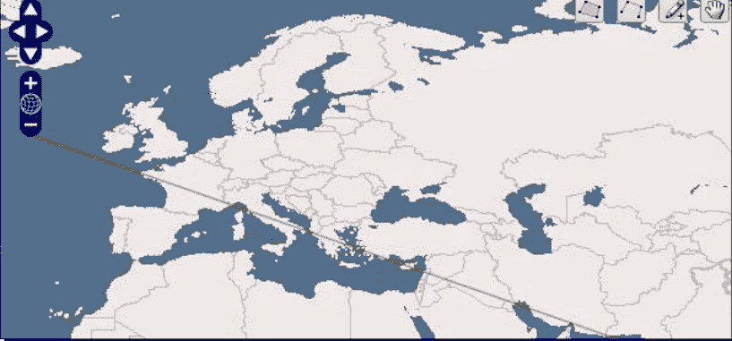

## 发生了什么？

我们刚刚演示了如何使用几个 Geometry 类方法。请记住——我们只使用了 Geometry.Point 和 Geometry.LineString 子类，但我们使用的方法（以及我们介绍过的方法）可用于所有 Geometry 子类。

我们还看到了如何使用 Geometry.LineString 类创建线。类似地，我们可以通过将 LineString 数组传入 Geometry.MultiLineString 类来创建 MultiLine 字符串。让我们简要了解一下其他一些 Geometry 子类。

## Geometry 子类

让我们快速了解一下一些 Geometry 子类。我们不会介绍它们的方法，只看看如何从它们创建对象。所有子类再次可以使用我们之前讨论过的方法——它们只是实现略有不同。

-   Geometry.Point：包含属性 x 和 y。实例化时传入 x 和 y。例如：
```
var my_point = new OpenLayers.Geometry.Point(-50, 42);
```

-   **Geometry.Collection**：这是一个包含几何对象集合（一个 {Array}）的类。许多其他几何类，例如 `LineString`，继承自此类。实例化时传入几何对象数组。例如，要创建几何集合对象，你需要传入几何对象数组（假设你有 `geom_point_object` 和 `geom_line_object`）：
```javascript
var geom_collection_object = new OpenLayers.Geometry.Collection([
geom_point_object, geom_line_object ]);
```

-   **Geometry.MultiPoint**：这是一个几何点对象的集合（{Array}）。其他类，例如 `LineString`，继承自此类。实例化时传入 Point 对象数组：
```javascript
var geom_multipoint = new OpenLayers.Geometry.MultiPoint([ geom_point_1, geom_point_2 ]);
```

-   **Geometry.Curve**：此类与 MultiPoint 类似（它也继承自它），但它假设点对象是连接的。实例化时传入 Point 对象数组：
```javascript
var geom_curve = new OpenLayers.Geometry.Curve([ geom_point_1, geom_point_2 ]);
```

-   **Geometry.LineString**：此类如我们之前所见，由连接在一起的点对象组成。它继承自 Curve 类——它基本上是一条曲线，不能包含少于两个点。实例化时传入 Point 对象数组：
```javascript
var geom_line = new OpenLayers.Geometry.LineString([ geom_point_1, geom_point_2 ]);
```

-   **Geometry.MultiLineString**：MultiLineString 包含多个 LineString 对象。实例化时传入 LineString 对象数组：
```javascript
var geom_multi_line = new OpenLayers.Geometry.MultiLineString([
geom_line_1, geom_line_2 ]);
```

-   **Geometry.LinearRing**：此类是 LineString 的一种闭合版本——意味着线条“回环”，起点和终点相连。创建对象时，你可以通过使最后一个点等于第一个点来自行闭合线条。实例化时传入 Point 对象数组：
```javascript
var geom_linear_ring = new OpenLayers.Geometry.LinearRing([ geom_point_1, geom_point_2, geom_point_3, geom_point_1 ]);
```
你也可以不将起点作为终点传入。如果这样做，它会自动为你闭合（OpenLayers 会自动将起点添加为终点）。

-   **Geometry.Polygon:** 此类本质上只是 `LinearRing` 对象的 `{Array}`。对于基本多边形，你只需传入一个 `LinearRing` 对象。你传入的第一个 `LinearRing` 对象将作为多边形的外部边界。之后传入的所有 `LinearRings` 对象将在多边形内形成孔洞（例如，你可以先传入一个大圆然后传入一个小圆来形成甜甜圈）。实例化时传入 `LinearRing` 对象数组：

```
var geom_polygon = new OpenLayers.Geometry.Polygon([ geom_linear_ring_1, geom_linear_ring_2 ]);
```

-   **Geometry.MultiPolygon:** MultiPolygon 由多个 Polygon 对象组成。实例化时传入 `Polygon` 对象数组：

```
var geom_multi_polygon = new OpenLayers.Geometry.MultiPolygon([ geom_polygon_1, geom_polygon_2 ]);
```

## Geometry 子类方法

所有 Geometry 子类都包含基 Geometry 类方法的自己的版本，以及某些子类中的一些额外方法。本章（和本书）的其余部分将重点关注我们迄今为止看到的方法，因此你应该拥有继续所需的所有知识。

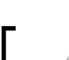

> 书中范围之外的一些子类方法，但它们都可以在官方文档 http://dev.openlayers.org/docs/files/OpenLayers/Geometry-js.html 中找到。

## Feature 类

在继续进一步讨论 Vector 类之前，我们还应介绍一个类。**Feature** 类是 Vector 类用来在地图上实际显示 Geometry 对象的类。我们在本章中一直使用 Feature 类，因为好吧，没有它我们就无法在矢量图层上显示对象——因此你已经接触到该类的很多内容了。

### Feature 类的工作原理

Vector 图层类有一个名为 `features` 的属性，它是 Feature 对象的数组。我们在本章中已经使用过它，并且以后会更多地使用它。顾名思义，feature 对象是由 **Feature** 类创建的。

基本 Feature 类由两部分组成——**Geometry 对象**（如你所见），和 **属性**。属性包含与要素相关联的数据。


## 特性子类

只有一个子类我们会使用——`Feature.Vector` 类。与其父类 Feature 类一样，它由一个 Geometry 对象组成并包含一个 `attributes` 属性。此外，还有一个 `style` 属性控制要素的外观（类似于 CSS 如何样式化 HTML）。我们将在第 10 章详细介绍 Style 类。

## 特性函数

本书中我们将使用的其实只有几个方法：

- **destroy()**：销毁要素对象。
- **clone()**：创建要素对象的副本并返回它，作为一个 `{OpenLayers.Feature.Vector}` 对象。
- **getVisibility()**：返回一个 `{Boolean}`，指定要素是否显示。
- **move(location)**：将要素移动到传入的位置。`location` 可以是 `{OpenLayers.LonLat}` 对象，将要素移动到传入的地图坐标，或 `{OpenLayers.Pixel}` 对象，将其移动到屏幕上的像素位置。
- **onScreen(boundsOnly)**：返回一个 `{Boolean}`，指示要素是否在地图视口内（如果在屏幕上可见）。可以传入一个 `boundsOnly` 参数，它是一个默认为 `false` 的 `{Boolean}`。如果设为 `true`，将使用更快但精度较低的边界框相交方法。

## 实例化要素对象

要创建要素对象，我们只需这样调用：

```
var my_feature = new OpenLayers.Feature.Vector( geometry_object,
attributes, style);
```

`geometry_object` 是一个几何对象（在上一节中介绍过）。`attributes` 对象是一个可选的对象字面量，将映射到要素的 `attributes` 属性，可用于提供有关要素的额外信息（例如 `{'building_area': 18000, 'building_floors': 2}`）。最后，`style` 对象是一个可选对象，指定要素的样式（将在第 10 章详细介绍）。

## 使用 Control.SelectFeature 与要素交互

现在我们知道如何创建要素并将其放入矢量图层，如何与它们交互？前面我们说过，与要素的交互几乎是即时的——这是因为所有矢量要素数据都存储在客户端浏览器中。点击要素时无需从服务器请求信息。

要使点击要素时发生某些事情，我们需要使用 SelectFeature 控制类（OpenLayers.Control.SelectFeature 类）。此控件允许我们与要素对象交互——例如在鼠标悬停或点击要素时执行操作。让我们先通过示例了解如何使用它，然后再介绍 SelectFeature 控制类本身。

## 动手实践 – 使用 SelectFeature 控件

让我们把迄今为止学到的一些东西组合起来。我们将创建一些点和一个多边形，将其放置在地图上，并使用 SelectFeature 控件允许用户选择它们。我们将注册要素已选择和要素未选择事件，以便在用户与要素交互时触发事件。当这些事件被触发时，我们将访问要素的 attributes 对象并显示其中的信息。开始吧。

- 1. 我们将添加一个矢量图层、一些要素和一个 SelectFeature 控件。该文件将被称为 `chapter9_selectFeature.html`。
- 2. 首先，让我们像本章前面那样将 vector_layer 设为全局变量。将其放在 `init` 函数之外，紧跟在 `var map;` 之后。
  ```js
  var vector_layer;
  ```
- 3. 接下来，我们将添加一个 `<div>` 元素，当用户点击要素时我们将要素信息输出到该元素中。在地图 div 之后添加此 div：
  ```html
  <div id='map_feature_log'></div>
  ```
- 4. 现在，回到 `init` 函数代码。在 WMS 图层添加到地图之后添加矢量图层：
  ```js
  vector_layer = new OpenLayers.Layer.Vector('Basic Vector Layer');
  map.addLayer(vector_layer);
  ```
- 5. 现在，让我们添加一些要素。我们将添加两个点要素和一个多边形要素。我们将向每个要素传入一个 attributes 对象（一个用于存储数据的键值对对象）。首先创建两个点要素：
  ```js
  var feature_point_1 = new OpenLayers.Feature.Vector(
    new OpenLayers.Geometry.Point(6.055, 46.234),
    {
  ```
```
'location': 'Cern',
'description': "Stand back, I'm going to try science!"
}
);
var feature_point_2 = new OpenLayers.Feature.Vector(
    new OpenLayers.Geometry.Point(-129, 3),
    {
        'location': 'The Sea',
        'description': 'Here be dragons'
    }
);
```
- 6. 注意我们传入了两个键值对——location 和 description。这些只是任意的键和值——你可以使用任何你喜欢的，我们一会儿就会看到如何访问它们。不过首先，让我们添加一个多边形要素。为此，请记住——我们需要将一组点传入 LinearRing 对象，然后将该 LinearRing 对象传入 Polygon 类以实例化它。呼。虽然听起来复杂，但其实更容易：
```
var feature_polygon = new OpenLayers.Feature.Vector(
    //We'll make a polygon from a linear ring object, which
    //consists of points
    new OpenLayers.Geometry.Polygon(new OpenLayers.Geometry.
    LinearRing(
        [
            new OpenLayers.Geometry.Point(-124.2, 41.9),
            new OpenLayers.Geometry.Point(-120.1, 41.9),
            new OpenLayers.Geometry.Point(-120, 39),
            new OpenLayers.Geometry.Point(-114.5, 34.9),
            new OpenLayers.Geometry.Point(-114.7, 32.7),
            new OpenLayers.Geometry.Point(-117.1, 32.5),
            new OpenLayers.Geometry.Point(-120, 34),
            new OpenLayers.Geometry.Point(-123.7, 38.4)
            //We won't pass in the first point, the polygon will close automatically
        ]
    )),
    {
        'location': 'Fanghorn Forest',
        'description': 'Land of the Ents'
    }
);
```
- 7. 现在我们将要素添加到地图：
```
vector_layer.addFeatures([feature_point_1, feature_point_2, feature_polygon]);
```
- 8. 好——到目前为止没有什么太新的。查看地图，你应该能看到要素。不过我们还不能与它们交互。

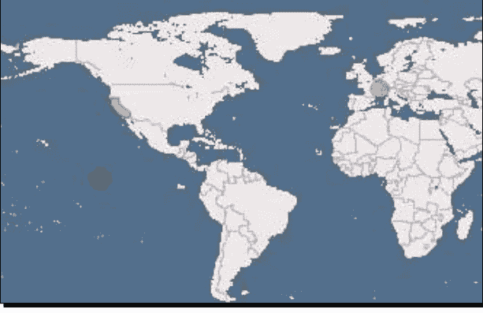
- 9. 现在，让我们使要素具有交互性。为此，我们首先需要一个 selectFeature 控件。实例化时，我们传入想要控件使用的矢量图层（或者，如果我们希望控件使用多个矢量图层，也可以传入一个 {Array} 的矢量图层）。我们还将传入几个属性，我们将在本示例之后详细介绍。multiple 属性允许一次选择多个要素，toggle 属性会在选择不同要素时取消选择要素，而 multipleKey 指定按下哪个键以允许选择多个要素：
```
var select_feature_control = new OpenLayers.Control.SelectFeature(
    vector_layer,
    {
        multiple: false,
        toggle: true,
        multipleKey: 'shiftKey'
    }
);
map.addControl(select_feature_control);
```
- 10. 此时，控件已创建并已添加到地图。然而，在使用它之前，我们必须通过调用其 activate 方法来激活它。
```
select_feature_control.activate();
```
- 11. 现在我们可以选择要素了。因为我们传入了 multipleKey 属性，所以可以通过按住 Shift 并点击来选择多个要素。按住 control 会切换要素选择。点击一个要素查看：

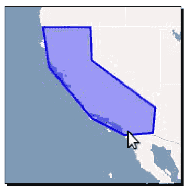
- 12. 现在，让我们在用户点击要素时做些事情。为此，我们将创建两个函数，当要素已选择和要素未选择事件被触发时调用它们（它们由 SelectFeature 控件触发）。首先让我们创建在要素被选择时调用的函数。它将清除 map_feature_log div，然后查看传入要素的 attributes 对象。最后，它将遍历所有已选择的要素并显示所有已选择要素的 location 属性。
```
function selected_feature(event) {
    //clear out the log's contents
    document.getElementById('map_feature_log').innerHTML = '';

    //Show the current selected feature (passed in from the event object)
    var display_text = 'Clicked on: '
        + '<strong>' + event.feature.attributes.location + '</strong>'
        + ': ' + event.feature.attributes.description + '<hr />';
    document.getElementById('map_feature_log').innerHTML =
    display_text;
}
```

//Show all the selected features
document.getElementById('map_feature_log').innerHTML += 'All selected features: ';

//Now, loop through the selected feature array
for(var i=0; i<vector_layer.selectedFeatures.length; i++){
    document.getElementById('map_feature_log').innerHTML +=
    vector_layer.selectedFeatures[i].attributes.location + ' | ';
}
}

13. 我们现在需要一个在要素取消选择时调用的函数。它将做与之前函数类似的事情——显示用户点击的要素，然后显示所有已选择的要素。

```
function unselected_feature(event){
    var display_text = event.feature.attributes.location + 'unselected!' + '<hr />';
    document.getElementById('map_feature_log').innerHTML = display_text;

    //Show all the selected features
    document.getElementById('map_feature_log').innerHTML += 'All selected features: ';

    //Now, loop through the selected feature array
    for(var i=0; i<vector_layer.selectedFeatures.length; i++){
        document.getElementById('map_feature_log').innerHTML +=
        vector_layer.selectedFeatures[i].attributes.location + ' | ';
    }
}
```

14. 现在只剩最后一件事了！我们必须注册事件，以便在要素被选择或取消选择时调用这些函数：

```
vector_layer.events.register('featureselected', this, selected_feature);
vector_layer.events.register('featureunselected', this, unselected_feature);
```

15. 全部完成！打开你的地图并选择一些要素（使用 Shift 选择多个要素）。你应该会看到日志更新：

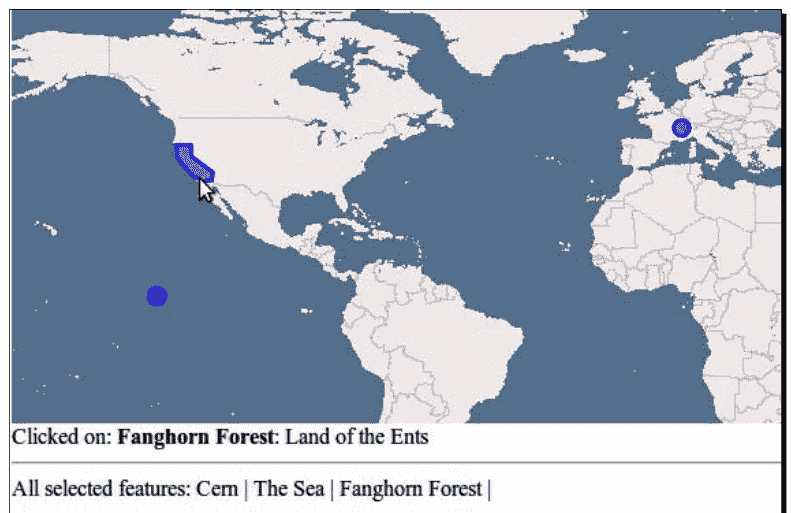

## 发生了什么？

我们刚刚演示了如何使用 SelectFeature 控制以及一些要素数据。在本书的剩余部分，我们将对 SelectFeature 控制和要素做更多的工作，所以如果你对它还不是完全熟悉，也不用太担心。尝试创建自己的函数和要素。为此，你需要对 SelectFeature 类及其一些属性有更多的了解。让我们快速回顾一下。

## Control.SelectFeature 类

首先我们将介绍属性，然后查看 SelectFeature 类的一些方法。

## SelectFeature 控制属性

- **box:** `{Boolean}` 指定是否可以通过绘制框来选择要素。默认为 `false`。如果设置为 `true`，在激活 `SelectFeature` 控制对象时，你将能够绘制一个框来选择要素，而不是通过点击要素来选择它们。
- **clickout**: `{Boolean}` 确定在点击任何要素之外时要素是否会被取消选择。默认为 `false`。
- **geometryType**: `{Array{String}}` 指定要素能够选择的唯一几何类型的字符串数组。每个字符串应为 Geometry 类的名称。默认为此属性指定 `null`，意味着所有几何类型都可以被选择。例如，如果你希望控制只允许选择 Point 对象，你可以这样传入此属性：
  ```
  geometryTypes: ['OpenLayers.Geometry.Point']
  ```
- **handlers**: `{Object}` 这包含对处理程序对象实例的引用。
- **highlightOnly**: `{Boolean}` 指定要素是否可以被选择，或只能被高亮。默认为 `false`。如果 `hover` 设置为 `true`，则此设置无效。
- **hover**: `{Boolean}` 默认为 `false`。如果设置为 `true`，当用户将鼠标悬停在要素上时，要素将被选中（并添加到 `vector_layer.features` 数组中）——点击要素不会起作用，只有悬停才有效。
- **layer**: `{OpenLayers.Layer.Vector}` or `{Array{OpenLayers.Layer.Vector}}` 指定 selectFeature 控制关联的矢量图层（或图层数组）。
- **multiple**: `{Boolean}` 控制是否可以通过点击选择多个要素。默认为 `false`。这并不意味着永远不能选择多个要素（即使此设置为 `false`，你也可以使用 `multipleKey` 来选择多个要素）。如果设置为 `true`，点击其他要素时要素不会被取消选择。
- **multipleKey**: `{String}` 指定用于允许多选要素的键。按住该键时可以选中多个要素。例如 `multipleKey: 'shiftKey'` 或 `'altKey'`。默认值是 `null`。
- **onBeforeSelect**: `{Function}` 在要素被选择前调用的函数。默认为空函数。
- **onSelect**: `{Function}` 在要素被选择时调用的函数。默认为空函数。
- **onUnselect**: `{Function}` 在要素被取消选择时调用的函数。默认为空函数。
- **renderIntent**: `{String}` 用于从图层的样式映射中获取要使用的样式。样式在第 10 章中介绍。
- **selectStyle**: `{Object}` 包含样式对象。样式将在本章后面讨论。
- **toggle**: `{Boolean}` 确定在点击要素时是否取消选择已选择的要素。默认值为 `false`。如果 `hover` 属性设置为 `true`，则此设置无效。
- **toggleKey**: `{String}` 指定一个键，按住时将 `toggle` 属性设置为 `true`。释放键时，`toggle` 属性将恢复为 `false`。例如 `multipleKey`: `'altKey'`。默认值为 `null`。

这些属性可以在实例化 `SelectFeature` 控制时设置。创建 `SelectFeature` 控制对象的调用形式为：

```javascript
var select_feature_control = new OpenLayers.Control.SelectFeature(
    vector_layer,
    {}
);
```

`{}` 是可选的 `options` 对象，可以用我们刚刚讨论的属性填充。现在，让我们来看一下 `SelectFeature` 控制的一些方法。

## SelectFeature 控制方法

让我们看一下在本书剩余部分会使用到的几个方法。

- **activate()**: 激活控制，允许我们使用它。
- **deactivate()**: 停用控制。调用后，要素在控制再次激活之前无法被选择。
- **highlight(feature)**: 使用要素的 `select` 样式绘制传入的 `feature`。
- **unhighlight(feature)**: 使用要素的正常样式绘制传入的 `feature`。
- **select(feature)**: 选择传入的 `feature` 对象，将其添加到图层的 `selectedFeature` 数组中，调用 `onSelect` 方法，并将要素渲染为已选择状态（应用任何样式等）。
- **unselect(feature)**: 取消选择传入的 `feature` 对象，从图层的 `selectedFeature` 数组中移除它，调用 `onUnselect` 方法，并将要素渲染回正常状态（应用任何样式等）。
- **unselectAll(options)**: 调用此方法将取消控制当前选择的所有要素。如果希望取消除特定要素外的所有要素，请将其作为 `except` 属性传递给 `options` 参数。

这结束了我们对 Feature 和 Geometry 类的讨论。接下来，我们将再次深入 Vector 类——但这次我们将关注更高级的使用。

## The Vector class, part two

现在我们对矢量图层的工作原理有了更多的了解，可以开始做一些更有趣的事情了。首先，让我们快速回顾一下到目前为止我们所涵盖的内容：

- Vector 类允许我们在地图上显示矢量对象，使用各种不同的渲染器（SVG、Canvas、VML）来实现这一点。
- 矢量图层中的对象，如点和多边形，都是 `OpenLayers.Feature.Vector` 类的对象。
- 每个 `Feature` 对象都包含一个包含空间信息的 `Geometry` 对象。
- 我们可以使用各种 Vector、Geometry 和 Feature 类方法来移动地图上的要素对象、添加要素以及获取地图上要素和几何对象的信息。

换句话说——到目前为止，我们主要研究了 Vector 类本身以及如何与我们添加的要素进行交互。那剩下的呢？

有趣的是你这么问。你可能已经注意到，我们并没有花很多时间来创建实际的矢量图层对象。本章的下一部分将主要关注这一点——创建矢量图层对象。

## Format, protocol, and strategy classes

在本章开头，我们提到要真正使用 Vector 类，我们实际上也会使用其他类。到目前为止，我们使用过 `Geometry` 和 `Feature` 类——但仅在矢量图层创建之后。现在让我们专注于创建更有用的矢量类。

为此，我们在实例化矢量图层对象时需要使用 Format、Protocol 和 Strategy 类。使用这三个类，我们可以进一步控制 Vector 图层的行为。

## Who invited these classes over?

那么，这些类是什么，为什么我们需要它们？有很多好的答案，本书无法全部涵盖——但以下是使用这三个类可以做到的一些事情的简短列表：

- 从外部源加载数据——KML 文件、GeoJSON 文件、WFS 服务等。
- 将我们创建的要素保存为 KML 或其他文件格式
- 使用 Cluster 策略将数百个点分组，就像我们在本章开头看到的那样
- 创建更具交互性的网络地图应用程序

这三个类如何相互关联，每个类的用途是什么？


## 三个类的简要概述

这些类协同工作，帮助我们定义矢量图层的行为。我们很快会更详细地介绍每个类，但首先让我们对其进行概述。

## Protocol 类

**Protocol** 类控制矢量图层如何与数据源进行通信。与 Geometry 类类似，我们实际上使用的是 Protocol 类的子类。两个常用的子类是 `Protocol.HTTP` 和 `Protocol.WFS`。HTTP 协议类允许我们直接与包含矢量数据的源进行通信，而 WFS 协议类则让我们能够与 WFS 服务通信。

## Format 类

**Format** 类让我们可以使用一种文件类型（如 KML 文件），并将该文件中的数据转换为地图中的实际要素对象。我们还可以将现有的要素对象转换为 KML、GeoJSON 等文件格式。OpenLayers 开发者的设想是为 Vector 类支持更多的 Format 和 Protocol，而不是像 WFS（已弃用）这样的特定子类。其他图层类，如 WMS 或 Google Maps 图层，不使用 Format 类——这是因为它们是栅图像层，我们无需担心数据格式。

更技术地说，**Format** 类处理要素数据的序列化和反序列化。序列化是程序员使用的术语，基本意思是从代码中提取对象并将其转换为类似文件或人类可读的字符串，以便这些对象可以在代码之外访问。反序列化则相反——它将文件或字符串转换为代码可用的对象。

那么，在 OpenLayers 的上下文中，这意味着什么？使用 format 类，我们可以对来自各种不同文件格式的要素数据进行序列化和反序列化——例如 KML、GeoJSON、GeoRSS、ArcXML 等。

## Strategy 类

最后，**Strategy** 类用于控制如何设置对服务器的请求以及对服务器返回的数据做什么处理。Strategy 类也是一个基类，我们与它的子类进行交互。我们可以使用众多子类，例如 `Strategy.BBOX` 和 `Strategy.Cluster`。与 Protocol 和 Format 类不同，对于每个类只能使用其中一个子类，使用 Strategy 类时我们可以同时使用多个策略。

为了澄清，让我们看看 `Strategy.BBOX` 类的作用。Strategy 类用于设置请求并确定对响应做什么处理。`Strategy.BBOX` 类是一个处理第一部分的子类。例如，使用 WFS 服务器时，我们可以使用 `Strategy.BBOX` 类向服务器发送请求，仅请求在可视地图范围内的數據。因此，BBOX 类决定如何设置请求。

Strategy 类的另一个作用是控制服务器返回的数据会发生什么。使用像 Strategy.Cluster 这样的类，当图层收到数据后，它会将返回的数据分组为簇。因此，它有助于控制对服务器响应的结果的处理。

我们可以使用 BBOX 类和 Cluster 类一起——即设置图层向 WFS 服务器请求地图范围内的數據，然后图层接收数据并将其转换为簇。

## 这三个类如何交互

现在，你可能已经开始了解这些类如何交互。Protocol 类决定数据如何与客户端进行通信。该数据以某种格式存在，由 Format 类进行序列化和反序列化。最后，Strategy 类告诉 Vector 类如何设置对服务器的请求以及对响应做什么处理。

## 示例实例化

在深入示例或进一步讨论之前，让我们看看如何使用这三个类创建矢量图层。以下代码将从 GeoJSON 文件加载要素数据。该文件必须位于同一服务器上——如果它位于不同的服务器上，或如果您希望指向外部 URL，则需要代理主机（我们稍后会介绍）。

```
var vector_layer = new OpenLayers.Layer.Vector('More Advanced Vector Layer',{
    protocol: new OpenLayers.Protocol.HTTP({
        url: 'some_data.json',
        format: new OpenLayers.Format.GeoJSON({})
    }),
    strategies: [new OpenLayers.Strategy.Fixed()]
});
```

上述代码将使用 HTTP Protocol 类并使用 GeoJSON 格式。注意格式实际上是协议对象的一部分。Fixed Strategy 类也被使用，它基本上只是导致矢量图层请求一次要素并且不再请求新要素。

实际上，这就是全部内容！不同格式将使用不同的 Format 类，如果您想使用其他策略，只需将它们传递到 strategies 数组中即可。

这有很多内容需要消化。让我们通过两个示例来了解如何将这三个类一起使用。

## 动手实践 – 创建矢量图层

在这个第一个示例中，我们将使用与上面看到的类似的代码——利用这三个类构建我们的矢量图层，该图层将从 URL 请求数据。

这个示例有两个注意事项。第一个是它假设您在地图文件同一目录下有一个名为 ex5_data.json 的文件。您可以在本书的源代码文件中找到它，网址为 http://vasir.net/openlayers_book/files/。

其次，除非您在服务器上运行，否则它将无法工作。它需要一个代理主机，我们将在此示例后立即介绍。如果您无法访问服务器，您可以在上述 URL 查看示例的运行情况。

- 1. 使用第 1 章的基础模板启动一个新地图文件。我们将使用 Protocol、Format 和 Strategy 类。因此，首先让我们为每个类创建对象。让我们从格式对象开始，因为协议对象将使用它。我们将使用 GeoJSON 格式。
  
  ```js
  //Create a Format object
  var vector_format = new OpenLayers.Format.GeoJSON({});
  ```
  
- 2. 现在，让我们使用刚刚创建的格式对象创建一个协议对象：
  
  ```js
  var vector_protocol = new OpenLayers.Protocol.HTTP({
      url: 'ex5_data.json',
      format: vector_format
  });
  ```
  
- 3. 最后，我们将创建一个要使用的策略变量，它实际上是策略对象的数组。
  
  ```js
  var vector_strategies = [new OpenLayers.Strategy.Fixed()];
  ```
  
- 4. 现在，将其组合起来创建矢量图层并将其添加到地图中：
  
  ```js
  //Create a vector layer that contains a Format, Protocol, and Strategy class
  vector_layer = new OpenLayers.Layer.Vector('More Advanced Vector Layer',{
      protocol: vector_protocol,
      strategies: vector_strategies
  });
  
  map.addLayer(vector_layer);
  ```
  
- 5. 如果您在服务器上运行，可以打开页面，您应该会看到类似以下内容：

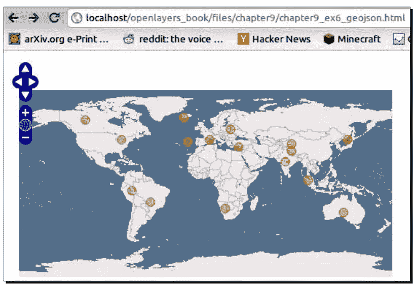

## 发生了什么？

我们刚刚演示了如何使用 **Format**、**Protocol** 和 **Strategy** 类设置矢量图层。如果我们想使用 KML 文件，比如说，我们只需使用 `Format.KML` 类并更改 URL 以指向 KML 文件。

现在，如果您只是从文件夹运行，前面的示例将无法工作——它需要在服务器上。设置服务器超出了本书的范围，但让我们谈谈为什么如果直接从文件夹打开，前面的示例不起作用。

## 跨服务器请求

JavaScript 使用 `XMLHttpRequest` 发出 AJAX 请求。使用 `Protocol` 类时，OpenLayers 会发出 `XMLHttpRequest` 从 URL 获取要素数据。如果该数据文件与您的地图不在同一服务器上，请求将无法工作。JavaScript 有安全限制，阻止其进行此类跨域请求。因此，为了绕过这个问题，我们必须使用 **proxy**。其他图层类不需要这样做，因为其他栅图像层请求的是图像，但不使用 AJAX——因此跨域请求限制不适用。


## 使用代理主机

代理本质上会代替 JavaScript 向外部服务器发起请求。我们使用一些服务器端脚本（使用 python、php、cgi 等）设置一个代理主机，该代理主机位于我们的服务器上，介于我们的 JavaScript 代码和外部服务器之间，这样 JavaScript 就可以（通过使用代理）与外部服务器通信并绕过固有的安全限制。

因此，基本上 JavaScript 会向代理主机发送请求，而代理主机则代表 JavaScript 发起外部请求。你可以自己编写代理脚本（除非你真的知道自己在做什么，否则不建议这样做），或使用 OpenLayers 提供的标准代理主机 CGI 文件。你可以在 http://trac.osgeo.org/openlayers/browser/trunk/openlayers/examples/proxy.cgi 找到它。

一旦你在服务器上设置了代理脚本，你需要告诉 OpenLayers 使用代理主机来发起外部请求。为此，请在你的代码中加入以下内容：

```
OpenLayers.ProxyHost = '/cgi-bin/proxy.cgi?url=';
```

你需要将 URL 替换为指向你的代理脚本的 URL——此代码假定你使用的是标准的 apache 设置并且使用的是 proxy.cgi 文件。

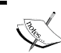

> 此步骤对于前一个示例不是必需的。如果你在服务器上运行前一个示例，则服务器不需要使用代理主机，因为数据文件位于同一服务器上。

## 不使用协议类使用矢量图层

如果你只是想从某个数据源加载数据，对于大多数用例，我们刚刚介绍的标准 Protocol / Format / Strategy 用法会很好用。然而，你不必同时使用这三个类。这三个类可以相对独立地使用。

例如，我们可以使用 Clustering 类对点数据进行聚类，而不使用 Format 或 Protocol 类。我们也可以在矢量图层之外使用 Format 类，以多种不同的格式读取和输出要素数据。

## 动手实践 – 单独使用 Format 和 Strategy 类

现在让我们看另一个示例。这里，我们会做一些与第一个示例非常相似的事情——不过这次我们不会使用 Protocol。相反，我们将把要素数据作为 JavaScript 对象读入，并使用 GeoJSON Format 类读取数据。这样，这个示例无需使用服务器或代理主机即可工作。

1. 使用第 1 章中的模板创建一个新页面。在这里我们要做三件事——以 GeoJSON 格式创建一些要素数据、创建矢量图层，并将 GeoJSON 数据加载到其中。让我们创建一些基本的要素数据。随意尝试不同的坐标和要素数量：

```
var feature_data = {
    "type": "FeatureCollection",
    "features": [
        {"type":"Feature","properties":{},
"geometry":{"type":"Point", "coordinates":[-81, 42]}},
        {"type":"Feature","properties":{},
"geometry":{"type":"Point", "coordinates":[-82, 43]}},
        {"type":"Feature","properties":{},
"geometry":{"type":"Point", "coordinates":[-80, 41]}},
        {"type":"Feature","properties":{},
"geometry":{"type":"Point", "coordinates":[19, -24]}},
        {"type":"Feature","properties":{},
"geometry":{"type":"Point", "coordinates":[4, 42]}},
        {"type":"Feature","properties":{},
"geometry":{"type":"Point", "coordinates":[32, 35]}}
    ]
}
```

2. 现在，我们需要创建一个格式对象来使用我们刚刚创建的 feature_object。JSON 代表“JavaScript Object Notation”，GeoJSON 只是带有地理信息的 JSON。有关 GeoJSON 的更多信息可以在 http://geojson.org/geojson-spec.html 找到。你上面看到的数据基本上就是前一个示例中数据文件中的内容。让我们创建一个 GeoJSON 格式对象：

```
Create a format object
var format_geojson = new OpenLayers.Format.GeoJSON({});
```

3. 现在，让我们创建一个聚类策略，如果点彼此在一定距离范围内，则将它们分组。默认情况下，距离为 20——让我们将其改为 42.

//Create an array of strategy objects
```
var vector_strategies = [new OpenLayers.Strategy.Cluster({distance:42})];
```

4. 现在让我们创建并添加矢量图层，并传入我们刚刚创建的策略对象。我们不需要传入协议或格式对象，因为我们的矢量图层不会直接使用格式对象，也完全不会使用协议对象。

//Create a vector layer that contains a Format, Protocol, and Strategy class
```
vector_layer = new OpenLayers.Layer.Vector('More Advanced Vector Layer',{
    strategies: vector_strategies
});
```

5. 最后，我们将使用格式对象读取 feature_data 对象（反序列化它）并将要素添加到我们的矢量图层。

//Load in the data
```
vector_layer.addFeatures(format_geojson.read(feature_data));
```

6. 查看地图。你应该会看到三个点，尽管我们创建了六个。这是因为聚类策略将一些点分组在一起了。

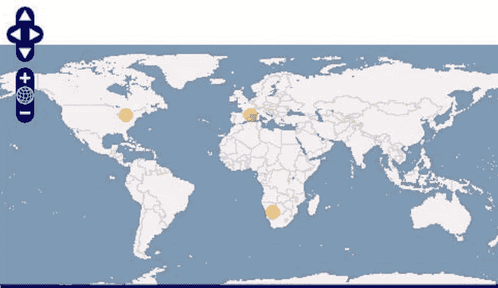

## 发生了什么？

我们刚刚在不使用 Protocol 类的情况下使用了 Format.GeoJSON 类和 Strategy.Cluster 类。通过硬编码数据，我们使用格式对象的 read 方法加载数据并对其进行反序列化，将其转换为要素数组，然后使用 addFeatures 添加。

如果你打开 Firebug 并查看矢量图层的要素（例如 map.layers[1].features），你会注意到只列出了三个要素。但我们传入了六个要素——这是为什么？由于我们使用了 Cluster 策略，彼此靠近的要素会被聚类并变成单个要素。不过，我们仍然可以通过访问每个要素的 cluster 对象来访问被聚类的要素（例如 map.layers[0].features[0].cluster）。

现在我们已经掌握了如何使用这些类，让我们最后再多谈一点关于 Format 和 Strategy 类的内容。

## Format 类

Format 类用于序列化和反序列化要素数据。它只有两个属性、一些方法，以及我们应快速介绍的有效子类列表。

### Format 类属性

你经常会遇到数据文件与地图使用的投影不同的情况。例如，如果你的地图使用球面墨卡托投影，而数据为 EPSG:4326，则需要设置以下两个属性，以便 OpenLayers 转换投影。

- externalProjection: `{OpenLayers.Projection}` 这指定了数据的投影。
- internalProjection: `{OpenLayers.Projection}` 这指定了地图（或将返回的几何对象）的投影。

> 默认情况下，你只能使用球面墨卡托和 EPSG:4326 投影。如果想使用不同的投影，你需要包含 Proj4js 库，该库在第 4 章中有更详细的介绍。

### Format 类方法

所有子类共有的两个主要方法如下。

- read(data): 反序列化传入的数据。不同子类之间还有其他不同的参数。返回类型也不同，但通常是一个要素对象数组。
- write(features): 序列化传入的要素并返回一个字符串。返回的字符串将采用格式对象所使用的格式——即，如果你使用的是 KML 格式对象，返回的字符串将是有效的 KML 格式。

大多数子类扩展了上述方法，允许传入更多参数。完整的介绍超出了本书范围，但可以在 http://dev.openlayers.org/docs/files/OpenLayers/Format-js.html 的文档中找到。

### Format 子类

我们可以使用多种子类。由于经常会添加新格式，请查阅文档以获取完整且最新的列表。在撰写本文时，有效的子类为：

- ArcXML, Atom, GeoJSON, GeoRSS, GPX, JSON, KML, OSM, OWSContext, SOSCapabilities, Text, WFS, WKT, WMSGetFeatureInfo, WMTS Capabilities, XML

## Strategy 类

strategy 类用于确定矢量图层如何请求数据以及对要素数据执行的操作。策略可以一起使用——例如，`BBOX` 和 `Cluster` 策略可以同时使用。每个子类都大不相同，因此让我们逐一查看这些子类。

### Strategy.BBOX

此类用于显示位于地图范围内的數據。当与 WFS 协议一起使用时，它会设置请求以仅获取落在地图范围内的數據。如果处理大量要素数据，使用 BBOX 策略会非常有帮助，因为你只会获取到可见范围内的數據。这只能通过某种要素服务器实现——静态文件无法处理传入的地图范围请求，并且总是返回静态文件包含的所有要素。

### Strategy.Cluster

这将根据 `distance` 和可选的 `threshold` 参数对要素进行聚类。矢量图层的要素列表中的要素将被聚类要素替换，每个聚类都包含其所有要素的信息在 `cluster` 对象属性中。

`distance` 属性指定聚类之间的 `{Integer}` 像素距离。如果一个点落在该距离内，则会被添加到聚类中。默认值是 20。

`threshold` 属性是可选属性，用于根据找到的要素数量决定是否对要素进行聚类。也就是说，如果 `threshold` 设置为 4，则意味着必须找到至少四个要素才能创建聚类。如果有三个要素落在 `distance` 范围内，则它们不会被聚类，因为未达到 `threshold` 值。


## Strategy.Filter

**Strategy.Filter** 类用于限制添加到矢量图层的要素。它使用 **OpenLayers.Filter** 类对要素数据进行比较。要使用此策略，您必须创建一个 **OpenLayers.Filter** 对象，详细内容将在下一章介绍。

## Strategy.Fixed

此策略用于请求要素一次且不再请求。有个 `preload` 属性会在图层可见之前加载数据，默认值为 `false`。如果设为 `true`，数据会在要素绘制前加载，但可能会减慢地图速度。

## Strategy.Paging

使用此策略，要素可以分组为“页”，这意味着您会收到数据的分组。如果数据量很大，这是一个非常有用的策略。有个 `length` 属性接收一个 `{Integer}`，指定每页的要素数量。默认值是 `10`。

另一个属性 `num` 包含当前页码的 `{Integer}`。要使用此策略，您需要调用 `pageNext()` 和 `pagePrevious()` 方法来翻页。

## Strategy.Refresh

此策略会刷新矢量图层，导致要素被重新请求并重绘。它可以手动调用，也可以设置间隔并按传入的间隔刷新。

`interval` 属性是一个以毫秒为单位的 `{Float}`，如果设为大于 0 的数字，则指定自动刷新矢量图层的频率。默认情况下，它设为 `0`，不会自动刷新。

还有一个 `force` 属性，也会强制刷新图层。默认情况下设为 `false`。

有几个相关的方法可以使用：

- **refresh()**: 导致图层被刷新
- **reset()**: 重置计时间隔（如果已设置）
- **start()**: 根据 `interval` 属性开始自动刷新行为
- **stop()**: 结束自动刷新

## Strategy.Save

使用此策略，要素可以保存到服务器。服务器必须允许保存，例如使用事务的 WFS 服务器。当调用 `save()` 方法时，更改将尝试保存到服务器。

还有一个 `auto` 属性，可以设为 `{Boolean}` 或 `{Float}`（以秒为单位）。如果设为 `true`，则在要素被修改（或删除）后立即保存。如果设为数字，则要素将在传入的间隔时保存。

## Summary

本章关于矢量图层类的介绍到此结束。我们讨论了矢量图层类是什么以及它如何工作。我们还介绍了矢量图层类的属性、方法和事件，并通过示例进行了演示。Feature 和 Geometry 类也涵盖了其属性和方法。最后，我们学习了 Strategy、Protocol 和 Format 类以及如何使用它们创建矢量图层。

在下一章中，我们将继续深入使用矢量图层。我们将学习如何为矢量图层设置样式，并学习如何使用 Rule 和 Filter 类来完全控制矢量图层的外观。
