# 10 矢量图层样式指南

> *到目前为止，您应该已经对 OpenLayers 相当熟悉了。*
> *我们谈过如何自定义控件（UI 元素）的外观，但我们还没有太多谈论如何自定义地图本身的外观。*

在本章中，我们将让事物看起来更漂亮（或多或少）。我们将：

- Learn how to style Vector layers in OpenLayers
- Discuss the Style class and demonstrate how to use it
- Go over the StyleMap class
- Work with the Rules class
- Learn about the Filter class

Let's get to it!

## 为矢量图层设置样式

在上一章中，您看到了矢量图层的强大功能。在本章中，我们将更深入地探讨如何自定义矢量图层中要素的外观。矢量图层样式的工作方式类似于我们自定义控件对象外观的方式，但不同于使用 CSS，我们使用 Style 和 StyleMap 对象与矢量图层一起使用。我们可以这样为矢量图层设置样式，因为矢量图层不使用栅格图像——它使用可以设置样式的 SVG（或 Canvas 或 VML）元素，类似于 HTML 元素可以用 CSS 设置样式。

更改要素样式，例如将要素颜色从默认的橙色更改为蓝色，非常容易。但更改矢量图层要素的颜色也许只是我们可以做的最基本的事情之一。通过使用 **Rule** 和 **Filter** 类，我们可以指定 *如何*（以及什么）要素应该被设置样式。例如，我们可以根据要素的地理位置或其 `attributes` 中包含的属性值来为点着不同颜色。

我们能做的远不止修改颜色。我们可以更改大小、不透明度、线型以及各种其他属性。样式属性可以任意设置，也可以基于单个要素对象本身的属性。

### 应用样式

我们可以做很多事，但怎么做呢？有三种不同的方法可以将样式应用于矢量图层。

- Use the StyleMap and Style objects.
- Apply a symbolizer (an anonymous object with style properties) directly to the layer.
- Apply a symbolizer directly on a feature. This primarily only occurs when reading in data from a source like a KML file.

The first way is what we'll be using throughout this chapter. A **StyleMap** is, essentially, a mapping of **Style** objects to various 'states', or **intents**, of feature objects. For example, the `default` intent is what a feature object is normally set as. When you select it, it then receives the `select` intent, and any styles mapped to that intent.

The **Style** object contains a style symbolizer, or numerous style properties and values. We use symbolizers to define style, and we can use symbolizers on Style objects, directly on layer objects, or directly on an individual feature.

### 什么是 symbolizer？

A **symbolizer** is just an anonymous object consisting of `key:value` pairs that contains style properties, similar to CSS. For example, { `fillColor`: '#336699', `strokeWidth`: 4 } is a symbolizer which tells the feature to have a fill color of #336699 (light blue), and a stroke width of 4 pixels. We'll cover a full list of valid properties later in this chapter.

We use symbolizers when we create **Style** objects to specify the style properties to apply to our features. We can apply a symbolizer directly to the vector layer object, or read in style information from a source file (such as a KML file).

Before we dive into the **StyleMap** and **Style** classes, let's first take a look at an example so we can better wrap our heads around what we intend to do in this chapter.

## 动手实践 – 应用一些基本样式

Applying styles is pretty easy, as you'll see:

- 1. We'll be doing a few things in this example. First, we'll create a vector layer. Then, we'll add some features to it. Nothing new so far. Then, we'll style the layer by creating a StyleMap and Style object and applying them to the vector layer.
- 2. Add a WMS layer to the map (like in previous chapters) then create and add a vector layer to the map:
- 3. Let's add some feature points. We'll create a loop which will create ten randomly placed feature objects and add them to the vector layer. These coordinates will be different each time you refresh the page, as they are being randomly generated:
- 4. Now, let's add some style to our vector layer. We'll be using a StyleMap object and apply a style to the 'default' intent (the 'normal state' of the features) so all features will receive the style. First, we'll need to create a Style object which will be used by the StyleMap object that gets applied to the layer. The Style object consists of a symbolizer, as we previously mentioned, that contains key:value pairs of styles to apply to the features (similar to CSS):

```
vector_layer = new OpenLayers.Layer.Vector('Basic Vector Layer');
map.addLayer(vector_layer);
```

```
for(var i=0; i<10; i++) {
    vector_layer.addFeatures([new OpenLayers.Feature.Vector(
        new OpenLayers.Geometry.Point(
            (Math.floor(Math.random() * 360) - 180),
            (Math.floor(Math.random() * 180) - 90)
        )
    )]);
}
```

```
var vector_style = new OpenLayers.Style({
    'fillColor': '#669933',
    'fillOpacity': .8,
    'strokeColor': '#aaee77',
    'strokeWidth': 3,
    'pointRadius': 8
});
```


5. 接下来，我们创建一个 StyleMap 对象并使用刚刚创建的 Style 对象来定义图层的 'default' 意图样式。

```
var vector_style_map = new OpenLayers.StyleMap({
  'default': vector_style
});
```

6. 最后，我们将 StyleMap 对象设置为矢量图层。

```
vector_layer.styleMap = vector_style_map;
```

7. 你应该会看到一堆类似下图的绿色点。实际的点位置对你来说会有所不同，因为点是随机生成的：

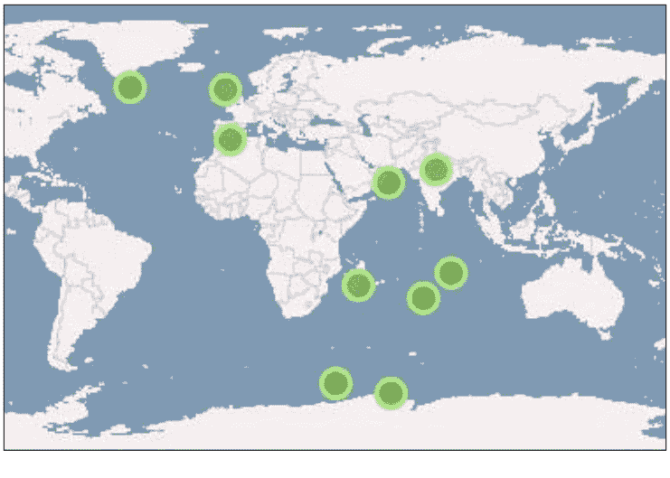

## 发生了什么？

我们刚刚使用 StyleMap 和 Style 类为矢量图层应用了自定义样式。我们创建的 Style 对象（`vector_style` 对象）包含决定要素外观的属性。如果你创建一个空的样式对象（没有 `key:value` 对，只有空的一对大括号 `{}`），则不会对图层应用任何样式——你将用空白的空样式覆盖默认样式。

我们只使用了几个符号化器属性，例如 `strokeColor`，但我们将在本章后面介绍完整有效的符号化器属性列表。现在，让我们先更详细地讨论 StyleMap 和 Style 类的工作方式。

## StyleMap 类

**StyleMap** 类告诉矢量图层在要素处于某种 'state' 时使用哪些 **Style** 对象，或 OpenLayers 所称的 **intent**。正如之前的示例所示，使用这个类其实没什么特别的。要创建一个 **StyleMap** 对象，你需要传入一个 **intent** 作为键（作为一个 `{String}`），而 **Style** 对象用作值。例如，如之前的示例所示，`'default'` 是期望的 intent，而 `vector_style` 对象是用于该 intent 的期望样式对象。这会导致 `vector_style` 被应用于 `'default'` intent：

```
var vector_style_map = new OpenLayers.StyleMap( {'default': vector_style} );
```

### 什么是 'intent'？

'Intent'，即 **render intent** 的简写，是指定要素应如何绘制或在不同 'states' 下要素应如何显示的一种方式。我们只能使用三种默认的 intent：

- `'default'`：这是最常用的 intent。如果要素不在接下来的两种 intent 中，它就处于此 'default' intent。
- `'select'`：要素仅在被选中时处于此 intent。未选中时，它们会返回到 'default' intent。
- `'temporary'`：此 intent 在要素被绘制或 'sketched' 时使用；例如，通过 EditingToolbar 控制。当要素完成草绘后，它会返回到 'default' intent。

创建 StyleMap 对象时，如果你只为一个 intent 指定样式对象，则所有 intent 都会收到该样式对象。

例如，在之前的示例中，我们仅将样式对象应用于默认 intent——因为我们只应用于一个 intent，所以所有其他 intent 都会收到该样式。如果我们选择其中一个要素，则不会看到要素样式的任何变化，因为我们没有指定单独的 `'select'` intent 样式对象。

## Style 类

**Style** 类用于指定矢量图层应使用的样式。如前所述，其原理与我们使用 CSS 为控件设置样式非常相似。不同之处在于，对于矢量图层，我们直接将样式嵌入到 JavaScript 代码本身中，使用一个被称为 **符号化器** 的匿名对象。

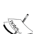

> 当我们谈论符号化器时，我们只是指定义样式（或，某种程度上，它们的 'symbol'）的匿名对象。'symbolizer' 这个术语也许不是最好的用词，但它是 OpenLayers 词汇的一部分，所以我们需要学习它。

创建 Style 对象时，我们只需传入一个符号化器（匿名对象）来定义图层的样式。如之前的示例所示：

```
var vector_style = new OpenLayers.Style({
  'fillColor': '#669933',
  'fillOpacity': .8,
  'strokeColor': '#aaee77',
  'strokeWidth': 3,
  'pointRadius': 8
});
```

创建样式对象基本上就是这样！还可以指定一个 `context` 属性，它可用于提供额外的变量供样式类与 **属性替换** 一起使用——我们很快会谈到这一点。

创建样式对象后，我们就可以将其与 StyleMap 对象一起使用。我们也可以将符号化器（但不是 `vector_style` 对象本身）应用于图层的 `style` 属性并 'skip' StyleMap 对象步骤——尽管不建议这样做，因为它有点局限，并且不如使用 StyleMap 对象那样 'clean' 或模块化。

**规则** 和 **过滤器** 也可以应用于我们的样式对象，以获得对要素样式更精细的控制，我们很快就会看到。首先，让我们介绍一下有效的符号化器属性。

## 符号化器属性

创建样式符号化器时可以使用以下属性。某些属性仅会影响特定类型的几何（例如，`font` 类型属性仅适用于 `text` 要素）。我们将首先介绍一些更常见的符号化器属性，然后再介绍剩余属性。

### 常见符号化器属性列表

- **cursor**：鼠标悬停在要素上时使用的光标样式。可以是任何有效的 CSS 光标样式，例如 `help`、`move`、`cursor`、`crosshair`、`text`、`wait`、`pointer` 或 `progress`。
- **fillColor**：填充区域的颜色，六位 RGB 值。示例：`#000000` 为黑色（`00` 红色、`00` 绿色和 `00` 蓝色。）`#ffffff` 为白色。
- **fillOpacity**：指定填充区域的不透明度，范围从 0 到 1（1 为完全不透明，0 为完全透明）。
- **fontColor**：字体颜色，六位 RGB 值。示例：`#000000` 为黑色（00 红色、00 绿色和 00 蓝色。）`#ffffff` 为白色。
- **fontFamily**：指定标签使用的字体族。与 CSS `font-family` 属性类似。示例值可以是 `Arial` 或 `sans-serif`。
- **fontOpacity**：字体不透明度，范围从 0 到 1（1 为完全不透明，0 为完全透明）。
- **fontSize**：指定字体的大小。可以是任何有效的 font-size CSS 值，例如像素（例如 `'18px'`）或 em 单位（例如 `'1.2em'`）。
- **fontWeight**：要应用的字体粗细。可以是有效的 CSS font-weight 属性，例如 `normal` 或 `bold`。
- **graphicName**：指定渲染点时使用的图形类型。默认值是 `'circle'`，会导致点以圆形渲染。其他可能的值包括 `'square'`、`'star'`、`'x'`、`'cross'` 和 `'triangle'`。其他样式，例如填充和描边属性，仍将应用于绘制的形状类型。例如，`'graphicName': 'square'` 会使点产生正方形而不是圆形。
- **label**：应用于要素的文本。此属性的值为 `{String}` 类型，例如 `label: 'My Label'`。
- **labelAlign**：确定标签的对齐位置（如果提供了标签）。与 CSS 中的 `align` 属性不同，`labelAlign` 属性接受一个或两个字符，一个用于水平对齐，一个用于垂直对齐。可能的水平值是 `'l'`（左）、`'c'`（居中）和 `'r'`（右）。可能的垂直值是 `'t'`（顶部）、`'m'`（中间）和 `'b'`（底部）。对齐是指相对于文本位置的一个点，这意味着 `'t'`（顶部）对齐实际上会将标签放在底部，因为插入点位于文本顶部（有点 confusing，但也许把对齐想象成你想要标签位置的 '相反' 会有帮助）。有效值是水平和垂直值的任意单字母或双字母组合——例如 `'r'`（右）或 `'lb'`（左下）。
- **labelSelect**：如果设置为 `true`，标签也可以通过 `selectFeature` 控制来选择。默认值是 `false`。
- **labelXOffset**：在 X 方向上偏移标签的距离（以像素为单位）。
- **labelYOffset**：在 Y 方向上偏移标签的距离（以像素为单位）。
- **pointRadius**：指定点要素的半径大小，以像素为单位。默认值是 6。
- **stroke**：指定是否显示描边。如果希望不显示描边，则设置为 `false`。


-   **strokeColor**: 描边颜色，六位 RGB 值。示例：`#000000` 为黑色（`00` 红色，`00` 绿色，`00` 蓝色。）`#ffffff` 为白色。
-   **strokeDashstyle**: 应用于描边的样式类型。可以是 `'dot'`、`'dash'`、`'dashdot'`、`'longdash'`、`'longdashdot'` 或 `'solid'`。
-   **strokeLinecap**: 应用于线端点的样式类型。可以是 `'butt'`、`'round'`、`'square'`。
-   **strokeOpacity**: 描边的不透明度，范围从 0 到 1（1 为完全不透明，0 为完全透明）。
-   **strokeWidth**: 描边宽度，以像素为单位。

## 行动时间 – 常见样式示例

通过示例来看看这些常见属性的作用。我们还将演示如何使用两种不同的意图——`default` 意图和 `selected` 意图。

1.  复制上一个示例的文件。我们将使用相同的代码，但稍作修改特征样式。我们还将使用 `select` 意图，因此需要两个样式对象。首先让我们重新创建默认样式对象：

```
var vector_style = new OpenLayers.Style({
  'cursor': 'pointer',
  'fillColor': '#787878',
  'fillOpacity': .8,
  'fontColor': '#343434',
  'pointRadius': 14,
  'strokeColor': '#232323',
  'strokeDashstyle': 'dot',
  'strokeWidth': 3
});
```

2.  现在，让我们创建一个在要素被选中时使用的样式对象。我们将边框改为实线，改变填充颜色，稍微增加点的半径，将 `graphicName` 改为 `'square'`，并添加一个将显示 'X' 的标签。

```
var vector_style_select = new OpenLayers.Style({
  'fillColor': '#ffffff',
  'fillOpacity': .9,
  'graphicName': 'square',
  'label': 'X',
  'pointRadius': 16,
  'strokeColor': '#343434',
  'strokeDashstyle': 'solid',
'strokeWidth': 4
});
```

3.  现在更新 StyleMap 对象以包含新添加的 `vector_style_select` 样式对象：

```
var vector_style_map = new OpenLayers.StyleMap({
    'default': vector_style,
    'select': vector_style_select
});
```

4.  最后，我们只需添加一个 `selectFeature` 控制，以便能够选择要素。

```
//Add a select feature control
var select_feature_control = new OpenLayers.Control.SelectFeature(
    vector_layer
);
map.addControl(select_feature_control);
//Activate the control
select_feature_control.activate();
```

5.  现在，查看地图并选择一个要素。你应该会看到样式发生变化：

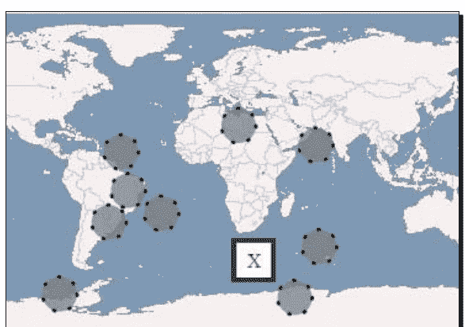

## 发生了什么？

我们练习了使用常见的符号化属性，并演示了如何向 StyleMap 对象添加多个 Style 对象并使用两种意图。到目前为止，你可能不会太印象深刻。我们对一些要素进行了样式设置，虽然可以进行大量自定义，但我们还没有做任何太花哨的事情。

## 亲自尝试 – 样式图层

现在你对如何使用符号化器有了一些了解，打开上一个示例并更改一些符号化器。测试不同的属性和值组合——不同的颜色、不透明度、背景颜色等。看看你是否能想出比灰色和黑色圆圈更好看的东西。

在进入属性替换——我们下一个主题之前，让我们看看尚未涵盖的剩余符号化属性。

## 剩余的符号化属性

-   **backgroundGraphic**: 指定要使用的图像的 URL。这将放置在 `externalGraphic` 之下（如果已设置）。
-   **backgroundGraphicZIndex**: 指定 `backgroundGraphic` 的 z-index（相互放置的顺序）。
-   **backgroundHeight**: 确定背景图像的高度。如果未指定，则使用 `graphicHeight`。
-   **backgroundWidth**: 背景图像的高度，如果存在的话。如果未设置此属性且提供了图像，则会尝试使用 `graphicHeight` 属性。
-   **backgroundXOffset**: 指定在 X 方向上偏移图像的距离（以像素为单位）。
-   **backgroundYOffset**: 指定在 Y 方向上偏移图像的距离（以像素为单位）。
-   **display**: 如果设置为 `none`，则不会应用符号化样式。
-   **externalGraphic**: 指定当要素点显示时要使用的图像的 URL（而不是描边和填充属性）。
-   **fill**: 如果设置为 `false`，则不会显示填充。
-   **graphic**: 设置为 `false` 将禁用任何图形的显示。
-   **graphicHeight**: 外部图形的高度（以像素为单位）（如果存在）。
-   **graphicOpacity**: 指定关联图形的不透明度，范围从 0 到 1（1 为完全不透明，0 为完全透明）。
-   **graphicTitle**: 这指定了在鼠标悬停在外部图形上时出现的工具提示文本（如果提供了图形）。
-   **graphicWidth**: 外部图形的宽度（以像素为单位）（如果存在）。
-   **graphicXOffset**: 在 X 方向上偏移外部图形的距离（以像素为单位）。
-   **graphicYOffset**: 在 Y 方向上偏移外部图形的距离（以像素为单位）。
-   **graphicZIndex**: 指定外部图形的 z-index。较高的 z-index 意味着它会显示在 z-index 较低的元素之上。
-   **rotation**: 指定要素围绕其中心顺时针旋转的程度。值范围为 0 到 360，默认为 0。值为 180 时为倒置。

## 小测验 – 确定使用哪些属性

指定图像有两种方法：使用 `background` 或使用 `externalGraphic` 属性。当一起使用它们时，重要的是记住它们各自的工作方式。如果我们想显示一个标记的图像，以及标记阴影的单独图像，我们该怎么做？

## 属性替换

使用要素样式可以做的一件简单但强大的事情称为 **attribute replacement**。它是一种在图层的样式定义中使用要素的属性的方式，就像变量一样。创建符号化器时，可以将任何属性的值设置为以下格式：

```
${variable_name}
```

其中 `variable_name` 是包含在要素的 `attributes` 属性中的属性的名称。例如，假设我们的所有要素都有一个名为 'size' 的属性属性，具有随机整数值。如果我们想将 `pointRadius` 分配给每个要素的 `size` 属性，我们将使用：

```
{ 'pointRadius': ${size} }
```

然后发生的情况是，当每个要素被样式化时，`${size}` 会被要素的 `attribute.size` 属性替换（如果存在）。进一步解释这一点的最好方法是举例说明。让我们先看看，然后再深入探讨。

## 行动时间 – 使用属性替换

让我们演示如何使用属性替换根据要素的属性更改要素的样式。

1.  复制上一个示例。我们将稍作修改以演示属性替换。为此，我们首先需要为要素提供一些可以访问的属性。修改 `for` 循环中的 `addFeature` 代码以按如下方式添加属性：

```
for(var i=0; i<10; i++) {
    vector_layer.addFeatures([new OpenLayers.Feature.Vector(
new OpenLayers.Geometry.Point(
    (Math.floor(Math.random() * 360) - 180),
    (Math.floor(Math.random() * 180) - 90)
),
{
    //Attributes go here
    size: 5 + (Math.floor(Math.random() * 20)),
    label: 'F' + i,
    strokeWidth: (Math.floor(Math.random() * 10))
}
]);
}
```

2.  现在，我们只需要修改 vector_style 样式对象以包含属性替换，以便我们可以使用刚刚创建的要素的 size、label 和 strokeWidth 属性。执行此操作的语法是 '${variable_name}'，其中 variable_name 是我们想要使用的要素属性的名称。按如下方式修改 vector_style 对象，修改 label、pointRadius、strokeDashStyle 和 strokeWidth：

```
var vector_style = new OpenLayers.Style({
    'cursor': 'pointer',
    'fillColor': '#787878',
    'fillOpacity': '.8',
    'fontColor': '#343434',
    'label': '${label}',
    'pointRadius': '${size}',
    'strokeColor': '#232323',
    'strokeDashstyle': 'solid',
    'strokeWidth': '${strokeWidth}'
});
```

3.  打开地图。我们使用了随机值，因此刷新地图时每次都应看到不同的内容。你应该会看到类似下面的内容，但点的位置和大小不同：


## 发生了什么？

我们刚刚演示了如何在创建样式时使用属性替换。根据属性更改要素的点半径是一个相当常见的实践，但正如你所见，我们并不仅限于少数几个属性——我们可以使用属性替换来更改任何属性。这可以非常强大，我们将在本书的其余部分中持续使用它。然而，属性替换只是冰山一角。

## 规则和过滤器

为了获得更精细的控制，我们可以通过使用 **Rule** 和 **Filter** 类来设置对象的样式。这两个类允许我们根据我们选择的任意“规则”对不同的要素应用不同的样式。我们可以使用要素的 `attributes` 属性来应用某些样式，如果一个（或多个）属性匹配我们选择的值。

## 我们如何遵循规则？

**规则** 允许我们在某些条件发生时应用符号化器。这些条件通过 **Filter** 类来处理。我们可以拥有多个规则和过滤器，甚至可以使用逻辑运算符（如 OR 和 AND）与它们配合使用。不过，在谈论这一点之前，有两种方式可以使用规则。

第一种方法是使用 StyleMap 类的 `addUniqueValueRules` 方法。这允许简单的属性匹配，使用起来相当直接。我们将首先介绍这种方法。

第二种方法，使用自定义规则和过滤器对象，有点复杂，但允许我们对应用哪些样式进行雪花级别的控制。在讨论完如何使用 addUniqueValueRules 之后，我们将介绍这一点以及 Rule 和 Filter 类本身。

## 使用 addUniqueValueRules

使用规则最简单的方法是使用 StyleMap 类的 addUniqueValueRules 方法。它允许我们进行某种值查找，并根据属性的值应用不同的样式。更具体地说，假设我们有一堆代表定居点的点要素。每个要素都有一个名为 settlement_type 的属性，其值例如为 'village'、'city' 或 'metropolis'。

现在，假设我们还想根据定居点的类型以不同的方式设置点的样式。我们希望以不同的颜色着色，使点半径更大，并更改描边大小。理论上，我们只需使用属性替换并将这些值嵌入每个要素即可，但更优雅且易于维护的方法是使用 addUniqueValueRules。

使用这种方法，我们可以创建三个不同的符号化器，并将适当的样式应用于不同的定居点类型。例如，如果 settlement_type 属性的值匹配 'village'，它将获得某种样式，如果匹配 'city' 则会收到不同的样式，等等。如果这个解释令人困惑，不用担心，我们将在示例中简要介绍。

## 调用 addUniqueValueRules 函数

首先，让我们看看调用 addUniqueValueRules 函数的一般语法：

```
style_map_object.addUniqueValueRules(intent, property, symbolizer_lookup, context);
```

## intent 参数

intent 参数指定所需意图——通常为 'default'。

## property 参数

第二个参数 property 是你想要检查的要素的属性——例如，我们之前解释中的 'settlement_type'。

## symbolizer_lookup 参数

symbolizer_lookup 参数是一个匿名对象，包含在规则匹配时使用的键值对。键指定传入属性的一个值，而值指定如果属性匹配该值时要应用的符号化器。看看它在代码中出现的样子可能会更清楚一些，例如：

```
var symbolizer_lookup = {
  'village': {pointRadius:5, strokeWidth:2},
  'city': {pointRadius:10, strokeWidth:4}
}
```

这将在要素的 settlement_type 属性为 'village' 时应用 'village' 符号化器，并在属性为 'city' 时应用 'city' 样式符号化器。符号化器将扩展 StyleMap 对象已关联的任何默认符号化器。最后，也是重要的是，如果你搜索的属性包含 symbolizer_object 中不存在的值，该要素将不会收到样式。因此，最好在你知道可以从属性值中期望什么时使用此函数——如果不知道，你可以创建自定义规则，我们将在下一部分介绍。

## context 参数

最后一个参数 context 是一个可选的（通常不包含）对象，指定要检查属性的匿名对象。如果未传入 context，则默认使用 features.attributes（通常这就是你希望发生的情况）。

## 动手实践 – 使用 addUniqueValueRules

现在我们了解了 addUniqueValueRules，让我们看看它在实际中的使用。

- 1. 我们将使用一个包含一些随机生成要素和 settlement_type 属性的基础矢量图层。添加一个 WMS 图层。然后，我们需要一个矢量图层：
  ```
  vector_layer = new OpenLayers.Layer.Vector('Settlement Vector Layer');
  map.addLayer(vector_layer);
  ```
- 2. 现在，让我们创建一个匿名对象，以整数值作为键，以我们期望的 settlement_type 值作为值。我们这样做是因为我们需要一种方法来随机选择要素应为哪种类型的定居点。
  ```
  var settlement_values = {
    0: 'hut',
    1: 'village',
    2: 'city',
    3: 'metropolis',
    4: 'facebook'
  }
  ```
- 3. 好的，现在让我们创建 20 个随机点。使用与之前示例类似的代码，我们将创建二十个随机点，并使用我们刚刚创建的 settlement_values 对象为每个要素分配一个随机定居点类型。
  ```
  for(var i=0; i<20; i++){
      vector_layer.addFeatures([new OpenLayers.Feature.Vector(
          new OpenLayers.Geometry.Point(
              (Math.floor(Math.random() * 360) - 180),
              (Math.floor(Math.random() * 180) - 90)
          ),
          {
              'settlement_type': settlement_values[(Math.floor(Math.random() * 5))]
          }
      )]);
  }
  ```
- 4. 接下来，我们需要创建一个 StyleMap 对象。这次我们不会将任何样式对象应用于任何意图，我们只需将其留空。请记住——如果你只是将一个空的 StyleMap 对象添加到矢量图层，你仍然会看到默认的图层样式，因为我们尚未覆盖意图使用的符号化器。
  ```
  var vector_style_map = new OpenLayers.StyleMap({});
  ```
- 5. 我们几乎准备好调用 addUniqueValueRules 方法了。不过，在这样做之前，我们需要创建一个包含为每个找到的值使用的符号化器的对象。因此，我们需要创建一个包含 settlement_type 中每个值的符号化器的对象。此对象将是我们之前讨论的 symbolizer_lookup 对象。让我们继续为我们之前创建的 settlement_values 的所有值设置符号化器（如果愿意，可以在此处定义自己的样式）：
  ```
  var symbolizers_lookup = {
      'hut': {
          'fillColor': '#ababab', 'fillOpacity':.8, 'pointRadius':4,
          'strokeColor': '#454545', 'strokeWidth':2
      },
      'village': {
          'fillColor': '#FFFA93', 'fillOpacity':.8, 'pointRadius':8,
          'strokeColor': '#AFAB57', 'strokeWidth':4
      },
      'city': {
          'fillColor': '#aaee77', 'fillOpacity':.8, 'pointRadius':12,
          'strokeColor': '#669933', 'strokeWidth':5
      },
      'metropolis' : {
          'fillColor': '#BD1922','fillOpacity':.8,  'pointRadius':16,
          'strokeColor': '#812B30', 'strokeWidth':6
      },
      'facebook': {
          'fillColor': '#336699','fillOpacity':.8,  'pointRadius':26,
          'strokeColor': '#003366', 'strokeWidth':2
      }
  }
  ```
- 6. 呼——现在我们可以调用 `addUniqueValueRules` 函数了。我们将使用 `'default'` 意图，因为我们希望这些样式默认应用。我们想要使用的属性是 `'settlement_type'` 属性。最后，我们将传入上面创建的 `symbolizer_lookup` 对象。

我们在 `symbolizer_lookup` 对象中使用的符号化器也将扩展已应用于 StyleMap 的任何样式；然而，在这种情况下，我们尚未定义要使用的样式对象，因此符号化器将仅扩展默认样式。让我们按如下方式调用函数：
  ```
  vector_style_map.addUniqueValueRules('default', 'settlement_type', symbolizers_lookup);
  ```
- 7. 最后，我们需要将 StyleMap 对象连接到我们的矢量图层。我们只需将矢量图层设置为使用 `vector_style_map` 对象：
  ```
  vector_layer.styleMap = vector_style_map;
  ```


8. 你现在应该在地图上看到类似以下的内容。如果某些点类型缺失，不用担心！由于点是随机生成的，有时你不会看到某些定居点类型——刷新地图会生成新的点：

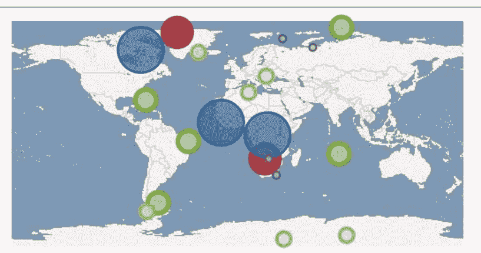

## 刚才发生了什么？

我们刚刚使用了一个创建规则的“快捷方式”。这并不意味着你应该避免这样做。该方法相当快，工作效果良好，而且易于阅读和理解。只要记住，如果你没有为找到的值定义 symbolizer，包含该值的要素可能不会有样式。如果你需要对已知值进行这种属性值检查，`addUniqueValueRules` 是一个很好的解决方案。

然而，有一种更强大的自定义样式的方法——使用自定义 Rules 和 Filters。

## 规则和过滤器

到目前为止，我们基本上只是对属性进行一对一匹配来指定样式。使用属性替换，我们直接替换一个值。使用 `addUniqueValueRules`，我们检查属性是否等于某个值。到目前为止，我们的灵活性并不大。

通过使用 Rules 和 Filters，我们可以拥有想要的灵活性。我们可以对属性进行比较，例如，如果要素的属性小于或大于某个值，则以某种方式对其进行样式设置。我们可以创建过滤器来检查多种不同类型的比较（大于、小于、等于等），并且可以让过滤器相互作用。

## 它们如何工作？

filters 对象属于 rule 对象。rule 对象属于 style 对象。每个 style 对象可以有多个规则，并且规则可以根据其过滤器的定义方式相互作用。

## 我们如何使用它们？

要使用自定义规则和过滤器，我们只需要将它们与 style 对象关联起来。定义规则并将其添加到 style 对象的通用语法是：

```
var my_rule = new OpenLayers.Rule({
  filter: new OpenLayers.Filter({}),
  symbolizer: { key:values }
});
style_object.addRules([my_rule]);
```

filter 对象决定规则如何应用（例如检查属性是否大于某个值）。我们将在示例之后更详细地介绍 Filter 类，因为我们可以用过滤器做很多复杂的事情。这可能听起来有点抽象，所以让我们先通过一个示例看看它是如何工作的，然后再详细介绍这两个类。

## 动手实践 – 使用规则和过滤器

让我们使用规则和过滤器根据要素对象的属性为其分配不同的样式。

- 1. 让我们开始使用规则和过滤器。向地图添加一个 WMS 层。我们还需要一个矢量层，所以添加一个矢量层：
- 2. 接下来，我们需要一些要素。我们将再次生成一些随机要素点，并为每个对象创建一个名为 population 的属性，其中包含 0 到 2000 之间的随机数：

```
vector_layer = new OpenLayers.Layer.Vector('Basic Vector Layer');
map.addLayer(vector_layer);
```

```
for(var i=0; i<20; i++){
  vector_layer.addFeatures([new OpenLayers.Feature.Vector(
new OpenLayers.Geometry.Point(
    (Math.floor(Math.random() * 360) - 180),
    (Math.floor(Math.random() * 180) - 90)
),
{
    'population': Math.floor(Math.random() * 2000)
}
]);
}
```

3. 现在我们需要创建一个 style 对象——规则直接应用于 style 对象，过滤器直接应用于规则。所以，让我们按顺序创建对象，从 style 对象开始：

```
var vector_style = new OpenLayers.Style();
```

4. 现在让我们创建三个规则。对于每个规则，我们将传入一个包含两个键的对象：filter（将是一个 Filter 类对象）和 symbolizer（是熟悉的 symbolizer 对象）。filter 对象需要一个过滤器类型，我们将在此示例之后介绍，以及规则将匹配的属性（在本例中为 population）。我们还需要指定要匹配的每个规则的值（或值范围）。value 参数取决于过滤器类型，我们将使用 value 或 lowerBound 和 upperBound。让我们创建第一个规则，该规则将处理小于 500 的人口值：

```
var rule_pop_low = new OpenLayers.Rule({
    filter: new OpenLayers.Filter.Comparison({
        type: OpenLayers.Filter.Comparison.LESS_THAN,
        property: 'population',
        value: 500
    }),
    symbolizer: {
        fillColor: '#ababab', fillOpacity:.8,
        pointRadius:8, strokeColor: '#454545',
        strokeWidth:2
    }
});
```

5. 现在我们来处理第二个规则，该规则处理下边界为 500、上边界为 1500 之间的人口值。边界是包含的；也就是说，500 和 1500 的值将被匹配。请注意，我们没有像前一个规则那样的 value 属性——这里的值由两个边界属性决定：

```
var rule_pop_mid = new OpenLayers.Rule({
    filter: new OpenLayers.Filter.Comparison({
        type: OpenLayers.Filter.Comparison.BETWEEN,
        property: 'population',
        lowerBoundary:500,
        upperBoundary:1500
    }),
    symbolizer: {
        fillColor: '#aaee77', fillOpacity:.8,
        pointRadius:14, strokeColor: '#669933',
        strokeWidth:5
    }
});
```

6. 我们的最后一个规则将匹配大于 1500 的人口值：

```
var rule_pop_high = new OpenLayers.Rule({
    filter: new OpenLayers.Filter.Comparison({
        type: OpenLayers.Filter.Comparison.GREATER_THAN,
        property: 'population',
        value: 1500
    }),
    symbolizer: {
        fillColor: '#BD1922', fillOpacity:.8,
        pointRadius:20, strokeColor: '#812B30',
        strokeWidth:5
    }
});
```

7. 几乎完成了——现在我们需要将这三个规则添加到 style 对象。我们将规则对象的数组传递给 addRules 方法：

```
vector_style.addRules([rule_pop_low, rule_pop_mid, rule_pop_high]);
```

8. 现在创建一个 styleMap 对象并将 style 对象应用到它，并设置矢量层使用它：

```
var vector_style_map = new OpenLayers.StyleMap({
  'default': vector_style
});
vector_layer.styleMap = vector_style_map;
```

9. 现在查看地图。你应该会看到类似这样的内容，但点的位置和颜色不同，因为值是随机化的：

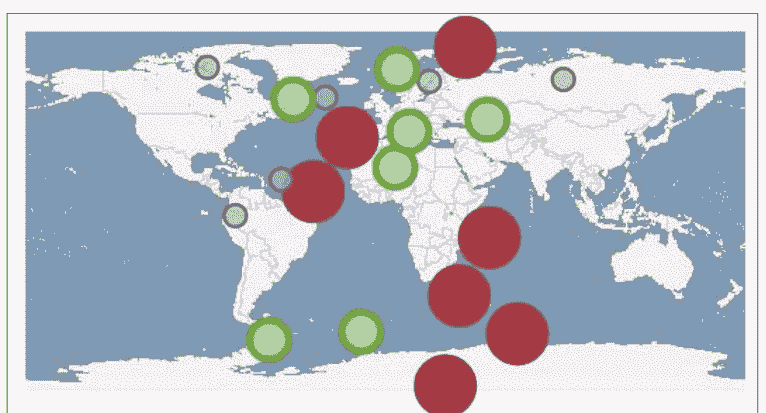

## 刚才发生了什么？

我们刚刚展示了规则和过滤器的使用方法。我们使用了三个 rule 对象，每个对象都有不同的 filter 对象。filter 对象的 type 属性决定了将应用的比较类型。因此，在前面的示例中，如果一个要素的 'population' 属性值小于 500，则 rule_pop_low 规则将被应用于它。现在我们对它的使用有了基本了解，让我们更仔细地看看这两个类。

## OpenLayers.Rule 类

当你想要非常具体地指定应用于要素对象的样式类型时，最好的方法是使用 Rule 类。当你创建一个 rule 对象时，你指定一个 Filter 对象、如果规则匹配则应用于要素的 symbolizer，以及一个可选的 name 属性，该属性指定规则的任意名称。

Rule 对象应用于 style 对象，你可以在一个 style 对象上拥有几乎任意数量的规则。创建 rule 对象的语法，如前所述，是：

```
var my_rule = new OpenLayers.Rule({
    filter: new OpenLayers.Filter({}),
    symbolizer: { key:values }
});
style_object.addRules([my_rule]);
```

正如我们在前面的示例中看到的，为 style 对象创建和应用多个规则并不困难。在前面的示例中，我们为每个 rule 对象只使用了一个过滤器，但 OpenLayers 使指定多个过滤器变得很容易，从而让你对要素样式有更多控制。

规则是根据过滤器使用的——过滤器负责确定规则是否应用于要素。所以，让我们看看 Filter 类，以及如何使用它来进一步自定义要素样式。

## OpenLayers.Filter 类

Filter 类控制匹配要素属性的逻辑，以查看是否应应用规则。我们可以使用单个过滤器，如前面的示例中所示，也可以将过滤器组合在一起（例如，如果 property1 大于 500 且另一个 property2 小于 200，则应用样式）。

过滤器也可以是空间性的——我们可以检查要素是否与几何对象相交、是否在某一点的某个距离范围内等等。为了完成所有这些操作，我们使用基 Filter 类的子类，类似于我们使用 Layer 类和其他类的子类的方式。

## Filter 子类

这里我们将介绍四个子类——Comparison、FeatureId、Logical 和 Spatial。

## Filter.Comparison

Comparison 类是我们到目前为止一直使用的过滤器类。顾名思义，该类将根据过滤器对象的指定参数比较属性。应用的比较类型由 type 属性指定。我们还必须指定要检查的值——大多数过滤器使用 value 属性（但有些使用不同的属性，例如 lowerBoundary 和 upperBoundary）。最后，我们还必须指定要素中要检查的属性。


例如，让我们来看一下前一个示例中 rule_pop_low 规则所使用的过滤器对象：

```
var rule_pop_mid = new OpenLayers.Rule({
  filter: new OpenLayers.Filter.Comparison({
    type: OpenLayers.Filter.Comparison.GREATER_THAN,
    property: 'population',
    value: 1500
  }),
});
```

在这里，我们要求 OpenLayers 执行 GREATER_THAN 比较类型，它会查看要素的 population 属性，如果 population 的值大于（但不包括）1500，则匹配。

## Filter.Comparison 值属性

所有 Filter.Comparison 对象都必须具有相应的 value 属性。几乎所有过滤器比较类型，如我们刚刚演示的 GREATER_THAN 类型，都只是使用 value 属性。其他类型，如 Comparison 类型，使用 lowerBoundary 和 upperBoundary 属性。如果不指定过滤器应查找的值，过滤器将无法工作（它不知道要比较什么）。

让我们来看看可用的不同 Filter.Comparison 类型。

## Filter 比较类型

除非另有说明，每个比较类型都将具有相应的 value 属性。value 属性的类型为 {Integer}，除非另有说明。

### Filter Type: BETWEEN

BETWEEN：检查属性是否介于两个值之间。这不使用 value 属性——相反，你需要指定 lowerBound 和 upperBound 值进行检查。值是包含的——因此如果 lowerBound 为 500 且 upperBound 为 1500，它将匹配介于 500 到 1500 之间且包含这两个值的数值。示例构造函数调用：

```
var my_filter = new OpenLayers.Filter.Comparison({
  type: OpenLayers.Filter.Comparison.BETWEEN,
  property: 'population',
  lowerBoundary:500,
  upperBoundary:1500
});
```

### Filter Type: EQUAL_TO

EQUAL_TO：检查属性是否等于指定值。示例构造函数调用：

```
var my_filter = new OpenLayers.Filter.Comparison({
    type: OpenLayers.Filter.Comparison.EQUAL_TO,
    property: 'population',
    value: 1337
});
```

### Filter Type: GREATER_THAN

GREATER_THAN：检查属性是否大于（但不包括）指定值。以下示例构造函数调用将匹配大于（但不包括）1000 的任何值——因此它将匹配的最小值为 1001：

```
var my_filter = new OpenLayers.Filter.Comparison({
    type: OpenLayers.Filter.Comparison.GREATER_THAN,
    property: 'population',
    value: 1000
});
```

### Filter Type: GREATER_THAN_OR_EQUAL_TO

GREATER_THAN_OR_EQUAL_TO：检查属性是否大于或等于指定值。以下示例构造函数调用将匹配值 1000 以及更大的值：

```
var my_filter = new OpenLayers.Filter.Comparison({
    type: OpenLayers.Filter.Comparison.GREATER_THAN_OR_EQUAL_TO,
    property: 'population',
    value: 1000
});
```

### Filter Type: LESS_THAN

LESS_THAN：检查属性是否小于（但不包括）指定值。示例构造函数调用——这将匹配低于 1000 的任何值，但不会匹配值 1000：

```
var my_filter = new OpenLayers.Filter.Comparison({
    type: OpenLayers.Filter.Comparison.LESS_THAN,
    property: 'population',
    value: 1000
});
```

### Filter Type: LESS_THAN_OR_EQUAL_TO

LESS_THAN_OR_EQUAL_TO：检查属性是否小于或等于指定值。示例构造函数调用——这将匹配低于 1000 的任何值，也将匹配 1000：

```
var my_filter = new OpenLayers.Filter.Comparison({
    type: OpenLayers.Filter.Comparison.LESS_THAN_OR_EQUAL_TO,
    property: 'population',
    value: 1000
});
```

### Filter Type: LIKE

LIKE：检查属性是否包含一个值，在此情况下为 {String}。例如，如果属性的值为 'village'，而你指定的检查值为 'village'，则会匹配。你指定的值也是一个正则表达式——这意味着你可以传入各种特殊字符进行匹配。例如，* 将匹配零个或多个任意字符的实例。如果只是想查看某个字符串是否包含在属性中，可以简单地将值设置为该字符串，而无需担心正则表达式是什么。示例构造函数调用：

```
var my_filter = new OpenLayers.Filter.Comparison({
    type: OpenLayers.Filter.Comparison.LIKE,
    property: 'settlement_type',
    value: 'village'
})
```


有关正则表达式的更多信息，可访问 http://en.wikipedia.org/wiki/Regular_expression.

### Filter Type: NOT_EQUAL_TO

NOT_EQUAL_TO：检查属性是否不等于传入的某个值，该值为 {Integer} 类型。以下示例构造函数调用将匹配 population 属性不等于值 1000 的所有内容。

```
var my_filter = new OpenLayers.Filter.Comparison({
    type: OpenLayers.Filter.Comparison.NOT_EQUAL_TO,
    property: 'population',
    value: 1000
});
```

## Filter.FeatureId

这将根据 Feature ID 过滤要素。这在处理 WFS 服务或 SLD 时特别有用。对于 WFS，FeatureID 是引用唯一要素的一种方式。WFS 服务器返回有关要素的数据，每个要素都包含一个唯一标识它的 FeatureID。SLD 也可以通过唯一的 FeatureID 标识要素。如果知道要设置样式的特定要素的 ID，这会很有用。使用 FeatureID 过滤器时，在实例化期间它期望一个 fids 数组：

```
var my_filter = new OpenLayers.Filter.FeatureId({
    fids: ['fid1', 'fid2']
});
```

## Filter.Logical

我们已经练习过将过滤器应用于规则，但将过滤器对象应用于另一个过滤器对象呢？我们为什么要这样做？好吧，这使我们能够使用逻辑运算符与过滤器。也就是说，我们可以非常轻松地创建非常复杂的过滤器。

我们可以使用三种类型的逻辑运算符：

- OpenLayers.Filter.Logical.AND: 检查多个过滤器是否匹配
- OpenLayers.Filter.Logical.OR: 检查多个过滤器中是否至少有一个匹配
- OpenLayers.Filter.Logical.NOT: 如果过滤器不匹配

我们可以将这些过滤器组合在一起创建非常具体的规则，从而对应该获得样式的要素进行非常精细的控制。要创建逻辑过滤器，只需指定类型（即上述三个逻辑运算符之一）以及包含其他过滤器对象的过滤器数组。

例如，

```
var my_logical_filter = new OpenLayers.Filter.Logical({
    type: OpenLayers.Filter.Logical.AND,
    filters: [
        new OpenLayers.Filter.Comparison({
            type: OpenLayers.Filter.Comparison.LESS_THAN,
            property: 'population',
            value: 1000
        }),
        new OpenLayers.Filter.Comparison({
            type: OpenLayers.Filter.Comparison.LIKE,
            property: 'settlement_type',
            value: 'village'
        })
    ]
});
```

上述过滤器使用 AND 逻辑运算符和两个比较过滤器。其结果是，此逻辑过滤器仅匹配同时匹配两个比较过滤器的要素（population 小于 1000 且 settlement_type 包含 'village'）。

让我们用一个示例来说明。

## Time For Action – figuring out logical filters

在此示例中，我们将使用一些逻辑过滤器和一些具有随机 population 和 settlement_type 值的随机点。

- 1. 添加 WMS 和矢量图层。
- 2. 现在，我们需要创建一个匿名对象，其中包含一些 settlement 值，我们将从中随机选取：
- 3. 让我们创建一些要素。我们将创建二十个要素，在每个要素的属性中使用一些随机的 population 和 settlement_type 值：
- 4. 与之前一样，我们现在需要一个样式对象来应用过滤器：

```
vector_layer = new OpenLayers.Layer.Vector('Basic Vector Layer');
map.addLayer(vector_layer);
```

```
var settlement_values = {
    0: 'village',
    1: 'city',
}
```

```
for(var i=0; i<20; i++){
    vector_layer.addFeatures([new OpenLayers.Feature.Vector(
        new OpenLayers.Geometry.Point(
            (Math.floor(Math.random() * 360) - 180),
            (Math.floor(Math.random() * 180) - 90)
        ),
        {
            'population': Math.floor(Math.random() * 2000),
            'settlement_type': settlement_values[(Math.floor(Math.random() * 2))]
        }
    )]);
}
```

```
var vector_style = new OpenLayers.Style();
```

5. 现在进入“困难”的部分。我们将创建一个逻辑过滤器来检查两个比较过滤器。它会检查人口是否低于 1000 且 settlement_type 为 'village'。就这么简单：

```
var filter_village_low_pop = new OpenLayers.Filter.Logical({
    type: OpenLayers.Filter.Logical.AND,
    filters: [
        new OpenLayers.Filter.Comparison({
            type: OpenLayers.Filter.Comparison.LESS_THAN,
            property: 'population',
            value: 1000
        }),
        new OpenLayers.Filter.Comparison({
            type: OpenLayers.Filter.Comparison.LIKE,
            property: 'settlement_type',
            value: 'village'
        })
    ]
});
```

6. 接下来，我们将创建另一个逻辑过滤器。它将检查人口是否在 100 到 1500 之间，并检查 settlement_type 是否为 'village'。

```
var filter_village_high_pop = new OpenLayers.Filter.Logical({
    type: OpenLayers.Filter.Logical.AND,
    filters: [
        new OpenLayers.Filter.Comparison({
            type: OpenLayers.Filter.Comparison.BETWEEN,
            property: 'population',
            lowerBoundary: 1000,
            upperBoundary: 1500
        }),
        new OpenLayers.Filter.Comparison({
            type: OpenLayers.Filter.Comparison.LIKE,
            property: 'settlement_type',
            value: 'village'
        })
    ]
});
```

7. 现在我们再创建一个过滤器。这个过滤器将使用 OR 逻辑运算符来检查人口是否高于 1500 或 settlement_type 是否为 'city'。因此，即使 settlement_type 为 'city' 而人口比如为 500，它也会被匹配，因为至少有一个过滤器匹配：

```
var filter_city = new OpenLayers.Filter.Logical({
    type: OpenLayers.Filter.Logical.OR,
    filters: [
        new OpenLayers.Filter.Comparison({
            type: OpenLayers.Filter.Comparison.GREATER_THAN,
            property: 'population',
            value: 1500
        }),
        new OpenLayers.Filter.Comparison({
            type: OpenLayers.Filter.Comparison.LIKE,
            property: 'settlement_type',
            value: 'city'
        })
    ]
});
```

8. 好的——现在我们只需创建一些规则并将过滤器应用到它们上。每个规则都将应用到我们刚刚创建的其中一个过滤器。

```
var rule_village_low_pop = new OpenLayers.Rule({
    filter: filter_village_low_pop,
    symbolizer: {
        fillColor: '#ababab', fillOpacity:.8,
        pointRadius:8, strokeColor: '#454545',
        strokeWidth:2
    }
});

var rule_village_high_pop = new OpenLayers.Rule({
    filter: filter_village_high_pop,
    symbolizer: {
        fillColor: '#FFFA93', fillOpacity:.8,
        pointRadius:8, strokeColor: '#AFAB57',
        strokeWidth:4,
    }
});

var rule_city = new OpenLayers.Rule({
    filter: filter_city,
    symbolizer: {
        fillColor: '#BD1922', fillOpacity:.8,
        pointRadius:16, strokeColor: '#812B30',
        strokeWidth:6,
        fontSize:'.8em', fontColor: '#efefef',
        label: '${population}'
    }
});
```

9. 最后一步——我们需要将规则添加到 vector_style 对象中，创建一个 style_map 对象并将样式对象应用到 'default' 意图，最后将矢量图层的 StyleMap 设置为样式映射对象。

```
vector_style.addRules([rule_village_low_pop, rule_village_high_pop, rule_city]);

var vector_style_map = new OpenLayers.StyleMap({
  'default': vector_style
});

vector_layer.styleMap = vector_style_map;
```

10. 你应该会看到如下类似的内容，由于值是随机化的，点的分布和颜色会有所不同：

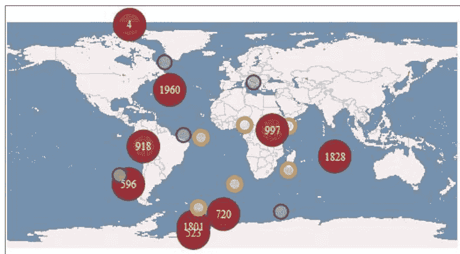

## 发生了什么？

我们刚刚演示了如何在地图中使用逻辑过滤器。我们可以混合搭配不同的逻辑运算符来创建更复杂的过滤器，从而让我们能够按想要的方式精确地设置要素样式。还有一个功能类需要介绍——Feature.Spatial。

## Feature.Spatial

The **Feature.Spatial** class allows us to filter features based on their geographic information. This class is used when *creating* a vector layer. It differs from the previous logical filter, as we don't typically add this to a rule after a vector layer has been created—it's used to specify the features returned from a source like a WFS server. If you are creating a vector layer which uses the WFS protocol, this is a very useful filter.

When creating a spatial filter, a `type` and `value` must be specified. The value will be either a `{OpenLayers.Bounds}` or `{OpenLayers.Geometry}` object, depending on the `type`. Some types also allow for additional `distance` and `distanceUnits` parameters. Let's take a look at some of the types:

- **OpenLayers.Filter.Spatial.BBOX**: Specifies features to match that fall inside a bounding box, set by an `{OpenLayers.Bounds}` object in the `value` property
- **OpenLayers.Filter.Spatial.CONTAINS**: Used to check if an `{OpenLayers.Geometry}` object specified by the `value` property contains a feature
- **OpenLayers.Filter.Spatial.DWITHIN**: Specifies if a feature is within some distance specified by the `distance` property
- **OpenLayers.Filter.Spatial.INTERSECTS**: Used to check if a feature intersects an `{OpenLayers.Geometry}` object specified in the `value` property
- **OpenLayers.Filter.Spatial.WITHIN**: Used to check if a feature is completely within an `{OpenLayers.Geometry}` object specified in the `value` property

So, to use this filter, you'll usually use it when instantiating your vector layer. We won't do an in depth example, as it follows the general format of our previous examples. However, an example instantiation call using the Spatial filter would look like this:

```
var my_vector_layer = new OpenLayers.Layer.Vector(
  'My WFS Layer',
  {
    protocol: new OpenLayers.Protocol.WFS({
      url: wfs_server
    }),
    filter: new OpenLayers.Filter.Spatial({
      type: OpenLayers.Filter.Spatial.BBOX,
      value: new OpenLayers.Bounds(-180,-90,0,0),
      projection: new OpenLayers.Projection('EPSG:4326')
    })
  });
```

## 总结

We've reached the end of our discussion about the core components of OpenLayers. This was the last chapter that deals specifically with defining parts of the OpenLayers API. In this chapter, we discussed styling vector layers in OpenLayers. We covered the Style and StyleMap classes, and went over how to work with the Rules and Filter classes.

The next chapter will be similar to the latter part of this chapter. Instead of going over more of the OpenLayers library (you know enough now to be dangerous), we'll go over the process of creating a web application using OpenLayers. We'll put together the things we've learned throughout this book to demonstrate how everything 'fits together', and what a typical development process looks like.

# 11

# 创建 Web 地图应用

By now, we've covered all the parts of OpenLayers that are essential for making our own web map application. So far, we've been focusing on how to use the various different parts of OpenLayers. In this chapter we'll put together those pieces that we've learned and demonstrate how to create an actual web map application with OpenLayers.

While we won't be introducing many new things in this chapter, we will be putting them together in ways we haven't before. Throughout this chapter, we'll:

- Cover common development strategies
- Learn how to interact with third party data
- Build a web-mapping application from scratch using Flickr
- Deploy our applications and discuss what deployment means
- Discover how to build the OpenLayers library file

## 开发策略

In this chapter, we'll be developing a web map application that loads in data from a third party source (Flickr). The examples have been structured with **iterative development** in mind. What this means is that you start small and make many changes, gradually building up your web map from nothing into something useful.


**迭代开发** 是开发应用程序的一种重要、流行且有效的方式。核心思想是先创建一个简单的东西，让它运行起来，然后再改进它。通过在前一次迭代的基础上改进并学习，你可以更快地弄清楚什么有效、什么无效。

另一种我们将采用的策略是 **模块化编程**。本质上，这意味着我们尽可能保持事物离散（或模块化）。这样做的好处是，一旦我们知道某个组件有效，后续就无需再担心它。

## 使用 Flickr 创建网络地图应用程序
由于 OpenLayers 非常灵活，很容易让第三方软件和数据与我们的地图协同工作。共享地理空间数据变得越来越流行，Flickr 和 Twitter 等服务免费提供嵌入地理空间的数据。能够可视化数据通常有助于我们理解它。使用 OpenLayers，我们可以将地理空间数据（例如 Twitter 帖子或 Flickr 图片）放置在地图上，从而更清晰地了解数据。

## 关于 API 的说明
许多流行网站提供 **API（应用程序编程接口）**，允许程序员与其数据交互。例如，Flickr 和 Twitter 都提供 API，使开发人员能够查看最近的更新（照片上传和推文）。这些 API（但并非所有 API）让我们获取可与 OpenLayers 一起使用的地理空间数据。Flickr 提供了一些非常易于使用的方法来检索带有关联地理信息的数据，因此本章将重点介绍围绕 Flickr 构建网络制图应用程序。

## 访问 Flickr 公共数据订阅源
虽然 Flickr 提供了非常强大的开发者 API，但我们将仅通过提供订阅源访问的 URL 调用与 Flickr 交互。订阅源提供有关数据的信息，我们可以获取不同类型的订阅源（例如特定用户的订阅源或所有用户合并的订阅源）。这样做其实很容易；我们只需调用一个 URL 并指定某些参数即可。我们将调用的基础 URL 是 `http://api.flickr.com/services/feeds/geo/?format=kml`。

`format` 参数可以是多个值——JSON、RSS、SQL 等。本章我们将使用 KML 和 JSON。调用此 URL 时，将返回一个你所请求格式的文件，其中包含有关最新上传且带有地理信息关联的照片的信息（URL 中的 `geo` 就是为此目的）。

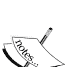

> Flickr 的 API 文档可在 http://www.flickr.com/services/api/ 找到。有关 Flickr 订阅源的更多信息可在 http://www.flickr.com/services/feeds/ 找到。

## 指定数据
我们可以通过向 URL 添加额外参数来细化返回的数据。你可以通过 ID 键指定用户 ID，通过 g 键指定组，通过 tags 键指定标签。你还可以指定其他内容，例如特定坐标和半径——目前，我们将只关注 tags 键。

## 我们将如何操作
让我们创建一个网络地图应用程序，从 Flickr 获取数据并将其显示在地图上。这将使我们能够从地理上看到照片的提交位置。例如，我们可以搜索“鸟类照片”，从而了解某些特定鸟类可能常见的地区（或至少在 Flickr 上被常见拍摄并上传的地区）。我们将把该应用程序的开发分解为几个不同的示例，让我们开始吧。

## 动手实践 – 获取 Flickr 数据
我们应用程序的第一步需要从 Flickr 获取数据。我们将请求一些数据，然后将其保存到服务器。

- 1. 第一步是确定我们想要获取什么样的数据。我们将使用之前提到的 URL，但也会指定一个标签。让我们使用 'bird' 作为标签。在你的网络浏览器中打开此 URL，你应该能够将其下载为 KML 文件 `http://api.flickr.com/services/feeds/geo/?format=kml&tags=bird`。
- 2. 将文件保存为 `flickr_data.kml` 并将其放置在你的地图目录中。
- 3. 打开文件并查看一下。我们不会编辑它，只是看看数据的结构。注意其中有 `style` 标签——如果我们愿意，可以直接将文件中的样式应用到我们的地图上（我们很快就会看到）。

## 发生了什么？
我们刚刚下载了包含名为 'bird' 标签的最新图片的 KML 格式文件。当你调用 URL 并传入某个标签时，Flickr 会返回给你最新上传且带有某些地理信息关联的图片。

## 试一试 – 访问 Flickr API
向上一示例中的 URL 发出请求。尝试更改 `tags` 参数并注意返回的文件有何不同。根据 URL 中的参数，Flickr 将返回不同的数据。

## 为什么要这样做？
你可能会想知道为什么我们要下载 KML 文件。如果你还记得第 9 章，我们可以直接创建一个矢量图层并指向 Flickr URL，而不是本地文件。然而，如果我们下载 KML 文件，我们就可以直接控制它；我们可以修改它。在“开发模式”下，我们希望尽可能让事情易于调试和修复。

## 减少可能的错误
一旦我们让代码能够加载我们下载的 KML 文件（在下一个示例中），我们就无需再担心它了。当我们开发应用程序并发现其中的错误或问题时，就不必花费大量时间追踪它们。我们先让静态文件正常工作，然后再进行下一步。我们不必担心 Flickr API 宕机、请求未完成或其他问题——我们可以专注于其他部分。一旦应用程序的更多部分开始工作，我们就会切换到使用动态 URL。现在，让我们使用静态文件。


> 因为我们将加载一个文件，所以必须在服务器上运行此代码。你可以在本地主机上运行——如果没有服务器，可以从 http://www.apachefriends.org/en/xampp.html 下载适用于 Windows 的 Apache。
> 需要在服务器上运行的原因是 KML 文件通过 AJAX 调用加载，并且文件必须位于与原始请求相同域下。有关加载文件的更多详细信息，请参阅第 9 章。

## 动手实践 – 将数据添加到你的地图
是时候回到编码了。现在我们已经从上一示例中获得了 Flickr 的数据，让我们将其添加到地图中。我们将创建一个 Google 地图底图层，然后在其上放置一个填充有 Flickr 数据的矢量图层。

- 1. 首先，我们需要确保 `flickr_data.kml` 文件位于我们将创建地图的同一目录中。将文件保存在服务器的文档根文件夹中，这可能类似于（Windows 上使用 XAMPP）`c:/xampp/htdocs`，或在 OSX 上（使用 XAMPP，http://www.apachefriends.org/en/xampp-macosx.html）位于 `/Applications/XAMPP`，或在 Linux 上：`/var/www/`。我们将引用它为 `example_1.html`。
- 2. 现在让我们创建地图。这次我们不会使用 WMS 图层——相反，我们将只使用 Google 底图并在其上放置矢量图层。确保首先在 `<head>` 部分添加对 Google Maps API 的引用：
```
<script src="http://maps.google.com/maps/api/js?sensor=false"></script>
```
- 3. 现在，创建并添加一个 Google 地图图层。
```
var google_map = new OpenLayers.Layer.Google(
    'Google Layer',
    {}
);
map.addLayer(google_map);
```
- 4. 现在我们需要一个矢量图层。我们必须将其投影定义为 `EPSG:4326`，因为 KML 文件中的坐标就是该投影。如果它们使用不同的投影，我们将按其所在的投影进行定义（尽管我们需要 Proj4js 来进行投影转换）。

我们将使用 `HTTP` 协议，因为我们将从本地服务器访问 KML 文件。这就是为什么我们不能简单地在文件夹中打开页面——这样做时协议为 `file:///`，因此我们必须从本地 Web 服务器打开它（前提是你已安装，见之前的说明）。

在协议内部，我们将从 `KML` 类设置一个 `format` 对象，并将 `extractAttributes` 设置为 `true`，以便我们可以访问与每个图像关联的属性。最后，我们将使用 `Fixed` 策略。
```
var vector_layer = new OpenLayers.Layer.Vector('Flickr Data',
    {
        projection: new OpenLayers.Projection('EPSG:4326'),
        protocol: new OpenLayers.Protocol.HTTP({
            url: 'flickr_data.kml',
```


```
format: new OpenLayers.Format.KML({
    extractAttributes: true
})
}),
strategies: [new OpenLayers.Strategy.Fixed()]
}
);
```

5. 并将其添加到地图中：

`map.addLayer(vector_layer);`

6. 现在我们应该能看到一些点，显示已上传图像的位置。通过 localhost 打开页面，例如：`http://localhost/openlayers_book/chapter_11/code/example_1.html`。

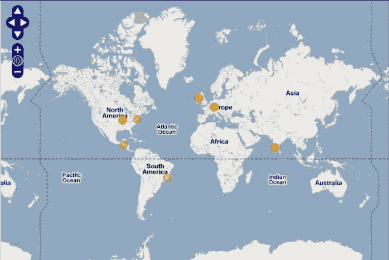

7. 现在，让我们看看 `extractAttributes` 用来做什么。当我们将其设置为 `true` 时，KML 文件中每个要素的属性都会应用于每个要素对象的 `attributes` 属性。更直白地说——它从文件中提取属性并将其应用到你的点上。打开 Firebug，并在控制台中访问其中一个要素对象：

`map.layers[1].features[0].attributes`

8. 你应该会看到一个包含三个属性的对象：`Snippet`、`name` 和 `styleUrl`。这些是 somewhat arbitrary 的属性，在 KML 文件中为每张照片指定，使用 `extractAttributes: true` 我们可以访问它们。`styleUrl` 是对 KML 文件内部样式标签的引用——我们将在下一个示例中讨论它。

## 发生了什么？

我们刚刚加载了 KML 文件并使用 `extractAttributes` 查看每张照片包含的属性。Flickr 提供了这些属性——KML 文件中的属性会被应用到我们的要素对象上。另一个我们可以使用的是 `extractStyles` 属性，用于将 KML 文件中的样式应用到我们的要素上。

## 动手时间 – 提取样式

`extractStyles` 可用于根据 KML 文件中指定的样式来设置矢量图层的样式。由于 Flickr 的 KML 文件提供了样式信息，我们可以使用此属性——让我们看看如何操作。

- 1. 如果你正在使用的 KML 文件包含样式信息，我们可以直接访问并使用它。在本例中，Flickr 为我们提供了一个嵌入了样式标签的 KML 文件，所以让我们使用它。
- 2. 我们将在创建矢量图层时在内部指定 `extractStyles: true`。在 format 值设置中添加它，并确保包含逗号：

```
...
format: new OpenLayers.Format.KML({
    extractAttributes: true,
    extractStyles: true
})
...
```

3. 现在打开页面，你应该能看到图像的缩略图：

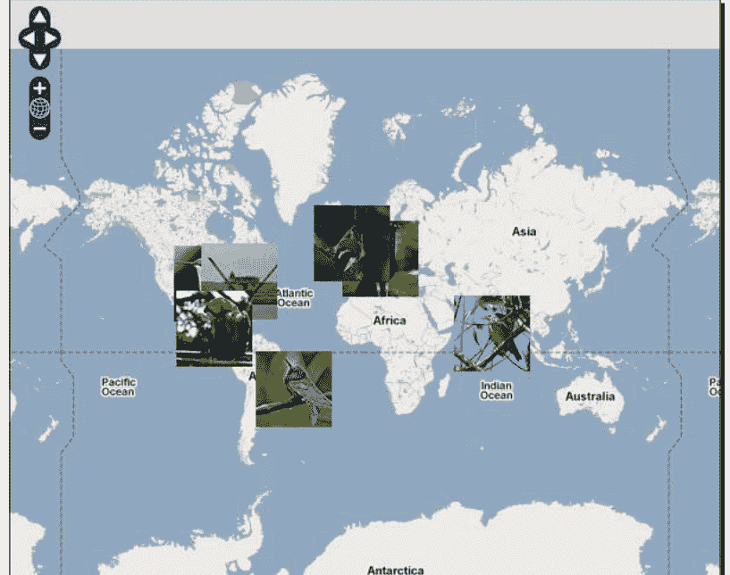

## 发生了什么？

使用 extractStyles，我们的要素从默认的橙色点变成了实际上传照片的缩略图。当使用此属性时，KML 文件中的样式定义会被应用到每个要素的 style 属性上。KML 文件可以包含样式信息——这就是为什么我们可以在 KML 格式中使用 extractStyles 属性。OpenLayers 将解析 KML 文件中的样式信息并生成必要的样式定义。

## 将我们的示例转变为应用程序

到目前为止，我们已经从 Flickr 获取了数据，将其保存到文件中，并将其添加到地图中。这很酷，但从 OpenLayers 的角度来看，我们基本上只做了加载数据的操作。很有用，但我们还没有真正创建一个功能齐全的“网络应用程序”。因此，让我们专注于如何构建更有用的网络地图应用程序。

为此，我们基本上需要做两件一般性的事情：

- 1. 为我们的地图添加一些交互性。
- 2. 使用“实时”数据。我们不应该每次想要新数据时都手动下载 KML 文件——我们的网络应用程序应该自动完成。

让我们先专注于第一部分，然后在开发了一些交互性后更改数据源。

## 添加交互性

在之前的示例中，每个要素都收到了一个 `externalGraphic` 属性，因为我们使用了 `extractStyles`（导致为每个要素显示缩略图）——但在地图上很难看到它们的位置，尤其是在缩小时。我们需要解决这个问题。我们希望显示照片，但也希望显示它们的位置。

为此，我们可以改回使用点要素并使用 `selectFeature` 控制。但如果要素太多且彼此太近，会使选择它们变得更困难？这就是 **cluster** 策略的作用所在，所以我们也会使用它。

## 选择要素

选择要素时应该发生什么？我们需要显示所点击要素的信息，而该信息就是 Flickr 照片本身及其相关属性。因此，让我们暂时保持简单，在选择要素时在地图下方显示照片信息。

## 动手时间 – 添加一些交互性

在本示例中，我们将使用 **cluster** 策略、**selectFeature** 控制，并在选择时显示照片信息。在操作过程中，请随意自行调整示例、更改功能或做其他任何事情——这才是最好的学习方式！

- 1. 复制（或直接编辑）上一个示例中的代码。我们将对其进行改进。
- 2. 我们将保留 `extractAttributes` 和 `extractStyles`。即使我们指定了 `extractStyles`，我们也将使用自定义的 `styleMap` 对象。我们这样做是为了仍然能够访问缩略图图像位置（在使用 `extractStyles` 时，该位置设置为要素的 `style` 对象中的 `externalGraphic`）。确保 `format` 对象如下所示：

```
...
format: new OpenLayers.Format.KML({
    extractAttributes: true, extractStyles: true
```

```
})
...
```

3. 现在让我们为矢量图层添加一个 `cluster` 策略，以便我们的点进行聚类。我们的 `strategies` 数组现在应如下所示：

```
strategies: [new OpenLayers.Strategy.Fixed(),
            new OpenLayers.Strategy.Cluster()]
```

4. 让我们快速查看一下地图，确保它能正常工作。由于我们使用了 cluster 策略，我们将看不到之前示例中出现的缩略图。请记住从 http://localhost/... 访问它：

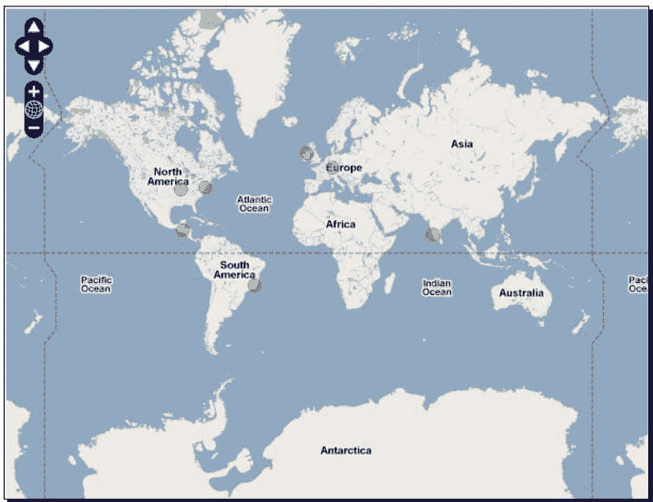

5. 到目前为止，一切都很好。我们的点看起来有点小，而且我们无法直观地区分簇中包含多少个点。让我们改变这一点。我们将根据簇包含的点数使簇变大。在使用聚类时，每个要素都属于一个簇，我们可以通过 feature.attributes.count 访问簇中要素的数量。让我们还在每个要素上添加一个标签，显示其包含的点数。我们还将在实例化样式对象时传入第二个 context 对象，这允许我们定义与属性替换一起使用的变量的值。context 对象将包含一个返回将与属性替换一起使用的值的函数。

```
//Create a style object to be used by a StyleMap object
var vector_style = new OpenLayers.Style({
    'fillColor': '#669933',
    'fillOpacity': .8,
    'fontColor': '#f0f0f0',
    'fontFamily': 'arial, sans-serif',
    'fontSize': '.9em',
    'fontWeight': 'bold',
    'label': '${num_points}',
    'pointRadius': '${point_radius}',
    'strokeColor': '#aaee77',
    'strokeWidth': 3
},
    //Second parameter contains a context parameter
    {
        context: {
            num_points: function(feature){ return feature.attributes.count; },
            point_radius: function(feature){
                return 9 + (feature.attributes.count)
            }
        }
    }
));
```

```
//Create a style map object and set the 'default' intent to the
var vector_style_map = new OpenLayers.StyleMap({
    'default': vector_style
});
```

```
//Add the style map to the vector layer
vector_layer.styleMap = vector_style_map;
```

6. 让我们看一下。每个簇的大小和标签都应该发生变化：

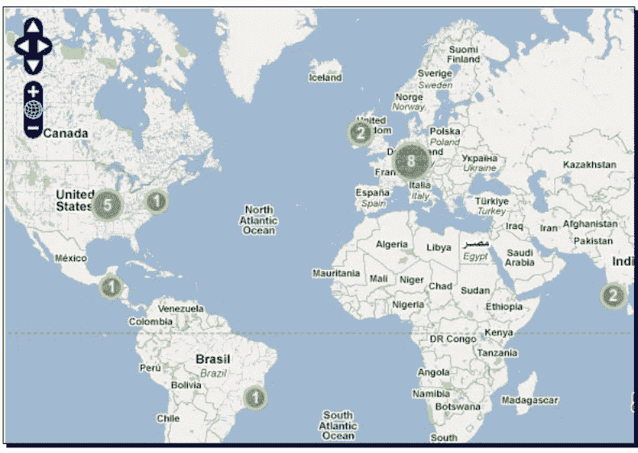

7. 我们计划的第一部分已完成——我们已成功添加了簇。现在，我们需要添加要素选择功能。让我们创建一个 selectFeature 控制。我们很快会添加事件，但现在让我们只是创建控制并将其添加到地图中，然后激活它。

```
//Add a select feature control
var select_feature_control = new OpenLayers.Control.SelectFeature(
    vector_layer,
    {}
)
map.addControl(select_feature_control);
select_feature_control.activate();
```

8. 现在，如果我们选择一个要素，它的外观可能不太正确。这是因为我们尚未为 select 意图定义样式。让我们返回并定义一个样式对象并将其添加到我们的 vector_style_map 对象中：

```
var vector_style_select = new OpenLayers.Style({
    'fillColor': '#cdcdcd',
    'fillOpacity': .9,
    'fontColor': '#232323',
```


```
'strokeColor': '#ffffff'
})
//Create a style map object and set the 'default' intent to the
var vector_style_map = new OpenLayers.StyleMap({
  'default': vector_style,
  'select': vector_style_select
});
```

9. 进入最后部分——创建事件。我们的计划是在选择要素时显示一些照片信息。让我们先通过简单地创建一个将出现在地图下方的 div 来搭建该框架。在你的 HTML 代码中，添加以下内容：

```
<div id='photo_info_wrapper'></div>
```

现在让我们创建一个在选择要素时会被调用的函数。它需要使用所选集群中包含的照片的信息来更新 photo_info_wrapper div。我们需要创建一个循环，遍历所选集群中的每个要素，提取其属性，并更新 div 的 HTML。所有这些操作都将在选择要素时被调用的函数中发生，我们还需要创建一个在取消选择要素时清除该 div 的函数。我们需要从要素的 attributes 属性中获取属性，这些属性是在创建矢量图层时由之前的 extractAttributes 参数填充的。我们还将访问要素的 style 属性（该属性由我们之前使用的 extractStyles 参数填充）以获取 externalGraphic 位置。让我们创建这些函数：

```
function on_select_feature(event) {
  //Store a reference to the element
  var info_div = document.getElementById('photo_info_wrapper');
  info_div.innerHTML = '';

  //Store the clusters
  var cluster = event.feature.cluster;

  //Loop through the cluster features
  for(var i=0; i<cluster.length; i++){
    //Update the div with the info of the photos
    info_div.innerHTML += "<strong>"
      + cluster[i].attributes.name
      + "</strong><br />"
      + ""
      + cluster[i].attributes.Snippet
      + "<br /><hr />";
```

```
}
}
function on_unselect_feature(event) {
    //Store a reference to the element
    var info_div = document.getElementById('photo_info_wrapper');
    
    //Clear out the div
    info_div.innerHTML = '';
}
```

10. 现在，我们只需要注册事件。

```
vector_layer.events.register('featureselected', this, on_select_feature);
vector_layer.events.register('featureunselected', this, on_unselect_feature);
```

11. 现在，当我们点击一个集群时，我们应该看到关于点的信息如下：

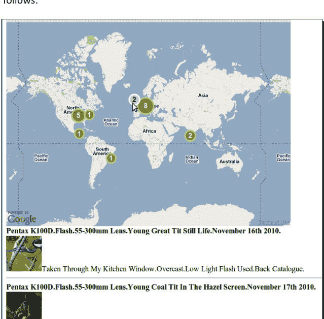

## 发生了什么？

我们刚刚为地图添加了一些交互性。它并不太复杂，尽管乍一看代码可能令人望而生畏。不过我们实际上并没有做任何“新”的事情。我们注册了一些矢量图层事件，这些事件在选择要素时会触发，然后显示所选要素的信息。从这里开始，你可以轻松地对应用程序进行一些更改——例如更改显示的方式和内容。这个示例或多或少可作为指南，帮助你创建自己的应用程序。让我们进一步扩展这个示例；但首先，我们需要使用实时数据。

## 使用 ProxyHost 使用实时数据

我们加载的数据 (`flickr_data.kml`) 来自第三方来源，但它仅在我们下载时保持新鲜。让我们解决之前遇到的第二个问题：

*使用“实时”数据，而不是在我们想要新数据时自己下载 KML 文件*

我们需要做的是实时访问数据。为此，我们需要使用一个 **ProxyHost**。该术语在第 9 章中有更详细的讨论，但本质上它是一种通过调用某些服务器端脚本来为我们发出请求（充当代理）从而规避 AJAX 跨域请求限制的方法。

## 动手时间 – 获取动态数据

让我们指定一个 ProxyHost 并实时获取 Flickr 的数据。

- 1. 我们可以使用刚刚创建的示例，因为我们只会在其中添加两件事。
- 2. 首先，我们需要定义 proxyhost 的 URL。它可以是 CGI 脚本、python 脚本等。OpenLayers 在 `http://trac.osgeo.org/openlayers/wiki/FrequentlyAskedQuestions#ProxyHost` 处提供了一个 CGI 脚本。如果你使用该文件，请确保已安装 Python。默认情况下，使用 Xampp 在 Windows 上文件会放在 `c:/xampp/cgi-bin`，在 Linux 上为 `/usr/lib/cgi-bin` 或 `/var/www/cgi`（位置可能因发行版而异）。在你的代码中指定 ProxyHost，将 URL 更改为指向你的 ProxyHost：

```
OpenLayers.ProxyHost = '/cgi-bin/proxy.cgi?url=';
```

3. 接下来，我们需要在代理文件中的 allowed host 变量中添加 Flickr 域名。编辑代理文件并将 Flickr URL 添加到 allowedHosts 列表中（在 OpenLayers 提供的文件中靠近顶部）。在撰写本文时，列表中的最后一项是 'vmap0.tiles.osgeo.org'。在最后一项后添加一个逗号，然后将 'api.flickr.com' 添加到列表中：

```
allowedHosts = [ ..., 'vmap0.tiles.osgeo.org', 'api.flickr.com']
```

4. 最后，我们只需更改矢量图层指向的 URL。在矢量图层的 protocol 对象中，我们需要更改 url 值并添加一个 params 对象，该对象指定将附加到 URL 调用的额外 GET 变量。在这种情况下，我们希望指定 format 和 tags 参数：

```
...
protocol: new OpenLayers.Protocol.HTTP({
    url: 'http://api.flickr.com/services/feeds/geo/',
    params: {'format':'kml', 'tags':'bird'},
...
```

5. 就这样！现在，假设你已正确设置 ProxyHost，你应该会看到与之前几乎相同的内容。唯一的区别是数据可能不同，因为你现在正在实时接入数据流。

## 发生了什么？

我们刚刚使用了 ProxyHost 并将矢量图层指向了实际的 Flickr API URL。为什么我们一开始不这样做呢？同样是为了减少在开发应用程序时需要担心的事情。现在我们已经有了一些交互性和实时 URL，让我们更进一步。

## 收尾应用程序

显示来自世界各地的鸟类图片很不错——但如果让用户能够显示他们想要的任何标签的照片呢？我们接下来要做的就是这个。

## 回顾

到目前为止，我们已经创建了一个地图，让用户可以与 Flickr 数据交互。就我们而言，交互部分或多或少已经完成。现在我们将重点放在更改“数据源”部分。目前，我们只请求带有 bird 标签的照片，但我们希望允许该标签为任意标签。

应用程序开发中的一个重要概念是保持模块化。这基本上意味着我们尝试以这样的方式编写应用程序，以便我们可以取出和放入不同的部分，而不会大幅更改其余代码。在这种情况下，我们将保持代码的交互部分不变（至少到目前为止我们所做的工作），并主要关注检索数据的代码。

## 计划

需要发生什么？好吧，让我们思考一下。我们希望用户能够指定他们想要的任何标签。我们希望允许多个标签。这意味着我们需要更改矢量图层指向的 URL，但仅在他们指定标签之后。我们可以通过更改矢量图层协议对象的 params 属性来实现这一点。目前，tags 硬编码为 'bird'，但这将基于用户输入的变量。

## 更改 URL

因此，我们知道需要允许一个变量，该变量指定 URL 中的 tags 参数基于用户输入。我们需要创建一个输入框，让用户指定标签。我们还将有一个提交按钮，当点击时，它将调用一个函数，使用指定的参数更新矢量图层的 URL。

## 动手时间 – 为你的地图添加动态标签

现在让我们为地图添加更多交互。我们将添加一个输入框，根据用户的输入更改请求的 Flickr 数据。

- 1. 打开之前的示例，我们将在其基础上进行添加。首先，我们需要在 HTML 页面中添加一个输入框和按钮。我们将创建一个包含它们的 div 并将其放置在地图旁边。地图 div 之后，添加以下内容：
  
  ```html
  <div id='input_wrapper' style='position:absolute; left:610px; top:0;'>
      <input type='text' id='input_tags' value='bird' />
      <input type='button' id='input_submit' value='Show Data' />
  </div>
  ```
  
- 2. 接下来，我们需要创建一个函数，当点击 input_submit 按钮时会被调用。此函数执行三件事。首先，它将矢量图层的 tags 参数设置为 input_tags 输入框中的值。其次，它将调用矢量图层的 refresh() 方法，该方法更新矢量图层并根据新参数发出新的数据请求。最后，它将清除 photo_info_wrapper div 的 HTML。你可以在 init() 函数底部添加此内容。

```
<div id='input_wrapper' style='position:absolute; left:610px; top:0;'>
    <input type='text' id='input_tags' value='bird' />
    <input type='button' id='input_submit' value='Show Data' />
</div>
```


```
function update_vector_layer() {
    //Change URL based on input tags
    vector_layer.protocol.options.params['tags'] = document.getElementById('input_tags').value

    //Refresh the layer with the new params
    vector_layer.refresh();

    //Lastly, clear out the div that shows photo info
    document.getElementById('photo_info_wrapper').innerHTML = '';
}
```

3. 最后，我们需要让 input_submit 按钮在被点击时调用该函数。现在，我们将使用 JavaScript 内置的事件处理——但它与我们在 OpenLayers 中做的事情非常相似。我们只需调用元素的 addEventListener 方法。要获取该元素，我们将使用 document.getElementById，就像我们在整本书中一直做的那样。调用时，我们传入事件类型（本例中为 'click'）、要调用的函数名称，以及一个指定事件如何传播的布尔值（如果对此不确定，只需将其设为 false 即可）。

```
document.getElementById('input_submit').addEventListener(
    'click',
    update_vector_layer,
    false);
```

4. 打开页面，你应该会在地图旁边看到一个输入框。当你更改值并点击旁边的按钮时，update_vector_layer 函数将被调用并刷新矢量图层。尝试输入各种标签（或用逗号分隔的多个标签）并点击按钮：

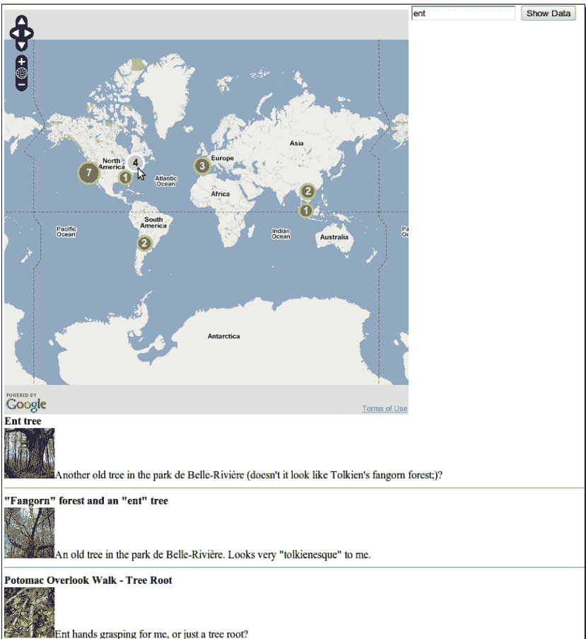

## 发生了什么？

我们刚刚更新了 Flickr 应用程序，以允许用户输入影响显示的数据。我们以一种模块化的方式完成了此操作——我们不必更改之前编写的任何代码。相反，我们只是更新了数据源并添加了额外功能。现在我们已经编写了一个应用程序，让我们谈谈如何部署它。

## 部署应用程序

部署 OpenLayers（或其他）应用程序意味着什么？基本上，部署某物意味着我们从开发模式切换到生产模式；我们将某物发布给全世界查看。

生产应用程序应尽可能快速且无错误。由于我们希望生产版本能够尽可能快速地访问，这通常包括移除我们在开发环境中使用的东西，并调整生产环境以更好地处理大量用户。这也意味着使用尽可能小的文件。部署应用程序时我们应该做的第一件事之一是使用 OpenLayers 构建脚本创建一个文件大小更小的库文件。


> 我们还可以做很多其他事情来更好地准备生产环境，例如使用缓存以及合并和最小化我们的 JavaScript 文件。这些和其他实践超出了本书的范围，但可以在本书网站 http://vasir.net/ 上找到更多信息。

## 构建 OpenLayers 库文件

OpenLayers 提供了一种简单的方法来配置包含在页面中的库文件。在整本书中，我们一直包含一个名为 `OpenLayers.js` 的文件，该文件包含 OpenLayers 提供的 *全部* 功能（类、函数等）。到目前为止，这很棒——我们一直开发到现在，所以我们希望确保能够访问我们可能使用的所有类。我的重点是什么？

## 始终尝试提供小文件

好吧，我们一直使用的 `OpenLayers.js` 文件大约为 920 KB！几乎达到一兆字节——这是一个相当大的文件，尤其因为它只包含 JavaScript 代码。尽管文件大小大不如几年前那样成为问题，当时每个人都使用较慢的连接，但在生产环境中，一个一兆字节的 JavaScript 文件是我们尽可能想要避免的。

我们希望生产环境中的所有文件尽可能小。这将允许用户更快地下载文件（因为需要下载的内容更少），从而减少页面的加载时间（节省带宽费用）。更快的页面加载（即使速度只是感知到的）将极大地提升用户体验。幸运的是，我们可以使用 OpenLayers 提供的构建工具大幅减小 OpenLayers 库文件的大小。

## 使用 OpenLayers 构建文件

当你下载 OpenLayers 归档文件时，其内部有一个名为 `build` 的文件夹。在其中，有一个名为 `build.py` 的文件，这是一个 python 脚本，它基于单独的构建配置文件创建 `OpenLayers.js` 文件。以这种方式构建库称为 **单文件构建**，因为 OpenLayers 背后的所有 JavaScript 代码都包含在一个文件中。

因此，我们可以告诉构建脚本创建一个 `OpenLayers.js` 文件，其中仅包含我们的应用程序需要的类。这意味着我们无法访问其他类，但在生产环境中我们不需要这样做，因为代码不会更改——那是开发的目的。这样做的益处在于，如果文件中的代码更少，文件大小就会更小。

## 配置构建脚本

当构建脚本运行时，它会查找配置文件以确定在创建 `OpenLayers.js` 文件时包含和排除哪些类。OpenLayers 默认附带两个配置文件：

- **full.cfg:** 导致构建脚本包含所有内容
- **lite.cfg:** 仅包含创建 WMS 或切片图层所需的最小类数，且不包含控件

你可以通过复制其中一个文件并指定要包含的文件来创建自己的文件。在创建自己的构建配置文件时，你必须至少包含来自 `full.cfg` 或 `lite.cfg` 文件中标记为 `[first]` 的部分。

`[include]` 部分指定应添加到 `OpenLayers.js` 输出文件中的文件。如果留空，则会包含 *全部* 文件。否则，只有在此部分指定的文件才会被包含。要了解此处应包含哪些文件，请查看你的代码，每当你看到对类的引用（例如，在调用 `new OpenLayers.Classname` 时），就意味着你需要在此处包含该类。

> 构建脚本会自动查找类依赖项，因此你无需指定父类。例如，如果你想包含单个控件类，你可以指定该类名，构建脚本将自动包含基础 `Control.js` 文件。

如果 `[include]` 部分留空，则会读取 `[exclude]` 部分。这些是*不会*包含在最终构建文件中的类。然而，如果你在 `[include]` 部分指定了类，则该部分将被忽略，并且只有 `[include]` 部分中的类才会被包含。

## 动手实践 – 构建配置文件

让我们看看如何编写构建配置文件。

- 1. 复制 build 目录中找到的 `lite.cfg` 文件，并将复制版本命名为 `example_1.cfg`（或你喜欢的任何名称，但我们将称其为此）。
- 2. 让我们手动指定一些文件。我们将添加几个控件。添加以下内容然后保存文件。完整文件应如下所示：

```
# Config File
[first]
OpenLayers/SingleFile.js
OpenLayers.js
OpenLayers/BaseTypes.js
OpenLayers/BaseTypes/Class.js
OpenLayers/Util.js
[last]
[include]
OpenLayers/Map.js
OpenLayers/Layer/WMS.js
OpenLayers/Control/LayerSwitcher.js
OpenLayers/Control/Navigation.js
OpenLayers/Control/Scale.js
[exclude]
```

## 发生了什么？

我们刚刚为构建创建了一个名为 `example_1.cfg` 的配置文件。我们将使用此文件来构建 `OpenLayers.js` 文件。请注意，我们不必包含基础 `Control.js` 类——构建脚本会自动查找并包含依赖项。

## 小测验 – 使用构建脚本

现在你知道了如何使用构建脚本，你能想出一些使用它的理由吗？你认为使用它的好处是什么？使用它的缺点会是什么？


## 运行构建脚本

为了构建 `OpenLayers.js` 文件，我们必须运行 `build.py` 脚本。这需要在你的电脑上安装 Python，可免费从 `http://www.python.org/` 下载——下载 2.6 或 2.7 版本即可。

当脚本运行时，它会查找配置文件并根据配置文件构建一个合并的 `OpenLayers.js` 文件。它会自动包含类依赖项。最后，它还会 `minify`（删除空白和不必要的字符）合并后的 JavaScript 代码，并在构建目录中创建 `OpenLayers.js` 文件。从那里，你可以复制该文件并在生产代码中使用。

运行脚本，在 Linux 上你只需 `cd` 进入目录并运行：

```
./build.py config_file.cfg
```

其中 `config_file.cfg` 是可选的。如果未包含，则将使用 `full.cfg` 文件。

在 Windows 上，你可以使用命令提示符 `cd` 进入目录并以相同方式运行构建文件。你也可以点击开始然后选择运行，并从 Windows 资源管理器的地址栏复制 `build.py` 文件的位置并粘贴，同时加上配置文件名。例如，

```
c:\users\your_name\Download\OpenLayers\build\build.py config_file.cfg
```

### 动手时间 – 运行构建脚本

现在让我们看看如何运行脚本。

- 1. 使用我们在前一个示例中创建的配置文件执行构建脚本。根据你的操作系统（参考我们刚才讨论的命令）：
- `./build.py example_1.cfg`
- 2. 运行命令后你应该会看到输出，告知脚本正在做什么。在这种情况下，它合并了总共 34 个文件，最终文件大小略高于 160 KB。这比原来的 920 KB *大幅* 减少！

### 发生了什么？

我们刚刚运行了构建脚本并生成了 `OpenLayers.js` 文件。根据你的应用程序，你会创建构建脚本并指定代码使用的类。然后，你将使用该配置文件运行构建脚本，并将输出的 `OpenLayers.js` 文件复制到你的生产代码库中。

这样做可以减少用户等待页面加载的时间，因为文件大小会更小，下载所需时间更短。

## 总结

你已经读完了本书！在本章中，我们构建了一个简单的 Web 地图应用程序，可根据用户输入获取 Flickr 数据。我们在整章中涵盖了一些开发概念，例如尝试保持代码模块化。我们学习了如何与其他第三方 API 交互，并从头构建了一个应用程序。最后，我们讨论了部署并学习了如何使用 OpenLayers 构建脚本。现在你已经读完这本书（我希望你喜欢它），你应该能够去制作自己的令人印象深刻的 Web 地图！

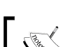

> 本书中的所有代码示例，以及更多部署和 JavaScript 优化技术等，都可以在本书网站 http://vasir.net/openlayers_book/ 找到。

## 测验答案

### 第 2 章：使用 Firebug 消除错误

答案：2

### 第 3 章：OpenLayers 中的“图层”

答案：4。因为变量 b 不能在 test 函数外部访问，所以会出现错误。

### 第 4 章：理解投影

答案：其他投影有用的原因多种多样。其他投影保留不同的属性，如果你的地图旨在显示近距离区域，你可能希望使用不同的投影。EPSG:4326 投影不适合显示接近极点的地点。

### 第 6 章：控制控件

答案：3—TYPE TOOL

### 第 7 章：样式化控件

答案：访问该元素的方法不计其数，这里只是几种可能的方式：

- #inner_most
- #outer_div .paragraph_style #middle_div #inner_most
- div p div span
- #outer_div p #middle_div #inner_most
- div #inner_most

### 第 8 章：绘制地图类

答案：几种可能的方式是使用 `map.setCenter(new OpenLayers.LonLat(-42,52))`、`map.panTo(new OpenLayers.LonLat(-42,52))`，或创建一个包含坐标的边界对象并调用，例如：`map.zoomToExtent(new OpenLayers.Bounds(-43, 51, -41, 53))`。

### 第 9 章：使用矢量图层

答案：其实没有“正确答案”。任何涉及客户端与数据交互的应用程序都是矢量图层的绝佳用例。例如，映射房屋并显示其信息的房地产网站就是矢量图层的绝佳用途。

### 第 10 章：矢量图层样式指南

答案：我们将设置 background 属性以包含阴影图像，并将 `externalGraphic` 属性设置为包含标记的图像。如果需要，我们还可以调整图像偏移以获得更逼真的效果。

### 第 11 章：制作 Web 地图应用

答案：任何数量的原因都是合理的，特别是涉及减少文件大小的原因。文件越小，用户下载文件越快。这也节省了带宽成本。唯一的缺点是，一旦构建脚本创建了文件，人类就更难阅读它。
