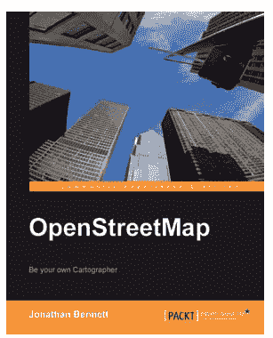
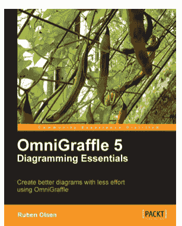

## 索引

A
绝对路径 19
activateControl 方法 156
activateControl() 方法 170
activate() 事件 168
activate() 函数，OpenLayers.Control 类 138
addControl 方法 163
addEventListener 方法 328
addLayer 函数 54
addLayers 函数 59
addOptions( options ) 函数 87
addUniqueValueRules 函数 290
addUniqueValueRules 方法 289, 290
alert() 函数 42
allOverlays 属性，Map 类
关于 193
使用 194-196
alpha，图层属性 67
animationEnabled，VirtualEarth 图层类属性 117
Apache，用于 Windows
下载 314
API 312
API 文档 28, 47
Application Programmer Interface。参见 API
ArcGIS 图层文档
参考链接 72
ArcGIS Server REST API
参考链接 72
面积，地图投影特征 90
argParser 控制 23
ArgParser 控制，OpenLayers.Control 子类 138, 139
参数 26
属性替换
关于 287
使用 287, 289
attributes 属性 323
Attribution 控制，OpenLayers.Control 子类
关于 139
div 属性 139
separator 属性 139
使用 140
attribution，图层属性 67
autoActivate 属性，OpenLayers.Control 类 137
B
基图层 51
BBOX 参数 41
beforefeatureadded 事件 246
Bing Maps 115
Bing（Microsoft）Maps 104
Bing/Virtual Earth 图层
创建 115-117
构建文件，OpenLayers
config 文件，构建 332
配置 331
构建脚本，OpenLayers
运行 333
特征，地图投影
面积 90
方位 91
方向 91
距离 91
比例尺 91
形状 91
类事件，矢量图层。参见 事件类型，矢量图层
关于 243
事件类型 244, 245
客户端 / 服务器模型，Web 地图应用程序 10
客户端端，OpenLayers 8
clone() 方法 222
Clustering 类 270
代码
JavaScript 对象表示法 21-24
逐行理解 18-21
工作 17
Comparison 类，Filter 类子类
关于 299
类型 300, 301, 302
类型，BETWEEN 300
类型，EQUAL_TO 301
类型，GREATER_THAN 301
类型，GREATER_THAN_OR_EQUAL_TO 301
类型，LESS_THAN 301
类型，LESS_THAN_OR_EQUAL_TO 302
类型，LIKE 302
类型，NOT_EQUAL_TO 302
Value 属性 300
console.log() 45
console 面板，Firebug
关于 35
API 文档 47
代码，执行 42, 43
console 日志区域 42
启用 35
输入区域 42
对象字面量，创建 43
使用 42
Constructor 55
Control 类 136
控制相关函数，Map 类
addControl () 209
addControls() 209
getControl () 209
getControlsByClass () 209
removeControl() 210
使用 210
控件
关于 130
添加到地图 130
ArgParser 控件 130
创建 159
Navigation 控件 130
OverviewMap 控件 130
面板控件 153
移除方式 136
ScaleLine 控件 130
在 OpenLayers 中使用 130
控件，添加到地图
使用 addControl() 方法 135, 136
使用 addControls() 方法 135, 136
创建地图，未使用控件 131, 132
方法 130
OpenLayers.Control.ArgParser 131
OpenLayers.Control.Attribution 131
OpenLayers.Control.Navigation 130
OpenLayers.Control.PanZoom 130
在控件数组中传递 135
步骤 132-134
控件，创建
Button 子类 159
Control.SelectFeature 类
关于 262
方法 264
属性 262
controls 属性，Map 类 193
控件类型，面板控件
OpenLayers.Control.TYPE_BUTTON 153
OpenLayers.Control.TYPE_TOGGLE 153
OpenLayers.Control.TYPE_TOOL 153
使用面板类 154-157
Panel 控件 157
坐标转换 99
CSS
关于 172
与 OpenLayers 180
编辑 172, 173
使用外部文件 176, 177
HTML 元素样式 174
继承，顺序 178
用途 172

在 HTML 中使用 175
在 Firebug 中查看 178
CSS 面板，Firebug 37
自定义按钮
其他控件类型 165
创建其他控件类型 165
要求 161
创建简单按钮 161-164
custom_button_func 函数 162
自定义投影
定义 102
## D
数据类型
关于 66
{Array} 66
{Boolean} 66
{Float} 66
{Integer} 66
{Object} 66
{OpenLayers.______} 66
{String} 66
deactivate() 函数，OpenLayers.Control 类 138
destroy() 函数，OpenLayers.Control 类 137
Dev 列表 28
不同投影
指定 94, 95
使用 93, 94
displayClass 属性，OpenLayers.Control 类 137
displayInLayerSwitcher 属性 61, 67
displayOutsideMaxExtent，图层属性 70
displayProjection 属性 121
displayProjection 属性，Map 类 194
distance 属性 308
div 属性，Map 类 194
div 属性，OpenLayers.Control 类 137
DOM（文档对象模型） 35
DOM（文档对象模型）元素 24
DOM 面板，Firebug 38
点表示法 44
draw() 函数，OpenLayers.Control 类 138
## E
EditingToolbar 125
EditingToolbar 控件，OpenLayers.Control 子类 141
EPSG 92
EPSG 代码 92
EPSG 代码，球面墨卡托 120
欧洲石油勘探集团。参见 EPSG
事件
关于 165
activate() 168
changelayer 事件 220
自定义事件 166
事件处理程序 166
事件监听器 165
moveend 事件 224
创建 TYPE_TOGGLE 控件 166-170
zoomend 219
eventListeners，图层属性 68
eventListeners 属性，Map 类 196
eventListeners 属性，OpenLayers.Control 类 137
事件对象
访问 218
处理地图事件 219, 220
事件
浏览器事件 215
事件对象 218
地图事件 215
地图事件，类型 216
使用地图事件 216-218
事件，图层属性 67
事件类型，矢量图层
关于 244
afterfeaturemodified 244
beforefeatureadded 244
beforefeaturemodified 244
beforefeatureremoved 244
beforefeaturesadded 244
beforefeaturesremoved 244
featureadded 244
featuremodified 244
featureremoved 245
featuresadded 244
featuresselected 245
featuresremoved 245
featureunselected 245
refresh 245
sketchcomplete 245
sketchmodified 245
sketchstarted 245
使用 246
vertexmodified 245
使用 247
示例，将其转换为应用程序
关于 318, 319
选择要素 319
添加交互性 319-325
Extent/Coordinate/Bounds 相关函数，
Map 类
关于 210
使用坐标相关函数 213
getCenter() 方法 211
getExtent() 方法 211
getMaxExtent() 方法 211
getMaxResolution() 方法 211
getNumZoomLevels() 方法 211
getResolutionForZoom() 方法 211
getResolution() 方法 211
getScale() 211
getZoomForExtent() 方法 211
getZoomForResolution() 方法 211
isValidLonLat() 方法 211
isValidZoomLevel() 方法 212
pan() 方法 212
panTo() 方法 212
zoomIn() 方法 212
zoomOut() 方法 212
zoomToExtent() 方法 212
zoomToMaxExtent() 方法 213
zoomTo() 方法 212
externalGraphic 属性 319
ExtJS
URL 189
extractAttributes 参数 323
## F
fallThrough 属性，Map 类 197
Feature 类
关于 248
函数 256
交互，使用 Control.SelectFeature 257
实例化对象 256
使用 SelectFeature 控件 257-262
子类 256
工作 255
要素 228
featureselected 事件 260
要素，OpenLayers 8
featureunselected 事件 260
订阅源 312
Filter 类
关于 299
要素 ID 303
逻辑 303
定位逻辑过滤器 304-307
Spatial 类 308
子类 299
过滤器
关于 295
使用 295-298
工作 295
Firebug
关于 32
使用控制台面板 42
控件 34
查看 CSS 178
下载 32
功能 32
查看 HTML 178
安装 33, 34
面板结论 41
设置 32
Firebug 控件
Firebug 图标 34
Page Inspector 图标 34
面板 34
Firebug 图标 34
Fixed strategy 类 267
Flickr
创建网络地图应用程序 312
获取 Flickr 数据
添加到地图 315, 316
减少错误 314
使用 extractStyles 317, 318
需求 314
步骤 313
Format 类
关于 266, 273
方法 273
属性 273
子类 274
format 参数 312
函数，Feature 类
clone() 256
destroy() 256
getVisibility() 256
move(location) 256
onScreen(boundsOnly) 256
函数，Map 类
关于 209
与控件相关 209
destroy() 214
Extent/Coordinate/Bounds 相关 210
getLonLatFromPixel() 214
getPixelFromLonLat() 215
与图层相关 214
render() 215
updateSize() 215
函数，OpenLayers.Control 类
activate() 138
deactivate() 138
destroy() 137
draw() 138
moveTo(location) 138
## G
GeoExt
URL 189
GeoJSON 格式 267
Geometry 类
关于 248, 249
方法 250, 251
使用方法 251-253
子类 249, 253
Geometry 类，子类
Geometry.Collection 254
Geometry.Curve 254
Geometry.LinearRing 254
Geometry.LineString 254
Geometry.MultiLineString 254
Geometry.MultiPoint 254
Geometry.MultiPolygon 255
Geometry.Point 253
Geometry.Polygon 255
方法 255
Geometry.LineString 类 253
geometry 属性 232
getVisibility() 函数 87
GitHub 29
Google 图层属性
关于 108
sphericalMercator {Boolean} 109
type {GmapType} 109
V2 GMapType 值 110
V3 GMapType 值 109
Google 地图图层
使用 V2 创建 111, 113
Google 地图图层对象
创建 108
Google Maps
关于 103, 104
Google 图层属性 108
创建 Google 地图图层对象 108
URL 104
使用 105, 123
V2 和 V3，差异 105
使用 V3 105, 106, 108
Google Maps API 11
Google Maps 图层
创建 73, 74
Google Maps V2
文档 105
Google Maps V3
文档 105
使用 105
Graticle 控件，OpenLayers.Control 子类
关于 141
displayInLayerSwitcher 属性 142
intervals 属性 142
labeled 属性 142
labelFormat 属性 142
labelSymbolizer 属性 142
layerName 属性 142
lineSymbolize 属性 142
numPoints 属性 142
targetSize 属性 142
visible 属性 142
gutter，图层属性 68
## H
HTML
元素 173
使用 CSS 样式化元素 174
目的 172
在 Firebug 中查看 178
HTML，元素
类 174
ID 173
HTML Inspector，Firebug 控件 34
HTML 面板，Firebug
关于 35
内容 36
工作 36
HTTP 协议类 267
## I
id 属性，OpenLayers.Control 类 137
图像图层
使用 76, 77
图像图层参数
extent 78
name 77
options 78
size 78
url 77
imageOffset，图层属性 67
继承，CSS
关于 178
引用元素 179
顺序 178
init() 函数 20, 23
inRange，图层属性 67
意图
默认 281
选择 281
临时 281
Internet Relay Chat。参见 IRC
IRC 29
isBaseLayer，图层属性 67
isBaseLayer 属性 51
迭代开发 312
## J
JavaScript
目的 172
JavaScript 文档
参考链接 9
## K
键
g 键 313
ID 键 313
tags 键 313
KeyboardDefaults 控件，OpenLayers.Control
子类
关于 143
slideFactor 属性 143
## L
纬度 96
Layer.ArcGIS93Rest 类 72
Layer.ArcIMS 类 73
Layer 类 20, 136
Layer 类
关于 50
基础图层 51
Layer.ArcGIS93Rest 72
Layer.ArcIMS 73
Layer.Google 73
Layer.Google 类 72
Layer.Grid 75
Layer.Image 76
Layer.MapGuide 78
Layer.TileCache 79
Layer.Vector 79
Layer.VirtualEarth 79
Layer.WFS 80
Layer.WMS 80
Layer.Yahoo 80
覆盖图层 51
Layer 类方法
关于 85
定义 86
定义全局图层对象变量 85
Layer.Google 类
关于 73
创建 Google Maps 图层 73, 74
Layer.Grid 类 75
Layer.Image 类
关于 76
创建基于图像的地图 78
图像图层参数 78
使用图像图层 76, 77
Layer.MapGuide 类 78
图层对象
访问 80
在 Firebug 中访问 82
创建 54
访问 map.layers 80, 81
参数与参数的区别 57
WMS 图层对象 55
图层选项
配置 61
wms_layer_labels 图层选项 62
wms_state_lines 图层选项 61
图层属性。另请参见 OpenLayers.Layer 类属性
关于 65
访问 82
通过 map.layers 访问 82
数据类型 66
OpenLayers.Layer 类属性 66
与图层对象一起存储引用 83
图层相关函数，Map 类
addLayer() 214
addLayers() 214
getNumLayers() 214
raiseLayer() 214
removeLayer() 214
图层 11, 50
layers 属性，Map 类 197
Layer 子类 71
Layer 超类 72
图层切换器控件 52
LayerSwitcher 控件，OpenLayers.Control 子类
关于 143
ascending 属性 143
div 属性 143
maximizeControl() 函数 144
minimizeControl() 函数 144
roundedCorner 属性 143
样式 186-188
Layer.TileCache 类 79
Layer.Vector 类 79
Layer.VirtualEarth 类 79
Layer.WFS 类 80
Layer.WMS 类 80
Layer.Yahoo 类 80
## M
Madlibs
关于 25
玩 25
地图
关于 19
创建 15-17
Map 类
关于 20, 191, 192
函数 209
创建 Map 对象 192
属性 193
地图事件，类型
addlayer 216
changebaselayer 216
changelayer 216
使用 eventListeners 属性 217
使用 map.events.register 218
mousemove 216
mouseout 216
mouseover 216
move 216
moveend 216
movestart 216
preaddlayer 216
removelayer 216
使用 216
zoomend 216
map.functionname() 47
地图，图层属性 67
地图 mashup 104
地图投影
关于 90
特征 90
EPSG 代码 92
经度/纬度 95
转换 99
类型 92
使用 90

## 地图投影，类型
-   关于 92
-   圆柱投影 92
-   等面积投影 92
-   墨卡托投影 92
## 地图属性，球面墨卡托图层
-   关于 122
-   maxExtent 122
-   maxResolution 122
-   projection 123
-   units 123
## map.zoomToMaxExtent() 函数 23
## 混搭
-   关于 104
-   创建 124, 125
## maxExtent，图层属性 70
## maxExtent 属性 122
## maxExtent 属性，Map 类
-   设置 199, 200
## maxExtent 属性，Map 类 198
## maxResolution，图层属性 70
## maxResolution 属性 122
## MaxScale，图层属性 70
## maxScale 属性 204
## metadata，图层属性 71
## 方法
-   activateControl 156
-   addControl 163
-   addEventListener 328
-   addUniqueValueRules 290
-   clone() 222
-   refresh() 327
## 方法，Control.SelectFeature 类
-   activate() 264
-   deactivate() 264
-   highlight() 264
-   select() 264
-   unhighlight() 264
-   unselect() 264
-   unselectAll() 264
## 方法，Format 类
-   read(data) 273
-   write(features) 273
## 方法，Geometry 类
-   atPoint() 250
-   calculateBounds() 250
-   clearBounds() 250
-   clone() 250
-   destroy() 250
-   distanceTo() 250
-   extendBounds() 250
-   getArea() 250
-   getBounds() 250
-   getCentroid() 251
-   getLength() 251
-   getVertices() 251
-   toString() 251
-   使用 251-253
## 方法，projection 类
-   addTransform(from, to, method) 98
-   getCode() 98
-   getUnits() 98
-   transform(point, source, destination) 98
## Microsoft 映射 API
-   关于 115
-   Bing/Virtual Earth Layer，创建 116, 117
## minExtent 属性，Map 类 198
## minScale，图层属性 70
## 模块化编程 312
## MousePosition 控制，OpenLayers.Control 子类
-   关于 144
-   displayProjection 属性 145
-   div 属性 145
-   emptyString 属性 144
-   numDigits 属性 144
-   prefix 属性 144
-   separator 属性 144
-   suffix 属性 144
## moveend 事件 224
## moveTo(location) 函数，OpenLayers.Control 类 138
## 多个基础图层 51
## multipleKey 属性 260
## 多个地图对象
-   关于 220
-   自定义事件应用，创建 223, 224
-   使用 221, 222
## N
## Nabble 28
## name 参数，WMS 图层参数
## Navigation 控制，OpenLayers.Control 子类
-   关于 145
-   autoActivate 属性 145
-   documentDrag 属性 145
-   handleRightClicks 属性 145
-   zoomWheel 属性 145
## NavigationHistory 控制，OpenLayers.Control 子类
-   关于 146
-   limit 属性 146
-   nextStack 属性 146
-   nextTrigger() 函数 146
-   previousStack 属性 146
-   previousTrigger() 函数 146
-   使用 146, 147
## NavToolbar 控制，OpenLayers.Control 子类 147
## Net 面板，Firebug
-   关于 38, 39
-   请求列表 39
## numZoomLevels，图层属性 70
## numZoomLevels 属性 23
## numZoomLevels 属性，Map 类
-   关于 199
-   设置 199, 200
## O
## 对象字面量
-   关于 44
-   创建 43
-   函数，实验 47
-   地图，交互 45, 46
## 面向对象编程。参见 OOP
## OOP
-   关于 24
-   Madlibs 25
-   对象，交互 25
-   编程 26
-   子类 26
## OOP 编程 26
## opacity 属性 62
## 开放地理空间联盟 (OGC) 20
## OpenLayers
-   关于 7, 171
-   和 CSS 180
-   API 文档 28
-   应用，部署 330
-   错误，使用 Firebug 修复 31
-   客户端 8
-   控制，使用 130
-   特性 8
-   Layer 类 50
-   图层属性 65
-   图层 11
-   库 9
-   库文件，构建 330
-   Map 类 192
-   地图，创建 15-17
-   地图切片策略 63
-   地图标题 62
-   关联，到 API 11
-   资源，求助 28
-   样式，使用主题 180
-   主题，创建 181
-   第三方 API，使用 104
-   URL 8
-   Vector 图层 228
## OpenLayers.Bounds 类 198
## OpenLayers.Bounds 对象 198
## OpenLayers.Control 类
-   函数 137
-   属性 137
## OpenLayers.Control，子类
-   ArgParser 控制 138, 139
-   Attribution 控制 140, 141
-   Control.Scale 控制 151
-   EditingToolbar 控制 141
-   Graticule 控制 141
-   KeyboardDefaults 控制 143
-   LayerSwitcher 控制 144
-   MousePosition 控制 144
-   Navigation 控制 145
-   NavigationHistory 控制 146
-   NavToolbar 控制 147
-   OverviewMap 控制 147
-   PanPanel 控制 150
-   PanZoomBar 控制 151
-   PanZoom 控制 151
-   Permalink 控制 139
-   ScaleLine 控制 152
-   ZoomPanel 控制 153
## OpenLayers.Filter 类 275。参见 Filter 类
## OpenLayers.Layer 类
-   关于 71
-   子类 71
-   超类 72
## OpenLayers.Layer 类属性
-   关于 66
-   alpha 67
-   attribution 67
-   displayInLayerSwitcher 67
-   displayOutsideMaxExtent 70
-   eventListeners 68
-   events 67
-   gutter 68
-   imageOffset 67
-   inRange 67
-   isBaseLayer 67
-   map 67
-   maxExtent 70
-   maxResolution 70
-   MaxScale 70
-   metadata 71
-   minScale 70
-   修改 71
-   numZoomLevels 70
-   options 68
-   projection 69
-   resolutions 69
-   scales 69
-   SUPPORTED_TRANSITIONS 71
-   transitionEffect 71
-   units 69
-   visibility 67
-   wrapDateLine 70
## OpenLayers.Layer 对象
-   关于 56
-   isBaseLayer 属性 56
-   opacity 属性 56
-   visibility 属性 56
## OpenLayers.Layer.Vector。参见 Vector Layer
## OpenLayers.Layer.Vector 方法
-   关于 237
-   addFeatures(features, options) 函数 237
-   assignRenderer() 237
-   clone() 237
-   destroyFeatures(features, options) 239
-   displayError() 237
-   drawFeature(feature, style) 241
-   eraseFeatures(features) 241
-   特性事件，操作 242, 243
-   特性，添加 237, 238
-   特性，销毁 239, 241
-   getDataExtent() 237
-   getFeatureByFid(featureFid) 241
-   getFeatureById(featureId) 241
-   getFeatureFromEvent(event) 242
-   onFeatureInsert(feature) 242
-   preFeatureInsert(feature) 242
-   refresh() 237
-   removeAllFeatures( options) 239
-   removeFeatures() 239
## OpenLayers.Layer.Vector 属性，Vector Layer 类
-   关于 235
-   drawn: {Boolean} 235
-   filter: {OpenLayers.Filter} 235
-   isFixed: {Boolean} 235
-   isVector: {Boolean} 236
-   protocol: {OpenLayers.Protocol} 236
-   rendererOptions: {Object} 236
-   renderers: {Array[String]} 236
-   reportError: {Boolean} 236
-   selectedFeatures: {Array{OpenLayers.Feature.Vector}} 236
-   strategies: {Array{OpenLayers.Strategy}} 236
-   styleMap: {OpenLayers.StyleMap} 236
-   style: {Object} 236
-   unrenderedFeatures: {Object} 236
## OpenLayers 库
-   下载 13
## OpenLayers.LonLat 类 210
## OpenLayers 邮件列表
-   关于 28
-   Dev 列表 28
-   Users 列表 28
## OpenLayers 地图
-   关于 63-65
-   交互 45, 46
## OpenLayers.Map 类 20
## OpenLayers.Pixel 对象 138
## OpenLayers.Rule 类。参见 Rule 类
## OpenLayers 源代码仓库 29
## OpenLayers 网站 12
## OpenStreetMap
-   关于 104, 118
-   参考链接 118
-   设置 118
## OpenStreetMap 图层
-   创建 118, 119
-   OSM 瓦片，访问 119
## options，图层属性 68
## options 对象 21, 22
## options 参数 239
## options 参数，WMS 图层参数
-   关于 56, 57
-   配置 58, 59
## 覆盖图层
-   关于 51
-   地图，使用多个图层创建 51, 53
## OverviewMap 控制，OpenLayers.Control 子类
-   关于 147
-   autoPan 属性 150
-   div 属性 150
-   layers 属性 148
-   mapOptions 属性 150
-   maximizeControl() 函数 150
-   maxRatio 属性 149
-   minimizeControl() 函数 150
-   minRatio 属性 149
-   minRectDisplayClass 属性 149
-   minRectSize 属性 148
-   size 属性 148
## P
## 面板控制
-   关于 153
-   activateControl( {OpenLayers.Control} ) 函数 159
-   Activate() 函数 159
-   autoActivate 属性 158
-   controls 属性 158
-   控制类型 153
-   defaultControl 属性 158
-   saveState 属性 158
## 面板，Firebug
-   关于 34
-   console 面板 35
-   CSS 面板 37
-   DOM 面板 38
-   HTML 面板 35
-   Net 面板 38
-   script 面板 37, 38
## panMethod 属性 206, 207
## PanPanel 控制，OpenLayers.Control 子类
-   关于 150
-   slideFactor 属性 151
## PanZoomBar 控制，OpenLayers.Control 子类
-   关于 151
-   div 属性 151
-   zoomWorldIcon 属性 151
## PanZoom 控制 17
## PanZoom 控制，OpenLayers.Control 子类 151
## 参数
-   与 arguments 对比 57
## 参数，projection 类
-   options 97
-   projectionCode 97
## params 参数，WMS 图层参数
-   关于 56
-   可能的键和值 56
## Params 选项卡 39
## Permalink 控制，OpenLayers.Control 子类 139
## preload 属性 275
## Proj4js 库
-   关于 100, 101
-   下载 101
-   设置 101
-   URL 100
## projection 90
## projection 类
-   关于 97
-   方法 98
-   projection 对象，创建 97
## projection，图层属性 69
## projection 对象
-   创建 97
-   函数 98
-   参数 97
## projection 属性 123
## projection 属性，Map 类 208
## projection 转换
-   坐标转换 99
-   处理 99

属性，Control.SelectFeature 类
box 262
box: {Boolean} 262
clickout: {Boolean} 263
geometryType: {Array{String}} 263
handlers: {Object} 263
highlightOnly: {Boolean} 263
hover: {Boolean} 263
layer: {OpenLayers.Layer.Vector} 263
multiple: {Boolean} 263
multipleKey: {String} 263
onBeforeSelect: {Function} 263
onUnselect: {Function} 263
renderIntent: {String} 263
selectStyle: {Object} 263
toggle: {Boolean} 263
toggleKey: {String} 264
属性，Format 类 273
关于 273
externalProjection: {OpenLayers.Projection} 273
属性，Map 类
allOverlays 193
controls 193
displayProjection 194
eventListeners 196
fallThrough 197
layers 197
maxExtent 198
maxResolution 202, 203
maxScale 204
minExtent 198
minResolution 202, 203
minScale 204
numZoomLevels 199
panDuration 207
panMethod 206
projection 208
resolutions 200
restrictedExtent 198
scales 204
theme 208
tileSize 208
unit 208
属性，OpenLayers.Control 类
autoActivate 137
displayClass 137
div 137
eventListener 137
id 137
title 137
type 137
Protocol 类 266
ProxyHost
动态数据，获取 325, 326

## R
实时数据，使用
使用 ProxyHost 325
redraw() 函数 87
refresh() 方法 327
相对路径 19
渲染意图。参见 intent
请求列表，Firebug Net 面板
关于 39
BBOX 参数 41
参数 40
resolutions，图层属性 69
resolutions 属性，Map 类
关于 200
resolutions 数组，设置 201
资源，用于帮助
书籍网站 28
IRC 29
邮件列表 28
Response 选项卡 39
restrictedExtent 属性，Map 类 198
Rule 类 298
规则
使用 295-298
工作 295

## S
可缩放矢量图形。参见 SVG
Scale 控制，OpenLayers.Control 子类
关于 151
geodesic 属性 152
比例尺依赖 61
ScaleLine 控制，OpenLayers.Control 子类
关于 152
bottomInUnits 属性 152
bottomOutUnits 属性 152
div 属性 152
geodesic 属性 152
maxWidth 属性 152
topInUnits 属性 152
topOutUnits 属性 152
比例尺，地图投影特征 91
scales，图层属性 69
脚本面板，Firebug 37, 38
setIsBaseLayer( is_base ) 函数 87
setName( newName ) 函数 86
setOpacity( opacity ) 函数 88
setVisibility() 函数 61, 87
形状，地图投影特征 91
单文件构建 331
sketchstarted 事件 247
Spatial 类，类型
  OpenLayers.Filter.Spatial.BBOX 308
  OpenLayers.Filter.Spatial.CONTAINS 308
  OpenLayers.Filter.Spatial.DWITHIN 308
  OpenLayers.Filter.Spatial.INTERSECTS 308
  OpenLayers.Filter.Spatial.WITHIN 308
Spherical Mercator
  关于 108, 120
  EPSG 代码 120
  使用 121
sphericalMercator {Boolean} 109
Spherical Mercator 图层
  地图属性 122
sphericalMercator 属性 121
SRS 代码 97
stateboundary 图层 58
Strategy.BBOX 类 266
Strategy 类
  关于 228, 266, 274
  Strategy.BBOX 274
  Strategy.Cluster 274
  Strategy.Filter 275
  Strategy.Fixed 275
  Strategy.Paging 275
  Strategy.Refresh，方法 275
  Strategy.Save 276
Style 类
  关于 281
  symbolizer 281
  symbolizer 属性 282
StyleMap 类
  关于 281
  default intent 281
  select intent 281
  temporary intent 281
style 属性 318
样式应用，Vector Layer
  intents，使用 278
  步骤 279, 280
  StyleMap，使用 278
  symbolizer 278
  方法 278
子类
  关于 26
  示例 26
  GoogleMap Layer 类 27
  Navigation 控制 类 27
子类，Filter 类
  Comparison 类 299
  FeatureId 300
SUPPORTED_TRANSITIONS，图层属性 71
SVG 233
symbolizer_lookup 参数 291
symbolizer 属性，Style 类
  backgroundGraphic 286
  backgroundGraphicZIndex 286
  backgroundHeight 286
  backgroundWidth 286
  backgroundXOffset 286
  backgroundYOffset 286
  cursor 282
  display 286
  示例 284, 285
  externalGraphic 286
  fill 286
  fillColor 282
  fillOpacity 283
  fontColor 283
  fontOpacity 283
  fontSize 283
  fontWeight 283
  graphic 286
  graphicHeight 286
  graphicName 283
  graphicOpacity 286
  graphicTitle 286
  graphicWidth 286
  graphicXOffset 286
  graphicYOffset 286
  graphicZIndex 287
  label 283
  labelAlign 283
  labelSelect 283
  labelXOffset 283
  labelYOffset 283
  pointRadius 283
  rotation 287
  stroke 283
  strokeColor 284
  strokeDashstyle 284
  strokeLinecap 284
  strokeOpacity 284
  strokeWidth 284

## T
theme 属性，Map 类 208
主题，OpenLayers
  类名 181
  controls，样式 182-185
  创建 181
  生成的类名 181
  生成的 ID，方法 182
  ID 181
  LayerSwitcher 控制，样式 186-188
  NavToolbar 控制，样式 183, 184
第三方地图 API
  关于 103
  Google Maps 104
  地图 mashup 104
  Microsoft 地图 API 115
  OpenStreetMap 118
  Spherical Mercator 120
  Yahoo! Maps API 113
threshold 参数 274
tileSize 属性，Map 类 208
title 属性，OpenLayers.Control 类 137
toggle_button_activate_func 函数 169
toggle_button_deactivate_func 函数 169
transform() 函数 100
transitionEffect
  resize 属性 59
transitionEffect，图层属性 71
trigger 函数 162
type {GmapType} 109
type 属性，OpenLayers.Control 类 137

## U
unit 属性，Map 类 208
units，图层属性 69
units 属性 123
update_vector_layer 函数 328
URL 参数，WMS 图层参数 55
用户列表 28

## V
V2 GMapType 值 110
V3 GMapType 值 109
Vector Layer
  关于 79, 228, 230
  类事件 243
  创建 230-232
  EditingToolbar 控制，添加 231
  features 229
  对象，Features 228
  概述 227
  渲染，使用 Canvas 渲染器 233
  渲染，使用 SVG 渲染器 233
  渲染，使用 VML 233
  样式 277
  用途 229
  使用，作为客户端 229
  使用，不使用 Protocol 类 270
  vector 230
  工作 232
Vector Layer 类
  关于 235, 264
  类，相互交互 267
  跨服务器请求 269
  示例实例化 267
  Format 类 266
  OpenLayers.Layer.Vector 方法 237
  OpenLayers.Layer.Vector 属性 235
  概述 265
  Protocol 类 266
  proxy host，使用 270
  Strategy 类 266
  Vector Layer，创建 268
Vector Layer，样式
  样式，应用 278
Vector Layer 使用，不使用 Protocol 类
  Format 类，单独使用 270, 272
  步骤 270
Strategy 类，单独使用 270, 272
Vector Layer，工作
  关于 232
  Renderers 数组 233
  Renderers 数组，更改 234
  渲染步骤 233
VirtualEarth 115
VirtualEarth 图层类属性
  关于 117
  type 值 118
visibility，图层属性 62, 67

## W
web map 应用
  创建，使用 Flickr 312
  动态标签，添加 327, 329
  收尾 326, 327
web map 应用创建，使用 Flickr
  APIs 312
  数据，访问 313
  公共数据 feed，访问 312, 313
web map 客户端 10
web mapping 应用
  关于 9
  Client / Server 模型 10
  缺点 11
  web map 客户端 10
  web map 服务器 10, 11
web map 服务器 10, 11
Web Map Service 20
Well Known Identifier (WKID) 97
WFS (Web Feature Service) 80
WKT (Well-Known Text) 251
WMS 80
wms_base_layer 图层 55
wms_base 图层对象 54
WMS 类
  参数 55
wms_layer_labels 图层选项
  关于 62
  opacity 属性 62
  visibility 属性 62
WMS 图层对象
  关于 22
  创建 55
WMS 图层参数
  关于 55
  name 55
  options 56
  params 56
  URL 55
WMS 服务
  使用 127
wms_state_lines 图层选项
  配置 61
  displayInLayerSwitcher 属性 61
  maxScale 属性 61
  minScale 属性 61
  比例尺依赖 61, 62
WMS 子类 20
WMS 与 Spherical Mercator/第三方地图图层 127
wrapDateLine，图层属性 70

## X
Xampp on Windows 315

## Y
Yahoo! Maps API
  关于 104, 113
  Yahoo! Maps Layer 类，使用 113, 114
Yahoo! Maps Layer 类
  使用 113, 114
Yahoo! Maps Layer 类属性
  关于 115
  Yahoo! Maps Layer 类型 115
Yahoo! Maps Layer 类型
  关于 115
  YAHOO_MAP_HYB 115
  YAHOO_MAP_REG 115
  YAHOO_MAP_SAT 115

## Z
ZoomBox 控制 153
zoomend 事件 219
ZoomPanel 控制，OpenLayers.Control 子类
  ZoomIn 153
  ZoomOut 153
  ZoomToMaxExtent 153

## 感谢您购买
OpenLayers 2.10 初学者指南

## 关于 Packt 出版社

Packt，发音为 'packed'，于 2004 年 4 月出版了其第一本书 "Mastering phpMyAdmin for Effective MySQL Management"，随后继续专注于出版针对特定技术和解决方案的高度聚焦的书籍。

我们的书籍和出版物分享了您同行的 IT 专业人士在适应和定制当今系统、应用程序和框架方面的经验。我们的解决方案型书籍为您提供了定制正在使用的软件和技术的知识和能力，以完成工作。与您过去看到的 IT 书籍相比，Packt 的书籍更具体、更少泛泛而谈。我们独特的商业模式使我们能够提供更聚焦的信息，让您了解更多所需的内容，减少不必要的内容。

Packt 是一家现代且独特的出版公司，专注于为开发人员、管理员和新手等社区生产优质的前沿书籍。如需了解更多信息，请访问我们的网站：www.packtpub.com。

## 关于 Packt 开源

2010 年，Packt 推出了两个新品牌 Packt Open Source 和 Packt Enterprise，以继续专注于专业化。本书是 Packt Open Source 品牌的一部分，该品牌是出版围绕开源许可构建的软件书籍的家园，并为从高级开发人员到初出茅庐的网页设计师的任何人提供信息。开源品牌还运营着 Packt 的开源版税计划，Packt 会向其书籍所介绍的软件所属的每个开源项目支付版税。

## 为 Packt 撰稿

我们欢迎所有有兴趣撰稿的人的咨询。书稿提案应发送至 author@packtpub.com。如果您的书稿想法仍处于早期阶段，并且您希望在撰写正式书稿提案之前先进行讨论，请联系我们；我们的约稿编辑会与您联系。

我们不仅寻找已出版的作者；如果您具有强大的技术技能但没有写作经验，我们经验丰富的编辑可以帮助您发展写作事业，或为您提供专业知识的额外回报。

## [PACKT] 出版
开源
社区经验提炼

## OpenStreetMap

ISBN: 978-1-84719-750-4      平装版：252 页

做你自己的制图师

- 1. 使用这本 OpenStreetMap 书籍和电子书收集您想要绘制地图的区域的数据
- 2. 按照我们经过验证的教程创建自己的自定义地图以便打印或在线使用
- 3. 与其他 OpenStreetMap 贡献者合作以改进地图数据

## OmniGraffle 5 图表绘制精要

ISBN: 978-1-84969-076-8      平装版：380 页

使用 OmniGraffle 以更少的努力创建更好的图表

- 1. 制作高质量、专业外观的图表，其传达信息的能力远胜于文字
- 2. 让 Macintosh 用户的图表绘制变得有趣且简单
- 3. 精通用 OmniGraffle 阐释想法的艺术
- 4. 学习绘制引人入胜的图表和图形，以吸引观众对您演示文稿的注意力

请访问 www.PacktPub.com 了解我们的图书信息
