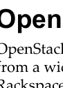

## 介绍 OpenStack

在 2015 年 5 月的温哥华 OpenStack 大会上，美国零售巨头沃尔玛宣布，他们已部署了一个 OpenStack 云，拥有 140,000 个计算核心，在网络星期一支持了 15 亿次页面浏览。长期使用 OpenStack 的 CERN 宣布，他们的 OpenStack 私有云已扩展到 10 万个核心，在生产环境中运行了两拍字节磁盘上的计算工作负载。另有 250 家公司和组织在九个行业领域宣布已在其数据中心采用 OpenStack。

OpenStack 在其短短五年的存在中完全重绘了私有云格局。在本章中，我们将了解 OpenStack 是什么以及它为何如此有影响力。我们还将迈出设计云架构的第一步。

## 什么是 OpenStack？

OpenStack 最好通过其用例来定义，因为用户和贡献者带着许多不同的目标来使用该软件。对于 Rackspace 等托管提供商而言，OpenStack 提供了多租户共享服务平台的基础设施。对于其他人来说，它可能为分布式商业智能应用程序提供数据和计算的配置机制。无论您组织的用例如何，以下几个答案都相关。

## OpenStack 是一个 API

OpenStack 的最初目标之一是提供与 Amazon Web Service 的应用程序编程接口（API）兼容性。根据 2014 年 11 月的用户调查，44% 的生产部署仍在使用 EC2 兼容性 API 与系统交互。随着平台受欢迎程度的提高，OpenStack API 本身已成为事实上的标准。因此，我们与之合作创建 OpenStack 云的许多企业组织都将其用作一个或多个平台即服务或混合云部署的基础设施即服务层。

OpenStack 的每个功能或功能都通过其 REST API 之一公开。OpenStack 有命令行界面（旧版 nova 和更新的 openstack 常用客户端）以及标准 Web 界面（Horizon）。然而，组件与最终用户之间的大多数交互都是通过 API 进行的。这具有以下优势：

- 系统中的一切都可以自动化
- 与其他系统的集成定义明确
- 用例可以明确定义并自动测试



API 是定义明确且版本化的 REST API，并且有超过十几种编程语言的原生客户端和 SDK。有关当前 SDK 的完整列表，请参阅 http://api.openstack.org。

## OpenStack – 一个开源软件项目

OpenStack 是一个开源软件项目，拥有来自各种组织的海量贡献者。OpenStack 最初由 NASA 和 Rackspace 创建。Rackspace 仍然是 OpenStack 的重要贡献者，但如今对该项目的贡献来自各种各样的公司，包括传统的开源贡献者（Red Hat、IBM 和 HP）以及完全致力于 OpenStack 的公司（Mirantis 和 CloudBase）。贡献的形式包括特定基础设施组件的驱动程序（即 Cinder 块存储驱动程序或 Neutron SDN 驱动程序）、错误修复或核心项目中的新功能。

OpenStack 由一个基金会管理。加入基金会的会员资格是免费的，任何希望加入的人都可以加入。目前基金会有数千名成员。技术问题的领导由十三名技术委员会成员提供，通常由个人成员选举产生。战略和财务问题由董事会决定，董事会包括由企业赞助商任命的成员和由个人成员选举产生的成员。

有关加入或为 OpenStack 基金会做出贡献的更多信息，请参阅 http://www.openstack.org/foundation。

OpenStack 用 Python 编程语言编写，通常部署在 Linux 操作系统上。源代码可随时在互联网上获取，社区的提交都是受欢迎的。在代码提交到项目之前，它必须通过一系列门控，包括单元测试和代码审查。

有关向 OpenStack 提交代码的更多信息，请参阅 https://wiki.openstack.org/wiki/How_To_Contribute。

## OpenStack – 一个私有云平台

最后，OpenStack 提供了构建自动化私有云平台所需的软件模块。虽然 OpenStack 传统上专注于提供类似于 Amazon Web Services 的基础设施即服务功能，但最近引入了一些新项目，开始提供可能更与平台即服务相关联的功能。本书将重点介绍以下所述的核心 OpenStack 组件集的实现。

OpenStack 作为私有云平台使用的最重要方面是租户模型。提供此模型的身份验证和授权服务在身份服务 Keystone 中实现。OpenStack 系统管理的每个虚拟或物理对象都存在于称为租户或项目的私有空间中。Keystone API 的最新版本已进一步区分，包含称为域的更高级别结构。无论术语如何，安全隔离计算、网络和存储资源的能力是该平台最基本的功能。这使其有别于传统的数据中心虚拟化，使其成为私有云平台。

使用术语实例的第二个原因是 OpenStack 中的虚拟机通常不具有与传统虚拟化相同的生命周期。虽然我们可能期望虚拟机像物理机一样具有数年的生命周期，但我们期望实例的生命周期以天或周为单位。虚拟机会被备份和恢复，而实例会被救援或疏散。对虚拟机的调整操作可能无需停机即可完成，而对实例的调整操作则是新的部署和迁移。这是由 OpenStack 与传统虚拟机及其 hypervisor 之间的架构差异造成的。传统虚拟化平台假设就地调整和修改行为，而 OpenStack 等云平台则期望重新部署虚拟机或通过添加额外的实例来增加容量，而不是向现有虚拟机添加额外资源。甚至术语 **迁移** 对于实例而言的含义也与我们对虚拟机的预期不同。

我们发现使用术语实例有用的第三个原因是，计算服务多年来已发展到启动多种类型的计算。一些 OpenStack 部署可能仅启动物理机，而其他部署可能启动物理、虚拟和基于容器的实例组合。无论计算提供商如何，相同的结构都适用。

随着更多企业功能被添加到 OpenStack 计算服务中，虚拟机和实例之间的界限变得越来越模糊。稍后，我们将讨论一些可以启动更像虚拟机的实例的方法，以用于更传统的计算工作负载。

## 对象存储

计算实例的临时后端存储由 Nova 服务提供。这种存储被称为 **临时**，因为其生命周期与计算实例的生命周期同步。也就是说，当实例终止时，与该实例关联的临时存储会从其所在的计算主机中删除。OpenStack 系统中提供的第一种持久存储是对象存储，基于 Amazon Web Service 环境中可用的 S3 服务。

对象存储由 OpenStack 中的 Swift 服务提供。就像 Nova 提供 EC2 兼容的计算 API 一样，Swift 提供 S3 兼容的对象存储 API。编写为在 Amazon EC2 服务上运行并将持久数据读写的应用程序读写入 S3 对象存储服务的应用程序无需重写即可在 OpenStack 系统上运行。


许多第三方应用程序提供 S3 或 Swift 兼容的 API，可以在典型的 OpenStack 部署中替代 Swift。这些包括 Gluster 或 Ceph 等开源对象存储，或 Scality 或 Riak 等专有产品。Swift 服务被拆分为几个组件，第三方应用程序可能会使用 Swift 的“Proxy”组件作为 API 服务并仅实现后端，也可能完全替换 Swift 服务。所有 OpenStack 兼容的对象存储都将使用 OpenStack 的租户模型并接受 Keystone 令牌进行身份验证。

## 块存储

传统的持久存储通过 Cinder 块存储组件提供给 OpenStack 工作负载。Cinder 卷的生命周期与计算实例独立维护，卷可以附加或从一个或多个计算实例分离，以提供基于文件系统的存储的后端。

OpenStack 附带了 Cinder 的参考实现，该实现利用主机上的本地存储并使用 LVM，以及使用 iSCSI 将块设备共享到 Cinder 存储节点的能力，该节点可将其存储用于实例。此实现缺乏高可用性，通常仅用于测试环境。生产部署倾向于利用 Ceph 或 NetApp 等基于软件或基于硬件的块存储解决方案，根据性能和可用性要求进行选择。

## 网络

OpenStack 中最后一个基础服务是 Neutron，网络服务。Neutron 提供用于创建端口、子网、网络和路由器的 API。一些 OpenStack 部署中还提供防火墙和负载均衡器等附加网络服务。

与 Cinder 一样，基于 Open vSwitch 的参考实现通常用于测试环境或较小规模的部署。大型生产部署将利用众多可用的基于软件或基于硬件的 SDN 解决方案中的一种，这些解决方案具有 Neutron 驱动程序。这些解决方案范围从 Juniper 的 OpenContrail 和 Midokura 的 MidoNet 等开源实现到 VMware 的 NSX 平台等专有解决方案。

如前所述，仍有一些 OpenStack 架构师选择基于 Nova 包含的网络服务而不是 Neutron 组件来部署云。这种决定很大程度上是基于 Neutron 参考插件缺乏分布式路由能力。在当前的参考实现中，Neutron 只是使用一个集中节点进行路由，并使用被动节点作为其高可用故障转移。新版本的 OpenStack 现在支持 **分布式虚拟路由器 (DVR)** 参考实现，然而，还需要额外的性能测试来确定这种模型是否能提供显著的性能提升。然而，随着 Nova 网络实现的弃用以及 Neutron 参考实现中更多功能的成熟，越来越多的部署正在使用 Neutron。

## 常见的 OpenStack 用例

尽管兴趣巨大、投资巨大且公开成功，我们还是看到了许多情况，其中出于好意的 OpenStack 项目失败或至少被资助者视为失败。当 OpenStack 项目失败时，技术本身很少是根本原因。Gartner 的 Thomas Bittman 注意到了这一趋势，并在 2014 年 9 月撰写了一篇有影响力的博文，题为 *Why are Private Clouds Failing?*。

Bittman 的发现呼应了我们从现场获得的许多经验。简而言之，大多数私有云项目失败的原因是，一开始设定了不切实际的期望，并且云的业务目标并未在最终结果中实现。

首先，OpenStack 部署应被视为一项有回报的投资，而不是降低运营成本的项目。虽然我们确实通过 OpenStack 提供的自动化看到了运营工作量的大幅减少，但很难准确量化这些减少，以便证明运行高效云平台所需的运营投资是合理的。完全专注于通过自动化削减成本的组织应首先考虑自动化现有虚拟环境，而不是部署新环境。

我们还看到了许多目标量化不佳的项目。OpenStack 是用例的推动者，而不是 IT 万灵药。如果在平台投资开始之前没有就用例达成一致，最终证明投资是很难的。这就是为什么架构师在 OpenStack 部署中的作用如此关键——他们的工作是确保在前期编写具体的需求，以便所有利益相关者都能在部署后量化平台的成功。

考虑到这一点，让我们来看看 OpenStack 部署的一些典型用例。

### 公共托管

正如我们之前提到的，OpenStack 最初是由 NASA 和 Rackspace 的代码贡献创建的。NASA 对 OpenStack 的兴趣源于他们希望创建一个私有弹性计算云，而 Rackspace 的主要目标是创建一个可以取代其公共共享托管基础设施的开源平台。截至 2015 年 4 月，“Rackspace Public Cloud”产品已移植到 OpenStack 并通过了 **OpenStack Powered Platform** 认证。

Rackspace 的实现提供计算和对象存储服务，但一些实现可能选择仅提供计算或对象存储并对这些服务进行认证。例如，另一家基于 OpenStack 的公共云提供商 DreamHost，就选择将其托管服务拆分为 **DreamCompute** 和 **DreamObjects**，分别实现这些服务。DreamObjects 服务首先作为 DreamHost 现有共享网络托管的补充而实现并提供，DreamCompute 服务随后推出。

大多数公共托管提供商主要专注于计算服务，许多提供商尚未提供通过 Neutron 网络服务实现的软件定义网络（DreamCompute 是一个值得注意的例外）。托管平台的架构师将首先关注租户问题，其次是计费问题，最后是规模问题。我们还看到了围绕公共云的仪表和监控所做的一些令人惊叹的工作；有关更多信息，请参阅 Rackspace 围绕 StackTach 的工作，网址如下：

```
https://media.readthedocs.org/pdf/stacktach/latest/stacktach.pdf
```

### 高性能计算

NASA 和 Rackspace 之外的第一个 OpenStack 生产部署是在一个名为 Cybera 的加拿大非营利组织。Cybera 于 2011 年为其 DAIR 项目部署了 OpenStack 作为技术平台，该项目为加拿大研究人员、企业家和小型企业提供免费的计算和存储。

Cybera、NASA 和 CERN 的架构师都评论说，他们的服务与公共托管空间中的许多关注点相同。他们向研究人员提供计算和存储资源，但对这些资源实际如何使用知之甚少。因此，关于安全多租户的关注同样适用于这些环境，就像在托管空间中一样。

HPC 云将额外关注性能。虽然托管提供商会寻求在商品硬件上节约成本，研究云会寻求通过配置其计算、存储和网络硬件来支持高容量和高吞吐量操作，从而最大化性能。大多数云通过商品硬件水平扩展低到中档硬件效果最佳，而高性能云往往对硬件选择的性能特征非常具体。Cybera 已发布了其 DAIR 平台与 EC2 的性能基准比较。研究云的架构师还可能希望使用硬件直通功能或其他低级 hypervisor 功能来启用特定工作负载。

### 快速应用开发

在过去几年中，OpenStack 的第三个重要用例出现了——企业应用开发环境。虽然公共托管和高性能计算实现可能拥有数百个计算节点和数千个核心的大型区域，但企业实现往往拥有 20 到 50 个计算节点的区域。企业采用者对软件定义网络有浓厚兴趣。

企业采用 OpenStack 的主要驱动因素是应用开发工作流程中持续集成和持续交付的日益使用。典型的持续集成和持续交付（CI/CD）工作流程会在通过基本单元测试的每个开发人员提交时部署完整的应用，以便进行自动集成测试。这些应用部署的生命周期与运行单元测试所需的时间一样长，然后自动流程会在测试通过或失败后拆除部署。这种工作流程很容易通过 OpenStack 计算和网络服务的组合来实现。事实上，在 Kilo 用户调查中，92% 的 OpenStack 用户报告称他们使用私有云进行 CI/CD 工作流程。

虽然托管或高性能计算（HPC）云的架构师花费大量时间关注租户和规模问题，企业部署的架构师将花费大量时间关注如何将 OpenStack 计算集成到其现有基础设施中。企业部署经常会利用现有的服务目录实现和身份管理解决方案。许多企业部署还需要与现有的 IPAM 和资产跟踪系统集成。


## 网络功能虚拟化

OpenStack 的一个新兴且令人兴奋的用例是 **网络功能虚拟化 (NFV)**。NFV 解决了电信行业特有的问题，该行业正在用运行在通用硬件上的虚拟化设备取代提供网络服务的专用硬件设备。其中一些服务包括路由、代理、内容过滤，以及分组核心服务和高容量交换。大多数这些设备对计算要求很高且大多无状态。这些工作负载非常适合 OpenStack 计算模型。

NFV 用例通常利用硬件功能，可将计算实例直接连接到计算节点上的物理网络接口。实例通常对 CPU 和内存拓扑（NUMA）也很敏感，虚拟核心往往直接映射到物理核心。这些部署主要集中在计算服务上，通常不会使用 OpenStack 的对象存储或编排等服务。

NFV 解决方案的架构师将主要关注虚拟实例的放置和性能问题，而较少关注租户和集成问题。

## 起草初始部署计划

OpenStack 设计用于大规模使用。许多 IT 项目可能只包含在现有网络、存储和计算环境中部署的少量物理资产，但 OpenStack 部署本身就是全新的网络、存储和计算环境。任何如此规模和范围的项目都需要 IT 组织内部不同团队之间进行大量协调。这种协调需要仔细规划，并且根据我们的经验，需要大量的文档。

## 架构师的角色

本书旨在为许多组织中相对较新的角色提供最佳实践——云架构师。云架构师的主要职能是根据基础设施即服务或平台即服务的业务需求，设计满足这些需求的基础设施即服务或平台即服务解决方案。这需要对基础设施软件能力的深入了解，并具备网络和存储架构方面的能力。

典型的云架构师具有计算背景，并且会大量依赖组织内的网络和存储架构师来完善其技术知识。由于 OpenStack 基于 Linux 操作系统，大多数 OpenStack 架构师将对该平台有深入的了解。但正如我们前面提到的，OpenStack 通常以 API 的形式交付，OpenStack 架构师也需要精通应用程序开发。

OpenStack 架构师的首要责任是编写和维护一套设计和部署文档。很难描述你从未见过的海洋，因此本书将引导你完成在创建文档时创建的文档实现。

## 设计文档

我们将创建的第一个文档是设计文档。在你的组织中它可能有不同的名称，但设计文档的目标是解释平台实施中所有决策背后的原因。格式可能因团队而异，但我们希望涵盖以下几点：

- **背景**：这是启动项目的历史。如果文档仅供内部使用，这可以很简短。如果要供外部使用，这就是为供应商和合作伙伴提供组织背景的机会。
- **执行摘要**：这实际上只是整个文档的详细摘要。通常，交付物的这一部分将由经理、技术和业务领导者使用，以了解整体建议的业务影响。需求和由此产生的架构应进行总结。
- **需求**：这是文档的核心。需求可以用项目管理团队可接受的任何格式表示。我们更喜欢“用户故事”格式，并在本书的示例中使用该格式。
- **物理架构**：这是对角色及其承担这些角色的物理机器的解释。这应包括网络图。
- **服务架构**：这是可用服务及其关系的摘要。本节应包括服务图。
- **租户架构**：应包含一节描述云内部的预期环境。这包括诸如可用的计算规格、镜像、身份管理架构以及 IPAM 或 DDI 等内容。
- **路线图**：本节是可选的，通常位于另一份文档中。它提供了在平台未来版本中改进领域的机会。

设计文档在项目开发过程中通常会经过多次修订。在平台每次迭代结束时，将所做的任何平台更改与设计文档进行核对是一项重要步骤。

注意设计文档中的范围蔓延。这种工件很容易变成关于 OpenStack 如何工作的文档。记住要专注于解释你做出的决策，而不是当时所有可用的选项。

## 部署计划

每个 OpenStack 实施都应从部署计划开始。设计文档描述了部署的内容和原因，而部署计划描述了如何部署。与设计文档一样，部署计划的内容因组织而异。它至少应包括以下内容：

- **硬件**：这是部署可用的计算、存储和网络硬件的清单。
- **网络寻址**：这是部署中网络资产的 IP 和 MAC 地址表。对于数百个计算节点的部署，这可能应限制为部署可用的 VLAN 和子网集。
- **部署特定配置**：我们假设 OpenStack 部署的配置是自动化的。这些是工程师在启动环境自动化部署之前需要调整的任何设置。
- **需求**：这些是在部署可以继续之前需要具备的条件。通常，这是硬件配置、交换机配置、LUN 屏蔽等。

## 介绍 OpenStack

一个好的部署计划将记录工程团队需要了解的一切，以便将设计文档实例化到物理世界中。我们喜欢从部署计划中省略的一件事是如何部署 OpenStack 的逐步说明。这些信息通常记录在安装指南中，可能由供应商提供或由运营团队编写。

## 你的第一次 OpenStack 部署

根据我们的经验，几乎所有组织都以以下三个步骤来使用 OpenStack：

- 1. 一个人，通常是 Linux 或云架构师，在单台机器上安装 OpenStack，以验证软件可以在不费太多力气的情况下部署。
- 2. 架构师征求其他团队成员的帮助，通常是网络和存储架构师或工程师，部署多节点安装。这将利用某种共享的临时或块存储。
- 3. 一组架构师或工程师为组织的用例或环境问题量身定制 OpenStack 的首次部署。Red Hat、Mirantis、HP、IBM、Canonical 或 Rackspace 等公司的专业服务通常会在此阶段参与。

从这里开始，一切就开始加速了。我们将在本书中遵循类似的模式。在本章中，我们将从第一步开始——“一体式”部署。

## 编写初始部署计划

花时间记录第一次部署可能看起来有点偏执，但它为我们提供了开始迭代文档的机会，而文档是成功 OpenStack 部署的关键。我们将从以下模板开始。


## 硬件

OpenStack 的初始部署将利用一台通用服务器，即 HP DL380。

| 主机名 | 型号 | CPU 核心数 | 内存 | 磁盘 | 网络 |
|---|---|---|---|---|---|
| openstack | DL380 | 16 | 256 GB | 500 GB | 2 x 10 GB |

此部署可为 60 个 m1.medium 实例或 30 个 m1.large 实例提供计算能力。

根据您的部署修改表格中的规格。在部署文档中指定预期容量非常重要。作为一个基本经验法则，只需将可用系统内存除以实例内存即可。我们将在后面的章节中更详细地讨论如何准确预测容量。

## 网络寻址

此部署中有一个物理提供商网络。SDN 由 Neutron 在租户空间中提供，使用 OVS ML2 插件。

| 主机名 | MAC | IP |
|---|---|---|
| openstack | 3C:97:0E:BF:6C:78 | 192.168.0.10 |

根据您的部署修改本节中的网络地址。对于一体式安装，我们将只使用一个网络接口。

## 配置说明

此部署将使用 RDO 一体式参考架构。此参考架构使用最少的硬件作为 OpenStack 单体安装的基础，通常仅用于测试或实验。有关一体式部署的更多信息，请参阅 https://www.rdoproject.org/install/quickstart/。

对于首次部署，我们将仅使用该盒子的 RDO 发行版。在后面的章节中，我们将开始自定义部署，并在此部分添加注释以描述我们与参考架构的偏离之处。

## 要求

在部署之前，主机系统需要满足以下要求：

- Red Hat Enterprise Linux 7（或 CentOS 7）
- Network Manager 必须被禁用
- 网络接口必须按照网络寻址部分中的说明在 /etc/sysconfig/network-scripts 中进行配置
- 必须启用 RDO OpenStack 仓库（来自 https://rdoproject.org/）

要启用 RDO 仓库，请以 root 用户身份在系统上运行以下命令：

```
yum install -y https://rdoproject.org/repos/rdo-release.rpm
```

## 安装 OpenStack

假设我们已根据部署计划正确配置了主机，那么 OpenStack 的实际部署相对直接。安装说明可以记录在部署计划的附加部分中，也可以记录在单独的文档中，即安装指南。无论哪种方式，安装说明后面都应紧跟一组可运行的测试，以验证部署是否正确完成。

## 安装说明

要安装 OpenStack，请以部署计划中指定的系统上的 root 用户身份执行以下命令：

```
# yum install -y openstack-packstack
```

此命令将在机器上安装 packstack 安装实用程序。如果此命令失败，请使用以下命令确保 RDO 仓库已正确启用：

```
# rpm -q rdo-release
```

如果尚未启用 RDO 仓库，请使用以下命令启用它：

```
# yum install -y https://rdoproject.org/repos/rdo-release.rpm
```

接下来，运行 packstack 实用程序以安装 OpenStack：

```
# packstack --allinone
```

packstack 实用程序会配置并应用一组 puppet 清单到您的系统，以安装和配置 OpenStack 发行版。allinone 选项指示 packstack 配置 RDO 参考架构中定义的一组服务。

## 验证安装

安装成功完成后，使用以下步骤验证安装。

首先，通过尝试获取授权令牌来验证 Keystone 标识服务。OpenStack 命令行客户端使用一组环境变量来验证您的会话。packstack 安装实用程序将创建两个设置这些变量的配置文件。

keystonerc_admin 文件可用于验证管理员用户，而 keystonerc_demo 文件可用于验证非特权用户。keystonerc 的示例如下所示：

```
export OS_USERNAME=demo
export OS_TENANT_NAME=demo
export OS_PASSWORD=<random string>
export OS_AUTH_URL=http://192.168.0.10:5000/v2.0/
export PS1='[\u@\h \W(keystone_demo)]\$ '
```

此文件将用于为您的命令行会话填充必要的环境变量和凭据，以便您能够与使用 Keystone 服务进行身份验证的 OpenStack API 进行通信。

为了使用 keystonerc 文件加载您的凭据，请从运行 packstack 命令的目录将内容导入到您的 shell 会话中。它不会输出任何内容，除了 shell 提示符的更改：

```
# . ./keystonerc_demo
```

您的命令提示符将更改以提醒您正在使用导入的 OpenStack 凭据。

为了加载这些凭据，前面的 source 命令必须在用户每次登录时运行。这些凭据不是持久的。如果您在运行 OpenStack 命令之前未导入凭据，您很可能会收到以下错误：

```
You must provide a username via either --os-username or env[OS_USERNAME]
```

要验证 Keystone 服务，请运行以下命令以获取 Keystone 令牌：

```
# openstack token issue
```

此命令的输出应类似于以下表格：

| 属性 | 值 |
|---|---|
| expires | 2015-07-14T05:01:41Z |
| id | a20264cd091847ac965cde8cbba7b0b9 |
| tenant_id | 202bd2fa2a3a40639bb0bccc9a57e37d |
| user_id | 68d90544e0064c4c838d47d80811b895 |

接下来，验证 Glance 镜像服务：

```
# openstack image list
```

这应输出一个表格，列出单个镜像，即随 packstack 命令安装的 CirrOS 镜像。我们将使用该 glance 镜像的 ID 来验证 Nova 计算服务。在此之前，我们将验证 Neutron 网络服务：

```
# openstack network list
```

这应输出一个表格，列出可用于测试的网络。我们将使用该网络的 ID 并使用以下命令验证 Nova 计算服务：

首先，将 root 的 SSH 密钥作为 demo.key 添加到 OpenStack：

```
# openstack keypair create --public-key ~/.ssh/id_rsa.pub demo
```

现在，创建一个名为 `instance01` 的实例：

```
# openstack server create --flavor m1.tiny \
--image <image_id> \
--key-name demo
--nic net-id=<networkid> \
instance01
```

此命令将创建实例并输出有关您刚刚创建的实例的信息表。要检查实例在配置过程中的状态，请使用以下命令：

```
# openstack server show instance01
```

当状态变为 `ACTIVE` 时，实例已成功启动。使用 `nova keypair-add` 命令创建的密钥（`demo.key`）可以在实例运行后用于登录实例。

## 后续步骤

此时，您应该在一台机器上拥有一个可用的 OpenStack 安装。为了熟悉 OpenStack Horizon 用户界面，请参阅 RDO 项目网站上的文档 https://www.rdoproject.org/Running_an_instance。

## 总结

本章提供了有关 OpenStack 的背景信息以及构成 OpenStack 部署的组件服务。我们查看了一些 OpenStack 的典型用例，并讨论了在启动 OpenStack 私有云部署的组织中云架构师的角色。

我们还开始了 OpenStack 部署的文档工作。创建了以下文档：

- 部署计划
- 安装指南

最后，我们在一台服务器上完成了“一体式”OpenStack 安装并验证了核心服务集。此安装可用于熟悉 OpenStack 系统。在下一章中，我们将分解 OpenStack 云的不同设计领域，并扩展我们的文档和部署。

## 参考资料

- https://www.openstack.org/summit/vancouver-2015/summit-videos/presentation/walmart-and-039s-cloud-journey
- https://www.openstack.org/summit/vancouver-2015/summit-videos/presentation/ceph-at-cern-a-year-in-the-life-of-a-petabyte-scale-block-storage-service
- https://www.openstack.org/user-stories/
- http://superuser.openstack.org/articles/openstack-user-survey-insights-november-2014
- http://blogs.gartner.com/thomas_bittman/2014/09/12/why-are-private-clouds-failing
- https://www.openstack.org/marketplace/public-clouds/rackspace/rackspace-public-cloud
- http://www.cybera.ca
- http://superuser.openstack.org/articles/openstack-users-share-how-their-deployments-stack-up


