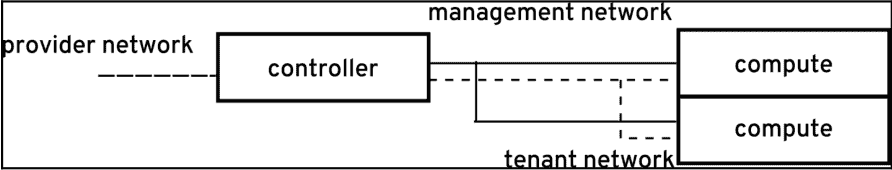

## 云架构设计

目前，可用于构建 OpenStack 云的硬件和软件组合相当令人惊叹。我们最近经常听到的一种说法是，对 OpenStack 的集成支持已成为硬件或软件产品进入市场的“入场券”。截至 OpenStack Liberty 版本（2015 年 11 月），已有超过 50 个 Cinder 存储驱动和 20 个 Neutron 网络驱动。它们覆盖了从传统 EMC 存储阵列、Cisco 交换机到各种软件定义存储和网络产品的广泛产品线。OpenStack 还支持众多 hypervisor 和计算平台，从普通 x86 硬件到 IBM Z 系列大型机不一而足。

作为架构师，我们所作的决策中，很少有像硬件和软件选型那样能对最终效益产生如此大的影响。虽然我们以迭代方式部署云或开发软件，以降低出错风险，但硬件采购通常很难迭代进行。

幸运的是，OpenStack 为每个子系统都附带了一组参考插件，我们可以在购买实际硬件之前用它们来模拟出整个云环境。就 Cinder 而言，其参考实现是在 Linux 系统上使用 LVM 和 iSCSI；就 Neutron 而言，参考实现使用 Linux 系统上的 Open vSwitch 和 iptables。甚至 Compute 也可以用 KVM 的嵌套虚拟化来进行模拟。我们推荐的方法是，在开始 OpenStack 项目时先使用参考插件，待你了解了软硬件将如何协同工作后，再进行大规模硬件或软件采购。

## 选择 OpenStack 发行版

OpenStack 与大多数开源软件项目一样进行开发。代码可以从 `http://openstack.org` 获取，也可以从 `http://tarballs.openstack.org` 下载软件包格式的版本。截至 OpenStack Liberty 版本，已有超过 350 个独立项目可供下载。对于工程团队来说，要梳理和管理如此多的源代码仓库是相当庞大的工作量。于是，OpenStack 发行版便应运而生。大多数 OpenStack 发行版由构建 Linux 发行版的同一批团队组装而成。例如，目前可用的三个主要发行版分别是 Ubuntu、openSUSE 和 CentOS Linux 发行版的组成部分。这些发行版各自维护着安装指南，可在 `http://docs.openstack.org` 获取。此外，还有来自 HP、Mirantis 和 Red Hat 等公司的发行版，它们属于商业支持协议的一部分。除这些选择外，还有 Platform9 等公司提供托管式 OpenStack 部署。

## 使用主干（trunk）

如前所述，OpenStack 的稳定版本以六个月为周期发布。活跃开发发生在每个软件项目的主干中（即 OpenStack 位于 `http://git.openstack.org` 的基于 Web 的仓库服务中的“master”分支）。这个 master 仓库控制着 OpenStack 项目的分布式版本控制，并辅助源代码管理。这与许多其他开源项目使用的著名 GitHub 服务非常相似。除了 Git 仓库之外，还有一些稳定分支与六个月发布版本相对应。新功能在 master 分支中实现，而错误修复则不定期地从主干向后移植到这些分支。

对大多数组织来说，获取某个稳定分支的打包版本并进行部署就已经足够了。不过，有几点原因可能让这种做法不那么有吸引力。其一，一些组织可能会发现，六个月发布之间积累的变更太多，而更频繁地从主干发布更小粒度的变更，风险反而更低。虽然这种思路对许多软件项目来说是有道理的，但 OpenStack 是由多个协调松散的团队开发的，管理各项目开发流之间的依赖关系是一项复杂的任务。主干上的自动化测试试图确保 Nova 中的改动不会破坏 Neutron 中的功能，但大部分手动集成测试都是针对协调一致的稳定版本进行的。

虽然某个组织有可能希望在主干变更进入稳定分支之前就把所有改动都拿过来，但更常见的是，它们只对尚未进入稳定分支的一两个重要功能感兴趣。例如，我们合作过的许多团队，早在 Neutron 实现外部 IPAM 系统功能（Liberty 版本）之前，就希望利用类似 Infoblox 提供的外部 IPAM 系统。我们还见过其他情况：某个组织希望在新 SAN 设备的 Cinder 驱动被上游接受之前就将其引入。对于这些用例，更合理的做法是先使用某个稳定分支的打包发行版，然后只为需要从主干向后移植所需功能的组件创建定制软件包。

## 社区发行版

每次 OpenStack 发布稳定版本后，来自三个主要社区 Linux 发行版的维护者都会将相应稳定分支中的软件打包成其发行版的原生格式。这些 OpenStack 发行版允许这些发行版的用户使用该发行版惯用的机制安装软件（及其依赖项）。这些发行方还在 `http://openstack.org` 上提供了如何在其特定发行版上安装和配置该软件的文档。

大多数组织会根据自己最熟悉的 Linux 发行版来选择社区发行版。例如，通常使用 Ubuntu Linux 发行版的组织也会使用 Ubuntu OpenStack 发行版。值得一提的是，OpenStack 社区发行版可以与 openSUSE 和 CentOS 的商业支持变体配合使用；一个组织为 Red Hat Enterprise Linux 付费购买支持，却使用社区支持的 CentOS OpenStack 发行版（RDO），这种情况并不少见。

社区发行版的选择也会影响安装机制的可用性。例如，我们在*第 1 章，OpenStack 入门*中使用的 Packstack 安装工具就是 CentOS 版 OpenStack（RDO）所特有的。Ubuntu 和 openSUSE 发行版则提供了安装 OpenStack 软件的其他工具。不过，使用 Puppet、Chef 和 Ansible 部署 OpenStack 的机制与发行版（以及操作系统）无关。例如，完全可以使用同一套 Puppet 模块在 Ubuntu 和 CentOS 发行版上部署 OpenStack。

## 商业支持的发行版

虽然目前只有三个主要的社区支持 OpenStack 发行版，但可用的商业支持发行版却数不胜数。这些发行版的列表及其认证状态可在 http://openstack.org 上查看。通过了特定负载和基于性能的 Tempest 测试的发行版，会以与托管服务提供商相同的方式获得认证。商业支持的发行版通常基于社区支持的发行版。不过，组织选择它们而不是社区发行版，有几个原因。

第一个主要驱动因素是支持。大多数提供 OpenStack 支持的公司都要求客户使用其商业支持的发行版，以便确保客户使用的是已经通过认证和测试流程的软件。例如，Red Hat 会从每个 RDO 版本中取出软件包，在将其作为 Red Hat Enterprise Linux OpenStack 平台发布之前，让它们通过详细的测试计划。当客户发现某个 OpenStack 组件存在问题时，Red Hat 可以将该问题添加到测试计划中，以防止未来版本中出现回归。此外，客户可能会出于易用性、支持质量或发行版附带的任何额外软件而选择不同的商业发行版；例如，Hewlett Packard Enterprise 的 Helion OpenStack 捆绑了许多运维工具，可能会吸引一些客户。Mirantis OpenStack 虽然只是一个基础设施即服务（IaaS）平台，但其安装程序可能比其它发行版的安装程序更受一些客户青睐。

组织也可能选择商业支持的发行版而非社区支持的发行版，因为前者提供了发行商尚未以开源形式发布的附加功能。例如，IBM 在其 IBM Cloud Manager 产品中就提供了一个 OpenStack 发行版。这些增强功能往往旨在加速 OpenStack 云的部署，或通过额外的报告和仪表板来提高部署的可管理性。


## 计算硬件考虑因素

在 IBM 的 Power 或 Z 系列系统或 Oracle 的 Solaris 系统上部署 OpenStack 完全可行，但绝大多数 OpenStack 部署都使用 64 位 Intel 系统上的 Linux。 在 OpenStack 中为计算基础设施选择硬件平台，与为数据中心中的任何其他工作负载选择硬件平台类似。 一些组织基于声誉、过去的性能或业务安排对特定供应商保持品牌忠诚度，而一些组织则要求硬件供应商在项目出现时投标。 少数组织选择从组件组装自己的系统，但大多数 OpenStack 部署使用与部署任何其他 Linux 工作负载相同的商品系统。

话虽如此，我们确实见过与 OpenStack 配合良好的硬件配置，以及事后需要重新配置的硬件配置。 我们将在本节中尝试帮助您避免第二次采购订单。

## Hypervisor 选择

大多数安装使用 Xen 或 KVM hypervisor，但也有许多其他 hypervisor 可与 Nova 一起使用。 Hyper-V 和 VMware hypervisor 都作为计算平台得到支持。 裸机系统可通过 Nova（Ironic 项目）进行配置，并且在 OpenStack 的生命周期中出现了各种用于容器的驱动程序。 在 OpenStack 中运行容器最近是一个非常感兴趣的话题，OpenStack Magnum 项目已成为在 OpenStack 内部部署它们的当前首选模型。

是否选择 Xen 或 KVM hypervisor 对某些人来说几乎是宗教问题。 KVM hypervisor 是 Linux 上使用最广泛的 hypervisor，它支持 PCI 直通、NUMA 区域固定和实时迁移等一系列高级功能。 Xen 的支持者会指出，在旧硬件上的性能传统上在 Xen 上更好。 他们还会指出，像 Amazon 和 Rackspace 这样的大型云提供商在部署中选择了 Xen hypervisor 而非 KVM hypervisor。 然而，Xen hypervisor 的采用率仍在继续下降。 根据 2016 年 OpenStack 用户调查报告，95% 的 OpenStack 云使用 KVM，只有 4% 使用 Xen。 KVM 是默认且使用最广泛的 hypervisor，除非您的组织有强烈的动机选择 Xen hypervisor，否则我们强烈建议您使用它而不是任何其他 hypervisor。

使用 VMware ESX 作为 OpenStack 中的 hypervisor 而不是 KVM 有很多很好的理由。 几乎每个大型 IT 部门都拥有大量关于 ESX 和 vSphere 的经验，并且使用 ESX 作为 OpenStack 部署的 hypervisor 可以降低那些不想在新的虚拟化技术上认证或培训的团队进入 OpenStack 的门槛。 基于 ESX 的部署是规定性的——与 ESX 配合使用只有一个 Cinder 驱动程序和一个 Neutron 驱动程序得到支持。 从这个角度来看，选择 ESX 允许组织专注于 OpenStack 的集成和运营方面，而不必太担心架构。

然而，使 ESX 对某些组织来说是一个不错的选择的相同原因，使其对大多数组织来说是一个糟糕的选择。 规定性的方法限制了存储和网络空间中的可用选项。 OpenStack 最强大的方面之一是生态系统的异构性和在通用 API 下动态添加新类型基础设施的能力。 出于这个原因，我们将在本书中专注于使用 KVM hypervisor 的工作。 我们在本节中讨论的大多数考虑因素也适用于 Xen hypervisor。

## 根据工作负载调整硬件规模

正如我们在本章开始时提到的，虽然迭代方法用于开发和部署软件是一种最佳实践，但迭代方法用于购买硬件可能会扼杀您的私有云计划。 第一次就把硬件搞对至关重要，这样您就可以从硬件供应商那里获得适当的折扣，并在项目开始时设定适当的预算。 然而，这些项目的规模通常很难确定，因为很难提前预测工作负载的要求。 这是让应用程序所有者在项目早期参与其中如此重要的原因之一——他们将能够预测应用程序的要求，这将为规模确定过程提供信息。

规模确定过程的第一步是定义标准实例大小。 在 Nova 用语中，这些被称为 flavors。 开箱即用，Nova 随附一组 m1 flavors，它们大致对应于 Amazon EC2 实例类型。 一个 flavor 有三个主要参数，虚拟 CPU 的数量、内存量和临时磁盘存储量。 组织通常根据预期工作负载定义两种或三种 flavors。 三种常见的 flavors 是 1×2、2×4 和 4×8 大小，它们指的是 vCPU 和内存千兆字节的数量。 临时磁盘大小通常与 CPU 和内存配置无关——它应等于组织标准 Glance 镜像的根磁盘的预期大小。 例如，使用 Red Hat Enterprise Linux 7 qcow2 镜像的 2×4 将具有两个虚拟 CPU、四千兆字节的内存和 20 千兆字节的临时磁盘。

一旦 flavors 被定义，下一步就是确定给定环境的 acceptable over-commit ratio。 每家主要硬件供应商都会发布可作为此比率起点的虚拟性能基准测试结果。 这些基准测试可在 http://spec.org/ 的 **Virtualization** 类别中找到。 通过这些基准测试，出现了两个简单的规则：永远不要超额分配内存，始终将 CPU 超额分配高达 10 倍。 遵循这些规则，您可以确定给定计算硬件中的最佳内存量。 例如，具有 36 个物理核心的计算节点可以支持多达 360 个虚拟核心的计算。 如果我们使用前面的 flavors，我们会看到每个虚拟核心 2 千兆字节的 RAM 的比率。 该计算节点中的最佳内存量大约在 720 GB（2 GB × 10 × 36 核心）左右。

内存层之间通常存在巨大的价格差异，通常有意义的是将系统配置为少于最佳内存量。 假设我们只能经济地将 36 核计算节点配置为 512 GB 内存。 接下来的两个需要考虑的项目是网络带宽和可用临时存储。 这就是了解目标工作负载有所帮助的地方。 512 GB 内存将支持 256 个 1×2 实例、128 个 2×4 实例或 64 个 4×8 实例。 这给我们一个最大临时磁盘需求在 1.2 到 5 TB 之间，假设 Glance 镜像为 20 GB。 这是一个相当大的差异。 如果我们确信我们的大多数实例将是 2×4，我们可以为大约 128 个实例定规模，这给我们 2.5 TB 的临时存储磁盘需求。 在那里也有一些余地——临时存储在 KVM hypervisor 中是精简配置的，我们不太可能消耗全部容量。 然而，如果我们使用 Ceph、SAN、iSCSI 或 NFS 等持久存储选项用于镜像、实例或对象存储，规划容量就会变得更加复杂。 在确定您的 flavor CPU、内存和临时磁盘规模时，您需要包括根卷的持久磁盘空间。 如果这些卷存储在与您的 glance 和对象存储相同的设备/集群上，必须非常小心地确保一致的弹性。

在选择计算硬件时需要考虑的最后一个主要项目是计算节点的可用带宽。 我们今天使用的系统大多数具有两个 10 千兆位绑定接口，专门用于实例流量。 将可用带宽除以预期实例数可以让我们确定是否需要额外的一组接口。 将 10 千兆位除以 128 个实例，给每个实例大约 75 兆位的可用平均带宽。 这对于大多数 Web 和数据库工作负载来说已经绰绰有余。


## 性能密集型工作负载的注意事项

前面给出的指南对于开发、Web 或数据库工作负载来说效果良好。某些工作负载，特别是网络功能虚拟化（NFV）工作负载，具有非常特定的性能要求，需要在硬件选型过程中加以解决。为了支持这些工作负载，Nova 计算服务最近增加了一些实例调度的改进。


NFV 是 OpenStack 的一个新兴用例，用于成为替代专用网络设备的负载的基础设施。路由器、防火墙、代理服务器和分组核心设备是今天正在被替换的常见虚拟网络功能。NFV 不仅减少了运营电信业务所需的物理硬件，而且还将云原生应用编排的所有优势带入了一个对敏捷性需求日益增长的业务场景，以便比以往更快地为消费者提供服务。

第一个改进允许将 PCI 设备直接从硬件直通到实例。在标准的 OpenStack Neutron 网络中，分组在实例的虚拟接口和实际网络接口之间经过一系列网桥。虚拟网络中的开销很大，因为每个分组每次经过接口或交换机时都会消耗 CPU 资源。通过允许虚拟机通过一种称为 SR-IOV 的技术直接访问网络设备，可以消除这种性能开销。SR-IOV 允许单个网络适配器在操作系统中表现为多个网络适配器。这些虚拟网络适配器（称为虚拟功能，VF）中的每一个都可以直接与虚拟实例关联。

第二个改进允许 Nova 调度程序为在具有非统一内存访问（NUMA）的计算节点上运行的实例指定 CPU 和内存区域。在这些 NUMA 系统中，一定量的内存更接近于一组处理器核心。当进程访问非相邻区域的内存页时，会产生性能惩罚。当进程从一个内存区域移动到另一个内存区域时，还会产生另一个显著的性能惩罚。为了避免这些性能惩罚，Nova 调度程序可以将实例的虚拟 CPU 绑定到底层计算节点中的物理核心。它还可以将虚拟实例限制在与这些虚拟 CPU 关联的给定内存区域中，从而有效地将实例限制在指定的 NUMA 区域内。

在 OpenStack 部署中通常有四种类型的网络。第一种是用于从互联网访问 OpenStack API 的网络，在公有云的情况下，或在私有云的情况下从内联网访问。在大多数部署中，只有负载均衡器在这个网络上有地址。这允许对来自互联网的流量进行严格控制和审计。这个网络通常被称为 **External** 网络。第二种类型的网络是用于 OpenStack 控制平面与计算基础设施之间通信的私有网络。消息总线和数据库在此网络上公开，并且流量通常不会在此网络内外路由。这个网络被称为 **Management** 网络。

通常还会创建另外两个私有网络，用于在计算、网络和存储节点之间承载网络和存储流量。这些网络在质量服务和安全性方面都有所区分，并且是可选的，具体取决于部署是否使用 SDN 或网络附加存储。专用于租户网络的段通常被称为 **Tenant** 网络或 **Underlay** 网络。根据部署规模，可能有一个或多个这些 underlay 网络。存储网络不出所料地被称为 **Storage** 网络。

在大多数部署中，租户工作负载需要访问互联网或内联网，最后一种网络类是必需的。通常被称为 **Provider** 网络，这是一个物理网络，在 Neutron 中建模以在物理网络上提供网络端口。浮动 IP 可以从 Provider 网络中动态分配给实例。在某些部署中，实例将被允许直接使用 Provider 网络的端口，而无需经过租户网络和路由器。希望使用 Neutron API 但不想实现 SDN 的组织经常使用这种在 Neutron 中使用 provider 网络对物理基础设施进行建模的模式。

这使他们能够使用传统的物理交换机和路由器，同时仍提供动态虚拟接口。

Reference Architectures, Fuel 7.0 Reference, Mirantis https://docs.mirantis.com/fuel/fuel-7.0/reference-architecture.html

## SDN

SDN 是 OpenStack 与传统虚拟化部署不同的关键能力之一。SDN 使用隧道技术在物理网络拓扑之上创建虚拟网络拓扑。虚拟（overlay）网络可以是共享的或租户专用的。租户可以定义自己的第 2 层段和路由器，他们可以指定网络特定的 DNS 和 DHCP 服务，并且某些部署还允许定义第 4 层服务，如负载均衡和防火墙。Neutron 是以插件式架构创建的，并且存在针对基于软件和硬件的 SDN 产品的插件。还提供了一个围绕 Open vSwitch 构建的参考实现，用于测试和实验室工作。

选择 SDN 提供商是一项艰难的任务。根据我们的经验，SDN 厂商倾向于用营销术语混淆其技术，并且需要一段时间才能弄清楚每个厂商实际上是如何通过 hypervisor 将分组路由到物理网络的。许多早期的 Neutron SDN 插件，如 Nicira 的，都是基于 Nicira 编写的 Open vSwitch 软件。这些解决方案的性能较差，随后有多种不同的方法将分组的处理从 Linux 操作系统中的“用户空间”下移到“内核空间”。人们还致力于通过简化分组从实例向下经过交换机的路径来提高参考 Open vSwitch 实现的性能。该项目称为 Open Virtual Network，或 OVN。

SDN 厂商倾向于在三个方面进行区分。第一个是其解决方案的弹性。评估 SDN 技术时，组织应注意在给定拓扑中第 3 层路由器如何实现高可用性，以及组件故障如何影响分组流。第二个是给定解决方案的管理界面。大多数 SDN 厂商将拥有一个引人注目且有用的用户界面，用于调试租户网络中的分组流。第三个需要考虑的因素是性能。根据我们的经验，这是大多数组织决定的因素。这些解决方案的性能通常存在很大差异，并且在概念验证（POC）期间应重点关注这一点。

## 物理网络设计

任何关于 OpenStack 网络的讨论都不应缺少对 **spine-leaf** 物理网络架构的提及。Spine-leaf 是传统 **multi-tier** 网络架构的替代方案，后者由核心、汇聚和接入层组成。Spine-leaf 对汇聚层的设计进行了修改，以减少连接到不同接入交换机的服务器之间的跳数。汇聚层成为 **spine**，其中每个接入交换机（**leaf**）都可以通过单个 spine 交换机到达每个其他接入交换机。这种架构被认为是水平可扩展云工作负载的先决条件，这些工作负载更关注实例之间的流量（东西向流量）而不是实例与互联网之间的流量（南北向流量）。

Spine-leaf 网络设计对 OpenStack 部署的主要影响是第 2 层网络通常在 spine 处终止——意味着子网不能从 leaf 延伸到 leaf。这有几个影响。首先，虚拟 IP 不能从 leaf 迁移到 leaf，因此 External 网络被限制在单个 leaf。如果 leaf 边界是机顶交换机，则这会将给定控制平面的所有负载均衡器置于单个故障域（机架）内。其次，如果实例要直接连接到它们，则 Provider 网络需要物理连接到 OpenStack 区域内的每个计算节点。这种限制可以将 OpenStack 区域限制为 leaf 的大小。同样，如果 leaf 边界是机顶交换机，这会产生非常小的区域，从而导致控制节点与计算节点比例异常高。

鉴于这些限制，我们在 OpenStack 安装中看到了几种不同的 spine-leaf 实现方法。第一种方法是在给定部署中的 leaf 之间简单地拉伸 L2 网络。需要拉伸的唯一网络是 External API 网络和 Provider 网络。如果实例不会直接连接到 Provider 网络（即，如果使用浮动 IP 进行外部连接），则这些网络只需在故障域之间拉伸，以确保单个机架的丢失不会导致控制平面崩溃。选择在机架之间拉伸 L2 的部署通常将机架分组为由三个或更多机架组成的 **pods**，然后这些机架成为 leaf 边界。我们看到的第二种方法是创建 spine 内的隧道，以模拟机顶交换机之间拉伸的 L2 子网。无论哪种方式，网络架构团队与云架构团队之间的协作都应导致组织可支持的解决方案。


浮动 IP 是 IP 地址池，通常面向外部，可以随意附加到运行中的实例或从中分离，以提供对实例的外部访问。这些浮动 IP 地址与租户路由器关联，并动态分配。

## 存储设计

随着近年来计算硬件成本的下降，受处理器或内存性能不足制约的工作负载越来越少。相反，大多数工作负载经过调优后，瓶颈在于 I/O——尤其是存储 I/O。OpenStack 工作负载通常将操作系统存储与应用存储分离，而 Cinder 以及不同的对象存储项目提供了通过单一接口呈现多种存储的机制。这种能力使租户能够选择符合其应用需求的存储。除了 Cinder 为应用提供持久性外，块存储和对象存储还为实例提供存储持久性，并支持实例在线迁移、备份和恢复。

## 临时存储

临时存储是指将 Glance 镜像本地复制到计算节点以实例化虚拟机时消耗的存储。Glance 镜像通常是稀疏的，大小往往不到 1 GB。实例化后，镜像为实例的操作系统提供根磁盘。这些根磁盘同样采用稀疏配置，但通常会长到 10、20 或 40 GB 大小。在传统的 OpenStack 部署中，临时存储由计算节点的内部磁盘提供，当计算节点发生故障或实例被终止时，这些存储会丢失或被回收。不过如今，许多组织会选择将临时存储放在共享存储上。

使用共享存储作为临时实例存储有两个主要原因。第一个原因是，通过为实例提供在线迁移能力，让这些临时实例不那么“临时”。如果只使用本地临时存储，计算节点一旦重启，就会终止它当前托管的所有实例。如果实例由共享存储（通常是 NFS 或基于软件的存储，如 Ceph）支持，则可以将其迁移到可访问同一存储的另一计算节点，而无需停机。这允许云运维人员将计算节点置于“维护模式”以便打补丁。当计算节点准备好再次托管工作负载时，实例可以跨节点重新平衡。在计算节点发生故障时，拥有实例的实时副本也很有用。由共享存储支持的实例可以疏散到健康计算节点，且不会丢失状态。

共享存储对临时存储具有吸引力的第二个原因是，某些存储后端支持在 Glance 镜像与运行中实例之间进行去重。在传统的实例生命周期中，镜像与实例之间并没有太大的去重需求。然而，如果具备去重能力，运维人员就可以将实例快照用作备份。实例可以定期备份，而不会消耗过多的共享存储。OpenStack 的 Kilo 和 Liberty 版本中的新功能允许在快照操作期间使客户机操作系统静默（quiescing），从而启用这种“在线备份”能力。

## 块存储

使用共享存储作为临时存储是为虚拟机实现持久化能力的一种方式，但更传统的方式是在 Cinder 卷上实例化 Glance 镜像。由 Cinder 卷支持的实例可以进行在线迁移、在线快照，并在状态完整的情况下疏散。如今，几乎所有主流存储产品都有对应的 Cinder 驱动，并且在单个 OpenStack 部署中配置多个后端也很常见。这允许 OpenStack 租户为其工作负载选择适当的后端。例如，一个数据库实例的操作系统可以放在相对廉价的临时磁盘上，而数据则存放在通过光纤通道连接的高性能 SAN 存储上。如果实例发生故障，根磁盘会被丢弃，新实例会挂载到持久的 Cinder 卷上。对于从传统虚拟化平台迁移来的实例，Cinder 卷作为根磁盘也很有吸引力。由 Cinder 支持的实例在用户体验上与这些平台非常相似。

为 Cinder 实现选择存储后端是一个相对直接的过程。云架构师应充分利用组织内存储架构师已经拥有的关系和知识。存储设备相对昂贵，因此 POC（概念验证）应尽可能在现有硬件设备上进行。NetApp 文件服务器和 EMC SAN 等常见设备的 Cinder 驱动具有一些有趣的功能，可以在实验室中进行验证。更特殊硬件设备的供应商通常也愿意出借硬件用于 POC。

我们合作过的大多数组织都已在其 OpenStack 实现中测试了基于软件的存储，其中许多组织已在至少一个存储层中采用基于软件的存储。尤其是 Ceph，它与 OpenStack 在镜像、临时和块存储方面有着紧密的集成。在此配置下使用时，Ceph 具有提供去重的优势。这一点，加上它对商用硬件的使用，使其从成本角度来看极具吸引力。

## 对象存储

Swift 是 OpenStack 最早的两个服务之一，而对象存储是 OpenStack（以及 Amazon）云中最初的持久性机制。随着 OpenStack 被越来越多地用于传统工作负载，对象存储已失去其很大一部分相关性。事实上，我们在企业领域参与的许多 OpenStack 部署在初始版本中并不包含对象存储。

对对象存储采取“如果你建好了，他们自然会来”策略的一个简单方法，就是利用对象存储来存放 Glance 镜像。虽然你的租户中可能很少有人会带着能够通过 S3 兼容接口持久化数据的应用来使用你的 OpenStack 部署，但几乎所有租户都可以使用 Nova 中的快照功能来改善他们在平台上的体验。将 Glance 镜像存储在 Swift 中可使其高度可用，并提供机会将其与计算基础设施共置，从而大幅提高网络性能。

对象存储后端的选择高度依赖于块存储和临时存储的选择。如果使用 Ceph 作为块存储，那么使用 Ceph 作为对象存储将大大简化平台的管理。NetApp 提供了与 Swift 的集成；如果使用 NetApp 作为块存储，那么选择 NetApp 作为对象存储后端可能更有利。Swift 也是 OpenStack 中的默认对象存储提供商，从这个角度来看，在异构环境中使用它是合理的。根据我们的经验，在存储选择过程中，对象存储后端不会受到像块存储后端那样的严格审查。这可能是因为许多对象存储系统较少关注性能，更多是提供低成本方案来存储频繁读取的数据，而不是应对大量繁重的 I/O。

## 扩展初始部署

为了正确评估本章讨论的不同计算、网络和存储选项，需要一个扩展的 OpenStack 部署，为不同的物理系统分配专门角色。将计算功能与控制功能分离，使我们能够正确测试不同类型的计算硬件。将存储功能与计算和控制功能分离，使我们能够正确测试不同的磁盘、NAS 或 SAN 配置。在本节中，我们将把第 1 章《OpenStack 简介》中部署的角色拆分到三个物理系统上。每个系统都会被分配一个角色，称为主机组（host group）。


## 更新设计文档

我们的首要任务是更新第 1 章 *Introducing OpenStack* 中的设计文档，并加入一组主机组的定义。这些定义应包含在文档的 *Physical architecture* 部分的开头。我们将在本次扩展的 **proof of concept (POC)** 中使用以下主机组。

### Cloud controller

云控制器系统为 OpenStack 部署提供 API 服务、调度服务和 Horizon 仪表板服务。

### Compute node

计算节点系统充当 KVM 超级管理器，并运行 `nova-compute` 和 `openvswitch-agent` 服务。

设计文档的 *Physical architecture* 部分还应包含部署的物理网络架构部分。在此部分中，每个分段网络都应被定义。每个物理主机到每个网络的连通性也应被定义。

Packstack 安装工具不允许指定用于 API 流量的外部网络。因此，在本次部署中我们将使用三个物理网络，一个可路由到内网的管理网络、一个为实例提供浮动 IP 的提供者网络，以及一个用于实例流量的租户网络。以下网络定义应添加到 *Physical architecture* 部分。

### Management network

管理网络用于 OpenStack 部署中所有节点之间的私有通信。在本次部署中，该网络还用于承载租户和存储流量。

### Provider network

提供者网络用于为本次部署中的租户实例提供公共端口。云控制器节点在此网络段上有一个端口。

### Tenant network

租户网络承载部署中的租户网络流量。它充当 SDN 隧道的下层网络。计算节点和控制器节点在此网络段上都有端口。

还应在 *Physical architecture* 部分添加一个网络图。以下图表描述了本章中的部署：



## 更新部署计划

我们实验室环境的部署计划需要更新以反映额外的硬件和网络配置。硬件表应首先更新以包含每个硬件的角色分配。例如，考虑以下表格：

| Hostname | Model | CPU cores | Memory | Disk | Network | Host group |
|---|---|---:|---|---|---|---|
| controller1 | DL380 | 16 | 256 GB | 500 GB | 2×10 GB | Cloud controller |
| compute1 | DL380 | 32 | 512 GB | 2 TB | 2×10 GB | Compute node |
| compute2 | DL380 | 32 | 512 GB | 2 TB | 2×10 GB | Compute node |

接下来，更新网络表以反映新的节点和网络：

| Hostname | Interface | MAC | IP | Network |
|---|---|---|---|---|
| controller1 | eth0 | 3C:97:0E:BF:6C:78 | 192.168.0.10 | Management |
|  | eth0.100 | 3C:97:0E:BF:6C:78 | 10.0.0.10 | Provider |
|  | eth0.200 | 3C:97:0E:BF:6C:78 | 172.16.0.10 | Tenant |
| compute1 | eth0 | 3C:97:0E:BF:6C:80 | 192.168.0.100 | Management |
|  | eth0.200 | 3C:97:0E:BF:6C:80 | 172.16.0.100 | Tenant |
| compute2 | eth0 | 3C:97:0E:BF:6C:81 | 192.168.0.101 | Management |
|  | eth0.200 | 3C:97:0E:BF:6C:81 | 172.16.0.101 | Tenant |

包含以下类似表格也很有帮助，该表格描述了部署的每个网络：

| Network | VLAN ID | Subnet | Gateway |
|---|---|---|---|
| Management |  | 192.168.0.0/24 | 192.168.0.1 |
| Provider | 100 | 10.0.0.0/24 | 10.0.0.1 |
| Tenant | 200 | 172.16.0.0/24 | 172.16.0.1 |

## 使用新配置安装 OpenStack

在第 1 章 Introducing OpenStack 中，我们使用 allinone 选项运行 packstack，采用默认设置进行测试安装。Packstack 能够将默认选项保存到配置文件中，然后可以用文本编辑器编辑。我们将在本章中使用此功能来创建可重用的配置。此外，packstack 能够通过 SSH 将生成的 puppet 清单应用到远程机器上。为此工作，你需要能够从控制器机器（我们将在此运行 packstack）通过 SSH 访问部署中的其他机器。在运行 packstack 之前，先测试一下是个好主意。

首先，开始在部署计划的硬件表中概述的四台服务器上安装全新的操作系统副本。每个系统在部署前都需要配置网络表中指定的网络接口，并且部署计划中指定的所有要求也需要满足（即 NetworkManager 需要被禁用，并且 RDO 仓库需要被启用）。

在云控制器（controller1）上执行以下命令以生成答案文件。我们将使用它作为部署配置的模板：

```bash
# packstack --gen-answer-file=packstack-answers.txt
```

接下来，编辑 packstack-answers.txt 文件，更新以下参数：

| Parameter | Example | Description |
|---|---|---|
| `CONFIG_CONTROLLER_HOST` | `192.168.0.10` | 管理网络上云控制器的 IP 地址 |
| `CONFIG_COMPUTE_HOSTS` | `192.168.0.100, 192.168.0.101` | 管理网络上计算节点的 IP 地址 |
| `CONFIG_NETWORK_HOSTS` | `192.168.0.10` | 管理网络上云控制器的 IP 地址 |
| `CONFIG_AMQP_HOST` | `192.168.0.10` | 管理网络上云控制器的 IP 地址 |
| `CONFIG_MARIADB_HOST` | `192.168.0.10` | 管理网络上云控制器的 IP 地址 |
| `CONFIG_NEUTRON_OVS_BRIDGE_MAPPINGS` | `vlan100:br-vlan100` | 提供者网络的 neutron 网络到 OVS 桥的映射 |
| `CONFIG_NEUTRON_OVS_BRIDGE_IFACES` | `br-vlan100:eth0.100` | 提供者网络的 OVS 桥到物理接口的映射 |
| `CONFIG_NEUTRON_OVS_TUNNEL_IF` | `eth0.200` | 用于租户网络的接口 |
| `CONFIG_PROVISION_DEMO_FLOATRANGE` | `10.0.0.128/25` | 提供者网络上使用的浮动 IP 范围 |

> 关于 Neutron 设置的快速说明，因为它们一直让我们感到困惑。隧道接口设置由 puppet 模块用来确定 Open vSwitch 插件配置文件中的 `local_ip` 设置。桥映射设置与 Open vSwitch 插件配置文件中的 `bridge_mappings` 相同。然而，桥接口设置并不影响插件配置。相反，它被 puppet 模块用来确定如何构造由 `bridge_mappings` 设置引用的 Open vSwitch 桥。如果你打算手动构造桥，可以安全地省略该设置。

现在，使用新配置运行 `packstack`：

```bash
# packstack --answer-file=packstack-answers.txt
```

安装完成后，应使用上一章相同的步骤验证 OpenStack 部署。可以通过查询 Nova 和 Neutron 服务来验证服务分布：

```bash
# nova service-list
```


此命令将输出所有正在运行的计算服务的表格、它们运行的主机以及其状态。输出应显示 `nova-cert`、`nova-consoleauth`、`nova-scheduler` 和 `nova-conductor` 服务在 `controller1` 上运行，以及 `nova-compute` 服务在 `compute1` 和 `compute2` 上运行。

```bash
# neutron agent-list
```

此命令将输出所有正在运行的网络服务的类似表格。输出应显示 Metadata、L3 和 DHCP 代理在 `controller1` 上运行，以及 Open vSwitch 代理在 `controller1`、`compute1` 和 `compute2` 上运行。

## Summary

OpenStack 部署经常被比作雪花。有如此多不同的方式来组合各种受支持的计算、存储和网络配置，以至于没有任何一个部署与另一个部署相似。这一类比经常在为 OpenStack 提供商业支持的公司中因挫败感而被使用——部署的多样性使得支持客户变得极其困难。我们合作的许多客户也表达了对众多选项的沮丧感。另一方面，大多数运行 OpenStack 一段时间的人都认识到拥有如此多选项的价值。它允许他们在统一的接口下不断为客户提供新的服务和功能。

在本章中，我们逐步介绍了 OpenStack 中的三大技术领域——计算、网络和存储。在每个领域，我们广泛描述了可用的选择，并提供了一些关于如何进行决策过程的指导。我们还扩展了部署文档和部署本身，以纳入本章涵盖的一些信息。此基本部署可以扩展，并且应提供足够的差异性，以便在做出购买决定之前在实验室中测试不同的计算、网络和存储技术。

在下一章中，你将了解如何通过添加高可用性软件使此简单部署更加健壮。


## 参考资料

- Neutron 插件列表：https://wiki.openstack.org/wiki/Neutron#Plugins
- Cinder 驱动列表：https://wiki.openstack.org/wiki/CinderSupportMatrix
- OpenStack 发行版列表：https://www.openstack.org/marketplace/distros/
- 虚拟化标准性能评估比较：http://spec.org/virt_sc2013/
