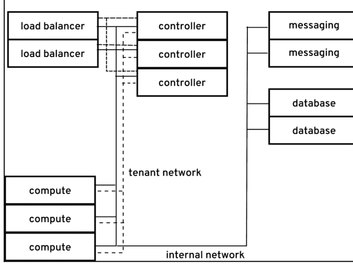

## 规划失败（和成功）

在本章中，我们将逐步介绍如何设计云架构以避免硬件和软件故障。OpenStack 控制平面由 Web 服务、应用服务、数据库服务和消息总线组成。这些层都需要不同的方式来实现高可用性，并且一些组织可能已经为每个服务定义了架构。我们看到客户要么重用这些现有模式，要么采用特定于 OpenStack 平台的新模式。这两种方法都合理，具体取决于部署规模。许多成功的部署实际上实现了这两种方法的混合。

例如，如果你的组织已有一种受支持的高可用 MySQL 数据库模式，你可能会选择该模式而不是本章中概述的模式。如果你的组织没有高可用 MongoDB 的模式，你可能需要设计一个新的模式。

本章分为以下主题：

- 高可用控制平面策略和模式
- OpenStack 区域、单元和可用区
- 更新设计文档并实施设计

## 构建高可用控制平面

在 Folsom 和 Grizzly 时代，为 OpenStack 控制平面设计高可用性（H/A）方案有点像黑魔法。OpenStack 高可用性指南最初迭代中推荐的许多技术都特定于 Ubuntu Linux 发行版，在基于 Red Hat Enterprise Linux 的发行版上不可用。

当时，标准的集群资源管理器 Pacemaker 未得到 Red Hat 支持。因此，使用 Ubuntu 的架构师可能会使用一套软件，使用 CentOS 或 RHEL 的可能会使用另一套软件，而使用 Rackspace 或 Mirantis 发行版的可能会使用又一套软件。然而，如今技术栈已经趋于一致，H/A 模式在很大程度上与所使用的发行版无关。

### 关于失败和成功

当我们设计高可用的 OpenStack 控制平面时，我们要缓解两种不同的场景：

- 第一种是故障。当物理硬件损坏时，我们希望确保在无需人工干预的情况下恢复并继续为用户提供服务。
- 第二种也许更重要的场景是成功。

软件系统在人类开始使用之前总是按设计和测试的方式工作。虽然我们的自动化测试套件会尝试启动合理数量的虚拟对象，但人类保证会尝试启动不合理数量的对象。此外，我们处理过的许多 OpenStack 项目都远远超出了预期规模，需要即时扩展。

我们早期参与的一个基于 Havana 的云使用了基于内存的 Fibre Channel 存储阵列作为 Cinder 后端。我们对平台的所有自动化测试都成功了，但在移交后一周内，我们被告知操作员无法启动虚拟实例。我们的自动化单元测试继续成功，但操作员进行的手动测试持续失败。困惑之下，我们与操作员坐下来查看他们做了什么不同的事情。在 Horizon UI 中，有一个选项可以同时通过单个 API 命令启动多个实例。操作员的租户配额为 100 个实例，他们在测试平台时指定了 100 个实例。前 8 个会成功，但最后 92 个会失败。事实证明，后端只能执行八个并发操作，超过这个数量就会出错。我们的单元测试会并发创建多个实例，但从不超过八个，因此我们从未发现该错误。

在设计 OpenStack 云时，我们需要为几种不同的成功场景做计划。

首先，我们需要为实例数量的增长做计划。这相对直接。每个额外实例都会增加数据库的大小，增加 Ceilometer 中的计量数据，最重要的是，它会增加计算节点的数量。添加计算节点和报告会给消息总线带来压力，而消息总线通常是 OpenStack 区域或单元规模的限制因素。我们在讨论将 OpenStack 云划分为区域、单元和可用区时将更详细地讨论这一点。

我们需要计划的第二种增长类型是 API 调用的增加。支持持续集成（CI）开发环境的部署可能（相对）计算需求较小，但 CI 通常会快速启动和拆除环境。这会产生大量 API 流量，进而产生大量数据库和消息流量。

在托管环境中，最终用户也可能手动产生大量 API 流量，因为他们启动和停止实例，或手动检查已启动部署的状态。虽然服务目录可能会定期检查其已启动实例的状态，但人类倾向于以不规律的方式刷新浏览器。对平台的自动化测试往往严重低估了这种行为。

考虑到这一点，我们采用的任何模式都需要满足以下要求：

- API 服务必须在控制平面硬件故障期间保持可用
- 提供 API 服务的系统必须能够水平扩展（理想情况下是弹性扩展）以应对不可预见的需求
- 数据库服务必须能够垂直或水平扩展以应对平台不可预见的增长
- 消息总线可以根据所选技术进行垂直或水平扩展

最后，每个系统都有其限制。这些限制应在架构文档中定义，以便容量规划能够考虑它们。在某个时刻，控制平面已扩展到其极限，应部署第二个控制平面以提供额外容量。虽然 OpenStack 设计为大规模可扩展，但它并非设计为无限可扩展。

## 控制平面的高可用性模式

目前在 OpenStack 部署中，常用的实现控制平面高可用的方法有三种。

第一种是最简单的。采用我们在第 2 章《设计云》中部署的单节点云控制器，对其进行虚拟化，然后使用 VMware 集群或 Linux 集群使虚拟机高可用。虽然此选项简单且能提供故障场景，但它只能垂直扩展（不能水平扩展），并且不能提供成功场景。因此，它仅应在计算节点数量有限且 API 调用数量有限的区域中使用。实际上，这种方法并不常用，我们在此不再赘述。

第二种模式提供 H/A，但不提供水平可扩展性。这是 OpenStack 高可用性指南中描述的“主/备”场景。在 Red Hat，我们在 Folsom 和 Grizzly 部署中使用了这种方法很多，但从 Havana 开始就放弃了它。它与前面描述的虚拟化解决方案类似，但不是依赖 VMware 集群或 Linux 集群来重启失败的虚拟机，而是依赖 Linux 集群在第二个云控制器节点上重启失败的服务，该节点也运行相同的服务子集。此模式不能为 Web 层提供成功场景，但仍可用于数据库和消息层。一些网络服务可能仍需要作为主/备提供。


OpenStack 架构可用的第三种 H/A 模式是 Active/Active 模式。在此模式中，服务在负载均衡服务或设备后面水平扩展，该负载均衡服务或设备为 Active/Passive。作为一般规则，只要可能，大多数 OpenStack 服务都应启用为 Active/Active，以允许成功场景同时减轻故障场景。理想情况下，Active/Active 服务可以通过简单地添加额外的控制平面节点，在无需服务中断的情况下弹性扩展。

Active/Passive 和 Active/Active 设计都需要集群软件来确定服务及其运行主机的健康状况。在本章中，我们将使用 Pacemaker 作为集群管理器。一些架构师可能会选择使用 Keepalived 而不是 Pacemaker。

除了这三种场景之外，扩展 OpenStack 服务始终存在超出一定限制的限制。如前所述，消息总线通常是首先出现扩展问题的服务；然而，它并不是唯一的地方。在 Canonical 和 Mirantis 的扩展测试中，测试人员发现 Nova 和 Cinder 项目以及数据库服务在扩展时也存在问题。始终最好实践是监控所有 OpenStack 服务的响应能力，并在模拟环境中使用 Tempest 和/或 Rally 等工具进行扩展测试，以评估需求增长对 OpenStack 云的影响。

## Active/Passive 服务配置

在 Active/Passive 服务配置中，服务配置并部署到两个或多个物理系统。服务与 **虚拟 IP (VIP)** 地址相关联。集群资源管理器（通常是 Pacemaker）用于确保在任何时间点服务及其 VIP 仅在两个系统中的一个上启用。资源管理器可以配置为更偏好其中一台机器。

当服务运行的机器发生故障时，资源管理器首先确保故障机器不再运行，然后在第二台机器上启动服务。确保故障机器不再运行的过程称为 **fencing**。Fencing 通常涉及使用 BIOS 上的管理接口关闭机器电源。fence 代理还可能与连接到故障服务器的电源供应器通信，以确保系统已关闭。

某些服务（如 Glance 镜像注册表）需要共享存储才能运行。如果存储基于网络，例如 NFS，存储可以同时挂载在活动节点和被动节点上。如果存储基于块，例如 iSCSI，存储将仅挂载在活动节点上，并且资源管理器将确保存储随服务和 VIP 一起迁移。

## Active/Active 服务配置

大多数 OpenStack API 服务设计为可同时在多个系统上运行。此配置即 Active/Active 配置，需要负载均衡器在各个活动服务之间分配流量。负载均衡器管理服务的 VIP，并确保后端系统在转发流量之前正在监听。集群管理器确保 VIP 在任何时候仅在单个节点上处于活动状态。后端服务在 Active/Active 配置中可能由集群管理器管理，也可能不由其管理。服务或系统故障由负载均衡器检测，故障服务将被移出轮换。

Active/Active 服务配置有以下几个优势：

- 第一个优势是它允许水平扩展。如果给定服务需要额外容量，可以启动运行该服务的新系统，并将其在负载均衡器后面加入轮换，而无需任何停机。控制平面在过度配置的情况下也可以在不中断的情况下缩减规模。
- 第二个优势是 Active/Active 服务的平均恢复时间要短得多。Fencing 操作通常需要长达两分钟，并且在集群资源管理器将服务从故障系统移动到健康系统之前需要进行 fencing。负载均衡器可以立即检测系统故障并停止向无响应的节点发送请求，同时集群管理器在后台进行 fencing。

只要可能，架构师应为控制平面服务采用 Active/Active 模式。

## OpenStack 服务具体说明

在本节中，我们将逐一介绍每个 OpenStack 服务并概述其 H/A 策略。虽然大多数服务可以在负载均衡器后面配置为 Active/Active，但其中一些必须配置为 Active/Passive，而其他一些可以配置为 Active/Active。一些配置还取决于 OpenStack 的特定版本，尤其是 Ceilometer、Heat 和 Neutron。以下详细信息截至 OpenStack 的 Liberty 版本。

### OpenStack Web 服务

作为一般规则，所有 Web 服务和 Horizon 仪表板都可以运行 Active/Active。这些包括 Keystone、Glance、Nova、Cinder、Neutron、Heat 和 Ceilometer 的 API 服务。Nova、Cinder、Neutron、Heat 和 Ceilometer 的调度服务也可以部署为 Active/Active。这些服务不需要负载均衡器，因为它们响应消息总线上的请求。

唯一必须运行 Active/Passive 的 Web 服务是 Ceilometer Central 代理。此服务可以配置为在多个实例之间拆分其工作负载，以支持水平扩展。

### 数据库服务

所有 OpenStack Web 服务的状态都存储在中央数据库中，通常是 MySQL 数据库。MySQL 通常以 Active/Passive 配置部署，但可以使用 Galera 复制扩展使其变为 Active/Active。Galera 是 MySQL（OpenStack 中的 MariaDB）的集群软件，它使用同步复制来实现 H/A。然而，即使使用 Galera，我们仍然建议仅将写入定向到其中一个副本；OpenStack 服务使用的某些查询在写入多个主节点时可能会死锁。使用 Galera，通常会在集群前面部署负载均衡器，并配置为一次仅将流量传递到一个副本。此配置可减少服务的平均恢复时间，同时确保数据一致性。

在实践中，许多组织会将高度可用的 MySQL 部署偏好交给数据库架构师。毕竟，通常是数据库管理团队负责响应该组件的故障。

使用 Ceilometer 服务的部署还需要 MongoDB 数据库来存储遥测数据。MongoDB 按设计可水平扩展，通常以至少三个副本的 Active/Active 方式部署。

### 消息总线

所有 OpenStack 服务都通过消息总线进行通信。如今大多数 OpenStack 部署使用 RabbitMQ 服务作为消息总线。RabbitMQ 可以通过称为“mirrored queues”的功能配置为 Active/Active。RabbitMQ 服务不进行负载均衡；每个服务都会获得潜在节点的列表，客户端负责确定哪些节点处于活动状态，哪些节点已失败。

与 OpenStack 一起使用的其他消息服务，如 ZeroMQ、ActiveMQ 或 Qpid，可能有不同的策略和配置来实现 H/A 和水平扩展。对于这些服务，请参阅文档以确定最佳架构。

### 计算、存储和网络代理

OpenStack 中的计算、存储和网络组件有一组由 API 服务调度的执行工作的服务。这些服务在启动时通过消息总线向调度器注册自己。调度器负责确定服务的健康状况并将工作调度到活动服务。计算和存储服务都设计为可运行 Active/Active，但网络服务需要额外考虑。

OpenStack 部署中的每个超visor 都运行 nova-compute 服务。当此服务启动时，它会向 nova-scheduler 服务注册自己。当前可用的 nova 服务列表可通过 nova service-list 命令获得。如果计算节点不可用，其状态列为 down，调度器在执行实例操作时会跳过它。当节点变得可用时，调度器会将其包含在可用主机列表中。

对于基于 KVM 或 Xen 的部署，nova-compute 服务每个超visor 运行一次且不做高可用。对于基于 VMware 的部署，则为每个 vSphere 集群运行单个 nova-compute 服务。因此，此服务应以 Active/Passive 配置实现高可用。这通常通过在 vSphere 集群内虚拟化该服务并配置虚拟机为高可用来实现。

Cinder 包含一个称为卷服务或 cinder-volume 的服务。卷服务在启动时向 Cinder 调度器注册自己，并负责在块存储设备上创建、修改或删除 LUN。对于支持多写入器的后端，可以以 Active/Active 配置运行多个此服务的副本。LVM 后端（这是参考后端）不可高可用，每个块设备只能有一个 cinder-volume 服务。这是因为 LVM 后端负责为本地连接的存储设备提供 iSCSI 访问。


因此，OpenStack 的高可用部署应避免使用 LVM Cinder 后端，而应使用支持多个 cinder-volume 服务的后端。


最后，OpenStack 的 Neutron 组件包含多个代理，它们在高可用部署中都需要特殊考虑。DHCP 代理可以配置为高可用，而每个子网响应 DHCP 请求的代理数量由 neutron.conf 文件中的参数 `dhcp_agents_per_network` 控制。该参数通常设置为 2，无论控制平面中配置运行多少个 DHCP 代理。

在 OpenStack 的大部分历史中，Neutron 中的 L3 路由代理一直是单点故障。它可以在主备（Active/Passive）配置下实现高可用，但其故障切换意味着租户空间中的网络连接会中断。许多第三方 Neutron 插件已经以不同方式解决了这个问题，而参考 Open vSwitch 插件自 Juno 版本起提供了高可用的 L3 代理。关于使用 OpenStack 分布式虚拟路由器（DVR）解决单一路由点故障的方案细节，请参阅 OpenStack 基金会的 Neutron 文档：http://docs.openstack.org/liberty/networking-guide/scenario-dvr-ovs.html。

## 区域、单元和可用区

如前所述，OpenStack 设计为可扩展的，但不是无限可扩展的。架构师可以使用三种不同的技术来隔离 OpenStack 云：区域（region）、单元（cell）和可用区（availability zone）。在本节中，我们将逐一说明这些概念是如何映射到虚拟机监控程序拓扑的。

## 区域

从最终用户的角度来看，OpenStack 区域等同于 Amazon Web Services 中的区域。区域位于不同的数据中心，通常以其地理位置命名。如果您的组织在菲尼克斯和罗利各有一个数据中心，那么您至少会有一个 PHX 区域和一个 RDU 区域。希望在地理上分散工作负载的用户会将部分工作负载放在 PHX，部分放在 RDU。区域拥有独立的 API 端点，尽管 Horizon UI 对多区域有一定支持，但它们本质上完全是独立的部署。

从架构的角度来看，实现区域有两个主要的设计选择，如下所示：

- 第一个是关于授权。用户希望使用相同的凭据访问每个 OpenStack 区域。有几种方法可以实现这一点。最简单的方法是在每个区域的 Keystone 服务中使用通用的后端存储（通常是 LDAP）。在这种情况下，用户必须分别向每个区域进行身份验证以获取令牌，但凭据是相同的。

在 Juno 及更高版本中，Keystone 还支持跨区域联合。在这种场景下，一个区域授予的 Keystone 令牌可以提交给另一个区域来验证用户身份。虽然目前这种做法尚未广泛使用，但它是 OpenStack 基金会的一个重点领域，并且将来可能会得到更广泛的采用。

- 区域架构的第二个主要考虑因素是是否向每个区域提供一组相同的 Glance 镜像。虽然目前正在进行跨联邦云复制 Glance 镜像的工作，但大多数组织仍在手动确保共享镜像的一致性。这通常涉及围绕镜像发布和废弃构建工作流，并需要考虑区域布局。

确保跨区域镜像一致的另一个选择是使用 Swift 实现中央镜像仓库。这也需要跨多个数据中心共享 Keystone 和 Glance 服务。关于如何设计具有共享服务的多区域的详细信息，请参阅 OpenStack 架构设计指南。

## 单元

Nova 计算服务具有单元（cell）的概念，可用于在单个区域内隔离大型虚拟机监控程序池。此技术主要用于缓解 OpenStack 消息总线的可扩展性限制。CERN 的部署广泛使用单元来在单个区域内实现大规模可扩展性。

不同服务对单元的支持各不相同，因此单元在少数超大型云部署之外并不常见。CERN 的部署有完善的文档记录，应作为此类部署的参考。

根据我们的经验，在单个数据中心内部署多个区域比实现单元来实现大规模扩展要简单得多。向用户展示地理位置上多个 API 端点所带来的额外不便，通常会被更健壮平台的好处所抵消。如果一个地理区域内有多个控制平面，单个控制平面的故障就不会那么严重。


单元架构在网络和实例放置调度方面有其自身的挑战。一些支持 OpenStack 工作的大型公司多年来一直在努力克服这些障碍。然而，许多不同的 OpenStack 发行版目前正在设计新的控制平面方案。这些新设计将开始将 OpenStack 控制平面拆分为多个容器，以微服务架构类型运行 OpenStack 服务。这样，服务本身可以放置在任何位置，并根据负载进行水平扩展。最近引起广泛关注的一个架构是 Kolla 项目，它推广 Docker 容器和 Ansible playbook，为运行 OpenStack 云提供生产级容器和部署工具。更多信息请访问 https://wiki.openstack.org/wiki/Kolla。

## 可用区

可用区用于在单个 OpenStack 区域内对虚拟机监控程序进行分组。可用区对最终用户可见，并应用于向用户提示云的底层拓扑。可用区最常见的用例是向用户暴露故障域。

为了确保部署在 OpenStack 上的服务的高可用性，用户通常希望将其服务的各个组件部署到不同机架内的虚拟机监控程序上。这样，一个机架顶部交换机或 PDU 的故障只会导致提供服务的部分实例宕机。因此，机架自然地构成了可用区的边界。除了向最终用户暴露故障域之外，可用区还有一些其他有趣的用途。我们合作过的一个金融服务客户要求每个业务线的实例都运行在专用硬件上。我们结合使用可用区和 AggregateMultiTenancyIsolation Nova 调度器过滤器，以确保每个租户都能访问专用的计算节点。

可用区也可以用于向最终用户公开硬件类别。例如，具有更快处理器的宿主机可以放在一个可用区中，而具有较慢处理器的宿主机可以放在不同的可用区中。这允许最终用户根据计算需求决定将工作负载放在何处。

## 更新设计文档

在本章中，我们讨论了在 OpenStack 部署中实现高可用性和可扩展性的不同方法和注意事项。作为云架构师，我们需要为部署选择正确的方法，然后对其进行全面记录，以便组织内更大的团队进行评估。

每个主要的 OpenStack 供应商都有一个高可用部署的参考架构，这些应作为设计的起点。然后，设计应与现有企业架构集成，并加以修改，以确保遵循组织内不同利益相关者确立的最佳实践。

例如，Red Hat 的高可用控制平面使用 Galera 扩展来实现 Active/Active MariaDB 服务，但组织内的数据库架构师可能只支持 Active/Passive 配置中的 Oracle MySQL。如果云架构师打算向数据库管理团队寻求支持，则可能选择实现数据库架构师经过验证的模式。组织内的网络架构师可能更熟悉支持 F5 负载均衡器，而不是 HAProxy 负载均衡器。

组织内的系统管理员可能更熟悉支持 Pacemaker，而不是 Keepalived。设计文档呈现了这些关键技术各自的选择，并在部署前为利益相关者提供评论的机会。

## 规划物理架构

在上一章中，我们更新了物理架构部分，以包含将要部署的各种主机组的定义。实现高可用性最简单的方法是向部署中添加额外的云控制器并对它们进行集群。其他部署可能选择将服务隔离到不同的主机类别中，然后对这些类别进行集群。这可能包括将数据库服务分离到数据库节点、将消息传递服务分离到消息传递节点，以及将 memcached 服务分离到 memcache 节点。


负载均衡服务也可能位于它们自己的节点上。将可扩展服务映射到物理（或虚拟）主机时，主要考虑以下因素：

-   该服务是水平扩展还是垂直扩展？
-   对该服务进行垂直扩展是否会妨碍其他共置服务的性能？
-   该服务是否有其他服务不具备的特殊硬件或网络要求？

例如，一些使用 HAProxy 负载均衡服务的 OpenStack 部署选择将负载均衡节点分离出来，放在单独的硬件上。负载均衡节点托管的 VIP 必须处于公开的可路由网络上，而它们所路由到的服务的内部 IP 则没有此要求。将 HAProxy 服务放在独立主机上，可以让控制平面的其余部分仅使用私有地址。

将所有 API 服务集中在专用主机上可能有助于水平扩展。这些服务不需要由集群资源管理器管理，可以通过向负载均衡器添加额外节点来进行扩展，而无需更新集群定义。数据库服务具有高 I/O 需求。将这些服务隔离到可以访问高性能光纤通道的机器上可能是合理的。

最后，你应该考虑是否虚拟化控制平面。如果控制平面将进行虚拟化，创建额外的主机组来托管专用服务就会变得非常有吸引力。将八九台虚拟机专用于控制平面与将八九台物理机专用于控制平面是完全不同的情况。

大多数高可用控制平面至少需要三个节点，以确保集群资源管理器能够轻松确定法定人数。虽然为一百节点的 OpenStack 部署专门使用三个物理节点来承担控制功能非常合理，但专门使用九个物理节点可能就不一定了。我们合作过的许多组织已经拥有基于 VMware 的集群可用于托管管理设备，控制平面可以部署在该现有环境内。部署纯 KVM 云的组织可能不想承担在 OpenStack 之外管理额外虚拟机所带来的额外运维复杂性。

## 更新物理架构设计

一旦确定服务到物理（或虚拟）主机的映射，就应该更新设计文档，加入主机组定义及其相关功能。下面给出一个简单示例：

-   **负载均衡器：**这些系统以主动/被动配置提供负载均衡服务
-   **云控制器：**这些系统以主动/主动配置提供 API 服务、调度服务和 Horizon 仪表板服务
-   **数据库节点：**这些系统以主动/被动配置提供 MySQL 数据库服务
-   **消息节点：**这些系统以主动/主动配置提供 RabbitMQ 消息服务
-   **计算节点：**这些系统充当 KVM 虚拟化主机，并运行 `nova-compute` 和 `openvswitch-agent` 服务

仅使用云控制器主机组的部署可以使用以下定义：

-   **云控制器：**这些系统以主动/被动配置提供负载均衡服务，并以主动/主动配置提供 API 服务、MySQL 数据库服务和 RabbitMQ 消息服务
-   **计算节点：**这些系统充当 KVM 虚拟化主机，并运行 nova-compute 和 openvswitch-agent 服务

定义主机组后，应更新物理架构图，以反映主机组到部署中物理主机的映射。这还应包括网络连接方面的考虑。以下是可包含在设计文档中的架构图示例：



## 在实验室部署中实现高可用性（H/A）

在最后这一节中，我们将通过添加第二个控制器节点并配置集群软件，使我们在第 2 章《构建云架构》中部署的当前实验室部署实现高可用。此示例应足够简单，以便在实验室中轻松实施，同时仍允许你评估相关技术。

### 配置第二台控制器

在后续章节中，我们将介绍更灵活的部署方法，这些方法允许细粒度的服务放置和自动化集群配置。在本章中，我们只扩展第 2 章《构建云架构》中的 Packstack 部署。Packstack 并不用于部署多个控制器，因此需要手动配置一些服务。

要配置第二台控制器，请以配置第一台控制器相同的方式，在新机器上安装操作系统，然后从第一台控制器复制 Packstack 应答文件。编辑应答文件，将 CONFIG_CONTROLLER_HOST、CONFIG_NETWORK_HOSTS 和 CONFIG_STORAGE_HOST 替换为新控制器的 IP 地址。

我们不会重新配置计算节点或现有控制器，因此请将你在第 2 章《构建云架构》中配置的计算节点和控制器添加到应答文件的 EXCLUDE_SERVERS 参数中。我们会将 MySQL、Redis、MongoDB 和 RabbitMQ 服务保留在第一台控制器上，因此不应修改这些值。

使用我们在第 2 章《构建云架构》中使用的相同命令，在新控制器上运行 Packstack：

```
packstack --answer-file <answer-file>
```

Packstack 完成后，你应该可以通过访问第二台主机的 IP 地址，并使用第 2 章《构建云架构》中使用的相同凭据，登录仪表板。

### 安装 Pacemaker 资源管理器

接下来，我们将安装 Pacemaker 来管理之后要与 HAProxy 配合使用的 VIP，以使 Web 服务高可用。我们假设控制器节点已经可以通过 yum 获取集群软件。

1.  首先，在两台节点上使用以下命令安装 Pacemaker：

    ```
    # yum install -y pcs fence-agents-all
    ```

2.  运行以下命令验证软件是否安装正确：

    ```
    # rpm -q pcs
    pcs-0.9.137-13.el7_1.3.x86_64
    ```

3.  接下来，向防火墙添加规则以允许集群流量：

    ```
    # firewall-cmd --permanent --add-service=high-availability
    ```

4.  使用以下命令在每个节点上设置 Pacemaker 集群的密码：

    ```
    # passwd hacluster
    ```

5.  在每个节点上启动 Pacemaker 集群管理器：

    ```
    # systemctl start pcsd.service
    # systemctl enable pcsd.service
    ```

6.  然后，在第一台节点上使用以下命令对节点进行身份验证：

    ```
    # pcs cluster auth controller1 controller2
    Username: hacluster
    Password:
    controller1: Authorized
    controller2: Authorized
    ```

7.  最后，在第一台节点上运行以下命令以创建集群并启动它：

    ```
    # pcs cluster setup --start --name openstack \
    > controller1 controller2
    Shutting down pacemaker/corosync services...
    Redirecting to /bin/systemctl stop pacemaker.service
    Redirecting to /bin/systemctl stop corosync.service
    Killing any remaining services...
    Removing all cluster configuration files...
    controller1: Succeeded
    controller2: Succeeded
    Starting cluster on nodes: controller1, controller2...
    controller1: Starting Cluster...
    controller2: Starting Cluster...
    ```

8.  对于我们的示例集群，我们将使用以下命令禁用 fencing：

    ```
    # pcs property set stonith-enabled=false
    ```

9.  使用以下命令验证集群是否成功启动：

    ```
    # pcs status
    Cluster name: openstack
    Last updated: Mon Aug 31 01:51:47 2015
    Last change: Mon Aug 31 01:51:14 2015
    Stack: corosync
    Current DC: controller1 (1) - partition with quorum
    Version: 1.1.12-a14efad
    2 Nodes configured
    0 Resources configured
    Online: [ controller1 controller2 ]
    ```

有关设置 Pacemaker 的更多信息，请参阅 http://clusterlabs.org/doc/en-US/Pacemaker/1.1-pcs/html/Clusters_from_Scratch/index.html 上出色的 Clusters from Scratch 文档。

### 安装并配置 HAProxy

在本实验室部署中，我们将使用 HAProxy 对控制平面服务进行负载均衡。一些部署可能还会使用 Keepalived，并以主动/主动配置运行 HAProxy。对于此部署，我们将以主动/被动配置运行 HAProxy，并将其与我们的 VIP 一起作为 Pacemaker 中的资源进行管理。

首先，在两台节点上使用以下命令安装 HAProxy：

```
# yum -y install haproxy
```

使用以下命令验证安装：

```
# rpm -q haproxy
haproxy-1.5.4-4.el7_1.x86_64
```

接下来，我们将为 HAProxy 创建一个配置文件，用于对两个控制器上安装的 API 服务进行负载均衡。使用以下示例作为模板，将示例中的 IP 地址替换为两个控制器的 IP 地址，以及你用于对 API 服务进行负载均衡的 VIP 地址。


某些部署可能会为每个服务创建一个 VIP。这允许多个 HAProxy 节点为不同服务响应 HTTP 会话。在本示例中，我们将仅使用一个单一 VIP，因为 HAProxy 处于主/备配置。

以下示例 `/etc/haproxy/haproxy.cfg` 将在我们的环境中对 Horizon 进行负载均衡：

```
global
    daemon
    group haproxy
    maxconn 40000
    pidfile /var/run/haproxy.pid
    user haproxy

defaults
    log 127.0.0.1 local2 warning
    mode tcp
    option tcplog
    option redispatch
    retries 3
    timeout connect 10s
    timeout client 60s
    timeout server 60s
    timeout check 10s

listen horizon
    bind 192.168.0.30:80
    mode http
    cookie SERVERID insert indirect nocache
    option tcplog
    timeout client 180s
    server controller1 192.168.0.10:80 cookie controller1 check inter 1s
    server controller2 192.168.0.11:80 cookie controller2 check inter 1s
```

在本示例中，`controller1` 的 IP 地址为 `192.168.0.10`，`controller2` 的 IP 地址为 `192.168.0.11`。我们选择的 VIP 为 `192.168.0.30`。复制此文件，将 IP 地址替换为实验室中的地址，然后将其放到每个控制器的 `/etc/haproxy/haproxy.cfg` 中。

为了使 Horizon 能响应 VIP 上的请求，我们需要在 Apache 虚拟主机配置中将 VIP 添加为 ServerAlias。这在我们的实验室安装中位于 `/etc/httpd/conf.d/15-horizon_vhost.conf`。查找以下行：

```
ServerAlias 192.168.0.10
```

在两个控制器上添加一个包含 VIP 的额外 ServerAlias 行：

```
ServerAlias 192.168.0.30
```

您还需要告诉 Apache 不要监听 VIP，以便 HAProxy 可以绑定到该地址。为此，修改 /etc/httpd/conf/ports.conf 并在端口号之外指定控制器的 IP 地址。以下是一个示例：

```
Listen 192.168.0.10:35357
Listen 192.168.0.10:5000
Listen 192.168.0.10:80
```

在本示例中，192.168.0.10 是第一个控制器的地址。为每台机器替换适当的 IP 地址。

重启 Apache 以应用新的别名：

```
# systemctl restart httpd.service
```

接下来，将 VIP 和 HAProxy 服务作为资源添加到 Pacemaker 集群中。这些命令应仅在第一个节点上运行：

```
# pcs resource create VirtualIP IPaddr2 ip=192.168.0.30 cidr_netmask=24
# pcs resource create HAProxy systemd:haproxy
```

将 HAProxy 服务与 VirtualIP 协同放置，以确保两者一起运行：

```
# pcs constraint colocation add VirtualIP with HAProxy score=INFINITY
```

验证资源是否已启动：

```
# pcs status
...
Full list of resources:
VirtualIP(ocf::heartbeat:IPaddr2):Started controller1
HAProxy(systemd:haproxy):Started controller1
...
```

此时，您应该能够使用指定的 VIP 访问 Horizon。流量将从客户端流向 VIP 上的 HAProxy，再流向两个节点之一上的 Apache。

## Additional API service configuration

现在我们已经拥有一个可工作的集群和 HAProxy 配置，最后的配置步骤是将每个 OpenStack API 端点都置于负载均衡器之后。此过程包含三个步骤，分别是：

- 1. 更新 HAProxy 配置以包含该服务。
- 2. 将 Keystone 服务目录中的端点移动到 VIP。
- 3. 重新配置服务，使其指向 VIP 而不是第一个控制器的 IP。

在以下示例中，我们将把 Keystone 服务置于负载均衡器之后。此过程可对每个 API 服务重复。

首先，在 HAProxy 配置文件中为 Keystone 的授权和管理员端点添加一个部分：

```
listen keystone-admin
    bind 192.168.0.30:35357
    mode tcp
    option tcplog
    server controller1 192.168.0.10:35357 check inter 1s
    server controller2 192.168.0.11:35357 check inter 1s

listen keystone-public
    bind 192.168.0.30:5000
    mode tcp
    option tcplog
    server controller1 192.168.0.10:5000 check inter 1s
    server controller2 192.168.0.11:5000 check inter 1s
```

确保在两个控制器上更新配置。在活动节点上重启 haproxy 服务：

```
# systemctl restart haproxy.service
```

您可以使用 pcs status 的输出确定活动节点。使用以下命令检查 HAProxy 是否已在 5000 和 35357 端口上监听：

```
# curl http://192.168.0.30:5000
# curl http://192.168.0.30:35357
```

两者都应输出一些描述 Keystone 服务状态的 JSON。

# 4
