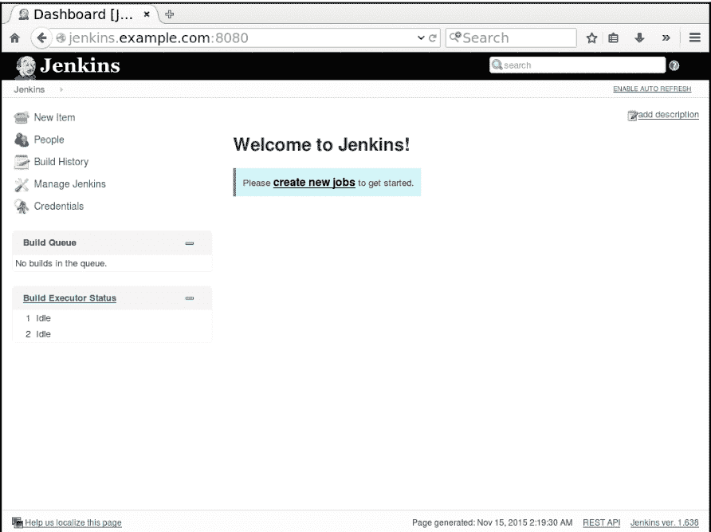
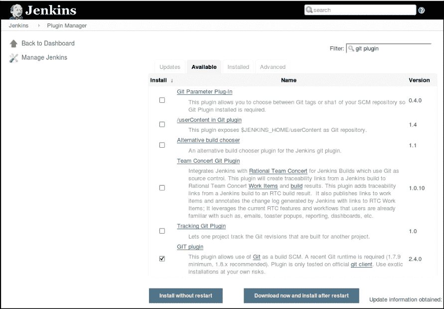
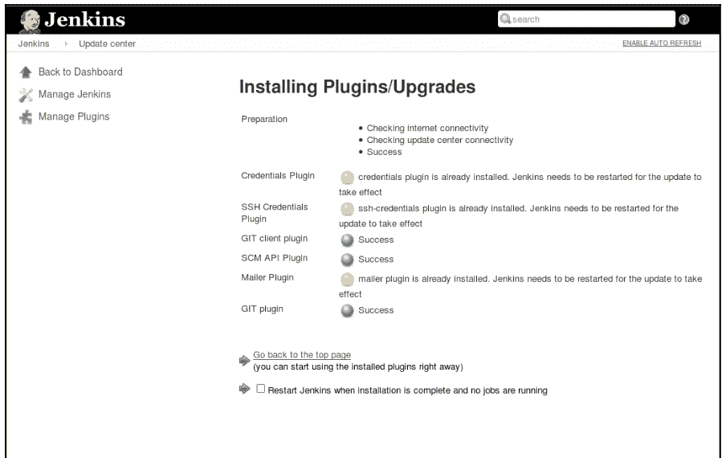
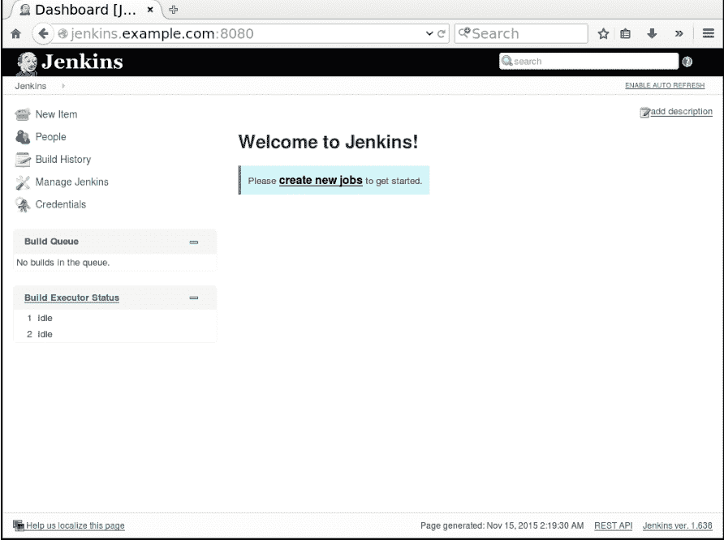
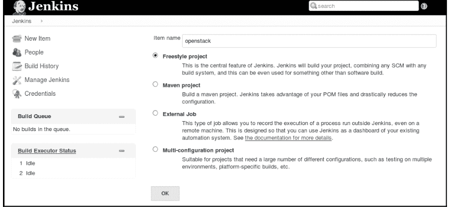
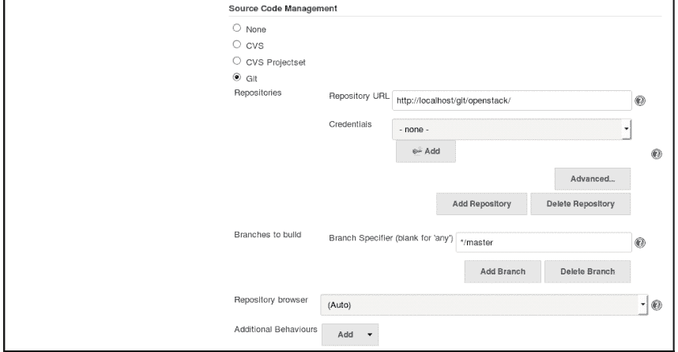
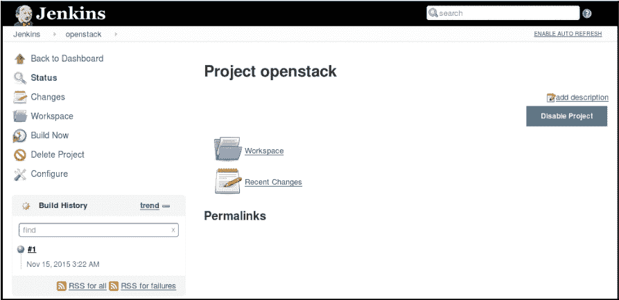
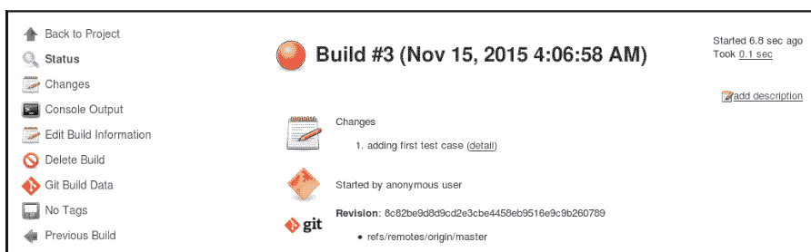

## Building the Deployment Pipeline

我们经常告诉我们合作的客户，OpenStack 不是被 **installed**，而是被 **deployed**。虽然词语上的差异可能看起来很细微，但它可能在组织内部带来革命性的变化。大多数企业基础设施团队习惯于在部署新基础设施平台时采用以下流程：

- 1. 安装平台。
- 2. 配置并集成平台。
- 3. 运行平台。
- 4. 升级平台。

安装和配置平台可能需要数月或数年时间，一旦安装完成，平台预计将运行数年。对平台的升级每 3 到 5 年发生一次，是为期 6-12 个月的大型项目。Red Hat 已围绕这些周期构建了企业 Linux 操作系统的发布结构——RHEL 5 和 RHEL 6 之间相隔 3 年，RHEL 6 和 RHEL 7 之间相隔近 4 年。每个版本都支持 10 年，保守的基础设施团队在新版本发布后至少等待一年才会开始为期 6-12 个月的升级项目。

这种对平台部署的保守方法在操作系统、虚拟化平台和应用平台领域工作得非常好。然而，如果您私有云项目的最重要业务驱动因素是提高敏捷性，那么以 12 个月的推出周期和 5 年的生命周期是不太可能实现目标的。

在本章中，我们将研究 OpenStack 通常作为应用软件而非基础设施软件的部署方式。我们将构建一个简单的部署流水线，该流水线使用 Puppet 描述 OpenStack 部署，使用 Jenkins 这款开源持续集成工具来实现该部署，然后运行单元测试以验证部署是否符合我们的规范。在整章中，我们将讨论迭代开发以及它如何适用于 OpenStack 部署。

## Dealing with Infrastructure as a Software

一家大型公司的基础设施副总裁曾经这样告诉我们：“我喜欢硬件。我的硬件几乎从不坏。我部署的软件总是坏。当我的数据中心变成软件时，我怎么才能拥有一个稳定的平台？”。同样的担忧曾经也可能适用于虚拟化，但今天大多数组织对软件假装成硬件的想法都很舒适。软件定义的数据中心则有点更令人畏惧。虽然我们很早就有了软件假装成 CPU，但软件假装成存储阵列相对较晚。而且，当存储阵列宕机时，一切往往都会随之宕机。

然而，更大的问题可能在于软件在部署时不断出错。事实上，我们合作过的最成功的 OpenStack 部署都采用了现代软件开发技术，以确保其软件在部署时不会出错。

## Eating the elephant

我们将应用于部署流程的第一个也是最重要的概念是迭代开发。不是试图在一轮部署中解决所有已识别的需求，我们将其分解为用户故事，分配给为期两到三周的冲刺，然后逐一实现。冲刺是源自 Scrum 流程和框架的一种基本开发度量。冲刺是经过规划且限制在特定持续时间内的限时工作量（两周很常见）。这不仅允许我们限制每次发布的复杂性并专注于彻底测试每个组件，还允许我们在流程中更早地为业务带来价值。仅需要少量功能集的工作负载将能够在无需等待大型发布的情况下加入平台。


## 先编写测试

我们将从软件开发领域借鉴的第二个重要实践是测试驱动开发。我们先编写能够演示所要实现功能的测试，然后再进行部署工作，直到测试通过。一旦功能实现完成，该测试便成为平台日常监控系统的一部分。

根据我们的经验，如果测试不是先于代码编写，那么它们往往根本不会被编写。每个项目都会在某个时刻面临时间耗尽的问题，如果测试被排在列表的最后，它们往往会被砍掉。

## 始终持续部署

持续部署的好处早已在软件开发领域得到充分阐述，但它们尤其适用于 OpenStack 的部署。相比少数几个大规模且经过良好测试的变更，大量小型且经过充分测试的变更对复杂环境（例如私有云部署）造成的干扰要小得多。

不过，也有一些例外。例如，从 Nova Networking 迁移到 Neutron 是一个重大变更，很难将其拆分为更小的部分。添加一个新的 Cinder 驱动是一个小的迭代变更，但在需要迁移大量卷的环境中，从一个 Cinder 驱动切换到另一个可能是一个巨大的变更。在做出架构决策时，应当谨慎行事，尽量避免对平台进行无法迭代开发和部署的大型变更。

## 使用配置管理进行部署

要开始部署我们的平台类代码，首先需要引入一套配置管理系统。虽然使用 shell 脚本自动化部署 OpenStack 确实是可能的（我们见过有人这样做），但使用声明式配置管理工具能让你的团队更轻松地跟踪迭代之间的变更。此外，一个 OpenStack 配置可能包含数百个变量，需要在数十台主机的多个配置文件中进行设置。例如，我们在实验室部署 Kilo 时，在组合层中设置了 137 个参数。用 shell 脚本管理这种复杂程度，会引入另一种不必要的复杂性。

过去几年的每项 OpenStack 用户调查都会询问社区通常如何部署 OpenStack。尽管调查结果中列出了各种各样的方法，但 Puppet 在相当长一段时间内一直是明显的领导者。在过去一年里，社区中围绕 Ansible 兴起了一项新计划，其使用量急剧增加。一些知名的 OpenStack 用户也使用 Chef 进行部署。我们的建议是使用贵组织最有经验的那款工具。我们合作过的一些团队已经大规模使用了 Puppet，一些团队精通 Chef，还有一些团队更喜欢使用 Ansible。我们也参与过使用 Salt 的项目。一个新的趋势是组合使用多种工具。例如，你可以让 Ansible 或 Salt 在主机上触发 Puppet 运行。Puppet 是最常用的，我们在本章的示例中也将使用它。

## 使用社区模块

前面提到的每个配置管理系统都有一套由 OpenStack 社区编写和维护的、用于部署 OpenStack 的模块。例如，请参考下表：

| 编排工具的 OpenStack 模块 | 位置 |
|---|---|
| Puppet 模块 | https://wiki.openstack.org/wiki/Puppet |
| Ansible 剧本 | https://wiki.openstack.org/wiki/OpenStackAnsible |
| Chef 食谱 | https://wiki.openstack.org/wiki/Chef |

无论使用哪种技术，总体方法都是一样的。

部署首先需要创建我们所说的**组合层**。这是一个 Puppet 模块（或 Ansible 剧本、Chef 食谱），它根据社区模块来定义我们部署中的系统所要承担的角色。例如，我们可以将计算角色定义为一个类，其中包含 `nova::compute` 类。控制节点角色将包含 `keystone, glance, nova::api` 以及其他类。我们还可以引入其他 Puppet 模块来配置系统服务（如 NTP）或安装监控代理。

## 分配角色

一旦我们在组合层中声明了角色，就需要一种机制将其应用到系统中。到目前为止我们一直在使用的工具（Packstack）通过 SSH 完成这项工作——它生成一组包含社区模块的 Puppet 清单，然后逐个应用到我们实验室的系统中。它支持两种角色：控制节点角色和计算角色。我们当前的实验室部署包含控制节点和计算节点，但我们还将定义数据库节点，用于运行数据库和消息服务。

我们合作过的许多组织都使用 Cobbler（http://cobbler.github.io）、Foreman（http://theforeman.org）、Puppet Enterprise（https://puppetlabs.com/puppet/puppet-enterprise）或其他工具来为系统分配角色。这些工具被称为 Puppet 的外部节点分类器（ENC）。借助 ENC，可以轻松地将配置参数（如 IP 地址或密码）与系统中的配置本身分离开来。这些工具还可以提供有关 Puppet 运行的报告和管理功能。

在本章中，我们将设置一个简单的 Puppet 主服务器来管理我们环境中各主机的配置。我们将配置数据存储在组合层中，同时承认这并不是最佳实践。


我们有一个客户更喜欢将配置数据存储在组合层中。他们的理由是，输入配置数据是最容易出现拼写错误或其他错误的地方，而这些错误会破坏自动化部署。由于他们通过版本控制来跟踪这些数据，因此更容易追踪这些手动错误。他们提出的流程是：为每个部署环境分叉（fork）出一个分支，然后在需要更新时从主分支将配置更改拉取到这些分支。分叉操作通常发生在开发人员从项目（如 OpenStack）中获取源代码副本并开始添加自己的更改时。由于项目的主源代码称为主干（trunk），当开发人员更改部分代码时，就说该开发人员创建了一个分支。

我们将已定义的角色分配给 Puppet 主服务器上的各主机，当主机与主服务器签入（check in）时，它们将获得与其角色匹配的配置。主机在首次运行后会定期签入，并在我们在主服务器上提供配置更新时拉取这些更新。

## 选择起点

前面列出的每个官方 OpenStack Puppet、Chef 和 Ansible 项目都提供了示例组合层，可用于进行简单的 All-in-One 部署。Puppet 的 All-in-One 部署清单可在 `https://github.com/openstack/puppet-openstack-integration` 获取。它提供了三种方案，可以用作起点。不同的 OpenStack 厂商也可能提供适合作为起点的参考。我们合作过的一些组织聘请了咨询公司来编写最初的组合层，然后教他们如何迭代。

由于我们已经使用 Packstack 完成了可用的部署，我们将以此作为组合层的基础。随着我们向部署中添加功能，我们会从 Packstack 生成的清单中复制部分内容作为起点。我们还会添加一些新的 Puppet 代码，以将部署扩展到 Packstack 所能实现的范围之外。

## 测试基础设施

无论贵组织决定使用哪种配置管理系统来部署和配置 OpenStack 软件，部署过程由测试基础设施驱动都是至关重要的。根据我们的经验，手动管理的环境总会导致不一致，无论执行部署的操作员技能如何。自动化部署不可能在真空中进行；然而，要想成功，它们需要向开发人员和操作员提供即时反馈，以便他们判断部署是否成功。我们经历过许多 OpenStack 的手动部署和手动验收测试，这些周期可能需要数天或数周才能完成。

## 测试类型

在组合层的变更应用于环境之前，会经过多个测试阶段。在每个阶段，如果测试失败，部署就会停止。我们将这一系列阶段称为**部署流水线**。在流水线的一端，变更被提交到版本控制；在另一端，配置在基础设施中得以实现。


## 构建部署流水线

下表列出了在流水线每个阶段测试的项目：

| 阶段 | 测试重点 |
|---|---|
| 预提交 | 在变更进入流水线之前，对其进行测试，以确保不存在语法错误或风格问题。 |
| 部署测试 | 在此阶段，测试集群中的每个系统都尝试应用配置更新。是否成功取决于变更能否无错误地应用。部分部署会触发第二次应用以测试幂等性。 |
| 集成测试 | 测试集群成功应用配置后，针对 OpenStack API 运行单元测试套件，验证配置的功能。 |
| 性能测试 | 对测试集群运行一系列测试，以确保变更不会对性能产生不良影响。 |
| 验收测试 | 在流水线的此阶段，执行任何手动测试。随后，变更被提升到下一个环境。 |
| 金丝雀测试 | 生产环境的一个子集将应用变更，并重复自动化和验收测试，且使用生产数据库和 hypervisor。 |
| 发布 | 整个生产环境将应用变更。 |

许多组织希望在部署过程中加入代码审查。这通常在所有自动化测试完成后进行，以便审查人员可以获得测试结果。诸如 Gerrit (https://www.gerritcodereview.com/) 之类的工具可用于编排具有代码审查要求的构建流水线。许多组织更倾向于手动执行金丝雀测试和生产发布——这些仍应是由操作员决定启动（和回滚）的自动化流程。

## 编写测试

OpenStack 完全由 REST API 驱动，因此可以使用任何带有 HTTP 客户端实现的语言为平台编写测试。http://developer.openstack.org 上提供了大多数主流语言的软件开发工具包（SDK）。即便如此，大多数组织倾向于使用 Python（OpenStack 的编写语言）编写测试。对此有两种不同的观点。第一种观点认为，这样更容易吸引熟悉 Python 的 OpenStack 人才，而且相关技能可以在测试与开发之间相互转换。此外，上游还有一个名为 Tempest 的 Python 项目，许多组织将其用作运行自身测试的框架。第二种观点则认为，组织应该使用平台终端用户所使用的同一接口来测试平台。例如，如果你打算通过云管理平台或使用 Ruby Fog 库 (http://fog.io/) 的 PaaS 来配置基础设施，那么就应该使用 Fog 库编写测试。

无论如何，Tempest 几乎总是会在 OpenStack 部署测试过程中的某个环节被用到。至少，所有自称是 OpenStack 云的公共云都必须通过一组最低限度的 Tempest 测试，才能获得基金会的认证。

## 运行测试

如前所述，测试基础设施应推动变更沿着流水线前进，捕获每次测试运行的结果，并在运行成功时提升变更。为此，可以使用软件开发中使用的众多 CI 工具中的任何一种。我们通常建议利用组织已经在使用的 CI 工具和软件仓库。如果你的组织在软件开发团队中没有进行 CI，我们之前见到成功使用的优秀选择包括 Jenkins (https://jenkins-ci.org/)、Atlassian 的 Bamboo (https://www.atlassian.com/software/bamboo/) 或 Buildbot (http://buildbot.net/)。OpenStack 基金会的 CI 是基于 Jenkins 构建的，在本章中，我们将使用该工具来构建我们的流水线。

## 组装流水线

现在我们已经介绍了部署流水线的各个组件，下面在我们的实验室环境中组装一个示例流水线。我们将从设置 CI 服务器开始，创建一个新的组合层，编写一个单元测试，然后部署 OpenStack 基础设施以通过测试。

## 设置 CI 服务器

在前面的章节中，我们通过从云控制器运行 `packstack` 工具来部署 OpenStack。在本节中，我们将设置一台专用机器来执行部署。对部署机器的要求并不苛刻——任何运行 CentOS 7 且内存为 2 GB 或以上的机器都应足够。唯一的网络要求是，该机器可以从内网和 OpenStack 集群本身访问。

### 安装 Git

以下说明将在 CI 服务器上设置一个 Git 版本控制服务器。如果你已经可以访问 Git 仓库，或者更倾向于使用 GitHub，则可以跳过本节。有关设置 Git 服务器的更多信息，请参阅 *Scott Chacon* 和 *Ben Straub* 所著的 *Pro Git* 一书，该书可在 https://git-scm.com/book/en/v2/ 在线阅读。

要安装 Apache HTTP 服务器和 Git 版本控制软件，请执行以下步骤：

- 1. 以 root 身份在 CI 服务器上执行以下命令：
```
# yum install -y httpd git
```
- 2. 验证软件包是否已正确安装：
```
# rpm -q httpd git
```
- 3. 创建一个顶级目录来存放我们的仓库：
```
# mkdir /var/www/html/git
```
- 4. 使用以下命令在该目录中创建 Git 仓库：
```
# mkdir /var/www/html/git/openstack/
# cd /var/www/html/git/openstack
# git --bare init
# git update-server-info
```
- 5. 在执行 `git --bare init` 命令后，你应该会看到以下响应：
```
Initialized empty Git repository in
/var/www/git/openstack/
```
- 6. 重置新 Git 仓库对 Apache 的权限：
```
# chown -R apache:apache /var/www/html/git/
```
- 7. 最后，创建一个需要身份认证才能访问 Git 仓库的配置文件。以下示例可以复制到 /etc/httpd/conf.d/git.conf：
```
<Directory /var/www/html/git/>
    DAV on

    AuthName "Git login:"
    AuthType Basic
    AuthUserFile /var/www/htpasswd

    # Allow anonymous clone, but require auth for push.
    <LimitExcept GET PROPFIND>
        Require valid-user
    </LimitExcept>
</Directory>
```
- 8. 创建一个用于访问仓库的用户账户：
```
# htpasswd -c /var/www/htpasswd git
```
- 9. 最后，重启 httpd 服务：
```
# systemctl restart httpd
```
- 10. 现在，你应该可以使用以下命令克隆 Git 仓库：
```
# git clone http://git@localhost/git/openstack
```
- 11. 系统可能会提示你输入创建用户账户时设置的密码，然后你应该会收到以下消息：
```
warning: You appear to have cloned an empty repository.
```

### 安装 Puppet 主服务器

以下说明将在 CI 服务器上设置一个 Puppet 主服务器。如果你已经有一个可以在实验室中使用的 Puppet 基础设施，可以跳过本节。有关设置 Puppet 主服务器的更多信息，请参阅 Puppet 参考手册 (http://docs.puppetlabs.com/puppet/latest/reference/)。安装 RDO 仓库，该仓库提供了对 Puppet 和 OpenStack Puppet 模块的访问，具体步骤如下：

- 1. 以 root 身份在 CI 服务器上执行以下命令：
```bash
# yum install -y https://rdoproject.org/repos/rdo-release.rpm
```
- 2. 运行以下命令，验证仓库已被启用：
```bash
# yum repolist
```
- 3. 你应该会在输出中看到 `openstack` 仓库。运行以下命令来安装 Puppet 和 OpenStack Puppet 模块：
```bash
# yum install -y puppet puppet-server openstack-puppet-modules openstack-packstack
```
- 4. 使用以下命令验证它们的安装：
```bash
# rpm -q puppet puppet-server openstack-puppet-modules openstack-packstack
```
- 5. 编辑 Puppet 配置，以包含 OpenStack Puppet 模块：
```bash
# puppet config set basemodulepath \
'$confdir/modules:/usr/share/puppet/modules:/usr/share/openstack-puppet/modules' --section main
```
- 6. 通过列出可用的 Puppet 模块来验证配置：
```bash
# puppet module list
```

你应该会看到大约 60 个 Puppet 模块，具体数量取决于 OpenStack 的版本。忽略任何有关依赖关系的错误。


7. 使用以下命令启动 puppet master 服务：

```
# systemctl start puppetmaster.service
# systemctl enable puppetmaster.service
```

8. 验证服务是否正确启动：

```
# systemctl status puppetmaster.service -l
```

你应该会看到服务已创建证书颁发机构。环境中的客户端访问 Puppet master 时必须使用与证书颁发机构相同的 hostname。如果客户端将通过除 hostname 之外的其他方式访问 Puppet master，请查阅 puppet.conf 中的 dns_alt_names 设置。

## 安装 Jenkins

以下说明将在 CI 服务器上设置 Jenkins 服务器。如果你已有可在实验室中使用的 Jenkins 服务器，可以跳过本节。有关设置 Jenkins 的更多信息，请参阅 Jenkins 网站 (https://wiki.jenkins-ci.org/display/JENKINS/Use+Jenkins)。

- 1. 以 root 用户身份在 CI 服务器上执行以下命令以安装 Jenkins 仓库，该仓库提供对 Jenkins 的访问权限：

```
# curl http://pkg.jenkins-ci.org/redhat/jenkins.repo > /etc/yum.repos.d/jenkins.repo
# rpm --import https://jenkins-ci.org/redhat/jenkins-ci.org.key
# yum install -y java-1.7.0-openjdk jenkins
```

- 2. 要验证软件是否正确安装，运行以下命令：

```
# rpm -q java-1.7.0-openjdk jenkins
```

- 3. 要启动 jenkins 服务器，使用以下命令：

```
# systemctl start jenkins
```

- 4. 使用以下命令验证 Jenkins 是否正确启动：

```
# systemctl status jenkins -l
```

你应该会看到服务正在运行，并且日志输出中没有错误。

5. 现在你可以通过在 Web 浏览器中访问主机 8080 端口来登录 Jenkins Web UI；也就是说，如果你的 CI 服务器的 hostname 为 `jenkins.example.com`，Jenkins 应可在 `http://jenkins.example.com:8080/` 上访问。登录后你应会看到以下页面：



6. 我们需要做的最后一件事是安装 Git SCM 插件。点击左侧导航中的 Manage Jenkins 链接。从下一页选择 Manage Plugins。在 Plugins 页面，选择 Available 选项卡，并在 Filter 栏中搜索 git plugin。选择 Git 插件并点击 Install without restart：



你将看到安装进度状态。完成后，你会看到类似以下页面：



Jenkins 现已安装并配置了 Git 插件。

## 创建组合层

现在我们的基础架构软件已就位，我们将开始创建我们的组合层。如前所述，我们将从在第 2 章 *Architecting the Cloud* 中运行 `packstack` 命令时获得的“已知良好”配置开始。

## 启动我们的 Puppet 模块

我们的组合层将存储在两个 Puppet 模块中，使用 Craig Dunn 开发的 **profiles and roles** 模式 (http://www.craigdunn.org/2012/05/239/)。我们将模块存储在新 Git 仓库中名为 `puppet/modules` 的目录中。以下步骤将在我们的仓库中创建新模块：

- 1. 克隆仓库。建议对此部分使用非特权用户帐户：
```
$ git clone http://git@localhost/git/openstack/
```
- 2. 接下来，创建模块的目录：
```
$ mkdir -p openstack/puppet/modules
```
- 3. 使用 `puppet module` 命令在目录中创建新模块：
```
$ cd openstack/puppet/modules
$ puppet module generate openstack-profile
$ puppet module generate openstack-role
```
对于每个命令，你将被提示输入有关模块的一组元数据。输入你想要的尽可能多的信息或采用默认值。
- 4. 设置好模块后，返回到代码仓库的顶层，并使用以下命令将其检入版本控制：
```
$ cd ~/openstack
$ git add puppet
$ git commit -m 'Initial check-in of the profile and role modules'
$ git push origin master
```
你应该会看到模块已提交并推送到仓库上的新 master 分支。
- 5. 现在让我们将这些模块添加到我们的 Puppet master。为此，以 root 用户身份在服务器上的位置克隆仓库的干净副本：
```
# cd /srv
# git clone http://localhost/git/openstack
```

你应该会收到类似 `Cloning into 'openstack'...` 的消息，这将表明命令成功。

- 6. 我们将使用 Jenkins 作业更新此仓库，因此将目录的所有权更改为 Jenkins 用户：

```
# chown -R jenkins:jenkins /srv/openstack
```

如果使用远程 Jenkins 服务器，你需要设置权限，以便可以远程登录此机器并在该目录中运行 `git pull` 命令。

- 7. 接下来，将两个新的 puppet 模块符号链接到 master 上的 `/etc/puppet/modules`：

```
# cd /etc/puppet/modules
# ln -s /srv/openstack/puppet/modules/openstack-profile profile
# ln -s /srv/openstack/puppet/modules/openstack-role role
```

现在你应该在 master 上 `puppet module list` 的输出中看到这两个模块：

```
/etc/puppet/modules
├── openstack-profile (v0.1.0)
└── openstack-role (v0.1.0)
```

## 定义第一个角色和配置文件

我们已在设计文档中定义了一组主机组。我们将直接将它们映射到我们 Puppet 组合层中的角色。每个角色将在 role Puppet 模块中拥有自己的类和文件。角色由配置文件组成，每个配置文件代表 OpenStack 功能的一部分。例如，`mariadb` 配置文件将安装并配置我们部署的 MySQL 数据库服务器，`amqp` 配置文件将安装并配置 RabbitMQ 消息服务器，等等。让我们从创建 Database Node 角色和相关配置文件开始。

## 构建部署管道

如前所述，我们将使用在 *第 2 章，Architecting the Cloud* 中创建的 Packstack 配置作为我们组合层的起点。通常，当 Packstack 运行 时，它会删除用于在主机上安装 OpenStack 软件的 Puppet 清单。但是，如果你指定 `-y` 选项，它将退出而不执行任何操作并保留 Puppet 清单。在 *第 2 章，Architecting the Cloud* 中运行 Packstack 的原始主机上，使用相同的 answer 文件和 `-y` 选项重新运行 Packstack：

```bash
# packstack --answer-file=packstack.answers -y
```

命令执行完成后，它将打印写入 Puppet 清单的目录名称。它应类似于 `/var/tmp/packstack/20151123-214424-gJbmJA`。进入该目录并将 Hiera 数据和清单复制到你的 CI 服务器。

Packstack 的 Puppet 清单使用 Hiera，Puppet 的 **key/value lookup tool**，使存储配置信息（如密码和 IP 地址）变得容易，以便它们不必存储在清单本身中。我们将继续采用这种做法。将 `hieradata` 目录复制到 CI 服务器上的 `/etc/puppet/hieradata`。要告诉 Puppet 引用此数据，创建一个名为 `/etc/puppet/hiera.yaml` 的文件，内容如下：

```yaml
---
:backends:
  - yaml
:hierarchy:
  - defaults
  - "%{clientcert}"
  - "%{environment}"
  - global

:yaml:
  :datadir: /etc/puppet/hieradata
```

现在，让我们创建第一个配置文件。在我们检出的 openstack 仓库副本中创建名为 `puppet/modules/openstack-profile/manifests/mariadb.pp` 的新文件。再次使用非特权帐户。

从 RDO 的 Newton 版本开始，Packstack 工具创建的清单已采用我们在本章中实现的 roles and profiles 模型。Packstack 中存在两个角色——一个用于控制器，一个用于计算节点。我们将通过从控制器清单中复制相关配置文件来创建新角色。在 `mariadb.pp` 中，创建如下的类定义：

```
class profile::mariadb {
  include '::packstack::mariadb'
  include '::packstack::mariadb::services'
}
```

这使用我们在 Packstack 安装中用于安装数据库的相同 Puppet 代码定义了 `mariadb` 配置文件。现在创建名为 `puppet/modules/openstack-role/manifests/database.pp` 的文件。在该文件中创建名为 `role::database` 的类，该类引用我们之前创建的配置文件：

```
class role::database {
  include profile::mariadb
}
```

将两个文件添加到提交，然后提交并推送到 Git 服务器。

## 运行第一次构建

访问 Jenkins http://jenkins:8080/，将 `jenkins` 替换为你的 CI 服务器的 hostname。Jenkins UI 应出现，提示你创建新作业。


点击 **create new jobs**：



创建一个名为 `openstack` 的 **Freestyle project**，如下所示：



现在，我们将指定项目的选项。首先，在 **Source Code Management** 下，选择 **Git** 并为你的仓库指定 `http://localhost/git/openstack`。（这假定你使用的是我们在 CI 服务器上设置的 Git 服务器。如果使用远程 Git 仓库，则输入该仓库的克隆 URL。）



## Building the Deployment Pipeline

接下来，我们将添加一个步骤来使用仓库中的最新代码更新 Puppet master。在 Build 下，点击 **Add build step** 并选择 **Execute shell**。指定以下命令：

```bash
cd /srv/openstack && git checkout -f $GIT_COMMIT
```

这将把 Puppet master 拉取的仓库副本更新为我们正在测试的版本：


让我们运行一次构建以确保权限设置正确。保存项目。这会带你返回项目页面。选择 **Build Now**。你会在左下角的 **Build History** 选项卡中看到第一次构建：



点击构建编号将显示构建是否成功或失败的信息，并允许你查看构建的控制台输出。

要验证 Jenkins 是否将我们的新更改拉取到模块中，请在 /etc/puppet/modules 中查找新文件：

```
# ls /etc/puppet/modules/profile/manifests/
# ls /etc/puppet/modules/role/manifests/
```

你应该在这些目录中看到 mariadb profile 和 database role 文件。

## Writing the tests

对于我们的第一个测试，我们将使用 mysql 命令行客户端连接到我们配置的数据库，并验证我们是否可以使用之前指定的用户名和密码登录。由于我们没有将新的 roles 和 profiles 应用到任何机器上，因此运行此测试时会失败。首先，在 CI 服务器上安装 mysql 客户端。我们将使用以下命令来验证与数据库的连接：

```
# yum install -y mariadb
```

使用 which 命令验证命令是否已安装：

```
# which mysql
```

你应该在输出中看到 /bin/mysql。

虽然我们可以在 Jenkins 构建的配置中直接编写测试，但最佳实践是将测试与源代码一起包含。在 Git 仓库的顶层创建一个名为 test 的目录来存放测试。使用与之前相同的已检出仓库版本和相同的非特权用户账户：

```
$ cd ~/openstack/
$ mkdir test
```

进入 test 目录并创建一个名为 test.sh 的 shell 脚本，该脚本尝试连接到数据库节点上的 MySQL。以下脚本目前足够：

```
#!/bin/sh

/bin/mysql -h db.example.com -uroot -psecret  -e "show databases;"
```

根据你的主机名和密码，分别替换 -h 和 -p 选项的适当值。运行脚本应导致失败：

```
$ sh test.sh
```

它应返回 Can't connect to MySQL server。

将 test 目录添加到你的提交中，然后提交并推送更改：

```
$ cd ../
$ git add test
$ git commit -m "adding first test case"
$ git push
```

代码推送后，配置 Jenkins 运行测试。在 Jenkins UI 中，选择 openstack 项目并点击左侧导航中的 Configure。在 Build 下，点击 Add a build step 并选择 Execute shell。输入如下截图所示的 shell 命令：


保存配置，然后从左侧导航中选择 Build Now。此次构建应失败：



选择 **Console Output** 应显示我们在命令行上运行命令时收到的相同错误。现在让我们着手配置数据库服务器以应用我们的 profile 和 class，以便测试通过。

## Assigning the first role to a system

为了整合所有内容，我们将从一台未配置的系统开始，安装并配置 Puppet agent，并使其拉取我们定义好的配置。让我们先在 Puppet master 上将角色分配给系统。

以 CI 服务器上的 root 用户身份，在 `/etc/puppet/manifests` 中创建 `site.pp` 文件，将未配置的主机映射到角色。例如，如果我的数据库主机名为 `db.example.com`，以下片段即可工作：

```
node "db.example.com" {
  include role::database
}
```

在主机本身上，使用以下命令安装 RDO 仓库和 puppet agent：

```
# yum install -y https://rdoproject.org/repos/rdo-release.rpm
# yum install -y puppet
```

配置系统使用我们的 CI 服务器作为其 Puppet master。例如，如果我们的 CI 服务器是 `jenkins.example.com`，请输入：

```
# puppet config set server 'jenkins.example.com' --section agent
```

最后，执行一次初始 Puppet 运行以设置证书：

```
# puppet agent -t
```

这应显示错误 `no certificate found and waitforcert is disabled`。

以 root 身份登录 CI 服务器并使用以下命令批准证书：

```
# puppet cert sign db.example.com
```

你将收到证书已被签名且请求已被移除的通知。

回到数据库服务器，执行另一次 Puppet 运行以拉取配置：

```
# puppet agent -t
```

这将产生大量输出，因为系统会从 master 下载所有 Puppet 模块。你应该看到系统下载、安装并为 OpenStack 配置 MySQL 数据库。最后，再次从 Jenkins 运行一次构建以使其成功。

## Installing Keystone

让我们在当前环境上迭代，添加另一个 profile 和 role。现在我们有了可用的数据库，安装第一个 OpenStack 服务 Keystone。首先编写单元测试。我们的测试将确保我们可以使用 Packstack 答案文件中指定的 admin 用户名和密码从 Keystone 获取令牌。这可以通过 curl 命令完成。在 Git 仓库的 test 目录下创建一个名为 test_keystone.sh 的文件：

```
$ cd ~/openstack/test/
$ vi test_keystone.sh
```

使用以下内容作为示例，将密码替换为 demo 用户的密码（secret），将第一个控制器的主机名替换为 controller01：

```
curl -i \
  -H "Content-Type: application/json" \
  -d '
  { "auth": {
    "tenantId": "demo",
    "passwordCredentials": {
      "userId": "demo",
      "password": "secret"
    }
  }
}' \
  http://controller01:5000/v2/auth/tokens ; echo
```

现在运行脚本。它应以 Connection refused 错误失败。

要使测试通过，请遵循与创建数据库 profile 时类似的过程。在 openstack 仓库中创建文件 puppet/modules/openstack-profile/manifests/keystone.pp，内容如下：

```
class profile::keystone {
  include '::packstack::apache'
  include '::packstack::keystone'
}
```

如前所述，创建一个名为 controller 的 role 并将 keystone profile 分配给该 role。创建文件 puppet/modules/openstack-role/manifests/controller.pp，内容如下：

```
class role::controller {
  include profile::keystone
}
```

将这些文件提交并推送到仓库：

```
$ git add puppet/modules/openstack-profile/manifests/keystone.pp
$ git add puppet/modules/openstack-role/manifests/controller.pp
$ git commit -m 'adding a controller role and keystone profile'
$ git push
```

再次从 Jenkins 运行构建以将文件推送到 Puppet master。我们尚未配置 Jenkins 运行新的测试，因此构建应成功，即使测试会失败。

再次取一台未分配的机器并根据主机名分配 controller 角色。在此示例中，我们将角色分配给名为 controller01.example.com 的机器。编辑 CI 服务器上的 /etc/puppet/manifests/site.pp 并添加以下片段：

```
node "controller01.example.com" {
  include role::controller
}
```

在名为 controller01.example.com 的未配置主机上，安装 Puppet agent 并设置 Puppet master：

```
# yum install -y https://rdoproject.org/repos/rdo-release.rpm
# yum install -y puppet
# puppet config set server 'jenkins.example.com' --section agent
# puppet agent -t
```

再次，你需要在 Puppet master 上批准证书：

```
# puppet cert sign controller01.example.com
```


在第二次执行 Puppet 时，Keystone 将被安装并配置完成。通过在 Jenkins 中添加一个类似如下的新构建步骤，启用我们在提交中编写的 Keystone 测试：


运行构建，并确保测试通过——此时 Keystone 已在第一个控制器上运行。

## 完全自动化流水线

到目前为止，我们一直在手动运行 Jenkins 构建和 Puppet 执行。这样我们可以确保在 Puppet 执行完成后才运行测试。要消除流水线中的这两个手动步骤，有几种不同的方法。

对于 Jenkins 构建，可以将 Jenkins 配置为定期轮询源代码仓库，也可以将 Git 配置为在新代码推送时主动通知 Jenkins 并触发构建。Jenkins 可以配置为仅在代码推送到任何分支时构建，也可以配置为仅在代码推送到特定分支时构建。这样你可以忽略特性分支上的工作，只在合并到主分支时执行构建；或者忽略合并操作，只在特性分支上执行构建。像 Stash 和 Bamboo 这样的工具提供了更简单的集成方式。

管理 Puppet 执行则稍显复杂。默认情况下，Puppet 大约每 30 分钟运行一次，从 Puppet master 获取变更并应用它们。虽然这对于希望分散执行以提升性能的大型环境是合理的，但等待半小时让环境获取你刚刚推送到 Git 的变更可能会令人沮丧。这个问题有两种可行的解决方案。第一，你可以将 Puppet 的执行作为测试过程的一部分在主机上运行。像 Ansible 这样的工具可以让这变得相对简单。第二，你可以缩短开发环境的执行间隔。这由 `/etc/puppet/puppet.conf` 主配置块中的 `runinterval` 设置控制。

一旦你完全自动化了流水线，你需要在将变更推送到 Puppet master 与运行单元测试之间添加某种延迟。这将使主机有时间获取变更并实施它们。例如，如果你将 `runinterval` 设置为 5 分钟，并期望变更在 5 分钟内应用，你可以在 Jenkins 作业中添加一个构建步骤，在执行单元测试前休眠 10 分钟。

## 总结

在本章中，我们讨论了组织如何使用现代软件开发技术来提高其 OpenStack 部署的质量。我们使用 Puppet、Git 和 Jenkins 构建了一个简单的部署流水线，并用它来部署和测试 OpenStack 基础设施的两个组件。在此基础上，可以以受控方式安装、配置和测试更多组件。

对于习惯使用 Packstack 并快速搭建环境的人来说，这似乎需要付出很多额外努力。但根据我们的经验，如果没有适当的基础设施来管理和测试变更，这些部署在规模化时会变得难以驾驭。提醒一下，我们遵循的三个基本原则是：

- 小而可控的变更，而不是大规模升级周期
- 测试驱动开发
- 持续部署

由于大多数组织在软件开发中已经具备围绕这些原则的一些经验和工具，部署流水线因组织而异。一个值得参考的优秀基础设施示例是 OpenStack 基金会自身用于测试变更的设施。有关该流水线的更多信息，请访问：

```
http://docs.openstack.org/infra/
```

## 参考资料

- OpenStack Puppet 指南：http://docs.openstack.org/developer/puppet-openstack-guide/
- OpenStack Ansible 项目：https://wiki.openstack.org/wiki/OpenStackAnsible
- OpenStack Chef 项目：https://wiki.openstack.org/wiki/Chef
- 设计 Puppet – 角色与配置文件，Craig Dunn：http://www.craigdunn.org/2012/05/239/
- OpenStack 开发者与社区基础设施文档：http://docs.openstack.org/infra/

# 5
