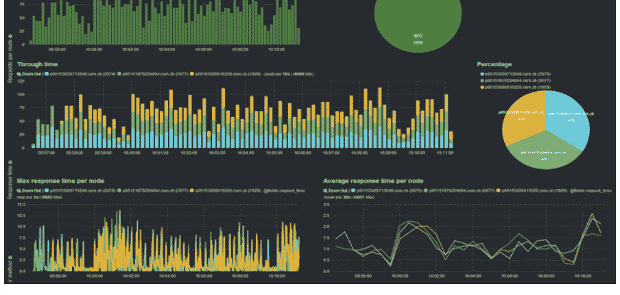
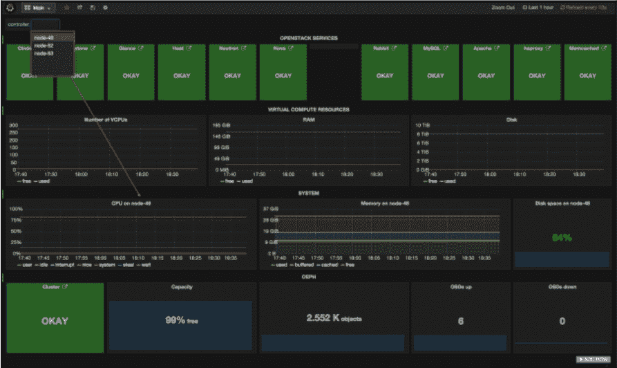
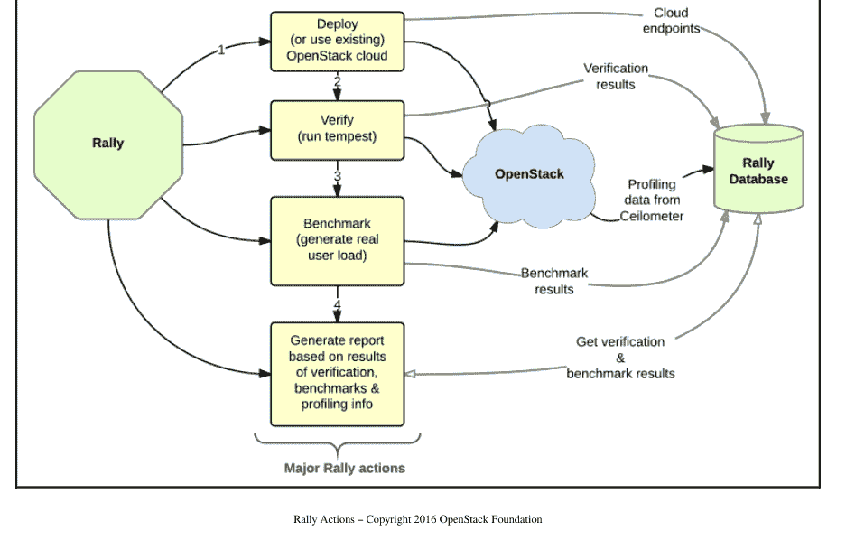
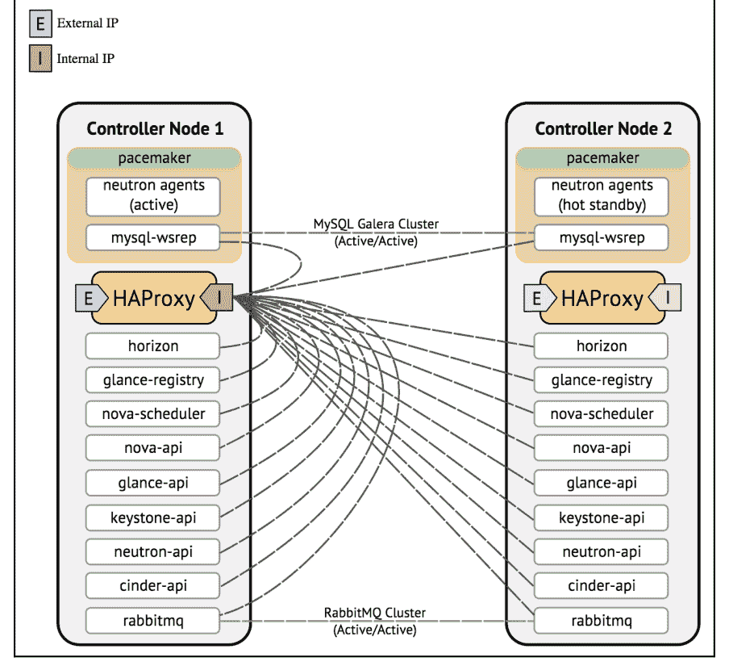
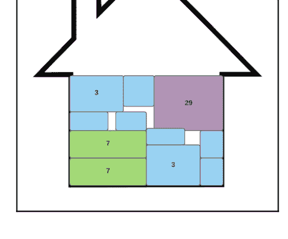

## 构建以运营

许多 OpenStack 管理员熟悉较为成熟的虚拟化平台。他们熟悉预装的操作工具，可以让管理员在几分钟内通过点击和配置构建一个功能完备的基础设施监控解决方案。不幸的是，OpenStack 并不是那么简单。这并不意味着它不如其他平台；恰恰相反，它非常灵活，允许管理员选择自己的工具，并以最适合公司或组织需求的方式对其进行配置。

在本章中，我们将讨论第 2 天运维，换句话说，就是 OpenStack 云构建、测试并具备运营条件后发生的事情。在此时，云已准备好接纳用户和工作负载。

### 本章预期成果

本章旨在达到以下目标：

- 对 OpenStack 云中真正需要监控的内容提供关键洞察。
- 提供一套在监控系统中实施的最佳实践。我们将提供一些示例规范，帮助你入门，并允许你根据企业运维需求进行调整。
- 基于实际案例，提供在 OpenStack 这类弹性云环境中进行有效容量规划的建议。
- 广泛了解 OpenStack 运维中使用的工具，包括开源和商业工具。

## 日志、监控和告警

运维 OpenStack 云最重要的方面之一是日志、监控和告警（LMA）。由于 OpenStack 不是传统基于裸机的基础设施平台，因此需要采用不同的方法。考虑到 OpenStack 环境的规模和弹性，传统的 LMA 方法往往力不从心。此外，旧的二元告警方式——例如“此服务已关闭”“资源使用率已达 95%”甚至“文件系统已满”之类的消息——无法提供真正了解 OpenStack 云健康状况所需的运营信息深度。

虽然有许多不同的工具可以实际监控日志事件并从运行 OpenStack 基础设施的系统创建告警，但在本章中，我们将更侧重于架构原则，这些原则将帮助你选择日志、监控和告警工具。

无论使用什么工具进行日志、监控和告警，从架构角度来看，解决方案都应满足以下要求：

- 对 OpenStack 基础设施提供实时或近实时的内部检查和告警
- 支持某种形式的发现和配置管理
- 可扩展以支持企业云
- 具备自我监控能力，并能够配置为高可用

### 日志

OpenStack 云运营数据的重要来源之一是日志。不仅主机操作系统的日志可用，而且作为 OpenStack 一部分运行的每个项目都有单独的日志。然而，尽管日志是分开的，建议将所有日志以相同的 syslog 日志级别发送到 syslog，作为起点，如有需要再进行修改。

以下是从 `nova-api.log` 中提取的 OpenStack 日志条目成功操作的示例：

```
2016-07-08 07:36:45.613 3474 INFO nova.osapi_compute.wsgi.server [req-b5ff3321-19cc-4ce8-af9c-0ed59ae21ac7 f32900acc09d4898b091b2caa4900112 6f0117ddd81b4dc78a8f4ce4dd5b04f5 - -] 10.0.3.15 "GET /v2/6f0117ddd81b4dc78a8f4ce4dd5b04f5/flavors/1 HTTP/1.1" status: 200 len: 613 time: 0.1168451
```

出于安全和分析的目的，日志应发送到远程集中式 syslog 服务器。理想情况下，该服务器将是进行日志检查、分析和编目的地方，并且应托管在具有适当 CPU 和内存以支持这些工作负载的服务器上。日志检查将针对日志条目的内容进行，因为这些日志可能包含以下部分或全部内容（基于上述日志的示例）：

- 严重性级别（`INFO`）
- 发送日志的服务器（`10.0.3.15`）
- 发送日志的服务（`nova.osapi_compute.wsgi.server`）
- 元数据，如 `tenant_id` 和 `request_id`（`6f0117ddd81b4dc78a8f4ce4dd5b04f5` 和 `req-b5ff3321-19cc-4ce8-af9c-0ed59ae21ac7`）
- 服务中的错误代码，甚至性能数据，如 HTTP 响应时间（由于创建请求和 API 交互的分段特性，对于异步连接，其可用性有限）

以下是错误示例：

```
nova-scheduler.log:2016-07-08 07:26:48.687 1159 ERROR oslo.messaging._drivers.impl_rabbit [req-c419cec6-9847-4692-8c61-733524097546 -- - --] AMQP server on 10.0.3.15:5672 is unreachable: [Errno 111] ECONNREFUSED. Trying again in 4 seconds
```

如上所示，这是一个结构化的日志文件，可以通过许多不同的工具进行解析，以提取严重性、服务、时间戳和其他相关元数据。此外，这些数据可以使用开源分析工具（如 **ELK（ElasticSearch、Logstash 和 Kibana）**）进行搜索。有关这一行业标准数据挖掘平台的基本信息，请访问 `https://www.elastic.co/webinars/introduction-elk-stack`。该页面还包含一个帮助你入门的网络研讨会。


这种使用日志处理平台、搜索平台、图形仪表盘和告警平台的概念，同样也被许多大型商业和研究生产云用作OpenStack基础设施监控解决方案。例如，CERN和GoDaddy都在使用ELK来为其OpenStack云提供可视化。CERN的仪表盘（http://openstack-in-production.blogspot.com/2013/10/log-handling-and-dashboards-in-cern.html）看起来与此类似（它展示了Nova API统计信息）：



CERN OpenStack云团队，2013

然而，并非所有解决方案都基于ELK；例如，Mirantis分发了一款名为StackLight的产品，它使用了不同的日志处理和格式化工具。除了Kibana之外，它还将Grafana添加到了可视化仪表盘套件中。Mirantis的解决方案还使用了不同的组件进行日志收集，并添加了InfluxDB作为时间序列数据的数据库。StackLight将Nagios Core集成到监控平台中以提供告警功能。这一系列免费软件应用程序由一系列插件（https://www.mirantis.com/validated-solution-integrations/fuel-plugins）自动配置为监控平台，并安装到Fuel（Mirantis最近开源的安装程序）上：



类似地，还有其他发行版拥有各自定制的监控平台；然而，尽管它们在软件选择上有所不同，但它们的架构相似，并且提供了与前述示例类似的功能。它们都基于本章前面讨论的日志分析基本原理，并提供了可用于数据可视化的实用工具。

## 监控

许多组织在应用程序部署到上线之间的阶段举步维艰。这主要是因为对OpenStack云运维与传统遗留平台之间的差异缺乏理解。很多时候，这是最难克服的障碍，因为它需要在工程、运维和开发人员与基础设施、应用程序和平台交互方式上实现一些根本性的文化转变。

虽然本节中我们将介绍的一些实践方法可能也适用于工作负载监控，但本章讨论的是OpenStack基础设施的运维监控，而不是运行在OpenStack上的工作负载。与OpenStack基础设施不同，运行在OpenStack云上的工作负载在许多情况下可以由传统平台进行监控。有许多专门为监控运行在OpenStack云上的工作负载而构建的工具，既有开源的也有商业的，但由于该领域的解决方案非常丰富，本章将不涉及该主题。我们将重点关注基础设施监控。

## 监控什么

一般来说，支持OpenStack管理的进程有许多类别，如下所示：

- 无状态服务和OpenStack API端点，如`nova-api`、`glance-api`和`keystone-api`，它们接收用户输入。
- 连接到消息总线的OpenStack服务工作进程，如`nova-scheduler`，它接收并处理来自其他进程（如前面列出的那些）的用户请求。
- 属于OpenStack但并非实际代码库一部分的其他程序，它们更像是实际API层的使能器，提供数据库、复制、虚拟化等服务。其中一些组件包括MySQL、RabbitMQ、Memcached、HAProxy、Corosync和Pacemaker。由于我们的Packstack环境不是高可用环境，因此其中一些元素不在该环境中；然而，大多数其他发行版（Mirantis、Canonical、Red Hat、IBM、HP等）的生产部署都拥有这些或其他类似工具来提供类似功能。我们将在本章后面简要提及这些与运维和监控相关的工具。
- 宿主机操作系统。在你的安装中，你可能安装了RHEL或CentOS。这两种选择都需要进行标准的操作系统、硬件和容量监控，以确保我们安装的基础——节点本身——正常运行。这种监控可以是代理、IPMI、SSH或其他接口，具体取决于监控平台。

## 监控性能

监控性能通常衡量进程、连接或工作流的响应能力。在云计算中，它通常用于定义完成某些工作流所需的时间。其中一些工作流包括：创建实例、卷、网络或其他OpenStack资源。性能的关键指标通常可以从OpenStack服务日志及其包含的时间戳中提取。由于实例创建是一个跨项目的工作流，性能影响可以通过每个项目每个请求的开始和完成时间以及项目之间的交接来进行端到端跟踪。其他衡量性能的方法可能使用OpenStack命令的输出，利用原生时间测量工具，以及通过修改OpenStack代码来添加插桩。

## 监控资源使用情况

在本节中，我们将仅部分涉及资源使用监控。在后面的章节中，我们将更深入地讨论它与容量规划的关系。然而，资源使用监控的目的是让操作员能够随时通过OpenStack API检索不仅是一个用户，还包括一个租户或整个云所使用的资源量。这种监控不必实时执行。在大多数情况下，资源监控是利用特定时间段内收集的数据进行的活动。在本章后面，我们将介绍Ceilometer项目，它是OpenStack的计量项目。

## 告警

告警过程是任何运维模型中最重要的一步之一。告警是监控平台就超出设定阈值的情况向操作员发出警报的过程。这些告警可以通过多种方式传递，例如Remedy等工单平台、电子邮件、短信、IRC，甚至与Slack（www.slack.com）等通信平台的集成。这些告警应包含有关触发它们的事件的基本信息。这可以是任何从良好状态变为非良好状态的关键值，或者是违反了SLA级别的关键值。在所有情况下，这些告警都是由状态变化驱动的，可能不是问题的直接指示，但可能是未来问题的征兆。

因此，告警应该：

- 显示受影响的OpenStack服务
- 包含导致告警的状态变化的一般描述
- 如果实现的话，具有由运维人员定义的严重级别
- 能够在维护等事件期间被标记为误报或被禁用
- 能够以逻辑方式将告警串联在一起，以触发额外操作并提供初步关联
- 能够引用时间序列统计数据，如中位数、百分位数和标准差
- 提供处于良好、警告或失败状态的服务的即时视图

信不信由你，在正确配置的OpenStack环境中看到的大多数错误并不严重，也不表示完全中断。OpenStack环境中的大多数错误通常是由于供应失败或其他类似的非中断性警告造成的。请记住，即使OpenStack控制平面完全故障，工作负载也（在大多数情况下）会继续运行。因此，拥有一个能够为错误确定适当告警级别的监控解决方案至关重要。这解决了过度告警运维人员并导致他们排查轻微警告的问题，而实际上这些警告可能只是次要问题的指示，应作为趋势指标来关注。一个简单的需求应包括类似以下要点的策略：

- 导致失败状态的严重错误应始终在告警中报告，并需要立即采取行动
- OpenStack HA环境中的其他问题，例如在三控制器环境中一个控制器上的一个服务故障，不应标记为严重，而应标记为警告或延迟状态，以表示高可用性降级


在 OpenStack 云投入生产之前，或在构建为镜像生产环境的 staging 云上，对其进行负载测试是一种测试其容量的绝佳方式。有一个名为 Rally（http://rally.readthedocs.io/en/latest/index.html）的开源项目，是识别环境中功能性故障和性能瓶颈的绝佳工具。以下图表描述了该工具的基本功能：



Rally Actions – Copyright 2016 OpenStack Foundation

## 活动监控

OpenStack 中有相当多的活动需要监控。一般来说，有三个主要监控区域：

- OpenStack 服务（用于编排和配置的必需项）
- 进程（OpenStack 组件的实际运行进程）
- HA 控制集群（为云提供 HA 能力的组件）

### 服务

检查服务主要是关于可用性。如果服务宕机，云用户将面临错误，阻止他们使用 API，进而与云交互。这些服务检查应使用来自监控平台生成的模拟事务定期执行。我们称之为模拟，因为它们不需要真实工作负载可能需要的镜像和部署后配置的所有特定自定义。虽然使用真实工作负载是可能的，但由于在常规部署负载之外定期运行实际事务所需的额外开销，它并不那么理想。合成事务应从专用用户在其自己的项目中启动，并设置严格的配额。这样，事务就可以使用与真实流量分开的租户和用户 ID 进行跟踪。

这些检查应针对端点（如果在 HA 配置中配置）的 VIP 地址启动，并且仅报告两种可能的结果：已完成或失败。这样，测试就可以限制为简单操作。复杂的模拟将涉及其他端点，并可能提供误报。例如，如果要测试 Nova API 端点，一个好的测试是检查与监控租户关联的 flavors。对 Nova 项目的 API 的示例调用如下：

```
GET /v2.1/{tenant_id}/flavors
```

更多 API 规范可在 http://developer.openstack.org/ 找到。

为了通过 Nagios 等监控平台进行此 API 调用，平台可以配置为使用插件脚本或一组插件脚本中的 nova CLI 客户端来调用 Nova 项目的 API，该脚本通过 Python 或其他脚本语言调用 API。这些插件脚本，其中许多可免费获得，位于 http://www.nagios.com，可以用于使用模拟操作检查 API 端点状态。例如，一些 OpenStack 基础设施插件已贡献给 Nagios 目录，例如 Rakesh Patnaik 的名为 check_nova_api 的插件，位于 https://github.com/rakesh-patnaik/nagios-openstack-monitoring，它使用 Python 和对 Nova API 端点的直接调用来检查 Nova 的 API 服务。nagios-openstack-monitoring 插件不仅具有监控 API 端点的能力，插件还包含检查进程的脚本。

### 进程

许多独立进程支持 OpenStack 的运行。其中许多进程在控制器节点上运行，需要运行以提供 API 可用性（nova-api 进程）以及协调控制堆栈其他部分功能的进程（MariaDB 和 RabbitMQ）。这些进程可以通过本地方式、通过 shell 脚本驱动的远程 SSH 代理，或通过 Ansible、Chef 和 Puppet 等软件实现的自动化进行检查。此外，如前所述，Nagios、Zenoss 和 Zabbix 等监控平台的插件也包含这些进程检查。

### HA 控制集群

许多不同的发行版使用 HAProxy 在多个 OpenStack 控制服务器（最少三个）之间实现 active/active 可用性。此 HAProxy 服务充当反向代理和简单负载均衡器，配置为在 OpenStack 端点地址前侦听 VIP 地址。常见做法是在 HA 集群中的每个控制器节点上运行 HAProxy。由于 HAProxy 服务与为 OpenStack API 服务配置的 VIP 地址绑定，如果 HAProxy 下的这些服务失败，则 HAProxy 本身将故障转移到另一个控制器节点以提供服务。然而，HAProxy 不监控或故障转移进程，也不将 VIP 地址移动到其他集群成员。因此，应使用 pacemaker 或 keepalived 等额外工具来满足此要求。

以下图表显示了一种配置 HA 控制器的逻辑图：



Mirantis OpenStack controller HA architecture – Mirantis

有关此主题的更多信息可在 http://docs.openstack.org/ha-guide/controller-ha-haproxy.html 找到。或者，也可以使用其他外部软件或硬件负载均衡器代替 HAProxy。

鉴于此 HA 架构，以及对每个 HA 控制节点上进程的监控，可能在三节点集群中，单个项目的三个控制器中的两个的进程完全宕机，OpenStack 仍然完全可用。这就是为什么，正如服务监控一样，进程状态和整体健康警报必须非常谨慎地自定义。仅仅因为一个控制器的单个进程（例如，nova-api）失败，而 HA 基础设施仍然运行，并不意味着监控解决方案应显示 OpenStack 云已失败的严重警报。

## 容量规划

作为属于 IT 财务管理的四个主要 ITIL 流程之一，容量规划显然是任何云战略的重要组成部分。然而，并非所有云战略都相同。区分企业虚拟化和 OpenStack 弹性云中的工作负载非常重要。对于虚拟化，每个工作负载，在许多情况下每个服务器都很重要。如果单个虚拟化服务器过度使用或以某种方式降级，则会调查、扩展和/或修复该特定服务器。一个常见的类比是将虚拟化 VM 和服务器与“宠物”进行比较。在纯 OpenStack 云世界中，除了当虚拟化工作负载迁移到弹性云，从而将 IT 即服务工作负载带入真正的云之外，没有此类单个实例（宠物）的构造。OpenStack 是围绕工作负载是短暂的、故障是预期的、增长应水平扩展而非垂直扩展这一前提构建的。如果一个工作负载失败，另一个工作负载将简单地在其位置启动。“牲畜”一直是用来解释这种短暂实例和工作负载的想法的类比。在这个类比中，牲畜只是资源；如果它们死亡或无法修复地受伤，它们就被简单地销毁并替换。在 OpenStack 中，这一想法甚至扩展到底层硬件。在许多公司中，计算服务器只是要按需使用的白牌硬件计算服务器资源。如果它们失败，其他在线且同样无处不在的资源将取而代之（以脚本化灾难恢复的方式或通过有足够的过剩容量）。此外，如果计算服务器因高负载而变慢，则会添加更多无处不在的资源（计算服务器）以增加容量。这是谈论弹性容量时需要把握的一个重要概念。在此定义下，计算服务器是通用、统一、可丢弃且可扩展的资源，可用容量发生变化时，增长不是线性的，而是基于需求的。然而，需求会随着开发周期、开发方法、一年中的时间以及生产周期而变化。


这种需求变动性通常是线性的，甚至可能随着云采用而呈指数级增长。然而，在构建 OpenStack 环境时，需要采用适当的方法来帮助制定最准确的容量规划，并为日后制定战略性和战术性决策奠定基础。这与虚拟化容量规划有很大不同，虚拟化容量规划往往更线性，因为工作负载更持久，并且不会频繁回收。

## 规划你的城市

与土木规划和建筑非常相似，OpenStack 云就像一个由租户组成的城市，需要资源才能存在。然而，在资源有限的情况下，不能让租户自行管理；资源耗尽的风险太大了。这类似于公寓楼的居民拥有无限的电、水、燃气、有线电视和空间，而无需计量或支付任何费用。许多居民可能会认为资源是无限的，他们可以无限扩大和超订一切而无需承担后果。因此，无论是在土木工程还是 OpenStack 云中，都需要运营方为最终用户进行容量管理和风险缓解。这意味着要找到一种方法来跟踪、分析并向最终用户或其租户成本中心收取费用（或至少展示成本）。这包括创建预定义的结构化资源包，用户可以从中选择，以及创建和维护配额系统。

容量风险缓解和规划通过执行三个不同的操作来完成：

- 跟踪使用情况
- 分析增长
- 计费/成本分摊（Chargeback/Showback）

## 跟踪使用情况并分析增长

为了跟踪任何资源的使用情况，我们首先需要标准化我们要统计的单位。在云计算中，利用 OpenStack 数据库中已有的数据，以及使用计量项目 Ceilometer，可以实现极细粒度。虽然可以跟踪许多不同的计量器，但让我们从跟踪随时间使用的单个 vCPU 数量、随时间变化的内存量和精确到分钟的磁盘使用情况开始。然而，让用户自行组合这三个数据点可能会导致数万种组合。因此，在 OpenStack 云中，我们使用 flavor（实例规格）来限制用户的选择。Flavor 是虚拟硬件模板，是计算、存储甚至网络元素的逻辑分组。

通过将资源逻辑分组为可管理的产品，这简化了计费/成本分摊的等式。在我们的示例中，我们仅考虑 vCPU 和内存；然而，同样的原则也适用于持久性和临时存储以及网络资源分配。

继续我们土木工程的类比，我们可以将 flavor 视为一个大家庭，希望入住一栋有空间要求的公寓楼。在这个例子中，我们的一个约束是，65,536 平方英尺的建筑最多只能有 16 个房间，并且根据规定，只能容纳 64 人。然而，由于这是一栋新公寓楼，房间大小尚未确定，物业经理会根据家庭的需求来建造房间。物业经理决定让前三个申请人选择房间大小，并根据家庭所需的规格向他们收费。

让我们从每个家庭的请求开始，每个请求都有精确且独特的要求：

- 3 人家庭需要 1,024 平方英尺
- 7 人家庭需要 8,096 平方英尺
- 29 人家庭需要 30,720 平方英尺

下面我们可以看到，使用这些独特且任意的房间大小，一个 65,536 平方英尺的房屋会是什么样子：



我们现在共有 49 人和他们的物品占据着这座容量为 64 人的建筑。这留下了可容纳 15 人的空间，但分散在大量被浪费的不同类型和配置的空间（资源）中，因为上面列出的现有家庭分组都不再能完美地填满现有空间中的同等房间；物业经理只有两个选择。他可以为不同家庭创建额外的不规则大小的公寓，以容纳另外 15 人，并希望有该规模的家庭申请，或者购买新房子，继续使用现有的不规则尺寸，而放弃房产中浪费的空间。这就是 OpenStack 云中没有进行 flavor 标准化时发生的情况。

将计算节点视为货运货车，将 flavor 视为箱子。使用标准尺寸的箱子，打包轻松且效率高。将箱子视为 vCPU；现在，我们将所有箱子视为正方形，尺寸如下：

- 1 英尺宽的箱子
- 2 英尺宽的箱子
- 4 英尺宽的箱子

这条线路上人们运送的大多数箱子都是 2 英尺规格的，但还有另外两种类型的箱子（1 英尺和 4 英尺）。然而，交通运输部只允许每辆卡车装载 64 英尺的箱子。不过，这次我们创造了可堆叠的空间。现在，当我们拥有互为指数的结构化箱子分组时，看看会发生什么：


为了确定计算容量，我们使用期望的 VM 密度；在本次讨论中，我们将估计值设置为每台计算服务器 40 个 VM，并将密度乘以组织中最常见的 flavor：

40 x 2 vCPU = 80 vCPU（假设非超线程 CPU，如果是超线程，则将此数字乘以 1.3）

40 x 4096 = 160 GB RAM（假设 RAM 超订比为 1:1）

根据经验法则，计算节点在满载时需要约 20% 的总 vCPU 和 RAM 用于开销和操作系统进程。这些资源需要包含在所需总资源的计算中：

包含操作系统开销所需的 vCPU 数量：80 * 1.20（100% + 20%）= 96 vCPU

包含操作系统开销所需的内存：160 * 1.20 = 192 GB RAM

因此，为了拥有一个精确扩展的起点，我们需要一台硬件支持 96 个 vCPU 的计算服务器。我们将 vCPU 的超订比设置为 8:1，因此我们需要将所需的 vCPU 数量除以 8，以获得所需的 CPU 核心数。超订比可能不同，因此请根据实际情况调整计算，如下所示：

所需 vCPU 总数 / 超订比 = 核心数

96 / 8 = 12 个 CPU 核心

因此，基于此计算，我们需要 12 个 CPU 核心来支持该云的平均 flavor（命名为 medium）的大约 40 个实例。由于现在大多数服务器都是双核或四核型号，我们只需要一台配备 6 核处理器的双路 CPU 服务器。对于此示例，Intel E5-2620v3 或 E5-2643v3 之类的处理器足以满足一般工作负载。

对于内存，我们只需确保每台计算服务器具有 192 GB RAM，并且由于这是一台配备 12 个 DIMM 插槽的 6 核双路服务器，每个处理器内存组需要 32 GB。因此，作为可视化表示，下图大致展示了逻辑内存分配的样子。

## 为运营而构建

在服务器达到其 40 实例加一的限制后，仍有一些剩余资源。这些内存可用于额外的实例，或留作计算服务器在负载时操作系统峰值备用。

| 计算服务器 - 192GB RAM - 2 x 2643 Intel CPU（96 个 vCPU @ 8:1 超订） |
|---|
| S | S | L | M | M | L |
| S | S | L | M | M | L |
| M | S | S | M | S | S | S | S |
| M | S | S | M | S | M |
| L | M | M | L | M | M |
| M | M | M | M |
| M | M | M | M |
| 为操作系统保留的 CPU |

在上图中，我们有一个明细，如下所示：

| Flavor 大小 | 实例数 | vCPU | 内存（GB） |
|---|---|---|---|
| 小型 | 13 | 13 | 26 |
| 中型 | 24 | 48 | 96 |
| 大型 | 4 | 16 | 32 |
| 总计 | 41 | 78 | 154 |
| 为操作系统保留 |  | 18（约20%） | 38 GB（约20%） |

这显示了我们之前 flavor 要求的近乎理想的配置，尽管我们并没有用*全部*中型镜像来填充它。然而，如果添加了更多 flavor，而不遵循前面推荐的模型，最终会出现间隙以及 CPU 和内存的浪费，具体取决于 flavor 的多样性和这些 flavor 的实例数量。

将这种 flavor 确定性作为最佳实践，将使运维人员能够更准确地测量/监控以下内容：

- 整体容量
- 随时间增长
- 利用率和过度利用
- Nova 对 VM 的正确放置

许多公司花费了大量时间制定内部策略，用于收集、管理和分析来自其云的数据，以回答所讨论的主题。然而，近年来，出现了许多不同的云管理平台（CMP）和专用货币化与管理软件，以简化计费和成本分摊（chargeback and showback）。然而，OpenStack 的遥测项目 Ceilometer 一直面临规模挑战。虽然技术上已取得进展，但现在一些容量规划软件已配置为直接使用 OpenStack API，甚至不需要 OpenStack 遥测服务（Ceilometer）。


## 为运营而构建

云容量必须成为更具确定性的容量规划方法论的一部分。始终保持适当的弹性并非易事，必须仔细监控，以在资源的可用性与折旧之间取得平衡。用户往往认为云资源是无限的；但遗憾的是，事实并非如此。所有资源请求，即便是半虚拟化请求，最终都会映射回容量有限的物理设备组。不幸的是，最终用户往往不知道或不知不觉地忘记这一模式。因此，当用户无需为资源消耗付费或资源消耗不被追踪时，他们有时会重新养成囤积资源的习惯。不幸的是，这种行为很可能是多年遗留基础设施流程的副产品——过去开发团队需要花费数月时间才能获得额外的基础设施。

考虑到这些限制和需求，云管理或运维团队负责 OpenStack 云各方面容量规划的工作变得越来越重要。控制这种囤积行为最简单的方法是通过计费（chargeback）或用量展示（showback）。这使 OpenStack 管理员能够定期向用户说明其资源消耗情况。此外，如果启用了计费功能，云部门或公有云提供商也能借此收回维护弹性环境的成本。

为了能够向用户展示资源消耗并向其收费，管理员需要遵循前述容量规划建议，同时为云用户提供定期账单、部署前资源成本、运行成本以及支付或计费选项等功能。虽然能够实现这些功能的大多数软件都属于商业领域，但也有少数开源工具可以用于提供部分功能。

以下是一些领先的容量规划和计费解决方案示例：

| 名称 | 公司 | 开源/闭源 | 支持 | 网站 |
|---|---|---|---|---|
| CloudKitty | Objectif Libre | 开源 | OpenStack | https://wiki.openstack.org/wiki/CloudKitty |
| HP | Cloud Optimizer 3.0 | 闭源 | OpenStack AWS Xen VMware Hyper-V | http://www8.hp.com/us/en/software-solutions/capacity-planning-server-virtualization-management/ |
| Red Hat | Cloudforms ManageIQ | 闭源；开源 | OpenStack AWS Google | https://access.redhat.com/documentation/en-us/red_hat_cloudforms/4.1/html/manageiq.org/ |
| Talligent | OpenBook 3.0 | 闭源 | OpenStack AWS VMware | http://talligent.com/openbook-faqs/ |

## 备份与恢复

通常，传统 OpenStack 运维人员首先想到的并不是备份与恢复。这通常是因为传统上在 OpenStack 云上运行的是临时性工作负载，它们存在时间并不长，不足以进行备份。然而，随着 OpenStack 的采用率呈指数级增长，我们看到越来越多的生产级 OpenStack 部署包含持久化工作负载，尤其是在 IT 即服务（IT-as-a-service）云中。因此，备份关键基础设施数据以及云上运行的持久化工作负载的需求应运而生。

### 基础设施备份架构

虽然运行在 OpenStack 云上的工作负载是舞台上的明星，但基础设施才是真正的英雄。在可用性方面，让 API 保持可用并 100% 不间断运行应该是任何运维人员的最终目标。然而，这并非现实。即使有适当的生命周期管理和变更流程，数据损坏仍可能发生。由于 OpenStack 的核心是一个运行在 MariaDB 上的结构化数据库，因此理所当然应该以高可用配置运行它。但是，如果在运行过程中发生错误，并且这些错误被复制到所有 HA（高可用）节点，会发生什么？故障。此时，如果没有备份和恢复，不仅 API 会离线（尽管工作负载可能仍在线），而且关于每个实例的所有数据以及这些实例的网络配置都会丢失。这对任何 OpenStack 云来说都是一场真正的灾难。

### 备份策略——需要备份什么

为了确保 OpenStack 云能够正确恢复，必须定期备份一些关键数据。这些备份的频率应与您的恢复时间目标（RTO）保持一致，即灾难发生后为避免对业务连续性造成不可接受后果而恢复云所需的时间。您的组织内部可能还有必须遵守的恢复点目标（RPO）和服务级别协议（SLA）。虽然这些指标更常用于持久化工作负载的灾难恢复，而非基础设施恢复，但总有例外情况。

要从全面或局部灾难中恢复，你需要备份的关键项目如下表所示：

| 数据项 | 项目 | 位置 | 说明 |
|---|---|---|---|
| MySQL 数据库 | OpenStack 数据库 | 控制节点 | 使用 `mysqldump` 导出数据库内容。将数据复制到备份服务器。 |
| Nova | 计算 | 计算控制节点 | 复制 `/etc/nova` 并将副本复制到备份服务器。在计算节点上复制 `/var/lib/nova`，但 `/var/lib/nova/instances` 除外。实例备份将在后文讨论。 |
| Glance | 镜像仓库 | 控制节点 | 复制 `/etc/glance` 和 `/var/lib/glance` 目录。或者使用 rsync 将 `/var/lib/glance/images` 同步到另一台备份服务器。 |
| Keystone | 身份 | 控制节点 | 备份 `/etc/keystone`。如果 `/var/lib/keystone` 中有任何数据，也进行备份。 |
| Cinder | 块存储 | 控制节点 | 备份 `/etc/cinder`。备份 `/var/lib/cinder`。 |
| Swift | 对象存储 | 控制节点 | 备份 `/etc/swift`；其中包含配置文件以及 ring 和 ring builder 文件。缺少这些文件，你的数据将完全无法访问。在备份之前，请先将这些文件复制到每个存储节点。 |

一旦所有这些文件都已备份并移动到安全的现场或异地灾难恢复服务器，要恢复 OpenStack 云，基本上需要停止现有云上的所有服务，将所有文件复制回原位，从导出文件中恢复数据库，然后重新启动云。

虽然这看起来简单，但很耗时。如果这个计划看起来无法满足您的 RTO 需求，还可以采用其他方法来让 OpenStack 实现高可用，并构建一个兼具多云和多区域特性的架构，在灾难期间具备故障转移并恢复到完全不同的站点的能力。这些解决方案包括跨 WAN 链路复制 Cinder 存储、自定义迁移中间件解决方案，以及一套网络方案，用于将灾难恢复云上线，并提供满足业务需求所需的所有访问和配置。该解决方案还可以通过复制数据库元数据以及为 Glance 镜像提供全局对象存储来扩展；不过，可以想象，这是一项相当复杂的架构和工程壮举，超出了本书的讨论范围。

### 工作负载备份架构

如前所述，工作负载是云存在的根本原因。在一个理想的世界里，所有应用都应该是云原生的、完全分布式的 12 因素应用。它们不需要备份，因为它们会在多个云之间进行区域性或全球性分布，并水平扩展以在一个地点发生灾难时自动伸缩。然而，对许多组织来说，这绝非现实。许多组织需要在生产云中运行持久化工作负载和传统应用。然而，这些应用的传统备份方法（尤其是在裸机环境中）与云环境中的方法截然不同。由于大多数资源都已虚拟化，租户网络相互隔离，传统的备份与恢复架构在 OpenStack 中根本行不通。因此，组织不仅需要面向工作负载的灾难恢复备份解决方案，还需要有时称为备份即服务（BaaS）的运营备份解决方案。

### 灾难恢复规划

由于 OpenStack 上需要备份的工作负载主要由持久化实例组成，我们必须备份实例的所有部分，不仅是保存所有运行时和持久化数据的磁盘镜像，还包括使该工作负载实例能够从备份中恢复所需的元数据。然而，OpenStack 缺乏提供基于策略的、自动化的、全面备份与恢复解决方案的能力。尽管 OpenStack 提供了一些零散的工具和 API 来提供某种备份能力，但即使是像 OpenStack 的 Cinder API 这样支持完整卷快照和增量卷快照的工具，仍然会造成中断：工作负载必须下线才能创建快照，否则就有数据损坏的风险。


## 为运维而构建

为了说明这一点，我们可以看看对基本工作负载执行简单备份的典型步骤：

- 1. 暂停实例。
- 2. 分离 Cinder 卷（根卷和任何其他非根卷）。
- 3. 为每个实例创建实例快照，并将其存储在 Glance 中以便日后检索。
- 4. 使用 Cinder 备份上述所有卷，并将它们放入对象存储（Swift/Ceph）中。
- 5. 记录这些副本，因为 OpenStack 不会为你跟踪它们。
- 6. 恢复实例。

这些步骤命令密集、耗时、需要自定义脚本，而且由于包含手动文档记录步骤，因此容易出错。这些步骤也可能不符合组织现有的内部备份策略。

这种手动备份操作方式已经过时且功能有限。任何企业级备份解决方案都应做到无影响、能够进行增量备份、可针对每个工作负载进行定制，并且在工作负载分布在多个实例上时能够跨多个实例进行备份。此外，租户应能够轻松备份自己的工作负载，并在提交到存储之前进行测试，同时能够在需要时恢复和重放备份。工作负载备份软件还应提供灾难恢复组件，以便在发生灾难时，备份和复制的资源可在不同的地理位置使用，以防任何一个地点遭到破坏。

在考虑使用 OpenStack 原生快照的工作负载备份解决方案时，开源和商业选项都很少。一个开源选项是 Raksha (https://wiki.openstack.org/wiki/Raksha)，它是后来成为 TrilioVault (http://www.triliodata.com/about/) 的 OpenStack 项目版本，TrilioVault 是一个专为 OpenStack 设计的数据保护、备份和灾难恢复商业产品。Trilio Data 采用了前面提到的工作负载备份快照流程，并设计了一个灵活且可扩展的解决方案。使用 TrilioVault，快照的完整备份和增量备份都可以存储在各种存储上，包括 NFS、Swift 和其他第三方阵列。恢复也是 GUI 驱动的，简化了原本需要由一组自制脚本驱动的备份和恢复操作。TrilioVault 还提供了数据保留、保护和数据完整性等附加功能。

此外，传统的基于文件的备份解决方案可以在 OpenStack 内部运行，并可用作备份即服务（BaaS）产品。虽然我们无法涵盖所有备份即服务选项，但下表比较了当今企业客户使用的一些软件中的常见选项。这种 BaaS 模式通常由公有云和私有云提供商使用，为客户提供备份服务。这些服务的定价基于容量、带宽、客户端数量等成本模型。云备份服务与其他云服务一样，利用共享的私有云基础设施，并且对底层基础设施进行了抽象。BaaS 既可以供云内的租户使用，也可以供希望备份到云中的外部主机使用。

| 功能与常见要求 | Zmanda | Cloudberry | Commvault Simpana | Community Amanda（开源） |
|---|---|---|---|---|
| 基于文件的备份 | 是 | 是 | 是 | 是 |
| 客户端-服务器架构 | 是 | 两者均可 | 是 | 是 |
| 可用数据格式 | 原生转储和/或 GNU tar | Swift 对象存储 | 原生转储/SCSI | 原生转储和/或 GNU tar |
| 去重 | 否 | 是 | 是 | 否 |
| 远程站点容灾（DR） | 是 | 是 | 是 | 否 |
| 加密和压缩 | 是 | 是 | 是 | 是 |
| 增量备份 | 是 | 否 | 是 | 是 |
| LDAP 集成 | 是 | 变通方案 | 是 | 变通方案 |
| 许可 | 年度或多年度 | 年度、永久 | 年度 | 免费 |
| Linux 客户端 | 是 | 否 | 是 | 是 |
| MS Exchange | 是 | 是 | 是 | 变通方案 |
| MS SharePoint | 是 | 变通方案 | 是 | 变通方案 |
| MS SQL | 是 | 是 | 是 | 变通方案 |
| 操作 GUI | 是 | 是 | 是 | 否 |
| 报表 | 是 | 功能有限 | 是 | 否 |
| 恢复到不同位置 | 是 | 是 | 是 | 是 |
| 恢复到单个数据库 | 是 | 是 | 是 | 否 |
| 指定保留时间 | 是 | 是 | 是 | 是 |
| Windows 客户端 | 是 | 是 | 是 | 是 |

## 总结

在本章中，我们讨论了对于 OpenStack 云运维至关重要的主题。我们介绍了监控、规划和备份云的技术性方法；这仅仅是开始。网上有很多优秀资源可以帮助你运维 OpenStack 云；不过，我建议读者从 OpenStack 运维和架构指南入手。它们分别位于 http://docs.openstack.org/ops/ 和 http://docs.openstack.org/arch/。这些指南将提供所有必要的基础信息，帮助你在任何云之旅中成功运维。

在下一章中，你将学习如何集成现有的业务和运维流程，例如使用 Jenkins 进行身份管理集成和单元测试。

## 参考资料

- http://docs.openstack.org/arch/
- http://openstack-in-production.blogspot.com/2013/10/log-handling-and-dashboards-in-cern.html
- https://www.mirantis.com/validated-solution-integrations/fuel-plugins
- http://www.slack.com
- http://rally.readthedocs.io/en/latest/index.html
- http://developer.openstack.org/
- http://www.nagios.com
- https://github.com/rakesh-patnaik/nagios-openstack-monitoring

# 6
