## 第 1 部分：了解 Azure 平台与架构

本部分将介绍 Azure 生态系统的基础知识，并从匿名、面向互联网的角度解释可用的攻击方式。

本书的这一部分包含以下章节：

- *第 1 章，Azure 平台与架构概述*
- *第 2 章，构建你自己的环境*
- *第 3 章，发现 Azure 服务与漏洞*

到本章结束时，我们将很好地理解组织如何使用 Azure，以及作为渗透测试人员应如何应对 Azure 环境。

### 技术要求

对于这第一章的大部分内容，你不需要任何额外的软件，因为我们将专注于获得对 Azure 基础设施的高层次理解。如果你能通过 Azure 门户访问现有订阅，对跟随学习当然很方便，但理解概念并不需要。

在本章末尾，我们将回顾访问 Azure 管理界面的多种方法。因此，如果你确实能访问现有 Azure 环境，那么以下工具会很有用：

- Azure **命令行接口（CLI）**
- Az PowerShell 模块
- **Azure Active Directory（Azure AD）** PowerShell 模块

如果你无法访问现有 Azure 环境，别担心。我们将在*第 2 章，构建你自己的环境*中逐步介绍创建自己测试环境的步骤。

### Microsoft Azure 基础设施基础知识

在撰写本文时（2020 年末至 2021 年初），Azure 平台包含 200 多项服务，而且似乎一直在扩展。可能让人觉得需要覆盖的内容很多，但在渗透测试期间，你通常只需要关注范围内可用服务的一个子集。

一般来说，理解环境在 Azure 平台层面（订阅、RBAC、资源）的结构，以及可用服务如何被滥用以获得环境中额外权限，这一点很重要。

本部分的内容将是你理解 Azure 如何作为平台运行的基础，所以请密切关注。对于有扎实 Azure 背景的读者，可以随意略读本章，以复习核心原则。

在本部分中，我们将了解 Azure 云平台及其区域、Azure 租户通常如何构建，以及租户下的资源如何管理。

Azure 中的组织结构由以下层级组成：**Azure AD 租户、根管理组、子管理组、订阅、资源组和单个资源。** 下图显示了这些不同层级：

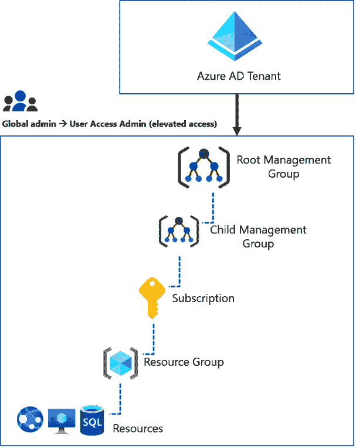

图 1.1——Azure 资源层次结构

以下是从上到下的每个层级的说明：

- **Azure AD 租户：** 为了管理 Azure 订阅和资源，管理员需要一个标识目录来管理有权访问资源的用户。Azure AD 就是这样一个标识存储，它为 Azure 租户订阅中的所有用户提供身份验证和授权。

  每个 Azure 订阅都与一个 Azure AD 租户建立信任关系，以管理对订阅的访问。组织通常使用名为 **Azure AD Connect** 的工具将其本地 AD 连接到 Azure AD，如下图所示：

  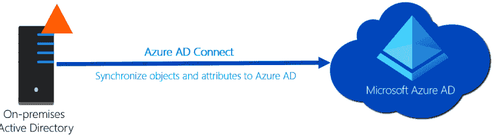

  *图 1.2——使用 Azure AD Connect 将对象同步到 Azure AD*

  作为身份验证和授权的核心，Azure AD 是信息收集以及各种基于身份的攻击的主要目标。我们将在本章的*理解 Azure RBAC 结构*一节中进一步介绍 Azure 订阅的授权模型。

- **根管理组**：这是 Azure 资源组织层次结构的顶层，*如果已启用的话*。对于刚接触 Azure 的组织，默认情况下根管理组未启用，这意味着每个订阅作为独立实体进行管理。然而，单独管理订阅会产生一种难以扩展的治理模型。对于需要管理多个订阅的中大型组织来说，这尤其困难。

  许多生产 Azure 环境都会启用根管理组。部分原因是 Microsoft 在其*云采用框架*文档（`https://docs.microsoft.com/en-us/azure/cloud-adoption-framework/decision-guides/subscriptions/`）中建议启用它。该文档介绍了采用 Azure 云的一些最佳实践，对于希望在 Azure 中构建环境的人来说，是一个很好的信息来源。

- **子管理组**：如果组织启用了根管理组，则可以在根下创建子管理组，以简化订阅管理。子管理组允许组织以灵活的结构将订阅分组在一起，主要用于集中管理访问和治理。子管理组可以嵌套，最多支持六层深度。


- **订阅：** 要在 Azure 中配置资源，我们需要一个 Azure 订阅。Azure 订阅是资源被配置的逻辑容器。当我们创建资源（例如 **结构化查询语言 (SQL)** 数据库）时，我们通常做的第一件事是指定资源将被配置的订阅。所选订阅也将承担该资源的使用费用。

如 **子管理组** 描述中所述，组织通常会有多个 Azure 订阅。组织为不同的环境设置多个订阅是很常见的，例如开发和生产环境，或用于分离应用程序环境。

- **资源组：** 在订阅内部，有资源组。资源组是可用于对 Azure 资源（如 **虚拟机 (VM)**、存储账户和数据库）进行分组和管理的逻辑容器。

资源组最适合用于收集和分组需要一起管理或共享相同生命周期的资源。根据订阅架构，这可能导致单个订阅中存在大量资源组。

从访问角度来看，资源组还允许我们在同一订阅中对不同组进行访问隔离，但我们将在 *了解 Azure RBAC 结构* 部分更详细地介绍这一点。

- **资源：** 资源是在 Azure 订阅中部署的 Azure 服务的单个实例。资源级别是组织层级的底部。除了具有特定访问策略的服务（请参阅有关 *密钥保管库* 的信息）之外，我们无法再进一步细分资源层级。

我们将在本章后面深入介绍如何使用 RBAC 管理访问的细节，但总的来说，Azure AD 账户可以对前面概述的任何资源组织级别拥有指定的访问权限。从渗透测试的角度来看，在更高级别授予的访问权限会为攻击者提供更广的范围来发现云服务配置中的漏洞，并在环境中横向移动。当我们讨论权限提升时，这一概念会变得更加重要。

在下一节中，我们将介绍一些常用 Azure 服务的概述。这些服务的单个实例属于前面列出的 **资源** 类别。

## Azure 服务概述

正如我们在本章前面提到的，Azure 中有超过 200 项服务。尽管听起来服务很多，但它们通常可以分为以下五类：

- **用于托管应用程序的服务：** 这些服务提供可用于执行应用程序代码或运行容器镜像的运行时环境。**Azure 应用服务、Azure 虚拟机 (Azure VM)** 和 **Azure Kubernetes 服务 (AKS)** 等服务属于此类。组织使用它们来托管外部和内部应用程序。
- **用于存储应用程序数据的服务：** 这些服务用于存储不同类型的应用程序数据。存储账户、Azure SQL 和 Cosmos DB 等服务属于此类。
- **用于创建应用程序的服务：** 这些服务用于创建在云中运行的工作流。Logic Apps 和 Functions 应用等服务属于此类。
- **用于增强应用程序的服务：** 这些通常是 Azure 中的 **软件即服务 (SaaS)** 类型服务，用于为其他应用程序提供额外功能。Azure Cognitive Services 等服务就属于此类。开发人员使用它通过预构建和预训练的机器学习算法为其自定义应用程序添加智能。
- **用于监控或管理应用程序的服务：** 这些是用于管理或监控其他服务或应用程序的服务。Azure Automation、API 管理、Application Insights 和 Azure Monitor 等服务属于此类。额外的安全重点服务，如 Azure Sentinel 和 Azure Security Center，也会归入此类。这些服务也可以从渗透测试角度提供有用的见解。

随着我们阅读本书的进展，我们将涉及许多服务，但这里概述的核心资源是需要理解的重要内容。

下表列出了本书中将被攻击的最常见的一些 Azure 服务：

| 服务 | 描述 |
|---|---|
| 应用服务 | 该服务包括 Azure 中的 App Service 和 Function 应用。这些服务可用于“无服务器”Web 应用程序和 API 托管。 |
| 存储账户 | 存储账户用于 Azure 中大多数数据存储操作。文件可以公开或私有托管，并且文件可以通过多种协议访问（**超文本传输协议 (HTTP)**、**服务器消息块 (SMB)**、**网络文件系统 (NFS)**）。该服务还可用于静态 Web 内容托管。 |
| 自动化账户 | 另一种“无服务器”代码服务，自动化账户允许您从“运行手册”运行脚本代码（PowerShell 和 Python）以自动化订阅中的流程。该服务有很多攻击面，因此我们将在整本书中经常回到它。 |
| 虚拟机 | 云服务的初始支柱之一，这些是在云中托管的 VM。在云中部署 VM 有多个方面，因此该服务也将成为主要关注点。 |
| 密钥保管库 | Azure 密钥保管库是 Azure 内的主要凭据存储。这包括密钥、机密和证书的存储。除了利用标准的 **身份和访问管理 (IAM)** 权限分配外，还可以应用访问策略来提供对 Key Vault 数据的额外限制。 |
| Azure SQL | 该服务用于在云中托管 SQL 数据库。SQL 数据库的全部内容都由 Microsoft 管理，这有助于简化 Azure 项目中使用数据库的工作。 |
| Azure 容器注册表/Azure 容器实例 | 随着许多环境开始迁移到容器化，云容器注册表和云容器实例的使用变得越来越流行。Azure 容器注册表保存用作容器化基础镜像的容器镜像。

虽然它在容器化环境中只占相对较小的一部分，但该服务是一个常见的攻击目标，因为镜像经常包含敏感信息。 |

从上述信息可以看出，微软在命名 Azure 服务时非常务实。大多数情况下，服务名称基于服务的功能。例如，用于托管 VM 的 Azure 服务称为 **虚拟机**。相比之下，AWS 中的等效服务称为 **弹性计算云 (EC2)**。

> **重要说明**
> 
> 对于任何从 AWS 过渡到 Azure 的术语转换者，以下 Microsoft 文档可能有助于匹配任何令人困惑的服务名称：`https://docs.microsoft.com/en-us/azure/architecture/aws-professional/services`。
> 
> 对于更熟悉 GCP 的用户，Microsoft 还在 `https://docs.microsoft.com/en-us/azure/architecture/gcp-professional/services` 提供了一些有用的文档。

在 *第 3 章、查找 Azure 服务和漏洞* 中，我们将讨论如何使用 Azure **域名系统 (DNS)** 命名结构匿名发现其中一些服务。在下一节中，我们将回顾如何使用 RBAC 结构化和管理对 Azure 服务的访问。

## 了解 Azure RBAC 结构

**RBAC** 是一种授权系统，用于控制谁有权访问 Azure 资源，以及用户可以对这些资源执行的操作。从高层次来看，你可以将其视为 *通过向安全主体（用户、组和应用程序）分配角色来授予其对 Azure 资源的访问权限*。

例如，RBAC 可用于授予用户管理订阅中所有 VM 的权限，而另一用户则被授予管理同一订阅中所有存储账户的权限。这对于订阅中的职责分离来说是一个奇怪的选择，但云环境往往会催生出 *创造性解决方案* 来使事情正常运行。

当我们开始引入角色分配的不同作用域（管理组、订阅等）时，RBAC 概念会变得更加复杂，但在我们继续进行时请记住上述描述。

Azure RBAC 由以下组件组成——**安全主体、角色定义和角色分配**。让我们详细了解这些组件。


## 安全主体

**安全主体**是一个专业术语，用来描述*我们希望为其分配权限的 Azure AD 对象*。它可以是用户帐户、组、服务主体或托管标识。这些都是 Azure AD 中存在的不同类型标识，如下图所示：

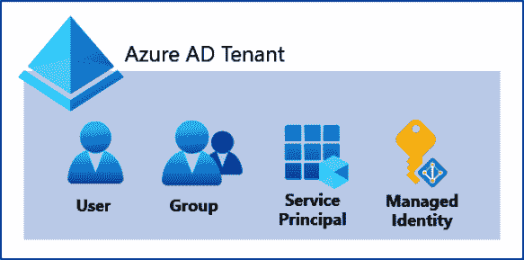

图 1.3 – Azure RBAC 安全主体

> **重要说明**
> 
> 不要将“安全主体”与“服务主体”混淆。*安全主体*是一个总称，用于描述 Azure AD 中的对象（包括用户、组和服务主体）。*服务主体*是安全主体的一种特定类型。

虽然安全主体有很多方面，但请记住，每个安全主体都有一个**对象 ID**，用于在 Azure AD 中唯一标识它。在向安全主体分配角色时，通常使用该对象 ID 作为引用。接下来，我们将介绍不同类型的安全主体。

### 用户帐户

*用户帐户是 Azure AD 中的标准用户标识。*这些帐户可以是 Azure AD 租户内部的帐户，也可以是外部“来宾”帐户。无论哪种情况，用户的常规管理都将在 Azure AD 租户级别进行。

内部用户帐户是由管理员在 Azure AD 租户中创建的用户标识。此外，这些用户标识也可能是从本地 AD 环境同步到 Azure AD 的（参见*图 1.2*）。这些帐户通常通过其**用户主体名称 (UPN)** 来寻址，该名称通常是电子邮件地址。例如，Azure AD 租户中名为 `karl` 的用户，域名为 `azurepentesting.com`，其 UPN 将是 `karl@azurepentesting.com`。

以下屏幕截图显示了 Azure 门户中的内部用户帐户。您所交互的大多数 Azure AD 帐户都属于此类别：

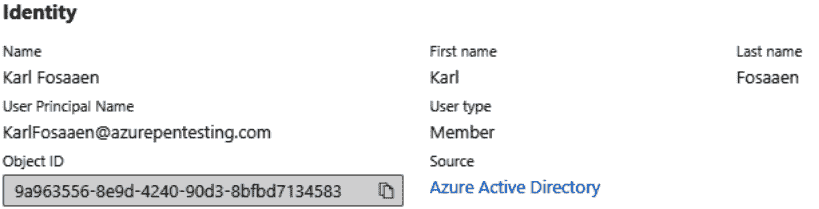

*图 1.4 – 内部用户帐户的屏幕截图*

外部用户帐户是来自其他 Azure AD 租户或 Microsoft 帐户（`outlook.com`、`hotmail.com` 等）的用户标识，这些帐户被邀请为 Azure AD 租户的来宾用户。外部用户帐户的 UPN 格式如下所示：

```
<alias>_<HomeTenant>#EXT#@domain.suffix
```

例如，如果来自 `cloudsecnews.com` AD 租户的名为 `david` 的用户被邀请为 `globaladministratorazurepen.onmicrosoft.com` Azure AD 租户的来宾用户，则 UPN 将为 `david_cloudsecnews.com#EXT#@globaladministratorazurepen.onmicrosoft.com`（参见*图 1.5*）。

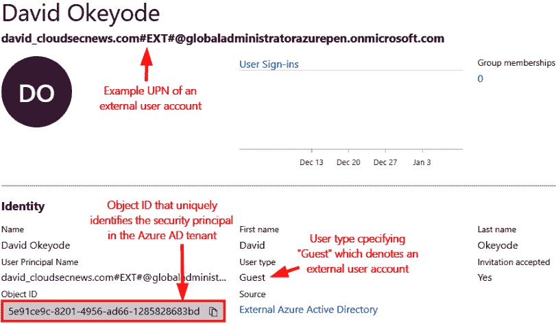

图 1.5 – 外部用户帐户的屏幕截图

外部帐户通常用于向供应商或可能在订阅上工作的第三方用户授予访问权限。这些用户帐户不直接由 Azure AD 租户管理，因此帐户策略（密码长度、**多重身份验证 (MFA)** 等）将不受 Azure AD 租户的控制。

对于内部和外部帐户，我们将在 Azure 渗透测试期间以这些帐户的凭据为目标，以获取对 Azure AD 租户中资源的访问权限。正如我们将在后续章节中看到的，这些帐户是在环境中获得初始立足点的绝佳位置。

### 服务主体

**服务主体**是 Azure AD 中的应用程序标识。您可以将其视为表示需要访问 Azure 资源的应用程序的 Azure AD 对象。这是向应用程序授予访问权限的首选方式，而不是创建*虚拟用户帐户*。

当我们讨论自动化帐户攻击时，服务主体将非常重要，但就目前而言，只需知道*应用程序*可以在 Azure AD 中注册，并且也可以在租户中被授予权限。例如，您可能有一个自动化帐户在订阅中运行维护脚本，因此您希望向运行脚本的帐户授予特定权限。这些权限将应用于创建自动化帐户时在 Azure AD 租户中创建的服务主体。

服务主体还可以分配用于身份验证的证书和机密。当我们想要利用应用注册进行特权提升和/或在 Azure AD 租户中持久化时，这些凭据将非常重要。创建服务主体的过程称为**应用注册**。

在以下屏幕截图中，我们可以看到示例租户中应用注册的一些基本信息。作为攻击者，我们可能会遇到创建新服务主体以使我们能够在环境中持久化的情况。如果我们为创建后门服务主体选择通用显示名称（Backup Service），我们可能更有可能在租户中更长时间不被发现：

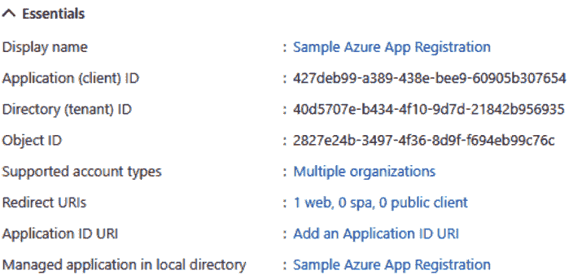

图 1.6 – Azure AD 中服务主体的屏幕截图

最后，服务主体可以在 Azure AD 中设置所有者。服务主体的所有者可以控制与这些帐户关联的凭据，因此在服务主体具有提升权限的环境中，所有者是权限提升的有用目标。

### 托管标识

有时，Azure 服务（VM、AKS、应用程序等）可能需要访问其他 Azure 资源。授予此访问权限的最简单方法是为 Azure 服务启用托管标识。**托管标识**是自动创建和管理的服务主体，分配给受支持的 Azure 服务。在撰写本文时，Azure 中有 27 个服务支持托管标识。

> **重要说明**
> 
> 如果您有兴趣了解有关 Azure 中支持托管标识的所有服务的更多信息，Microsoft 已将相关文档发布在：
> 
> `https://docs.microsoft.com/en-us/azure/active-directory/managed-identities-azure-resources/services-support-managed-identities`

托管标识可以是**系统分配**的，也可以是**用户分配**的。系统分配的标识直接绑定到为其创建标识的资源。用户分配的标识首先在订阅中创建，然后应用于资源。用户分配的标识可以被多个服务共享，而系统分配的标识不能。

在后续章节中，我们将看到这些标识可用于在租户中提升权限。目前需要注意的重要一点是，任何对具有已分配托管标识的资源拥有修改权限的人，都可能获得该托管标识的权限。这取决于服务，但有几种服务（我们将在后面介绍）可以轻松用于为托管标识生成令牌。

### 组

**组**用于在 Azure AD 中组织用户，并更轻松地管理对 Azure 资源的访问。例如，向一组中的 200 个用户分配权限比向 200 个单独用户分配权限更有效。一旦向组授予了对 Azure 资源的访问权限，日后就可以通过组成员资格授予——或撤销——访问权限。

与用户帐户类似，组可以由管理员在 Azure AD 中创建，也可以从本地 AD 环境同步。还有第三种情况，即允许用户创建自己的组，或加入现有的公共组，但这些组通常与 Microsoft 365 服务相关联。

与应用注册非常类似，组可以拥有所有者（可以是用户帐户或服务主体），并且所有者不必是组的成员。组所有者可以管理该组及其成员身份。

Azure AD 支持两种主要类型的组：主要用于管理对共享资源访问的安全组，以及功能类似于您在 AD 中可能熟悉的电子邮件通讯组的 Microsoft 365 组。这些组也可以用于分配对 Azure 资源的访问权限。


Azure AD 组的成员资格可以是 **分配** 的，也可以是 **动态** 的。分配的成员资格是由管理员或组所有者直接分配给用户的。动态组的成员资格使用规则，这些规则会根据用户或设备的属性自动评估以确定组成员资格。动态组成员资格的规则可以允许模糊匹配，这可能被滥用以提升权限。有关此攻击的更多信息，请参阅 *第 1 章《利用 Reader 权限》* 中的 *动态组成员资格* 部分。

在与本地 AD 域同步的 Azure 环境中，组织用户的复杂性可能会呈指数级增长，因为可能有大量从本地域导入的组。虽然在 Azure 租户中实际使用的组数量可能有限，但你可能需要处理数百个（或数千个）位于 Azure AD 租户中的组。在评估 Azure 环境时，这不应造成任何问题，但在你开始转向本地环境时可能会使事情复杂化。我们将在 *第 7 章《利用 Owner 和特权 Azure AD 角色权限》* 中介绍有助于简化评估 AD 组的工具。

## 角色定义

在安全主体之后，Azure RBAC 的第二个组件是角色定义。此术语描述 *一组权限*。权限描述了可以在资源上 *执行或不执行* 的操作，例如读取、写入和删除。我们可以检查默认 Azure 角色下的权限，以了解它允许我们执行的操作。

以下是 Azure 中 **Contributor** 角色的权限：

```json
{
  "assignableScopes": [
    "/"
  ],
  "description": "Grants full access to manage all resources, but does not allow you to assign roles in Azure RBAC, manage assignments in Azure Blueprints, or share image galleries.",
  "id": "/subscriptions/{subscriptionId}/providers/Microsoft.Authorization/roleDefinitions/b24988ac-6180-42a0-ab88-20f7382dd24c",
  "name": "b24988ac-6180-42a0-ab88-20f7382dd24c",
  "permissions": [
    {
      "actions": [
        "*"
      ],
      "notActions": [ 
        "Microsoft.Authorization/*/Delete",
        "Microsoft.Authorization/*/Write",
        "Microsoft.Authorization/elevateAccess/Action",
        "Microsoft.Blueprint/blueprintAssignments/write",
        "Microsoft.Blueprint/blueprintAssignments/delete",
        "Microsoft.Compute/galleries/share/action"
      ],
      "dataActions": [],
      "notDataActions": []
    }
  ],
  "roleName": "Contributor",
  "roleType": "BuiltInRole",
  "type": "Microsoft.Authorization/roleDefinitions"
}
```

我们可以在前面的权限中看到，角色定义支持两种类型的操作，如下所示：

- 控制平面操作，描述角色可以执行的管理操作。这些在 `'actions': [ ]` 部分中定义。管理操作的一个例子是创建存储帐户的权限。
- 数据平面操作描述角色可以在资源内执行的数据操作。这些在 `'dataActions': [ ]` 部分中定义。数据操作的一个例子是读取存储在存储帐户中的数据的权限。

我们也可以在前面的权限中看到，某些操作可以被角色排除。`'notActions': [ ]` 部分定义了角色被限制执行的管理操作。`'notDataActions': [ ]` 部分定义了角色被限制执行的数据操作。

在前面 **Contributor** 角色的示例中，该角色具有执行所有管理 (*) 操作的权限，但它被 `notActions` 定义限制执行与授权相关的管理操作，这意味着该角色不能用于向他人分配权限。此外，该角色不具有执行任何数据操作的权限。

还应注意，此角色定义还包含 `assignableScopes`: `["/"]` 部分，该部分表示角色如何在租户中应用。`/` 表示它可以应用于管理组结构的根，但也可以应用于根下的任何范围（子管理组、订阅等）。

## 默认 RBAC 角色

在最基本层面上，Azure 中通常应用的三个主要角色是 **Reader**、**Contributor** 和 **Owner**。除了这三个基本角色之外，你还会找到服务特定的角色，它们充当这些基础角色的受限版本。这些受限角色对于减少用户在特定订阅中的权限很有用，但它们仍可能允许在环境中提升权限。

例如，**Virtual Machine Contributor** 角色（在订阅级别应用）*不允许* Azure AD 用户成为订阅中所有服务的贡献者。然而，该角色确实允许 `Microsoft.Compute/virtualMachines/*` 操作，这意味着它允许用户在订阅中的任何 VM 上运行命令。

如果此 VM 配置了特权托管标识，该 VM Contributor 用户就可以在 VM 上运行命令以承担托管标识的权限并提升其权限。我们将在 *第 5 章《在 IaaS 服务上利用 Contributor 权限》* 中更深入地探讨这一概念，在那里我们学习如何使用 VM 上的贡献者权限。

需要注意的一个重要点是，Azure 资源和 Azure AD 租户具有独立的权限系统。这意味着用于授予对 Azure AD 的访问权限的角色与用于授予对 Azure 资源的访问权限的角色不同，如以下屏幕截图所示：

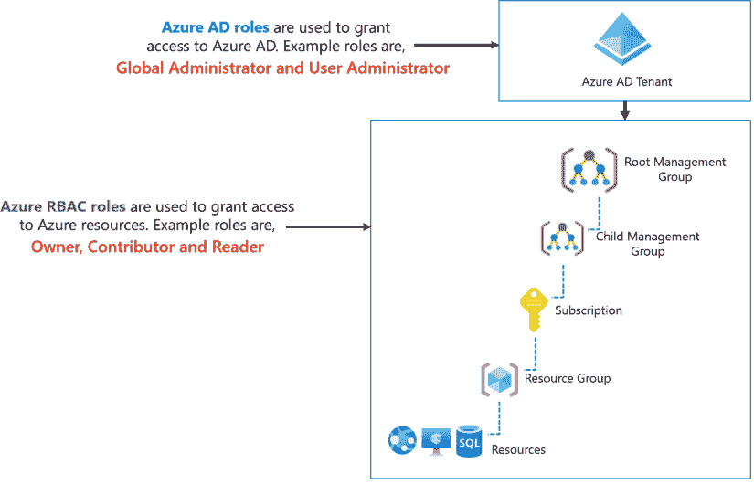

图 1.7 – Azure AD 角色与 Azure RBAC 角色

Azure AD 角色用于管理对 Azure AD 资源和操作的访问，例如用户帐户和密码重置，而 Azure RBAC 角色用于管理对 Azure 资源（如存储帐户、SQL 数据库等）的访问。

Azure AD 和 Azure 资源都具有多个内置角色，具有预定义的权限，组织可以使用它们向用户和应用程序授予访问权限。两者都支持由管理员创建的自定义角色。截至撰写本文时，目前有 60 个内置 Azure AD 角色和超过 220 个 Azure RBAC 内置角色。

## Azure 门户

Azure 门户是用于访问和管理 Azure 资源的基于 Web 的控制台。Azure 公有云平台的 URL 为 `https://portal.azure.com`。正如本章开头所述，其他 Azure 云（如美国政府、中国和德国）的地址是不同的。

用户必须首先使用 Azure AD 用户帐户进行身份验证才能访问门户。对于视觉型学习者来说，Azure 门户将是了解 Azure 租户中资源的最佳起点。

在门户中，每个 Azure 服务在网站左侧都有 **刀片**，如下图所示：

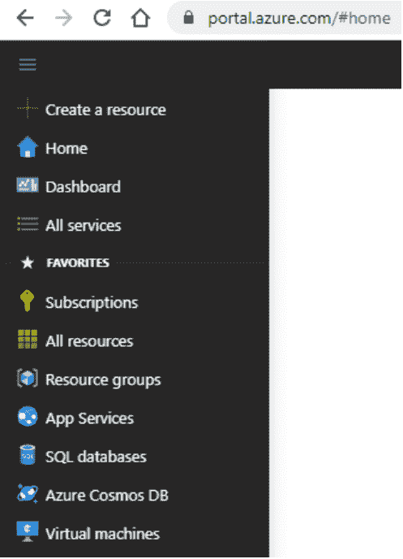

图 1.8 – Azure 门户导航

根据你的帐户有权访问的租户，你可能会在这里看到不止一个目录。这些是你拥有（直接成员资格或访客）访问权限的不同 Azure AD 租户。选择目录后，你可以导航到 **Subscriptions** 刀片以查看你有权访问的订阅，如下图所示：

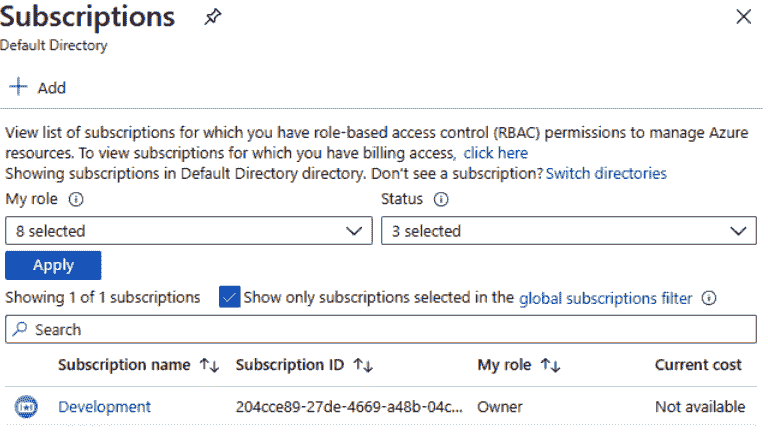

图 1.11 – Azure 订阅列表

在 **Subscriptions** 部分，请注意 **My role** 列，因为它会让你知道你当前用户在订阅中的 RBAC 角色。在各个订阅中，你还可以使用 **IAM** 刀片查看订阅中其他用户的权限。

## Cloud Shell

在门户中，搜索栏右侧有一个小 PowerShell 提示符 >_ 图标。此图标激活门户中的 Azure Cloud Shell。这也可以通过 `https://shell.azure.com` 访问，如下图所示：

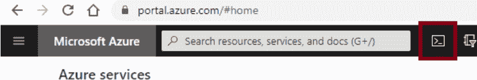

图 1.12 – Azure Cloud Shell 门户链接


如果尚未为您的账户设置 Cloud Shell，则需要选择一个存储账户来用于 Cloud Shell 存储。进入 Cloud Shell 后，您的提示符应如下所示：

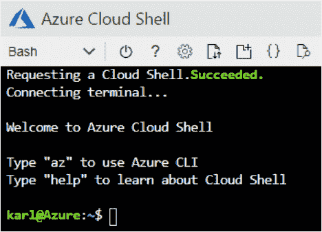

图 1.13 – Azure Cloud Shell

在设置 Cloud Shell 时，您可以选择 Bash 或 PowerShell 环境。两种环境各有优势，并且 shell 中都已准备好可用的 Az CLI。

虽然 Azure Cloud Shell 预装了管理 Azure 环境所需的所有工具，但它也存在一些风险。我们将在后续章节中看到该服务如何被用于权限提升攻击。

## Azure CLI

管理 Azure 环境的另一个流行选项是 Azure CLI。CLI 的安装对于 Windows 系统来说很简单。请记住，我们将在下一章的练习中作为一部分安装 CLI，但如果您想在其他系统上安装 CLI，可以在此处下载最新版本的 Microsoft 安装程序：`https://aka.ms/installazurecliwindows`。

> **重要说明**
> 
> 由于前面的链接是一个可执行文件，可以理解您可能不会立即急于打开它。作为一般说明，我们将在整本书中更多地使用这些链接，将您连接到 Microsoft 资源。
> 
> 书中使用的 aka.ms 链接应安全可跟随，因为它们都由 Microsoft 内部短链接服务管理。

首先，使用 `az` 命令列出可用选项，如下所示：

```
```text
PS C:\ > az
 /\\
 /  \\    ______    __  ______  __
 / /\\ \\ |__  / | | | | \__/_/__\\
/ ____ \\ / /| | | | | |  __/
/_/    \\_/___| |___| \____|\

Welcome to the cool new Azure CLI!
Use `az --version` to display the current version.
Here are the base commands:
    account : Manage Azure subscription information.
    acr : Manage private registries with Azure Container
Registries.
    ad : Manage Azure Active Directory Graph entities needed
for Role Based Access Control.
    advisor : Manage Azure Advisor.
    [Truncated]
```
```

通常，您在 CLI 中运行的命令与服务名称（acr、appservice、vm）相关，然后是您想要执行的操作。

例如，以下是如何列出默认订阅中的资源：

```
```text
PS C:\ > az resource list
```
```

如果您需要有关可能运行的命令选项的灵感，请使用 `--help` 标志列出可用选项。

这是一个用于管理 Azure 的强大工具，我们将在未来章节的书籍示例中用到它。话虽如此，我们的大多数示例将侧重于 Azure PowerShell 模块以及使用它们的工具。在深入研究特定模块之前，我们希望确保对 Microsoft 的 PowerShell 编程语言有基本的了解。

首先，您需要能够在系统上启用 PowerShell 脚本执行。很可能您的测试系统上会有一些 PowerShell 执行策略限制。正如本书技术审阅者之一 Scott Sutherland 在这篇博文中所述，这些执行限制很容易被绕过（参见 https://blog.nets​pi.com/15-ways-to-bypass-the-powershell-execution-policy/）。

对于 PowerShell 模块的安装，我们将主要使用 PowerShell Gallery 包。PSGallery（https://www.powershellgallery.com/）是受信任的、由 Microsoft 管理的包管理资源。这是安装模块的最简单方法之一，并且工具包所需的 Microsoft 包都将列在画廊中。

由于我们将在本书第二章中逐步介绍 Azure PowerShell 模块的安装，因此在当前系统上安装这些模块并非立即需要。

## Az 模块

Az PowerShell Cmdlets 是与 Azure 交互以允许管理 Azure 服务的函数。这些函数允许列出、创建、销毁和修改 Azure 资源的功能。虽然某些 Azure 服务不受函数支持，但您交互的大多数服务都将得到支持。

- 1. 在提升权限的（**以管理员身份运行**）PowerShell 会话中，运行 Az 模块安装命令，如下所示：

```
PS C:\> Install-Module -Name Az
```

- 2. 安装后，您需要对 Azure 租户进行身份验证。您可以通过运行以下代码来完成此操作：

```
PS C:\> Connect-AzAccount
```

3. 与 Azure CLI 类似，这将提示您登录，但这次会弹出 Azure AD **身份验证库（ADAL）** 身份验证窗口，而不是 Web 浏览器，如以下屏幕截图所示：

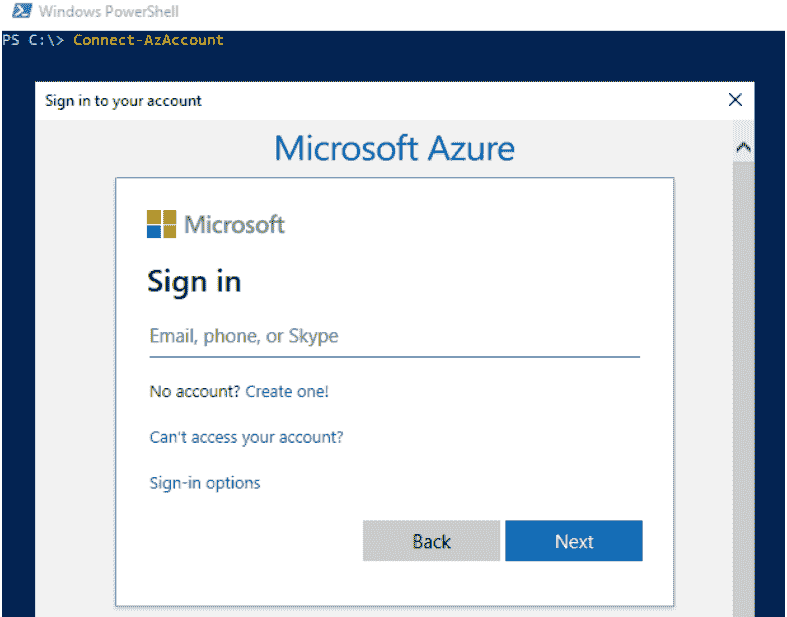

图 1.14 – Az PowerShell 身份验证提示

从这里开始，您将使用的任何命令都将基于 Microsoft 对 PowerShell 函数的批准动词的指导（https://docs.microsoft.com/en-us/powershell/scripting/developer/cmdlet/approved-verbs-for-windows-powershell-commands）。

我们将使用的动词大多是 Get 或 Invoke，但这将是一个尝试 PowerShell Tab 补全的好机会。

- 1. 如果模块尚未导入到您的 PowerShell 会话中，请按如下方式导入 Az 模块：

```
```powershell
PS C:\> Import-Module Az
```
```

- 2. 然后，输入 `Get-Az`，如下所示，并暂停：

```
```powershell
PS C:\> Get-Az
```
```

- 3. 从这里，您可以使用 *Ctrl* + *space* 快捷方式展开您的选项，如下所示：

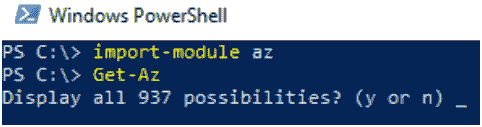

图 1.15 – Az PowerShell 模块命令选项

- 4. 如果我们对 PowerShell 函数参数执行相同的操作，您将获得该函数的全部可用参数，如下所示：

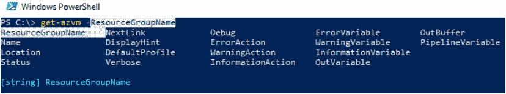

图 1.16 – Az PowerShell 模块参数选项

- 5. 要查看 Az 模块中的子模块，我们可以使用以下命令：

```
```powershell
PS C:\> Get-Module -Name az*
```
```

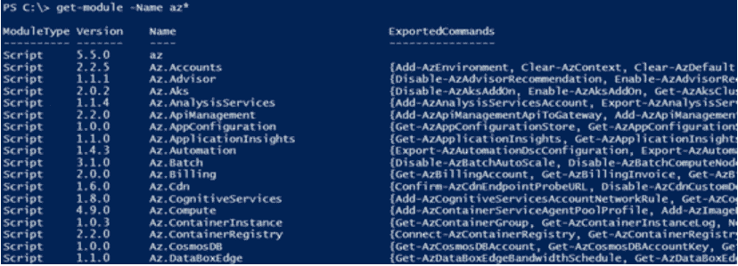

图 1.17 – 列出 Az PowerShell 子模块

6. 要获取模块中可用的所有命令，您可以使用以下命令：

```
PS C:\> Get-Module -Name az*
```

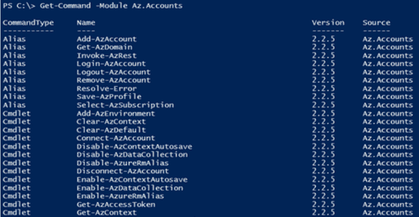

图 1.18 – 列出 Az.Accounts 模块命令

我们试图在 PowerShell cmdlet 中完成的许多操作都可以通过 Tab 补全轻松找到。遇到疑问时，开始输入您认为命令可能是的内容，您可能会惊讶于找到真实命令的容易程度。

## 模块 – Az 与 AzureRM

如果您在互联网上搜索特定 Az PowerShell 函数，您可能会遇到以 **Azure 资源管理器（AzureRM）** 为前缀的函数，与 Az 相比。这些函数用于现已弃用的 AzureRM 模块。这是用于 Azure 管理的原始 PowerShell 模块之一，因此您可能会遇到对其的引用。

对于大多数 AzureRM 函数，您应该能够将 Az 替换为 AzureRM 以获得等效的 Az 模块命令（`Get-AzureRmVM` 与 `Get-AzVM`）。

## AzureAD 模块

AzureAD 模块涵盖了管理 Azure AD 租户的特定函数。从渗透测试的角度来看，我们将主要使用它来枚举有关 Azure AD 租户的信息，但也有一些特权命令可用于添加或修改用户。与 Az 模块一样，该模块也是书中提到的一些工具所必需的。我们还将在下一节中在测试 VM 中安装此模块，但在此处介绍模块的基本用法：

- 1. 在提升权限的（**以管理员身份运行**）PowerShell 会话中，运行 AzureAD 模块安装命令，如下所示：

```
PS C:\> Install-Module -Name AzureAD
```

- 2. 安装后，您需要对 Azure 租户进行身份验证。您可以通过运行以下代码来完成此操作：

```
PS C:\> Connect-AzureAD
```

与 Az 模块一样，这将提示您使用身份验证窗口登录，并且您可以使用与 Az 模块相同的 PowerShell 命令来帮助导航可用函数。

## Azure REST API

访问 Azure 的最后一种方法是使用 REST API。API 是我们能够利用被盗访问令牌的为数不多的几种方式之一，我们将在后续章节中涵盖的攻击场景中看到这些示例。如果提供了有效的授权令牌，可以使用 Postman 或 cURL 等 REST 客户端与 API 交互。在后面的示例中，我们还将使用 HTTPie 命令行工具与 API 交互。

我们完全可以写一整章关于使用 REST API 管理 Azure 的内容，但现在，只需知道这些是非常强大的 API，可以执行我们通常使用 CLI 或 PowerShell 模块采取的许多相同操作。

如果您想尝试 REST API 基础知识，请查看 Microsoft Azure REST API 参考页面的教程，网址为 `https://docs.microsoft.com/en-us/rest/api/azure/`。


## Azure 资源管理器

无论我们使用何种工具或方法，与 Azure 平台和 Azure 资源进行交互时，通信都是通过一个名为 **Azure 资源管理器 (ARM)** 的单一中心端点进行的。你可以将其视为 Azure 中资源管理的集中层（参见 *图 1.19*）。这种方法的优势在于，无论我们使用哪种工具，体验都是一致的。身份验证和访问都以相同的方式处理。

当我们使用前面描述的任何工具请求执行某个操作时，资源管理器会与执行我们所请求操作的“资源提供程序”进行通信，如下图所示：

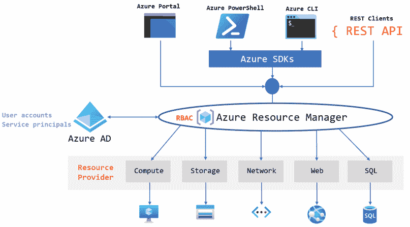

资源提供程序是提供不同类型资源的服务。例如，网络资源提供程序负责网络资源（虚拟网络、网络接口等），而计算资源提供程序负责计算资源（虚拟机）。

### 小结

虽然这可能是本书中最不激动人心的章节，但 Azure 平台基础知识将为我们接下来要学习的各种攻击奠定基础。在进入后续章节时，请牢记 Azure 在资源和 RBAC 两个层面上的底层结构。

在下一章中，我们将引导你设置一个 Azure 环境和一台渗透测试虚拟机，你可以用它来模拟本书其余部分将要介绍的 attack scenarios。

### 延伸阅读

以下是一篇很好的文章，可帮助您了解如何为 Azure 环境和服务实施安全措施：

- *《Microsoft Azure 安全技术认证及进阶》* 作者：David Okeyode
