## 2 构建你自己的环境

要完全遵循本书的内容，你需要访问一个 Azure 环境和一台渗透测试**虚拟机 (VM)**，以便模拟使用这些工具、技术和流程来利用 Azure 环境。通过跟随书中的动手示例，你将获得在实际环境中实际利用漏洞的宝贵见解。有利的一面是，微软非常希望人们尝试 Azure，因此很容易在 Azure 中设置免费试用版来帮助你降低成本。

在本章中，我们将讨论以下主要内容：

- 创建新的 Azure 租户
- 在 Azure 中部署渗透测试虚拟机
- Azure 渗透测试工具

让我们开始吧！

### 技术要求

虽然拥有 Azure 账户是免费的，但在账户中运行资源并非免费。请注意，在你的订阅中运行这些测试资源可能会产生任何潜在费用。目前，微软确实为新账户提供免费试用额度和非免费层级服务，但这可能无法覆盖运行示例所涉及的所有资源成本。有关 Azure 免费层级产品的更多信息，请访问微软网站：https://azure.microsoft.com/en-us/free/free-account-faq/。

> **重要说明**
>
> 作为设置后的额外预防措施，请确保为你的订阅设置警报，以避免在 Azure 中超额支出。这可以通过 **“订阅”** 边栏选项卡下的 **“成本警报”** 部分完成，或者通过搜索栏中的 **“成本管理 + 计费”** 边栏选项卡完成。当试用期结束而你可能仍有服务在运行时，这一点尤其有用。

在撰写本书时，本章提供的虚拟机模板每天运行大约需要花费 5 美元（美元/USD）。如果你想最大化试用额度或减少总支出，请确保在不使用时暂停或关闭任何正在运行的资源。但在我们开始担心虚拟机和订阅成本之前，我们需要先设置一个 Azure 租户来存储我们的订阅。

让我们从创建 Azure 租户开始。为此，请按以下步骤操作：

1. 导航到 `https://portal.azure.com/` 并创建一个新账户，如下面的屏幕截图所示。如果你已有 Microsoft 账户，也可以使用该账户：

   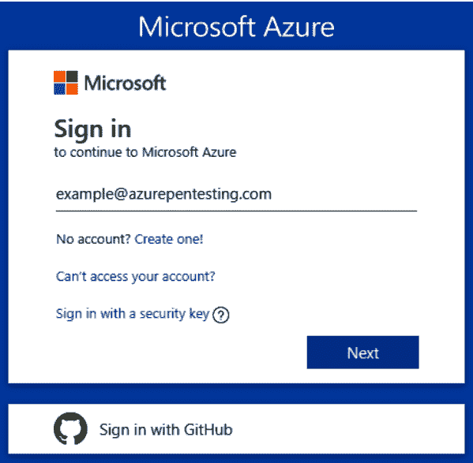

   *图 2.1 – 登录 Azure*

2. 身份验证完成后，选择 **“开始”** 以开始 Azure 免费试用，如下面的屏幕截图所示：

   **欢迎使用 Azure！**

   没有订阅？请查看以下选项。

   

   **开始 Azure 免费试用**

   获取 200 美元可用于 Azure 产品和服务的免费额度，外加 12 个月的常用免费服务。

   开始 · 了解更多

   *图 2.2 – 开始免费试用*

3. 填写个人资料信息。请确保使用正确的信息，因为这将用于计费账户。你可以在下面的屏幕截图中看到一个示例：

   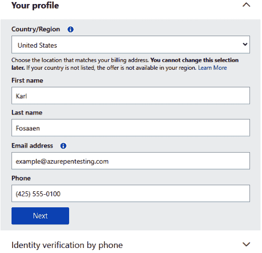

   *图 2.3 – 输入计费信息*

4. 完成设置 Azure 计费信息的步骤后，你将进入快速入门中心，如下面的屏幕截图所示：

   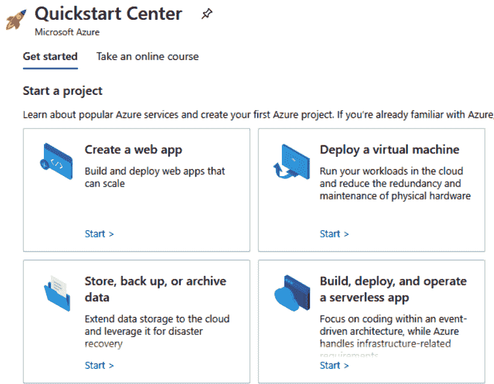

   *图 2.4 – 访问新的 Azure 租户*

恭喜！你刚刚创建了你的 Azure 租户。这是跟随示例操作的第一步，现在你离配置租户以托管示例实验漏洞和测试虚拟机又近了一步。

### 动手练习：创建 Azure 管理员账户

要完成本书中的许多动手练习，你需要在 Azure 租户和订阅中设置“刻意设计的易受攻击”用户和服务。为此，我们将提供你需要从 Azure Cloud Shell 运行的脚本和模板。

虽然用于设置租户的用户已拥有租户的全局管理员权限，但我们还将创建一个单独的管理员用户（azureadmin），该用户可访问 Azure AD 和 Azure 租户。此用户将是一个全局管理员账户，因此请务必设置一个强密码！在本书后续示例中，此用户名也会保持一致，以便我们统一使用一个用户名。

作为一般规则，我们不建议在 Azure 中将特权角色分配给日常使用的账户，但出于我们练习的目的，这将帮助我们利用一些未来的攻击场景。

以下是你在本练习中将完成的任务：

- **任务 1：** 注册 Azure AD Premium P2 试用版。
- **任务 2：** 在 Azure AD 中创建新用户。
- **任务 3：** 在你的 Azure 订阅中授予该用户 **所有者** 角色分配。

让我们按如下步骤创建我们的 Azure 管理员账户：

1. 使用上一个练习中经过身份验证的 Web 浏览器会话，点击左上角的门户菜单图标，然后选择 **Azure Active Directory**，如下面的屏幕截图所示：

   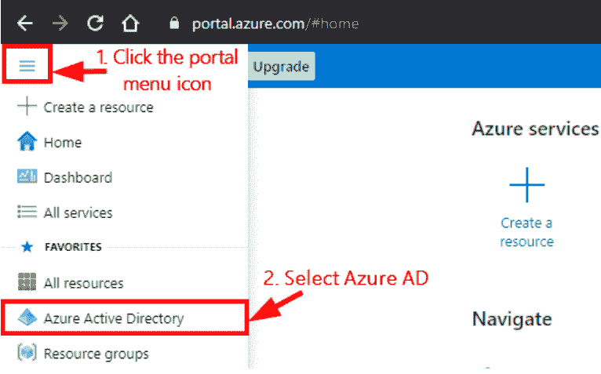

   *图 2.5 – 选择 Azure AD*

2. 在 **“默认目录 | 概述”** 边栏选项卡中，查看 **“租户信息”** 部分中包含的信息。查看你当前 Azure AD 许可证的版本。

   如果你当前的许可证是 **Premium**，则可以跳过本练习中的其余任务。如果你当前的版本是 **Free**，如以下屏幕截图所示，请继续执行后续步骤以激活试用高级许可证：

   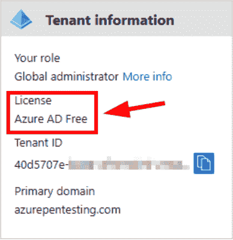

   *图 2.6 – 查看当前的 Azure AD 许可证*

3. 在左侧菜单中，点击 **“许可证”**，如下面的屏幕截图所示：

   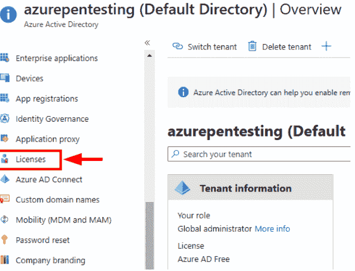

   *图 2.7 – Azure AD 许可证*

4. 在 **“许可证 | 概述”** 边栏选项卡中，点击 **“所有产品”**，然后点击 **+ 尝试/购买** 选项，如下面的屏幕截图所示：

   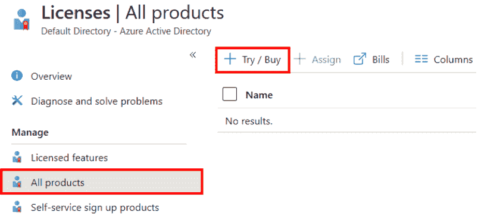

   *图 2.8 – 尝试 Azure AD Premium P2 许可证*


+   5. 在**激活**边栏中，点击展开**免费试用**（位于**Azure AD PREMIUM P2**下），然后点击**激活**，如下面的截图所示：

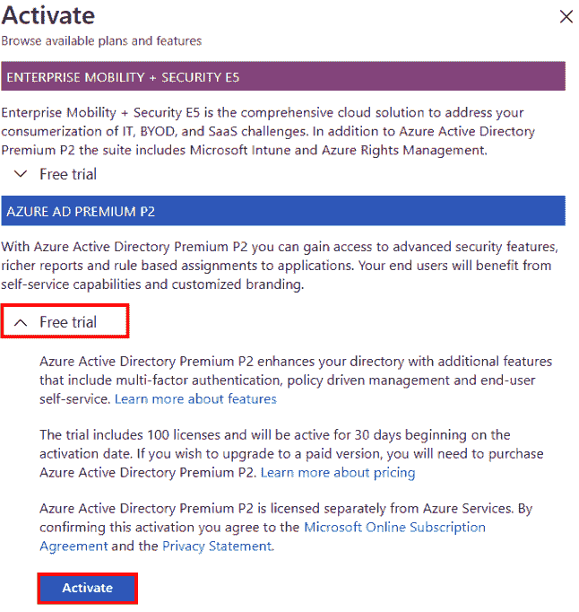

*图 2.9 – 激活 Azure AD Premium P2 试用许可证*

+   6. 即使在收到**成功**消息后，许可证的激活也可能需要几分钟。您可能还需要刷新浏览器才能看到已激活的试用版。完成后，您应该会拥有 100 个 Azure AD Premium P2 许可证，我们将把这些许可证分配给我们即将创建的用户，如下面的截图所示：

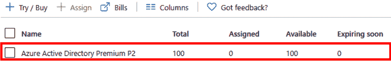

*图 2.10 – Azure AD Premium P2 许可证*

7. 仍在 Azure 门户中时，使用顶部的搜索栏导航回 Azure Active Directory 主部分。在“管理”部分下，依次点击“用户”和“+ 新建用户”以创建新用户，如下面的截图所示：

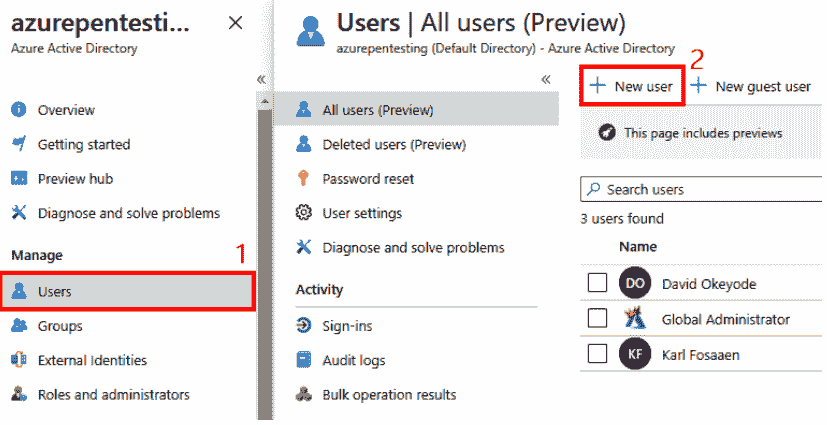

图 2.11 – 创建新的 Azure AD 用户

8. 在“新建用户”窗口中，配置以下内容：

创建用户：已选择

在“标识”下，配置以下内容：

用户名：azureadmin

名称：azureadmin

在“密码”下，配置以下内容：

选择“自动生成密码”。

选择“显示密码”以查看初始临时密码。记下该密码，因为下一步需要使用它。

在“组和角色”下，配置以下内容：

组：保持默认设置。

角色：点击“用户” → 选择“全局管理员” → 点击“选择”。

在**设置**下，配置以下内容：

**阻止登录：**否

**使用位置：**选择离您最近的位置

+   9. 其他设置保持默认状态，然后点击**创建**。

该过程如下面的截图所示：

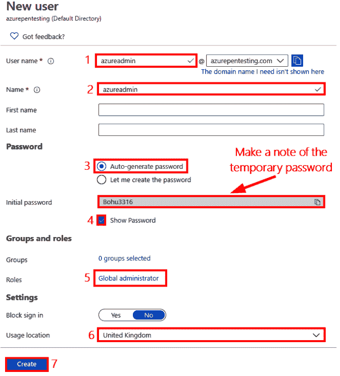

图 2.12 – 配置新的 Azure AD 用户

+   10. 在**用户 | 所有用户**边栏中，点击刚创建的新用户——`azureadmin`，如下面的截图所示：

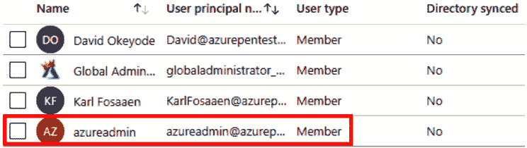

**图 2.13 – 新的 Azure AD 用户**

+   11. 在**azureadmin | 个人资料**边栏中，记下**用户主体名称**，因为后续步骤会用到它，然后点击**许可证**。该过程如下面的截图所示：

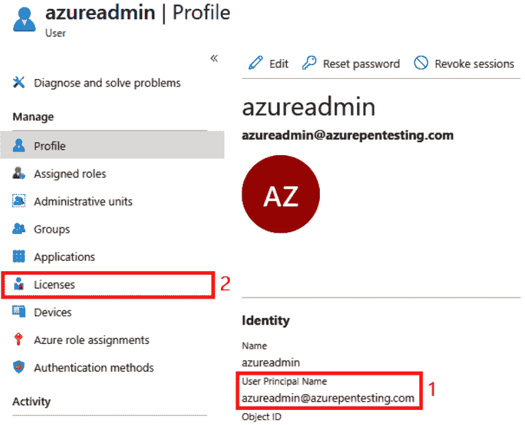

**图 2.14 – azureadmin 用户个人资料**

15. 在主页的“导航”部分，点击“订阅”，如下面的截图所示：

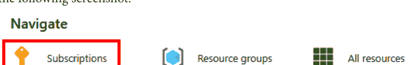

图 2.17 – 导航到订阅

16. 在“订阅”边栏中，点击您的订阅（“免费试用”），然后依次点击“访问控制（IAM）”和“添加角色分配”，如下面的截图所示：

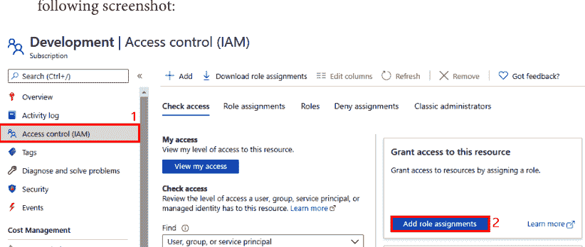

图 2.18 – 添加订阅级角色分配

17. 在“添加角色分配”边栏中，配置以下内容：

角色：所有者

将访问权限分配给：保持为“用户、组或服务主体”

选择：azureadmin

18. 点击**保存**。

该过程如下面的截图所示：

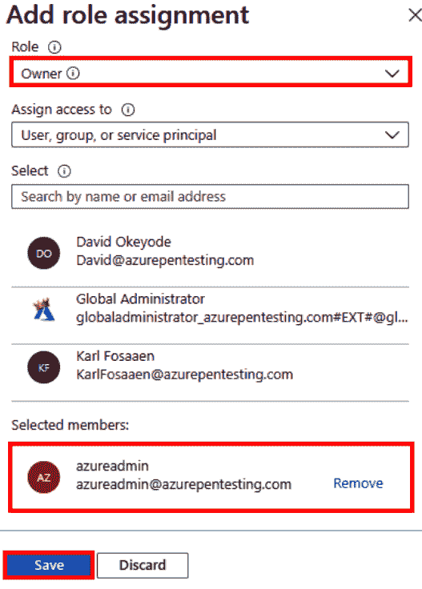

图 2.19 – 将所有者角色分配给 azureadmin

+   19. 退出 Azure 门户并关闭浏览器窗口。
+   20. 打开 Web 浏览器，浏览到 Azure 门户的**统一资源定位符（URL）**：`https://portal.azure.com`。

21. 使用 azureadmin 用户主体名称（UPN）和之前记下的临时密码登录门户。

22. 当提示更新密码时，配置以下内容：

**当前密码：**输入之前记下的临时密码。

**新密码：**输入一个复杂密码。记下它，因为本书的其余部分会用到它。

**确认密码：**重新输入该复杂密码。

23. 点击**登录**，如下面的截图所示：

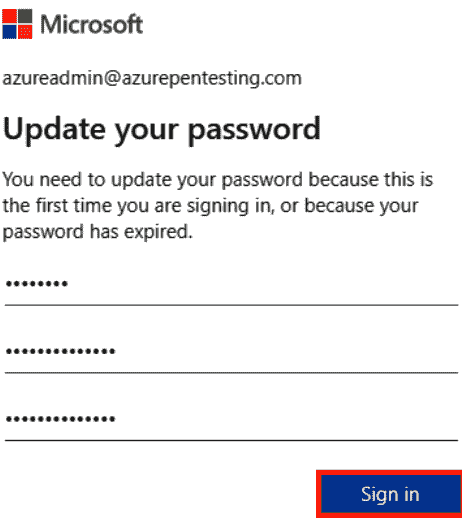

图 2.20 – 更新 azureadmin 用户帐户的密码

我们现在拥有一个 Azure 租户、一个获得许可的管理员用户，以及渴望深入了解 Azure 渗透测试的积极态度。让我们借助这种热情，继续设置我们的测试环境。

> **重要说明**
> 
> 虽然这里没有涉及，但我们强烈建议为任何特权 Azure 帐户添加**多因素身份验证（MFA）**要求。这可以通过用户图标（门户右上角）下的**“我的 Microsoft 帐户”**部分完成。虽然我们将有意创建一个易受攻击的环境，但我们不希望您因为不保护管理员帐户而进一步将自己置于风险之中。有关为帐户使用 MFA 的更多信息，请参阅 Microsoft 文档：`https://docs.microsoft.com/en-us/azure/active-directory/roles/security-planning#turn-on-multi-factor-authentication-and-register-all-other-highly-privileged-single-user-non-federated-admin-accounts`。

我们现在已在 Azure AD 中配置了一个适当的管理员帐户，因此可以继续设置示例中将要使用的 VM。

### 在 Azure 中部署渗透测试 VM

既然我们有了可以部署资源的 Azure 租户，我们就需要设置一台用于测试的 VM。与尝试在现有系统上安装工具相比，该 VM 将使我们能够完成本书中的练习，并应为安装工具提供一个干净的基础。对于任何希望实现 Azure 基础映像来自动化其内部团队工具的人来说，这同样有用。

### 动手练习：部署渗透测试 VM

我们在本书的 GitHub 仓库中准备了一个**Azure 资源管理器（ARM）**模板。该模板将部署一台 Windows Server 2019 VM，并安装以下应用程序：Git for Windows、**Visual Studio Code（VS Code）**和 Docker Desktop。

### 重要说明

ARM 模板是在 Azure 环境中部署资源的绝佳工具。由于本书侧重于攻击（而非构建）Azure 环境，我们不会深入介绍 ARM 模板。有关 ARM 模板的更多信息，请参阅 Microsoft 文档：https://docs.microsoft.com/en-us/azure/azure-resource-manager/templates/。

下面是我们将在本练习中完成的任务：

- **任务 1：**在 GitHub 中初始化模板部署。
- **任务 2：**配置参数并将模板部署到 Azure。

让我们开始部署 VM 的过程，如下所示：

+   1. 打开 Web 浏览器，浏览到 https://bit.ly/azurepentestervm。此链接将打开包含用于部署渗透测试 VM 的 ARM 模板的 GitHub 仓库。
+   2. 在打开的 GitHub 仓库中，点击**部署到 Azure**，如下面的截图所示：

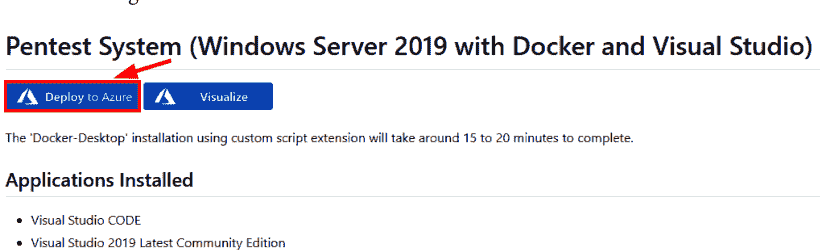

图 2.21 – 点击开始部署过程

3. 在“登录”窗口中，输入之前配置的 azureadmin 用户名和密码以对 Azure 订阅进行身份验证，如下面的截图所示：

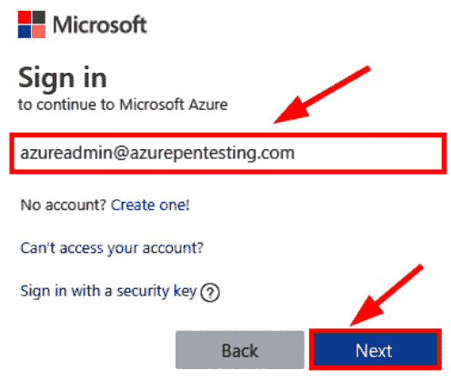

图 2.22 – 向 Azure 进行身份验证

4. 在“自定义部署”窗口中，配置以下参数：

订阅：选择要部署渗透测试 VM 的订阅。

资源组：新建 → pentester-vm-rg → 确定。

区域：选择离您较近的 Azure 区域。

存储名称：保持默认设置。

VM DNS：保持默认设置。

管理员用户：pentestadmin。

管理员密码：输入一个复杂密码。记下您使用的密码。我们建议您选择一个复杂密码，并在本书的各个场景中统一使用，以保持简单。

VM 大小：保持默认设置。

位置：保持默认设置。

_artifacts Location：保持默认设置。

_artifacts Location Sas Token：保持默认设置。


5. 点击**查看 + 创建**。

这个过程在下面的截图中突出显示：

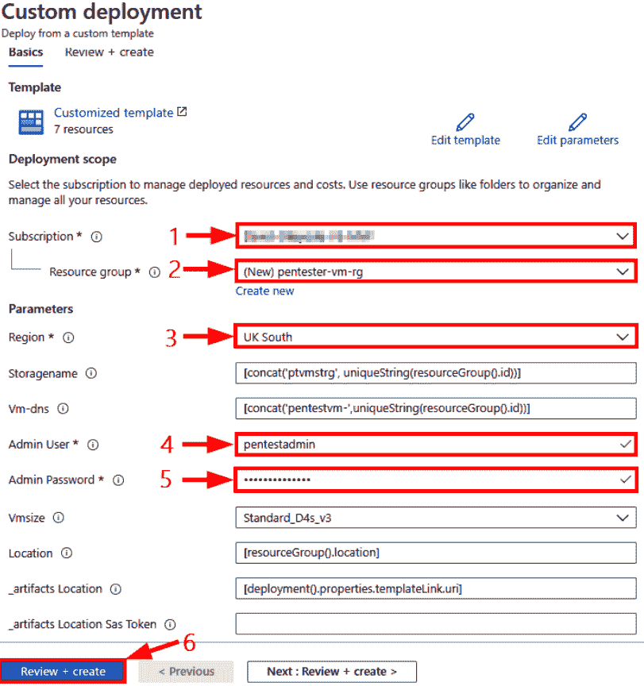

图 2.23 – 配置模板参数

6. 模板验证通过后，点击**创建**，如下面的截图所示。这将开始部署过程，大约需要 20 到 25 分钟才能完成。给自己拿杯饮料，等待部署完成：

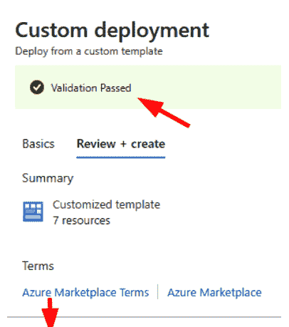

图 2.24 – 部署 pentest 虚拟机模板

7. 部署完成后，点击**输出**选项卡。记下 `pentest-vm-dns` 的值。这是我们刚刚部署的 pentest 虚拟机的公共**域名系统（DNS）**名称。下面的截图展示了这一点：

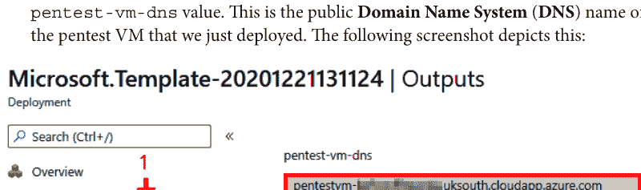

图 2.25 – 获取 pentest 虚拟机 DNS 名称

8. 在客户端系统上，打开**远程桌面协议（RDP）**客户端，输入之前记下的 `pentest-vm-dns` 值，然后点击**连接**。这里的说明描述的是使用 Windows RDP 客户端。如果你使用的是其他 RDP 客户端，操作步骤可能会有所不同。

要打开 Windows RDP 客户端，请在 Windows“运行”对话框中执行 `mstsc`，或在 Windows“开始”菜单中键入 `mstsc`。

下面的截图显示了使用 RDP 连接到 pentest 虚拟机的过程：

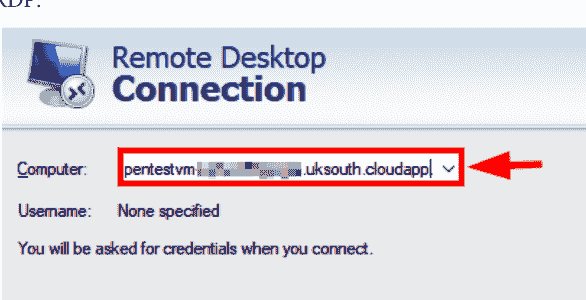

图 2.26 – 使用 RDP 连接到 pentest 虚拟机

9. 当提示登录时，点击**更多选择** → **使用其他帐户**。输入以下内容：

**用户名：** `pentestadmin`。

**密码：** 输入你在模板部署期间配置的密码。

下面的截图展示了这一点：

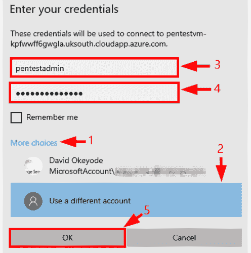

图 2.27 – 使用 RDP 客户端进行身份验证

10. 当收到证书警告提示时，勾选**不再询问我是否连接到此计算机**选项，然后点击**是**，如下面的截图所示：

图 2.28 – 跳过证书警告

11. 现在，你应该已经获得了 pentest 虚拟机的 RDP 会话！下面的截图展示了这一过程的概览。请保持此会话打开，因为下一个练习需要用到它：

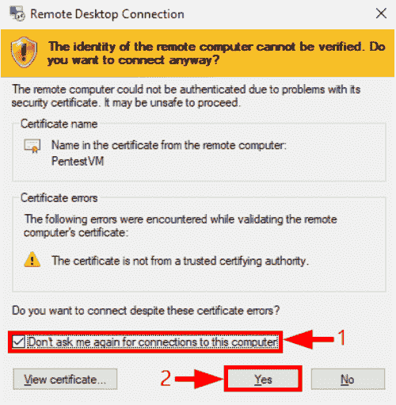

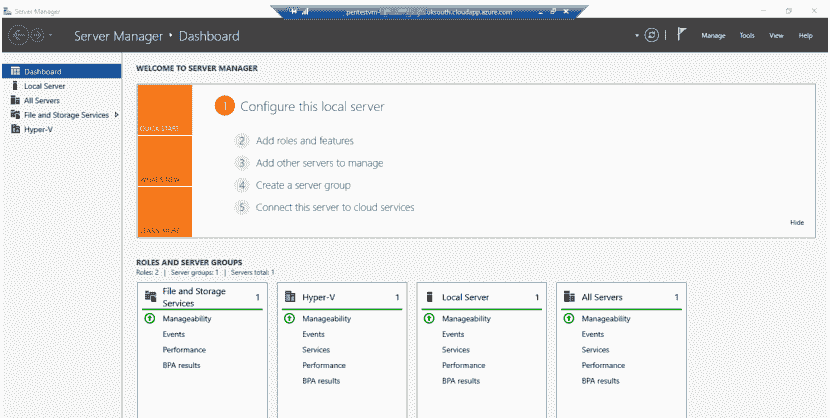

图 2.29 – 与 pentest 虚拟机的 RDP 会话

在本练习中，你在 Azure 中部署了一台 pentest 虚拟机。我们将使用这台虚拟机来发起本书后续要介绍的渗透测试攻击场景。

> **重要提示**
> 
> 如果你想要进一步限制对此虚拟机的访问，可以将对该虚拟机的 RDP 访问限制为你自己的外部**互联网协议（IP）**地址。这被视为最佳实践，可以在门户中虚拟机“**网络**”部分的“**入站安全规则**”中进行设置。也可以通过“**网络安全组**”菜单进行访问。

在下一个练习中，我们将介绍在 pentest 虚拟机上安装**适用于 Linux 的 Windows 子系统（WSL）**。

### 动手练习：在 pentest 虚拟机上安装 WSL

我们将在渗透测试场景中使用的一些工具是基于 Linux 的。为了避免为不同的工具集搭建两套渗透测试系统，我们将在刚部署的 pentest 虚拟机上安装 **WSL**。WSL 允许我们直接在 Windows 上运行 Linux 环境，而无需部署传统的虚拟机。以下是我们在本练习中要完成的任务：

- **任务 1：** 验证 Windows 构建版本是否支持 WSL。
- **任务 2：** 启用 WSL（并重启虚拟机）。
- **任务 3：** 下载 Ubuntu 20.04 Linux 发行版。
- **任务 4：** 安装 Ubuntu 20.04 Linux 发行版。
- **任务 5：** 启动 Linux 发行版。

让我们通过以下步骤来安装 WSL：

1. 在与 pentest 虚拟机的 RDP 会话中，右键点击**开始**按钮，然后点击 **Windows PowerShell（管理员）**，如下面的截图所示：

以下是输出结果的样子：

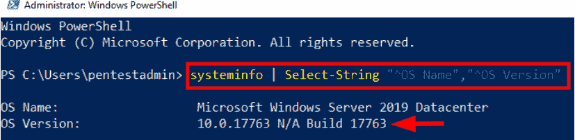

图 2.31 – 验证 Windows 构建版本

3. 使用以下命令启用 WSL。当提示重启虚拟机时，键入 **Y** 并按 *Enter* 键。等待几分钟让虚拟机重启，然后使用 RDP 重新连接，并以管理员身份打开 PowerShell 控制台：

```
Enable-WindowsOptionalFeature -Online -FeatureName Microsoft-Windows-Subsystem-Linux
```

以下是输出结果的样子：

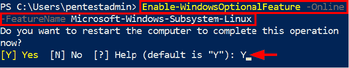

图 2.32 – 使用 PowerShell 启用 WSL

4. 切换到用户目录（使用 `C:\Users\$env:USERNAME\` 或 `~` 均可），并使用以下命令下载 Ubuntu 20.04 发行版：

```
cd C:\Users\$env:USERNAME\
Invoke-WebRequest -Uri https://aka.ms/wslubuntu2004 -OutFile Ubuntu.appx -UseBasicParsing
```

5. 使用以下命令验证下载：

```
Get-ChildItem
```

以下是输出结果的样子：

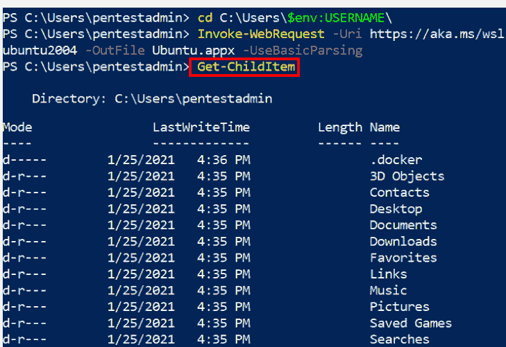

图 2.33 – 验证已下载的 Linux 发行版

6. 使用以下命令解压已下载的发行版：

```
Rename-Item .\Ubuntu.appx .\Ubuntu.zip
```

```
Expand-Archive .\Ubuntu.zip .\Ubuntu
```

7. 使用以下命令安装已解压的 Linux 发行版。安装过程需要几分钟才能完成：

```
Set-Location .\Ubuntu\
```

```
.\ubuntu2004.exe
```

8. 当提示为 Linux 安装输入凭据时，请完成以下操作：

- 输入新的 UNIX 用户名：pentestadmin。
- 新密码：为简单起见，请输入与 pentest 虚拟机相同的密码。
- 重新输入新密码：再次输入相同的密码。

下面的截图展示了这一过程：

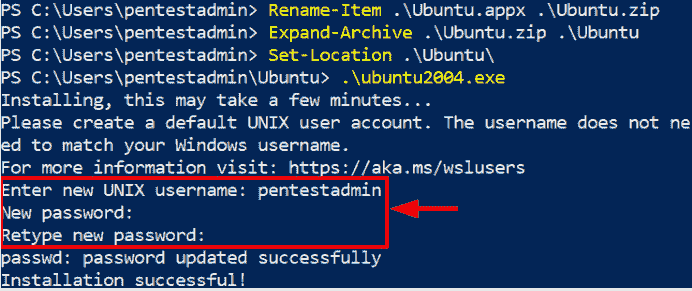

图 2.34 – 为 WSL 配置凭据

9. 使用以下命令为 Linux 安装应用更新。当提示时，输入你刚刚配置的密码：

```
sudo apt update -y
```

10. 你可以关闭 PowerShell 控制台。以后要使用 WSL，只需在 PowerShell 控制台或 pentest 虚拟机的命令行控制台中键入 `bash` 并按 *Enter* 键即可。

在本练习中，你在 pentest 虚拟机上启用了 WSL。在接下来的练习中，我们将介绍安装 Azure PowerShell 模块和 Azure **命令行接口（CLI）**，它们是本书中将要使用的其他渗透测试工具所必需的。

### 动手练习：在 pentest 虚拟机上安装 Azure 和 Azure AD PowerShell 模块

如第一章所述，**Azure PowerShell** 是一个模块，管理员和开发人员可以将其添加到 PowerShell 中，以连接到 Azure 订阅并管理 Azure 资源。**Azure AD PowerShell** 是 IT 专业人员用来管理 Azure AD 的模块。这两个模块都包含渗透测试人员可以用来枚举目标环境的有用命令。Azure 特定的渗透测试工具，如 **MicroBurst** 和 **PowerZure**，也需要安装这些模块。

在本练习中，我们将在 pentest 虚拟机上安装这两个模块。以下是我们要完成的任务：

- **任务 1：** 验证是否已安装 PowerShellGet
- **任务 2：** 将 PowerShell 库配置为受信任的存储库
- **任务 3：** 安装并验证 Azure PowerShell 模块
- **任务 4：** 安装并验证 Azure AD PowerShell 模块

让我们按如下方式安装 Azure PowerShell 和 Azure AD PowerShell：

1. 在 pentest 虚拟机上以管理员身份打开 PowerShell。
2. 使用以下命令验证是否已安装 PowerShellGet：

```
Get-Module -ListAvailable PowerShellGet
```

结果如下所示：

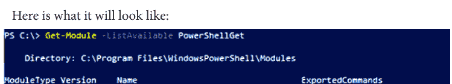

图 2.35 – 将 PowerShell 库配置为受信任的存储库

3. 我们将安装的两个模块都将从 PowerShell 库存储库下载。为了避免收到有关存储库信任级别的消息，我们可以使用以下命令将其配置为受信任的存储库。当提示安装 NuGet 提供程序时，键入 Y 表示同意，然后按 Enter 键：

```
Set-PSRepository -Name PSGallery -InstallationPolicy Trusted
```

结果如下所示：

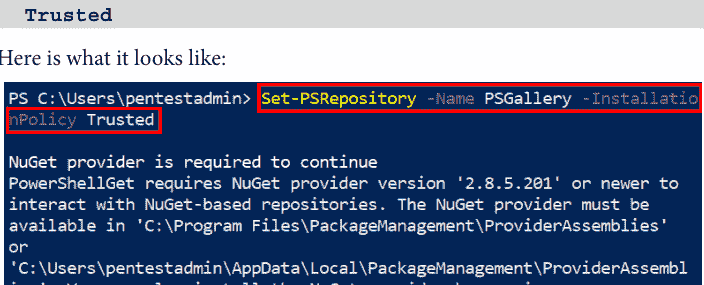

图 2.36 – 将 PowerShell 库配置为受信任的存储库


> **注意**
>
> 强烈建议在不使用渗透测试虚拟机时将其关闭，以节省一些成本。你可以通过 Azure 门户停止该虚拟机来完成此操作。

### Azure 渗透测试工具

在本书的整个过程中，我们将使用不同的工具来模拟对手的战术和技术。我们可以根据这些工具的典型用途，将它们分为不同类别。

首先，我们有 **Windows 或 Linux 管理工具**，如下所述：

- 管理员通常用于常规系统管理的工具
- **示例：** `JQ`、`httpie`、`wget`、`curl`、`unzip` 和 `PowerShell`

接下来是 **通用渗透测试工具**，如下所述：

- 通用服务和漏洞识别工具
- **示例：** `gobuster`、`nmap`、`dnscan` 和 `hydra`

最后，我们有 **Azure 专用渗透测试工具**，如下所述：

- 经过优化、专注于 Azure 平台相关漏洞的渗透测试工具
- **示例：** MicroBurst、Lava、Koboko、PowerZure、Stormspotter 和 BloodHound

目前这类 Azure 专用工具很少，而且大多数是开源的。这通常意味着创建者和贡献者是在自己的空闲时间发布和更新这些工具，因此经常有其他人参与贡献这些工具的机会。本书的作者（以及我们的技术审阅者）都为开源工具做出过贡献，包括前面提到的一些工具，我们的工作证明了：如果你需要的工具或功能不存在，你可以自己动手编写。

关于这些类别，一个重要的区别需要注意：通用渗透测试工具与 Azure 专用工具之间的差异。虽然许多通用渗透测试工具可以用于针对 Azure，但它们通常需要配置以专注于 Azure 域名和服务。本书中提到的 Azure 专用工具要么是专门为限定在 Azure 域范围内而构建的，要么是围绕现有的微软 **应用程序编程接口（API）**、PowerShell 模块和库构建的，以便直接与 Azure 集成。
