## 3 查找 Azure 服务与漏洞

作为渗透测试人员，你可能会在评估过程中被要求对 Azure 租户进行匿名攻击。从范围的角度来看，这可能会很棘手。任何人都可以随意命名一个 Azure 服务，而且可能很难找到真正在范围内的资源。无论你是在追逐漏洞赏金，还是在渗透测试期间寻找影子 IT 资产，匿名的 Azure 服务发现都可以成为识别环境中漏洞的有用工具。

在本章中，我们将介绍不需要对 Azure 租户进行任何身份验证的攻击。此外，这些攻击还可以用于获得对 Azure 租户的初始访问权限。我们还将讨论目前可用于评估 Azure 服务漏洞的多个开源工具包。

具体来说，在本章中，我们将涵盖以下小节：

- Azure 渗透测试指南
- 匿名服务识别
- 识别面向公共服务的漏洞
- 查找 Azure 凭据

### 技术要求

对于本章，我们将使用在 *第 2 章，构建你自己的环境* 中搭建的虚拟机。如果你没有搭建自己的环境，请确保你拥有带 PowerShell 的 Windows 系统的本地管理员访问权限。虽然理解本章内容并不绝对需要 Windows 桌面环境，但作者建议（如前一章所述）启动一台 Azure 虚拟机来测试我们将要介绍的工具和技术。

### Azure 渗透测试指南

自 2017 年 6 月起，*微软不再要求组织在对其 Azure 资源进行渗透测试前获得预先批准*（`https://docs.microsoft.com/en-us/azure/security/fundamentals/pen-testing`）。需要特别注意的是，此豁免不适用于其他微软云服务，例如 Office 365。即使你在执行渗透测试前无需通知微软，但仍然有明确规定的 *交战规则*，你必须始终遵守，并且绝对不应跨越这些界限。不遵守规定可能会导致你的 Azure 账户被暂停或终止、微软对你提起法律诉讼，以及向你提出财务赔偿责任索赔！

> **重要说明**
>
> 由于这些指南会不时更新，我们建议你访问 `https://www.microsoft.com/en-us/msrc/pentest-rules-of-engagement` 以查看最新信息。

以下活动被禁止：

- 扫描属于 *其他 Azure 客户* 的资产。
- 访问任何 *不属于你的数据*。
- 严禁执行任何形式的拒绝服务测试，因为这可能导致 *其他 Azure 客户遭遇计划外停机*。
- 尝试对微软员工进行网络钓鱼或其他社会工程攻击。

以下活动被允许：

- 扫描你的 Azure 端点以发现应用程序或配置漏洞
- 对你的 Azure 端点进行端口扫描和模糊测试

一般来说，任何可能影响其他 Azure 客户或底层 Azure 基础设施稳定性的活动都是不允许的（包括未经许可测试和访问其他客户的数据）。测试你的 Azure 端点及其上托管的应用程序是受到鼓励的。

#### Azure 渗透测试范围

Azure 中的渗透测试可以有多种不同的范围。根据你的组织如何确定对环境的威胁，以及他们如何定义 *渗透测试*，测试可能会有不同的目标。

常见的 Azure 渗透测试范围包括以下内容：

- 匿名外部测试
- 只读配置审查
- 内部网络测试
- 架构审查

很多时候，Azure 渗透测试会包含这些范围的任意组合。无论如何，在开始测试之前，我们都希望获得 Azure 资产所有者的书面法律批准。就像任何其他渗透测试一样，*拥有明确定义的范围和方法论对项目的成功至关重要*。

对于那些从漏洞赏金角度看待本内容的人来说，本章将为你提供大量从外部角度攻击 Azure 目标的选项。就像任何其他测试一样，始终确保 Azure 目标在你所参与的漏洞赏金计划范围内是个好主意。

在本章的其余部分，我们将从匿名枚举和测试 Azure 服务开始。然后，我们将研究可以帮助我们获取租户中 Azure Active Directory 账户的攻击场景。

### 匿名服务识别

现在我们已经对 Azure 基础设施和 Azure 渗透测试的可用范围有了基本了解，让我们开始进行一些实际的攻击。在本节中，我们将介绍如何匿名识别托管在 Azure 中的面向互联网的服务。鉴于许多组织都在使用 Azure 服务，这对于任何外部测试都是适用的，无论云平台是什么。

#### 自行承担测试风险

为了本书的目的，我们将在示例中提供一些真实资源（由作者托管），供你用于测试这些工具。除非另有说明，本书中的所有示例都将指向你有权按照示例操作（测试）的资源。

> **重要说明**
>
> 不要针对你无权测试的系统或服务运行本书中的工具或示例。希望到目前为止，我们已经充分说明了这一点。

我们将尽量为每次攻击指出具体的 *危险范围* 示例。如有疑问，请向你正在测试的资源的所有者确认，你匿名枚举到的资源是否归该组织所有。

#### Azure 公共 IP 地址范围

与其他公共云提供商一样，Microsoft Azure 允许组织将可访问互联网的 IP 地址分配给 Azure 资源。公共 IP 地址可以分配到以下 Azure 资源：虚拟机网络接口、面向互联网的负载均衡器、VPN 网关、应用程序网关或 Azure 防火墙实例（图 3.1）。

当分配公共 IP 地址时，它们可以是 *静态* 或 *动态* 的。动态公共 IP 地址在 Azure 资源的生命周期内可能会改变，而静态公共 IP 地址在 Azure 资源的生命周期内不会改变：


> **注意**
>
> 请注意，前面的命令并不属于我们稍后将要演示的动手练习。不过，如果你有一个想尝试运行这些命令的 Azure 环境，可以在 Azure Cloud Shell 中运行它们。

需要注意的是，动态分配的地址可能会发生变化；如果稍后再次进行测试，这些地址可能已经不再分配给你正在参与测试的组织。在这些情况下，针对 DNS 主机名可能更为合适，因为 IP 地址发生变化时，DNS 主机名会自动更新。这有助于我们避免扫描其他 Azure 客户的 IP 地址。此外，我们建议在收集到公共 IP 后立即执行任何公共 IP 扫描。

出于学习目的，我们将向你展示外部攻击者如何利用公开可用的信息匿名发现 Azure 目标。Microsoft Azure 网络团队发布了一个 JSON 文件，其中包含所有 Azure 区域和公共服务的公共 IP 地址范围。

该文件也会随着新地址范围的添加而每周更新。攻击者获取此列表并使用 **JQ** 等 JSON 工具对其进行解析是很常见的。随后，可以使用 **Nmap** 等工具扫描这些 IP 地址范围，以确定攻击面。我们将在下一组练习中模拟这一过程。

> **重要注意**
>
> Microsoft 强烈不建议扫描未分配给你的 Azure 订阅的公共 IP 地址范围，或扫描未经所有者授权的地址范围。下一项练习仅用于教育目的。**未经分配所有者的书面法律许可，请勿扫描这些地址！**

### 动手练习 – 使用 PowerShell 解析 Azure 公共 IP 地址

本练习将引导你了解外部攻击者如何利用已发布的 Azure 公共 IP 地址范围，识别潜在目标并扫描其漏洞。

以下是本练习中将完成的任务：

- **任务 1：** 在我们的渗透测试虚拟机上下载已发布的 Azure 公共 IP 地址范围 JSON 文件。
- **任务 2：** 使用 PowerShell 解析下载的文件，以识别潜在目标。

让我们开始：

1. 在渗透测试虚拟机中打开 Web 浏览器，并访问 `https://www.microsoft.com/en-us/download/details.aspx?id=56519`（也可以使用这个短网址：`http://bit.ly/azureipranges`）。

2. 单击 **Download** 按钮，以获取当前的 Azure 公共 IP 地址范围列表。这将下载一个 JSON 文件，其中包含按区域和服务划分的公共 IP 地址范围列表。

3. 为了演示方便，我们不会使用下载的 JSON 文件，而是使用命令行会话中显示的链接来下载该文件：

   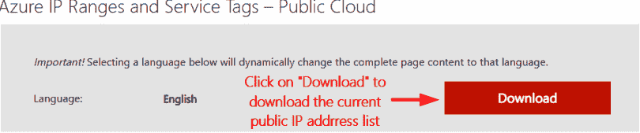

   图 3.2 – 下载 JSON 文件

4. 在显示的窗口中，右键单击 **click here to download manually**，然后单击 **Copy link address**，以获取 JSON 文件的 URL：

   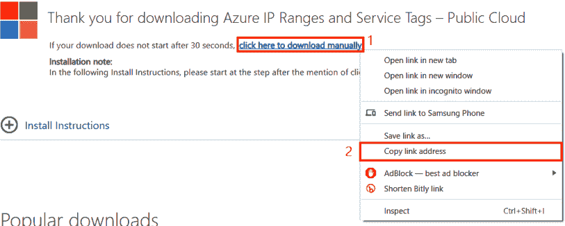

   图 3.3 – 获取 JSON 文件的 URL

> **注意**
>
> 我们在此处下载的 JSON 文件适用于 Azure 公有云。Azure 美国政府云有一个单独的文件，可从 `https://www.microsoft.com/en-us/download/details.aspx?id=57063` 下载。

5. 在渗透测试虚拟机的 PowerShell 控制台中，使用以下命令下载 JSON 文件。将 `<json_url>` 替换为你在*步骤 3*中获取的 URL：

   ```
   cd C:\Users\$env:USERNAME\
   Invoke-WebRequest <json_url> -OutFile azure_ip_range.json
   ```

6. 在本示例中，我们将使用 PowerShell 筛选 Azure 英国南部区域中所有服务的公共 IP 地址范围。这样会返回一个 IP 地址范围列表，攻击者可以扫描这些地址，以确定开放端口以及这些端口上正在监听的服务：

   ```
   $jsonData = gc .\azure_ip_range.json | ConvertFrom-Json
   ($jsonData | select -ExpandProperty values | where name -EQ AzureCloud.uksouth).properties.addressPrefixes
   ```

7. 接下来，尝试筛选英国南部区域中特定服务（Azure App Service 实例）所使用的公共 IP 地址范围。攻击者可以获取这些 IP 地址范围并扫描其中的 Web 应用程序漏洞，因为 Azure App Service 资源通常用于托管 Web 应用程序和 API：

   ```
   ($jsonData | select -ExpandProperty values | where name -EQ AppService.UKSouth).properties.addressPrefixes
   ```

8. 攻击者可以获取这些 IP 地址范围，并扫描开放端口和正在监听的服务，以了解攻击面。使用*步骤 6 和 7*中的示例，尝试执行其他查询，以识别其他 Azure 服务和区域的公共 IP 地址范围。

> **重要注意**
>
> 为了“让一切正常工作”，一些 Azure 管理员或工程师可能会开放分配给不同 Azure 区域的较大 IP 地址范围，以允许虚拟机相互通信。这也可能使你能够从正确区域中的虚拟机访问相同的系统。如果你已通过身份验证访问 Azure 环境，请留意网络安全组规则中的 Azure IP 地址范围，因为你可能可以加以利用。

此外，也可以使用此列表验证你已经在定位的主机是否为 Azure 资源。只需将目标 IP 地址与此列表中的地址范围进行比较，即可识别托管在 Azure 上的资源。本章稍后将使用 Cloud IP Checker 工具演示如何执行此操作。

### Azure 平台 DNS 后缀

如*第 1 章“Azure 平台和体系结构概述”*所述，许多 Azure 平台服务使用由 Microsoft 所有和管理的公共 DNS 后缀。当 Azure 客户创建资源实例时，Azure 会按照 `<resource instance name>.<service dns suffix name>` 的格式，为其分配关联 DNS 后缀的一个子域。

例如，Azure Blob 存储服务的公共 DNS 后缀是 `blob.core.windows.net`。如果 Azure 客户创建了一个名为 `azurepentesting` 的存储帐户实例，则该服务实例的**完全限定域名（FQDN）**将是 `azurepentesting.blob.core.windows.net`。

还需要注意的是，有些 DNS 后缀是区域性的，而另一些则是全局性的。例如，如果客户在 Azure 英国南部区域创建一个带有关联 DNS 标签的公共 IP 资源，则该资源的 FQDN 将是 `<dns label>.<region>.cloudapp.azure.com`。

> **重要注意**
>
> Microsoft 确实维护了一份*不完整的* Azure 域名列表。除了本章提到的域名外，该列表还包含一些其他域名。有关更多信息，请参阅 https://docs.microsoft.com/en-us/azure/security/fundamentals/azure-domains。

虽然该列表会持续更新且并不完整，但下面列出了一些常见的 DNS 域名及其关联服务：

| DNS 后缀 | 关联的 Azure 服务 |
| --- | --- |
| file.core.windows.net | 存储帐户 – 文件 |
| blob.core.windows.net | 存储帐户 – Blob |
| azurewebsites.net | App Services 和 Functions 应用 |
| scm.azurewebsites.net | App Services – 管理 |
| database.windows.net | 数据库 – MSSQL |
| documents.azure.com | 数据库 – Cosmos DB |
| cloudapp.azure.com | 客户分配的公共 IP DNS |
| vault.azure.net | Key Vault |
| azurecontainer.io | 容器实例 |
| azurecr.io | 容器注册表 |

那么，这些信息与匿名枚举 Azure 服务有什么关系？作为渗透测试人员，你可以使用 DNS 解析或暴力破解技术枚举这些子域上的主机，从而发现 Azure 客户部署的活动资源实例。

> **重要注意**
>
> 需要牢记的是，在进行匿名测试时，*名称并不一定能证明资源的所有权*。例如，你可能会看到一个类似 `https://aws.blob.core.windows.net` 的 Azure Blob 存储 URL，并认为它属于**亚马逊云科技（AWS）**。但在本文撰写时，它实际上是一个注册在作者 Azure 租户中的存储帐户。我们使用它来存放 Azure 写作示例，因此它与亚马逊没有任何关系。除了一些与 Microsoft 相关的关键词外，Azure 平台不会执行资源名称完整性验证。如果某个名称当前尚未被其他人使用，任何拥有有效 Azure 订阅的人都可以创建一个名为 `departmentofdefense.azurecr.io` 的容器注册表，没有任何机制可以阻止这一点。

要匿名枚举 Azure 中的平台服务，渗透测试人员可以采用以下方法：

1. 确定要使用的基础词搜索词。这些搜索词通常与正在参与测试的 Azure 客户名称，或与该组织相关的已知术语有关；例如，`packt`、`azurepentesting`、`azurept` 等。
2. 根据基础词创建排列组合，以识别潜在的子域名；例如，`packt-prod`、`packt-dev`、`azurepentesting-stage`、`azurept-qa` 等。


> **重要说明**
> 以下是决定在渗透测试活动中应使用哪些排列组合的一个实用技巧。Microsoft Azure 资源命名最佳实践已发布在 https://docs.microsoft.com/en-us/azure/cloud-adoption-framework/ready/azure-best-practices/resource-naming （你也可以使用此缩短网址：http://bit.ly/azurenamingbestpractices）。由于许多 Azure 客户很可能遵循推荐的命名方案，我们也可以利用这一信息来协助渗透测试人员进行枚举活动。

3. 使用 MicroBurst、Gobuster 或 DNSscan 等工具枚举匹配这些排列组合的子域名。在接下来的动手练习中，我们将使用 MicroBurst 来完成此操作。

MicroBurst 相较于 Gobuster 和 DNSscan 等其他工具的优势在于它是 Azure 专用的，这意味着我们无需手动找出要枚举的每个 DNS 后缀！

### 动手练习 – 使用 MicroBurst 枚举 PaaS 服务

MicroBurst（https://github.com/NetSPI/MicroBurst）工具集是一组 PowerShell 脚本，可用于 Azure 中的多种不同攻击。它由本书作者之一 Karl Fosaaen 创建。我们将在本书中全程使用 MicroBurst 工具，但在本次练习中，你将在渗透测试 VM 上安装 MicroBurst，并使用其 Invoke-EnumerateAzureSubDomains.ps1 脚本来匿名枚举作者已在 Azure 云中预先设置好的 Azure 服务。

按照此处概述的方法论，该脚本将从基础词创建排列组合列表，并尝试基于这些排列组合解析 DNS 主机名。以下是我们将在本次练习中完成的任务：

- **任务 1：** 下载并安装 MicroBurst。
- **任务 2：** 使用 MicroBurst 枚举活动的 Azure 平台服务实例。

6. 正如在此示例中看到的，结果输出表表明存在具有 azurepentesting 资源名称的 Azure 平台服务实例：

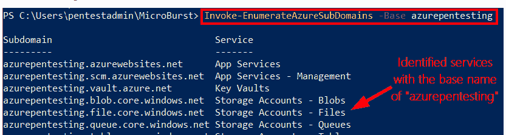

*图 3.7 – MicroBurst 匿名枚举服务*

作者已为本次练习的目的设置了前述截图中列出的资源。超出本书所列的任何额外资源可能不属于作者所有。在遵循示例时请务必谨慎，以免攻击或访问本书示例中未明确定义的资源。

在本章下一节中，我们将看到如何识别并利用这些服务中的一些常见漏洞。

> **重要说明**
> 请务必在练习中仔细核对你正在使用的资源名称，以避免尝试访问你无权访问的 Azure 客户资源。

### 自定义域名和 IP 所有权

某些 Azure 服务允许客户使用自定义域名。此外，一些主机可能设置了重定向或透明代理以掩盖服务托管在 Azure 中的事实。作为渗透测试流程的一部分，你需要充分了解你的目标位于何处，因为这可能会对你的测试范围产生重大影响。例如，你的外部渗透测试范围可能包括你有权攻击的环境中的特定 IP 和主机名。如果这些主机最终位于 Azure 中，这将影响我们攻击这些特定资源的方式。

### 介绍 Cloud IP Checker

Cloud IP Checker 是一款基于 Go 的工具，用于检查 IP 地址是否与已发布的 Azure IP 范围和服务标签匹配。如果 IP 匹配已发布范围，它会显示该 IP 所属的服务及其区域。该工具可以是已发布的 API，也可以是自托管的。

还有其他工具，例如 Leron Gray（Twitter：@mcohmi）创建的 AzureIPCheck 工具（https://github.com/daddycocoaman/azureipcheck），它提供类似功能，但由于是基于 Python 的工具，其工作方式略有不同。

| Cloud IP Checker 信息 | |
|---|---|
| Creator: | Dean Bryen（Twitter：@deanbryen） |
| Open Source or Commercial: | 开源项目 |
| GitHub Repository: | https://github.com/deanobalino/cloudipchecker |
| Language: | Go |

### 动手练习 – 确定自定义域名服务是否托管在 Azure

在本练习中，我们将使用测试订阅中的 book.azurepentesting.com 主机作为示例。要查看此主机是否为 Azure 托管系统，让我们进行一些基本的域名和 IP 侦察：

1. 在渗透测试 VM 中，打开 PowerShell 控制台。使用 `nslookup` 命令识别与我们主机关联的 IP 地址：

   ```text
   nslookup book.azurepentesting.com
   ```

2. 记录返回的 IPv4 地址。此外，请注意在以下截图中，主机解析为 `azurepentesting.z13.web.core.windows.net`，这表明该站点托管在 Azure 中：

   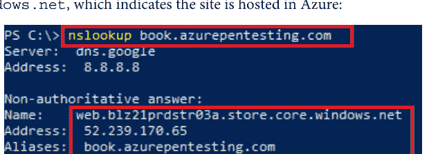

   *图 3.8 – 获取 IPv4 地址*

3. 在 PowerShell 控制台中，运行以下命令以确定 IP 地址是否属于 Azure 已发布 IP 范围。将 `<IP_ADDRESS>` 替换为你在上一步中记录的 IP 地址值：

   ```text
   Invoke-WebRequest https://cloudipchecker.azurewebsites.net/api/servicetags/manual?ip=<IP_ADDRESS> -UseBasicParsing | Select-Object -ExpandProperty Content
   ```

4. 正如前述输出所示，该 IP 属于 Azure IP 范围（美国东部区域的 Azure Storage 服务），因此我们可以推断该服务访问点托管在 Azure 中：

   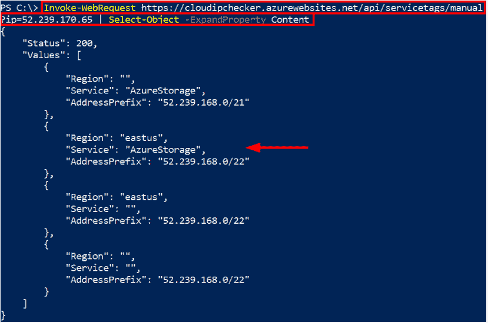

   *图 3.9 – 查看 Cloud IP Checker 结果*

现在我们了解了域名和子域名在 Azure 中的运作方式，让我们看看它们如何可以被进行子域名接管攻击。

### 子域名接管

在讨论 Azure 平台 DNS 枚举时，不提及子域名接管问题是不完整的。在调查托管在 Azure 中的应用程序时，你可能会注意到向不存在的 Azure 子域发出的资源请求。

这种情况有时发生在应用程序最初配置为从 Azure 端点提取内容，但随后内容更改为不同来源，并且初始端点资源从客户的 Azure 订阅中删除。在某些情况下，指向这些端点的客户管理的 DNS 记录也未被清理。

在实践中，这些通常是 JavaScript 文件或其他类似的 Web 资源，因为它们对页面显示的影响通常较小且不易被注意到。在这些情况下，攻击者可能能够在 Azure 中重新创建受影响的资源，并通过受影响的网站投递缺失内容。

这只需在新的 Azure 账户中重新创建端点资源并认领缺失资源的子域名即可：

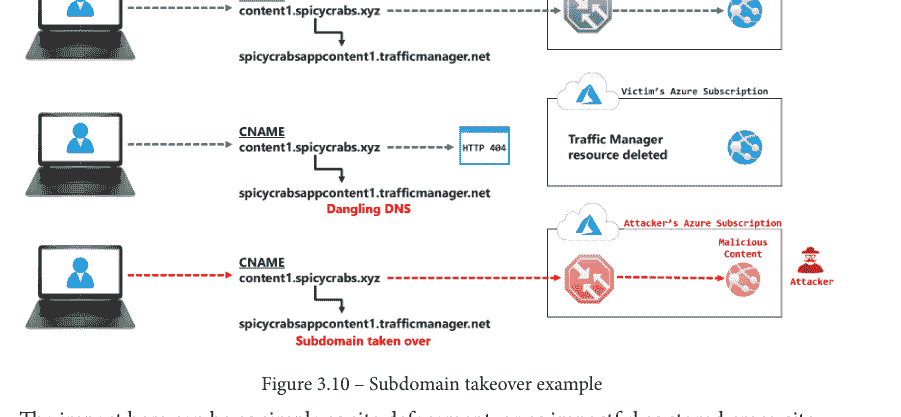

*图 3.10 – 子域名接管示例*

其影响可能仅限于网站篡改，也可能严重到存储型跨站脚本或将站点重定向到恶意内容。这是在漏洞赏金中常见的问题，也是需要留意的事项。最常容易受到子域名接管攻击的服务是 Azure Blob、CDN、Traffic Manager 和 App Services，但这也可能适用于其他具有公共 DNS 后缀的服务。

现在我们了解了自定义域名在 Azure 中的使用方式，让我们来看看在这些面向公众的系统中可能发现的不同类型漏洞。

### 存储账户

存储账户是 Azure 在云中处理数据存储的方式。这些账户包含以下子服务：

- **Blob 服务**：通用 HTTP/HTTPS 文件托管
- **Files 服务**：附加数据存储（SMB/NFS）
- **Table 服务**：NoSQL 半结构化数据集
- **Queue 服务**：HTTP/HTTPS 消息存储

根据之前的子域名枚举任务输出，我们知道 azurepentesting 基础词产生了一个名为 `azurepentesting` 的存储账户。

我们还可以看到以下子域名的 DNS 记录：

- **Blob 服务**：`azurepentesting.blob.core.windows.net`
- **Files 服务**：`azurepentesting.file.core.windows.net`
- **Table 服务**：`azurepentesting.table.core.windows.net`
- **Queue 服务**：`azurepentesting.queue.core.windows.net`

默认情况下，在创建存储账户时会分配这四个子域名。这并不一定意味着 Azure 客户正在使用全部四个服务进行数据存储，因此我们需要确定它们是否包含任何可匿名访问的数据。

Files、Table 和 Queue 服务访问始终需要某种级别的身份验证（本章中我们不会关注它们）。相反，我们将关注 Blob 服务，管理员/开发人员可以为其配置匿名文件访问。

#### Blob 存储账户权限概述

存储账户中的 Blob 服务由 **容器** 组成。这些容器本质上是可用于存储对象/数据的目录。你可以通过 HTTP/HTTPS 端点访问这些对象。URL 地址是存储账户名称、容器和对象名称的组合。

如以下图所示，如果存储账户名称为 `azurepentesting`，容器名称为 `public`，容器内的文件为 `README.txt`，则对象的 URL 将如下所示：

```text
https://azurepentesting.blob.core.windows.net/public/README.txt
```


对于更喜欢视觉化学习的人来说，其结构如下所示：

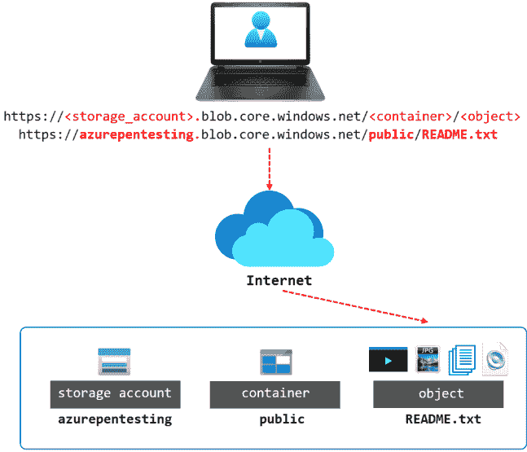

图 3.11 – Azure Blob 服务端点 URL

存储帐户可以包含多个容器，每个容器可以配置不同的公共访问级别。公共访问配置选项如下：

- **私有（Private）：** 不允许匿名访问。访问需要进行身份验证。
- **Blob：** 允许匿名访问已知对象 URL。
- **容器（Container）：** 允许匿名列出和访问容器中的文件。

虽然 **Blob** 容器权限可能会暴露敏感数据，但攻击者需要知道受影响文件的完整文件名才能访问它们。在应用程序以可预测的命名格式（如 Report-123.pdf、Report-124.pdf 等）以编程方式创建文件的情况下，攻击者在初步识别目标用户文件后，可能能够推断出存储帐户中其他文件的名称。这种文件名枚举通常称为**不安全直接对象引用**，简称 **IDOR**。PortSwigger 在其网站上对此问题做了很好的概述：https://portswigger.net/web-security/access-control/idor。

攻击者还可以使用诸如 Gobuster 之类的工具进行容器和对象名称猜测攻击，以查看是否返回对象。成功的可能性很小，但仍然存在。

最令人担忧的公共访问级别是**容器**，因为它允许任何人列出并访问所有可用文件。这意味着，知道存储帐户和容器的攻击者将能够枚举所有可用文件。

利用我们之前的示例存储帐户 URL，我们知道存储帐户名为 `azurepentesting`，并且该容器是公共的。通过将 `?restype=container&comp=list` 参数附加到容器 URL（https://azurepentesting.blob.core.windows.net/public/?restype=container&comp=list），我们可以列出该容器中存储的所有对象。这将返回有关可用文件的 XML 数据，然后我们可以利用这些数据访问对象！

```
<EnumerationResults ContainerName="https://azurepentesting.blob.core.windows.net/public/">
  <Blobs>
    <Blob>
      <Name>README.txt</Name>
      <Url>https://azurepentesting.blob.core.windows.net/public/README.txt</Url>
      <Properties>
        <Last-Modified>Mon, 21 Dec 2020 00:47:51 GMT</Last-Modified>
        <Etag>0x8DBA54A0BCC7C5C</Etag>
        <Content-Length>123</Content-Length>
        <Content-Type>text/plain</Content-Type>
        <Content-Encoding/>
        <Content-Language/>
        <Content-MD5>P4Xiwn/SRng174UNmV1J2A==</Content-MD5>
        <Cache-Control/>
        <BlobType>BlockBlob</BlobType>
        <LeaseStatus>unlocked</LeaseStatus>
      </Properties>
    </Blob>
  </Blobs>
  <NextMarker/>
</EnumerationResults>
```

图 3.12 – Azure Blob 容器枚举输出

从未经身份验证的角度来看，如果我们无法立即知道存储帐户中的任何容器，我们该怎么办？我们可以使用自动化工具猜测容器名称，检查它们是否允许容器权限，然后从中列出可用文件。

### 动手实验 – 使用 MicroBurst 识别配置错误的 Blob 容器

在本实验中，我们将使用 MicroBurst 中的 `Invoke-EnumerateAzureBlobs` 脚本来访问配置错误的 Azure Blob 存储服务中的数据。以下是本实验需要完成的任务：

- **任务 1：** 使用 `Invoke-EnumerateAzureBlobs` MicroBurst 模块，以 `azurepentesting` 为基础名称和内置的排列列表，匿名枚举存储帐户容器。
- **任务 2：** 定义自定义容器列表，并使用它进一步枚举容器。

让我们开始：

1. 在你的渗透测试虚拟机中，以管理员身份打开 PowerShell 控制台。

2. 使用以下命令将目录路径更改为 MicroBurst 目录，并导入 PowerShell 函数：

    ```
    cd .\MicroBurst\
    Import-Module .\MicroBurst.psm1
    ```

    输出如下所示：

    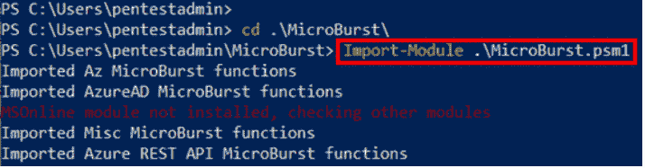

    图 3.13 – 导入 MicroBurst PowerShell 模块

3. 使用 `Invoke-EnumerateAzureBlobs` 函数，以 `azurepentesting` 作为基础词，识别配置了容器访问级别的公共存储帐户：

    ```
    Invoke-EnumerateAzureBlobs -Base azurepentesting
    ```

6. 使用以下命令读取下载的文件之一的内容。这将在记事本中打开该文件：

    ```
    notepad .\credentials.txt
    ```

    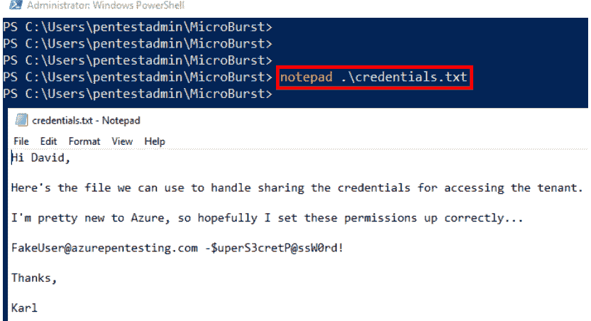

    图 3.16 – 访问下载的文件

7. 在我们于步骤 3 中使用的命令里，MicroBurst 使用常见的容器名称（如 private 和 public）枚举了存储帐户。除非在命令中另有指定，否则用于猜测容器名称的名称来自 MicroBurst 存储库中的 permutations.txt 文件。MicroBurst 用于猜测的完整名称列表可以通过以下命令查看：

    ```
    Get-Content .\Misc\permutations.txt
    ```

8. MicroBurst 还允许我们使用 Folders 参数指定自定义容器名称。使用以下命令创建自定义容器名称列表。当提示创建新文件时，单击“是”：

    ```
    notepad customcontainer.txt
    ```

    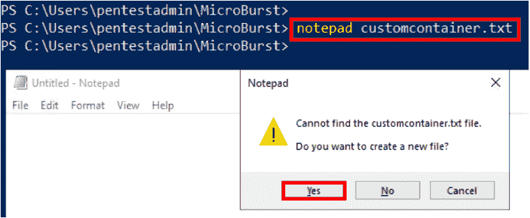

    图 3.17 – 创建自定义容器名称列表

9. 将以下名称添加到记事本文件中。保存文件并关闭它：

    ```
    scripts
    templates
    archive
    2020
    2019
    2018
    ```

10. 回到 PowerShell 控制台，使用以下命令，利用自定义名称列表中的任意名称来枚举潜在的公共容器：

    ```
    Invoke-EnumerateAzureBlobs -Base azurepentesting -Folders .\customcontainer.txt
    ```

11. 在这里，你可以看到我们找到了比之前运行命令时更多的公共容器和对象：

    ```
    PS C:\temp> invoke-EnumerateAzureBlobs -Base azurepentesting -Folders .\customcontainer.txt
    Found Storage Account - azurepentesting.blob.core.windows.net

    Found Container - azurepentesting.blob.core.windows.net/archive
        Public File Available: https://azurepentesting.blob.core.windows.net/archive/sensitive_customer_private_information.csv
    Found Container - azurepentesting.blob.core.windows.net/2020
        Public File Available: https://azurepentesting.blob.core.windows.net/2020/December/access.log
    PS C:\temp>
    ```

    图 3.18 – 枚举自定义容器

如你所见，与配置相关的漏洞可能会给 Azure 环境带来严重问题。在本书中，我们将在面向公众的以及“内部”平台配置级别看到多个此类问题的示例。

虽然这只是一个示例，但本书中还会重点介绍其他特定于服务的配置漏洞。接下来，我们将研究一些可能适用于我们面向外部服务的其他漏洞类别。

### 与补丁相关的漏洞

虽然这些问题不太常见，但每周仍然会发布大量新的安全补丁。因此，有许多被遗忘或废弃的服务、应用程序和虚拟机错过了这些补丁。在本书中，我们将重点利用与 Azure 配置相关的漏洞，但了解利用与补丁相关问题的基本知识也是有帮助的。

从外部角度来看，我们通常会扫描具有公共 IP 的 Azure 虚拟机，以查找面向 Internet 的服务。这些服务通常可以通过网络扫描工具进行指纹识别，以确定承载该服务的软件的具体版本。

一旦确定了软件版本，我们可以使用漏洞扫描器（Nessus、Nexpose 等）或一些基本的 Google 搜索技巧来查找这些服务中的潜在漏洞。

由于这不是一本关于网络渗透测试的书，我们建议查阅 Packt 出版的众多渗透测试书籍之一：https://www.packtpub.com/catalogsearch/result/?q=penetration%20testing。

### 与代码相关的漏洞

现有应用程序的“云化”以及对云原生开发的推动，是促使组织进入 Azure 云的部分驱动力。通过将现有或遗留应用程序移植到云环境，许多组织只是把原先应用程序中存在的许多旧漏洞一并带了进来。

虽然迁移到云端有许多好处，但它并不是修复应用程序漏洞的灵丹妙药。一些现有的常见应用程序问题在云环境中实际上会变得更具影响力，因为这些问题可能被利用来提升访问权限。


### 查找 Azure 凭据

除了在 Azure 应用程序或服务中寻找漏洞之外，获取 Azure 订阅访问权限的最常见方式是通过猜测、窃取或“找到”的凭据。

#### 猜测 Azure AD 凭据

根据实际测试经验，进入 Azure 租户的最常见方式是使用弱密码或默认密码。尽管多年来我们取得了巨大的技术进步，但用户仍然喜欢使用简单密码，而管理员有时会忘记实施身份安全最佳实践。

成功的密码猜测攻击有三个步骤：

- 1. 获取用户名列表。
- 2. 获取密码列表。
- 3. 决定并执行猜测策略。

让我们来看一下。

##### 获取用户名列表

许多组织对用户名/电子邮件地址有正式的命名约定。一些示例包括 `<firstname>.<lastname>@company.com` 和 `<firstname>.<lastname_initial>@company.com`。你可以从公开领域（公司网站、支持渠道、在线员工资料、GitHub 等）中的用户电子邮件地址识别公司的用户名格式。

然后，你可以将对此命名约定的了解与在 LinkedIn 等网站上找到的公司用户信息相结合，为一份员工列表构建用户名。你也可以查看与该组织相关的过往泄露事件来获取此信息。

##### 获取密码列表

一旦你有了用户名列表，就需要仔细选择一个密码或密码列表来尝试登录这些账户。最简单的方法是使用一份从先前泄露事件中识别出的常见密码公开列表。以下是来自流行的 *Have I Been Pwned* 数据集的前 100,000 个密码列表：`http://bit.ly/PwnedPasswordsTop100k`。该列表由英国**国家网络安全中心（NCSC）**发布——这不是原始数据集。网上还有其他常见密码列表，你也可以参考。

你也可以自己制定一个更有针对性的列表来尝试登录这些账户。在制定列表时，请记住，大多数组织会实施某种类型的密码策略，以确保用户只选择中等强度的密码。即使有策略存在，用户也常常会创建刚好能通过策略的密码。这些密码可能易于用户记忆和输入，但容易受到密码猜测攻击。

一个很好的例子是密码 `Winter2020`。它足够长，满足大多数密码长度要求（10 个字符），并且满足大多数密码复杂性要求（使用大写字母、小写字母和数字字符）。它也很符合许多密码期限要求。如果密码设置为每 90 天过期，那么这正好符合下一个季节。

##### 决定猜测策略

在渗透测试中，我们可以使用多种策略来猜测密码。你可以使用你拥有的用户名和密码列表执行**暴力破解攻击**、**单密码喷洒攻击**或**定向用户攻击**。

**暴力破解攻击**更针对少量用户，目的是尽可能多地尝试密码。这可以是循环尝试常见密码列表、字典单词或随机生成的密码（*图 3.19*）。

在执行暴力破解攻击时，要注意可能存在锁定策略，如果输入多个错误密码，账户会被临时禁用。一个好的经验法则是，从锁定策略中获取失败尝试次数（如果已知）并减去 2。这样可以让受害用户有几次输错密码的机会，而不会触发锁定。例如，如果一个账户在五次失败尝试后被锁定，我们只需要猜测三个密码，然后等待锁定计时器重置。如有疑问，请务必与负责渗透测试范围的人员合作，以确定适当的密码猜测策略：

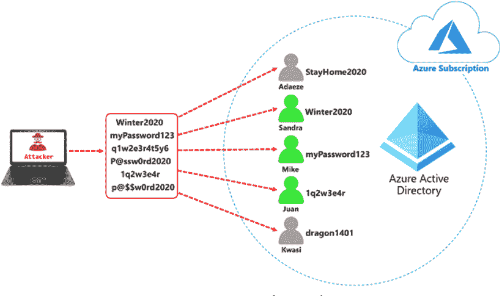

图 3.19 – 暴力破解攻击

**密码喷洒攻击**对许多用户名使用相同的密码（*图 3.20*）。这里需要考虑的一点是，将密码猜测尝试分布到多个 IP 地址，以避免被某些安全工具检测到（包括 Microsoft 的 AD 密码保护和身份保护。相关链接可在本章末尾的*进一步阅读*部分找到）。

可以使用诸如 FireProx 之类的工具，通过 AWS API Gateway 服务发起攻击来轮换源 IP 地址。请记住，FireProx 可能违反 AWS 可接受使用政策，这可能会给你的 AWS 账户带来问题：

| FireProx 信息 |
|---|
| **创建者：** Mike Felch（Twitter：`@ustayready`） |
| **开源或商业：** 开源项目 |
| **GitHub 仓库：** `https://github.com/ustayready/fireprox` |
| **语言：** Python |

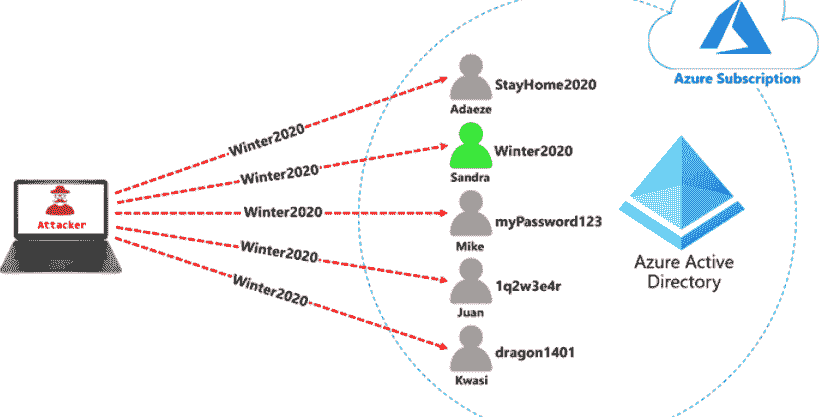

图 3.20 – 密码喷洒攻击

既然我们已经有了猜测密码的方法，接下来让我们了解一些工具，这些工具可用于针对我们自己的测试环境尝试猜测密码。

#### MSOLSpray 简介

MSOLSpray 是一款用于 Microsoft 在线账户（Azure/Office 365）的 PowerShell 密码喷洒工具。该工具的优势在于，除了检测有效密码外，它还能提供与账户的多因素认证（MFA）状态相关的有用侦察信息，例如账户是否存在、账户是否被锁定或禁用，或者密码是否已过期。

| MSOLSpray 信息 |
|---|
| **创建者：** Beau Bullock（Twitter：@dafthack） |
| **开源或商业：** 开源项目 |
| **GitHub 仓库：** https://github.com/dafthack/MSOLSpray |
| **语言：** PowerShell |

虽然还有其他变体（MSOLSpray Python、TREVORspray 等），但在下一个动手练习中，我们将使用最初用 PowerShell 编写的 MSOLSpray 工具。

#### 动手练习 – 使用 MSOLSpray 猜测 Azure Active Directory 凭据

在本动手练习中，我们将使用 MSOLSpray 工具执行密码喷洒攻击。以下是我们要完成的任务：

- **任务 1**：从 Azure Cloud Shell 在你的 Azure Active Directory 租户中创建测试用户。
- **任务 2**：使用 Azure 门户为测试用户启用 MFA。
- **任务 3**：在你的渗透测试虚拟机上下载并导入 MSOLSpray。
- **任务 4**：在你的渗透测试虚拟机上创建用户列表。
- **任务 5**：从你的渗透测试虚拟机使用 MSOLSpray 运行密码喷洒攻击。

让我们开始：

- 1. 打开 Web 浏览器，浏览到 Azure 门户 https://portal.azure.com。使用你的 azureadmin 凭据登录。
- 2. 在 Azure 门户中，单击右上角的 Cloud Shell 图标：
- 3. 如果出现提示，请选择 PowerShell：


图 3.21 – 打开 Azure Cloud Shell

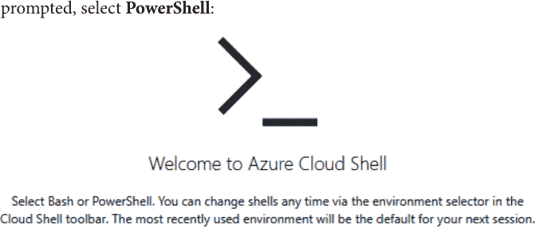

图 3.22 – 选择 "PowerShell"

- 6. 使用以下命令执行下载的脚本。当提示输入密码时，输入 myPassword123 并按 Enter。该脚本将使用你输入的密码在你的 Azure AD 租户中预配五个新用户：

```
./create-test-users.ps1
```

如下所示：

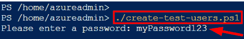

图 3.26 – 为测试用户输入密码

- 7. 在脚本输出的末尾，记下用户主体名称和密码。密码喷洒攻击时需要用到它们：

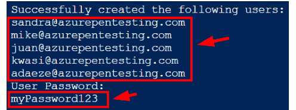

图 3.27 – 记下用户主体名称和密码

- 8. 关闭 Cloud Shell 窗口：

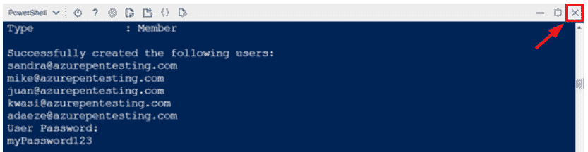

图 3.28 – 关闭 Cloud Shell


9. 在 Azure 门户中，点击左上角的 Hub 菜单图标并选择 Azure Active Directory：

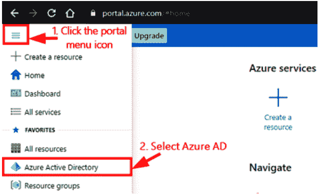

图 3.29 – 点击“Azure Active Directory”

10. 在 Azure AD 控制台中，在 Manage 部分，选择 Users 并点击 Multi-Factor Authentication：

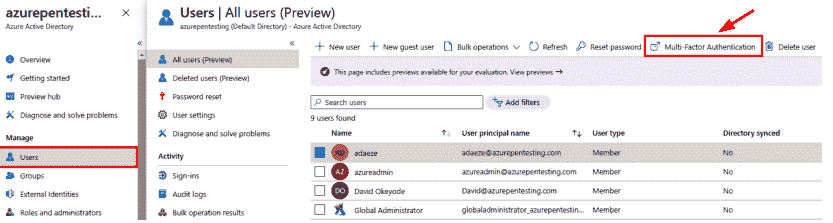

图 3.30 – 点击“Multi-Factor Authentication”

16. 将你之前记下的用户名输出粘贴到 Notepad 中。保存并关闭 Notepad 文档：

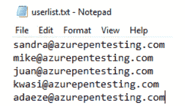

图 3.35 – 粘贴脚本之前创建的用户名

17. 使用以下命令对用户账户运行 MSOLSpray。指定你之前记下的密码输出。你应该会看到所有账户的成功消息，但你也应该会看到你已为其启用 MFA 的账户的输出：

```
Invoke-MSOLSpray -UserList ./userlist.txt -Password myPassword123
```

输出如下所示：

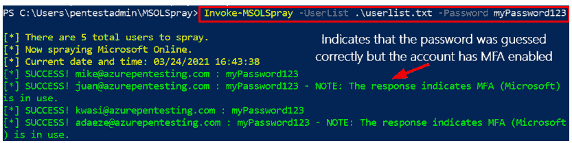

图 3.36 – 对用户列表执行密码喷洒攻击

18. 在 InPrivate 或 Incognito 窗口中打开 Azure AD 门户 https://aad.portal.azure.com 。使用 Sandra 的凭据登录：

Username: `sandra@<domain_name_suffix>`

Password: myPassword123

19. 你现在应该能够以 Sandra 的身份访问 Azure AD 门户。此外，你还应该能够以 Sandra 的身份查看 Azure AD 租户中其他用户的信息！（这是默认行为。）

图 3.37 – 使用 Sandra 的被攻破账户访问 Azure AD 门户

20. 返回以 azureadmin 用户登录的 Azure Cloud Shell。下载清理脚本以删除之前创建的测试用户，并使用以下命令验证下载：

```
Invoke-WebRequest -Uri http://bit.ly/az-pentest-cleanup-test-users -OutFile cleanup-test-users.ps1
```

```
Get-ChildItem
```

输出如下所示：

图 3.38 – 下载清理脚本

此工具将遍历以下 Microsoft 服务，以识别任何允许在没有 MFA 或 Conditional Access 要求的情况下访问的服务：

- Microsoft Graph API
- Azure Service Management API
- Microsoft 365 Exchange Web Services
- Microsoft 365 Web portal
- Microsoft 365 Web portal with mobile user agent (Android)
- Microsoft 365 ActiveSync

在一个真实场景中，我们可能会发现使用移动操作系统的用户对标准 Conditional Access 规则有例外。为什么会这样？一些移动用户会从不同的 IP 地址频繁登录，很难预测这些 IP。通过使用移动设备用户代理，我们可以假装成移动操作系统，从而绕过 Conditional Access 要求。

虽然我们在实验室中不会使用它，但将 MFASweep 工具用于你的测试是有益的：

1. 在你的 pentest VM 中，打开 PowerShell 控制台，切换目录到你的用户目录，并使用以下命令克隆 MFASweep GitHub 仓库：

```
cd C:\Users\$env:USERNAME\
git clone https://github.com/daftHack/MFASweep.git
```

2. 使用以下命令导入 MFASweep PowerShell 模块：

```
cd .\MFASweep\
Import-Module .\MFASweep.ps1
```

3. 使用以下命令对你已攻破的任何用户账户运行 MFASweep。你应该会看到允许 Conditional Access 策略绕过的任何账户的成功消息：

```
Invoke-MFASweep -Username sandra@azurepentesting.com -Password myPassword123
```

虽然 Conditional Access 策略绕过可能并非在任何地方都可用，但还有额外的 *非传统* 选项可用于绕过 MFA 要求。

### Summary

在本章中，我们介绍了从外部人员角度处理 Azure pentest 场景的方法，该人员对目标的云资产几乎没有信息。我们还学习了如何查找暴露资源的配置错误漏洞，这可能导致对租户的初始访问。

除此之外，我们还介绍了用于攻破 Azure AD 用户账户以供进一步利用的一系列工具和技术。本章讨论的信息有望使你能够匿名发现和攻击公共 Azure 资源和易受攻击的云身份。

在下一章中，我们将介绍在你猜测到凭据或获得对订阅的 *reader* 级别访问权限后可以进行的攻击。

#### Further reading

要了解本章所涵盖内容的更多信息，请查看以下资源：

- Azure AD Identity Protection: `https://docs.microsoft.com/en-us/azure/active-directory/identity-protection/overview-identity-protection`
- Azure AD Password Protection: `https://docs.microsoft.com/en-us/azure/active-directory/authentication/concept-password-ban-bad`
- Social engineering: `https://www.csoonline.com/article/2124681/what-is-social-engineering.html`
- *Implementing Microsoft Azure Security Technologies* by David Okeyode, Packt Publishing
