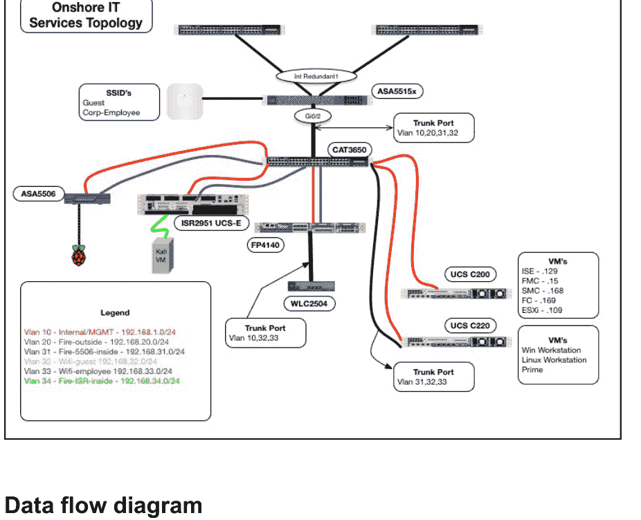
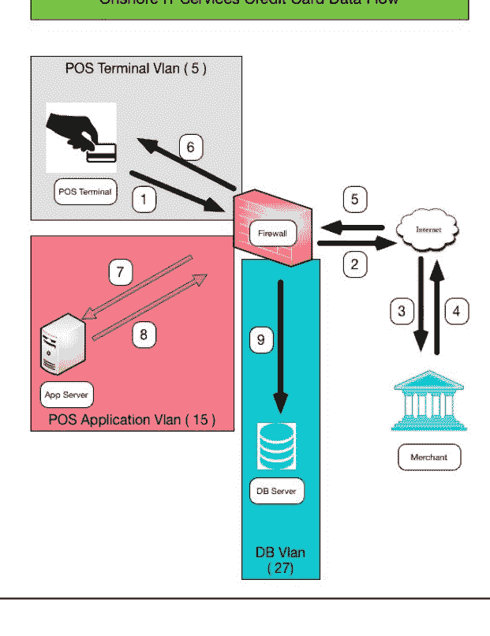
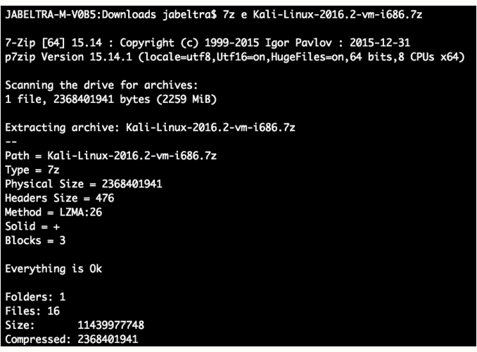
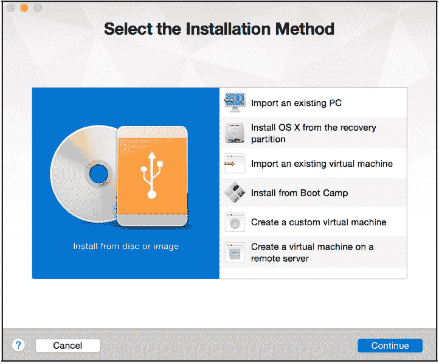
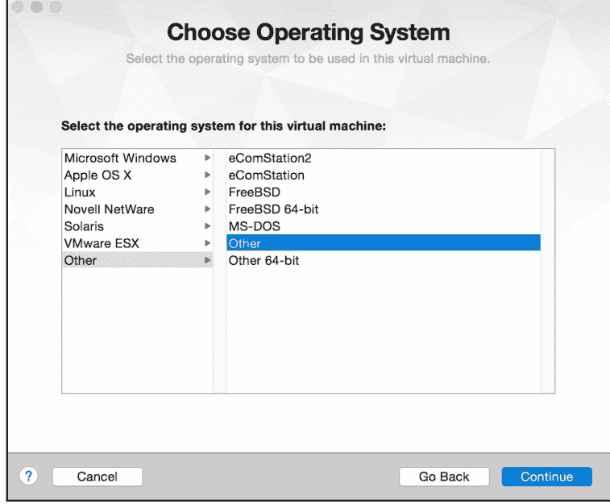
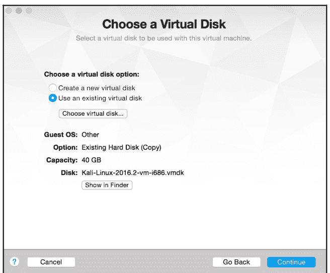

## 1

## 规划与准备

适当的规划和准备是成功渗透测试的关键。它绝对没有我们稍后在渗透测试中执行的某些任务那么令人兴奋，但它将奠定渗透测试的基础。渗透测试涉及许多变动环节，您需要确保自己走在正确的道路上，并清楚知道可以和应该进行多远。您在渗透测试中最后想要做的事情就是因为使用漏洞利用测试导致客户的应用服务器宕机（除非，当然，他们希望我们深入到这种程度）或扫描了错误的网络而造成客户中断。执行这些操作中的任何一个都会使我们的渗透测试职业生涯变得相当短暂。

本章将涵盖以下主题：

- 为什么要进行渗透测试？
- 范围界定会议、利益相关者问卷和文档
- 为渗透测试构建系统
- 渗透系统软件设置

### 为什么要进行渗透测试？

渗透测试有许多必要的原因。有时，公司可能希望更深入地了解其安全态势。有时，他们可能需要满足合规要求。无论如何，了解为什么需要渗透测试将帮助您理解公司的目标。此外，它还将让您知道您是执行内部渗透测试还是外部渗透测试。外部渗透测试将遵循外部用户的流程，查看他们可以访问的内容，以及他们可以用该访问权限做什么。

内部渗透测试旨在测试内部系统，因此通常渗透测试主机将完全访问该环境，能够测试所有软件和系统是否存在已知漏洞。由于测试目标不同，我们需要区别对待；因此，我们的工具和方法也会不同。

### 了解 engagement

在开始渗透测试之前，您需要完成的首要任务之一是与利益相关者会面，讨论有关即将进行的渗透测试的各种数据点。此会议可能涉及您作为外部实体为客户执行渗透测试，或作为内部安全员工为自己的公司执行测试。这里的重要要素是，无论哪种情况，会议都应该举行，并且需要讨论相同类型的信息。

在范围界定会议期间，目标是讨论渗透测试的各个项目，以便您不仅拥有所需的一切，而且还获得管理层的完全认可，并有明确定义的目标和交付成果。管理层的完全认可是一个成功的渗透测试的关键组成部分。没有它，您可能难以从某些团队获取所需信息，或者可能出现范围蔓延，或出现普遍的抵制。

### 使用利益相关者问卷定义目标

本节介绍我使用过的各种问题，以及我认为对于这种 engagement 很重要的问题。这些问题将有助于为渗透测试人员定义明确且可衡量的目标。

让我们看一个用于确定 engagement 标准的问卷：

- 此次渗透测试的目标是什么？
- 渗透测试结束时需要哪些交付成果？
- 渗透测试的时长是多少，是否有任何时间段不能进行渗透测试？（例如，客户在一天中的繁忙时段可能不希望任何事情中断其业务流程）
- 在渗透测试期间，渗透测试是否在发现漏洞时停止，还是会积极尝试利用这些漏洞？（这个问题很重要，因为利益相关者可能不希望系统被关闭或潜在数据被修改/删除，因此我们需要确保了解边界）如果利用系统是可以接受的，您是否希望渗透测试人员在之后尝试在环境中进行横向移动？
- 这将是内部渗透测试、外部渗透测试，还是两者兼有？
- 公司内的联系人是谁？
- 公司需要遵循哪些合规标准？

### 范围界定标准

我们现在将看到一个范围界定标准的示例问卷。首先，我们将从仅由白盒测试人员提出的问题开始，以深入了解网络以进行测试：

- 此次测试的范围内的子网和/或 IP 地址是什么？
- 是否有任何系统不在范围内？
- 网络中是否有安全设备？（这很重要，因为这些设备可能会阻止进入环境的访问，从而妨碍正确测试系统）
- 环境中是否保存或传输任何重要数据？

最后，如果渗透测试人员采用更多黑盒思维，那么这些问题对他们以及白盒测试人员同样相关：

- 访客访问是否也在范围内？
- 哪些企业 SSID 在范围内？
- 测试范围内的物理位置是什么（如果有多个位置）？所有位置/网络都是专用的，还是与另一家公司共享（例如，共享托管或某些云环境）？


这个列表绝不完整或全面。作为渗透测试人员，您需要弄清楚哪些问题对您的特定 engagement 相关。前面的列表包含基于我经验的一些必需问题。

### 文档

文档是规划和准备阶段的重要组成部分。有时，这些信息不会提供给您，您必须自行获取。在 `Chapter 2`，*Information Gathering* 中，我们还将重点关注获取这些信息，如果没有全部提供的话。

但希望您能在进入渗透测试之前获得有关环境的某些信息。在开始渗透测试之前，有不同类型的文档非常有用。在接下来的几个部分中，我们将看到准备阶段所需的主要文档类型。


文档很棒，但渗透测试人员的工作之一也是验证其正确性。我们见过太多过时和/或不正确的文档。请将其用作测试的指南，但绝不应该将其用作唯一的真理来源。

### 了解网络图 – onshore IT 示例

范围内系统和设备的网络图对于了解网络以便开始制定整体渗透计划非常重要。此文档将允许您查看范围内系统，以及网络和所涉及设备的路径。许多组织在这种类型的文档方面存在困难，因此请严格将其用作指南。其中一项交付成果可能最终是基于渗透测试期间发现的内容为您制作的更全面的网络图。

网络图有各种形状和大小。重要的是要为范围内网络提供它，并尽可能显示主要网络设备、安全设备和主机。以下是我的一个示例网络图。这将让您很好地了解需要寻找什么：



## 数据流图

数据流图可能是渗透测试员/评估员/审计员可以拥有的最重要的文档之一。数据流图的工作是展示组织内部重要数据的流动。数据可以是不同类型的，包括信用卡信息、专有公司信息，甚至个人身份信息（PII）。了解此类数据在网络中的流动方式以及它与哪些系统交互，将有助于你帮助渗透测试员了解应重点关注的地方。这很重要，因为黑客也会重点关注这里。

某些组织通常没有此类文档。我们见过许多公司在进行某种审计或评估时不得不生成这些数据流图。但大多数组织应为任何重要的数据流在组织内部保留数据流图。

渗透测试的一个很好的结果是，此类文档可能会通过渗透测试得到验证以证明其准确性。不幸的是，文档在大多数公司中往往是低优先级，因此能够保持其最新状态很重要。

这是我们创建的示例公司的示例数据流图，显示信用卡信息在整个网络中的流动：



## 组织结构图

你可能会想知道为什么组织结构图是渗透测试中宝贵且必需的文档。但仔细想想，职位较高的人往往会成为目标，因为他们有权转移资金或访问重要物品。了解组织内所有员工的指挥链使我们作为渗透测试员能够看到可以针对的其他个人，希望最终到达顶层。此信息可以帮助显示渗透测试员可能首先针对谁。对黑客来说，让一名初级会计点击链接并安装恶意软件以便黑客获得远程访问，可能比对 CFO 采用同样方法更容易。现在，我们相当确定 CFO 相比初级会计拥有更多访问权限，但一旦你在组织内获得立足点，移动起来就会变得容易得多。记住：人通常是安全中最薄弱的环节。

这是一个组织结构图的简单示例：


## 为渗透测试构建系统

在对期望、交付成果和范围有清晰理解后，现在是时候开始着手准备我们的渗透系统了。硬件方面，我将使用一台性能相当不错的笔记本电脑。该笔记本电脑是配备 16 GB RAM、256 GB SSD 以及运行 VMware Fusion 的四核 2.3 GHz Intel i7 的 MacBook Pro。我还将使用 Raspberry Pi 3。Raspberry Pi 3 是一款 1.2 GHz ARMv8 64 位四核，配备 1 GB RAM 和 32 GB microSD。显然，笔记本电脑和 Raspberry Pi 之间存在相当大的性能差异。不过没关系，因为我会以不同的方式使用这两台设备。任何需要某种处理能力的任务都将在笔记本电脑上完成。我喜欢使用 Raspberry Pi 是因为其小巧的机身和灵活性。它可以放置在我们需要的几乎任何位置，如果需要，还可以轻松隐藏。

软件方面，我将使用 Kali Linux 作为我的操作系统选择。Kali 是一个以安全为导向的 Linux 发行版，其中已预装了大量安全工具。其前身 Backtrack 也曾是非常流行的安全操作系统。Kali Linux 的一个好处是它也适用于 Raspberry Pi，这在我们的情况下非常完美。这样，我们就可以在计划用于渗透测试实验室的设备之间保持一致的平台。Kali Linux 可以从其网站 https://www.kali.org 下载。对于 Raspberry Pi，Kali 镜像由 Offensive Security 在 https://www.offensive-security.com 管理。至于各种工具，我们将在其他章节中使用它们时讨论。

即使我使用 Kali Linux 作为我的软件平台选择，请随意使用你最舒适的任何软件平台。在本书中，我们将使用大量开源工具进行测试。其中许多工具可用于其他发行版和操作系统。

## 渗透系统软件设置

由于它们是不同的平台，在两个系统上设置 Kali Linux 有些不同。由于这是一本中级书籍，我们不会深入探讨安装的许多细节，但我们将涵盖所有主要要点。这是你可以用来使软件运行起来的流程。

我们将从 Raspberry Pi 上的安装开始：

- 1. 从 Offensive Security 下载镜像，网址为 https://www.offensive-security.com/kali-linux-arm-images/。
- 2. 在 OS X 上打开终端应用程序。
- 3. 使用 xz 实用程序，可以解压缩已下载的 Kali 镜像：
```
xz -d kali-2.1.2-rpi2.img.xz
```
- 4. 接下来，将带有 microSD 卡的 USB microSD 卡读卡器插入笔记本电脑，并验证已安装的磁盘，以便知道将 Kali 镜像写入哪个正确的磁盘：
```
diskutil list
```
- 5. 一旦知道正确的磁盘，你可以卸载磁盘以准备写入：
```
diskutil unmountDisk /dev/disk2
```
- 6. 现在正确的磁盘已卸载，你需要使用 dd 命令将其写入镜像。此过程可能需要一些时间，因此如果你想检查进度，可以随时运行 Ctrl + T 命令：
```
sudo dd if=kali-2.1.2-rpi2.img of=/dev/disk2 bs=1m
```
- 7. 由于镜像现在已写入 microSD 驱动器，你可以使用以下命令将其弹出：
```
diskutil eject /dev/disk2
```
- 8. 然后取下 USB microSD 卡读卡器，将 microSD 卡放入 Raspberry Pi 并首次启动它。默认登录凭据如下：
```
Username:root
Password:toor
```
- 9. 然后使用以下命令更改 Raspberry Pi 上的默认密码，以确保没有人可以进入：
```
passwd <INSERTPASSWORDHERE>
```
- 10. 确保软件是最新的对于任何系统都很重要，尤其是安全的渗透测试系统。你可以使用以下命令实现：
```
apt-get update
apt-get upgrade
apt-get dist-upgrade
```
- 11. 重启后，Raspberry Pi 就准备就绪了。

接下来，我们将继续在 Mac 上设置 Kali Linux 安装。由于你将在 Fusion 中将 Kali 作为 VM 安装，因此该过程与另一个虚拟化程序或在裸机系统上安装相比会有所不同。对我来说，我喜欢拥有 OS X 运行的灵活性，这样我也可以在上面运行命令：

- 1. 与 Raspberry Pi 设置类似，你需要下载镜像。你将直接通过 Kali 网站进行下载。他们也提供虚拟镜像供下载。如果你选择这些镜像，你将被重定向到 Offensive Security 网站 https://www.offensive-security.com/kali-linux-vmware-virtualbox-image-download/。
- 2. 现在 Kali Linux 镜像已下载，你需要提取 VMDK。我们使用 CLI 中的 7z 来完成此任务：



- 3. 由于 VMDK 现在已准备好导入，你需要进入 VMware Fusion 并导航到 文件 | 新建。应显示类似以下内容的屏幕：



- 4. 点击 **Create a custom virtual machine**。你可以将操作系统选择为 **Other | Other** 并点击 **Continue**：



- 5. 现在，你需要导入之前解压缩的 VMDK。点击 **Use an existing virtual disk** 单选按钮，然后点击 **Choose virtual disk**。浏览 VMDK。点击 **Continue**。然后，在最后一个屏幕上，点击 **Finish** 按钮。磁盘现在应该开始复制。给它几分钟时间完成：



6. 完成后，Kali VM 现在将启动。使用我们在 Raspberry Pi 镜像中使用的凭据登录：

```
Username:root
Password:toor
```

7. 然后你需要更改设置的默认密码，以确保没有人能够进入。 在 Kali Linux VM 中打开一个终端并使用以下命令：

```
passwd <INSERTPASSWORDHERE>
```

8. 确保软件是最新的，就像你为 Raspberry Pi 所做的那样。 为此，你可以使用以下命令：

```
apt-get update
apt-get upgrade
apt-get dist-upgrade
```

9. 完成后，笔记本 VM 已准备就绪。

## Summary

现在我们已到达本章的结尾，我们应该拥有渗透测试所需的一切。 在与所有利益相关者进行范围界定会议后，我们能够得到我们所需的所有问题的答案。 这包括参与问题和范围界定标准。 利益相关者在范围界定会议后的交付物应包括对渗透测试有益的任何文档。 我们通常需要网络图、组织结构图以及任何重要的数据流图。

一旦我们完成了规划部分，我们就进入了准备阶段。 在这种情况下，准备阶段涉及在 Raspberry Pi 上设置 Kali Linux 以及在笔记本电脑上将其设置为 VM。 我们在每个平台上完成了安装和更新软件的步骤，以及一些基本的管理任务。

在 `Chapter 2`，*信息收集*，我们将开始深入信息收集任务。 在此任务中，我们将查看需要调查的各种类型的信息，以及在哪里寻找更多信息。 我们不能总是依赖利益相关者的文档是正确的，甚至可能存在他们甚至不知道的未记录系统。 找到这些系统是我们的任务。 我们将使用各种工具来获取这些信息，以便帮助我们了解现有的安全性和系统，从而知道稍后从哪里开始渗透测试。
