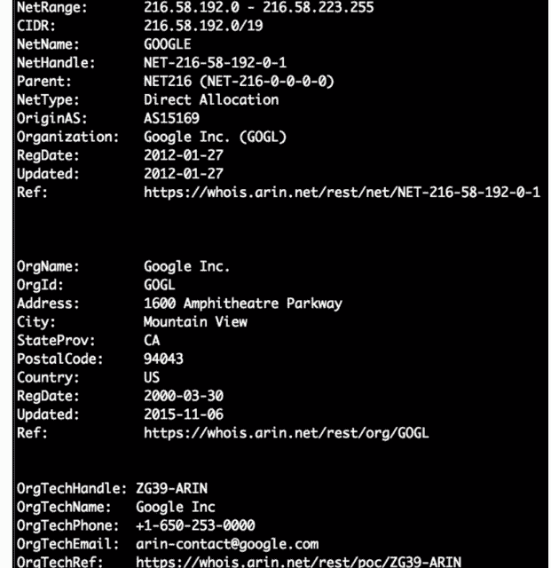
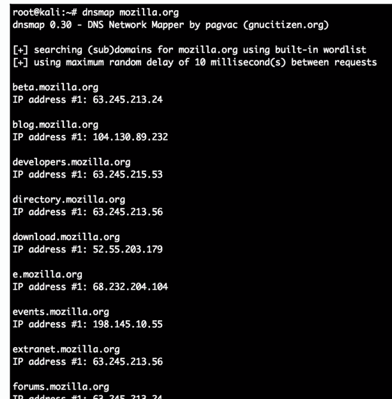
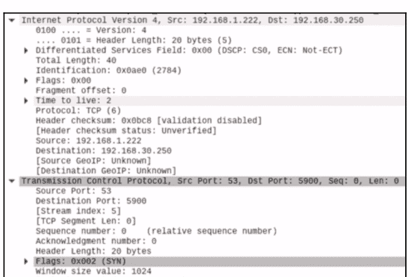
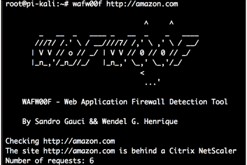
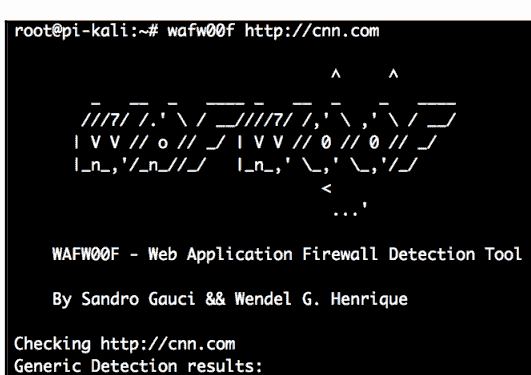
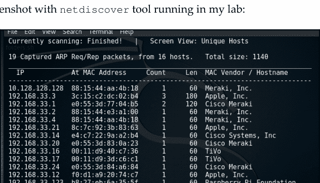

## 2

## Information Gathering

有了从范围界定会议收到的所有信息，现在是时候不仅验证这些信息，而且通过你自己的信息收集研究尽可能多地了解。 目标是在开始扫描漏洞并利用它们之前，尽可能多地了解网络和系统。

在本章中，你将学习使用各种工具来开始绘制网络和系统的地图，然后枚举你的发现。 从此阶段获得的信息越多，找到漏洞和利用就越容易。 这一步可以在实验室中为你节省大量时间。 例如，如果你了解到 Web 服务器是 Microsoft Windows 2012 服务器，你就可以利用此信息更好地了解如何进行利用阶段。 如果没有这些信息，你可能会尝试对该服务器进行大量利用，但它们不会起作用，因为它们不是针对 Windows 2012 服务器的。

话虽如此，在找到你想要进一步探测的系统后，总是会有快速通过此阶段的诱惑。 你必须不惜一切代价抵制这种行为。 你必须在分配的渗透测试时间中花费相当一部分时间在此阶段。 在此花费的实际时间将取决于整体参与时间。 我不能强调这一点足够； 这可能是整个渗透测试中最重要的阶段。 你花费的时间越多来了解环境和目标，你在渗透测试的其他阶段浪费的时间就越少。

在本章中，我们将讨论以下主题：

- 工具箱中的各种工具
- Whois、dnsmap 和 DNSRecon
- Nmap
- P0f
- Firewall Dotdotpwn

## Understanding the current environment

在跳入用于绘制网络、安全性和系统地图的各种工具之前，回顾你可能作为利益相关者会议的一部分收到的当前文档是一种良好的做法。 同时，你希望采访组织内的各个团队，以获取有关拓扑的背景信息，在你自己发现之前。 如果你已经有一个定义的布局，渗透测试员的工作肯定会更容易，而不是花费数天进行探测和映射只是为了达到这一点。

以下是一些我倾向于交谈的团队。 你选择的团队最终将取决于组织以及渗透测试的范围：

- **网络团队**：采访网络团队以更好地了解当前网络拓扑、当前使用的网络设备、使用的网络供应商以及任何有助于你了解网络的其他信息。
- **系统管理员**：与系统管理员交谈将帮助你了解现有的各种操作系统以及服务器角色、应用程序和应用程序之间的数据流。 当谈到查看应用程序层和可能存在的漏洞时，这些信息是无价的。
- **安全团队**：这一个对我来说意义重大。 了解网络中使用的当前安全设备是真正了解拓扑的关键。 防火墙和设备可能会隐藏网络的部分，因此了解它们存在的位置和原因将帮助你布置网络和任何潜在目标。 此外，了解公司的安全策略，例如修补管理策略、密码策略和端点策略，肯定会帮助你为未来的工具确定目标。


前面的列表仅代表在跳入探测和映射工具之前需要交谈的团队的一小部分。 你能交谈的人越多，能获得的信息越多，渗透测试成功的可能性就越大。 其中一个主要原因是严格由于你将通过深入细节而节省的时间，而不会浪费太多时间只是绘制地图。

## Where to look for information – checking out the toolbox!

现在我们已经讨论了信息收集阶段为何如此重要，让我们深入了解一些用于获取各种类型信息的工具。 你可能很快会注意到的一件事是，有很多工具和方法可以从环境中获得更多情报。 第二件事是这些工具及其各自的功能和输出有很多重叠。 这是一件好事，因为随着经验的积累，每位渗透测试员都会学会他们最喜欢使用的工具、他们认为最有益的工具以及他们想要避免的工具。

以下是我在实验室环境中以及现实世界中使用过的工具，以发现我正在运行渗透测试的网络上到底有什么。

## Search engines as an information source

搜索引擎为我们提供了回答任何问题的手段。 诸如 Google、Yahoo! 或 Bing 等工具使我们能够随时找到任何问题的答案。 但这些工具对于为我们计划运行渗透测试的公司或环境提供信息也非常强大。 通过各种搜索，你可以查看环境的各种图像，这可以帮助你布置任何物理安全测试。 你还可以找到可能泄露了环境某些敏感信息的 Google dorks。 Google dorking 在信息收集阶段非常流行。

类似于 Google，Shodan 已成为任何 Internet 连接设备的首选搜索引擎。 该搜索引擎对于暴露和泄露环境中各种各样的信息具有巨大的可能性。 浏览该网站可以为你提供有关连接到 Internet 的网络摄像头的[content]


6. 完成后，Kali VM 现在将启动。使用我们在 Raspberry Pi 镜像中使用的凭据登录：

```
Username:root
Password:toor
```

7. 然后你需要更改设置的默认密码，以确保没有人能够进入。 在 Kali Linux VM 中打开一个终端并使用以下命令：

```
passwd <INSERTPASSWORDHERE>
```

8. 确保软件是最新的，就像你为 Raspberry Pi 所做的那样。 为此，你可以使用以下命令：

```
apt-get update
apt-get upgrade
apt-get dist-upgrade
```

9. 完成后，笔记本 VM 已准备就绪。

## Summary

现在我们已到达本章的结尾，我们应该拥有渗透测试所需的一切。 在与所有利益相关者进行范围界定会议后，我们能够得到我们所需的所有问题的答案。 这包括参与问题和范围界定标准。 利益相关者在范围界定会议后的交付物应包括对渗透测试有益的任何文档。 我们通常需要网络图、组织结构图以及任何重要的数据流图。

一旦我们完成了规划部分，我们就进入了准备阶段。 在这种情况下，准备阶段涉及在 Raspberry Pi 上设置 Kali Linux 以及在笔记本电脑上将其设置为 VM。 我们在每个平台上完成了安装和更新软件的步骤，以及一些基本的管理任务。

在 `Chapter 2`，*信息收集*，我们将开始深入信息收集任务。 在此任务中，我们将查看需要调查的各种类型的信息，以及在哪里寻找更多信息。 我们不能总是依赖利益相关者的文档是正确的，甚至可能存在他们甚至不知道的未记录系统。 找到这些系统是我们的任务。 我们将使用各种工具来获取这些信息，以便帮助我们了解现有的安全性和系统，从而知道稍后从哪里开始渗透测试。

## 2

## Information Gathering

有了从范围界定会议收到的所有信息，现在是时候不仅验证这些信息，而且通过你自己的信息收集研究尽可能多地了解。 目标是在开始扫描漏洞并利用它们之前，尽可能多地了解网络和系统。

在本章中，你将学习使用各种工具来开始绘制网络和系统的地图，然后枚举你的发现。 从此阶段获得的信息越多，找到漏洞和利用就越容易。 这一步可以在实验室中为你节省大量时间。 例如，如果你了解到 Web 服务器是 Microsoft Windows 2012 服务器，你就可以利用此信息更好地了解如何进行利用阶段。 如果没有这些信息，你可能会尝试对该服务器进行大量利用，但它们不会起作用，因为它们不是针对 Windows 2012 服务器的。

话虽如此，在找到你想要进一步探测的系统后，总是会有快速通过此阶段的诱惑。 你必须不惜一切代价抵制这种行为。 你必须在分配的渗透测试时间中花费相当一部分时间在此阶段。 在此花费的实际时间将取决于整体参与时间。 我不能强调这一点足够； 这可能是整个渗透测试中最重要的阶段。 你花费的时间越多来了解环境和目标，你在渗透测试的其他阶段浪费的时间就越少。

在本章中，我们将讨论以下主题：

- 工具箱中的各种工具
- Whois、dnsmap 和 DNSRecon
- Nmap
- P0f
- Firewall Dotdotpwn

## Understanding the current environment

在跳入用于绘制网络、安全性和系统地图的各种工具之前，回顾你可能作为利益相关者会议的一部分收到的当前文档是一种良好的做法。 同时，你希望采访组织内的各个团队，以获取有关拓扑的背景信息，在你自己发现之前。 如果你已经有一个定义的布局，渗透测试员的工作肯定会更容易，而不是花费数天进行探测和映射只是为了达到这一点。

以下是一些我倾向于交谈的团队。 你选择的团队最终将取决于组织以及渗透测试的范围：

- **网络团队**：采访网络团队以更好地了解当前网络拓扑、当前使用的网络设备、使用的网络供应商以及任何有助于你了解网络的其他信息。
- **系统管理员**：与系统管理员交谈将帮助你了解现有的各种操作系统以及服务器角色、应用程序和应用程序之间的数据流。 当谈到查看应用程序层和可能存在的漏洞时，这些信息是无价的。
- **安全团队**：这一个对我来说意义重大。 了解网络中使用的当前安全设备是真正了解拓扑的关键。 防火墙和设备可能会隐藏网络的部分，因此了解它们存在的位置和原因将帮助你布置网络和任何潜在目标。 此外，了解公司的安全策略，例如修补管理策略、密码策略和端点策略，肯定会帮助你为未来的工具确定目标。


前面的列表仅代表在跳入探测和映射工具之前需要交谈的团队的一小部分。 你能交谈的人越多，能获得的信息越多，渗透测试成功的可能性就越大。 其中一个主要原因是严格由于你将通过深入细节而节省的时间，而不会浪费太多时间只是绘制地图。

## Where to look for information – checking out the toolbox!

现在我们已经讨论了信息收集阶段为何如此重要，让我们深入了解一些用于获取各种类型信息的工具。 你可能很快会注意到的一件事是，有很多工具和方法可以从环境中获得更多情报。 第二件事是这些工具及其各自的功能和输出有很多重叠。 这是一件好事，因为随着经验的积累，每位渗透测试员都会学会他们最喜欢使用的工具、他们认为最有益的工具以及他们想要避免的工具。

以下是我在实验室环境中以及现实世界中使用过的工具，以发现我正在运行渗透测试的网络上到底有什么。

## Search engines as an information source

搜索引擎为我们提供了回答任何问题的手段。 诸如 Google、Yahoo! 或 Bing 等工具使我们能够随时找到任何问题的答案。 但这些工具对于为我们计划运行渗透测试的公司或环境提供信息也非常强大。 通过各种搜索，你可以查看环境的各种图像，这可以帮助你布置任何物理安全测试。 你还可以找到可能泄露了环境某些敏感信息的 Google dorks。 Google dorking 在信息收集阶段非常流行。

类似于 Google，Shodan 已成为任何 Internet 连接设备的首选搜索引擎。 该搜索引擎对于暴露和泄露环境中各种各样的信息具有巨大的可能性。 浏览该网站可以为你提供有关连接到 Internet 的网络摄像头的

## 利用 whois 进行信息收集

当域名注册时，必须输入一些特定的联系信息。你可以选择公开显示这些信息，或支付费用将其隐藏，以免他人看到这些个人信息。其中包括姓名、物理地址、电子邮件地址和电话号码等项目。除了联系信息外，还有其他相关信息，例如域名注册日期和分配的域名服务器。这些信息可能很有用。

对公司的域名使用 whois 可以让我们看到一些相关信息，例如谁维护 DNS 记录及其联系信息。利用注册日期可以知道域名可能何时到期，如果公司忘记续费，你也可以利用这些信息在到期时自行注册。过去这种情况曾发生在许多知名网站上。

以下是关于 google.com 域名信息的 whois 截图：

```
root@kali:~# whois -H google.com

Whois Server Version 2.0

Domain names in the .com and .net domains can now be registered
with many different competing registrars. Go to http://www.internic.net
for detailed information.

Domain Name: GOOGLE.COM
Registrar: MARKMONITOR INC.
Sponsoring Registrar IANA ID: 292
Whois Server: whois.markmonitor.com
Referral URL: http://www.markmonitor.com
Name Server: NS1.GOOGLE.COM
Name Server: NS2.GOOGLE.COM
Name Server: NS3.GOOGLE.COM
Name Server: NS4.GOOGLE.COM
Status: clientDeleteProhibited https://icann.org/epp#clientDeleteProhibited
Status: clientTransferProhibited https://icann.org/epp#clientTransferProhibited
Status: clientUpdateProhibited https://icann.org/epp#clientUpdateProhibited
Status: serverDeleteProhibited https://icann.org/epp#serverDeleteProhibited
Status: serverTransferProhibited https://icann.org/epp#serverTransferProhibited
Status: serverUpdateProhibited https://icann.org/epp#serverUpdateProhibited
Updated Date: 20-jul-2011
Creation Date: 15-sep-1997
Expiration Date: 14-sep-2020

>>> Last update of whois database: Sun, 15 Jan 2017 03:43:20 GMT <<<
```

以下是从 whois 屏幕中可以看到的联系信息：

```
Registry Registrant ID:
Registrant Name: Dns Admin
Registrant Organization: Google Inc.
Registrant Street: Please contact contact-admin@google.com, 1600 Amphitheatre Parkway
Registrant City: Mountain View
Registrant State/Province: CA
Registrant Postal Code: 94043
Registrant Country: US
Registrant Phone: +1.6502530000
Registrant Phone Ext:
Registrant Fax: +1.6506188571
Registrant Fax Ext:
Registrant Email: dns-admin@google.com
Registry Admin ID:
```

现在，你可以看到 whois 提供了一些很棒的信息。如果没有域名只有 IP 地址怎么办？没问题！whois 可以使用 IP 地址进行查询。事实上，这是我最喜欢使用 whois 的方式，因为它能提供有关公司的一些关键信息。例如，它会显示该 IP 所属的分配网络块以及公司的 AS 编号。接下来，我将向你展示如何使用这个 AS 编号。

以下是使用 IP 地址进行 whois 查询的截图，可以看到它与查询域名时的结果大不相同。我运行了以下命令来获取输出：

```
whois -H 216.58.218.238
```



让我们回到之前找到的 AS 编号。我们现在可以取这个编号并查找分配给该公司（包括 IPv4 和 IPv6）的所有 IP 网络。这也可以通过 whois 和一些参数来实现，同时使用 Unix 管道和 grep 过滤输出。利用此工具是验证利益相关方所声称拥有的 IP 地址范围并获取额外攻击面的绝佳方式。我见过很多利益相关方忘记或不知道自己拥有的网络块的情况：

```
root@kali:~# whois -h whois.radb.net -- '-i origin AS36856' | grep route
route:       63.245.208.0/20
route:       63.245.223.0/24
route:       63.245.208.0/22
route:       63.245.221.0/24
route:       63.245.220.0/24
route:       63.245.214.0/23
route:       63.245.219.0/24
route:       63.245.208.0/20
route:       63.245.221.0/24
route:       63.245.214.0/23
route6:      2620:101:8001::/48
route6:      2620:101:8000::/40
route6:      2620:101:8000::/40
```

## 使用 dnsmap 枚举 DNS

dnsmap 是一个非常棒的工具，可以在你正在查找的域名内发现子域名。这是可以查看是否存在其他可能已知或未知的公开站点（内部和/或外部）的绝佳方式。这使你有可能找到并利用未被正确控制或管理的子域名。你可以提供自己的词表来对照子域名进行查找，也可以直接使用内置的词表。有些组织会将部分子域名外包给第三方，因此在使用这些信息时需要谨慎。工作范围可能仅涵盖你受雇的公司；因此，如果你试图主动利用它，另一家组织可能不会对你持友好态度。这应该在利益相关方会议上确定，但有时事情还是会遗漏。以下是 dnsmap 命令行选项的截图：

```
root@kali:~# dnsmap
dnsmap 0.30 - DNS Network Mapper by pagvac (gnucitizen.org)

usage: dnsmap <target-domain> [options]
options:
-w <wordlist-file>
-r <regular-results-file>
-c <csv-results-file>
-d <delay-millisecs>
-i <ips-to-ignore> (useful if you're obtaining false positives)

e.g.:
dnsmap target-domain.foo
dnsmap target-domain.foo -w yourwordlist.txt -r /tmp/domainbf_results.txt
dnsmap target-domain.foo -r /tmp/ -d 3000
dnsmap target-domain.foo -r ./domainbf_results.txt
```

然后我们可以取正在查看的域名，在本例中为 https://www.mozilla.org，并查看可能存在哪些其他子域名。以下截图显示了针对 Mozilla.org 运行 dnsmap 命令的输出：



有了这些信息，我们现在可以开始探测过去可能不知道的额外 IP 地址/站点，这可以增加我们可操作的攻击/渗透测试面。目标越多，我们进入的机会就越大，并且能够将其包含在我们将交付的渗透测试报告中。

## 使用 DNSRecon 进行 DNS 侦察

DNSRecon 是一个方便的基于 DNS 的实用工具，可让你对 DNS 记录执行各种侦察操作。首先，你可以枚举所有不同类型的 DNS 记录，检查任何缓存条目，并检查区域传输，甚至可以枚举 Google 以获取额外的区域文件。

DNSRecon 并不是一个复杂的工具，但它功能强大，可以节省你手动使用其他工具花费的大量时间。`dnsrecon` 包有一些命令行选项，因此一定要查看主页面，看看在你的环境中哪些是相关的。我通常使用 `-g` 开关进行 Google 枚举。这可以找到引用我正在查找的主域名的额外子域名。这让我不必手动在 Google 上查找，从而节省了大量时间。这是可以自动化部分 `google-fu` 的绝佳方式，可以获得一些很棒的信息。

以下是实验室中使用 `-g` 开关的示例。你会注意到在命令的第一部分会给出标准信息。Google 枚举结果稍后出现。以下是通过 DNS 查找发现的一般枚举结果：

```
root@kali:~# dnsrecon -d cnn.com -g
[*] Performing General Enumeration of Domain: cnn.com
[-] DNSSEC is not configured for cnn.com
[*] SOA ns-47.awsdns-05.com 205.251.192.47
[*] NS ns-1086.awsdns-07.org 205.251.196.62
[*] NS ns-1086.awsdns-07.org 2600:9000:5304:3e00::1
[*] NS ns-1630.awsdns-11.co.uk 205.251.198.94
[*] NS ns-1630.awsdns-11.co.uk 2600:9000:5306:5e00::1
[*] NS ns-47.awsdns-05.com 205.251.192.47
[*] MX ppsprmsa.turner.com 157.166.168.210
[*] MX ppsprmsh.turner.com 157.166.157.29
[*] A cnn.com 151.101.64.73
[*] A cnn.com 151.101.128.73
[*] A cnn.com 151.101.192.73
[*] A cnn.com 151.101.0.73
[*] TXT cnn.com 598362927-4422061
[*] TXT cnn.com 321159687-4422031
[*] TXT cnn.com v=spf1 include:cnn.com._nspf.vali.email include:%{i}._ip.%{h}._ehlo.%{d}._spf.vali.email ~all
[*] TXT cnn.com globalsign-domain-verification=21I5pahhCu_jg_2RC5GEdo1QmAa4K7rhP7_OA-1Z8K
[*] TXT cnn.com 353665828-4422052
[*] Enumerating SRV Records
[*] SRV _sip._tls.cnn.com sipdir.online.lync.com 146.112.61.106 443 1
[*] SRV _sip._tls.cnn.com sipdir.online.lync.com ::ffff:146.112.61.106 443 1
[*] SRV _sipfederationtls._tcp.cnn.com sipfed.online.lync.com
```

```
146.112.61.106 5061 1
[*] SRV _sipfederationtls._tcp.cnn.com sipfed.online.lync.com
::ffff:146.112.61.106 5061 1
[*] 4 Records Found
```

这里是通过 Google 枚举找到的其他站点的示例：

```
[*] Performing Google Search Enumeration
[*] CNAME www.cnn.com turner.map.fastly.net
[*] A turner.map.fastly.net 151.101.192.73
[*] A turner.map.fastly.net 151.101.128.73
[*] A turner.map.fastly.net 151.101.64.73
[*] A turner.map.fastly.net 151.101.0.73
[*] CNAME edition.cnn.com www.edition.cnn.com
[*] CNAME www.edition.cnn.com turner.map.fastly.net
[*] A turner.map.fastly.net 151.101.192.73
[*] A turner.map.fastly.net 151.101.128.73
[*] A turner.map.fastly.net 151.101.64.73
[*] A turner.map.fastly.net 151.101.0.73
[*] CNAME cnnradio.cnn.com cnnradio.wordpress.com
[*] CNAME cnnradio.wordpress.com vip-lb.wordpress.com
[*] A vip-lb.wordpress.com 192.0.79.33
[*] A vip-lb.wordpress.com 192.0.79.32
[*] CNAME news.blogs.cnn.com cnnnews.wordpress.com
[*] CNAME cnnnews.wordpress.com vip-lb.wordpress.com
[*] A vip-lb.wordpress.com 192.0.79.33
[*] A vip-lb.wordpress.com 192.0.79.32
[*] CNAME religion.blogs.cnn.com cnnreligion.wordpress.com
[*] CNAME cnnreligion.wordpress.com vip-lb.wordpress.com
[*] A vip-lb.wordpress.com 192.0.79.33
[*] A vip-lb.wordpress.com 192.0.79.32
[*] CNAME ac360.blogs.cnn.com cnnac360.wordpress.com
[*] CNAME cnnac360.wordpress.com vip-lb.wordpress.com
```

在此屏幕中存在一些重要的输出。首先，可以看到未配置 DNSSEC。这是一个重要的发现，可以在报告中记录。你还可以注意到 SPF 记录，它告诉我们哪些服务器可以发送电子邮件。还要注意他们没有使用 IPv6。我还可以看到由于存在某些记录，他们正在使用 Lync 服务，因此环境中肯定存在一些 Microsoft 服务。

我想用一个 DNSSEC 确实存在的示例来跟进。以下是当前使用 DNSSEC 的主机的输出：

```
root@kali:~# dnsrecon -d mozilla.org
[*] Performing General Enumeration of Domain: mozilla.org
[*] DNSSEC is configured for mozilla.org
[*] DNSKEYs:
[*] None ZSK RSASHA1NSEC3SHA1 03010001d748fbf3dff546ecb16dbf13 d169236ca187ea137ea32e43becf55dc b3ee591d c9cb478ff25e6eda740b6bd15 2a762023dece07ea3e241db165c56376 6af73b8aec8bb38107e009ebb6a1e82a 1dbe561b891b2191d ba1a1d9972b1974 ef4ef50dfe62b7848ba0079395f4bd f19dfc75a0014c19bb34e9819290d31f 44ae7425
[*] None ZSK RSASHA1NSEC3SHA1 03010001d381989d9bcb77051b1420aa 3dc1a0efef367125f6a7a840a65e22 b75a4638 a55f0cb23f0a4f0aa2e1bf9f 2c612e9f0dc943b18076300db065706 f348710d7ad9d35e36650ec9879eff04 69d3ec417fe17f71f e096126370530a5 a8b71a390d42a9c80aa3eb291974c2be b8cf4a18e5fb55fab91e1c503d1d34b6 0bc3f04f
[*] None KSK RSASHA1NSEC3SHA1 02ffffc335910d21b3de0e09922b90ab 0b3bf5867a9f0c64d1ff4f17d3024126 2b446774 7f856eba9b9f78a6f675e 638c7db469a1ec539d508ba104afd2c bcb643ca93b44b8dd9f2783e75813517 cac2159b48d416bea d63c2b1b796c01e 94bcfbb4ee64a6d23b4ced7aa769dca6 7849a9fcd3e66589e27b2bbe983d996ef 8c66521824e32ffce4160f69d5 9ac8d7 78ed1d9ecacbf0cc82e707723f2da06e 4b1606c72c6f0376df800f1183b8f0f1e aca2fcb67ee4d55a78fbc2c3b04877373 ae18c66258569abdeb5e0d696457a5cf f3195eb2bab80969eb6d3a1dceba f729 5f848703f5def0d2b73d32cd43142879 c335516e724 9179d665b69c29a1e42f0 4ef14b
```

## 检查 DNS BIND 版本

能够看到 DNS 服务器运行的 BIND 版本会提供一些潜在的重要信息。许多 DNS 服务器设计为不会透露这些信息，或只透露有关其设置的通用信息。但仍有大量 BIND 实例在运行，它们可能会透露其运行的确切 BIND 版本。使用以下命令获取的版本，你可以将其与任何已知漏洞进行交叉引用，如果存在漏洞，你现在就有了潜在的入侵途径。

在以下示例中，我能够从一台公开可用的 DNS 服务器获取 BIND 服务器信息。我已更改名称以保护当事人：

```
root@pi-kali:~# host -c chaos -t txt version.bind DNS1.XXXX.NET
Using domain server:
Name: DNS1.XXXX.NET
Address: XXX.XXX.XXX.XXX#53
Aliases:
version.bind descriptive text "9.3.6-P1-RedHat-9.3.6-16.P1.1.2012012401"
```

## 使用 Nmap 探测网络

Nmap 无疑是目前最优秀的渗透测试工具之一。它是一个网络映射实用程序，可为你希望发送到线路上的任何内容生成网络数据包。这正是它如此出色的原因。你可以生成自己选择的数据包，然后查看网络和系统如何响应它。但这种强大的功能也带来了一些复杂性。Nmap 确实有一定的学习曲线。我将介绍我在实验室测试中使用的一些示例。请查看 Nmap 的主页面，因为有大量选项可供你使用。

让我们看一些示例：

```
nmap -v -A scanme.nmap.org
nmap -v -sn 192.168.0.0/16 10.0.0.0/8
nmap -v -iR 10000 -Pn -p 80
```

这里，我们还可以参考 https://nmap.org/book/man.html 主页面以获取更多选项和示例。

现在，让我们尝试一些真实世界的示例：

```
Nmap -v -sS -sV -p0-65535 192.168.1.129
```

- 1. 我们通常在想要查看网络上运行了什么时使用以下扫描：
- 2. 现在，让我们逐个开关来分析这个示例。首先，使用 -v 增加详细程度。这将让我们更好地了解正在发生的事情。现在这不是必需的，有些人不用它，但你会喜欢它提供的额外信息。
- 3. 一旦你足够频繁地使用此命令，你就会知道发生了什么，如果你愿意，可以将其关闭。
- 4. 接下来，我们将使用 -sS 进行 TCP SYN 扫描。使用 TCP 时有几个不同的选项。我倾向于使用 SYN 扫描，因为它比 connect 更快，而且通常不会像 connect 那样容易受到防火墙的影响。
- 5. 然后，我们将使用 -sV，它将探测以尝试确定这些端口上的服务和版本。
- 6. 然后我们指定要测试的端口（ 0-65535）最后以我们使用的主机结束。

- 7. 当在我的实验室网络上运行时，我们将得到此输出。输出不仅显示打开了哪些端口，还尝试找出服务，在本例中为 Cisco Identity Services Engine。

```
root@kali:~# nmap -v -sS -sV -p0-65535 192.168.1.129
Starting Nmap 7.40 ( https://nmap.org ) at 2017-01-16 16:31 EST
NSE: Loaded 40 scripts for scanning.
Initiating Ping Scan at 16:31
Scanning 192.168.1.129 [4 ports]
Completed Ping Scan at 16:31, 0.01s elapsed (1 total hosts)
Initiating Parallel DNS resolution of 1 host. at 16:31
Completed Parallel DNS resolution of 1 host. at 16:31, 13.01s elapsed
Initiating SYN Stealth Scan at 16:31
Scanning 192.168.1.129 [65536 ports]
Discovered open port 80/tcp on 192.168.1.129
Discovered open port 22/tcp on 192.168.1.129
Discovered open port 443/tcp on 192.168.1.129
SYN Stealth Scan Timing: About 20.49% done; ETC: 16:33 (0:02:00 remaining)
Discovered open port 8443/tcp on 192.168.1.129
Discovered open port 8910/tcp on 192.168.1.129
SYN Stealth Scan Timing: About 48.87% done; ETC: 16:33 (0:01:04 remaining)
Discovered open port 8444/tcp on 192.168.1.129
Discovered open port 9090/tcp on 192.168.1.129
Discovered open port 8905/tcp on 192.168.1.129
Discovered open port 49/tcp on 192.168.1.129
Discovered open port 9002/tcp on 192.168.1.129
Discovered open port 5222/tcp on 192.168.1.129
Completed SYN Stealth Scan at 16:33, 104.32s elapsed (65536 total ports)
Initiating Service scan at 16:33
Scanning 11 services on 192.168.1.129
Completed Service scan at 16:34, 98.19s elapsed (11 services on 1 host)
NSE: Script scanning 192.168.1.129.
Initiating NSE at 16:34
Completed NSE at 16:35, 20.25s elapsed
Initiating NSE at 16:35
Completed NSE at 16:35, 0.04s elapsed
Nmap scan report for 192.168.1.129
Host is up (0.0049s latency).
Not shown: 65521 filtered ports
```

| 端口 | 状态 | 服务 | 版本 |
|------|-------|---------|---------|
| 22/tcp | 开放 | ssh | OpenSSH 6.6 (protocol 2.0) |
| 49/tcp | 开放 | tcpwrapped |  |
| 80/tcp | 开放 | http | Cisco Identity Services Engine |
| 443/tcp | 开放 | ssl/http | Cisco Identity Services Engine |
| 1468/tcp | 关闭 | csdm |  |
| 5222/tcp | 开放 | xmpp-client? |  |
| 6514/tcp | 关闭 | syslog-tls |  |
| 8080/tcp | 关闭 | http-proxy |  |
| 8443/tcp | 开放 | ssl/http | Cisco Identity Services Engine admin httpd |
| 8444/tcp | 开放 | ssl/http | Cisco Identity Services Engine admin httpd |
| 8905/tcp | 开放 | ssl/unknown |  |
| 8909/tcp | 关闭 | unknown |  |
| 8910/tcp | 开放 | ssl/manyone-http? |  |
| 9002/tcp | 开放 | ssl/dynamid? |  |
| 9090/tcp | 开放 | http | Apache Tomcat/Coyote JSP engine 1.1 |


我们也可以对 UDP 执行类似的测试，不过 UDP 扫描会花费很长时间。这是因为 UDP 是一种无连接协议，因此没有像 TCP 那样丢弃/关闭/重置连接的机制，所以 Nmap 需要发送多个数据包，只是为了确保没有其他原因导致没有收到响应。如果想要快速测试，可以通过调整计时器来操作，但要小心。如果加速太多，你可能会遗漏某些内容。

这里是我对 UDP 的扫描，以查看此主机开放了什么：

```
root@kali:~# nmap -sU --min-rate 5000 192.168.1.129
Starting Nmap 7.40 ( https://nmap.org ) at 2017-01-29 19:55 EST
Nmap scan report for 192.168.1.129
Host is up (0.48s latency).
Not shown: 997 open|filtered ports
PORT     STATE         SERVICE
68/udp   closed        dhcpc
161/udp  closed        snmp
162/udp  closed        snmptrap

Nmap done: 1 IP address (1 host up) scanned in 21.95 seconds
```

除了之前执行的 TCP SYN 扫描和 UDP 扫描外，肯定还有大量其他类型的扫描。浏览主页面会列出所有不同的选项。每种扫描类型在显示内容方面都有其优势。

内置脚本引擎，或 NSE，将 Nmap 提升到全新水平。它允许你将社区脚本，甚至你自己的脚本作为命令的一部分使用。这样，你可以让这些脚本并行运行，并在输出中提供更多信息。让我们先看一个仅使用默认 Nmap 并定义参数的示例，然后再看一个启用脚本引擎的示例。

以下是未启用脚本引擎的输出：

```
root@pi-kali:~# nmap -p22,80,443,8888 -T4 192.168.1.129
Starting Nmap 7.40 ( https://nmap.org ) at 2017-05-06 17:33 UTC
Nmap scan report for 192.168.1.129
Host is up (0.00088s latency).
PORT      STATE      SERVICE
22/tcp    open       ssh
80/tcp    open       http
443/tcp   open       https
8888/tcp  filtered   sun-answerbook
Nmap done: 1 IP address (1 host up) scanned in 1.82 seconds
```

以下是启用脚本引擎的输出。你可以看到正在显示的额外信息：

```
root@pi-kali:~# nmap -sC -p22,80,443,8888 -T4 192.168.1.129
Starting Nmap 7.40 ( https://nmap.org ) at 2017-05-06 17:33 UTC
Nmap scan report for 192.168.1.129
Host is up (0.00084s latency).
PORT STATE SERVICE
22/tcp open ssh
| ssh-hostkey:
|_ 2048 7e:4c:c1:4d:e6:53:68:45:5a:a5:53:f9:98:32:13:e5 (RSA)
80/tcp open http
|_http-title: Did not follow redirect to https://192.168.1.129/admin/
443/tcp open https
| http-title: Site doesn't have a title (text/html;charset=UTF-8).
|_Requested resource was /admin/login.jsp
| ssl-cert: Subject:
commonName=ise.cryptomap65535.com/organizationName=IT/stateOrProvinceName=Pennsylvania/countryName=US
| Not valid before: 2016-10-12T20:17:05
|_Not valid after: 2018-10-12T20:17:05
|_ssl-date: 2017-05-06T17:33:38+00:00; 0s from scanner time.
8888/tcp filtered sun-answerbook
Nmap done: 1 IP address (1 host up) scanned in 7.31 seconds
```

脚本引擎使用 -sC 标志激活。

有了从 Nmap 接收到的所有信息，我在本次实验后面进行有针对性的利用和漏洞扫描时肯定处于良好状态。此外，有了一些返回的版本信息，我也可以精确定位这些产品。知道 Apache with Tomcat 与仅 Apache 之间的区别为我们提供了明确的优势。

## 使用 NSE 检查 DNS 递归

DNS 递归通常不是问题，但如果你允许外部主机使用你的内部 DNS 服务器进行递归，你就为潜在攻击埋下了隐患。DNS 放大攻击可以利用这类设置，黑客会使用这些 DNS 服务器向其发送伪造请求，而它们会将响应发送回原始主机，如果数量众多，就会造成 DDoS 情况。

要检查 DNS 递归，我们可以使用 NSE 引擎的 Nmap。命令很简单，因为我们将在端口 53 上执行 UDP 扫描并使用命令 nmap -sU -p53 -script=dns-recursion HOST 打开递归脚本。

在此示例中，DNS 服务器设置正确，因为它们不允许 DNS 递归：

```
root@pi-kali:~# nmap -sU -p53 --script=dns-recursion NS.XXX.NET
Starting Nmap 7.40 ( https://nmap.org ) at 2017-05-06 18:24 UTC
Nmap scan report for NS.XXX.NET (XXX.XXX.XXX.XXX)
Host is up (0.096s latency).
PORT STATE SERVICE
53/udp open domain
Nmap done: 1 IP address (1 host up) scanned in 3.06 seconds
```

接下来，此特定服务器允许递归发生，因此可能参与 DNS 放大攻击：

```
root@pi-kali:~# nmap -sU -p53 --script=dns-recursion 1.xxx.xxx.xxx
Starting Nmap 7.40 ( https://nmap.org ) at 2017-05-06 18:24 UTC
Nmap scan report for 1.xxx.xxx.xxx
Host is up (0.27s latency).
PORT STATE SERVICE
53/udp open domain
|_dns-recursion: Recursion appears to be enabled
Nmap done: 1 IP address (1 host up) scanned in 7.29 seconds
```

## 使用 P0f 进行系统指纹识别

P0f 是一个很棒的小工具，可帮助根据 p0f 观察到的网络连接来识别或被动指纹识别另一系统。每个操作系统处理事物的方式略有不同，网络栈也存在细微差异。正因如此，p0f 通常可以确定主机机器的操作系统。这很有用，因为你可以记录所有主机的操作系统以供将来进行利用测试。

P0f 使用起来相当简单。它可以针对来自或发往你所在主机的实时流量运行，也可以将网络捕获输入其中以确定操作系统。以下是命令行参数的输出，以帮助确定你的使用方法：

```
root@kali:~# p0f -h
--- p0f 3.09b by Michal Zalewski <lcamtuf@coredump.cx> ---

p0f: invalid option -- 'h'
Usage: p0f [ ...options... ] [ 'filter rule' ]

Network interface options:

  -i iface   - listen on the specified network interface
  -r file    - read offline pcap data from a given file
  -p         - put the listening interface in promiscuous mode
  -L         - list all available interfaces

Operating mode and output settings:

  -f file    - read fingerprint database from 'file' (/etc/p0f/p0f.fp)
  -o file    - write information to the specified log file
  -s name    - answer to API queries at a named unix socket
  -u user    - switch to the specified unprivileged account and chroot
  -d         - fork into background (requires -o or -s)

Performance-related options:

  -S limit   - limit number of parallel API connections (20)
  -t c,h     - set connection / host cache age limits (30s,120m)
  -m c,h     - cap the number of active connections / hosts (1000,10000)

Optional filter expressions (man tcpdump) can be specified in the command line to prevent p0f from looking at incidental network traffic.

Problems? You can reach the author at <lcamtuf@coredump.cx>.
```

如果你想对网络上的主机运行测试，可以通过指定正确的接口以及任何过滤器来限制进入 p0f 的内容来运行 p0f。在我们的例子中，我将检查从此设备发出到 TCP 3389 的任何流量。我将通过指定本地要监视的接口来启动 p0f，然后使用过滤器。

过滤器语法与 tcpdump 相同，因此在可能的情况下利用它们以防止 p0f 屏幕持续流式传输，尤其是在繁忙的设备上：

```
root@kali:~# p0f -i eth0 'port 3389'
--- p0f 3.09b by Michal Zalewski <lcamtuf@coredump.cx> ---

[+] Closed 1 file descriptor.
[+] Loaded 322 signatures from '/etc/p0f/p0f.fp'.
[+] Intercepting traffic on interface 'eth0'.
[+] Custom filtering rule enabled: port 3389 [+VLAN]
[+] Entered main event loop.

.-[ 192.168.33.27/34728 -> 192.168.33.29/3389 (syn) ]-
| client = 192.168.33.27/34728
| os = Linux 2.2.x-3.x
| dist = 0
| params = generic tos:0x04
| raw_sig = 4:64+0:0:1460:mss*20,5:mss,sok,ts,nop,ws:df,id:+0
`----

.-[ 192.168.33.27/34728 -> 192.168.33.29/3389 (mtu) ]-
| client = 192.168.33.27/34728
| link = Ethernet or modem
| raw_mtu = 1500
`----

.-[ 192.168.33.27/34728 -> 192.168.33.29/3389 (syn+ack) ]-
| server = 192.168.33.29/3389
| os = Windows 7 or 8
| dist = 0
| params = none
| raw_sig = 4:128+0:0:1460:8192,8:mss,nop,ws,sok,ts:df,id:+0
`----
```

根据屏幕截图，你可以看到它正确识别了连接的源和目标。由于厂商可能不会更改某些栈的编程方式，因此你并不总是能获得操作系统的确切版本。你可以看到，在我在实验室中执行的先前示例中，目标主机被识别为 Windows 7 或 Windows 8 主机。即使指纹不完全精确，你也可以将该信息用于后续的进一步利用。


使用 tcpdump 风格的过滤器在渗透测试主机上同时运行多个工具时非常重要。例如，如果你正在运行 Nmap 来查看哪些端口开放，然后将其中一些结果交给 p0f 进一步检查，你可能会捕获到不仅是你想看到的 p0f 流量，还有持续的 Nmap。我的建议是只要可能就始终使用过滤器，以防止多个测试汇聚到 p0f 屏幕中。

现在，如果你不想测试实时流量，而是想查看过去记录的实时对话中有哪些主机在通信怎么办？完全没问题。通过指定 -r 以及文件名，你可以将文件导入 p0f 并查看识别出的操作系统。

在我的实验室环境中，我从我的 OS X 主机发起了一个到网络上另一台主机的 ssh 连接。你可以看到 p0f 正确识别了我的 OS X 主机。此外，进一步向下，它将目标机器识别为 Linux 主机：

```
root@kali:~# p0f -r ssh.pcap
--- p0f 3.09b by Michal Zalewski <lcamtuf@coredump.cx> ---

[+] Closed 1 file descriptor.
[+] Loaded 322 signatures from '/etc/p0f/p0f.fp'.
[+] Will read pcap data from file 'ssh.pcap'.
[+] Default packet filtering configured [+VLAN].
[+] Processing capture data.

.-[ 192.168.33.3/54332 -> 192.168.33.27/22 (syn) ]-
| client = 192.168.33.3/54332
| os = Mac OS X
| dist = 0
| params = generic
| raw_sig = 4:64+0:0:1460:65535,5:mss,nop,ws,nop,nop,ts,sok,eol+1:df,id:+0
|____
```

如示例所示，使用 p0f 读取流量（实时和记录的）可以帮助进一步识别你可能尚不了解的机器操作系统。再一次，这展示了在渗透测试工具箱中使用 p0f 的强大功能。

## 使用 Firewalk 进行防火墙侦察

Firewalk 是一种主动侦察网络扫描器，可帮助确定我们的路由器或防火墙会放行或拒绝哪些第 4 层协议。这是一个很好的工具，通过利用网络设备中不良或缺失的 ACL 来找到穿透环境的途径。Firewalk 利用 ICMP 错误消息和 TTL 过期来告知我们端口是否开放或不开放，与 traceroute 非常相似。如果端口被打开或允许，目标端口的数据包通常会被安全设备静默丢弃。但是，如果端口关闭，数据包的 TTL 将在下一跳过期并发出 ICMP_TIME_EXCEEDED 错误消息。

Firewalk 是一个两阶段命令。第一阶段称为 hop ramping 阶段。其唯一工作是找到到目标网关的正确跳数，以便为下一阶段锁定正确的 TTL（跳数 + 1）。第二阶段涉及从该点开始并使用 CLI 选项中指定的端口对该 metric 主机进行端口扫描。

初次使用 firewalk 时，参数可能有点令人困惑。以下是命令的屏幕输出：

```
root@kali:~# firewalk
Firewalk 5.0 [gateway ACL scanner]
Usage : firewalk [options] target_gateway metric
    [-d 0 - 65535] destination port to use (ramping phase)
    [-h] program help
    [-i device] interface
    [-n] do not resolve IP addresses into hostnames
    [-p TCP | UDP] firewalk protocol
    [-r] strict RFC adherence
    [-S x - y, z] port range to scan
    [-s 0 - 65535] source port
    [-T 1 - 1000] packet read timeout in ms
    [-t 1 - 25] IP time to live
    [-v] program version
    [-x 1 - 8] expire vector
```

与 Nmap 等其他工具相比，选项数量并不多，这是一件好事。从技术上讲，我们只需要指定 `target_gateway` 和 metric 即可使 Firewalk 工作。`target_gateway` 指的是我想要检查 ACL 或访问的网关/防火墙/安全设备的 IP 地址。metric 只是指位于该 `target_gateway` 地址之后或后面的某个 IP 地址。该 IP 地址甚至不需要位于该 `target_gateway` 的下一跳内，或可达，或甚至在下一个网络中。该 IP 地址只有一个工作，那就是让 Firewalk 尝试向其发送流量以验证 `target_gateway` 是否允许数据包通过它。它从技术上讲永远不会到达那里，因为 TTL 将在下一跳过期，因此会引发 `ICMP_TIME_EXCEEDED`。

以下是一些我如何利用 `firewalk` 命令检查到目标 `192.168.30.250` 的几个知名端口的示例。我们想要进行侦察的主机是主机 `192.168.1.1`，它恰好是一个安全设备。在 CLI 命令中，我们还指定了源端口和目标端口以及使用 `-S` 开关的端口范围。

在以下输出中，你将看到两个阶段的运行。在第一阶段，你将通过看到第一个 TTL 过期来看到 `hop ramping`。在此示例中，该第一跳为 `192.168.1.1`。在下一跳，第一阶段现在已绑定，因此第二阶段可以开始。使用第二阶段，我们在 CLI 中指定的那些知名端口现在正在被测试。结果显示端口 `22`（ssh）和 `5900`（VNC）是开放的。我们可以将此信息用于未来的渗透测试。


需要注意的是，一些安全设备不会递减 TTL。如果是这种情况，我们可能无法获得该设备的跳数或测试甚至可能失败，因为 Firewalk 认为它在同一网络上。如果是这样，你将看到一条错误消息，提示 metric 在目标之前响应。

## 信息收集

如果在内部进行测试，你可能有选项可以关闭某些防火墙上的该功能，如果你愿意的话：

```
root@kali:~# firewalk -pTCP -S22,23,25,80,443,5900,8080,8443 192.168.1.1 192.168.30.250
Firewalk 5.0 [gateway ACL scanner]
Firewalk state initialization completed successfully.
TCP-based scan.
Ramping phase source port: 53, destination port: 33434
Hopping through 192.168.1.1 using 192.168.30.250 as a metric.
Ramping Phase:
  1 (TTL 1): expired [192.168.1.1]
Binding host reached.
Scan bound at 2 hops.
Scanning Phase:
port 22: A! open (port listen) [192.168.30.250]
port 23: A! open (port not listen) [192.168.30.250]
port 25: A! open (port not listen) [192.168.30.250]
port 80: A! open (port not listen) [192.168.30.250]
port 443: A! open (port not listen) [192.168.30.250]
port 5900: *no response*
port 8080: A! open (port not listen) [192.168.30.250]
port 8443: A! open (port not listen) [192.168.30.250]

Scan completed successfully.

Total packets sent:               9
Total packet errors:              0
Total packets caught             9
Total packets caught of interest 8
Total ports scanned              8
Total ports open:                7
Total ports unknown:             0
root@kali:~#
```

因为我们想要教你如何解读结果的一部分，我们还想展示如果该设备在其上设置了 ACL 会发生什么，以及输出会如何变化。在以下示例中，我在端口 TCP 5900 上设置了一个 ACL 来展示这一点。有了这个新的 ACL，输出显示 Firewalk 现在没有响应，而之前是开放且端口正在监听。这清楚地表明有一台内联安全设备正在丢弃该端口：

```
root@kali:~# firewalk -pTCP -S22,23,25,80,443,5900,8080,8443 192.168.1.1 192.168.30.250
Firewalk 5.0 [gateway ACL scanner]
Firewalk state initialization completed successfully.
TCP-based scan.
Ramping phase source port: 53, destination port: 33434
Hotfoot through 192.168.1.1 using 192.168.30.250 as a metric.
Ramping Phase:
1 (TTL 1): expired [192.168.1.1]
Binding host reached.
Scan bound at 2 hops.
Scanning Phase:
port 22: A! open (port listen) [192.168.30.250]
port 23: A! open (port not listen) [192.168.30.250]
port 25: A! open (port not listen) [192.168.30.250]
port 80: A! open (port not listen) [192.168.30.250]
port 443: A! open (port not listen) [192.168.30.250]
port 5900: *no response*
port 8080: A! open (port not listen) [192.168.30.250]
port 8443: A! open (port not listen) [192.168.30.250]

Scan completed successfully.

Total packets sent: 9
Total packet errors: 0
Total packets caught 9
Total packets caught of interest 8
Total ports scanned 8
Total ports open: 7
Total ports unknown: 0
root@kali:~#
```


利用 Wireshark，你可以验证 firewalk 实际在做什么。在这里，我们可以深入查看数据包中的第 3 层和第 4 层信息，并看到 TTL 被设置为 2：



## 检测 Web 应用防火墙

基于网络的防火墙并不是你在途中可能发现的唯一类型的防火墙。Web 应用防火墙（Web Application Firewalls，简称 WAFs）常被用于保护基于 Web 的应用程序。如果对环境不熟悉，检测 WAF 可以帮助梳理 Web 应用程序的基础架构。为了帮助我们弄清这方面的信息，我们将使用一个名为 WAFW00F 的工具。WAFW00F 可以帮助你确定在 Web 服务器之前是否存在额外的安全层。

WAFW00F 可以检测许多不同类型的 WAF 的存在。通过使用 -l 标志运行 wafw00f 命令，你可以看到当前已定义的 WAF 列表。以下是我的实验室中的当前列表。如果其中一种未被检测到，不必担心；wafw00f 命令仍会通知你检测到通用 WAF：

- Profense
- NetContinuum
- Incapsula WAF
- CloudFlare

## 信息收集

- USP Secure Entry Server
- Cisco ACE XML Gateway
- Barracuda Application Firewall
- Art of Defence HyperGuard
- BinarySec
- Teros WAF
- F5 BIG-IP LTM
- F5 BIG-IP APM
- F5 BIG-IP ASM
- F5 FirePass
- F5 Trafficshield
- InfoGuard Airlock
- Citrix NetScaler
- Trustwave ModSecurity
- IBM Web Application Security
- IBM DataPower
- DenyALL WAF
- Applicure dotDefender
- Juniper WebApp Secure
- Microsoft URLScan
- Aqtronix WebKnight
- eEye Digital Security SecureIIS
- Imperva SecureSphere
- Microsoft ISA Server

wafw00f 命令极其简单易用。你只需要指定想要检查的 URL。我运行了两个示例，以向你展示一个匹配前面 WAF 类型之一的站点，以及一个仅告知存在 WAF 的站点。

在此示例中，你可以看到检测到了 WAF，并且实际类型已被确定：



在下一个示例中，`wafw00f` 无法确定使用的确切 WAF，但仍会告知你存在一个 WAF：



## 使用 DotDotPwn 进行协议模糊测试

DotDotPwn 是一个精巧的多协议模糊测试工具，用于发现 Web 服务器中的目录遍历漏洞。模糊测试是一种测试技术，用于查找软件应用程序（如 Web 服务器甚至操作系统）中的糟糕编码或安全漏洞。因此，DotDotPwn 成为一个良好的侦察工具，可用于查找 Web 服务器堆栈中的各种问题，以便日后利用。

现在获取有关环境的尽可能多的信息会使利用阶段变得容易得多。我们会记录我们能找到的一切，然后在适当的时候进行利用。请不要急于进行侦察阶段，因为这只会降低渗透测试的整体质量。我们现在能找到的越多，以后就能利用的越多。

关于 `dotdotpwn` 首先需要知道的是，它支持许多不同的协议或模块。我们将在实验室中专注于 `http` 模块，但还有其他模块可用，例如 `tftp` 和 `ftp`。以下是从 CLI 运行 `dotdotpwn` 时可用的开关：

```
Usage: ./dotdotpwn.pl -m <module> -h <host> [OPTIONS]
Available options:
-m Module [http | http-url | ftp | tftp | payload | stdout]
-h Hostname
-O Operating System detection for intelligent fuzzing (nmap)
-o Operating System type if known ("windows", "unix" or "generic")
-s Service version detection (banner grabber)
-d Depth of traversals (e.g. deepness 3 equals to ../../..; default: 6)
-f Specific filename (e.g. /etc/motd; default: according to OS detected, defaults in TraversalEngine.pm)
-E Add @Extra_files in TraversalEngine.pm (e.g. web.config, httpd.conf, etc.)
-S Use SSL - for HTTP and Payload module (use https:// for in url for http-uri)
-u URL with the part to be fuzzed marked as TRAVERSAL (e.g. http://foo:8080/id.php?x=TRAVERSAL&y=31337)
-k Text pattern to match in the response (http-url & payload modules - e.g. "root:" if trying /etc/passwd)
-p Filename with the payload to be sent and the part to be fuzzed marked with the TRAVERSAL keyword
-x Port to connect (default: HTTP=80; FTP=21; TFTP=69)
-t Time in milliseconds between each test (default: 300 (.3 second))
-X Use the Bisection Algorithm to detect the exact deepness once a vulnerability has been found
-e File extension appended at the end of each fuzz string (e.g. ".php", ".jpg", ".inc")
-U Username (default: 'anonymous')
-P Password (default: 'dot@dot.pwn')
-M HTTP Method to use when using the 'http' module [GET | POST | HEAD | COPY | MOVE] (default: GET)
-r Report filename (default: 'HOST_MM-DD-YYYY_HOUR-MIN.txt')
-b Break after the first vulnerability is found
-q Quiet mode (doesn't print each attempt)
-C Continue if no data was received from host
```

现在我们有了所有选项，我们将对其在实验室中的主机 192.168.1.134 上进行测试。在我们的测试中，我们将使用 -m 开关使用 http 方法，同时由于时间限制将遍历检测限制为 3。我们还将使用 -h 开关指定主机。以下是我们将针对实验室 Web 服务器运行的命令：

```
dotdotpwn -m http -d 3 -h 192.168.1.134
```

由于 dotdotpwn 在进行遍历测试时输出会停止，你可以使用 tcpdump 来验证它正在检查并且正在积极执行某些操作。在此运行期间，当发现某些内容时，你将看到所有目录遍历测试的输出。不过请耐心等待；完成此操作可能需要很长时间：

```
[*] HTTP Status: 404 | Testing Path: http://192.168.1.134:80/..%5C..%5Cwindows%5Csystem32%5Cdrivers%5Cetc%5Chosts%00
[*] HTTP Status: 404 | Testing Path: http://192.168.1.134:80/..%5C..%5Cwindows%5Csystem32%5Cdrivers%5Cetc%5Chosts%00index.html
[*] HTTP Status: 404 | Testing Path: http://192.168.1.134:80/..%5C..%5Cwindows%5Csystem32%5Cdrivers%5Cetc%5Chosts%00index.htm
[*] HTTP Status: 404 | Testing Path: http://192.168.1.134:80/..%5C..%5Cwindows%5Csystem32%5Cdrivers%5Cetc%5Chosts%00index.htm
[*] HTTP Status: 404 | Testing Path: http://192.168.1.134:80/..%5C..%5Cwindows%5Csystem32%5Cdrivers%5Cetc%5Chosts%00
[*] HTTP Status: 404 | Testing Path: http://192.168.1.134:80/..%5C..%5Cwindows%5Csystem32%5Cdrivers%5Cetc%5Chosts%00index.html
[*] HTTP Status: 404 | Testing Path: http://192.168.1.134:80/..%5C..%5Cwindows%5Csystem32%5Cdrivers%5Cetc%5Chosts%00index.html
[*] HTTP Status: 404 | Testing Path: http://192.168.1.134:80/..%5C..%5Cwindows%5Csystem32%5Cdrivers%5Cetc%5Chosts%00index.htm
[*] HTTP Status: 404 | Testing Path: http://192.168.1.134:80/..%5C..%5Cwindows%5Csystem32%5Cdrivers%5Cetc%5Chosts%00index.htm
[+] Fuzz testing finished after 51.25 minutes (3075 seconds)
[+] Total Traversals found: 1080
[+] Report saved: Reports/192.168.1.134_09-30-2016_00-44.txt
```

一个选项是使用 -b，它会在找到易受攻击的主机后立即停止测试。这是一种找到一个遍历问题然后停止的好方法，但在渗透测试方面通常不是一个好主意，因为你通常希望在系统中始终进行查找和记录。

## 使用 Netdiscover 查找未记录的 IP 地址

Netdiscover 是一个用于查找网络上潜在 IP 地址以供进一步检查的绝佳工具。它通过为你指定的网络发送 ARP 消息来实现这一点。通过运行此工具，你可以发现有线或无线任何类型网络上的任何活动主机。它还尝试通过 MAC 地址发现厂商，这对于查找可利用的漏洞非常有帮助。

接下来是我的实验室中运行 `netdiscover` 工具的屏幕截图：



这是 `netdiscover` 工具发送的用于发现这些活动 IP 地址的 ARP 请求的 `tcpdump` 命令：

```
root@kali:~# tcpdump -n arp
tcpdump: verbose output suppressed, use -v or -vv for full protocol decode
listening on eth0, link-type EN10MB (Ethernet), capture size 262144 bytes
20:23:38.102104 ARP, Request who-has 192.168.33.27 tell 10.128.128.128, length 46
20:23:38.102364 ARP, Reply 192.168.33.27 is-at 00:0c:29:f8:7b:ae, length 28
20:23:39.212221 ARP, Request who-has 192.168.33.1 (ff:ff:ff:ff:ff:ff) tell 192.168.33.67, length 28
20:23:39.213615 ARP, Request who-has 192.168.33.2 (ff:ff:ff:ff:ff:ff) tell 192.168.33.67, length 28
20:23:39.215054 ARP, Request who-has 192.168.33.2 (ff:ff:ff:ff:ff:ff) tell 192.168.33.67, length 28
20:23:39.215223 ARP, Reply 192.168.33.3 is-at 3c:15:c2:dc:02:b4, length 46
20:23:39.216498 ARP, Request who-has 192.168.33.4 (ff:ff:ff:ff:ff:ff) tell 192.168.33.67, length 28
20:23:39.217951 ARP, Request who-has 192.168.33.5 (ff:ff:ff:ff:ff:ff) tell 192.168.33.67, length 28
20:23:39.219311 ARP, Request who-has 192.168.33.6 (ff:ff:ff:ff:ff:ff) tell 192.168.33.67, length 28
20:23:39.219863 ARP, Reply 192.168.33.1 is-at e0:55:3d:77:04:b5, length 46
20:23:39.219864 ARP, Reply 192.168.33.2 is-at 88:15:44:e3:a1:00, length 46
20:23:39.220548 ARP, Request who-has 192.168.33.7 (ff:ff:ff:ff:ff:ff) tell 192.168.33.67, length 28
20:23:39.220775 ARP, Reply 192.168.33.4 is-at 88:15:44:aa:4b:18, length 46
20:23:39.221786 ARP, Request who-has 192.168.33.8 (ff:ff:ff:ff:ff:ff) tell 192.168.33.67, length 28
20:23:39.223085 ARP, Request who-has 192.168.33.9 (ff:ff:ff:ff:ff:ff) tell 192.168.33.67, length 28
20:23:39.224323 ARP, Request who-has 192.168.33.10 (ff:ff:ff:ff:ff:ff) tell 192.168.33.67, length 28
20:23:39.225708 ARP, Request who-has 192.168.33.11 (ff:ff:ff:ff:ff:ff) tell 192.168.33.67, length 28
20:23:39.227075 ARP, Request who-has 192.168.33.12 (ff:ff:ff:ff:ff:ff) tell 192.168.33.67, length 28
20:23:39.228248 ARP, Request who-has 192.168.33.13 (ff:ff:ff:ff:ff:ff) tell 192.168.33.67, length 28
20:23:39.229556 ARP, Request who-has 192.168.33.14 (ff:ff:ff:ff:ff:ff) tell 192.168.33.67, length 28
20:23:39.230944 ARP, Request who-has 192.168.33.15 (ff:ff:ff:ff:ff:ff) tell 192.168.33.67, length 28
20:23:39.231027 ARP, Reply 192.168.33.12 is-at f0:d1:a9:20:74:c7, length 46
20:23:39.232278 ARP, Request who-has 192.168.33.16 (ff:ff:ff:ff:ff:ff) tell 192.168.33.67, length 28
20:23:39.233567 ARP, Request who-has 192.168.33.17 (ff:ff:ff:ff:ff:ff) tell 192.168.33.67, length 28
20:23:39.234811 ARP, Request who-has 192.168.33.18 (ff:ff:ff:ff:ff:ff) tell 192.168.33.67, length 28
20:23:39.235906 ARP, Request who-has 192.168.33.19 (ff:ff:ff:ff:ff:ff) tell 192.168.33.67, length 28
20:23:39.237169 ARP, Request who-has 192.168.33.20 (ff:ff:ff:ff:ff:ff) tell 192.168.33.67, length 28
```

tcpdump 显示了 netdiscover 如何对网络范围内的所有主机进行 ARP 请求，在本例中为 192.168.33.0/24。根据回复，你可以看到当前网络上哪些主机处于活动状态。

## 枚举你的发现

现在我们刚刚使用了一系列信息收集工具来绘制、探测和发现我们正在处理的基础设施，让我们将这些信息整理成逻辑性更强、结构更完善的文档。然后我们可以将这些信息与我们在利益相关者会议和团队访谈中获得的数据合并，创建一个可靠的文档包，这几乎可以保证我们在渗透测试的后续阶段取得成功。我们创建的这些信息将包含在最终的渗透测试报告中，不仅有助于展示我们的发现，还可以核实组织目前记录的内容。很多时候我提交的文档要么比组织现有的更详细，要么更新，要么更完整。我们作为渗透测试人员所展示的价值越大，未来被再次聘用的机会就越多。


组织是成功项目的关键。你使用的工具提供了大量关于网络和系统的各种优秀信息。在从各种工具中枚举这些信息时，请确保按某种结构组织项目。这可以按系统类型或信息类型进行；这个决定由你来做。但你不希望因为信息不在文档中应有的位置而丢失或遗漏有价值的信息。

## 摘要

在本章中，我们讨论了信息收集的重要性以及它如何决定渗透测试的成功与否。在开始利用阶段之前尽可能多地收集信息可以节省你的时间和精力，因为你会知道攻击什么以及如何攻击，而不是浪费周期尝试那些行不通的利用。

我们回顾了我工具箱中用于收集信息的几个工具。每种工具相互补充，并且在发现能力方面都很强大。这些工具包括 whois、dnsmap、Nmap、p0f、Firewall、DotDotPwn 和 Netdiscover。这绝不是工具的详尽清单，但只是我使用的一些更流行和有效的工具。

在介绍这些工具时，我展示了一些使用示例，但我也记录了所有可用的命令行参数。这样你就可以尝试它们，并发现哪些选项和工具最适合你的环境。

在下一章中，我们将讨论设置和维护命令与控制服务器。这是将文件、数据以及在渗透测试中遇到的任何其他证据传输出去的重要步骤。
