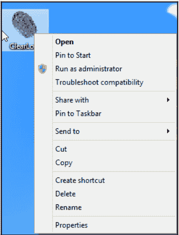
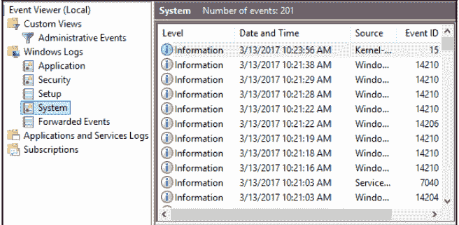
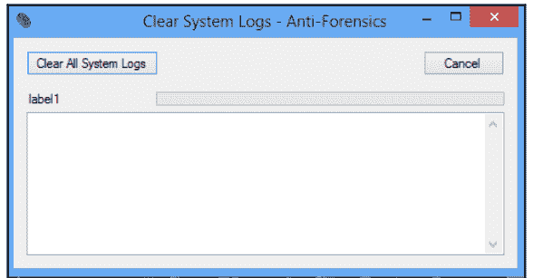
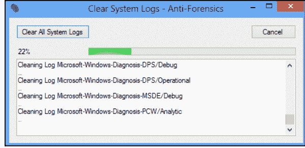
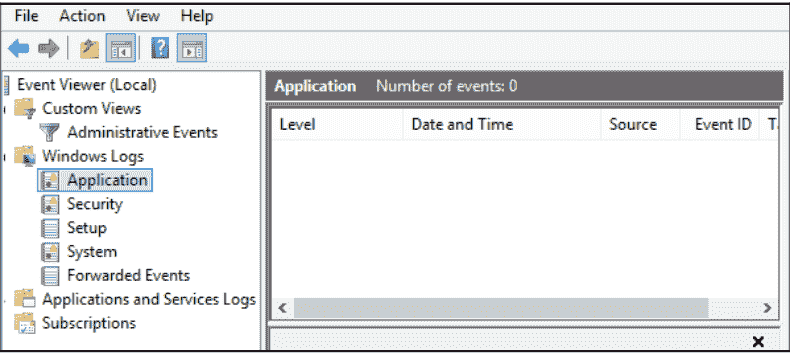
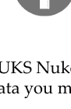
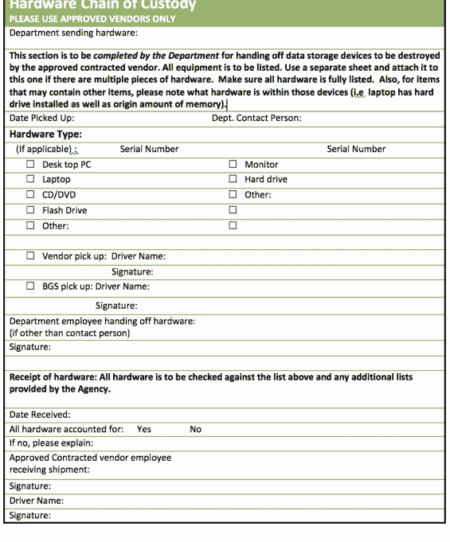
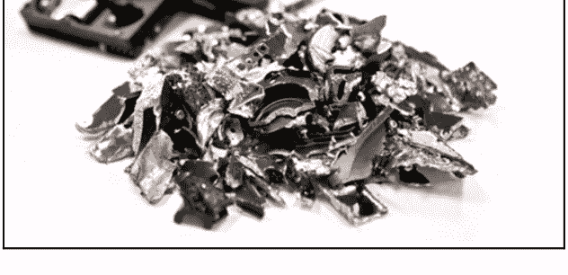
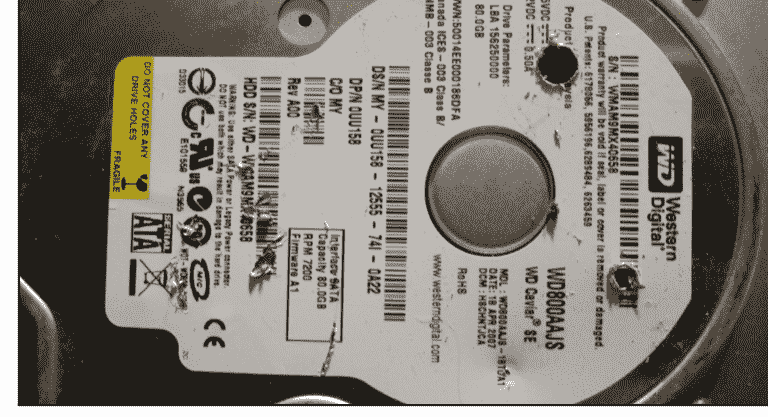
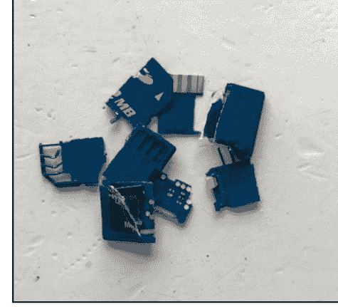

## 9

## Cleaning Up and Getting Out

随着我们与利益相关者的参与接近尾声，并且所有测试都已完成，是时候我们做必要的整理工作然后退出环境了。

重要的是确保我们离开的环境与我们开始渗透测试之前完全相同。软件应与测试前相同，硬件也应相同。我们引入环境中的任何新东西都应撤销。我们的任务是将发现和文档移交给利益相关者，让他们根据自己的日程和优先级执行认为必要的修复工作。

本章将讨论以下主题：

- 掩盖你的踪迹
- 清理留下的痕迹
- 销毁设备

## Cleaning up any trails left behind

作为渗透测试人员，我们能做的最重要的事情之一就是让环境保持参与前的原状。这意味着我们需要确保系统上我们放置的任何东西都已被移除。以下列表只是作为负责任的渗透测试人员我们需要做的事情中的一些：

- 删除为任何测试或程序创建的任何用户或系统账户。我们不想留下任何未监控的账户。
- 删除我们在测试过程中可能遗留的任何漏洞利用、后门、Rootkit 或恶意软件。


- 删除在测试期间遗留在服务器上的任何测试证据。我们本应将这些证据转移到我们的 C&C 服务器以便安全保存，但在某些情况下可能无法做到。因此，我们要确保不会留下任何痕迹。
- 删除在任何测试期间使用的任何工具或脚本。我们不希望其他人在事后利用我们的工具攻击公司。
- 确保任何被修改或更改的系统都恢复到出厂默认设置。这可以通过恢复我们在更新该系统之前制作的黄金镜像、从文件或系统的最后备份中恢复，或直接将值改回原始值来实现。我们具体怎么做以及做什么最终取决于利益相关方希望我们执行的操作。
- 删除在渗透测试期间使用的所有不属于客户的设备。这可能包括电缆、计算机和其他设备。
- 从日志文件中删除任何可能表明你所做操作的命令。
- 清除任何网络层日志，以便没有人知道你何时何地在环境中活动。

## 掩盖你的踪迹

在为我们的渗透测试完成对各个服务器上的所有任务后，现在轮到我们掩盖踪迹了。我们要确保不会留下任何关于我们做了什么以及在哪里做的证据。为了实现这一点，让我向你展示一些可以用来帮助清理你所做操作痕迹的实用工具。

### 使用 Metasploit 的 Clearev

在 Metasploit 中，有一个脚本可以清除 Windows 事件日志。它会清除系统上包含的所有事件日志。它只需一条命令就能节省大量时间和人工操作。将此实用工具打包到 Metasploit 中是非常聪明的设计。

唯一的限制是它仅在你入侵了 Windows 系统时才受支持。当你入侵任何其他操作系统时，此特定菜单项将不可用。

使用 clearev 的过程相当简单。你首先需要入侵某种 Windows 主机。一旦完成，你将到达以下提示：

```
meterpreter >
```

一旦到达此提示，你就知道已成功入侵主机。要查看可用的选项，在提示符下输入 help 以查看所有可用选项。如果主机是 Windows 机器，你应该在 System 部分下看到 clearev 选项。要清除这些日志，只需在 meterpreter 提示符下输入命令 clearev。无需传递任何参数。以下是我在实验室中遵循的过程：

```
meterpreter > clearev
[*] Wiping 45 records from Application...
[*] Wiping 219 records from System...
[*] Wiping 5 records from Security...
meterpreter >
```

根据输出，你可以看到哪些日志已被清除以及删除了多少条消息。

### 使用 shred 销毁文件

当你真的需要确保文件和分区彻底消失时，你可能想使用 shred。与仅删除指针的 rm 不同，shred 会多次覆盖文件，试图确保其无法被任何工具恢复。这对于整个分区也同样适用。

shred 是我清除文件时最喜欢的命令之一。shred 有几个可用的选项；让我们看看以下选项的输出：

```
root@pi-kali:~# shred --help
Usage: shred [OPTION]... FILE...
Overwrite the specified FILE(s) repeatedly, in order to make it harder
for even very expensive hardware probing to recover the data.

If FILE is -, shred standard output.

Mandatory arguments to long options are mandatory for short options too.
 -f, --force    change permissions to allow writing if necessary
 -n, --iterations=N  overwrite N times instead of the default (3)
     --random-source=FILE  get random bytes from FILE
 -s, --size=N   shred this many bytes (suffixes like K, M, G accepted)
 -u             truncate and remove file after overwriting
     --remove[=HOW]  like -u but give control on HOW to delete;  See below
 -v, --verbose  show progress
 -x, --exact    do not round file sizes up to the next full block;
                this is the default for non-regular files
 -z, --zero     add a final overwrite with zeros to hide shredding
     --help     display this help and exit
     --version  output version information and exit

Delete FILE(s) if --remove (-u) is specified.  The default is not to remove
the files because it is common to operate on device files like /dev/hda,
and those files usually should not be removed.
The optional HOW parameter indicates how to remove a directory entry:
'unlink' => use a standard unlink call.
'wipe' => also first obfuscate bytes in the name.
'wipesync' => also sync each obfuscated byte to disk.
The default mode is 'wipesync', but note it can be expensive.
```

在我的实验室中，我想对 auth.log 文件进行 shred 处理，但也想删除该文件。为此，我将运行以下命令：

```
shred -vfzu auth.log
```

以下是我实验室的输出：

```
root@pi-kali:/var/log# shred -vfzu auth.log
shred: auth.log: pass 1/4 (random)...
shred: auth.log: pass 2/4 (random)...
shred: auth.log: pass 3/4 (random)...
shred: auth.log: pass 4/4 (000000)...
shred: auth.log: removing
shred: auth.log: renamed to 00000000
shred: 00000000: renamed to 0000000
shred: 0000000: renamed to 000000
shred: 000000: renamed to 00000
shred: 00000: renamed to 0000
shred: 0000: renamed to 000
shred: 000: renamed to 00
shred: 00: renamed to 0
shred: auth.log: removed
```

shred 如此有效，以至于许多人在处理硬盘时都会使用它，无论是卖给他人还是丢弃，只是为了确保其无法读取。

### 隐藏踪迹的 CLI 技巧

无论你时间紧迫，还是只是想做一些基本的隐藏踪迹操作，你也可以使用一些 CLI 技巧来完成。当我登录我的 Linux 主机时，我可以看到 .bash_history 文件会记录我所做的事情。如果我现在查看我的文件，我可以看到最近几个命令：

```
root@pi-kali:~# more .bash_history
bluesnarfer -r 1-100 -C 13 -b
58:40:4E:50:D1:0E
apt-get install bluepot apt-get install bluemaho
hcitool -i hci0 rssi 8C:DE:52:1F:F5:07
sudo rfcomm connect 0 8C:DE:52:1F:F5:07 10 >/dev/null&
```

我只需使用空重定向 (>) 即可清空此文件。这适用于你想要清空的任何文件：

```
root@pi-kali:~# > .bash_history
root@pi-kali:~# more .bash_history
root@pi-kali:~#
```

这个选项可行，肯定没有 shred 那么优雅，但在某些情况下必须这样做。但是，如果你不想再次处理这个问题，或者想限制 .bash_history 文件中保留的内容呢？好吧，让我展示如何更改它。从 CLI，你可以 echo $HISTSIZE 来查看当前历史记录大小的设置。我的目前设置为 500，如以下命令所示：

```
root@pi-kali:~# echo $HISTSIZE
500
```

如果我想更改它，可以通过更新此值来实现。如果将其设置为 0，则永远不会保留历史记录。在运行各种测试时更改此设置是个好主意，这样你就不会忘记稍后更改它。不过，完成后请记得改回原值。要更改，只需使用适当的值运行 export 命令。你需要注销并重新登录才能使此值生效：

```
root@pi-kali:~# export HISTSIZE=0
root@pi-kali:~# echo $HISTSIZE
0
root@pi-kali:~# more .bash_history
root@pi-kali:~#
```

现在，我运行的任何命令都不会显示在该 .bash_history 文件中。非常适合在该机器上隐藏你的踪迹！

你也可以选择直接编辑日志文件并删除你不希望他人看到的任何行。这可以使用你喜欢的文本编辑器（vi、nano、vim 等）完成。这很基础，但在删除你不希望他人看到的内容方面很有效。

### Windows 的 ClearLogs

ClearLogs 是适用于基于 Microsoft Windows 的系统的事件日志清理工具。它会清除所有类型的事件日志，包括安全、系统或应用程序日志。此实用工具使渗透测试人员极易清除自己的踪迹，并在最终节省大量时间。手动完成此任务肯定会涉及一些繁琐的清理。


在桌面上运行 **ClearLogs** 可实现快速简便的删除流程。不过请注意，此命令需要以管理员身份运行才能正常工作。通常，我右键单击图标并选择 **Run as administrator**，如下图所示：



在下一张截图中，您可以看到事件日志充满了信息：



应用程序加载后会出现以下屏幕。请注意，这里没什么可操作的，除了 **Clear All System Logs** 或 **Cancel** 按钮。在我们的情况下，我们想要清除所有日志，因此请点击 **Clear All System Logs** 按钮：



您将开始看到正在被删除的所有日志的逐项状态：



在下面的截图中，您可以看到使用 ClearLogs 之前和之后的事件日志。它已快速删除了所有相关信息：



## 使用 DD 和 mkfs 清除驱动器

需要注意的一点是，删除文件实际上并不会删除文件。我们在谈论 shred 时之前提到过这一点。因此，如果您想要真正删除文件并且需要 shred 的另一种选择，DD 就是答案。此实用程序允许我们将文件复制到我们选择的任意目标位置。然而，我们也可以使用此实用程序向任何分区写入随机数据。在以下命令中，我将向我选择的分区写入随机字符。这将确保之前的数据确实被覆盖，而不是仅仅删除指针：

```
dd if=/dev/urandom of=/dev/sda2
```

前一个命令与我们用于复制分区的命令之间的主要区别在于，输入文件是一个实际文件，而不是 /dev/urandom。与 dd 类似，我们也可以使用 mkfs.ext4 为分区重新格式化并使用新的文件系统。要在前一个分区上实现此操作，类似的命令如下：

```
mkfs.ext4 /dev/sda2
```

使用命令行隐藏踪迹的选项有很多。确保您了解每种选项的优缺点，以便做出明智的决定。

## LUKS Nuke 销毁分区

到目前为止，我们讨论了通过粉碎、删除文件中的行或删除文件本身来隐藏踪迹的选项。我们还讨论了覆盖分区。这些方法各有利弊，但如果您想在特定时间使用特定关键字来实现这一点会怎样？那么事情就会变得相当棘手。这就是 LUKS Nuke 登场的地方。它允许您向远程主机发送信号，让其自行销毁，类似于远程自毁信号。

LUKS Nuke 通过与 LVM 和磁盘加密配合工作来实现这一点。当机器启动时，您需要输入密码。如果您输入自毁密码，机器将删除所有保存的密钥，从而基本使所有数据无法访问。此功能已在 Kali 1.06 版本中实现。这是一种确保数据受保护的简便方法，并且无需完全登录即可执行自毁操作。这是对用户的极大保护，尤其是那些可能携带敏感信息的人员，例如渗透测试人员。



如果您想更详细地了解 LUKS Nuke，请查看以下链接：

```
https://www.kali.org/tutorials/nuke-kali-linux-luks/
http://www.zdnet.com/article/developers-mull-adding-data-nuke-to-kali-linux/
```

LUKS Nuke 是一个很棒的小功能，可帮助保护您的个人数据以及您可能拥有的任何客户数据。

## 销毁设备

有时在任务结束后必须销毁设备。这可能是因为有相关政策要求，也可能是出于预防措施，因为某些系统上可能存在敏感数据。无论如何，销毁设备的需求有时会出现，并可能成为利益相关方会议谈判的一部分。

## 由利益相关方赞助的销毁

许多组织，尤其是注重安全的组织，可能要求任何可能离开其环境的物理设备必须被物理销毁。这很可能在利益相关方会议期间讨论过。作为负责任的渗透测试人员，您需要确保此任务按照利益相关方的确切要求执行。此时也可能会提到保管链。

保管链是一系列文件，以最简单的形式显示任何 IT 硬件的安全占有和安全转移。任何硬件被带离现场进行销毁时，从 A 点到 B 点的整个过程都需要完整记录。一些销毁公司甚至会记录整个过程，以确保公司也能看到整个流程。

如果您为要求此类活动发生的公司工作，在初次会议期间创建一个表格供他们参考并不是一个坏主意。这样，他们将了解流程并看到您非常重视这些敏感数据。

以下是一个硬件销毁保管链表格的示例。您可以随意使用并修改与特定客户要求相关的任何内容：



## 由渗透测试人员进行的销毁

即使您进行渗透测试的公司可能没有具体政策，出于安全考虑，销毁客户现场的任何设备可能仍符合您的最佳利益。我们讨论了很多通过软件销毁数据的方法，但物理销毁也是一种选择。

需要考虑销毁的最重要项目是数据可能存在的地方。这包括任何非易失性存储，例如闪存盘、SSD 和硬盘。如果这些设备落入错误的人手中，如果设备未被正确销毁，其中的数据可能会被窃取。

我们如何销毁设备最终取决于设备的类型。对于任何设备，您都可以将其粉碎。这会将其变成类似以下图像中所示的大堆碎屑。这几乎适用于任何设备：



您也可以在驱动器上钻孔。以下是我实验室的一块硬盘，我通过钻孔将其销毁。粉碎它会更有趣，但我没有合适的设备：



最后，由于我有几块用于各种功能的 Raspberry Pi，我倾向于在每次客户任务后物理销毁 microSD 卡。这样，我可以向客户保证我没有他们的任何数据并且不会带走。以下是我在离开其中一个客户任务之前将其摔碎成许多碎片的 microSD 卡之一：



## 总结

我们现在已完成本章，让我们回顾一下。由于我们已完成参与所需的全部渗透测试，我们需要确保清理我们造成的任何混乱，就像我们的母亲教导我们的一样。作为专业人士，确保我们离开的环境与开始时相同并且不留下任何痕迹非常重要。为此，我们讨论了应确保完成的各种项目，基本上是一个清理清单。为此，我们讨论了隐藏踪迹的实用程序，例如 shred、dd、ClearLogs 和 cleanenv。它们在何处何时使用各有专长，所有这些都应包含在渗透测试人员的工具箱中。

接下来，由于根据利益相关方的要求和/或数据敏感程度，可能需要进行物理销毁，我们讨论了物理销毁硬件的各种方法。然而，在某些情况下，我们可能需要聘请第三方硬件销毁公司，因此我们讨论了保管链，我还包含了一个表格，可用于确保一切按相关方要求完成。

在下一章中，我将讨论本书的最后一个主题：撰写渗透测试报告。这将是我们运行的所有章节和测试的集大成。我们收集的所有信息将被整理成一份非常详细的报告，并发送给资助渗透测试的利益相关方。

我将介绍报告中应包含的各种项目以及我偏好的语法和布局，仅举几例。这份报告将是您的交付成果，因此它需要尽可能完美，以体现您的工作有多出色。我们绝对希望确保其中包含优质信息，以便向利益相关方展示我们作为渗透测试人员的价值。


