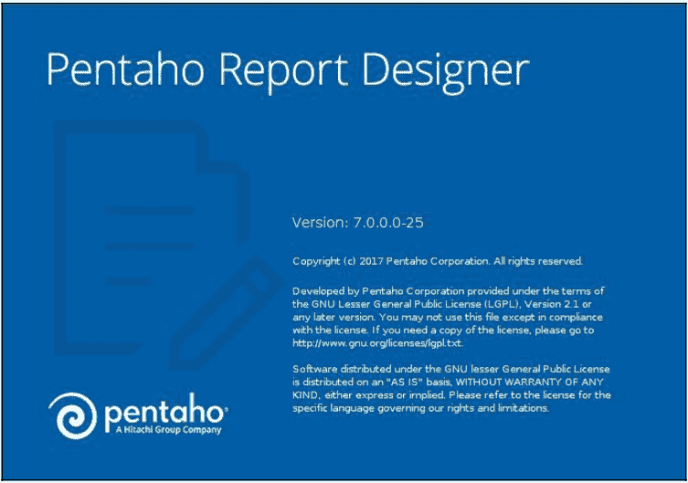
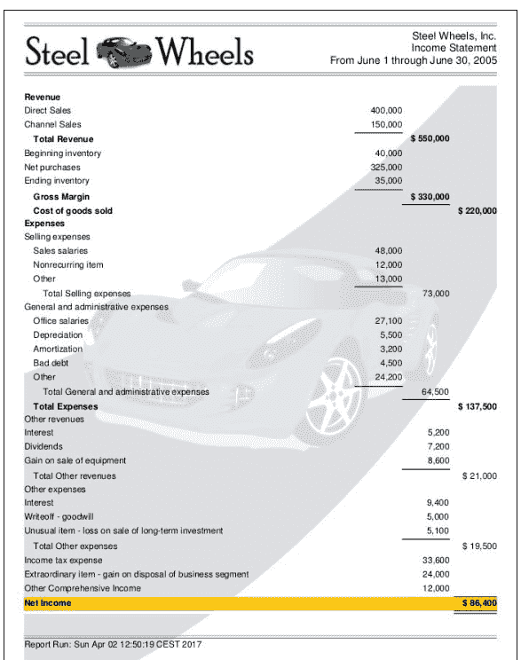
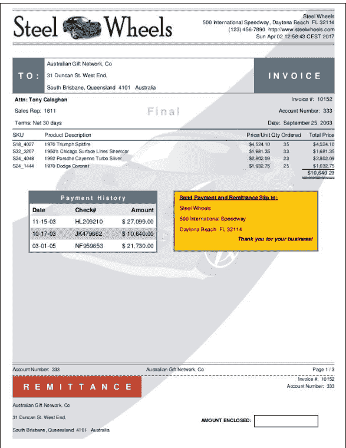
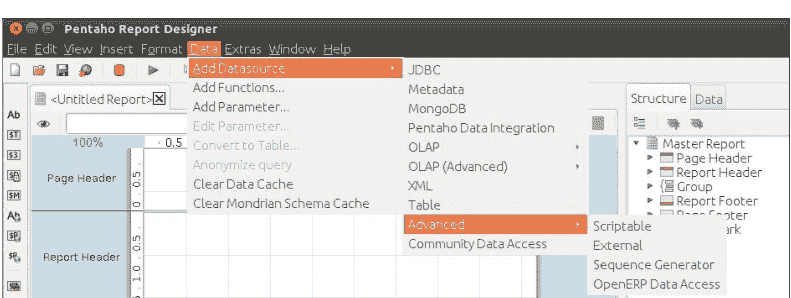
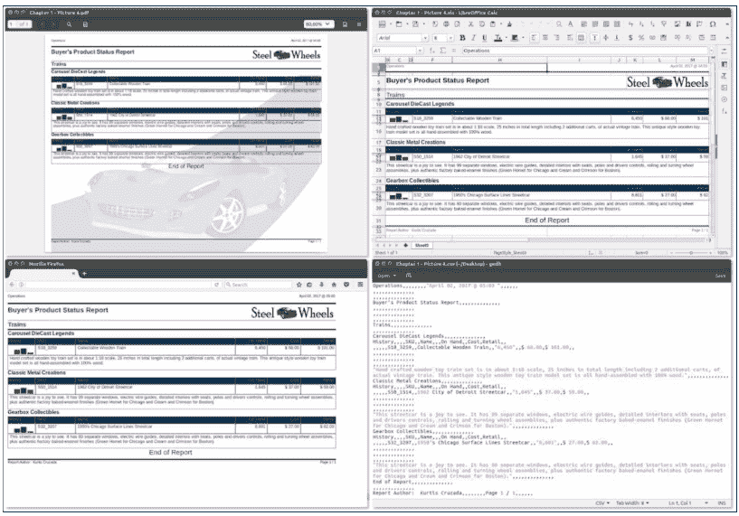
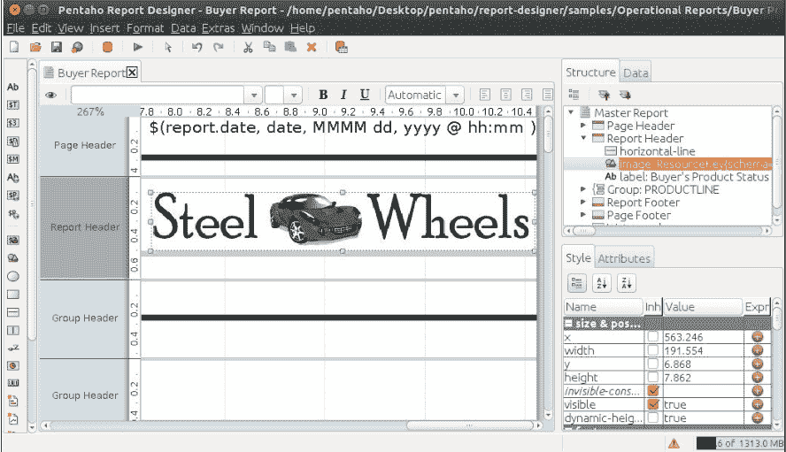
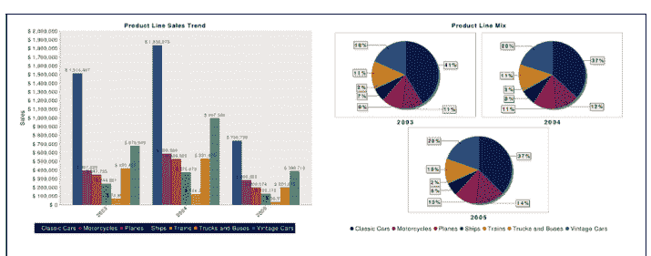
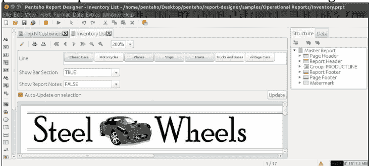
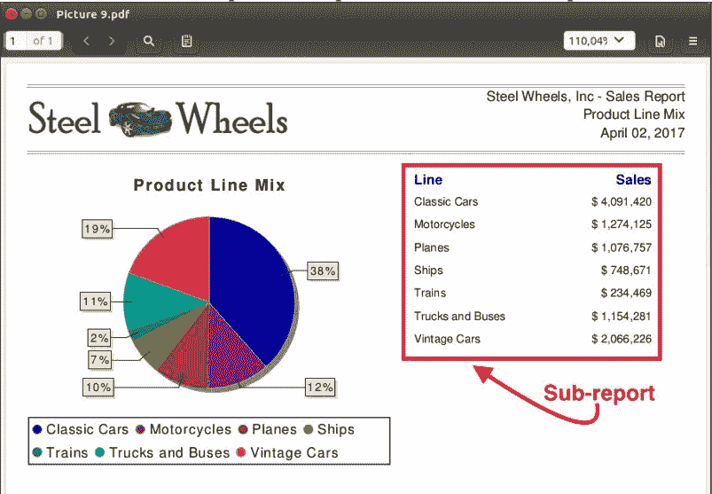
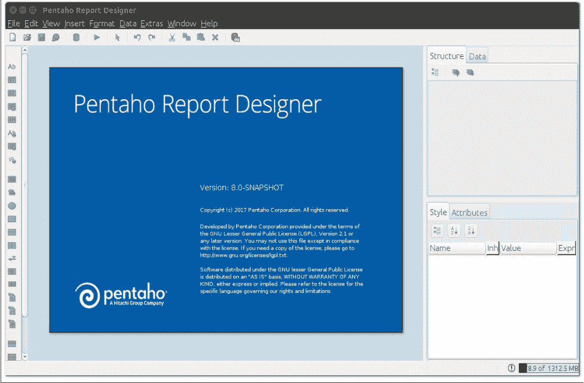

## Pentaho Reporting 简介

**Pentaho Reporting** 是一个易于使用、开源、轻量级的 Java 项目套件，专为一个目的而构建：报表生成。在本书中，您将发现将 Pentaho Reporting 嵌入 Java 项目中，或作为独立报表平台使用的便捷性。Pentaho Reporting 的开源许可——GNU **Lesser General Public License (LGPL)**——使开发人员能够免费将其嵌入开源和专有应用程序中。一个活跃的社区参与 Pentaho Reporting 的开发和使用，回答论坛问题、修复错误并实现新功能。虽然有许多专有报表选项可用，但没有一个能提供 Pentaho Reporting 为其用户提供的开放性和灵活性。

与大多数成功的开源项目一样，Pentaho Reporting 拥有经证实的业绩记录和长长的功能列表。其中大部分历史记录已记录在开放论坛和电子邮件线程中，这些内容仍可供浏览和汲取灵感。从最初的业余爱好发展成为历经多年后的企业级报表套件，Pentaho Reporting Engine 及其工具套件（如 Report Designer、Reporting Engine 和 Reporting SDK）被用作无数企业、教育、政府和社区信息技术解决方案中的关键组件。

在大多数业务软件应用程序中，报表组件是必要的，无论是用于汇总数据、生成大量定制文档，还是仅仅为了更方便地打印在各种输出格式中有用的信息。凭借完整的特性集，包括 PDF、Microsoft Excel、HTML、Text、XML、CSV 和 RTF 报表生成，以及子报表和交叉表等高级报表功能，Pentaho Reporting 可以快速解决最简单的问题，同时在设计、生成和部署报表时解决更高级的挑战。

继续阅读本章，了解更多关于 Pentaho Reporting 的信息，包括其典型用途、历史和起源，以及 Pentaho Reporting 提供的报表功能的更详细概述。

在本章中，您将涵盖以下主题：

- Pentaho Reporting 简介
- Pentaho Reporting 的典型用途
- Pentaho Reporting 历史
- Pentaho Reporting 架构

## 介绍 Pentaho Reporting

如前所述，Pentaho Reporting 是一个易于使用、开源、轻量级的 Java 项目套件，旨在让报表开发人员能够创建像素级精确的报表，将其数据以 PDF、Microsoft Excel、HTML、Text、RTF、XML 和 CSV 格式呈现。这些计算机生成的报表可轻松将来自各种来源的数据提炼为人可读形式，并可通过集成 Web 查看器访问、保存为文件并通过电子邮件发送给预定义收件人列表。还可以在 Pentaho Data Integration 转换的一部分中生成报表，以便根据更复杂的业务规则分发生成的文件 (http://community.pentaho.com/projects/reporting)。

> *Pentaho Data Integration 转换用于描述过程中的数据流，例如从源读取、转换数据并将其加载到目标位置。您将在第 16 章《在 Pentaho Data Integration 中使用报表》中了解更多信息。*

由于其渲染性能高且消耗的内存相当低，报表处理可以从小型嵌入式场景扩展到大规模企业报表场景。Pentaho Reporting 可完美集成到 Business Analytics Platform，并允许您与同事和同行共享报表。

Pentaho Reporting 的样式灵活，允许报表设计师选择他们希望操作整个用户界面的粒度，甚至精确到单个字符的字体样式等细节。此外，您还可以向这些报表添加自己的图片和徽标，并从各种布局、图表和表格中选择所需的应用项。

## 介绍 Pentaho Reporting 工具

Pentaho Reporting 可定义为开源工具套件，可描述为由以下部分组成：

- **Report Designer**：这是一款桌面应用程序，提供设计、开发和测试环境，使知识工作者能够轻松创建简单和复杂的报表。该工具旨在供经验丰富的用户和高级用户使用，他们熟悉一些技术概念。
- **Reporting Engine**：该引擎诞生于 JFreeReport 项目的演进，该项目是一个用于创建报表的免费 Java 类库。该库可在客户端（如 Report Designer）和服务器端应用程序（如 Web 应用程序）中使用。
- **Reporting SDK**：这是一组资源的打包（引擎、部分文档以及将 Pentaho Reporting Engine 嵌入应用程序所需的所有库），为所有开发人员，特别是所有 Java 开发人员提供有效支持。

在本书中，我们将详细了解 Report Designer 和 Reporting SDK，假设它们是开发人员和报表设计师在实际用例中使用 Reporting Engine 的合适工具。

## 用户类型及所需知识

Pentaho Reporting 的设计和开发旨在让报表设计师的工作更轻松，在灵活性和开发复杂丰富的报表能力方面限制更少。因此，报表设计器可由开发人员（不一定是 Java 开发人员）使用，也可由具备数据库和技术概念基础知识的信息技术人员使用。

对于高级开发，特别是使用 Reporting SDK，需要 Java 开发方面的技术技能，并且你必须熟悉将 JAR 导入项目，并能够阅读代码中的内联注释，以便自行了解高级功能。

如果你是一名具备数据库和技术概念基础知识的信息技术人员，那么专门介绍报表设计器以及如何在 Pentaho Data Integration 和 Pentaho Business Analytics Platform 中使用报表的章节可能就是你感兴趣的内容。如果你是 Java 开发人员，关于 Reporting SDK 的章节也可能对你有兴趣。

## 技术优势

Pentaho Reporting 提供了以下独特功能，在竞争的嵌入式解决方案中找不到：

-   **需要 Java 运行时环境，而不一定是 JDK。** 即使你在开发环境中需要安装 JDK，运行嵌入 Pentaho Reporting Engine 的应用程序也不需要 JDK。只需要 Java 运行时环境即可。
-   **潜在的向后兼容。** 理论上，Pentaho Reporting 可以在过时的 Java 虚拟机版本上运行。Pentaho 强烈建议使用 JRE 1.8.0，但也可以在较旧的 JRE 版本中使用 Reporting Engine（需要少量集成）。
-   **所有处理都在内存中完成。** 所有处理、计算和算法均设计为仅在内存中运行，不使用临时文件、表或任何形式的海量存储。
-   **内存需求低。** 基于 Pentaho Reporting 的应用程序只需 64 MB 内存即可运行，尽管 128 MB 会显著提高报表处理速度。
-   **动态库加载。** Pentaho Reporting Engine 能够在运行时检测 JAR 库。通过添加新的 JAR 或删除现有 JAR，你可以扩展引擎的功能或删除不必要的库以减少应用程序的内存和磁盘空间使用。
-   **运行时参数化。** 所有报表元素，以及样式、函数和查询，都可以通过在运行时传递给 Reporting Engine 的参数完全自定义。
-   **OpenFormula 标准。** OpenFormula 是一种开放标准，将在下一章中介绍。你将能够使用已知标准创建自己的自定义公式或自定义现有公式。
-   **易于资源管理。** 借助 **OpenDocument Format (ODF)** 的使用，Pentaho Reporting Engine 可以将所有请求资源，包括数据源连接信息、查询，甚至图像等二进制资源打包到一个常规文件中，从而简化资源管理。

## 商业友好的开源许可证

Pentaho Reporting 的一个非常吸引人的特性是其许可证。Pentaho Reporting 在 GNU LGPL 下免费提供。该许可证如以下屏幕截图所示，允许其他开源和专有项目嵌入 Pentaho Reporting，而无需担心高额许可费用或病毒式开源限制。作为一个开源项目，开发人员还可以前所未有地访问引擎以及 Pentaho Reporting 社区内的庞大软件开发人员群体。该社区包括开放讨论论坛和 **Internet Relay Chat (IRC)**，以及如有需要时的商业支持和许可。

## Pentaho Reporting 的典型用途

业务用户出于许多不同的原因需要以多种不同的形式访问信息。Pentaho Reporting 解决了以下典型的报表用途，以及本书中将涵盖的许多其他类型。

### 运营报表

最常用的报表形式之一是运营报表。当开发人员或 IT 组织决定直接从其运营数据源生成报表以进行详细的交易级报表时，这被称为运营报表。在这种情况下，数据库旨在解决运营问题，通常包含支持关键业务功能的实时数据。Pentaho Reporting 的用户可以直接指向此数据源并开始生成报表。

运营报表的一些示例包括直接基于第三方软件供应商的数据库模式构建自定义报表。这些报表可能包括日常活动的汇总，或对系统中特定项目或用户的详细视图。报表也可以从内部自定义应用程序生成的数据中生成。这些报表通常基于 SQL 后端，但也可以从平面日志文件或直接从内存中的 Java 对象生成。

Pentaho Reporting 的参数化功能提供了一种强大的机制来呈现最新定制的运营报表。借助交叉表和交互式报表等功能，业务用户可以快速查看其运营数据并深入到可能需要关注的运营系统。

然而，基于实时运营数据开发报表时存在局限性。开发人员需要小心确保运营系统中的查询不会影响常规操作的性能。极端的 CPU 密集型查询可能会延迟交易的进行。此外，某些历史问题，例如状态转换或特定信息字段（如地址）的更改，在传统的运营模式设计中通常不会被捕获。

### 商业智能报表

当你达到运营报表的极限时，下一步的逻辑选择是将数据移入数据仓库。这种迁移通常被称为商业智能报表。仅靠报表本身并不能提供完成此过渡所需的工具。你需要一个 **Extract, Transform, Load (ETL)** 工具，例如 Pentaho Data Integration，以及合理的仓库设计，例如雪花模式。

> * **雪花模式** 是多维数据库中表的逻辑排列方式，使得实体关系图类似于雪花形状。多维数据库被定义为“一种关系模型的变体，使用多维结构来组织数据并表达数据之间的关系”。*

这种用途允许业务用户随时间监控变化。它还有助于通过预先计算聚合并定义为汇总报表而设计的模式来获得性能优势。直到最近，由于软件成本和专业知识有限，数据仓库和商业智能一直局限于大型企业。随着开源工具变得更广泛可用，大量中小型企业正在部署数据仓库，以便为其业务领域的关键问题找到解决方案。数据仓库报表的常见示例包括将销售和库存数据合并到一个位置进行报表，或将内部专有销售数据与公开的市场趋势和分析相结合。

Pentaho Reporting 灵活的数据源支持使其易于将报表纳入你的商业智能解决方案。此外，凭借 Pentaho Reporting 的速度和可扩展性，你可以确信报表将高效执行，从而自信地部署 Pentaho Reporting。

与所有方法一样，这种方法也有局限性。在传统的仓库中，数据通常按每晚、每周或每月批量处理。因此，

业务用户很少能看到关于业务运营的即时报告。此外，在设计数据仓库时，提出正确的业务问题非常重要。不幸的是，如果没有事先进行调查，即使构建了数据仓库，也可能无法满足业务用户的需求。

### 财务报告

财务报告是一种非常具体但也很常见的报告形式，旨在为会计师、经理和商业投资者生成财务摘要。属于此类标准的报告包括资产负债表、利润表、留存收益表和现金流量表。与商业智能或运营报告不同，其中许多报告依法要求，并对其内容和呈现方式有法规约束。财务报告通常包括对资产、负债、收入和费用的计算。

以下是显示此类报告的屏幕截图：

凭借分组汇总聚合等功能，Pentaho Reporting 使开发人员能够非常轻松地实现业务经理和所有者所需的自定义财务报告。

通常，此类数据以受控形式存在，无论是在 QuickBooks 或 SAP 等专有系统中，还是在 Oracle 或 MySQL 等安全数据库系统中。由于此数据的敏感性，开发人员需要意识到谁有权访问报告，并可能希望实现审计日志等功能。

### 生产报告

Pentaho Reporting 的另一个典型用途包括生产报告。此类报告包括为大量受众定制的表单信函、发票或明信片等报告，以及自动邮件合并。通常，此类报告涉及批处理。然而，基于标准模板为个人生成的自定义报告也可以归入此类。

以下是展示此类报告的屏幕截图：

Pentaho Reporting 中有一些特定功能，例如动态从数据源中合并图像以及像素级精确格式，在实施生产报告时非常有帮助。

## Pentaho Reporting 历史

Pentaho Reporting 最初于 2002 年以 JFreeReport 的形式出现，这是一个基于 Java 的报表引擎和 Swing 组件。JFreeChart 的作者 David Gilbert 实现了 JFreeReport 的初始版本，以满足报表渲染需求。项目启动后不久，Thomas Morgner 成为主要开发者。他添加了关键功能，例如报表函数和 XML 报表定义，使 JFreeReport 成为成功的开源 Java 项目。

从一开始，Pentaho Reporting 就是一个国际项目。David 位于英国赫特福德郡，Thomas 位于德国法兰克福。世界各地的许多人也为 Pentaho Reporting 贡献了翻译和代码。

从 2002 年到 2006 年，Thomas 不断将 JFreeReport 开发成企业级报表引擎。在担任顾问期间，Thomas 添加了对多种输出的支持，包括 Excel 和 RTF。2006 年初，Thomas 和 JFreeReport 加入了开源商业智能公司 Pentaho，JFreeReport 正式成为 Pentaho Reporting。此时，Thomas 从全职顾问转变为 Pentaho Reporting Engine 及工具套件的全职开发者。

2006 年 1 月，随着 Pentaho Reporting 的收购，Pentaho 宣布 Pentaho Report Design Wizard 正式可用，该向导通过一系列简单说明引导业务用户构建复杂的基于模板的报表。Pentaho 高级工程师 Mike D'Amour 是该向导的最初作者，该向导现已用于许多 Pentaho 应用中。

Pentaho Reporting 历史上的另一个重要里程碑是 Pentaho Report Designer 的推出。2006 年，Martin Schmid 向社区贡献了 Pentaho Report Designer 的第一个版本。自推出以来，Report Designer 随着 Reporting Engine 一起发展。

2007 年，Pentaho 与 Sun 的 OpenOffice 合作，为 OpenOffice 的数据库工具集提供报表解决方案。该项目由 Thomas Morgner 主导，现称为 Pentaho Reporting Flow Engine。虽然该引擎与本书中讨论的经典引擎共享许多概念，但它是一个独立的项目，其功能和特性与 Pentaho 的经典报表项目有很大不同。

从 Pentaho Business Intelligence Platform 1.6 版本开始，Pentaho Reporting 还与 Pentaho 的 Metadata Engine 紧密集成，允许可能没有 SQL 专业知识的业务用户进行易于使用的基于 Web 的即席报表，以及报表中的数据驱动格式，以及列级和行级数据安全。同样的功能在 Pentaho Report Designer 中用于查询和报表构建，使业务用户能够从快速的基于模板的报表过渡到功能齐全的自定义报表。

今天，Pentaho Reporting 无疑是 Pentaho 平台的核心部分，并作为整个商业智能套件的官方且强大的组件得到维护和增强。

## 功能概述

在本快速介绍 Pentaho Reporting 8 中提供的各种功能时，您将获得 Pentaho Reporting 的工作原理及其能为您的报表需求实现什么的执行摘要。以下主题将在本书后面的章节中更深入地介绍。

### 高级报表算法

报表算法是 Pentaho Reporting 的核心。无论渲染何种输出格式，该算法都管理整个报表的布局和渲染。该算法即时组合报表模板和数据集，以生成最终报表。没有不必要的编译步骤。所有其他 Pentaho Reporting 功能都可以在整体报表算法的上下文中进行描述。

该算法允许报表渲染页面页眉和页脚、报表页眉和页脚、组页眉和页脚以及详细信息带。报表算法多次遍历数据集以渲染报表。在第一次遍历中，算法执行计算并确定如何将数据分离成组，同时计算文本和图像的高度和宽度。在初始遍历之后，算法第二次遍历数据集以渲染输出。

### 多种可用数据源

Pentaho Reporting 定义了用于访问数据的标准 Java API。Pentaho Reporting 提供了许多数据源实现。最常用的实现包括 JDBC 和 JNDI 数据库连接、XML XPATH 功能，以及使用 MDX 的多维 OLAP 数据访问和 MongoDB NoSQL 数据库支持。

**Java 命名和目录接口 (JNDI)** 是 Java 目录服务的 API，允许 Java 软件客户端通过逻辑名称发现和查找数据和对象，从而将实现与配置和设置解耦。

**联机分析处理 (OLAP)** 是一种在计算中快速回答多维分析查询的方法。**多维表达式 (MDX)** 是 OLAP 数据库的查询语言。就像 SQL 一样，它是关系数据库的查询语言。

可用的其他数据源包括 Pentaho Data Integration 数据源、**Hibernate 查询语言 (HQL)** 数据源、Pentaho Metadata 数据源、脚本数据源（JavaScript、Python、TCL、Groovy 和 BeanShell）、作为静态行列列表定义简单表，以及其他高级数据源（OpenERP 数据访问、社区数据访问和序列生成器）。

使用 Pentaho 的 Data Integration 数据源，可以轻松地使用 Excel、日志或其他文件格式作为报表的输入，而无需编写任何代码。所有这些数据源都通过易于扩展的标准 API 与 Reporting Engine 交互。

以下屏幕截图显示了 Pentaho Reporting 中可用的数据源：

通过将 Pentaho Reporting 的数据源功能与 Pentaho 的数据集成引擎结合使用，大多数已知的数据格式和系统都可用于输入。这包括将多个数据源组合到单个报表中。例如，可能包括远程共享驱动器上的 Microsoft Excel 文件，以及来自 HTTP 服务器的纯文本日志文件。

## 丰富的输出格式

Pentaho Reporting 能够渲染为最广泛使用的输出格式，包括使用 iText 库的 Adobe PDF 标准、使用 POI 库的 Microsoft Excel 标准以及 HTML，均在以下屏幕截图中突出显示。其他可用格式包括 XML、纯文本、RTF 和 CSV。除这些输出格式外，Pentaho 报表还可以渲染为 Swing 并使用 PostScript 格式直接打印，从而提供打印预览功能。

以下屏幕截图显示了使用报表设计器获得并渲染的此类报表，PDF（左上）、Microsoft Excel（右上）、HTML（左下）和 CSV（右下）：

## 像素级精确的丰富格式

在 Pentaho Reporting 中定义的报表可以指定文本或图像等对象在像素级别的渲染位置。使用 Pentaho 报表设计器，可以轻松对齐字段并对需要保持对齐的项目进行分组。虽然由于不同格式类型（如 XML、CSV 和纯文本）而不总是可能，但三种主要图形输出 HTML、PDF 和 Excel 努力保持尽可能相似的外观。

丰富格式包括 TrueType 系统字体选择、渲染几何形状和线条的能力，以及在报表中包含图像和其他对象的能力。这种丰富格式在幕后通过类似 CSS 的样式指定，将格式与报表细节分离。这使得修改和维护报表变得更容易，也可以通过报表向导应用企业样式，如以下图像所示：

## 嵌入式图表

Pentaho Reporting 引擎和工具套件使在报表中嵌入图表变得容易，最初使用 JFreeChart 引擎开发。提供多种图表类型，包括条形图、直方图、饼图和折线图，如下图所示：

## 报表参数化

Pentaho Reporting 提供易于使用的工具来参数化报表，允许用户指定范围和其他值来自定义报表的输出。参数值可以从硬编码值列表中选择，也可以由查询驱动。通过参数化，最终用户可以控制报表中显示的信息量。以下屏幕截图是来自 Pentaho 商业智能服务器内的参数输入示例：

## 公式和样式表达式

报表构建者可以使用 OpenFormula 标准定义自定义公式和样式表达式，从而在报表中实现计算值和动态格式，例如聚合、数字格式以及交通灯指示。

## 子报表

Pentaho Reporting 允许报表开发人员在主报表中包含子报表。这提供了一种强大的功能，允许报表包含不同的较小报表，既可以并排放置，也可以在报表的各个频带内放置。这些子报表可以基于不同的数据源。以下屏幕截图是包含单独图表子报表的报表示例：

## 交叉表报表

交叉表报表以类似电子表格的格式呈现数据，使查看数据摘要变得容易。交叉表报表同时呈现行和列标题以及数据单元格，所有这些都可以通过报表元素进行自定义。以下图像显示了交叉表报表的外观：

| 产品线 | 年份 | 季度 | APAC | EMEA | 日本 |  | 北美 |
|---|---|---|---|---|---|---|---|
| 市场 |  |  | 所有市场 |  |  |  |  |
| 经典汽车 | 2003 |  | 1,052 | 5,853 | 898 | 12,762 | 4,959 |
| 经典汽车 | 2004 |  | 1,785 | 8,976 | 307 | 16,085 | 5,017 |
| 经典汽车 | 2005 |  | 1,015 | 3,463 | 122 | 6,705 | 2,105 |
| 摩托车 | 2003 |  | 654 | 1,428 | 205 | 4,031 | 1,744 |
| 摩托车 | 2004 |  | 540 | 2,177 | 380 | 5,906 | 2,809 |
| 摩托车 | 2005 |  | 658 | 1,501 | 44 | 2,771 | 568 |
| 飞机 | 2003 |  | 456 | 1,723 | 677 | 3,833 | 977 |
| 飞机 | 2004 |  | 723 | 2,326 | 547 | 5,820 | 2,224 |
| 飞机 | 2004 | QTR1 | 318 |  | 322 | 971 | 331 |
| 飞机 | 2004 | QTR2 |  | 311 |  | 1,113 | 802 |
| 飞机 | 2004 | QTR3 |  | 977 |  | 1,178 | 201 |
| 飞机 | 2004 | QTR4 | 405 | 1,038 | 225 | 2,558 | 890 |
| 飞机 | 2005 |  | 151 | 1,464 |  | 2,207 | 592 |
| 船舶 | 2003 |  |  | 1,968 | 174 | 2,844 | 702 |
| 船舶 | 2004 |  | 396 | 2,144 | 127 | 4,309 | 1,642 |
| 船舶 | 2005 |  | 32 | 696 | 81 | 1,346 | 537 |
| 火车 | 2003 |  | 33 | 384 | 174 | 1,000 | 409 |
| 火车 | 2004 |  | 106 | 977 |  | 1,409 | 326 |
| 火车 | 2005 |  |  | 183 | 49 | 409 | 177 |
| 卡车和公共汽车 | 2003 |  | 91 | 2,261 | 415 | 4,056 | 1,289 |
| 卡车和公共汽车 | 2004 |  | 801 | 1,558 | 102 | 5,024 | 2,563 |
| 卡车和公共汽车 | 2005 |  | 488 | 836 |  | 1,921 | 597 |
| 老爷车 | 2003 |  | 1,243 | 3,094 | 308 | 7,913 | 3,268 |
| 老爷车 | 2004 |  | 1,587 | 5,472 | 229 | 10,864 | 3,576 |
| 老爷车 | 2005 |  | 1,067 | 1,094 | 84 | 4,116 | 1,871 |

### 交互式报表

虽然大多数报表在渲染后是静态的，但一部分报表包含钻取、透视和其他交互功能。Pentaho Reporting 提供了直接的 Java 和 JavaScript API，用于在报表渲染后对其进行操作，使报表构建者能够创建非常交互式的报表。Pentaho Reporting 的交互功能在以 HTML、Excel 或 Swing 渲染报表时可用。还可以向 PDF 文档添加指向外部文档的链接。

以下屏幕截图显示了一个带链接的报表，点击时可在详细级别折叠/展开行：

### 交互式报表

获取值

调用 Web 服务

经典汽车
| SKU | 名称 | 比例 | 在手库存 | 成本 | 零售价 |
|---|---|---|---|---|---|
|  | + Autoart Studio Design <-点击此处展开或折叠 |  |  |  |  |
|  | + Carousel DieCast Legends <-点击此处展开或折叠 |  |  |  |  |
| S24_1628 | 1966 Shelby Cobra 427 S/C | 1:24 | 8,197 | $29 | $50 |
| S24_2840 | 1958 Chevy Corvette Limited Edition | 1:24 | 2,542 | $16 | $35 |
| S700_2824 | 1982 Camaro Z28 | 1:18 | 6,934 | $47 | $101 |
|  | + Classic Metal Creations <-点击此处展开或折叠 |  |  |  |  |
|  | + Exoto Designs <-点击此处展开或折叠 |  |  |  |  |
|  | + Gearbox Collectibles <-点击此处展开或折叠 |  |  |  |  |
|  | + Highway 66 Mini Classics <-点击此处展开或折叠 |  |  |  |  |
|  | + Min Lin Diecast <-点击此处展开或折叠 |  |  |  |  |
|  | + Motor City Art Classics <-点击此处展开或折叠 |  |  |  |  |
|  | + Red Start Diecast <-点击此处展开或折叠 |  |  |  |  |
|  | + Second Gear Diecast <-点击此处展开或折叠 |  |  |  |  |
|  | + Studio M Art Models <-点击此处展开或折叠 |  |  |  |  |
|  | + Unimax Art Galleries <-点击此处展开或折叠 |  |  |  |  |
|  | + Welly Diecast Productions <-点击此处展开或折叠 |  |  |  |  |

摩托车
| SKU | 名称 | 比例 | 在手库存 | 成本 | 零售价 |
|---|---|---|---|---|---|
|  | + Autoart Studio Design <-点击此处展开或折叠 |  |  |  |  |
|  | + Exoto Designs <-点击此处展开或折叠 |  |  |  |  |
|  | + Gearbox Collectibles <-点击此处展开或折叠 |  |  |  |  |
|  | + Highway 66 Mini Classics <-点击此处展开或折叠 |  |  |  |  |

## 丰富的创作工具

虽然可以使用 XML 或 Java API 来构建 Pentaho 报表，但大多数报表都是以 Pentaho Report Designer 构建的模板开始的。Pentaho Report Designer 是一款 **所见即所得 (WYSIWYG)** 报表编辑器，它提供了 Pentaho Reporting Engine 提供的丰富功能。除从零开始构建报表外，作为 Pentaho Report Designer 组成部分的 Report Design Wizard 会引导报表作者逐步构建报表，然后该报表会显示在 Report Designer 中，如以下屏幕截图所示，以便进一步自定义：

## 报表服务器

作为 Pentaho 套件的一部分，由 Pentaho Reporting 创建的报表可以发布、执行和在 Pentaho 的 Analytics Platform 上调度。Pentaho Analytics Platform 提供身份验证和授权，以及一个中央存储库来管理您的业务报表。Pentaho Analytics Platform 还托管用于创建基于 Pentaho 元数据的报表的基于 Web 的即席报表用户界面。通过结合使用 Pentaho Report Designer 和 Pentaho Analytics Platform，无需编写任何代码即可让您的业务使用 Pentaho Reporting 快速运行。

## 用于构建报表的 Java API

Pentaho Reporting 随带了一个文档完善的 Java API，可从头开始构建报表，因此开发人员在自定义现有报表模板或从头开始构建报表时可以坚持使用 Java 编程语言。此 Java API 允许开发人员创建和修改报表的各个部分，包括各种页眉、页脚、组和明细频带，以及在报表的每个部分内创建和修改对象。

## 可扩展性

Pentaho Reporting 从头开始使用纯 Java 设计，公开了许多扩展接口。从实现可嵌入报表中的基本公式和函数，到编写自定义数据源或输出格式，Pentaho Reporting 的源代码和 API 接口文档完善且易于使用。

## Pentaho 报表网站

除这些功能外，Pentaho Reporting 仍在积极开发中。访问 http://community.pentaho.com/projects/reporting/ 以了解有关正在考虑开发的额外功能和功能的更多信息，或访问产品的早期发布版本。

## Pentaho Reporting 架构

Pentaho Reporting Engine 主要是一个 Java 类库，分为其他 Java 项目，然后组合在一起以呈现报表。该库针对性能和较小的内存占用进行了优化，并且可以在内存中完全运行，而无需生成临时文件或需要额外的编译步骤。源代码根据 GNU LGPL 版本 2.1 的条款在 GitHub 仓库 https://github.com/pentaho/pentaho-reporting 中提供。

GitHub 仓库包括 Pentaho Report Designer，提供报表定义的图形编辑器，并用作独立的桌面报表工具。此外，在 Pentaho Reporting 生态系统中还有其他相关的开源工具和项目，包括 Report Engine Demo、Report Design Wizard、Report Designer 和基于 Web 的即席报表用户界面。

以下是定义 Pentaho Reporting Engine 的 Java 项目的介绍，重点介绍库、Reporting Engine 核心和 Reporting Engine 扩展。

## Reporting Engine 的库

Pentaho Reporting Engine 使用以下库来呈现报表：

- **Flute:** 这是用 Java 编写的 CSS 2 解析器，实现了 SAC (https://www.w3.org/Style/CSS/SAC/)。SAC 是 CSS 解析器的标准事件驱动 API，紧密模仿 XML 解析器的 SAX API。
- **LibBase:** 这是所有其他 Pentaho Reporting 库的根库。该库包含通用功能，例如调试和错误日志实用程序、库配置以及库初始化 API，用于 Reporting Engine 一致的启动和关闭管理。
- **LibDocBundle:** 这抽象了 Pentaho Reporting 文件包的管理，默认情况下以 ZIP 文件存储，并实现了 ODF。这使得 Reporting Engine 的其他部分更易于处理和操作 Pentaho Reporting 的文件格式。
- **LibFonts:** 这允许 Pentaho Reporting 使用 TrueType 系统字体，从字体类型中提取必要的元数据并填充抽象接口，以便在各种上下文中进行适当的渲染，包括 PDF 和 Excel 视图。
- **LibFormat:** 这是一个字符串格式化库，可以根据格式字符串适当呈现日期和数字。该库专注于内存和 CPU 效率，以实现高性能报表渲染。
- **LibFormula:** 这是一个基于 OpenFormula 标准的公式解析和执行库。您可以通过访问 http://wiki.oasis-open.org/office/About_OpenFormula 了解有关 OpenFormula 的更多信息。该库的功能类似于基于 Excel 的公式定义。LibFormula 是一个非常通用的库，并在 Pentaho Reporting 之外的其他需要 OpenFormula 风格解析和执行的项目中使用。LibFormula-UI 是基于 LibFormula 的 OpenFormula 表达式公式编辑器。
- **LibLoader:** 这以通用方式管理生成报表所需的所有必要资源加载和缓存，为 Reporting Engine 的其他部分提供简单 API，以控制静态和动态内容，包括数据源和图像。
- **LibPensol:** 这是通过 Apache VFS 文件系统访问远程 Pentaho 解决方案存储库的访问层。它处理所有 HTTP 调用、XML 文件的解析以及所有客户端状态管理。
- **LibPixie:** 这是一个 WMF 文件读取库，最初由 David R. Harris 编写，作为 Pixie 图像查看器的转换器。Pixie 很久以前就已停止维护，现在已作为 Java 1.2.2 或更高版本的 WMF 读取器和图像生成器复活。Pixie 缺少对大多数位图格式的支持，但其他一切功能正常。
- **LibRepository:** 这抽象了 Pentaho Reporting 交互的层次化存储系统（如文件系统）的输入和输出。这使得可以实现自定义存储系统（如 FTP）并将其映射到 API，从而使 Pentaho Reporting 可以访问该系统。
- **LibSerializer:** 这为序列化不可序列化对象提供了辅助方法。这对于 Reporting Engine 能够序列化未实现 Java 可序列化接口的标准 Java 类是必要的。
- **LibSparkline:** 这是一个用于呈现迷你图谱的库。迷你图谱是插入文本中的小型条形图或线形图，用于在文本描述的同时提供可视化信息。
- **LibSwing:** 这是设计时元素的通用辅助类存储，以便它们不必移入引擎项目，在那里它们可能由于第三方依赖或大量代码而使项目膨胀。
- **LibXml:** 这提供了基于 Java 的 **Java API for XML Parsing (JAXP)** API 的 **Simple API for XML (SAX)** 解析和 XML 编写实用程序类。该库确保 Pentaho Reporting XML 模板文件快速加载和验证。

## Reporting Engine 核心

Reporting Engine 核心项目包含呈现报表的核心报表算法，以及支持样式所需的功能。该项目还包含用于呈现特定输出的算法，包括 PDF、Excel、CSV、XML 等。引擎依赖于前面提到的库来管理生成报表的加载、解析、格式化、渲染和归档。

## Reporting Engine 扩展

Reporting Engine 扩展项目包含对 Reporting Engine 的第三方扩展，虽然非常有用，但会增加依赖。本项目中的扩展包括使用 Rhino 项目的 JavaScript 表达式支持、Hibernate 数据源工厂、使用 Barbecue 的条形码支持、使用 LibSparkline 的迷你图支持，以及配置和打印的额外 JDK 1.4 支持。还存在其他扩展项目，其中包括图表和本书中讨论的许多数据源。

*以下是有关所引用项目的进一步详细信息的一些链接：*
Rhino: https://developer.mozilla.org/en-US/docs/Mozilla/Projects/Rhino
Hibernate: http://hibernate.org
Barbecue: http://barbecue.sourceforge.net

## 摘要

在本章中，我们介绍了 Pentaho Reporting 并强调了一些典型用途，为您实现自己的解决方案提供了基础思路。嵌入式报告的典型用途包括运营、商业智能、财务和生产报告。

我们简要描述了 Pentaho Reporting 的独特历史，从其 JFreeReport 起源开始，并深入了解了 8.0 版本中包含的丰富功能。核心功能包括多种数据源集成，以及 PDF、HTML 和 Excel 渲染。另一方面，更高级的功能包括子报表和交叉表报表。此外，面向开发者的功能，例如开放的 Java API，以及可用的源代码和商业友好的 LGPL 开源许可证，使 Pentaho Reporting 在所有其他 Java 报表工具包中脱颖而出。

本章还涵盖了 Pentaho Reporting 的架构，为开发人员提供了从两万英尺高度的视角，了解他们可能修改或为 Pentaho Reporting Engine 做出贡献的地方，同时也给予他们访问源代码的终极灵活性。

您很快就能将 Pentaho Reporting 的丰富功能集应用于您的用例。

在下一章中，我们将向您介绍 Pentaho Reporting 易于使用的 Report Designer 和 Java API，让将报表嵌入到 Java 应用程序中变得有趣且轻松。
