## Getting Started with Report Designer

在介绍 Pentaho Reporting 并从两万英尺高度进行概述之后，在本章中，您将从一次实践动手操作开始，学习如何首次运行 Pentaho Report Designer。此外，您将使用一些初始数据作为示例，迈出创建具有您首选布局的报表的第一步。

您将首先设置用于构建报表的环境。从那里开始，您将浏览用户界面的一些初始细节，例如菜单、工具栏、报表元素调色板、报表画布选项卡面板、报表资源管理器、元素属性和消息。在了解更多关于用户界面的内容后，您将从头开始创建报表的过程进行讲解。在此阶段，您将使用 Pentaho Report Designer 中提供的简易向导，为了使本次会话更具实践性，您将了解如何将报表保存到文件系统中。这将有助于根据您的需求和用例安全地将其存储以供后续会话使用。在此过程中，您将获得有关构建报表和将数据导入其中的第一个详细信息，以及生成预览并在设计和预览之间迭代以获得最佳结果。

本章作为面向开发人员和信息技术人员的教程编写。最好的学习方法是边阅读边在笔记本电脑上按照说明操作。本章结束时，您将对构建 Pentaho 报表的基础感到自如。后续章节将假设您的环境已正确配置，并且您保留了在本章中获得的知识，因此请仔细阅读并注意。

## Prerequisites of your environment

如第 1 章，*Introduction to Pentaho Reporting*，中所述，Pentaho Reporting 是一套开源工具，包括 Report Designer、Reporting Engine 和 Reporting SDK。所有上述工具均用纯 Java 编写，允许任何支持 Java 运行时环境的系统运行该应用程序。Pentaho Reporting 的最新版本第 8 版需要使用 JDK 8 或更新版本。

Pentaho Reporting 工具是跨平台应用程序，可在 Linux、Windows、macOS 以及其他受 Java 支持的环境中运行。Reporting Engine 与之前版本的 JDK 向后兼容，但始终建议使用最新版本。

如介绍中所说，在本章中我们将把注意力集中在 Pentaho Report Designer 上。关于 Pentaho Reporting SDK 的讨论将在下一章中介绍。关于 Reporting Engine，它用作设计器和 SDK 中的核心组件，因此将在对另外两个工具的描述中进行处理。

讨论 Pentaho Report Designer，您的环境唯一需要具备的前提条件显然是 Sun 的 JDK。开始时，请访问 http://java.sun.com 并下载 Java SE 开发工具包 8 的最新补丁版本。下载后，您可以轻松地将其安装到您的环境中，主要是在您的操作系统上解压并设置一些变量。我们在这里不会展示更多细节，因为假设您只需稍微搜索一下就能找到关于此任务的最新教程。为了验证您的安装，请在命令行上运行 `java -version`，如果安装正确，您将看到与以下屏幕截图中所示类似的内容：

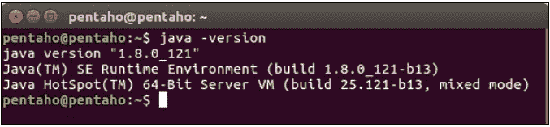

现在您的环境已准备就绪，让我们向前迈进一步并安装 Pentaho Report Designer。

## Setting up the Pentaho Report Designer

正如您所预期的那样，我们目标的第一个任务是从正确的网站下载 Pentaho Report Designer。发行包可在几个地方获得：在 SourceForge 网站（[https://sourceforge.net/projects/pentaho](https://sourceforge.net/projects/pentaho)）上，以及直接在官方 Pentaho 网站（[http://community.pentaho.com/projects/reporting](http://community.pentaho.com/projects/reporting)）上。在每种情况下，发行包都可以免费下载，不应收取任何费用或成本。

如果您选择从官方 Pentaho 网站下载 Pentaho Report Designer，自动重定向会将您发送到 SourceForge 网站。要在 SourceForge 网站上找到正确的发行版，请在 `Files` 仓库中跟随 `Report Designer` 文件夹。在那里您会为每个版本找到一个子文件夹。选择最新可用的版本，在我们的例子中是 8.0 版。

在发行文件夹中，您可以找到三个可用的包（让我们忽略仅包含校验和字符串的 `.sum` 文件）。前两个包 `prd-ce-mac-*.zip` 和 `prd-ce-*.zip` 包含 macOS 和 Windows/Linux 操作系统的二进制发行版。第三个包 `prd-classic-sdk-*.zip` 包含 Reporting SDK。

下载 Pentaho Report Designer 的二进制发行版后，在您的机器上创建一个目录，并在其中解压包的内容。解压后，您将在主目录中找到一个名为 `report-designer` 的脚本。

> _当然，如果您使用的是基于 Windows 的操作系统，请运行 `report-designer.bat` 脚本。如果您使用的是基于 Linux 的操作系统，请运行 `report-designer.sh` 脚本。如果您使用的是 macOS，请在 Finder 中找到 Pentaho Report Designer 并直接双击该应用程序。_

运行脚本后，用户界面应出现，并且与以下类似的欢迎屏幕将显示在您的桌面上：

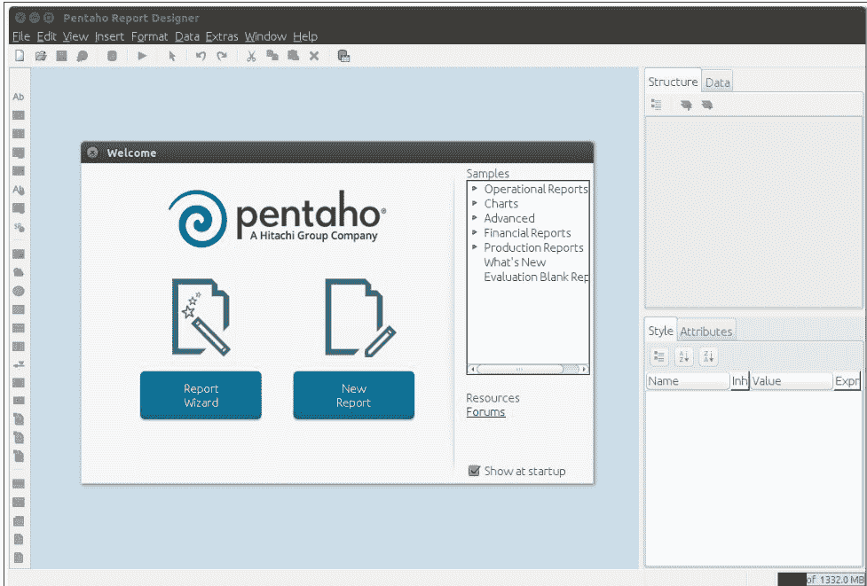

到此时，你可能想要在桌面上创建一个快捷方式或类似的东西以便更轻松地运行。无论如何，恭喜你，你已成功安装 Pentaho Report Designer！

Pentaho Report Designer 默认情况下随核心 Pentaho Reporting Engine 库一起打包，因此你现在拥有完成本书中所述示例所需的报表组件。

如果你在安装 Pentaho Report Designer 时遇到困难，有一些常见的故障排除问题需要你核实。最常见的问题与你已安装的 Java 虚拟机和 SDK 有关。`report-designer` 脚本使用系统路径中找到的第一个 Java 命令。因此，你需要验证你的路径是否配置正确。你可以通过在命令窗口中执行命令 `java -version` 来做到这一点，以便查看你正在使用的 Java 版本。

## SampleData 模式

与发行包一起，Pentaho Report Designer 的安装包含一个名为 `SampleData` 的数据库模式。`SampleData` 模式包含一套完整的表和数据，可用于你的测试和一般培训。在本书中，你将在所有练习中使用此数据库。你会发现 `SampleData` 是报表周围每种常见需求的绝佳起点。

无需进行任何设置即可使用 `SampleData` 模式。Pentaho Report Designer 内置了 HyperSQL RDBMS，考虑到 HyperSQL 完全用 Java 编写且无需任何安装或复杂任务即可运行，这是一个自然的选择。

> *如果你想了解有关 HyperSQL RDBMS 的更多信息，可以在网上或直接在官方网站 (http://hsqldb.org) 上查看大量可用的文档和教程。*

正如你可能知道的，HyperSQL 数据库包含在一组文件中，所有文件都存储在文件系统的唯一文件夹中。对于 `SampleData` 来说，你可以在 `<report-designer>/resources/sampledata` 路径下找到它。

撇开数据库不谈，Pentaho Report Designer 捆绑了一个连接到 `SampleData` 模式的数据源。我们将详细了解数据源是什么以及数据源如何在报表中使用，但现在，足够你知道的是，你可以在 Pentaho Report Designer 内部轻松访问它，并在正确安装后立即自动访问。

为了完成对 `SampleData` 模式的介绍，让我们来看看其中包含的表列表。这很重要，因为你将在本书中多次在查询中使用这些表，并且希望你在所有初始测试和实验中都会使用它们，如下所示：

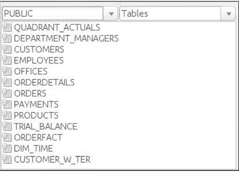

我们不会再多谈论 SampleData 模式，但这次介绍对你很重要，因为现在你可以轻松理解我们将要开发的所有查询。正如你将在以下各节中很快看到的那样，查询是使用 Pentaho Reporting 开发所有报表的第一步。

## 用户界面介绍

现在你已在环境中安装了 Pentaho Report Designer，并且知道如何启动它，让我们再向前迈进一步，介绍用户界面。启动 Pentaho Report Designer 后，你会注意到以下六个主要图形组件。所有组件共同工作的唯一目标是创建报表。从窗口的左上到右下，你可以识别出：

-   菜单和工具栏，你可以在其中请求对报表执行所有可能的操作
-   报表元素调色板，你可以在其中为报表选择报表元素
-   报表画布选项卡面板，显示你的报表
-   报表资源管理器面板，包含结构和数据选项卡，以对象树形式显示整个报表
-   元素属性面板，显示与当前选定的报表元素关联的所有样式和属性
-   消息面板，显示与当前打开的报表相关的警告和错误

以下是一个突出显示所列组件及其在 Pentaho Report Designer 用户界面中位置的屏幕截图：

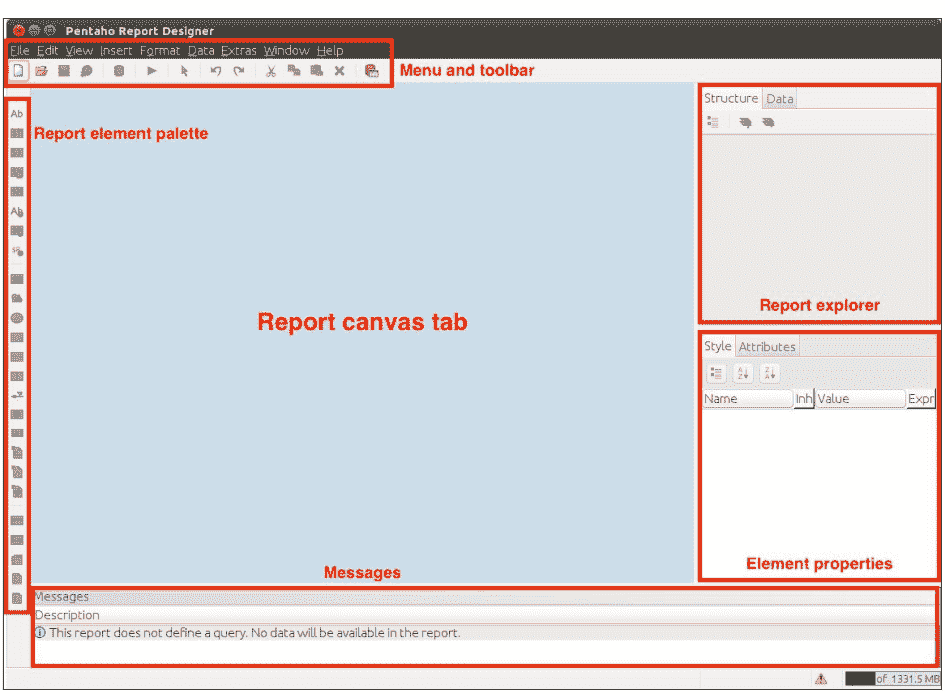

考虑到组件需要高度熟练地管理才能取得良好效果，以下是它们的简要描述，以确保你从一开始就理解它们在报表开发中的用途和目的。

### 菜单和工具栏

菜单和工具栏包含有助于更轻松构建报表的实用功能。除了保存、打开和发布等基本功能外，你还可以访问大量高级功能。菜单和工具栏中的许多选项都可用作快捷键。Pentaho Report Designer 的菜单和工具栏的目的与标准菜单和工具栏没有不同。它们包含所有可用功能，以描述和图标的序列形式收集，所有内容均可点击以完成特定任务。

### 报表元素调色板

报表元素调色板面板位于 Pentaho Report Designer 的左侧，包含可放置在报表上的元素类型的图标列表。报表元素调色板包括标签、形状、字段、图表、子报表以及大量有趣且有用的基本元素，你可以使用它们按照你（或你的客户）的意愿精确开发报表。

> *要向报表添加元素，请从调色板中拖动图标并直接将其拖放到报表画布中。你可能会开始理解，一切都极其简单，并不仅仅适用于纯开发者（在此阶段）。*

### 报表画布选项卡

报表画布选项卡面板位于 Pentaho Report Designer 的中央，它有点像你最终结果的预览。一旦你创建了新报表或打开了现有报表，这里就是你拖放元素以构建首选布局的地方。

在设计模式下，画布显示一些所谓的报表频段（我们将在下一章详细介绍报表频段是什么以及它们的作用）。画布提供许多视觉功能，允许你管理报表元素的对齐和大小。这是魔术发生的地方，你将能够移动、调整和微调报表，使其完全符合你（或你的客户）的期望。除了设计画布之外，你还可以在此面板中直接预览当前报表。

> *你可以以这种方式在实时数据和报表模板之间快速切换。这将使报表的开发更容易，并能从用户角度立即进行测试。*

### 报表资源管理器

报表资源管理器位于 Pentaho Report Designer 的右侧，包括结构选项卡面板和数据选项卡面板。结构选项卡面板包含报表的树结构，包括所有报表频段。数据选项卡面板包含报表的所有数据源、函数和参数。在结构和数据树的各个部分上右键单击时，界面会显示许多可能的选项，例如添加新的数据源和子组。报表资源管理器可以通过窗口应用程序菜单隐藏。与画布选项卡和元素属性一起，它是 Pentaho Report Designer 最强大的组件之一。

> *强烈建议尽快开始了解报表资源管理器的工作方式，因为它可以帮助你很多，尤其是在对报表中元素的精确放置进行微调时。*

## 元素属性

元素属性面板位于报表资源管理器面板之后，在 Pentaho Report Designer 的右侧，并显示报表资源管理器或画布中当前选中项的详细信息。所有可编辑的样式和属性都会在此面板中显示。许多可编辑属性提供额外的对话框以实现高级编辑功能。报表资源管理器可通过窗口应用程序菜单隐藏。与画布选项卡和报表资源管理器一起，它是 Pentaho Report Designer 最强大的组件之一。

> *强烈建议尽快开始了解元素属性的工作方式，因为它可以在很大程度上帮助你，尤其是在报告中对元素精确位置进行微调时。*

## 消息

消息面板位于 Pentaho Report Designer 底部，并显示报告中存在的任何活动警告或错误。选择一条消息时，Report Designer 会自动选择相关元素和属性，从而便于追踪报告中的问题。消息面板默认隐藏，可通过窗口应用程序菜单使其可见。强烈建议经常检查消息面板，因为它包含了报告部署到生产环境时可能出现的问题的详细信息，最糟糕的是提交给最终用户。

*你可以通过查看用户界面右下角的小图标轻松检查警告或错误。你可以在下一张截图中看到该图标的示例，为黄色三角形。如果你在那里看到图标，建议检查消息框，因为你的报告中存在需要解决的问题。*

下图显示了消息面板中显示的活动警告：

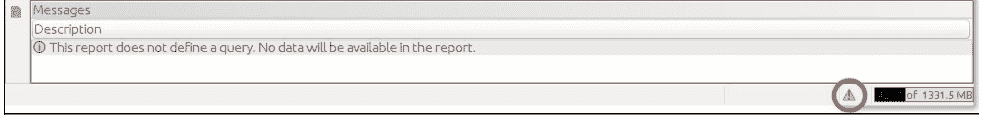

## 使用向导创建你的第一个报表

现在你已成功安装 Pentaho Report Designer，并且对用户界面更有信心，在本节中，你将逐步构建第一个完整的报表。

你将要开发的报表将列出在 `SampleData` 模式中定义的目录中的所有产品，更确切地说，存储在 `PRODUCTS` 表中。开始之前，在你的笔记本电脑上创建一个名为 `my_reports` 的目录，以管理你在本书中开发的文件。

> *在 https://github.com/fcorti/pentaho-8-reporting-for-java-developers 可用的 GitHub 仓库中，你可以找到本书所有示例中描述的源代码。在 `chapter 02 - Getting started with Report Designer/my_reports` 文件夹中，你可以在名为 `my_first_report.prpt` 的文件中找到此处描述的示例。*

## 介绍报表设计向导

使用 Pentaho Report Designer 创建报表有两种可能的方式：从空白报表开始或使用向导。

这两种方式没有哪一种更好。

每种方式都有优点和缺点，你应该在尝试其中一条路径而不是另一条路径后积累一些经验和一些成功（或困难）后形成自己的想法。

如果你想要完全控制细节和行为，建议从 *空白* 报表开始开发。如果你的目标是开发结构相当简单、布局和定制也相当简单的标准报表，建议使用向导进行开发。

向导最具吸引力的优势之一是，你可以从一组可用模板中选择布局，其中大多数足够精美，可以保证吸引你的用户。

正如你所预期的那样，本书将涵盖这两种可能的方式，但你将从使用向导开始，因为它更快更简单。在这个第一个示例之后，你将放弃向导方法，更倾向于从空白报表开始。

> *在开始使用向导开发报表之前，让我们再次强调一个最佳实践：一些开发者更喜欢修改用向导构建的报表，而不是从头开始。原则上，这并不坏，但可能会遇到的问题是，你对某些细节的控制力会降低，尤其是在布局微调或特定情况下的某些意外行为。*

要启动 Pentaho 报表设计向导，请检查顶部菜单并单击 File 项目，然后单击 Report Design Wizard。请注意，你也可以使用快捷键（*Ctrl + Shift + N*）作为从菜单中选择项目的替代方式。

下图显示了顶部菜单的外观：

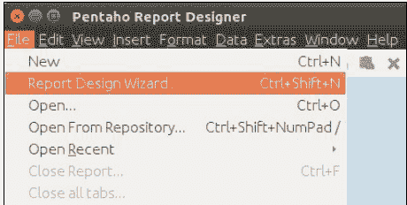

一旦启动 Pentaho 报表设计向导，一个模态窗口会出现，描述四个步骤：

- 1. 外观和感觉，在此你从可能的模板列表中选择首选布局
- 2. 数据源和查询，在此你定义报表中使用的数据集
- 3. 布局步骤，在此你定义报表中显示的分组和字段
- 4. 格式步骤，在此你定义报表中显示的每个项目的外观和感觉

每个步骤的简要描述，描述你在笔记本电脑上将看到的用户界面的进一步细节，如下所示。

## 定义外观和感觉

在报表设计向导中作为第一个任务显示的模态窗口定义了外观和感觉步骤。在此步骤中，你可以从一组可能的模板中选择报表的布局。

下图显示了窗口的外观：

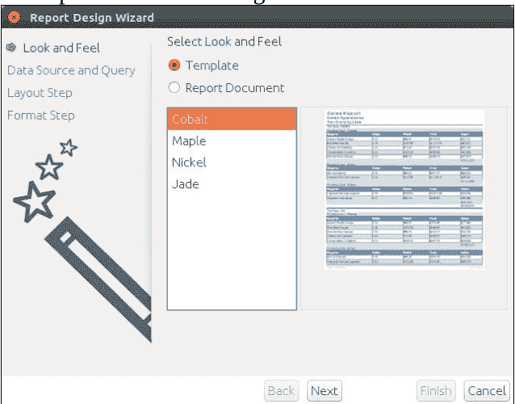

正如截图所示，模板以小图像预览，给你机会提前看到报表将是什么样子。使用 Report Document，你也可以使用现有报表作为模板。使用此功能时要小心，或者至少在做出任何最终决定之前尝试使用它（有时结果并不像你想象的那样好）。一旦你为报表选择了最佳模板，请单击 Next 前进。在我们的练习中，你将使用 Cobalt 模板作为示例。

## 定义数据源和查询

报表设计向导的第二步是选择数据集。数据集通常被识别为数据库上的查询，但也可以在其他多种类型的源（称为数据源）上定义。在我们的示例中，我们将使用 `SampleData` 表。特别是，我们将查询名为 `PRODUCTS` 的表。

从向导窗口开始，在右上角，你应该看到一个加号图标 (+) 。单击加号图标 (+) 时，会出现一个窗口，询问你想要定义的数据源类型。在后面的章节中，我们将详细介绍所有可用的数据源类型，但在此时，选择 `JDBC` 来设置数据库模式上的标准查询。

选择后，JDBC 数据源定义的新的窗口如下所示：

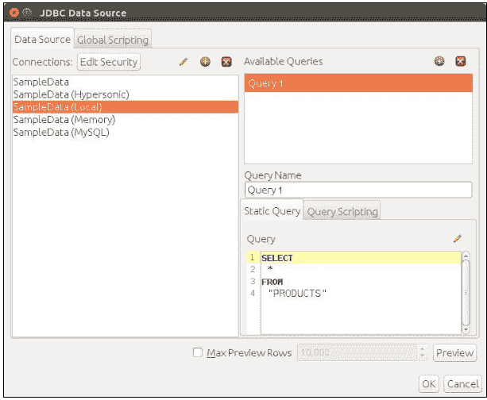

在前面的截图中，你可以看到所有数据正确填写的最终结果。在你的环境中，与查询相关部分（Available Queries 和 Static Query）应为空。从你的环境开始，选择 SampleData (Local) 连接以指示向导使用此作为源。然后按下 Available Queries 右侧的绿色加号图标；此操作将向可用查询列表（Available Queries）添加一个新的查询。

新查询被定义为名称 Query 1。你可以通过在 Query Name 字段中输入来决定更改查询的名称。我们选择保留默认名称作为我们第一个报表的示例。

现在查询已添加，在 Query 文本字段中输入 SQL 命令或按下铅笔图标（✏️）以打开可视化查询设计器。

要测试数据源，请按下 Preview 按钮执行查询并查看 resulting 数据集。如果预览显示数据集，则意味着一切都已正确定义。如果没有，请检查到 SampleData 模式的连接和 SQL 命令的语法。

要保存数据源并在报表中使用它，请单击 OK 按钮，你将返回到报表设计向导。一旦数据源创建，向导将向你显示如下窗口：

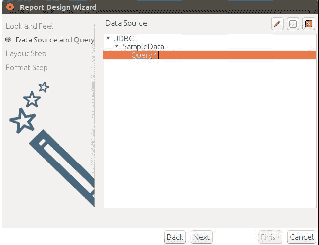

选择新的查询（在我们的例子中为 Query 1）并通过按下 Next 按钮进入布局设置。

## 定义布局

现在您已完成数据源的定义，是时候设置报告的布局了。在此步骤中，您将从数据源中选择一部分字段，定义报告中可见字段的列表。为了创建复杂的报表，本步骤中选择的字段被分为两类：分组项和明细项。在分组项中，精灵会包含所有用于分组明细的字段（在生成的报表中以每个值作为标题显示）。在明细项中，精灵会包含报表中作为最大详细级别显示的所有字段。

在我们的示例中，让我们在精灵窗口中操作，从“可用项”中选择数据源的字段并按下黄色箭头，具体取决于您希望赋予字段的分类：按下上方的黄色箭头将字段包含在“分组项”中，或按下下方的黄色箭头将字段包含在“已选项”（明细项）中。以下截图显示了字段正确分组后窗口的外观：

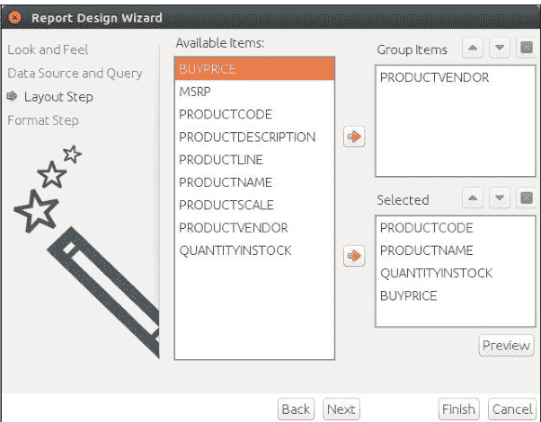

*正如您所见，并非所有数据源的可用字段都包含在分组项或明细项中。如果您想在不同的报表中重用数据源，此功能非常有帮助。例如，我们可以设想使用此数据源开发两个相似（但不同）的报表：一个按数量显示产品，一个按采购价显示产品。*

查看我们的示例，我们将产品供应商设置为分组项，而产品代码、产品名称、库存数量和采购价作为报表的明细。采用此配置，生成的报表将显示产品供应商列表，并为每个供应商显示产品明细列表，显示代码、名称、库存数量和采购价。

完成布局步骤后，单击“下一步”按钮进入最后一步——格式化字段。

## 格式化字段

作为最后一步，精灵要求定义每个字段的格式。所有类型的字段都需要进行格式定义：分组项中的字段和明细项中的字段。格式设置实际上取决于字段的分类；对于分组项中的字段，只需要标签，而对于明细项中的字段，可以自定义更多细节。

我们不会进一步介绍可能的设置细节，因为使用精灵设置格式非常容易理解。为了展示两者之间的差异，以下截图显示了为分组项字段定义的设置（在我们的示例中，仅为 PRODUCTVENDOR 字段）：

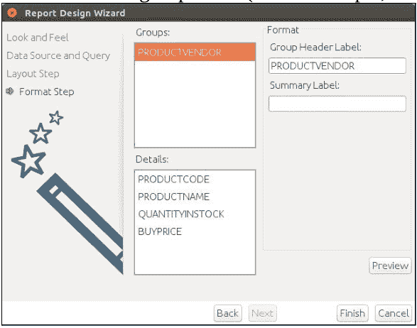

以下截图显示了为明细项字段定义的设置（在我们的示例中，我们只看到 PRODUCTCODE）：

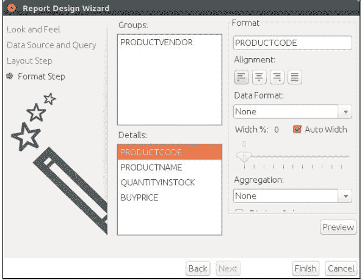

回到我们的示例，不需要修改任何默认设置。您可以选择修改标签作为练习，或更改设置以查看最终报表如何变化，但在我们的案例中，这不是强制性的，我们对使用默认设置开发的结果感到满意。现在我们对报表的定义感到满意，让我们单击“完成”按钮关闭精灵并访问生成的报表。

恭喜您，您已使用报表设计精灵创建了第一个 Pentaho 报表。

*完成示例后，请随意重复操作，稍微调整配置和设置。这始终是一次很好的体验，可以尝试看看最终结果会发生什么变化。您开发的练习越多，尝试所有功能越多，在为最终用户和客户开发真实报表时，您拥有的解决方案就越多。*

## 预览报表

现在报表设计精灵已完成其工作，您在 Pentaho 报表设计器中拥有一个功能齐全的报表。以下截图显示了用户界面的外观：

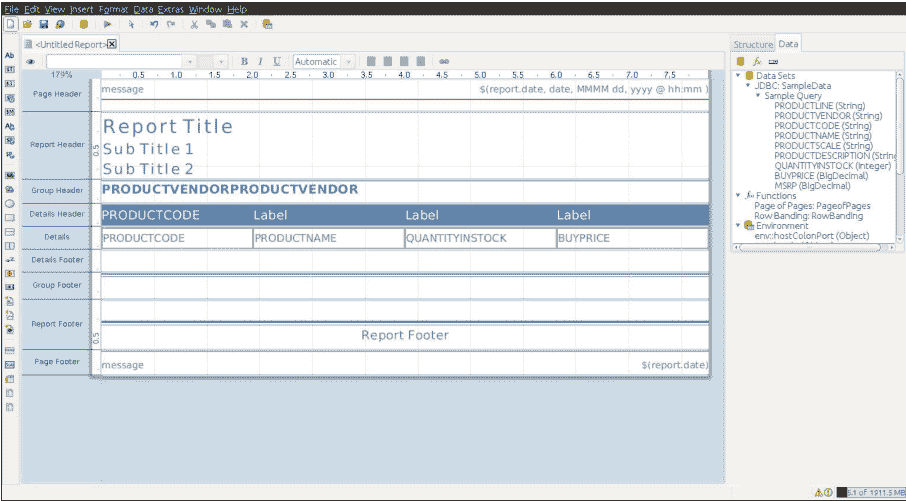

如果您不了解结构细节和每个标签的含义，请不要担心。在后面的章节中，我们将介绍 Pentaho 报表设计器的所有细节，您将大量练习以成为整个工具的真正专家。

在执行任何其他任务之前，让我们更新标题和副标题，使其更具意义。要修改标题，请双击“报表标题”文本并将其内容替换为 My first report。之后，双击“副标题 1”和“副标题 2”并删除其中的文本。更改完成后，标题应如下图所示：

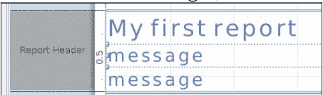

现在标题已修改，一切似乎都已准备好以最终版本为用户预览报表。为满足此需求，Pentaho 报表设计器提供了一个很棒的功能，在开发过程中非常有用。如果您查看报表画布左上角，<Untitled Report> 正下方有一个眼睛图标（👁）。眼睛图标绝对是开发人员的朋友，表示报表的预览。单击眼睛图标，您可以看到第一个报表运行。以下截图显示了所开发报表的预览外观：

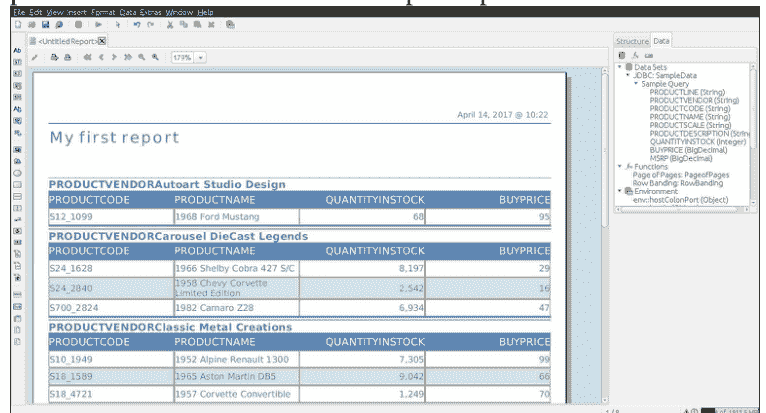

*正如预览所示，还可以做更多工作使其完美。例如，可以减小标题与表格之间的距离，可以更改产品供应商的标签，并且可能可以修复许多小问题。好吧，这是真的，但不要太苛求。您在很短的时间内取得了很好的成果，我们还有几章要阅读才能达到完美。*

现在您可以看到报表的预览，您可能希望切换回设计模式进行一些更改。要再次切换到设计模式，请查看报表画布左上角，<Untitled Report> 正下方。之前是眼睛图标的位置，现在有一个铅笔图标（✏️），表示切换到设计模式。单击铅笔图标（✏️），您将返回到初始视图，准备修改报表然后再次预览。听起来很简单，不是吗？

### 提示
*在设计模式和预览模式之间迭代，直到您满意报表为止，这是开发的正确方法。如果您打算使用精灵或从空白开始开发报表，您应该始终记住这一点。*

## 保存和打开报表

在定义第一个 Pentaho 报表后，您可能希望了解更多关于将其保存以供将来使用的方法。在练习中实际操作之前，让我们介绍所有可能的方式。Pentaho Reporting 有两个不同的位置可以请求存储报表：文件系统和所谓的 Pentaho 仓库。

将报表保存（和加载）到（和从）文件系统与保存（和加载）常规文件没有太大区别。另一种解决方案是 Pentaho 仓库。Pentaho 仓库由 Pentaho Analytics 平台直接管理，主要是开发者和用户可以读取、写入、更新和删除内容的协作空间，方式类似于内容仓库。Pentaho Analytics 平台使用 Apache Jackrabbit (http://jackrabbit.apache.org) 实现其仓库，它是 Java 技术 API 内容仓库（JCR，由 JSR 170 和 JSR 283 规定）的完全符合实现。Pentaho 仓库可以使用 Pentaho Analytics 平台的 API 访问，Pentaho 建议在生产环境中使用。您将在第 15 章 *在 Pentaho Business Analytics 平台中使用报表* 中了解所有这些内容。

即使应优先使用 Pentaho 仓库，在我们的实践示例中，我们开始使用文件系统作为仓库。要将第一个报表保存到文件系统，Pentaho 报表设计器提供了一个明确的功能：上部菜单（在“文件”组下）中的“保存”和“另存为...”项。单击“保存”项（“另存为...”具有相同的用户体验），将出现类似以下的一个窗口。正如您自己可以轻松检查的那样，工具栏中可见一个磁盘图标（💾）作为保存功能的快捷方式。如所述，此功能与保存常规文件没有区别，如下所示：

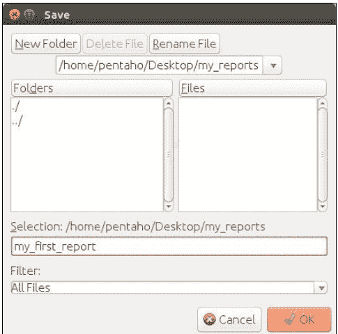

关于保存窗口该做什么绝对是可以理解的：在文件系统中指定一个文件夹，为报表指定名称，然后按确定按钮。在我们的例子中，我们将报表命名为 `my_first_report` 并保存到 `my_reports` 文件夹中。正如你应该记得的，在本章的开头，我们创建了 `my_reports` 文件夹来存储本书练习中创建的所有报表。

一旦安全地存储在文件系统中，你可以通过访问 `my_reports` 文件夹来查看报表是什么样子的。如以下屏幕截图所示，报表看起来像一个扩展名为 `.prpt` 的单个文件。我们将在第 11 章 *The PRPT Format and the Java API to Build It* 中介绍 `.prpt` 文件是什么。在此阶段，它无非是一个包含 Pentaho 报表的文件。Pentaho 报表以 `.prpt` 格式可以像普通文件一样复制、移动、删除和重命名，就用户体验而言几乎没有任何变化。

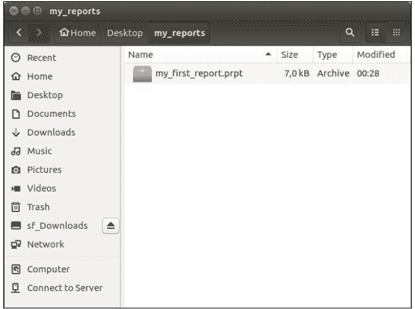

为了完成我们报表的生命周期，作为本章的最后一个主题，让我们简要讨论如何从文件系统打开报表。任务并不难做也不难理解。此外，与保存任务一样，打开 Pentaho 报表与打开普通文件没有区别。要从 Report Designer 打开 Pentaho 报表，请单击菜单中的 File 项，然后选择 Open...。从文件系统中选择 .prpt 文件并单击确定。就这样。

报表将被再次导入到 Pentaho Report Designer 中，并准备好像我们在前几节讨论的那样进行修改和预览。正如我们在保存和另存为...中所看到的，工具栏中可见一个文件夹图标（📁），作为上层菜单 Open... 功能的快捷方式。

*欢迎查看位于 https://github.com/fcorti/pentaho-8-reporting-for-java-developers 的 GitHub 仓库，在 `Chapter 02 - Getting started with Report Designer/my_reports` 文件夹中可以找到 `my_first_report.prpt` 文件。*

## 摘要

在本章中，你已经完整地[content]

关于保存窗口该做什么绝对是可以理解的：在文件系统中指定一个文件夹，为报表指定名称，然后按确定按钮。在我们的例子中，我们将报表命名为 `my_first_report` 并保存到 `my_reports` 文件夹中。正如你应该记得的，在本章的开头，我们创建了 `my_reports` 文件夹来存储本书练习中创建的所有报表。

一旦安全地存储在文件系统中，你可以通过访问 `my_reports` 文件夹来查看报表是什么样子的。如以下屏幕截图所示，报表看起来像一个扩展名为 `.prpt` 的单个文件。我们将在第 11 章 *The PRPT Format and the Java API to Build It* 中介绍 `.prpt` 文件是什么。在此阶段，它无非是一个包含 Pentaho 报表的文件。Pentaho 报表以 `.prpt` 格式可以像普通文件一样复制、移动、删除和重命名，就用户体验而言几乎没有任何变化。

为了完成我们报表的生命周期，作为本章的最后一个主题，让我们简要讨论如何从文件系统打开报表。任务并不难做也不难理解。此外，与保存任务一样，打开 Pentaho 报表与打开普通文件没有区别。要从 Report Designer 打开 Pentaho 报表，请单击菜单中的 File 项，然后选择 Open...。从文件系统中选择 .prpt 文件并单击确定。就这样。

报表将被再次导入到 Pentaho Report Designer 中，并准备好像我们在前几节讨论的那样进行修改和预览。正如我们在保存和另存为...中所看到的，工具栏中可见一个文件夹图标（📁），作为上层菜单 Open... 功能的快捷方式。

*欢迎查看位于 https://github.com/fcorti/pentaho-8-reporting-for-java-developers 的 GitHub 仓库，在 `Chapter 02 - Getting started with Report Designer/my_reports` 文件夹中可以找到 `my_first_report.prpt` 文件。*

## 摘要

在本章中，你已经完整地[content]

关于保存窗口该做什么绝对是可以理解的：在文件系统中指定一个文件夹，为报表指定名称，然后按确定按钮。在我们的例子中，我们将报表命名为 `my_first_report` 并保存到 `my_reports` 文件夹中。正如你应该记得的，在本章的开头，我们创建了 `my_reports` 文件夹来存储本书练习中创建的所有报表。

一旦安全地存储在文件系统中，你可以通过访问 `my_reports` 文件夹来查看报表是什么样子的。如以下屏幕截图所示，报表看起来像一个扩展名为 `.prpt` 的单个文件。我们将在第 11 章 *The PRPT Format and the Java API to Build It* 中介绍 `.prpt` 文件是什么。在此阶段，它无非是一个包含 Pentaho 报表的文件。Pentaho 报表以 `.prpt` 格式可以像普通文件一样复制、移动、删除和重命名，就用户体验而言几乎没有任何变化。

为了完成我们报表的生命周期，作为本章的最后一个主题，让我们简要讨论如何从文件系统打开报表。任务并不难做也不难理解。此外，与保存任务一样，打开 Pentaho 报表与打开普通文件没有区别。要从 Report Designer 打开 Pentaho 报表，请单击菜单中的 File 项，然后选择 Open...。从文件系统中选择 .prpt 文件并单击确定。就这样。

报表将被再次导入到 Pentaho Report Designer 中，并准备好像我们在前几节讨论的那样进行修改和预览。正如我们在保存和另存为...中所看到的，工具栏中可见一个文件夹图标（📁），作为上层菜单 Open... 功能的快捷方式。

*欢迎查看位于 https://github.com/fcorti/pentaho-8-reporting-for-java-developers 的 GitHub 仓库，在 `Chapter 02 - Getting started with Report Designer/my_reports` 文件夹中可以找到 `my_first_report.prpt` 文件。*

## 摘要

在本章中，你已经完整地[content]

关于保存窗口该做什么绝对是可以理解的：在文件系统中指定一个文件夹，为报表指定名称，然后按确定按钮。在我们的例子中，我们将报表命名为 `my_first_report` 并保存到 `my_reports` 文件夹中。正如你应该记得的，在本章的开头，我们创建了 `my_reports` 文件夹来存储本书练习中创建的所有报表。

一旦安全地存储在文件系统中，你可以通过访问 `my_reports` 文件夹来查看报表是什么样子的。如以下屏幕截图所示，报表看起来像一个扩展名为 `.prpt` 的单个文件。我们将在第 11 章 *The PRPT Format and the Java API to Build It* 中介绍 `.prpt` 文件是什么。在此阶段，它无非是一个包含 Pentaho 报表的文件。Pentaho 报表以 `.prpt` 格式可以像普通文件一样复制、移动、删除和重命名，就用户体验而言几乎没有任何变化。

为了完成我们报表的生命周期，作为本章的最后一个主题，让我们简要讨论如何从文件系统打开报表。任务并不难做也不难理解。此外，与保存任务一样，打开 Pentaho 报表与打开普通文件没有区别。要从 Report Designer 打开 Pentaho 报表，请单击菜单中的 File 项，然后选择 Open...。从文件系统中选择 .prpt 文件并单击确定。就这样。

报表将被再次导入到 Pentaho Report Designer 中，并准备好像我们在前几节讨论的那样进行修改和预览。正如我们在保存和另存为...中所看到的，工具栏中可见一个文件夹图标（📁），作为上层菜单 Open... 功能的快捷方式。

*欢迎查看位于 https://github.com/fcorti/pentaho-8-reporting-for-java-developers 的 GitHub 仓库，在 `Chapter 02 - Getting started with Report Designer/my_reports` 文件夹中可以找到 `my_first_report.prpt` 文件。*

## 摘要

在本章中，你已经完整地[content]

关于保存窗口该做什么绝对是可以理解的：在文件系统中指定一个文件夹，为报表指定名称，然后按确定按钮。在我们的例子中，我们将报表命名为 `my_first_report` 并保存到 `my_reports` 文件夹中。正如你应该记得的，在本章的开头，我们创建了 `my_reports` 文件夹来存储本书练习中创建的所有报表。

一旦安全地存储在文件系统中，你可以通过访问 `my_reports` 文件夹来查看报表是什么样子的。如以下屏幕截图所示，报表看起来像一个扩展名为 `.prpt` 的单个文件。我们将在第 11 章 *The PRPT Format and the Java API to Build It* 中介绍 `.prpt` 文件是什么。在此阶段，它无非是一个包含 Pentaho 报表的文件。Pentaho 报表以 `.prpt` 格式可以像普通文件一样复制、移动、删除和重命名，就用户体验而言几乎没有任何变化。

为了完成我们报表的生命周期，作为本章的最后一个主题，让我们简要讨论如何从文件系统打开报表。任务并不难做也不难理解。此外，与保存任务一样，打开 Pentaho 报表与打开普通文件没有区别。要从 Report Designer 打开 Pentaho 报表，请单击菜单中的 File 项，然后选择 Open...。从文件系统中选择 .prpt 文件并单击确定。就这样。

报表将被再次导入到 Pentaho Report Designer 中，并准备好像我们在前几节讨论的那样进行修改和预览。正如我们在保存和另存为...中所看到的，工具栏中可见一个文件夹图标（📁），作为上层菜单 Open... 功能的快捷方式。

*欢迎查看位于 https://github.com/fcorti/pentaho-8-reporting-for-java-developers 的 GitHub 仓库，在 `Chapter 02 - Getting started with Report Designer/my_reports` 文件夹中可以找到 `my_first_report.prpt` 文件。*

## 摘要

在本章中，你已经完整地[content]

关于保存窗口该做什么绝对是可以理解的：在文件系统中指定一个文件夹，为报表指定名称，然后按确定按钮。在我们的例子中，我们将报表命名为 `my_first_report` 并保存到 `my_reports` 文件夹中。正如你应该记得的，在本章的开头，我们创建了 `my_reports` 文件夹来存储本书练习中创建的所有报表。

一旦安全地存储在文件系统中，你可以通过访问 `my_reports` 文件夹来查看报表是什么样子的。如以下屏幕截图所示，报表看起来像一个扩展名为 `.prpt` 的单个文件。我们将在第 11 章 *The PRPT Format and the Java API to Build It* 中介绍 `.prpt` 文件是什么。在此阶段，它无非是一个包含 Pentaho 报表的文件。Pentaho 报表以 `.prpt` 格式可以像普通文件一样复制、移动、删除和重命名，就用户体验而言几乎没有任何变化。

为了完成我们报表的生命周期，作为本章的最后一个主题，让我们简要讨论如何从文件系统打开报表。任务并不难做也不难理解。此外，与保存任务一样，打开 Pentaho 报表与打开普通文件没有区别。要从 Report Designer 打开 Pentaho 报表，请单击菜单中的 File 项，然后选择 Open...。从文件系统中选择 .prpt 文件并单击确定。就这样。

报表将被再次导入到 Pentaho Report Designer 中，并准备好像我们在前几节讨论的那样进行修改和预览。正如我们在保存和另存为...中所看到的，工具栏中可见一个文件夹图标（📁），作为上层菜单 Open... 功能的快捷方式。

*欢迎查看位于 https://github.com/fcorti/pentaho-8-reporting-for-java-developers 的 GitHub 仓库，在 `Chapter 02 - Getting started with Report Designer/my_reports` 文件夹中可以找到 `my_first_report.prpt` 文件。*

## 摘要

在本章中，你已经完整地[content]

关于保存窗口该做什么绝对是可以理解的：在文件系统中指定一个文件夹，为报表指定名称，然后按确定按钮。在我们的例子中，我们将报表命名为 `my_first_report` 并保存到 `my_reports` 文件夹中。正如你应该记得的，在本章的开头，我们创建了 `my_reports` 文件夹来存储本书练习中创建的所有报表。

一旦安全地存储在文件系统中，你可以通过访问 `my_reports` 文件夹来查看报表是什么样子的。如以下屏幕截图所示，报表看起来像一个扩展名为 `.prpt` 的单个文件。我们将在第 11 章 *The PRPT Format and the Java API to Build It* 中介绍 `.prpt` 文件是什么。在此阶段，它无非是一个包含 Pentaho 报表的文件。Pentaho 报表以 `.prpt` 格式可以像普通文件一样复制、移动、删除和重命名，就用户体验而言几乎没有任何变化。

为了完成我们报表的生命周期，作为本章的最后一个主题，让我们简要讨论如何从文件系统打开报表。任务并不难做也不难理解。此外，与保存任务一样，打开 Pentaho 报表与打开普通文件没有区别。要从 Report Designer 打开 Pentaho 报表，请单击菜单中的 File 项，然后选择 Open...。从文件系统中选择 .prpt 文件并单击确定。就这样。

报表将被再次导入到 Pentaho Report Designer 中，并准备好像我们在前几节讨论的那样进行修改和预览。正如我们在保存和另存为...中所看到的，工具栏中可见一个文件夹图标（📁），作为上层菜单 Open... 功能的快捷方式。

*欢迎查看位于 https://github.com/fcorti/pentaho-8-reporting-for-java-developers 的 GitHub 仓库，在 `Chapter 02 - Getting started with Report Designer/my_reports` 文件夹中可以找到 `my_first_report.prpt` 文件。*

## 摘要

在本章中，你已经完整地[content]

保存窗口的使用很直观：指定文件系统中的文件夹、为报表命名，然后按确定。在本例中报表名为 `my_first_report`，保存到 `my_reports` 文件夹。正如本章开头所述，`my_reports` 用于存放本书练习创建的报表。

保存后，可通过访问 `my_reports` 查看报表。如截图所示，报表是一个扩展名为 `.prpt` 的单个文件。第 11 章 *The PRPT Format and the Java API to Build It* 将介绍 `.prpt` 文件。此阶段它只是一个包含 Pentaho 报表的单一文件。`.prpt` 格式的报表可像普通文件一样复制、移动、删除和重命名，用户体验无变化。

为完成报表生命周期，本章最后简要说明如何从文件系统打开报表。操作简单易懂，与保存类似，打开 Pentaho 报表与打开普通文件无异。在 Report Designer 中点击菜单 File 再选 Open...，选择文件系统的 .prpt 文件后点确定即可。

报表会再次导入 Pentaho Report Designer，可修改和预览。如保存和另存为...所示，工具栏中可见文件夹图标（📁）作为上层菜单 Open... 的快捷方式。

*可查看 https://github.com/fcorti/pentaho-8-reporting-for-java-developers 的 GitHub 仓库，其中 `Chapter 02 - Getting started with Report Designer/my_reports` 文件夹存放着 `my_first_report.prpt`。*

## 摘要

本章通过完整示例演示了如何创建 Pentaho 报表。你学习了在 HyperSQL 数据库上安装 Pentaho Report Designer 及 `SampleData` 模式，用于练习 Pentaho Reporting 功能。建议将 Report Designer 安装到本地，后续练习都会用到。

安装后，你熟悉了用户界面，并使用 Report Designer 的向导创建报表。完成创建后，你学会了预览及在设计和预览模式间切换，这是报表开发的最佳实践。为完成生命周期，你学会了将报表保存到文件系统以便后续使用和安全存储。最后，你学会了重新打开报表以使用或迭代改进。

读完本章，你应能理解 Pentaho Report Designer 是什么以及如何使用向导创建报表。下一章将介绍 Pentaho Reporting SDK，使用 Maven 和 Java 创建项目。
