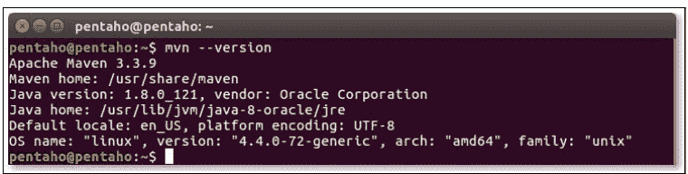
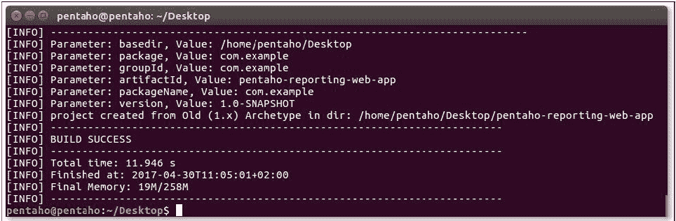
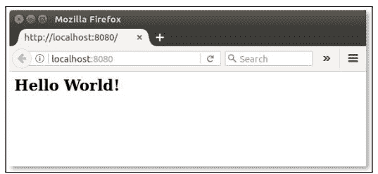
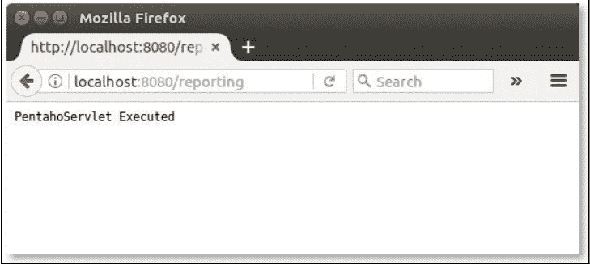
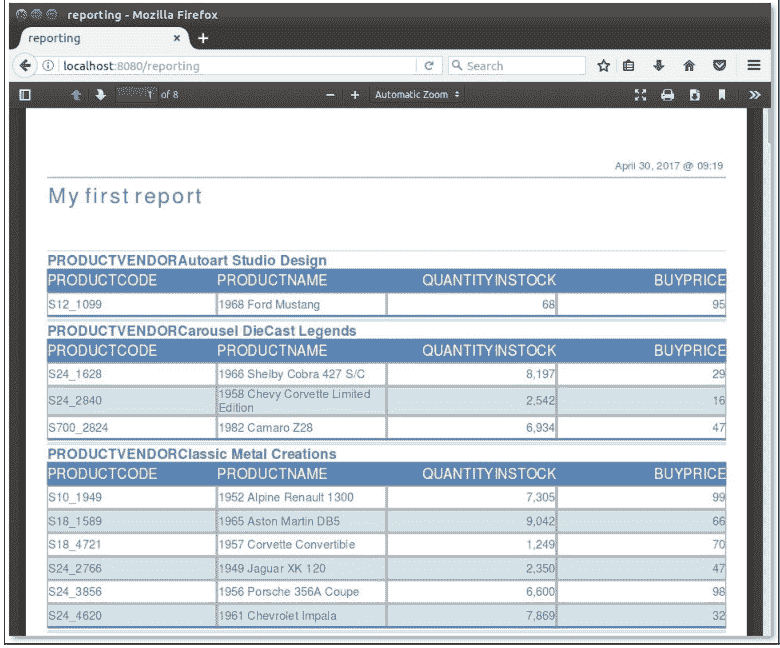

## 开始使用 Reporting SDK

在介绍 Pentaho Reporting 并使用 Report Design Wizard 创建首个报表后，本章将离开所见即所得的报表构建，进入 Pentaho Reporting SDK 的 Java 世界。最终你将学会用 Pentaho Reporting 在 Java 中创建 Web 应用，以预览上一章开发的报表。

你将从下载和设置 Pentaho Reporting SDK 开始，进而了解 SDK 包的构成，包括目录结构、各种库和示例。为更实用，你将学习如何将示例纳入 Eclipse 项目。

介绍完 SDK 后，动手部分将转向创建 Java Web 应用并集成 Pentaho Reporting，使用 Apache Maven 作为软件项目管理工具。为更实用，你将从零开始：创建标准 Java Web 应用，加入 Pentaho Report Engine，最后预览现有报表。为衔接已有知识，将使用上一章用 Report Designer Wizard 开发的报表作为示例。

本章技术性强，面向纯 Java 开发者。若你为开发经验不多的信息技术人员，可跳过阅读。最佳学习方式是边读边在本地操作。读完后你应能掌握将 Pentaho 报表嵌入现有 Java Web 应用的基础。后续章节假设你能用 Pentaho Reporting Engine 管理和设置 Java Web 应用，请仔细阅读并确保理解所有概念。

## 获取 Pentaho Reporting SDK

第 2 章 *Getting Started with Report Designer* 已说明 Pentaho Reporting 工具的位置：SourceForge 网站 https://sourceforge.net/projects/pentaho，特别是在 `Files` 仓库的 `Report Designer` 文件夹中。该文件夹包含名为 `pre-classic-sdk-*.zip` 的 ZIP 文件，包含整个 Pentaho Reporting SDK。下载到本地即可，分发包免费。

下载 Pentaho Reporting SDK 分发包后，在机器上创建目录并解压内容即可在环境中使用。在继续前，注意 `documentation` 文件夹中的 PDF `embedding_pentaho_reporting_engine`。该文件非常有用，建议阅读以了解更多关于 SDK 及使用方法。


*鉴于该 PDF 指南的存在，本书仅介绍示例的主要概念和包中内容。不重复 PDF 已覆盖的内容，我们更专注于实践练习：用 Java 创建 Web 应用，集成 Pentaho Reporting，并使用 Apache Maven 作为软件项目管理工具。*

## Pentaho Reporting SDK 的结构

在继续前，先介绍 Pentaho Reporting SDK 的目录结构及简要说明。`PentahoReportingEngineSDK` 文件夹结构如下：

```
PentahoReportingEngineSDK
|- documentation
|- licenses
|- samples
|- build-res
|- lib
|- source
|- sql
|- WebContent
|- META-INF
|- WEB-INF
```

各文件夹简述如下：

| 文件夹 | 描述 |
|---|---|
| `PentahoReportingEngineSDK` | Pentaho Reporting SDK 根目录。 |
| `documentation` | 存放 `embedding_pentaho_reporting_engine` PDF 文件的位置。 |
| `licenses` | 包含许可信息文本文件。 |
| `samples` | 包含示例的 Eclipse 项目目录 |


|  |  |
|---|---|
|  | 在 PDF 指南中描述。 |
| `build-res` | 包含 Apache Ant 脚本的文件夹 (http://ant.apache.org)。 |
| `lib` | 构成 Pentaho Reporting Engine 的库目录。 |
| `source` | 用于构成报表示例的源文件。 |
| `sql` | 与示例一起使用的基于文件的 HyperSQL 数据库实例。这是前几章中介绍的完全相同的 `SampleData` 模式。 |
| `WebContent` | 一个示例使用的 Web 内容信息（主要是 `WEB-INF/web.xml`）。 |

在继续其他概念之前，请查看每个文件夹的内容以熟悉 SDK 的结构和内容。在前面提到的 PDF 指南中，您将找到有关 Pentaho Reporting SDK 结构的信息。请在继续阅读以下段落之前先阅读该指南。

## 使用包含的 Eclipse 项目

如 PDF 指南所述，如果您使用 Eclipse 或 IntelliJ IDEA IDE，可以使用随 Pentaho Reporting SDK 包含的 Eclipse 项目直接使用示例。在实践中，将解压的 Pentaho Reporting SDK 目录选为工作区即可正常工作。您也可以直接从 Eclipse 中的文件浏览器启动 `Sample1.java` 和 `Sample2.java` 示例应用程序。

我们不会提供关于 Eclipse 项目的更多细节，因为它在指南中已有详细说明。从另一个角度来看，我们更愿意在接下来的章节中介绍最现代的方法，使用 Apache Maven ([https://maven.apache.org](https://maven.apache.org)) 作为软件项目管理和理解工具。

## 介绍包含的示例

Pentaho Reporting SDK 中包含五个有趣的示例。示例在 PDF 指南中有所描述，并附带介绍与 Reporting Engine 交互的概述。PDF 指南中描述的所有源代码都可在 sample 文件夹中使用，且文件名与示例严格相关。以下是每个示例的简要描述供参考：

- `sample0`：基础类。`AbstractReportGenerator` 类被 `sample1` 和 `sample2` 继承。它包含创建报表的基本逻辑，将输入和输出的细节留给继承它的类。
- `sample1`：静态报表定义，JDBC 输入，PDF 输出。最简单的嵌入场景会生成静态报表（关于数据源或查询无用户输入），使用 Pentaho 提供的 `SampleData` HyperSQL 模式进行 JDBC 输入，并在本地文件系统上生成 PDF。
- `sample2`：静态报表定义，JDBC 输入，HTML 输出。此示例生成静态报表（关于数据源或查询无用户输入），使用 Pentaho 提供的 `SampleData` HyperSQL 模式进行 JDBC 输入，并在本地文件系统上生成 HTML 文件。
- `sample3`：动态生成，JDBC 输入，Swing 输出。`Sample3.java` 生成的报表与 `sample1.java` 中创建的相同，但它使用 Reporting Engine 中定义的 Swing 辅助类在 Swing 预览窗口中渲染报表。
- `sample4`：动态生成，JDBC 输入，Java servlet 输出。`Sample4.java` 是 `HttpServlet`，它生成类似于 `sample2` 的 HTML 报表。此示例假定您已安装、配置、运行并且可访问 Java 应用服务器，例如 Tomcat 或 JBoss。

请在继续阅读以下段落的内容之前，先详细阅读 PDF 指南的内容以及五个示例的描述。如果您能在自己的环境中测试这些示例就太好了。如前一节所述，我们将继续介绍使用 Apache Maven 的不同方法。

## 使用 Pentaho Reporting 和 Maven 创建 Web 应用程序

在本节中，您将学习如何从头开始使用 Pentaho Reporting Engine 创建 Web 应用程序。如果您还想了解如何将 Pentaho Reporting Engine 嵌入到现有 Web 应用程序中，此示例很有用。在此示例中，您将看到如何创建一个 Java Web 应用程序来显示您在第 2 章 *使用 Report Designer 入门* 中开发的 Pentaho 报表。正如您可能还记得的，我们看到了如何使用 Report Design Wizard 创建 Pentaho 报表，并将其命名为 `my_first_report`。

与 Pentaho Reporting SDK 中介绍的示例不同，在本书中我们将使用 Apache Maven，这是 Java 最常用的软件项目管理和理解工具。

为了更好地描述任务并让您有机会测试正确的结果，我们将项目拆分为几个子任务：每个任务一个段落，并附带源代码和屏幕截图，以确保您能在自己的环境中成功重现示例。


*在 GitHub 仓库 https://github.com/fcorti/pentaho-8-reporting 中，您可以找到本书示例中描述的源代码。在 `Chapter 03 - Getting started with Reporting SDK/pentaho-reporting-web-app` 中，您可以找到这些示例的源代码。*

## 环境的前提条件

在第 2 章 *使用 Report Designer 入门* 中，我们介绍了环境应具备的唯一前提条件：Sun 的 JDK 版本 8。考虑到我们将使用 Apache Maven，请确保已在开发环境中安装它。建议的版本为 3 或更新版本。要验证安装，请从命令行运行以下命令：**mvn --version**

如果正确安装，您将看到与以下屏幕截图类似的内容：



如果尚未安装，Apache Maven 的安装过程很简单，只需解压归档文件并将包含 `mvn` 命令的 `bin` 文件夹添加到 `PATH`。有关如何在环境中安装 Apache Maven 的更多详细信息，请查看官方网页 https://maven.apache.org/install.html。


> *另一个明显的必要条件是您的机器/环境可访问互联网。Apache Maven 基于公共仓库的理念，命令从中获取库、源代码以及编译和运行应用程序所需的一切。请确保在执行以下任务期间笔记本电脑已连接到互联网。*

## 在 Java 中创建 Web 应用程序

现在您的开发环境已正确设置，下一步是创建一个新的 Java Web 应用程序。如果您已有现有 Web 应用程序并想将 Pentaho Engine 包含在其中，此特定任务可能不感兴趣您。然而，为了完整性，我们更愿意涵盖开发的整个生命周期，假设您将在自己的环境中尝试示例以便更好地理解。

让我们从头开始创建一个 Java Web 应用程序，然后在编译和首次运行之前添加初始页面。

## 使用 Apache Maven 创建 Java Web 应用程序

使用 Apache Maven 从头开始创建 Java Web 应用程序很简单，得益于 Maven Archetypes。简而言之，Archetype 是 Maven 项目模板工具包，定义为一种原始模式或模型，所有同类事物都由此制作。对于我们的需求，我们将使用 `maven-archetype-webapp` 来启动一个简单的 Web 应用程序。

> *在本書中，我们不会详细介绍 Maven Archetypes，并假设您熟悉其使用和行为的基础知识。如果不熟悉也没关系，因为我们将描述逐步的方法。如果您想了解更多，请阅读 Apache Maven 文档 https://maven.apache.org/guides/introduction/introduction-to-archetypes.html。*

回到我们的任务，在机器中确定一个文件夹来放置新的 Java 应用程序（我们将使用 `Desktop`）。打开终端，移动到工作文件夹（在我们的例子中为 `Desktop`），并执行以下命令：

```
mvn archetype:generate
-DarchetypeArtifactId=maven-archetype-webapp
-DinteractiveMode=false
-DgroupId=com.example
-DartifactId=pentaho-reporting-web-app
```

查看命令，`archetypeArtifactId` 参数指定 Maven Archetype，`interactiveMode` 参数告诉 Maven 是否向用户提问（或不使用默认值），`groupId` 参数定义 Java 源代码的根包，`artifactId` 参数定义 Web 应用程序的名称。

> *注意，一个名为 `pentaho-reporting-web-app` 的全新文件夹将被创建。新文件夹将包含整个项目，包括配置文件、库、源代码和资源。此文件夹是存储在版本控制仓库（GitHub、SVN 等）中的自然候选。*


你会看到命令的执行非常冗长，终端上会显示大量日志信息。日志信息描述了你正在下载所有库和配置文件，以及创建、编译和运行新的 Java Web 应用所需的一切。过一段时间后，你应该会看到类似于以下截图的消息：



检查文件系统，会创建一个名为 `pentaho-reporting-web-app` 的全新文件夹，其中包含与你的 Java Web 应用相对应的整个项目。花点时间深入了解其结构以理解组成（正如你将看到的，它非常简单直接）。

我们在这里不会详细介绍使用 Apache Maven 创建的 Java 项目的解剖结构（你只需谷歌一下就能找到大量描述细节的资源），但所有魔法都通过 `pom.xml` 文件实现，用于声明编译、测试并成功运行项目所需的一切。

在认为任务完成之前，让我们将 Eclipse Jetty 添加到项目中。Eclipse Jetty (http://www.eclipse.org/jetty) 是一个 Java HTTP（Web）服务器和 Java Servlet 容器，以开源形式发布，可用于商业用途和分发。要在项目中包含 Eclipse Jetty，请将以下 XML 代码添加到位于 `pentaho-reporting-web-app` 文件夹中的 `pom.xml` 文件：

```
<project ...>
  ...
  <dependencies>
    ...
  </dependencies>
  <build>
    <finalName>pentaho-reporting-web-app</finalName>

    <!-- Add This here. -->
    <plugins>
      <plugin>
<groupId>org.apache.maven.plugins</groupId>
<artifactId>maven-dependency-plugin</artifactId>
<executions>
    <execution>
        <phase>package</phase>
        <goals><goal>copy</goal></goals>
        <configuration>
            <artifactItems>
                <artifactItem>
                    <groupId>org.eclipse.jetty</groupId>
                    <artifactId>jetty-runner</artifactId>
                    <version>9.4.4.v20170414</version>
                    <destFileName>jetty-runner.jar</destFileName>
                </artifactItem>
            </artifactItems>
        </configuration>
    </execution>
</executions>
</plugin>
</plugins>
</build>
</project>
```

保存 pom.xml 文件后，项目即可以初始版本进行编译。要编译 Java Web 应用，请打开终端，进入 pentaho-reporting-web-app 文件夹，并运行 mvn package。执行结束时，会出现类似于之前截图的 BUILD SUCCESS 消息，并且你会在 pentaho-reporting-web-app 中找到一个名为 target 的新文件夹。

要在 Eclipse Jetty 服务器中部署 WAR 包并运行它，只需执行以下命令：

```
java -jar target/dependency/jetty-runner.jar target/*.war
```

几秒钟后，经过几行日志信息，Web 应用将在 8080 端口上启动并运行。以下截图显示了在浏览器中打开页面 http://localhost:8080 时应有的样子：



要停止 Eclipse Jetty 服务器，请通过按 Ctrl + C 或根据你的操作系统按下类似的按钮组合来中断前一个命令的执行。

## Creating the first page of the Java web application

现在 `pentaho-reporting-web-app` 文件夹中已创建新项目，让我们添加第一个页面作为 Java Web 应用的端点。在 Java Web 应用中创建页面非常简单，这要归功于 Java Servlet。

> *在本書中，我們不會詳細介紹 Java Servlet，並且假設你對它們的使用和行為的基礎有信心。如果不是，請不要擔心，因為我們將描述一種逐步的方法來引導你創建 Java Web 應用。要了解更多，請使用 Google 找到最適合你的教程：Java Servlet 是開發 Java Web 應用中頁面（和端點）的知名解決方案。*

要将 Java Servlet API 添加到项目中，请将以下 XML 代码添加到位于 `pentaho-reporting-web-app` 文件夹中的 `pom.xml` 文件：<project ...>

```xml
...
<dependencies>
...

<!-- Add This here. -->
<dependency>
<groupId>javax.servlet</groupId>
<artifactId>javax.servlet-api</artifactId>
<version>3.1.0</version>
</dependency>

</dependencies>
<build>
...
</build>
</project>
```

保存 `pom.xml` 文件后，创建以下文件夹结构 `pentaho-reporting-web-app/src/main/java/com/example`，以及一个名为 `PentahoServlet.java` 的新文件。在 `PentahoServlet.java` 中，写入以下内容：

```java
package com.example;

import javax.servlet.ServletException;
import javax.servlet.http.HttpServlet;
import javax.servlet.http.HttpServletRequest;
import javax.servlet.http.HttpServletResponse;
import java.io.IOException;
import java.io.PrintWriter;

public class PentahoServlet extends HttpServlet {

@Override
public void doGet(
HttpServletRequest request,
HttpServletResponse response)
throws ServletException, IOException {

doPost(request, response);

}

@Override
public void doPost(
HttpServletRequest request,
HttpServletResponse response)
throws ServletException, IOException {

PrintWriter out = response.getWriter();
out.println("PentahoServlet Executed");
out.flush();
out.close();

}
}
```

此 Java 代码在 GET 方法调用和 POST 方法调用的情况下创建 Servlet 的响应。在这两种情况下，结果都会显示简单的 PentahoServlet Executed 消息。

保存 PentahoServlet.java 文件后，是时候使用以下配置更新存储在 pentaho-reporting-web-app/src/main/webapp/WEB-INF 文件夹中的 web.xml 文件了：...

```xml
<web-app>
<display-name>Archetype Created Web Application</display-name>

<!-- Add This here. -->
<servlet>
<servlet-name>reporting</servlet-name>
<servlet-class>com.example.PentahoServlet</servlet-class>
</servlet>
<servlet-mapping>
<servlet-name>reporting</servlet-name>
<url-pattern>/reporting</url-pattern>
</servlet-mapping>

</web-app>
```

这些设置在端点 /reporting 和 PentahoServlet 类之间创建了一个链接。保存 web.xml 文件后，项目即可再次编译和运行。要编译 Java Web 应用，请打开终端，进入 pentaho-reporting-web-app 文件夹，并运行以下命令：
**mvn clean**
**mvn package**

每个命令执行结束时，都应出现 BUILD SUCCESS 消息。在 package 命令结束时，target 文件夹将包含名为 pentaho-reporting-web-app.war 的 WAR 包。要在 Eclipse Jetty 服务器中部署 WAR 包并运行它，请执行以下命令：
**java -jar target/dependency/jetty-runner.jar target/*.war**

几秒钟后，经过几行日志信息，Web 应用将在 8080 端口上启动并运行。以下截图显示了在浏览器中打开页面 http://localhost:8080/reporting 时应有的样子：



要停止 Eclipse Jetty 服务器，请通过按 Ctrl + C 或根据你的操作系统按下类似的按钮组合来中断前一个命令的执行。

## Including Pentaho Reporting Engine in a web application

一旦使用 Apache Maven 创建了 Java Web 应用，下一步任务就是包含 Pentaho 报表引擎。得益于 Pentaho 的开放性，所有请求的构件都可在公共 Nexus 仓库 http://repository.pentaho.org 中获得。


*开源并不一定意味着免费。然而，与社区版相关的所有构件都是免费的，因此在下载和使用期间不应收取任何费用或成本。*

请求的构件主要由定义 Pentaho 报表引擎的所有 JAR 库组成（有关完整列表，请参阅第 1 章，*Pentaho Reporting 简介*）。要在你的 Java Web 应用中包含 Pentaho 报表引擎，请按照下一节中描述的任务进行操作。


```
<project ...>
 ...
 <!-- Add This here. -->
<repositories>
 <repository>
 <id>pentaho-releases</id>
 <url>http://repository.pentaho.org/artifactory/repo/</url>
</repository>
 </repositories>

 <dependencies>
...
 </dependencies>
 <build>
 ...
 </build>
</project>
```

此 repositories 部分定义了 Pentaho 仓库的 URL，所有与 Pentaho 相关的依赖项都将从此处下载。
保存 pom.xml 文件以完成任务。

## 添加 Pentaho 依赖项

一旦 Pentaho Nexus 仓库已包含在你的 Web 应用中，就该声明定义 Pentaho Report Engine 的所有组件的依赖项了。要在 Java 项目中添加 Pentaho 依赖项，请将以下 XML 代码添加到位于 pentaho-reporting-web-app 文件夹中的 pom.xml 文件：

```
<project ...>
...
  <repositories>
  ...
  </repositories>
  <dependencies>
  ...

    <!-- Add This here. -->
    <dependency>
      <groupId>pentaho-reporting-engine</groupId>
      <artifactId>pentaho-reporting-engine-classic-core</artifactId>
      <version>8.0-SNAPSHOT</version>
    </dependency>
    <dependency>
      <groupId>pentaho-reporting-engine</groupId>
      <artifactId>pentaho-reporting-engine-classic-extensions</artifactId>
      <version>8.0-SNAPSHOT</version>
    </dependency>
    <dependency>
      <groupId>pentaho-reporting-engine</groupId>
      <artifactId>pentaho-reporting-engine-wizard-core</artifactId>
      <version>8.0-SNAPSHOT</version>
    </dependency>
    <dependency>
      <groupId>pentaho-library</groupId>
      <artifactId>libbase</artifactId>
      <version>8.0-SNAPSHOT</version>
    </dependency>
    <dependency>
      <groupId>pentaho-library</groupId>
      <artifactId>libdocbundle</artifactId>
      <version>8.0-SNAPSHOT</version>
    </dependency>
    <dependency>
      <groupId>pentaho-library</groupId>
      <artifactId>libfonts</artifactId>
      <version>8.0-SNAPSHOT</version>
    </dependency>
    <dependency>
      <groupId>pentaho-library</groupId>
      <artifactId>libformat</artifactId>
      <version>8.0-SNAPSHOT</version>
    </dependency>
    <dependency>
      <groupId>pentaho-library</groupId>
      <artifactId>libformula</artifactId>
      <version>8.0-SNAPSHOT</version>
</dependency>
<dependency>
    <groupId>pentaho-library</groupId>
    <artifactId>libloader</artifactId>
    <version>8.0-SNAPSHOT</version>
</dependency>
<dependency>
    <groupId>pentaho-library</groupId>
    <artifactId>librepository</artifactId>
    <version>8.0-SNAPSHOT</version>
</dependency>
<dependency>
    <groupId>pentaho-library</groupId>
    <artifactId>libserializer</artifactId>
    <version>8.0-SNAPSHOT</version>
</dependency>
<dependency>
    <groupId>pentaho-library</groupId>
    <artifactId>libxml</artifactId>
    <version>8.0-SNAPSHOT</version>
</dependency>
<dependency>
    <groupId>com.lowagie</groupId>
    <artifactId>itext</artifactId>
    <version>2.1.7</version>
</dependency>
<dependency>
    <groupId>com.lowagie</groupId>
    <artifactId>itext-rtf</artifactId>
    <version>2.1.7</version>
</dependency>
<dependency>
    <groupId>commons-logging</groupId>
    <artifactId>commons-logging</artifactId>
    <version>1.2</version>
</dependency>

</dependencies>
<build>
...
</build>
</project>
```

如果要在报表中使用图表，还应添加以下依赖项：

```
<dependency>
    <groupId>pentaho-reporting-engine</groupId>
    <artifactId>pentaho-reporting-engine-legacy-charts</artifactId>
    <version>8.0-SNAPSHOT</version>
</dependency>
<dependency>
    <groupId>org.jfree</groupId>
    <artifactId>jfreechart</artifactId>
    <version>1.0.19</version>
</dependency>
<dependency>
    <groupId>bsf</groupId>
    <artifactId>bsf</artifactId>
    <version>2.4.0</version>
</dependency>
```


在本书开发时，Pentaho Reporting SDK 的最新可用版本为 8.0。当然，这在未来会发生变化，因此你应相应地替换 version 标签的内容。在本书开发时，Pentaho Reporting SDK 的最新可用版本为 8.0。当然，这在未来会发生变化，因此你应相应地替换 version 标签的内容。建议检查位于 https://public.nexus.pentaho.org 的 Pentaho Nexus 服务器并搜索最新可用版本，使用搜索词 `pentaho-reporting-engine-classic-core`。

## 在 Web 应用中显示现有 Pentaho 报表
在 Web 应用中

现在 Java Web 应用已准备好管理 Pentaho 内容，在此最后任务中，你将最终学习如何修改 Java Web 应用以显示使用 Report Design Wizard 开发的 Pentaho 报表。特别是，目标是显示之前作为示例开发的 `my_first_report`。


_在接下来的章节中，你会看到使用 Report Design Wizard 未开发的 Pentaho 报表的管理方式大致相同。因此，本内容对你学习如何从 Java 应用管理现有 Pentaho 报表很有价值。_

像往常一样，我们将任务拆分为较小的子任务，因为这样描述、检查和控制起来会更容易。

## 包含现有 Pentaho 报表

非常 first task 是将 `my_first_report` 包含在 Java Web 应用中。记住 `my_first_report.prpt` 文件包含了渲染 Pentaho 报表所需的一切，请创建路径 `pentaho-reporting-web-app/src/main/resources/reports` 并将 `my_first_report.prpt` 文件复制到其中。

信不信由你，但这就是使报表对 Java Web 应用可用所需做的全部工作。

## 包含 SampleData 模式

如第 2 章 *开始使用 Report Designer* 中所述，`my_first_report` 报表使用 `SampleData` 模式作为数据源。因此，你需要在 Java Web 应用中包含它。将 `SampleData` 模式包含在 Java Web 应用中可以通过两个简单的任务实现：使 `SampleData` HyperSQL 数据库在项目中可用以及添加 HyperSQL 客户端作为依赖项。

要使 `SampleData` HyperSQL 数据库在 Java Web 应用中可用，请创建路径 `pentaho-reporting-web-app/resources` 并将 `sampledata` 文件夹从 `<report-designer>/resources` 复制到其中。

要将 HyperSQL 客户端添加为 Java Web 应用的依赖项，请根据以下描述更改位于 `pentaho-reporting-web-app` 文件夹中的 `pom.xml` 文件：

```
<project ...>
...
  <repositories>
  ...
  </repositories>
  <dependencies>
  ...

  <!-- Add This here. -->
  <dependency>
    <groupId>org.hsqldb</groupId>
    <artifactId>hsqldb</artifactId>
    <version>2.3.2</version>
  </dependency>

  </dependencies>
  <build>
  ...
  </build>
</project>
```

这就是将 `SampleData` 模式包含在你的 Java Web 应用中所需做的全部工作。

```java
package com.example;

import java.io.IOException;
import java.net.URL;

import javax.servlet.ServletConfig;
import javax.servlet.ServletException;
import javax.servlet.http.HttpServlet;
import javax.servlet.http.HttpServletRequest;
import javax.servlet.http.HttpServletResponse;

import org.pentaho.reporting.engine.classic.core.ClassicEngineBoot;
import org.pentaho.reporting.engine.classic.core.MasterReport;
import org.pentaho.reporting.engine.classic.core.modules.output.pageable.pdf
import org.pentaho.reporting.libraries.resourceloader.Resource;
import org.pentaho.reporting.libraries.resourceloader.ResourceManager;

public class PentahoServlet extends HttpServlet {

    @Override
    public void init(
        ServletConfig config)
    throws ServletException {
        super.init(config);
        ClassicEngineBoot.getInstance().start();
    }

    @Override
    public void doGet(
        HttpServletRequest request,
        HttpServletResponse response)
    throws ServletException,
    IOException {
        doPost(request, response);
    }

    @Override
    public void doPost(
        HttpServletRequest request,
        HttpServletResponse response)
    throws ServletException, IOException {
        // Prpt file.
        String reportPath = "file:" +
        this.getServletContext().getRealPath("WEB-INF/classes/reports/my_first_report.prpt");

        try {

            // Resource manager.
            ResourceManager manager = new
            ResourceManager();
            manager.registerDefaults();

            // Get report.
            Resource res = manager.createDirectly(new
            URL(reportPath), MasterReport.class);
            MasterReport report =
            (MasterReport) res.getResource();

            // Generate report in
```

将 PDF 输出到响应中。
response.setContentType("application/pdf");
PdfReportUtil.createPDF(report, response.getOutputStream());

} catch (Exception e) {
 e.printStackTrace();
}

}

}

在继续预览 Pentaho 报表之前，我们建议您仔细检查源代码，以了解 prpt 文件是如何管理的，以及对象是如何用于在响应中渲染 PDF 文件的。这并不是什么大问题，因为您可以看到 try 和 catch 命令之间只有几行代码。

## 预览 Pentaho 报表

现在 Web 应用已经更新，最后一个任务是编译和运行项目，正如我们在本章前面已经看到的那样。要编译 Java Web 应用，请打开一个终端，进入 `pentaho-reporting-web-app` 文件夹，并运行 `mvn clean package`。每个命令执行结束时都应出现 `BUILD SUCCESS` 消息。在 `package` 命令结束时，`target` 文件夹将包含名为 `pentaho-reporting-web-app.war` 的 WAR 包。要在 Eclipse Jetty 服务器中部署 WAR 包并运行它，请执行以下命令：**java -jar target/dependency/jetty-runner.jar target/*.war**

经过几秒钟和一些日志信息后，Web 应用将在端口 `8080` 上启动并运行。以下截图显示了您在浏览器中打开页面 `http://localhost:8080/reporting` 时应看到的样子：



如您所见，Java servlet 正在使用集成到 Java Web 应用中的 Pentaho Report Engine 以 PDF 格式预览 `my_first_report.prpt` 文件。


*欢迎查看位于 https://github.com/fcoreporting-for-java-developers 的 GitHub 仓库，特别是 `chapter 03 - Getting started with Reporting SDK/pentaho-reporting-web-app` 文件夹，其中可以找到此示例的源代码。*

## 摘要

在本章中，您已通过一个完整的示例，按照逐步说明了解如何将 Pentaho Reporting 嵌入到 Java J2EE 应用中。在本章的第一部分，您下载、安装并研究了官方的 Pentaho Reporting SDK，发现了其结构、示例和提供的指南。

在本章的第二部分，您使用 Apache Maven 开发了一个全新的 Java Web 应用，并在项目中包含了 Pentaho Report Engine。为了使示例更实用，您看到了如何从 Java 代码中管理上一章开发的 Pentaho 报表。目标是使用浏览器以 PDF 格式预览 Pentaho 报表。

现在您已阅读本章，您应该对 Pentaho Reporting SDK 的基础知识以及如何构建使用 Pentaho 报表消费的 Java 应用有信心。在下一章中，您将开始深入学习 Pentaho Report Designer，了解其基本原理并从头开始开发 Pentaho 报表，而不是像前一章那样使用向导。
