## 使用 Report Designer 创建报表

在前两章中，您学习了 Report Designer 和 Reporting **Software Development Kit (SDK)** 的基础知识。Reporting Engine 已作为另外两个工具的一部分进行处理。在本章中，您将再次使用 Pentaho Report Designer，目标是更好地理解它并开始成为真正的专家。从本章开始，将有一系列六章完全致力于桌面报表工具。从这里开始，您将看到所有高级功能，目标是能够为您的经理和客户开发最好的报表。

入门时，您将首先学习如何从头开始开发 Pentaho 报表，而不是像在第 2 章 *Getting started with Report Designer* 中那样使用 Report Design Wizard。手动创建 Pentaho 报表将让您有机会亲眼看到 Pentaho Report Designer 的所有功能（基础和高级）。与往常一样，描述将由一个实用示例驱动，并采用逐步的方法来完成任务。为了使示例更实用，您将基于存储在 `SampleData` 数据库中的产品库存开发一个 Pentaho 报表。

为了完成对 Report Designer 功能的初始描述，您将看到如何使用漂亮的页眉、页脚和详细信息分组来自定义生成的报表。在最后一个（但并非最不重要的）主题中，您将被介绍到图表，然后再展示如何在所有可能的格式中预览报表。

本章再次以开发人员和信息技术人员的教程形式编写。学习的最佳方式是在阅读时在笔记本电脑上按照说明操作。本章结束时，您将能够熟练地使用 Pentaho Report Designer 手动开发简单和复杂的 Pentaho 报表。后续章节将假设您能够手动开发 Pentaho 报表，因此请仔细阅读并注意。

## 创建 Pentaho 报表

正如我们在第 2 章 *Getting Started with Report Designer* 中讨论的那样，从空白报表开始创建 Pentaho 报表是使用 Report Design Wizard 的替代方案。这两种方式没有哪一种更好。每个方式都有优点和缺点，您需要在实践后形成自己的想法。

如果您想要完全控制细节和行为，建议从空白报表开始开发。如果您的目标是开发一个结构相当简单、布局和自定义也简单的标准报表，则建议使用向导开发。


> *让我们再次强调一个最佳实践：一些开发人员更喜欢从使用向导构建的报表开始修改，而不是从头开始。原则上这并不坏，但可以体验到的是，您对某些细节的控制力较弱，尤其是在布局微调或特定情况下的意外行为方面。*

在本节中，您将学习如何从空白报表开始开发 Pentaho 报表。目标是开发一个非常简单的示例，然后逐步添加元素，直到在布局和复杂性方面获得不错的结果。

为了使示例更实用，您将基于存储在 `SampleData` 模式中的实际数据开发一个 Pentaho 报表。报表将包含公司每个角色的实际数据和预算信息，并附带一个汇总饼图，以了解各部门的分布情况。此示例还将在报表页眉中包含静态图像和标题，并在报表页脚中包含页数和用户名。

## 创建新的 Pentaho 报表

从空白报表开始创建 Pentaho 报表非常简单。从 Pentaho Report Designer 中，使用顶部菜单（单击 File 项目然后单击 New）或工具栏，如以下图像所示：

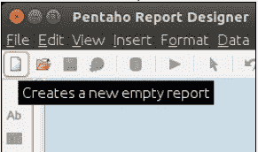

创建空白报表后，将显示一个空报表，类似于以下屏幕截图：

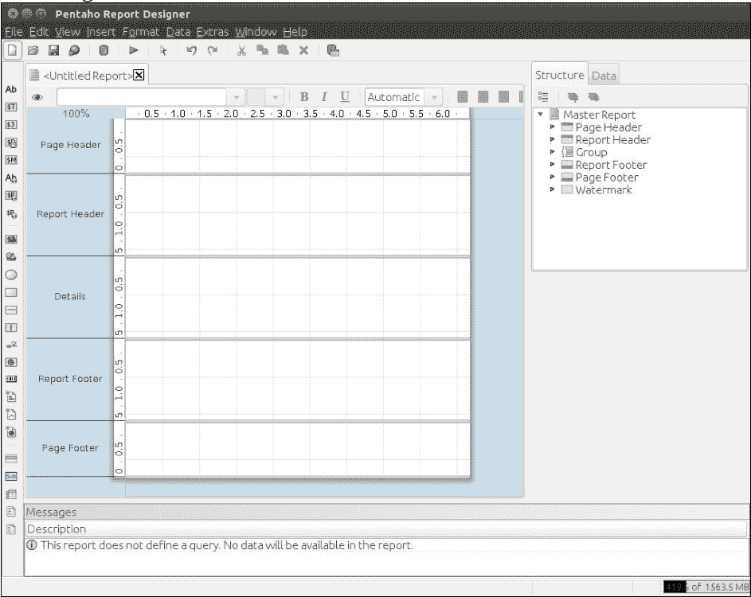

在继续下一个任务之前，让我们为报表画布添加一些颜色。报表画布显示在屏幕截图的中央，是您定义报表外观的地方。


> *请注意，此时您尚未决定报表将以 PDF、RTF 还是 Excel 形式呈现。事实上，任何报表定义都可以在所有这些格式中呈现。因此，此时您不必担心这个问题。*

报表画布包含一组 **bands**，它们共同构成一个报表。Bands 包括报表页眉和报表页脚 bands、单独的组页眉和组页脚 bands（默认隐藏），以及为每一行数据呈现的详细信息 band。报表还可能包含页页眉和页页脚（默认可见）。每个 band 都有不同的生命周期，并根据其上下文进行呈现。您可以通过在 Window 菜单中更改其可见性来隐藏画布周围的任何面板。这有助于在设计报表时管理屏幕。

在现实场景中，报表在结构和内容方面可能差异很大。当然，内容主要由数据源驱动，但布局实际上取决于最终用户和您需要开发的报表类型。并非所有布局都相同，即使 Pentaho Reporting 能够应对所有可能的请求（也许）。在本节中，我们希望对这个主题有所说明，提醒您注意，您可以轻松应对同事或客户在报表布局方面可能提出的未来所有请求。

就布局而言，Pentaho Report Designer 中可用的 bands 可以帮助您在最大程度的细节（Details Body）或分组和聚合（Group、Report Header 和 Report Footer 以及 Page Header 和 Page Footer）方面显示数据。


> *根据您需要开发的报表，请随意仅使用详细信息、仅使用聚合，或两者兼用，以定义您首选的布局以获得最佳结果。*


## 在 Pentaho 报表中创建数据源

在开始开发报表外观之前，您需要定义一个 **数据源**。数据源是每个报表的基石，因为它定义了用于查看结果、制作图表、计算公式等的字段列表，等等。从空白报表开始，通过在右上角选择 Data 选项卡并右键单击 Data Sets，如下图所示，可以定义新的数据集并从广泛的选项列表中选择其类型。以下是显示选择的图像

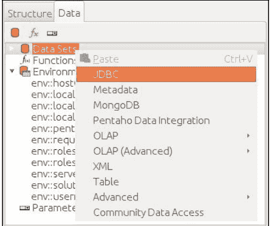

看起来像：

在接下来的章节中，我们将讨论所有可用的数据集类型，但在我们的示例中，我们将使用最常见的一种，即 JDBC。

*Java Database Connectivity (JDBC) 是 Java 语言的 **应用程序编程接口 (API)**，它定义了客户端如何访问数据库。它提供查询和更新数据库中数据的方法，并面向关系数据库。有关更多详细信息，请参阅 https://en.wikipedia.org/wiki/Java_Database_Connectivity。*

单击 JDBC 后，您将获得类似于下一张图像的面板，左侧为连接画布，右上方为可用查询，底行为查询详细信息。在连接画布中，您将找到指向 `SampleData` 架构的五种不同类型的关联。花点时间检查每个连接及其差异。

通过选择一个连接并单击铅笔图标 (✏️)，您将可以访问连接参数和设置。即使所有连接都指向 `SampleData` 架构，访问类型也不同，参数和设置也不同。我们不会详细介绍连接类型之间的差异，而是等待专门介绍数据源的章节以了解更多细节。


> *需要特别注意的是，Pentaho Report Designer 的默认安装并未为源提供所有 JDBC 驱动程序，即使它们在此面板中列出。要安装 JDBC 驱动程序，只需将实现驱动程序的 JAR 文件复制到 `<report-designer>/lib/jdbc` 文件夹并重新启动即可。*

即使您打算使用现有连接，使用绿色加号图标 (➕) 创建新连接也非常简单。作为练习，请尝试单击绿色加号图标 (➕) 以查看窗口的外观。

在介绍完连接画布后，选择 `SampleData (local)` 并继续在连接上定义查询。要定义查询，请在 `Available Queries` 面板右侧按下绿色加号图标 (➕)。单击后，将定义一个名为 `Query 1` 的新查询。要将其名称更改为有意义的名称，请选择它并在 `Query Name` 字段中更改值。在我们的例子中，我们将把它命名为 `Actuals`。

现在查询可用但应被定义，让我们专注于包含查询定义的底部面板。在画布右下角，输入查询或使用 **SQLLeonardo Query Builder** 进行组合。简单的查询生成器可通过右侧的铅笔图标 (✏️) 访问。在这两种情况下，您都可以选择单个表或在多个表上定义更复杂的查询。完成后，单击 Preview 以查看 resulting 数据集。

在我们的示例中，让我们按以下屏幕截图所述定义查询：

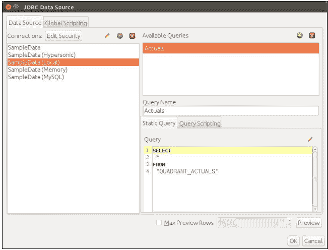

*请注意，以这种方式，您可以为报表定义一组可用查询。即使您决定使用多个查询开发报表，也请始终记住您必须选定其中一个作为主查询。主查询将在报表中使用，而所有其他查询将在子报表（请参阅以下章节的详细描述）或用于参数（请参阅以下章节的详细描述）中使用。*

单击 Preview 以查看 resulting 数据集并检查数据源是否正确定义。如果数据预览没有任何错误，单击 OK 按钮，`Actuals` 查询将出现在 Report Designer 的 Data 选项卡中。

## 为 Pentaho 报表添加详细信息

现在第一个数据源已定义，让我们继续进行布局，使用 `Actuals` 查询中的可用字段构建一个非常简单的报表。为了使用 `Actuals` 查询开发报表，您需要关注报表的两个不同部分：Report Explorer 中的 Data 选项卡和报表画布中的 Details 频段。

通过从右侧的 Report explorer 拖动查询字段并将其拖放到报表画布中的 Details 频段中，您可以定义报表的内容。正如您在开发环境中尝试所见，以这种方式您可以决定数据的精确显示位置、布局中的顺序以及每个字段的长度和高度。正如您所期望的，您可以轻松控制许多设置，例如字体和尺寸、格式和掩码、着色、对齐以及许多其他有用的东西。所有自定义和配置都可以使用 Element properties 面板在 Style 选项卡和 Attributes 选项卡中完成。不要担心如果您觉得自己没有完全了解和控制这些功能；您将在本书的后续章节中了解更多有关微调的信息。


> *考虑到经验往往是最好的老师，如果您能稍微玩一下报表，尝试并测试更改其中一个设置而不是另一个设置时报表看起来如何，那就太好了。不要担心尝试更改值、设置和属性。您不会破坏任何东西，因此请随意多加尝试。*

现在您知道如何从查询字段开始组合报表的详细信息，让我们为此特定用例定义布局。您可以看到包含 `POSITIONTITLE` 字段、`ACTUAL` 字段和 `BUDGET` 字段的 Details 频段的屏幕截图，如下所示。请在开发环境中尝试重现它，如前所述，注意每个查询字段的位置和长度的细节。

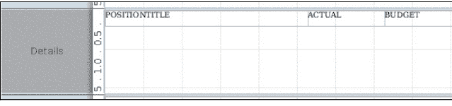

在组合 Details 频段期间，您可能已经体验到以下屏幕截图中描述的行为。如果您重叠两个字段，即使是部分重叠，您也会看到其中一个字段以红色突出显示。此外，Message 窗口中会出现一条警告消息，描述如下：

```
Element ... overlaps with Element ... and will not be printed in table-exports.
```

以下屏幕截图显示了红色高亮的外观：

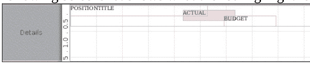

警告消息的含义及其重叠的影响很容易理解：字段重叠可能会导致报表最终渲染出现问题，隐藏内容的一部分。如果发生这种情况，请不要担心，并调整元素的位置和尺寸，直到红色高亮消失。这种行为在报表开发期间是完全正常的，Pentaho Report Designer 为获得最佳结果提供了大量帮助。

## 预览和保存 Pentaho 报表

现在报表已使用少量基本元素开发，您可能希望预览它以检查最终结果。正如您在第 2 章 *使用 Report Designer 入门* 中所学，单击报表画布左上角的眼睛图标 (👁)，将显示类似于以下屏幕截图的预览：

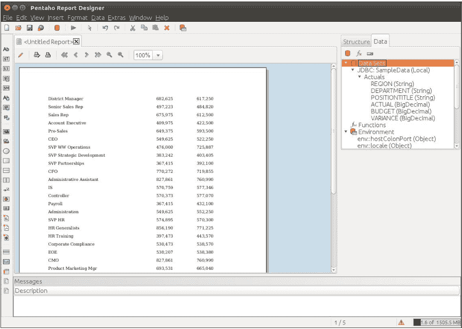


*如您所见，就布局和元素而言，报表极其基础。在接下来的段落中，我们将看到如何使其更具吸引力。然而，我们现在想引起您注意的是，像这样的报表在您想要定义某种机器可读格式的数据导出时可能会很有用，例如 CSV、Microsoft Excel (XLSX) 或文本。*


要了解有关预览报表的新内容，让我们看看如何以 Microsoft Excel 格式（XLSX）而不是 PDF 格式（通过点击眼睛图标（👁）的默认预览格式）预览报表。再次预览报表时选择其中一种可用格式，操作非常简单。如工具栏所示，中间有一个绿色箭头图标（▶）。点击绿色箭头（▶）图标后，会显示一个类似以下截图的菜单：

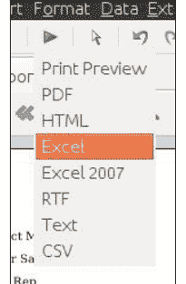

如你所料，项目列表代表了预览的可能格式。例如，点击 Excel 项目即可以 Microsoft Excel（XLSX）格式生成报表。完成后，预览应如下图所示：

| 行 | A | B | C |
|---|---|---|---|
| 1 | District Manager | 682625 | 617250 |
| 2 | Senior Sales Rep | 497223 | 484820 |
| 3 | Sales Rep | 675975 | 612500 |
| 4 | Account Executive | 409975 | 422500 |
| 5 | Pre-Sales | 649375 | 593500 |
| 6 | CEO | 549625 | 522250 |
| 7 | SVP WW Operations | 476000 | 725887 |
| 8 | SVP Strategic Development | 383242 | 403405 |
| 9 | SVP Partnerships | 367415 | 392100 |
| 10 | CFO | 770272 | 719855 |
| 11 | Administrative Assistant | 827861 | 760990 |
| 12 | IS | 570759 | 577346 |
| 13 | Controller | 570373 | 577070 |
| 14 | Payroll | 367415 | 432100 |
| 15 | Administration | 549625 | 552250 |
| 16 | SVP HR | 574895 | 570300 |
| 17 | HR Generalists | 856190 | 771225 |
| 18 | HR Training | 397473 | 443570 |
| 19 | Corporate Compliance | 530473 | 538570 |
| 20 | EOE | 530207 | 538380 |
| 21 | CMO | 827861 | 760990 |
| 22 | Product Marketing Mgr | 693531 | 665040 |
| 23 | Analyst Relations | 383375 | 443500 |
| 24 | Press Relations | 497296 | 524872 |
| 25 | Graphics | 782375 | 728500 |
| 26 | Writer | 405985 | 459650 |
| 27 | CIO | 405985 | 459650 |
| 28 | VP Engineering | 383242 | 443405 |


你可以尝试其他预览格式来查看报表的外观。在这种情况下，对于一个非常简单的报表，预览在渲染方面始终是可以接受的，但当报表复杂时，由于自动渲染可能会出现一些问题。也就是说，要在布局复杂性和格式之间找到最佳平衡，否则你可能会遇到与最终结果质量以及客户（或同事）满意度相关的问题。

现在预览确认报表符合你的需求，让我们将其以 `report_01.prpt` 的名称保存在 `my_reports` 文件夹中。保存报表已在第 1 章 *Pentaho 报表简介* 中详细介绍，但也可以很容易地使用 Pentaho Report Designer 工具栏中的磁盘图标（💾）或 `File` 组的上方菜单（使用 Save 或 Save as 项目）完成。完成后，使用靠近报表画布中标签 `report_01.prpt` 标题的 X 图标关闭报表，或使用 File 组的上方菜单（列出了 `close report` 项目），或使用 *Ctrl + F* 如果你想学习并使用快捷键。


你可以在 https://github.com/fcorti/pentaho-8-reporting-for-java-developers 仓库中找到 `report_01.prpt`，更准确地说在 `chapter 04 - Creating a report with Report Designer/my_reports` 路径下。

## 自定义 Pentaho 报表

现在报表第一个版本已经开发完成（并使用预览进行了测试），是时候考虑第二次迭代，目标是通过添加新元素来增加布局的复杂性以丰富报表。在开始这个新任务之前，让我们先用不同的名称复制之前的报表。

复制现有报表非常简单：将 `my_reports` 文件夹中的 `report_01.prpt` 文件复制为 `report_02.prpt`。复制完成后，使用 Pentaho Report Designer 打开报表。打开报表已在第 1 章 *Pentaho 报表简介* 中详细介绍，但也可以很容易地使用 Pentaho Report Designer 工具栏中的文件夹图标（📁）或 File 组的上方菜单（使用 Open 项目）完成。

## 自定义字体

我们可以为报表做很多事情使其对用户更具吸引力，有时一些基本更改就能提高最终结果的质量。作为自定义示例，我们将更改默认字体。

要更改字体，请在 Report Explorer 中点击 Structure 选项卡的 Master Report 项目。你会看到 Element properties 出现。点击 Style 选项卡并在字体组中查找 family 项目。将值更改为 SansSerif，如以下截图所示：

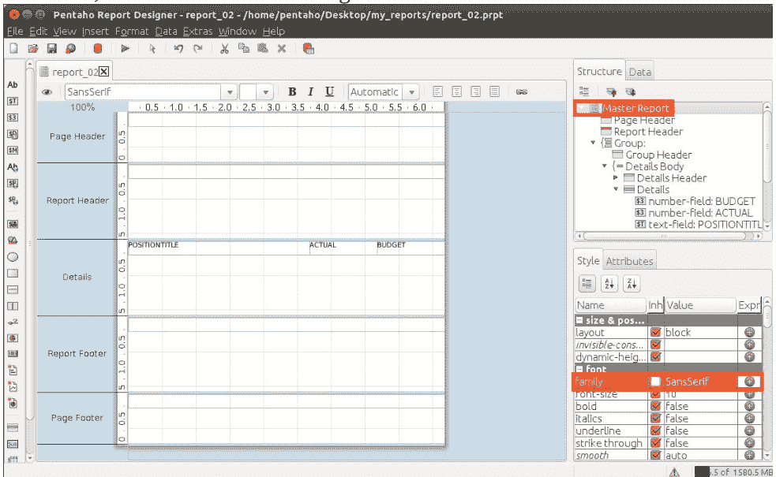


*请注意，这种简单的自定义向你介绍了微调报表元素最强大的方法之一：Style 和 Attributes 选项卡中的属性。务必记住，元素中可以自定义和更改的所有内容，都可以通过操作这些选项卡来控制。学习如何操作的最好方法是通过练习和在示例中尝试，反复尝试直到找到报表的最佳布局。*

预览报表（点击报表画布左上角的眼睛图标（👁）），你会看到整个内容中使用了新的字体。在继续自定义之前，通过点击铅笔图标（✏️）再次切换回设计模式。

## 自定义报表页眉

现在字体已经优化，更接近专业报表的理念，让我们添加一个标识公司的徽标和一个标题，使其印刷版本更具意义。

对报表进行每次自定义时要做的第一个决定是如何设计布局。在这种情况下，决定是放置徽标和标题的位置。你可以选择 Page Header 频段，如果你希望在每页上渲染这些元素，或者你可以使用 Report Header 频段，如果你只希望在报表开头看到徽标和标题。在此任务中，让我们选择第二个选项：将元素放在 Report Header 频段中。

为了准备页眉，我们将更改背景颜色和默认文本颜色，从 Report Explorer 的 Structure 选项卡中选择 Report Header 项目。使用 Element properties 的 Style 选项卡更改颜色非常简单。更具体地说，识别 text-color 和 bg-color 属性并分别将其设置为白色和 #77b3d4。以下图像显示了这两个字段应有的外观：


颜色正确更新后，让我们添加标识公司的徽标。要向报表添加图片，请从 Report Element 调色板中拖动图像图标并将其放置到 Report Header 频段中，如下所示

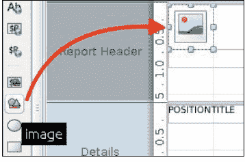

以下截图所示：

双击 Report Header 频段中的图片以访问其配置。点击后，配置面板会要求你提供要包含的图像的路径或 URL，如果你想使用互联网上的图像。在这两种情况下，你都可以选择将图像作为外部源链接或将图像嵌入报表中。


> *大多数情况下，将图像嵌入报表中是个好主意，以避免因互联网连接不可用或链接损坏而出现问题*

在我们的例子中，让我们指向存储在 https://github.com/fcorti/pentaho-8-reporting-for-java-developers 仓库的 `Chapter 04 - Creating a report with Report Designer/resource` 路径中的名为 `world.64x64.png` 的图像。要从 Pentaho Report Designer 指向该图像，请在本地克隆项目或直接将图像下载到你的笔记本电脑。

现在徽标已正确放置在报表中，让我们添加标题。任务与之前非常相似：从 Report Element 调色板中拖动标签图标（Ab）并将其放置到 Report Header 频段中，如以下截图所示。请注意，标签位于图像中间，其长度已延伸至页面末尾。

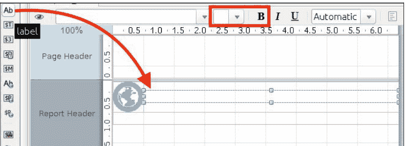

点击 Report Header 频段中的标签元素并更改格式，操作图像中突出显示的工具栏。通过点击 B 按钮选择粗体选项，并在下拉菜单中将字体尺寸更改为 `20`。格式更新后，双击 `label` 元素以访问内容。将文本更改为 `Actuals per position title` 并按 *Enter* 确认标签的新内容。

现在页眉已正确更新，让我们通过点击眼睛图标（👁）预览它。以下截图显示了预览应有的外观：

| 按职位标题的实际值 |  |  |
|---|---|---|
| District Manager | 682,625 | 617,250 |
| Senior Sales Rep | 497,223 | 484,820 |
| Sales Rep | 675,975 | 612,500 |
| Account Executive | 409,975 | 422,500 |

在继续自定义之前，通过点击铅笔图标（✏️）再次切换到设计模式。

## 添加明细标题并自定义明细

现在报告中的标题已正确开发，我们应该再次处理明细以提高最终结果的吸引力。为了达到该目标，让我们看看如何为明细添加标题以及如何添加交替行颜色。

默认情况下，报告带有隐藏的明细标题频段（正如您所见，明细标题频段在 Report Canvas 选项卡中不可见）。要显示明细标题，请在 Report explorer 的 Structure 选项卡中选择 Details Header 项（Details Header 是 Details Body 的子项）。之后，切换到 Element properties 中的 Attributes 选项卡并将 hide-on-canvas 属性更改为 false。立即，您会看到 Report canvas 中出现一个名为 details header 的新频段。

正如您所料，此频段可作为常规频段使用，如果您希望在报告的最终版本中显示有关明细标题的内容，则应进行填充。在我们的示例中，我们希望为每个字段显示一个标签作为标题。

在添加标签之前，再次点击 Element properties 的 Style 选项卡并将 text-color 属性的值更改为 #77b3d4。这将使标签具有不同的着色以获得更好的效果。

要添加标签，请从 Report Element 调色板中拖动标签图标（Ab）并将其放置到 Details Header 频段中。您应该重复此简单操作三次（每个明细字段一个）并将标签放置在 Details 频段中明细字段对应的位置。

对于每个标签，将字体格式设置为粗体（在字体工具栏中点击 B 按钮）并双击元素以将内容更改为 Position title（第一个）、Actuals（第二个）和 Budget（第三个）。对于 Actuals 标签和 Budget 标签，在字体工具栏中点击右对齐图标（≡）。

为了使报告的最终版本更具吸引力，请尝试在频段顶部到标签之间留出少量空间（10 到 15 像素）。这将使您的报告布局更整洁，在标题栏和明细标题之间增加一点距离。


要完成任务，请从 Details 频段中选择 `Actuals` 字段和 `Budget` 字段并在字体工具栏中点击右对齐图标（≡）。任务结束时，Report canvas 应如下图所示：

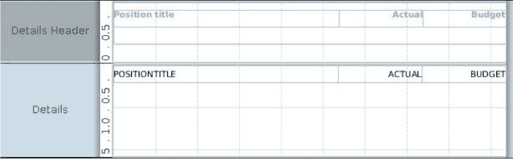


*使用默认设置，明细标题将在第一页显示。要在每页重复标题，请从 Report explorer 的 Structure 选项卡中选择 `Details Header` 项。在 Element properties 的 `Style` 选项卡中，您可以在 `page-behaviour` 组中找到 `repeat-header` 属性。将值更改为 true。使用眼睛图标（👁）预览结果。使用导航栏滚动页面，您会看到标题出现在每一页上。在继续自定义之前，通过点击铅笔图标（✏️）再次切换到设计模式。*

现在明细标题已开发完成，让我们继续自定义明细字段。特别是，我们将添加交替行颜色。要完成任务，请从 Report explorer 的 `Structure` 选项卡中选择 `Details` 项并在 `Style` 选项卡的 `text` 组中搜索 `bg-color` 属性。在此情况下，我们将使用动态表达式来评估该属性。要设置 **expression**，请点击属性旁边的绿色加号图标（⊕）。此时将出现一个配置窗口。在窗口右下方的 `Formula` 文本字段中，输入以下公式：=IF(ISEVEN(ROWCOUNT()); "white"; "#d2e8f4")

作为最终微调，将 `v-align` 属性更改为 `MIDDLE` 值。现在自定义已完成，让我们通过使用眼睛图标（👁）预览报告来查看报告的样子：

## 按职位标题的实际值

| 职位标题 | 实际 | 预算 |
|---|---|---|
| District Manager | 682,625 | 617,250 |
| Senior Sales Rep | 497,223 | 484,820 |
| Sales Rep | 675,975 | 612,500 |
| Account Executive | 409,975 | 422,500 |
| Pre-Sales | 649,375 | 593,500 |
| CEO | 549,625 | 522,250 |
| SVP WW Operations | 476,000 | 725,887 |

在继续自定义之前，通过点击铅笔图标（✏️）再次切换到设计模式。

## 自定义页脚

自定义页眉和页脚与我们为报告标题所见的内容并无不同。Report canvas 中的频段非常有帮助，它们将使您能够按此任务的要求开发所有内容。我们现在的目标是在页脚中添加执行报告的用户和页码。

为了准备页脚，我们将通过从 Report Explorer 的 Structure 选项卡中选择 Page Footer 项来更改默认文本颜色。使用 Element properties 的 Style 选项卡更改颜色非常简单。特别是，识别 `text-color` 属性并将其设置为 `#77b3d4`。

要将用户添加到报告中，让我们使用一个名为 `env:username` 的捆绑 **parameter**。要在报告中使用该参数，请在 Report explorer 中选择 `Data` 选项卡并向下滚动直到找到 Environment 组。像往常一样，拖动 `env:username` 参数并将其放置到 Page footer 频段的左侧：

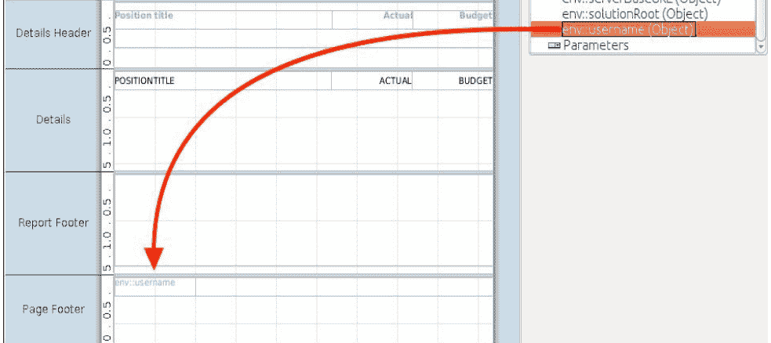

要添加页码，您需要使用公式创建一个新的 **function**。要创建函数，请右键单击 Report Explorer 中 Data 选项卡的 `functions` 组。点击后，一个简单的菜单将显示 Add function .. 项。

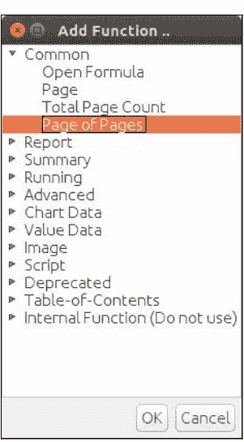

点击它以访问窗口：

展开 Common 并选择 Page of Pages，然后点击 OK 按钮将新公式添加到 functions 组。现在 Page of Pages 函数可用后，将其从 functions 组拖出并放置在 Page footer 频段右侧附近。要完成任务，请在字体工具栏中点击右对齐图标（≡）：

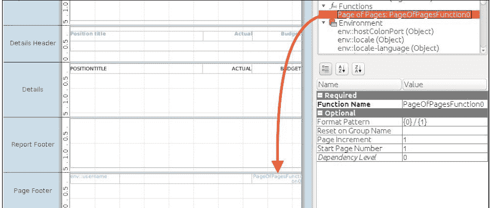

现在自定义已完成，让我们通过使用眼睛图标（👁）预览它来查看报告的样子：

|  |  |  |
|---|---|---|
| EOE | 530,207 | 538,380 |
| CMO | 827,861 | 760,990 |
| Product Marketing Mgr | 693,531 | 665,040 |
| Analyst Relations | 383,375 | 443,500 |
| Press Relations | 497,296 | 524,872 |
| Graphics | 782,375 | 728,500 |
| Writer | 405,985 | 459,650 |
| CTO | 405,985 | 459,650 |

如您所见，页脚会为每一页重复，并且页码会相应更改。在继续自定义之前，通过点击铅笔图标（✏️）再次切换到设计模式。

## 分组明细

此时，Pentaho 报告对最终用户来说更具吸引力，但我们还不满意，我们现在想讨论的是关于分组明细的问题。在报告中分组明细是一个常见请求，我们想使用 `Actuals` 中的 `DEPARTMENT` 字段举例说明。

为了准备任务，我们需要修改数据源，以确保所有明细都按 `DEPARTMENT` 字段排序。


> 如果您将在报告中使用分组，请确保正确按分组字段对行进行排序。如果您忘记了这个提示，您将遇到一些意外的结果，而没有任何异常或错误消息。这种行为的原因很容易理解；Pentaho Reporting Engine 通过将分组字段的当前值与前一个值进行比较来更改组，因此如果未排序，报告可能会显示错误的结果。

要更改数据源，请在 Report explorer 中选择 Data 选项卡并右键单击 `Actuals` 查询。选择 `Edit query` 项并将查询替换为接下来描述的内容：

```
SELECT *
FROM "QUADRANT_ACTUALS"
ORDER BY "DEPARTMENT" ASC
```

正如您所见，唯一的区别是 `ORDER BY` 关键字。按 Preview 并在预览显示数据集后稍后按 OK 按钮。

一旦数据源准备就绪，下一个任务是定义布局。查看 Report Explorer 的 Structure 选项卡，您可以找到 `Group` 元素。点击它并从 Element properties 中选择 Attributes 选项卡。在属性列表中，您可以在 `common` 组中找到 `group` 属性。使用 ... 按钮将值更改为 `DEPARTMENT`。完成后，布局实际上没有变化，但报告中的分组已正确设置。

要更改布局，请在 Report explorer 中点击 Group Header 并更改

将 `hide-on-canvas` 属性设为 `FALSE`，就像我们对 Details Header 所做的那样。正如我们在 `Details Header` 频段中所看到的，`Group Header` 频段会立即出现在 Report canvas 中，我们可以在其中添加元素。

要向 `Group Header` 添加元素，请从 Report explorer 的 `Data` 选项卡中的 `Actuals` 查询拖动 `DEPARTMENT` 字段，并将其放置到 `Group Header` 频段中。为完成任务，将字段长度扩展以覆盖整个页面宽度，并通过将字号设为 14 且样式设为粗体（在字体工具栏中单击 B 按钮）来设置字体格式。

*为了让报告的最终版本更具吸引力，请尝试在频段顶部到字段之间留出少量空间（10 到 15 像素）。这将使您的报告布局更整洁，在分组字段和明细标题之间增加一点距离。*


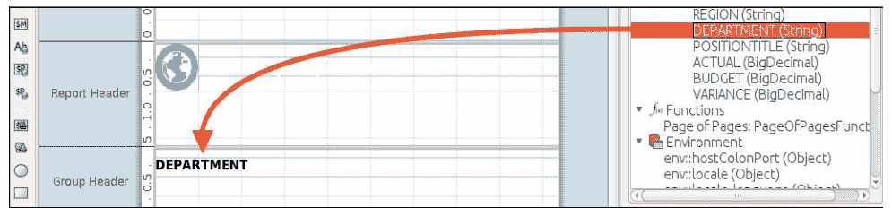

现在报告分组已正确定义，让我们使用

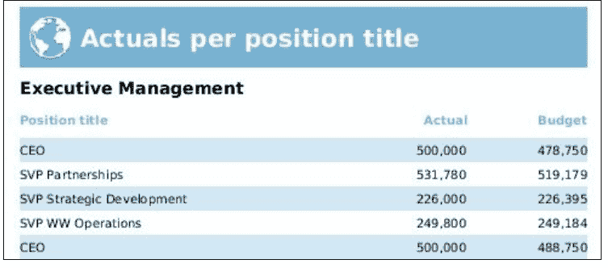

眼睛图标 👁️ ：

在继续自定义之前，通过单击铅笔图标（✏️）再次切换到设计模式。


*使用前面描述的相同方法，您将能够创建多级分组报告。使用 Pentaho Report Designer，您可以为每个组添加字段的层次结构组，以及组标题和页脚频段。*

## 添加图表

对于报告的最后一个（但并非最不重要的）自定义，让我们看看添加图表是多么容易。在各种格式中轻松创建图表的能力是 Pentaho Reporting 的一大亮点，在我们的示例中，我们将了解如何添加按部门汇总实际值的图表。

正如您所料，图表需要数据集来显示数据，而且大多数情况下，它们的自然位置在汇总频段中（通常是 Report Header，但也可能是 Group Header）。在我们的示例中，我们将在 Report Header 中添加一个条形图并进行一些简单的自定义。要添加条形图，请从 Report 元素调色板中拖动图表图标（）并将其放置在 Report Header 频段中。请注意，图表放置在标题正下方，其长度被拉伸以覆盖页面宽度：

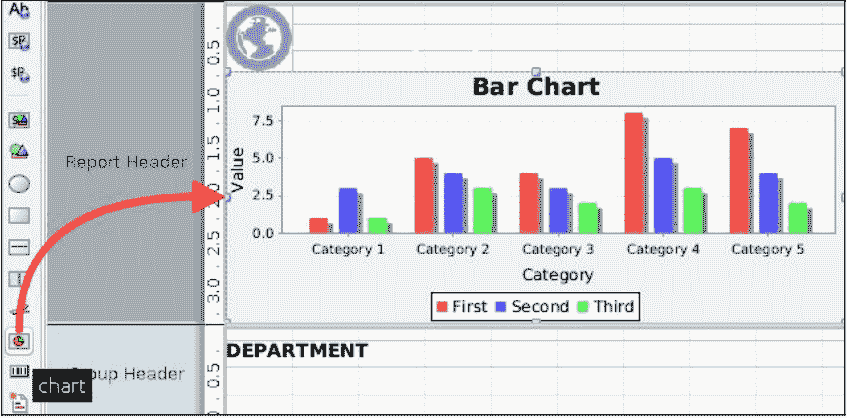

一旦图表定位在 Report Header 频段中，双击图表元素以访问编辑面板。在下面的图像中，您可以看到所有需要更改的高亮显示。如您所见，更改仅涉及三个属性：category-column 属性指向 DEPARTMENT 查询字段，value-column 属性指向 ACTUAL 查询字段，以及 show-legend 属性设为 False。

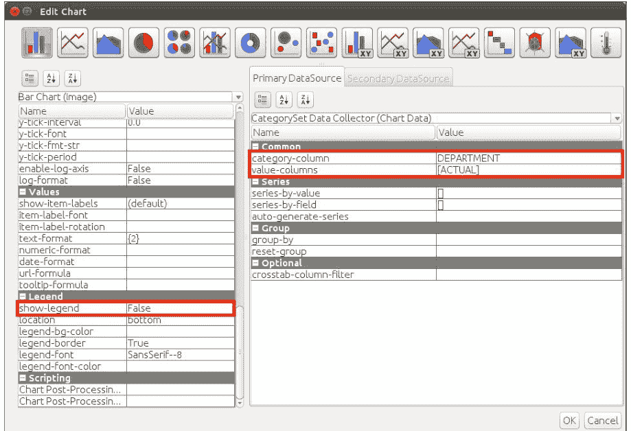

完成后，单击 ok 按钮即可。恭喜，您的报告已完成并已自定义，您可以使用眼睛图标（👁）预览它：

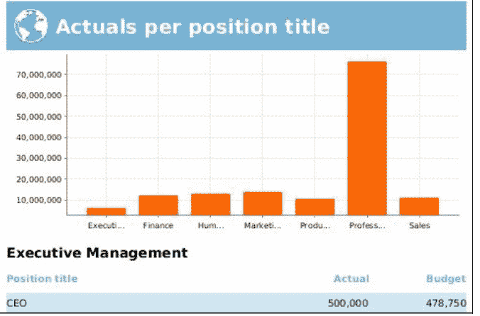

在继续学习新内容之前，让我们将报告保存为 my_reports 文件夹中的 report_02.prpt。保存报告已在第 1 章《Introduction to Pentaho Reporting》中详细介绍，但也可以很容易地使用 Pentaho Report Designer 工具栏中的磁盘图标（💾）或文件组中的上层菜单（使用 Save 或 Save as 项目）来完成。


您可以在 https://github.com/fcorti/pentaho-8-reporting-for-java-developers 仓库中找到 `report_02.prpt`，更准确地说，在 `Chapter 04 - Creating a report with Report Designer/my_reports` 路径中。

## 以不同格式预览 Pentaho 报告

现在您已经从空白页面开始开发了两个全新的报告（report_01.prpt 和 report_02.prpt），让我们看看如何以不同格式预览 report_02.prpt。正如您在介绍中所学到的，Pentaho Reporting Engine 能够独立于开发生成多种格式的报告。

要选择格式预览报告，请单击工具栏中可见的绿色箭头图标（▶）。单击后，您将看到一个简短菜单出现，其中列出了可能的格式。以下屏幕截图显示了菜单的外观：

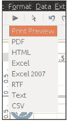

选择 Print Preview 项目相当于选择默认格式；默认格式会被生成并本地下载。如果您选择 PDF 格式，您会看到报告完全生成并本地下载。如果您的客户端环境中与该格式关联了阅读器（或软件），您会看到它将被打开并预览。另一方面，如果报告的格式未与任何阅读器或软件关联，则会提示将其保存为常规文件。

以下为一些屏幕截图，显示 report_02.prpt 以 PDF 格式（左上）、HTML 格式（右上）、Microsoft Excel 格式（左下）和 RTF（右下）呈现：

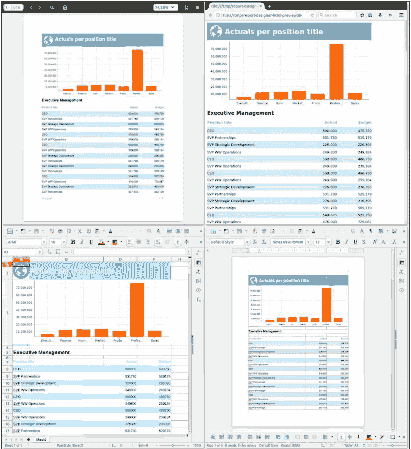

在离开此功能之前，让我们分享一些关于已开发报告与最终格式（或格式）之间关系的实际考虑。如 report_02.prpt 的前一个示例所示，Pentaho Reporting Engine 非常强大，能够在所有可用格式中生成报告的最佳版本。正如您所想象的，这有一些明显的局限性。如果您查看 Microsoft Excel 版本，渲染并不完美，可能不适合在生产环境中发布。无论对错，这在复杂布局上是常规行为，您在未来的开发中应始终考虑这一点。

*如果您必须开发将以功能有限的格式发布的报告，如 Microsoft Excel、CSV 或 Text，请始终记住保持简单。*


布局越复杂，Pentaho Reporting Engine 将报告渲染为最终版本就越困难。另一方面，如果您要以 PDF 格式渲染报告，Pentaho Reporting Engine 几乎像魔法一样，能够渲染非常复杂的布局。从这个角度来看，报告开发和最终格式是密切相关的。

## 训练自己更快学习

我们已经提到过，经验是报告开发人员的最佳老师。在本节中，我们分享了一些您可以自行开发的练习，以便您尝试使用 Pentaho Report Designer 创建和自定义 Pentaho 报告。

如果您尚未在笔记本电脑上安装 Pentaho Report Designer，请查看第 2 章 *使用 Report Designer 入门*，以获取逐步安装说明。如果一个或多个练习看起来太困难，请不要担心。在接下来的章节中，您将涵盖开发的所有细节，并成为真正的专家。

同时，请记住所有建议练习的解决方案都可以在 https://github.com/fcorti/pentaho-8-reporting-for-java-developers 仓库中找到，更准确地说在 `Chapter 04 - Creating a report with Report Designer/my_reports` 路径中。

- **练习 1：** 从 `report_02.prpt` 开始，将橙色条的颜色更改为 `#77b3d4`。作为建议，请在图表编辑器中检查 `series-color` 属性。解决方案请查看 `report_03.prpt` 文件。
- **练习 2：** 从 `report_02.prpt` 开始，将分组从 `DEPARTMENT` 改为 `REGION`。作为建议：
  - 在 `Group` 元素的 `Attributes` 选项卡中检查 `group` 属性。
  - 在 `Group Header` 下的 `text-field` 元素的 `Attributes` 选项卡中检查 `field` 属性。
  - 在图表编辑器中检查 `category-column`。

  解决方案请查看 `report_04.prpt` 文件。
- **练习 3：** 从 `report_01.prpt` 开始，将文本颜色设为白色，并将偶数行的背景设为 `#273B09`，奇数行的背景设为 `#002400`。作为建议，请检查 `Details` 元素的 `text-color` 属性，并为 `bg-color` 设置表达式，如本章所述示例中所见。解决方案请查看 `report_05.prpt` 文件。


## 摘要

在本章中，您已[content]
## 摘要

在本章中，您已[content]
## 摘要

在本章中，您已[content]
## 摘要

在本章中，您已[content]
## 摘要

在本章中，您已走完 Pentaho Report Designer 的高级使用流程，从空白报表开始学习如何从零开始开发 Pentaho 报表，而不使用 Report Design Wizard。手动创建 Pentaho 报表让您有机会亲眼看到 Pentaho Report Designer 的所有功能（基础和高级）实际运行。

正如前几章所体验到的，描述以实际示例为驱动，并采用逐步的方法来完成任务。本章结尾，您看到了如何开发一个布局简单的非常简单的报表（report_01.prpt），以及一个具有漂亮页眉、页脚、明细分组并且还包含图表的复杂报表（report_02.prpt）。在最后一个（但并非最不重要的）主题中，您了解了报表在所有可用格式中的预览，并重点介绍了开发与最终格式之间的关系。

本章再次以教程形式为开发人员和信息技术人员撰写。我们希望您在阅读时喜欢在笔记本电脑上跟随开发过程，并且希望您对使用 Pentaho Report Designer 手动开发简单和复杂的 Pentaho 报表感到得心应手。

在下一章中，我们将深入探讨设计师可用的各种元素的细节，它们如何使用以及可能用于什么。
