## Report Designer 中的设计与布局

在前几章中，您已[content]
## 摘要

在本章中，您已走完 Pentaho Report Designer 的高级使用流程，从空白报表开始学习如何从零开始开发 Pentaho 报表，而不使用 Report Design Wizard。手动创建 Pentaho 报表让您有机会亲眼看到 Pentaho Report Designer 的所有功能（基础和高级）实际运行。

正如前几章所体验到的，描述以实际示例为驱动，并采用逐步的方法来完成任务。本章结尾，您看到了如何开发一个布局简单的非常简单的报表（report_01.prpt），以及一个具有漂亮页眉、页脚、明细分组并且还包含图表的复杂报表（report_02.prpt）。在最后一个（但并非最不重要的）主题中，您了解了报表在所有可用格式中的预览，并重点介绍了开发与最终格式之间的关系。

本章再次以教程形式为开发人员和信息技术人员撰写。我们希望您在阅读时喜欢在笔记本电脑上跟随开发过程，并且希望您对使用 Pentaho Report Designer 手动开发简单和复杂的 Pentaho 报表感到得心应手。

在下一章中，我们将深入探讨设计师可用的各种元素的细节，它们如何使用以及可能用于什么。

## Report Designer 中的设计与布局

在前几章中，您已了解 Pentaho Report Designer 并开始使用它，通过使用向导或从零开始开发简单和复杂的报表。在本章中，您将深入探讨与报表设计和布局相关的 Pentaho Report Designer 的概念和功能。

您将首先复习 Report Designer 用户界面的基础知识，然后了解 Report Designer 中呈现的核心布局频段，包括明细频段和分组频段。从那里开始，您将详细探讨设计师可用的各种元素，它们如何使用以及可能用于什么。

您还将学习报表画布内视觉布局的方方面面，包括网格和指南等高级概念。您将以有关使用 Pentaho Reporting 支持的各种输出格式的更多细节结束本章。

本章以开发人员和信息技术人员的参考手册形式撰写。目标是分享 Pentaho Report Designer 的所有相关和高级功能。本章结束时，您将对其用户界面感到得心应手，并且应该能够充分发挥其能力使用它。

## Report Designer 用户界面组件

在第 2 章 *Getting Started with Report Designer* 中，您发现了用户界面的组成，而在第 4 章 *Creating a Report with Pentaho Designer* 中，您使用 Report Designer 开发了非常简单和复杂的报表，发现了与设计和布局相关的 most 相关功能。在完成对全部功能的发现之前，作为提醒，让我们在下面的列表中回顾一下您可以在 Report Designer 用户界面中识别的组件，如下图所示。这将在以下各节中讨论与设计和布局相关的细节和高级功能时很有用。

- 窗口上部菜单和工具栏
- 左侧的报表元素调色板，您可以在其中为报表选择报表元素
- 报表画布选项卡面板，显示您的报表
- 报表资源管理器面板，其中包含结构选项卡（和数据选项卡），以对象树形式显示整个报表
- 元素属性面板，显示与当前选定的报表元素关联的所有样式和属性
- 消息面板，显示与当前打开的报表相关的警告和错误

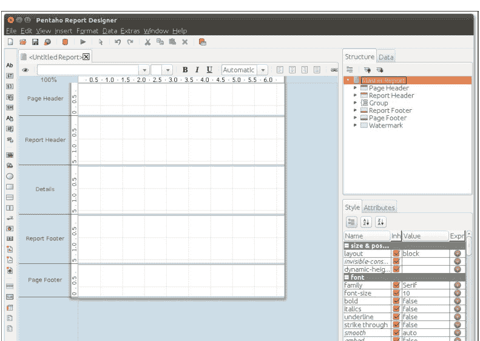

在以下各节中，您将深入探讨 Report Designer 用户界面中关于设计和布局的最有用的功能。

## 报表资源管理器中的结构选项卡

如前一节所述，报表资源管理器面板有一个名为结构的选项卡，以对象树形式显示整个报表。此选项卡，或其中表示的树结构，是开发人员手中关键工具之一。使用此工具，开发人员可以控制报表的精细调整。

在树结构中表示了一个对象层次结构，每个对象标识报表的一个（且仅一个）元素。报表中的所有内容都是一个元素，每个元素都有一个父级和零个或多个子级。一个元素必须只有一个父级，不能有多个或零个父级。唯一的例外是根，它没有父级。

关于根：层次结构顶部始终有一个唯一的称为 Master Report 的元素。Master Report 是报表中的一个不可见元素，但所有内容从这里开始定义设计、布局以及包含在报表中的所有内容。

从报表中移动（或删除）一个元素也会移动（或删除）该元素的整个子树。尝试向报表画布添加一个元素并检查树结构如何变化。尝试将一个元素从其父级移动到层次结构中的不同元素并查看报表画布如何变化。您现在使用树结构越多，您在未来项目中进行报表开发就越有信心。


> *花点时间在报表资源管理器中玩转结构选项卡。对其充满信心将使您能够完全控制报表以及所有结构、属性等的精细调整。*

## 报表元素属性

报表设计中的另一个关键概念是元素的属性。元素的属性是报表中元素的原子值或描述或配置或设置。每个元素可以有零个或多个属性。平均而言，一个元素具有可变数量的属性（取决于元素的类型）。属性被分组为集合，以便更好地理解并在开发期间更好地选择。

查找属性列表的主要位置是元素属性面板。元素属性面板由两个选项卡定义：包含与布局和渲染相关的所有属性的 Style 选项卡，以及包含与所有通用设置和配置相关的所有属性的 Attributes 选项卡。

每个选项卡都由与元素相关的属性列表定义，每个属性显示一对对象：属性名称和属性值（或值）。属性值可以由值（取决于属性的类型）或动态公式定义。元素属性面板中的大多数属性在右侧都有一个绿色加号图标（⊕）。单击绿色加号图标（⊕）可让您访问公式编辑器（我们将在下一章介绍公式编辑器）。以下是用户界面中呈现的属性示例。在这种情况下，`font-size` 是属性，其值为 10。


在报表中选择一个元素然后选择其子元素，您可以很容易注意到常见属性的值是从一个元素继承到另一个元素。这给了我们讨论报表属性继承的机会：报表中定义的每个元素都从父级继承常见属性的值，父级从其父级继承，依此类推。


> _如果您想更改报表的全局属性（字体、大小、颜色、边框等），可能只需更改 `Master Report` 中相应属性的值即可。该值将_

*该属性将被传播到所有后代（即整个报表）直到其中一个显式重写该值。*

你可以很容易地通过元素属性面板中对应项的标志 ☑ 是否被勾选来识别某个属性值是从父级继承的。可以想象，你可以打破可继承性，通过更改属性值来实现。这样做时，标志会自动设置为 *未勾选*。从那时起，所有后代元素都将继承新的属性值，直到另一次显式更改被设置。再次点击标志（☑）图标，你可以指示 Report Designer 再次从父元素继承属性值，就像默认情况下一样。

每个选项卡中的属性都按子集分组，以便在开发过程中更好地选择和搜索。这些子集使用有意义的描述命名，例如：`size & position`、`font`、`text`、`text-spacing`、`object`、`link`、`excel`、`padding`、`border`、`query`、`common`、`query-metadata`、`parameter`、`wizard`、`html`、`html-event`、`pdf-event`、`swing-event`、`advanced`、`pentaho`，还有一些。

在报表中选择一个元素（使用报表画布、使用报表资源管理器，或使用 Report Designer 的任何其他可能方式），元素属性面板将显示其所有可用属性。每次属性值的更改都会立即反映在报表画布中的报表预览中。

## Master report and report bands properties

现在元素和属性的概念已经介绍过，让我们开始讨论报表的根（`Master Report` 元素）以及树结构中的第一层级，即频段。具体来说，我们将描述与每种元素类型相关的属性，从通用属性开始，然后逐个元素描述特定属性。

你创建的每个 Pentaho 报表都有一个 `Master Report` 元素作为树层次结构的根。`Master Report` 元素在预览或报表画布中没有明确显示，但它包含一组通用属性。在以下专门介绍 `Master Report` 元素的部分中，你将了解有关此根元素的更多特定属性。

初次创建报表时，在你的画布和报表资源管理器结构树中，你会看到：`Page Header`、`Report Header`、`Details`、`Report Footer` 和 `Page Footer` 频段。这些频段以及其他频段，包括 `Group`、`Watermark` 和 `No Data`，构成了整个可视报表。所有频段都可能包含调色板中的元素并充当渲染这些元素的容器。每个频段都有不同的生命周期，并根据其上下文进行渲染。

为了更好地解释属性的重要性及其在报表开发中的作用，你可以在 https://github.com/fcorti/pentaho-8-reporting-for-java-developers 仓库中找到一些 Pentaho 报表的引用示例；更准确地说，在 `Chapter 05 - Design and layout in Report Designer/my_reports` 路径中。每个报表都展示了相关属性（或一组属性）的使用作为示例，可以作为你理解和学习的指南。

## Common properties

如 *The report element properties* 部分所述，嵌套元素之间属性值的继承是 Pentaho Reporting 的一个重要特性。当然，只有在父元素和子元素都使用相同属性时，继承才有效。这一概念引入了这样一个原则：大量通用属性在各种元素之间共享（并被继承）。在本节中，你将深入了解 `Master Report` 元素与各种类型频段之间的通用属性。

## Size and position properties

这组属性定义频段的大小和位置。这些属性可以通过在结构树中选择频段然后点击 Format | Size & Border... 菜单项来一起编辑，或在

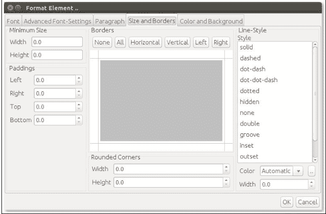

report element Style tab 中单独编辑：

下表列出了你在报表元素资源管理器中 Style 选项卡的 Size & Border... 组中可以看到的大小和位置属性：

| 名称 | 类型 | 描述 |
|------|------|------|
| layout | Selection | 这仅适用于频段，并定义频段内元素如何渲染。- 默认布局为 `canvas`，允许你指定频段中每个报表元素应渲染的确切位置。- `block` 布局将频段中的所有项目从上到下堆叠。- `inline` 布局将所有项目从左到右堆叠，并自动换行。- `row` 布局将所有报表元素显示在单行中。- `auto` 布局自动显示报表元素以避免重叠。- 与 `table` 相关的布局（包括特定的 `table-body`、`table-header`、`table-footer`、`table-row`、`table-cell`、`table-col` 和 `table-col-group`）在将报表导出为 HTML 时，将所有项目堆叠在 HTML 表格结构中。 |
| x | Integer | 该元素在其父容器内的 x 位置。 |
| width | Decimal | 该元素的宽度。-100 到 0 之间的数字表示父容器宽度的百分比。 |
| y | Integer | 该元素在其父容器内的 y 位置。 |
| height | Decimal | 该元素的高度。-100 到 0 之间的数字表示父容器高度的百分比。 |
| invisible-consumes-space | Boolean | 如果设置为 true，则该频段中不可见的子元素仍会在报表中占用空间。 |
| visible | Boolean | 如果设置为 false，则元素不被渲染。 |
| dynamic-height | Boolean | 如果设置为 true，则通知报表引擎该元素具有动态高度。 |
| preferred-width | Decimal | 该元素的首选宽度。 |
| preferred-height | Decimal | 该元素的首选高度。 |
| min-width | Decimal | 该元素的最小宽度。 |
| min-height | Decimal | 该元素的最小高度。 |
| max-width | Decimal | 该元素的最大宽度。 |
| max-height | Decimal | 该元素的最大高度。 |
| x-overflow | Boolean | 如果设置为 true，文本可能会水平溢出元素之外。 |
| y-overflow | Boolean | 如果设置为 true，文本可能会垂直溢出此元素之外。 |
| fixed-position | Integer | 如果指定，则设置该频段在报表内的固定垂直位置。 |
| box-sizing | Selection | 这可以设置为 `content-box` 或 `border-box`。如果设置为 `content-box`，则尺寸样式不包括边框；如果设置为 `border-box`，则尺寸样式包括边框框。此样式的默认值是 `content-box`。 |
| table-layout | Selection | 高级功能，用于指示 Pentaho 报表引擎以 `fixed` 或 `automatic` 大小和位置渲染表格。 |

如你在环境中看到的，点击报表元素资源管理器并在元素属性选项卡中检查，只有这些属性的一小部分在 `Master Report` 元素中可用，但在所有类型的频段中大部分都是可用的。


作为练习，从 *Chapter 4, Creating a Report with Report Designer* 中开发的 `report_02.prpt` 开始，并修改图表使其覆盖页面宽度的 50% 并将行高扩展到 40 像素。要查看最终结果，你可以检查存储在 GitHub 仓库的 `chapter 05 - Design and layout in Report Designer/my_reports` 文件夹中的 `report_06.prpt` 文件。

## Font, text, and text-spacing properties

`Font`、`text` 和 `text-spacing` 是三个基本属性集，完全致力于报表中的文本布局。与之前属性集不同，大多数属性是从 `Master Report` 和所有类型的频段共享（并继承）的。让我们在以下各节中详细查看每个属性。


## 字体属性

Pentaho Reporting 在大多数字体操作中都使用 Java 内置的字体支持。`libfonts` 中存在一些额外的功能，为报表引擎提供 Java 标准 `Font` 和 `FontMetrics` API 中不可用的额外信息。

在 Pentaho Report Designer 中，字体可以通过多种方式进行修改。首先，所有基于文本的元素都包含字体属性。这些属性允许选择字体族、字体大小和字体样式。通过菜单 格式 | 字体... 编辑这些属性时，会出现以下屏幕：

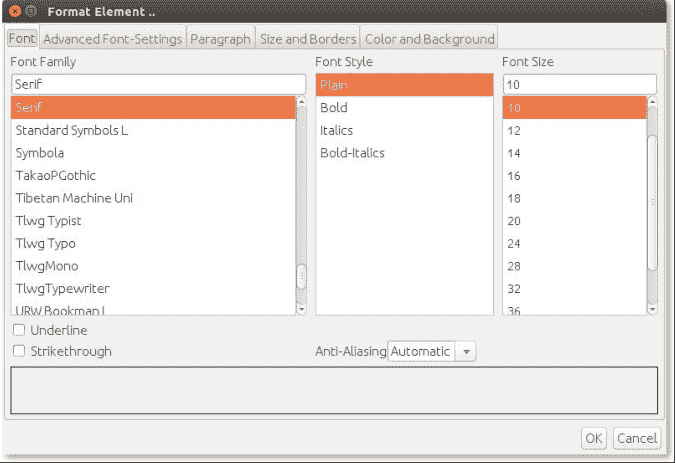

除了修改属性外，Pentaho Report Designer 还提供了一个工具栏（如下截图所示），您可以在其中快速修改字体名称、大小、样式和对齐方式：

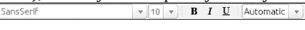

另一种配置字体的方法是使用元素属性，其中提供以下可用属性：

| Name | Type | Description |
|------|------|-------------|
| family | Selection | 表示字体类型的字符串，例如 `SansSerif`。 |
| font-size | Integer | 表示字体磅值的数字。 |
| bold | Boolean | 如果设置为 true，则以粗体显示字体。例如，如果公式设置为 true，字体将以粗体显示。 |
| italics | Boolean | 如果设置为 true，则以斜体显示字体。 |
| underline | Boolean | 如果设置为 true，则以下划线显示字体。 |
| strike through | Boolean | 如果设置为 true，则以删除线显示字体。 |
| smooth | Selection | 如果设置为 `auto`，则 8 磅以上的字体启用抗锯齿。如果设置为 `always`，则所有字体都启用抗锯齿。最后，如果设置为 `never`，则没有任何字体启用抗锯齿。 |
| embed | Boolean | 如果此样式等于 true，则在渲染 PDF 时嵌入报表中包含的字体。 |

如果报表在一个操作系统环境中设计并在另一个环境中发布，可能会出现额外的字体相关问题。例如，Windows 操作系统附带的字体标准集与 Solaris、Mac 和 Linux 系统不同。Pentaho Reporting 会尽力匹配正确的字体，但在发布后您应验证字体大小和样式是否仍按预期工作。


作为练习，从第 4 章《使用 Report Designer 创建报表》中开发的 `report_02.prpt` 开始，并将整个报表的字体族（即在 `Master Report` 中）修改为 `Purisa`。要查看最终结果，您可以检查 GitHub 仓库中 `Chapter 05 - Design and layout in Report Designer/my_reports` 文件夹中存储的 `report_07.prpt` 文件。

## 文本属性

文本属性对 `Master Report` 和频段是通用（且继承）的，除了 `h-align` 和 `v-align`。以下属性会影响报表元素中文本的外观：

| Name | Type | Description |
|---|---|---|
| `h-align` | Selection | 元素内文本的水平对齐方式。此属性也可以在主工具栏中编辑。 |
| `v-align` | Selection | 元素内文本的垂直对齐方式。此属性也可以在主工具栏中编辑。 |
| `v-align-in-band` | Selection | 指定频段中文本的垂直对齐方式。 |
| `text-wrap` | Selection | 指定文本是否应换行。适当的值包括 `none` 和 `wrap`。 |
| `word-break` | Boolean | 指示是否在单词内换行的标志。如果未定义，则默认为 true（仅在单词边界处换行）。 |
| `direction` | Selection | 文本方向（例如阿拉伯文本），指示是左到右（`ltr`）还是右到左（`rtl`）。 |
| `text-color` | String | 前景字体颜色。此属性也可以在主工具栏中编辑。 |
| bg-color | String | 文本元素的背景颜色。 |
| line-height | Decimal | 文本元素中字体的行高值。 |
| overflow-text | String | 如果给定文本无法完全放入元素边界内，则打印的文本引用。 |
| trim | Boolean | 指示是否删除前导和尾随空白的标志。 |
| trim-whitespace | Selection | 控制渲染器如何处理空白。 |
| encoding | String | 指定给定字段的目标文本编码，以防输出支持按字段编码。 |

关于 `text-color` 和 `bg-color` 属性，您应该知道 Report Designer 具有从视觉编辑器中选取颜色的有用工具。以下图像显示了视觉编辑器的外观。


> *作为练习，从第 4 章《使用 Report Designer 创建报表》中开发的 `report_02.prpt` 开始，并将整个报表的行高（即在 `Master Report` 中）修改为 30 像素。要查看最终结果，您可以检查 GitHub 仓库中 `Chapter 05 - Design and layout in Report Designer/my_reports` 文件夹中存储的 `report_08.prpt` 文件。*

组合

调色板

新建

旧

H: 0 °

S: 0 %

B: 0 %

R: 0

G: 0

B: 0

#

示例文本 示例文本

示例文本 示例文本

示例文本 示例文本

确定

取消


## 文本间距属性

文本间距属性让您可以控制文本元素中字母和单词之间的间距。

| Name | Type | Description |
|---|---|---|
| character | Integer | 指定两个字母之间最小字符间距 |
| word | Integer | 指定渲染时单词之间的额外填充 |
| preferred-character | Integer | 指定两个字母之间首选字符间距 |
| max-character | Integer | 指定两个字母之间的最大间距 |


*作为练习，从通常的 `report_02.prpt` 开始，将字符距离修改为 5.0 像素。要查看最终结果，您可以检查 GitHub 仓库中 `Chapter 05 - Design and layout in Report Designer/my_reports` 文件夹中存储的 `report_09.prpt` 文件。*

## 对象属性

`object` 属性控制元素的整体外观，如下表所述：

| Name | Type | Description |
|---|---|---|
| anti-alias | Boolean | 指示在绘制元素期间是否启用抗锯齿的标志。 |
| keep-aspect-ratio | Boolean | 指示缩放是否应保持纵横比的标志。 |
| fill | Boolean | 指示元素是否应被填充的标志。 |
| fill-color | Selection | 定义填充颜色。如果未定义，则使用前景色。 |
| draw-outline | Boolean | 定义是否应绘制元素轮廓。 |
| stroke | Selection | 定义用于渲染元素的笔类型和宽度。 |
| scale | Boolean | 指示元素中打印的内容是否应缩放以适应元素边界的标志。 |

## 链接属性

`Links` 属性管理从报表元素创建的 HTML 链接：

| Name | Type | Description |
|---|---|---|
| `pdf-bookmark` | String | 在 PDF 输出中添加书签 |
| `html-anchor` | String | 嵌入 HTML 输出中的锚点（链接目标）的名称 |
| `url` | String | 链接的目标 URL |
| `url-tooltip` | String | 链接的标题，以工具提示显示 |
| `url-window-target` | String | 链接应打开的目标窗口 |

## Excel 属性

这是一组与 Microsoft Excel 相关的属性：

| Name | Type | Description |
|---|---|---|
| sheet-name | String | 渲染频段的工作表名称。 |
| format-override | String | Excel 单元格数据格式字符串。 |
| formula-override | String | Excel 单元格数据公式字符串。 |
| wrap-text-override | Boolean | 如果为 true，则在 Excel 单元格内换行基于文本的报表元素文本。此值由频段内的基于文本的报表元素继承。 |
| indentation-text | Integer | 缩进的字符数。 |


## 页面行为属性

页面行为属性会影响频段相对于单个页面的渲染方式（仅适用于频段）：

| 名称 | 类型 | 描述 |
|---|---|---|
| `display-on-firstpage` | Boolean | 指示元素是否应在第一页中显示的标志。仅提供给页面页眉/页脚频段。 |
| `display-on-lastpage` | Boolean | 指示元素是否应在最后一页中显示的标志。仅提供给页面页眉/页脚频段。 |
| `sticky` | Boolean | 指示页面页眉/页脚以及来自 `Master Report` 的重复组页眉/页脚是否应在子报表中重复的标志。 |
| `avoid-page-break` | Boolean | 强制频段跳到下一页而不是拆分渲染。 |
| `pagebreak-before` | Boolean | 在渲染频段之前放置分页符。 |
| `pagebreak-after` | Boolean | 在渲染频段之后放置分页符。 |
| `orphans` | Integer | 发生分页符前需要分组的连续频段数量。 |
| `widows` | Integer | 发生分页符后需要分组的连续频段数量。 |
| widow-orphan-opt-out | Boolean | 指示是否包含或不包含来自孤行计数的频段的标志。 |
| repeat-header | Boolean | 指示页眉/页脚是否应在每页打印中重复的标志（仅页眉和页脚元素）。 |


作为练习，从第 4 章《使用报表设计器创建报表》中开发的 `report_02.prpt` 开始，将 `Group Header` 的 `repeat-header` 属性设置为 true。要查看最终结果，可以检查存储在 GitHub 仓库的 `Chapter 05 - Design and layout in Report Designer/my_reports` 文件夹中的 `report_10.prpt` 文件。

## 填充属性

这些属性定义频段的填充和边框定义。边框信息包括厚度、线型和颜色。可以通过选择频段然后单击 Format | Size & Border... 菜单项一起编辑这些属性，或在报表元素 Styles 选项卡中单独编辑。您可以在 *Size and position properties* 部分的图像中参考窗口的外观示例：

| 名称 | 类型 | 描述 |
|---|---|---|
| top | Decimal | 元素的顶部填充高度 |
| bottom | Decimal | 元素的底部填充高度 |
| left | Decimal | 元素的左侧填充宽度 |
| right | Decimal | 元素的右侧填充宽度 |


*作为练习，从第 4 章《使用报表设计器创建报表》中开发的 `report_02.prpt` 开始，将 `POSITIONTITLE` 文本字段的左侧填充设置为 20。要查看最终结果，可以检查存储在 Chapter 05 - Design and layout in Report Designer/my_reports 文件夹中的 `report_11.prpt` 文件。*

## 边框属性

这组属性控制元素周围边框的颜色、纹理和大小，如下表所述：

| 名称 | 类型 | 描述 |
|---|---|---|
| top-style | Selection | 顶部边框的样式。样式值包括 `solid`、`dashed`、`dot-dash`、`dot-dot-dash`、`dotted`、`double`、`hidden`、`none`、`groove`、`ridge`、`inset` 和 `outset`。 |
| top-size | Decimal | 顶部边框的宽度。 |
| top-color | String | 顶部边框的颜色。 |
| left-style | Selection | 左侧边框的样式。样式值包括 `solid`、`dashed`、`dot-dash`、`dot-dot-dash`、`dotted`、`double`、`hidden`、`none`、`groove`、`ridge`、`inset` 和 `outset`。 |
| left-size | Decimal | 左侧边框的宽度。 |
| left-color | String | 左侧边框的颜色。 |
| right-style | Selection | 右侧边框的样式。样式值包括 `solid`、`dashed`、`dot-dash`、`dot-dot-dash`、`dotted`、`double`、`hidden`、`none`、`groove`、`ridge`、`inset` 和 `outset`。 |
| right-size | Decimal | 右侧边框的宽度。 |
| `right-color` | String | 右侧边框的颜色。 |
| `bottom-style` | Selection | 底部边框的样式。样式值包括 `solid`、`dashed`、`dot-dash`、`dot-dot-dash`、`dotted`、`double`、`hidden`、`none`、`groove`、`ridge`、`inset` 和 `outset`。 |
| `bottom-size` | Decimal | 底部边框的宽度。 |
| `bottom-color` | String | 底部边框的颜色。 |
| `break-style` | Selection | 如果元素被拆分，则这是断裂处边框的样式。样式值包括 `solid`、`dashed`、`dot-dash`、`dot-dot-dash`、`dotted`、`double`、`hidden`、`none`、`groove`、`ridge`、`inset` 和 `outset`。 |
| `break-size` | Decimal | 如果元素被拆分，则这是断裂处边框的宽度。 |
| `break-color` | String | 如果元素被拆分，则这是断裂处边框的颜色。 |
| `top-left-width` | Decimal | 左上角圆角的宽度。 |
| `top-left-height` | Decimal | 左上角圆角的高度。 |
| `top-right-width` | Decimal | 右上角圆角的宽度。 |
| `top-right-height` | Decimal | 右上角圆角的高度。 |
| `bottom-left-radius-width` | Decimal | 左下角圆角的宽度。 |
| `bottom-left-radius-height` | Decimal | 左下角圆角的高度。 |
| `bottom-right-radius-width` | Decimal | 右下角圆角的宽度。 |
| `bottom-right-radius-height` | Decimal | 右下角圆角的高度。 |


作为练习，从第 4 章《使用报表设计器创建报表》中开发的 `report_01.prpt` 开始，仅添加顶部边框，样式为虚线，宽度为 1.0 像素。要查看最终结果，可以检查存储在 Chapter 05 - Design and layout in Report Designer/my_reports 文件夹中的 `report_12.prpt` 文件。

## 属性中的通用属性

从这里开始，属性集与 `attributes` 选项卡相关，而与 `style` 选项卡无关。此属性集包含作为属性的通用项。

| 名称 | 类型 | 描述 |
|---|---|---|
| hide-on-canvas | Boolean | 指示元素是否应隐藏或在报表中使用标志。根据频段类型，默认值不同。 |
| type | String | 不可修改。表示元素的类型。 |
| group | String | 定义分组的字段。 |
| name | String | 您希望分配给此元素的名称。 |
| if-null | String | 如果定义的字段或值返回 null，则显示此处定义的值。 |
| style-class | String | 分配给元素的样式类。 |
| id | String | 元素的唯一标识符。 |

## 查询元数据属性

这组属性控制查询的元数据：

| 名称 | 类型 | 描述 |
|---|---|---|
| data-format | Boolean | 指示数字或日期元素是否应使用报表向导格式化的标志。 |
| style-format | Boolean | 指示是否请求使用来自报表设计向导或数据源的样式格式化的标志。 |
| enable-style-bold | Boolean | 指示特定样式是否启用的标志。 |
| enable-style-italics | Boolean | 指示特定样式是否启用的标志。 |
| enable-style-underline | Boolean | 指示特定样式是否启用的标志。 |
| enable-style-strikethrough | Boolean | 指示特定样式是否启用的标志。 |
| enable-style-font | Boolean | 指示特定样式是否启用的标志。 |
| enable-style-fontsize | Boolean | 指示特定样式是否启用的标志。 |
| enable-style-color | Boolean | 指示特定样式是否启用的标志。 |
| enable-style-background-color | Boolean | 指示特定样式是否启用的标志。 |
| enable-style-valignment | Boolean | 指示特定样式是否启用的标志。 |
| enable-style-alignment | Boolean | 指示特定样式是否启用的标志。 |

## 向导属性

这组属性与设计向导相关：

| 名称 | 类型 | 描述 |
|---|---|---|
| `generated-content-marker` | Boolean | 如果启用，则清除所有受 `generated-content-marker` 属性影响的频段并从头开始。 |
| `label-detail-header` | Selection | 定义明细频段页眉。 |
| `show-changes` | Boolean | 指示是否显示更改的标志。 |
| `grid-style` | Selection | 网格的样式。样式值包括 `solid`、`dashed`、`dot-dash`、`dot-dot-dash`、`dotted`、`double`、`hidden`、`none`、`groove`、`ridge`、`inset` 和 `outset`。 |
| `grid-width` | Decimal | 网格使用的宽度。 |
| `grid-color` | String | 网格使用的颜色。 |
| `padding-top` | Decimal | 填充值。 |
| `padding-left` | Decimal | 填充值。 |
| `padding-bottom` | Decimal | 填充值。 |
| `padding-right` | Decimal | 填充值。 |


## HTML 属性

本组属性用于定义和控制 HTML 渲染：

| 名称 | 类型 | 描述 |
|---|---|---|
| class<br>name<br>title<br>xml-id | String | 表示 HTML class、name、title 和 xml-id 属性的属性 |
| append-header | String | 将此属性中输入的文本插入到 HTML 输出的 <header> 标签中 |
| append-body | String | 将此属性中输入的文本插入到 HTML 输出的 <body> 标签中 |
| append-body-footer | String | 将此属性中输入的文本插入到 HTML 输出的 <footer> 标签中 |
| suppress-content | Boolean | 标志指示是否请求在 HTML 输出中对具有 raw-content 的单元格抑制生成的内容 |

## 属性中的 Excel 属性

本组属性用于定义和控制 Microsoft Excel 渲染：

| 名称 | 类型 | 描述 |
|---|---|---|
| formula | String | 在 Excel 格式中用作公式的字符串 |
| page-header-text | String | 将字符串附加到 Excel 页眉 |
| page-footer-text | String | 将字符串附加到 Excel 页脚 |

## HTML-events、PDF-events 和 Swing-events 属性

本节包含的属性组将在本书后面更详细地描述，但在此引入是为了完善与 bands 和 `Master Report` 相关的元素属性文档。

### HTML-events 属性

本组属性与报告以 HTML 格式生成时触发的 `HTML-events` 相关：

| 名称 | 类型 | 描述 |
|---|---|---|
| on-click | String | 在 HTML 格式中用作公式的字符串 |
| on-double-click | String | 在 HTML 格式中用作公式的字符串 |
| on-mouse-down | String | 在 HTML 格式中用作公式的字符串 |
| on-mouse-up | String | 在 HTML 格式中用作公式的字符串 |
| on-mouse-move | String | 在 HTML 格式中用作公式的字符串 |
| on-mouse-over | String | 在 HTML 格式中用作公式的字符串 |
| on-mouse-enter | String | 在 HTML 格式中用作公式的字符串 |
| on-mouse-out | String | 在 HTML 格式中用作公式的字符串 |
| on-key-down | String | 在 HTML 格式中用作公式的字符串 |
| on-key-pressed | String | 在 HTML 格式中用作公式的字符串 |
| on-key-up | String | 在 HTML 格式中用作公式的字符串 |

### Pdf-events 属性

本组属性与报告以 PDF 格式生成时触发的 `pdf-events` 相关：

| 名称 | 类型 | 描述 |
|---|---|---|
| `script` | String | PDF 中脚本的名称 |

### Swing-events 属性

本组属性与报告在 **Swing（Java）框架** 中使用时触发的 `swing-events` 相关。Swing 是 Java 的 GUI 小部件工具包。它是 Oracle 的 **Java 基础类（JFC）** 的一部分——用于为 Java 程序提供 **图形用户界面（GUI）** 的 API。

| 名称 | 类型 | 描述 |
|---|---|---|
| `action` | String | Java 方法 |
| `tooltip` | String | 工具提示的内容 |

## Master Report 属性

如本章开头所述，`Master Report` 是树对象结构的根元素，表示报告资源管理器中的报告。即使 `Master Report` 在报告画布中不可见，它也是报告开发的关键元素，因为它使您只需更改一个元素即可将所有更改传播到整个报告（得益于通用属性的继承）。

在本节中，您将了解 `Master Report` 元素的特定属性，除前几节所述的属性外。

### 大小和位置属性

`Master Report` 仅包含该组中的少数属性。所有与位置相关的属性（`x`、`y`、`width`、`height` 等）均未提供，因为它们对根元素没有用处。

### 文本属性

除 `h-align` 和 `v-align` 外，所有属性均提供。

### 页面行为属性

该组属性不适用于 `Master Report` 元素。

### 查询属性

该组属性仅为 Master Report 提供，包含查询管理的属性：

| 名称 | 类型 | 描述 |
|------|------|-------------|
| query | String | 为所选查询分配名称。如果您使用 JDBC 自定义数据源，请使用名称字段。 |
| limit | Integer | 查询执行和行检索的限制。值 -1 表示无限制。 |
| timeout | Integer | 查询的超时限制。 |
| design-timeout | Integer | 从 Report Designer 运行时的超时限制。 |
| auto-sort | Boolean | 标志指示是否请求自动排序。 |
| shared-connection | Boolean | 标志指示连接是否共享给子报告。 |
| data-cache | Boolean | 确定参数结果集是否被缓存，这将减少在渲染报告中切换参数时的重新加载时间。此选项可通过 org.pentaho.reporting.engine.classic.core.cache.InMemoryCache.CachableRowLimit 和 org.pentaho.reporting.engine.classic.core.cache.InMemoryCache.MaxEntries 引擎设置进一步配置。默认值为 `true`。 |

### 属性选项卡中的通用属性

在该组属性中，`Master Report` 元素不提供 `hide-on-canvas` 属性，并具有一些额外的特定属性：

| 名称 | 类型 | 描述 |
|---|---|---|
| `output-format` | Selection | 设置报告的首选输出类型。选择项从长长的可用格式列表中启用。 |
| `lock-output-format` | Boolean | 锁定 `output-format` 属性中指定的输出类型，以便无法选择其他输出类型。默认值为 `false`。 |
| `compatibility-level` | Selection | 与 Report Engines 早期版本兼容的级别。 |
| `style-sheet-reference` | String | 引用要在报告中包含的样式表。 |

### 助手属性

在该组属性中，`Master Report` 元素不提供 `generated-content-marker` 属性，并具有一个额外的特定属性：

| 名称 | 类型 | 描述 |
|---|---|---|
| `wizard-enabled` | Boolean | 如果启用，则清除受 `generated-content-marker` 属性影响的所有 bands 并从头开始 |

### Excel 属性

在该组属性中，`Master Report` 元素不提供 `page-header-*` 属性，并具有几个额外的特定属性：

| 名称 | 类型 | 描述 |
|---|---|---|
| `freezing-left-position` | String | 此属性的目标是为 Pentaho Reporting 开发者提供在 Excel 中选择要冻结的窗格的能力 |
| `freezing-right-position` | String | 此属性的目标是为 Pentaho Reporting 开发者提供在 Excel 中选择要冻结的窗格的能力 |

### 高级属性

该组属性仅为 `Master Report` 提供：

| 名称 | 类型 | 描述 |
|---|---|---|
| `pre-processor` | String | 报告 **预处理器** 是可添加到主报告或子报告的自定义组件。此组件提供了一种方法，可在每次报告运行时自动修改现有报告定义。预处理器在报告引擎启动过程中注册。您不能使用未在报告引擎元数据系统中注册的预处理器实现。 |

### Pentaho 属性

该组属性仅为 `Master Report` 提供：

| 名称 | 类型 | 描述 |
|---|---|---|
| visible | Boolean | 标志设置报告是否可见 |
| staging-mode | Selection | 选择指示在将报告发送回客户端之前如何暂存报告 |
| report-cache<br>dynamic-report-cache | Boolean | 控制报告缓存的标志 |


## 页眉和页脚属性

`Page Header` 和 `Page Footer` 频段出现在每个页面的开头和结尾，由特定的输出格式决定。

这些频段与之前定义的通用属性略有不同。`pagebreak-before` 和 `pagebreak-after` 属性不适用于这些频段。此外，除了默认值外，还提供以下属性：`display-on-firstpage`、`display-on-lastpage` 和 `sticky`。

除通用属性外，还提供了 `table` 集合，包含以下属性：

| 名称 | 类型 | 描述 |
|------|------|-------------|
| `col-span` | Integer | HTML 渲染时的列跨度 |
| `row-span` | Integer | HTML 渲染时的行跨度 |

在 `excel` 集合中，`page-header-left`、`page-header-center` 和 `page-header-right` 以十进制值提供。

## 报表页眉和报表页脚属性

`Report Header` 和 `Report Footer` 出现在报表的开头和结尾，通常用于显示标题和汇总信息，如图表、目录等。`Report Header` 和 `Report Footer` 在通用集合之外还具有 `table` 集合作为附加属性。

## 组页眉和组页脚属性

`Group Header` 和 `Group Footer` 频段可能为报表中配置的每个已定义组出现。报表中定义的分组是一组在选定数据列中具有相同值的数据。 当定义分组列中的值发生变化时，会触发新的组。


> *将作为分组定义的列在传递到 Pentaho Reporting 之前进行适当排序至关重要，否则在渲染的报表中可能会出现重复的组。*

`Group Header` 和 `Footer` 与之前定义的通用属性略有不同，因为除了默认值外，还提供以下属性：`repeat-header`、`sticky`、`page-header-left`、`page-header-center` 和 `page-header-right`。`Group Header` 和 `Footer` 在通用集合之外还具有 `table` 集合作为附加属性。

## 详细信息主体属性

`Details Body` 由四个不同的频段组成。`Details Header` 和 `Details Footer` 频段在明细行分组之前和之后渲染。`Details` 频段为每行数据渲染一次，而在报表没有可用数据时渲染 `No Data` 频段。`Details Header`、`Details Footer` 和 `No Data` 频段在 Report Designer 中默认隐藏。

`Detail Header` 和 `Detail Footer` 频段与组频段共享相同的附加属性 `sticky`、`repeat-header`、`page-header-left`、`page-header-center` 和 `page-header-right`。此外，`table` 集合作为通用集合之外的附加属性提供。`table` 属性集合也提供给 `No Data` 频段。其余明细频段未定义超出通用属性集合的附加属性。

## 水印属性

`watermark` 频段出现在所有其他频段之后，用于报表的背景图像和样式。`watermark` 频段在通用集合之外还具有 `table` 集合作为附加属性。

## 报表元素

所有可用的 **报表元素** 都会出现在调色板中，可以拖放到报表画布中。报表元素构成了报表的內容。它们范围从标签和文本元素到图形、图表和子报表元素。

与频段类似，其他报表元素也会显示在报表资源管理器结构选项卡中，属性列表可在报表元素属性中获得。与上一节描述的元素类似，报表元素也会继承其父元素的现有属性，并将通用属性传播到子元素。

在本节中，您将了解调色板中每种类型元素的相关属性。正如我们在上一节关于频段中所看到的，您将从通用属性开始，然后查看每个元素的详细描述。


> *在本例中也适用本书前面分享的建议：尽可能多地使用元素和 Report Designer 进行操作以获得直接体验。如果尝试向示例报表添加元素，可以在面板中查看属性并尝试更改值，记住其行为。再次，直接体验是最好的老师。*

## 通用属性

与频段和 `Master Report` 类似，报表元素也有按组组织的通用属性，以便更好地理解。幸运的是，报表元素的绝大多数通用属性与您为频段所见的通用属性相同。

考虑到这一点，这很有道理，因为报表元素的属性嵌套在频段中，因此自然会发现频段的一些（或全部）通用属性被继承到子元素中。

考虑到报表元素非常具体，针对一个目的（标签、图表、来自数据源的字段、形状等），频段的一些属性会被继承到某些报表元素中，而不会被继承到其他元素中。无论如何，您将在专门针对每种报表元素类型的章节中找到详细的差异。

回到通用属性；以下是属性集合的详细描述。

## 大小和位置属性

此属性集合与您为频段和 `Master Report` 所见的相同，在有意义的地方。`Layout` 用于所有可以根据报表拉伸或修改宽度/长度的报表元素。

## 字体属性

此属性集合与您为频段和 `Master Report` 所见的相同，在有意义的地方。对于某些报表元素，如形状和线条，字体属性不可用，因为不使用文本。

## 文本和文本间距属性

这两个属性集合与您为频段和 `Master Report` 所见的相同，在有意义的地方。对于某些报表元素，如形状、`simple-barcodes`、`survey-scale` 和线条，`text` 和 `text-spacing` 属性仅限于以下属性：`h-align`、`v-align`、`text-color` 和 `bg-color`。

## 旋转属性

此集合在此首次引入，仅适用于基于文本的元素，如标签等：

| 名称 | 类型 | 描述 |
|------|------|-------------|
| `rotation` | Selection | 旋转，值为 90 或 -90 |

## 对象属性

此属性集合与您为频段和 `Master Report` 所见的相同。对于某些报表元素，如形状、`simple-barcodes`、`survey-scale`、图像和线条，`object` 属性扩展了该集合所有可用的属性。

## 链接属性

此属性集合与您为频段和 `Master Report` 所见的相同。对于某些报表元素，如形状、`simple-barcodes`、`survey-scale`、图像和线条，不提供 `pdf-bookmark` 属性。

## Excel 属性

此属性集合与您为频段和 `Master Report` 所见的相同，在有意义的地方。对于某些报表元素，如形状、`survey-scale`、`simple-barcodes` 和线条，`excel` 属性不可用，因为它们不是必需的。在某些情况下，例如图像，不提供 `sheet-name` 和 `format-override` 属性。

## 页面行为属性

此属性集合由您为频段和 `Master Report` 所见的属性的子集组成，特别是 `avoid-page-break`、`orphan`、`widows` 和 `widow-orphan-opt-out`。在某些情况下，例如频段和子报表元素，还提供 `pagebreak-before` 和 `pagebreak-after` 属性。

## 内边距和边框属性

这些属性集合与您为频段和 `Master Report` 所见的完全相同。


## 属性中的通用属性

这组属性与您在 bands 和 `Master Report` 中看到的相同。可用属性的数量取决于元素的类型。

## 查询元数据属性

这组属性与您在 bands 和 `Master Report` 中看到的完全相同。

## 助手属性

这组属性由您在 bands 和 `Master Report` 中看到的属性的子集组成，特别是 `label-detail-header` 和 `show-changes`。对于某些报表元素，还提供了其他属性。

## HTML 属性

这组属性与您在 bands 和 `Master Report` 中看到的完全相同。

## 属性中的 Excel 属性

这组属性由您在 bands 和 `Master Report` 中看到的属性的子集组成；特别是 `formula`。

## HTML-event、pdf-events、Swing-events 属性

这些属性集与您在 bands 和 `Master Report` 中看到的完全相同。

## 标签和消息

`label` 元素和 `message` 元素包含与本章前面介绍的完全相同的通用属性集，除了以下所述的一些差异：

- The `object` set of properties is not defined for these elements.
- `object` 属性集未为这些元素定义。
- The `excel` set of properties contains only `format override` and `wrap-text-over`.
- `excel` 属性集仅包含 `format override` 和 `wrap-text-over`。
- `Common` properties in attributes have `message-null-value` for the `message` element only. The property contains the string used when the content of the element is null.
- 属性中的 `Common` 属性仅对 `message` 元素具有 `message-null-value`。该属性包含元素内容为空时使用的字符串。
- The `HTML` set of properties doesn't provide the `append-header` property.
- `HTML` 属性集不提供 `append-header` 属性。
- The `Excel` set of properties only provides the `formula` property.
- `Excel` 属性集仅提供 `formula` 属性。

## 字段和资源

本节介绍 `date-field`、`b`、`text-field`、`resource-message-field`、`resource-field` 和 `resource-label`。这些元素包含与本章前面介绍的完全相同的通用属性集，除了以下所述的一些差异：

- The `object` set of properties is not defined for these elements.
- `object` 属性集未为这些元素定义。
- The `excel` set of properties contains only `format override` and `wrap-text-over`.
- `excel` 属性集仅包含 `format override` 和 `wrap-text-over`。
- `Common` properties in attributes have the `resource_identifier` property for the `resource-*` elements and the `field` property for all the `*-field` elements. The `resource_identifier` property is a unique string for the element in report and the `field` property points on the field of the data source.
- 属性中的 `Common` 属性对 `resource-*` 元素具有 `resource_identifier` 属性，对所有 `*-field` 元素具有 `field` 属性。`resource_identifier` 属性是报表中元素的唯一字符串，而 `field` 属性指向数据源的字段。
- `HTML` set of properties doesn't provide the `append-header` property.
- `HTML` 属性集不提供 `append-header` 属性。
- `Excel` set of properties only provides the `formula` property.
- `Excel` 属性集仅提供 `formula` 属性。

## 图像和图像字段

本节介绍 `image` 和 `image-field` 元素。这些元素包含与本章前面介绍的完全相同的通用属性集，除了以下所述的一些差异：

- The `excel` set of properties contains only `format override` and `wrap-text-over`.
- `excel` 属性集仅包含 `format override` 和 `wrap-text-over`。
- `Common` properties in attributes has the `field` property for the `image-field` element. The `field` property points to the field of the data source.
- 属性中的 `Common` 属性对 `image-field` 元素具有 `field` 属性。`field` 属性指向数据源的字段。
- `Encoding` set is introduced here with the following properties:

在此引入 `Encoding` 集，具有以下属性：

| 名称 | 类型 | 描述 |
|------|------|-------------|
| `encoding-type` | String | 编码类型的描述（例如 `image/png`） |
| `encoding-quality` | Integer | 质量等级 |

- `HTML` set of properties doesn't provide the `append-header` property.
- `HTML` 属性集不提供 `append-header` 属性。
- `Excel` set of properties only provides the `formula` property.
- `Excel` 属性集仅提供 `formula` 属性。

## 垂直线、水平线、矩形和椭圆

本节介绍 `vertical-line`、`horizontal-line`、`rectangle` 和 `ellipse` 元素。这些元素包含与本章前面介绍的完全相同的通用属性集，除了以下所述的一些差异：

- The `font` set of properties is not defined for these elements
- `font` 属性集未为这些元素定义
- The `text` set of properties contains only `h-align`, `v-align`, `text-color`, and `bg-color`
- `text` 属性集仅包含 `h-align`、`v-align`、`text-color` 和 `bg-color`
- The `text-spacing` set of properties is not defined for these elements
- `text-spacing` 属性集未为这些元素定义
- The `links` set of properties does not provide the `pdf-bookmark` property
- `links` 属性集不提供 `pdf-bookmark` 属性
- `Common` properties in attributes has very few properties, and `rectangle` has `arc-width` and `arc-height` to define the optional arcs on corners
- 属性中的 `Common` 属性只有很少的属性，且 `rectangle` 具有 `arc-width` 和 `arc-height` 来定义角上的可选圆弧
- `HTML` set of properties doesn't provide the `append-header` property
- `HTML` 属性集不提供 `append-header` 属性
- `Excel` set of properties only provides the `formula` property
- `Excel` 属性集仅提供 `formula` 属性

## 调查量表

本节介绍 survey-scale 元素。此元素包含与本章前面介绍的完全相同的通用属性集，除了以下所述的一些差异：

- The `font` set of properties is not defined for these elements
- `font` 属性集未为这些元素定义
- The `text` set of properties contains only `h-align`, `v-align`, `text-color`, and `bg-color`
- `text` 属性集仅包含 `h-align`、`v-align`、`text-color` 和 `bg-color`
- The `text-spacing` set of properties is not defined for these elements
- `text-spacing` 属性集未为这些元素定义
- The `links` set of properties does not provide the `pdf-bookmark` property
- `links` 属性集不提供 `pdf-bookmark` 属性
- The `excel` set of properties is not defined for these elements
- `excel` 属性集未为这些元素定义
- The `Encoding` set is provided with the same properties as introduced for the `image` and `image-field` elements
- `Encoding` 集提供了与 `image` 和 `image-field` 元素中介绍的相同属性
- The `Survey-scale` set is introduced here with the following properties:

在此引入 `Survey-scale` 集，具有以下属性：

| 名称 | 类型 | 描述 |
|---|---|---|
| `highest` | Integer | 量表最大值（默认为 5）。 |
| `lowest` | Integer | 量表最小值（默认为 1）。 |
| `upper-bound` | Integer | 条形图最大值。 |
| `lower-bound` | Integer | 条形图最小值。 |
| `tick-mark-paint` | String | 刻度标记的颜色。 |
| `upper-margin` | Integer | 可选的上边距。 |
| `lower-margin` | Integer | 可选的下边距。 |
| `default-shape` | Selection | 要使用的形状。可能的选项各不相同，从向下三角形到菱形、圆形等。 |
| `outline-stroke` | String | 轮廓的颜色。 |

- The `HTML` set of properties doesn't provide the `append-header` property
- `HTML` 属性集不提供 `append-header` 属性

## 图表

本节介绍 `chart` 元素。此元素包含与本章前面介绍的完全相同的通用属性集，除了以下所述的一些差异：

- The `font` set of properties is not defined for these elements
- `font` 属性集未为这些元素定义
- The `text` set of properties contains only `h-align`, `v-align`, `text-color`, and `bg-color`
- `text` 属性集仅包含 `h-align`、`v-align`、`text-color` 和 `bg-color`
- The `text-spacing` set of properties is not defined for these elements
- `text-spacing` 属性集未为这些元素定义
- The `links` set of properties does not provide the `pdf-bookmark` property
- `links` 属性集不提供 `pdf-bookmark` 属性
- The `excel` set of properties is not defined for these elements
- `excel` 属性集未为这些元素定义
- The `Encoding` set is provided with the same properties as introduced for the `image` and `image-field` elements
- `Encoding` 集提供了与 `image` 和 `image-field` 元素中介绍的相同属性
- The `chart` set is introduced here with the following properties:

在此引入 `chart` 集，具有以下属性：

| 名称 | 类型 | 描述 |
|---|---|---|
| `primary-dataset-expression` | String | OpenFormula 格式的公式（将在后续章节中描述） |
| `secondary-dataset-expression` | String | OpenFormula 格式的公式（将在后续章节中描述） |

- The `HTML` set of properties doesn't provide the `append-header` property
- `HTML` 属性集不提供 `append-header` 属性
- The `Excel` set of properties only provides the `formula` property
- `Excel` 属性集仅提供 `formula` 属性

## 简单条码

本节介绍 `simple-barcodes` 元素。此元素包含与本章前面介绍的完全相同的通用属性集，除了以下所述的一些差异：

- The `font` set of properties contains only `family`, `font-size`, `bold`, and `italics`
- `font` 属性集仅包含 `family`、`font-size`、`bold` 和 `italics`
- The `text` set of properties contains only `h-align`, `v-align`, `text-color`, and `bg-color`
- `text` 属性集仅包含 `h-align`、`v-align`、`text-color` 和 `bg-color`
- The `text-spacing` set of properties is not defined for these elements
- `text-spacing` 属性集未为这些元素定义
- The `links` set of properties does not provide the `pdf-bookmark` property
- `links` 属性集不提供 `pdf-bookmark` 属性
- The `excel` set of properties is not defined for these elements
- `excel` 属性集未为这些元素定义
- The Encoding set is provided with the same properties as introduced for the `image` and `image-field` elements
- Encoding 集提供了与 `image` 和 `image-field` 元素中介绍的相同属性
- The `Bar-code-settings` set is introduced here with the following properties:

在此引入 `Bar-code-settings` 集，具有以下属性：

| 名称 | 类型 | 描述 |
|---|---|---|
| `type` | Selection | 选择条码类型。支持多种条码类型。 |
| `bar-height` | Decimal | 条形图像的高度。 |
| `bar-width` | Decimal | 条形图像的宽度。 |
| `show-text` | Boolean | 指示是否请求显示条码值的标志。 |
| `checksum` | Boolean | 将校验和包含在条码中的标志。 |


- `HTML` 属性集不提供 `append-header` 属性
- `Excel` 属性集仅提供 `formula` 属性

## 条形迷你图、线形迷你图和饼形迷你图

本节介绍 `bar-sparkline`、`line-sparkline` 和 `pie-sparkline` 元素。这些元素包含本章前面介绍的完全相同的通用属性集，除了以下所述的某些差异：

- `font` 属性集未为这些元素定义
- 此处引入了 `Sparklines` 集，具有以下属性：

| 名称 | 类型 | 描述 |
|---|---|---|
| `low-color` | String | 设置最低切片的颜色。属性未提供默认值。仅适用于 `pie-sparkline`。 |
| `medium-color` | String | 设置中等切片的颜色。属性未提供默认值。仅适用于 `pie-sparkline`。 |
| `high-color` | String | 设置较高切片的颜色。属性未提供默认值。适用于 `pie-sparkline` 和 `bar-sparkline`。 |
| `lastcolor` | String | 设置条/线的颜色。属性未提供默认值。适用于 `bar-sparkline` 和 `line-sparkline`。 |

- `text` 属性集仅包含 `h-align`、`v-align`、`text-color` 和 `bg-color`
- `text-spacing` 属性集未为这些元素定义
- `links` 属性集不提供 `pdf-bookmark` 属性
- `excel` 属性集未为这些元素定义
- `Common properties in Attributes` 还将 `image-map` 属性定义为字符串，可选择在不同语言中开发

- `Attributes` 选项卡集中的 `Sparklines` 在此处引入，具有以下属性：

| 名称 | 类型 | 描述 |
|---|---|---|
| `spacing` | Integer | 设置 `bar/line` `sparkline` 条之间的间距（以像素为单位）。默认值为 0。 |
| `low-slice`, `medium-slice`, `high-slice` | Decimal | `pie-sparkline` 中低/中/高切片的角度。 |
| `start-angle` | Integer | 在 `pie-sparkline` 上设置起始角度（以度为单位）。可能的值为 1 到 360。默认值为 1。 |
| `counter-clockwise` | Boolean | 设置 `pie-sparkline` 上的绘图方向。默认值为 false，表示顺时针。 |

- `Encoding` 集提供了与 `image` 和 `image-field` 元素介绍相同的属性
- `HTML` 属性集不提供 `append-header` 属性
- `Excel` 属性集仅提供 `formula` 属性

## 频带

本节介绍 `band` 元素。该元素包含本章前面介绍的完全相同的通用属性集，除了以下所述的某些差异：

- `object` 属性集仅包含 `anti-alias` 和 `keep-aspect-ratio`
- `excel` 属性集不提供 `formula-override`
- `page-behaviour` 属性集也提供 `pagebreak-before` 和 `pagebreak-after` 属性
- `Table` 集提供了与 `Page Header` 和 `Page footer` 元素介绍相同的属性
- `HTML` 属性集不提供 `append-header` 属性
- `Excel` 属性集仅提供 `formula` 属性

## 子报表

本节介绍 `sub-report` 元素。该元素包含本章前面介绍的完全相同的通用属性集，除了以下所述的某些差异：

- `excel` 属性集不提供 `formula-override`。
- `page-behaviour` 属性集也提供 `pagebreak-before` 和 `pagebreak-after` 属性。
- `Query` 集在此提供了一些与 `Master Report` 元素定义的属性。
- 属性中的 `Common` 属性具有 `sub-report-active` 布尔属性。该属性包含用于 *switch-on* 或 *switch-off* 子报表 的标志。
- `HTML` 属性集不提供 `append-header` 属性。
- `Excel` 属性集仅提供 `formula` 属性。

## 目录和索引

本节介绍 `table-of-content` 和 `index` 元素。这些元素包含本章前面介绍的完全相同的通用属性集，除了以下所述的某些差异：

- `excel` 属性集不提供 `formula-override`。
- `query` 集在此提供了与 `Master Report` 元素定义相同的属性。
- 属性中的 `common` 属性具有 `sub-report-active` 布尔属性。该属性包含用于 *switch-on* 或 *switch-off* 包含该元素的子报表 的标志。
- `Attributes` 选项卡集中的 `Table-of-contents` 在此处仅针对 `Table-of-content` 引入，具有以下属性：

| 名称 | 类型 | 描述 |
|---|---|---|
| `group-fields` | String | 同时定义数据收集的深度以及从中读取 `group-value-x` 值 的字段。如果数组中给出的 `group-field` 为空，则字段值将从当前关系组中读取，并且在 `details-processing` 中，值将为 null。如果 `group-fields` 列表为空，则激活自动模式，收集所有组，从关系组中提取 `group-value`。 |
| `title-field` | String | 定义主报表中将用于读取有效项目标题的字段。 |
| `title-formula` | String | 定义在收集到新项目时求值的公式。仅当未设置 `title-field` 时才会求值该公式。 |
| `collect-details` | Boolean | 定义是否应在数据收集中包含明细项。 |
| `index-separator` | String | 定义索引元素之间使用的分隔符文本。默认为点字符 (.)。 |

- `Attributes` 选项卡集中的 `Index` 在此处仅针对 `Index` 引入，具有以下属性：

| 名称 | 类型 | 描述 |
|------|------|-------------|
| `data-field` | String | 定义用作 `item-data` 或 `item-key` 的字段。 |
| `data-formula` | String | 定义用作 `item-data` 或 `item-key` 的开放公式。 |
| `condensed-style` | Boolean | 定义是否在连续页码之间使用 -；例如，1,2,3,4 将显示为 1-4。 |
| `index-separator` | String | 定义索引子报表中 item-pages 字段中页码之间使用的分隔符文本。默认为点字符 (.)。 |

- `HTML` 属性集不提供 `append-header` 属性。
- `Excel` 属性集仅提供 `formula` 属性。

## 隐藏和显示频带

在前面的章节中，您通过报表资源管理器及其层次结构定义了解了报表的结构，从称为 Master Report 的根到由频带来表示的第一级，以及定义报表可见内容的子元素。本节描述了隐藏（或显示）某些元素以自定义最终报表布局的可能性。

例如，您可以关注报表资源管理器中显示的结构以及报表画布中可见的频带（和内容）。如本章前面所述，默认情况下，报表画布显示 Page Header、Report Header、Details、Report Footer 和 Page Footer 频带。但查看报表的结构，您还可以找到包含嵌套的 Group Header、Details Header、Details Footer 和 Group Footer 频带的 Group 元素。正如您所能想象的那样，最后这组频带默认是隐藏的。

要显示隐藏的元素（通常是频带）或隐藏可见的元素，请右键单击报表元素中的实体并取消选中（或选中）Hide Element 项，如下图所示：

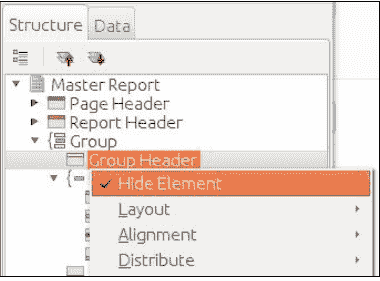

操作 Hide Element 项后，对应的频带将在报表画布中相应地显示（或隐藏）。


*这种隐藏/显示频带的行为对于自定义最终报表布局很有用，也有助于管理结果的分组。将报表的分组结果以某种主从布局形式呈现是一个强大的功能，您在第 2 章 Gett 中看到了一个示例*

分组始于报表设计器。使用报表资源管理器中的组元素属性来控制和自定义此功能，以便在未来的高级开发中使用。

## 报表设计器中的视觉布局

使用 Pentaho 报表设计器，您可以对报表中各个元素进行像素级控制。网格和引导线可能出现在每个报表画布频带中，这使得对齐和配置元素位置变得简单。

### 网格

默认情况下，报表网格已启用。要隐藏网格，请禁用菜单项 视图 | 网格 | 显示。网格以点单位（也称为像素单位）呈现，每 25 像素显示一条浅灰色网格线。网格线对于对齐的视觉反馈很有用，同时也为将元素吸附到网格上提供了一种方法。这使得元素的对齐变得简单。

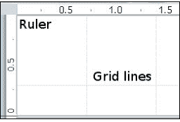

要将标尺单位调整为厘米、毫米、英寸或派卡，请进入 视图 | 单位 子菜单。默认网格大小可以通过启动网格大小对话框进行调整。选择菜单项 视图 | 网格 | 设置 并调整您的网格大小。您可以通过选择菜单项 视图 | 网格 | 显示 或按 Ctrl+Quote 来显示或隐藏网格。

### 引导线

**引导线** 允许您指定自定义网格线。要添加新的水平或垂直引导线，请在报表画布的标尺区域内单击。应出现一条新的蓝色引导线。引导线对于布局的视觉反馈很有用，同时吸附到网格功能可简化元素放置。

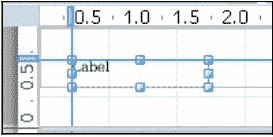

引导线可以通过在标尺内拖动其位置来移动。也可以通过在标尺内右键单击该线并选择 属性...，然后输入引导线的新值来移动。

可以通过右键单击并选择 `Deactivate` 来停用单个引导线。这会导致引导线从报表画布内容中移除，并在画布的标尺区域内显示为灰色标记。此外，还可以通过右键单击并选择 删除 来完全从报表中移除引导线。

可以通过选择 视图 | 网格 | 显示引导线 或点击 *Ctrl + S* 同时激活和停用所有引导线。如果您使用了许多引导线并且希望快速查看报表而不让所有蓝色线穿过，这很有用。

### 其他视觉指示器

除了网格线和网格引导线之外，还有一些方便的快捷方式可帮助您更轻松地布局报表。默认情况下，选择报表元素时，选择样式被视为 **轮廓选择**。另一种选择样式是 **夹具选择**。您可以通过选择 视图 | 轮廓选择 或 视图 | 夹具选择 在这两种选择类型之间切换。

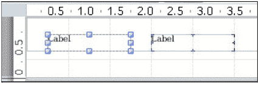

此外，还可以通过选择 视图 | 引导线 | 显示元素框架 或按 *Ctrl + H* 来显示和隐藏所有元素框架。这又是另一个工具，可轻松可视化元素彼此相邻的布局方式，并查看可能在渲染报表时导致问题的潜在重叠。

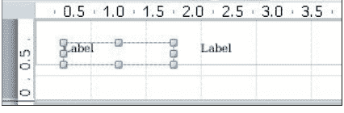

报表设计器中的另一个视觉指示器是 视图 | 显示重叠元素 菜单选项。选择此选项时，任何重叠的元素都会被突出显示，警告在渲染报表时可能存在问题。

最后，报表设计器中的另一个有用功能是能够放大和缩小网格。默认情况下，报表设计器以 100% 显示渲染的网格。在 视图 | 缩放 菜单中，您可以将报表查看为其实际大小的 50%、100%、200% 或 400%。

作为另一个有用的功能，视图 | 元素对齐提示 菜单可以帮助您放置元素，并在每个元素上显示一些对齐条。这可以帮助您进行对齐，即使更简单的 格式 | 对齐 菜单可能更快。

为了完成视图菜单中可用的项目，吸附到元素 选项让您可以轻松地将元素彼此靠近放置，而无需过多关注垂直或水平距离上几像素的差异。

### 移动和对齐单个元素

除了在报表画布周围拖放元素外，还可以使用快捷键和菜单项更轻松地对齐和移动报表元素。

要移动元素，首先选择该元素，然后将其拖放到频带内的新位置。您也可以使用箭头键按单个像素移动所选元素。

为了控制元素相对于可能重叠的其他元素的可见性，选择该元素，然后选择 `Format | Arrange | Send Forward` 或 `Format | Arrange | Send Backward` 选项以调整元素在频带内出现的顺序。`Bring to Front` 和 `Send to Back` 分别将元素移动到最前面可见或最后面可见。这也称为 **Z 排序**。

### 对齐元素组

为了真正完善报表，有两个易于使用的快捷方式可用于对齐元素组。首先，通过按住 Shift 键并在元素周围拖动选择区域，或按住 Shift 键同时选择单个元素来将元素作为一组选择。

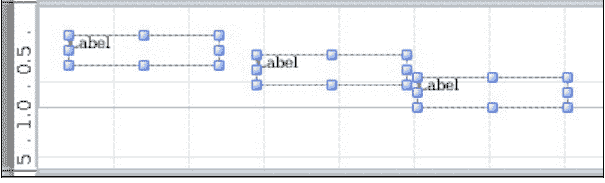

一旦您选择了一组元素，就可以轻松地在水平和垂直方向上对齐组中的所有元素。如果您想将示例中的所有标签对齐到顶部，请选择菜单项 格式 | 对齐 | 顶部。这将使所有选定元素与组中最上面的选择对齐。此外，您还可以将这些元素对齐到中间或底部。对于垂直分组的元素，您可以将其对齐到左、中或右。

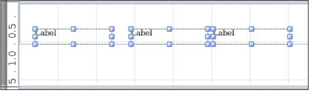

现在，假设您想要均匀分布所有选定的元素。这可以通过选择菜单项 格式 | 分布 | 水平等距 来实现。您可以通过选择 等垂直间距 在垂直方向上执行相同的操作。

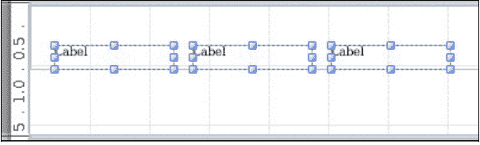

### 其他布局功能

在报表设计器中工作时，还有一些额外的布局功能可以让您的生活更轻松。第一个功能是将一个元素的 **粘贴格式** 应用到另一个元素的能力。选择并复制您想要共享格式的元素。现在，选择您想要应用格式的附加元素并选择菜单项 `Edit | Paste Formatting`。所有与格式相关的属性都会复制到选定元素中，同时保留其与数据相关的属性。

### Pentaho 报表设计器快捷键

下表显示了 Pentaho 报表设计器中所有可用快捷键的列表：

| Shortcut key | Description | Shortcut key | Description |
|---|---|---|---|
| Ctrl+N | 创建新报表 | Ctrl+Arrow key | 按方向移动元素一个网格线 |
| Ctrl+Shift+N | 启动报表向导 | Arrow Key | 按箭头键方向移动元素一个像素 |
| Ctrl+O | 打开“打开报表”对话框 | Ctrl+A | 全选 |
| Ctrl+Shift+NumPad/ | 从仓库打开“打开报表”对话框 | Escape | 清除所有选择 |
| Ctrl+F | 关闭报表 | Ctrl+Quote | 显示或隐藏网格 |
| Ctrl+S | 保存报表 | Ctrl+1 | 字体属性 |
| Ctrl+Shift+P | 在仓库中发布报表 | Ctrl+B | 加粗元素字体 |
| Ctrl+Z | 撤销 | Ctrl+I | 斜体元素字体 |
| Ctrl+Y | 重做 | Ctrl+H | 置于最前 |
| Ctrl+X | 剪切 | Ctrl+U | 置于前 |
| Ctrl+C | 复制 | Ctrl+D | 置于后 |
| Ctrl+V | 粘贴 | Ctrl+E | 置于最后 |
| Ctrl+Shift+V | 粘贴格式 | Ctrl+3 | 显示或隐藏报表资源管理器窗口 |
| Delete | 删除当前元素 | Ctrl+2 | 显示或隐藏元素属性窗口 |

此外，您还有以下快捷键可用于访问菜单：

| Shortcut key | Description |
|---|---|
| Alt+F | 打开“文件”菜单 |
| Alt+V | 打开“视图”菜单 |

|  |  |
|---|---|
| Alt+I | 打开插入菜单 |
| Alt+O | 打开格式菜单 |
| Alt+D | 打开数据菜单 |
| Alt+E | 打开扩展菜单 |
| Alt+W | 打开窗口菜单 |
| Alt+H | 打开帮助菜单 |

## 不同输出格式的注意事项

根据输出格式的不同，您设计的报表在渲染时可能会有所差异。您将了解在渲染到各种输出格式时遇到的一些常见问题。在开发报表时，请务必在计划渲染的格式中预览报表，以避免在发布报表后出现任何意外。

## 单元格输出

在渲染到 CSV、Excel、RTF 以及在某些方面渲染到 HTML 时，单元格布局成为一个重要问题。Pentaho Reporting Engine 会尽力确定报表最合适的单元格布局，但仍需遵循某些做法以确保报表美观。

元素对齐在处理单元格输出时至关重要。请确保所有水平和垂直对齐都准确。即使水平或垂直位置存在细微差异，报表到单元格渲染算法也可能出现困难。

以下屏幕截图显示了一个示例；报表中的元素未正确对齐：

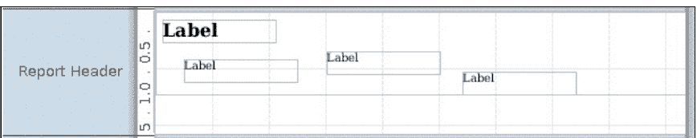

这就是报表在 Excel 中的显示效果：

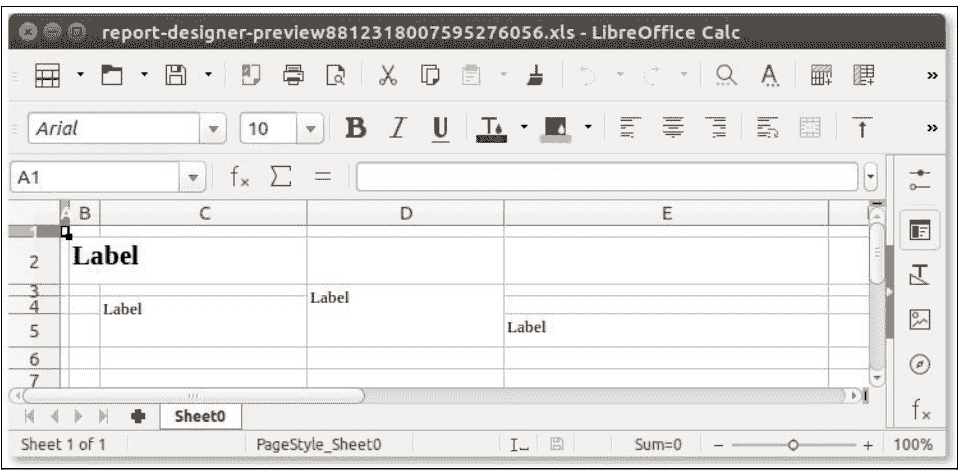

请注意，在标签之前会出现额外的单元格，使得最终结果完全不精确且不专业。以下屏幕截图显示了一个元素对齐正确的报表：

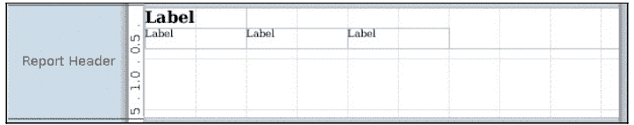

这就是 Excel 输出的显示效果：

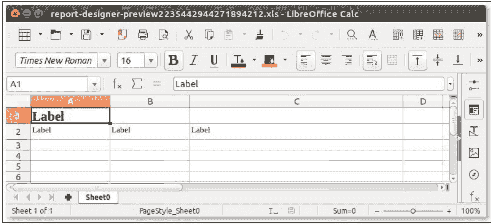

使用基于单元格的报表生成器时，另一个需要考虑的问题是元素重叠。相互重叠的元素将无法正确渲染，因此应避免重叠。

## 分页

某些输出格式，如 HTML、CSV、RTF 和 Excel 输出，将报表（无论报表多长）视为单页。请在了解许多输出类型不会完全相同渲染的情况下使用页眉和页脚。

关于分页，Excel 输出提供了将工作表视为页面的功能，只要在报表频段中使用 `page-break-before` 和 `page-break-after` 样式属性明确指定分页符即可。

## 丰富图形和图表的限制

虽然某些格式（如 Excel、HTML 和 PDF）支持图像和图表，但其他格式（如 CSV、文本和 RTF）则无法嵌入这些丰富元素。在设计报表时请牢记这一点。

某些图形元素，如椭圆，在大多数格式中无法渲染。请始终通过在预期格式中预览来验证报表的显示效果。

## 摘要

在本章中，您深入探讨了使用 Pentaho Report Designer 设计和布局报表的方方面面。您首先了解了构成 Report Designer 的各种用户界面组件。从那里开始，您深入研究了每个报表频段及其属性。您了解到每个频段都可以通过树结构访问，并且每个频段都可以在画布中显示，同时在属性编辑器中提供属性。

然后您全面查看了所有报表元素。本章向您介绍了所有元素中常见的属性，以及在编辑时各种属性显示的对话框。您还学习了如何利用菜单、工具栏、画布和快捷键快速排列和布局报表。这包括介绍使对齐和分布元素组变得容易的快捷方式。

最后，本章涉及了在使用 Pentaho Reporting 支持的各种输出格式时处理常见问题的其他细节。

本章作为开发人员和信息技术人员的参考手册编写。目标是为您提供详细的描述，帮助您开发出最佳的报表，并提供最准确的细节。阅读完本章后，您应该对 Pentaho Report Designer 界面感到熟悉，并且能够充分发挥其功能。

在下一章中，您将发现 Pentaho Reporting 定义数据源的所有可用方式。您将再次使用 Pentaho Report Designer，但您将在第 12 章 *Developing Using Data Sources* 中看到如何重用您将在以下主题中学到的内容。

## 配置 JDBC 和其他数据源

在第 4 章 *Creating a Report with Report Designer* 中，您了解了如何使用 Pentaho Report Designer 从头开始创建报表。作为练习，您创建了一个数据源，定义了用于查看结果、制作图表、计算公式等的字段列表。在本章中，您将深入了解数据源这一基础概念的细节，发现所有可用的类型及其特定功能。

在本章中，您将从使用 Pentaho 报表进行数据源管理的介绍开始，逐一深入了解所有不同的数据源，并学习如何使用 Pentaho Report Designer 配置它们。特别是，您将看到：

- 使用 JDBC 的 DBMS 数据源
- XML 元数据交换格式中的元数据源
- MongoDB 数据源
- Pentaho Data Integration 转换数据源
- OLAP 模式（Mondrian）数据源
- XML 数据源
- 表结构数据源
- Report Designer 的高级数据源
- Pentaho 社区数据访问数据源

一章类似的章节，涵盖使用 Pentaho Reporting SDK 的数据源主题，将是第 12 章 *Developing Using Data Sources*，完全致力于开发人员体验。

本章作为开发人员和信息技术人员的参考手册编写。目标是分享 Pentaho Report Designer 中关于数据源的所有相关和高级功能。在本章结束时，您将对它提供的所有连接源的方式感到熟悉。这是开发简单和复杂的 Pentaho 报表必须经历的第一步。

## 介绍数据源

我们已经介绍了数据源在报表开发中的重要性。事实上，使用 Report Designer 和 Pentaho Reporting SDK 进行报表开发时，数据源都是第一步。简而言之，Pentaho Reporting 使用数据源来定义报表中可用的数据集，使用由字段和行组成的表表示。每个字段由名称和类型（即字符串、整数等）定义，而一行是与字段相关的值的集合。字段和行是 Pentaho 报表的实际内容，可用于查看结果、制作图表、计算公式、定义参数和用户输入，以及许多其他用途。

即使数据源的结果始终是一个表，源的类型也可能有很大差异。我们可以有关系型 DBMS、NoSQL 数据库、不同的引擎（如 OLAP、Pentaho Data Integration 等），甚至像 XML、元数据等静态数据结构的各种格式。在下一节中，您将了解如何使用 Pentaho Report Designer 管理您的数据源。

## 报表资源管理器中的数据集

从 Report Designer 用户界面开始，您应该已经熟悉报表资源管理器（您可以在右上角面板中找到它）。报表资源管理器由两个不同的选项卡组成：Structure 和 Data。您在第 5 章 *Design and Layout in Report Designer* 中大量使用了 Structure 选项卡，但现在是您第一次看到 Data 选项卡。作为初步介绍，Data 选项卡是所有数据源所在的位置，以及其他一些类型的对象。

查看 Data 选项卡内容，您可以看到一个 `Data Sets` 项，列出了报表中定义的所有数据源。在空报表中，`Data Sets` 项没有子项，但在每个正在工作的报表中，它至少有一个子项。以下屏幕截图显示了报表资源管理器在有两个数据源时的外观

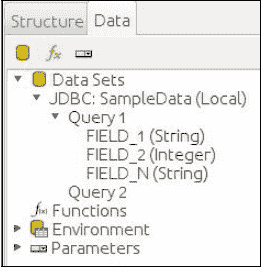

已定义：

如您所见，每个数据源都由一个唯一名称标识（示例中为 `Query 1` 和 `Query 2`），并且每个数据源都包含一个字段列表。即使报表有多个数据源，也只有一个被选中用于明细（在本例中为 `Query 1`）。只有选中的数据源会显示可用字段列表。所有其他数据源用于不同的目的：用于参数值的列表、子报表中的查询等。


*如果您有多个数据源，请直接在报表资源管理器面板中右键单击其中一个，然后单击 Select Query。这将使数据源能够在当前报表的详细信息中使用。*

每个数据源的字段都有一个名称和一个类型。字段的名称不过是一个有意义的标签。字段的类型是 Java 类型，

like string, integer, long, date, timestamp, and others. You will see that the field's type will help you during the report development, to set up the format and grouping, and everything is directly connected to presentation. Starting from this panel, you can drag a field and drop it directly into the preferred place in the bands of your report.

Coming back to the data source topic, you can create a new data source by right clicking on the `Data Sets` item and choosing the preferred type. Alternatively, you can click on the database icon ( ) in report explorer or use the upper menu choosing the Data | Add Datasource item. In the following sections you will see, one by one, how to create (and manage) all the different available data sources.

## The JDBC data source

The first type of data source in the list, and the most used one, is the JDBC data source. JDBC is an API for the Java language, which defines how a client may access a database. It provides methods to query (and update) data in a database and is oriented towards relational databases. See https://en.wikipedia.org/wiki/Java_Database_Connectivity for further details.

Once selected, a modal window, similar to the following one, appears:

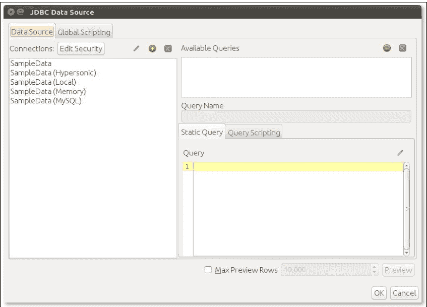

The window contains two main sections: the connections (on the left) and the queries (on the right). The next two sections will introduce all the features for both the panels.

## Adding or editing a JDBC connection

Even if the connection panel contains some SampleData connections, you can see here how to add a new one or how to edit an existing one. In the connection panel of the window, you can see:

- A pencil icon (✏️) used to edit an existing connection
- A green plus icon (⊕) used to add a new connection to the list of the available ones
- A red icon (🗑️) used to delete an existing connection

In addition, if you want to provide parameters that contain different authentication credentials for the connections, click the Edit Security button in the upper-left corner of the window and then type in the fields or variables that contain the user credentials you want to store as a parameter. A username and password will be available as security parameters when you are creating your report.

The user experience for adding or editing a JDBC connection is mainly the same; a new modal window similar to the following one is shown, containing all the requested fields and parameters to connect to a relational DBMS. The user experience for deleting an existing connection is simpler, as it requires only a confirmation.

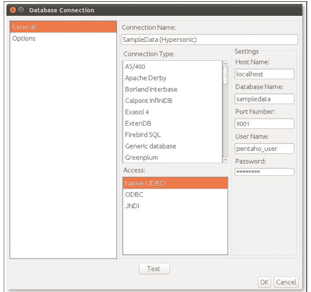

The Database Connection user interface contains a grouping selector on the left pointing to General and Options, a Connection Name field, a Connection Type field, Settings, Access, and few buttons for actions (Test, OK, and Cancel). Selecting Options in the grouping selector, a collection of empty couples of parameter/value can be specified for the connection (they really depend on the database).

The Connection Name field is mandatory (in the example, it points to the existing `SampleData (Hypersonic)` connection). The Connection Type field lists all the available types of databases supported by the Pentaho Reporting Engine, with more than 40 different types of relational DBMS, from the most famous to the more specific ones, open source or legacy ones, newest, and oldest versions, and so on.

> *All the drivers are provided for the supported databases. Even if you are going to use a very common type of relational DBMS, you may need to add the right driver. To check for the existing drivers or to add a new one, look at the `jar` libraries in the `<report-designer>/lib/jdbc` folder. Always remember to restart Pentaho Report Designer after every change to the drivers in the `jdbc` folder.*

Once selected a connection type, settings can change accordingly. To be more precise, the number (and types) of settings requested by the user depends on the connection type and access. Access depends on the connection type, and for most of the supported relational databases, it includes `JDBC`, `ODBC`, and `JNDI`.


> The *Open Database Connectivity (ODBC)* is a standard API for accessing DBMS. The designers of ODBC aimed to make it independent of database systems and operating systems.

The available buttons are easy to understand: the Test button tries to access the database and check the correct connection; the OK button confirms the changes to the database connection; and the Cancel button, well, you can imagine what this button does.

Once you have added or edited a database connection, select one of the available connection to instruct Pentaho to use it during the query development.

## About the JNDI access

The **Java Naming and Directory Interface (JNDI)** is a Java API for a directory service that allows Java software clients to discover and look up data and objects using a name. Because of its nature, the settings requested for the JNDI connection is a name only. This unique name should match an existing JNDI connection available in the Pentaho Reporting environment.

To set up a JNDI data source in Pentaho Reporting, edit the `.pentaho/simple-jndi/default.properties` file. The `.pentaho` directory is in the home or user directory of the user account that runs Pentaho Report Designer. If you have multiple copies of Pentaho Report Designer installed in multiple user accounts, each `default.properties` file should be edited.

The following example shows text lines to be added/edited relation to an existing JNDI connection; the JNDI connection to `SampleData` on HyperSQL:

```
SampleData/type=javax.sql.DataSource
SampleData/driver=org.hsqldb.jdbcDriver
SampleData/url=jdbc:hsqldb:hsql://localhost/sampledata
SampleData/user=pentaho_user
SampleData/password=password
```

As you can see, the name of the JNDI connection is used as a prefix for all the settings in the properties file.

## Adding or editing a query

Once the connection is added (or updated), the next task is defining the queries. Starting from the JDBC Data Source window, the Available Queries panel lists all the queries defined for the current data source. In the top-right corner of the panel, you can see:

- A green plus icon (⊕) used to add a new query
- A red icon (⊗) used to delete an existing query

A query is generally identified by a name and content. The name of a query can be edited in the Query Name field and the content can be managed in the bottom panel of the window. The content could be a static string or a script. The static query (widely used) is written in the syntax required for the database type (usually SQL). The SQL string can be enriched with some optional parameters defined using a specific notation (you will see the syntax of the notation in the following chapters).

The query scripting is a source code in ECMAScript or Groovy and you can use it to manipulate the dataset, using a programming language. The query scripting is rarely used and we won't treat it in detail, but it's a collection of functions you can develop to make the dataset exactly as you want. The static query can be specified in the Query field of the Static Query tab, and the query scripting can be specified in the Query Script field of the Query Scripting tab.

> *Click on the Template button of the Query Scripting tab to see all the available functions, and documentation on how to develop the dataset using the source code instead of a standard query.*

The pencil icon (✎) in the Static Query tab is useful to launching SQLeonardo Query Builder, a powerful and easy-to-use GUI that lets you query databases without any relevant knowledge of the SQL syntax. Max Preview Rows, if enabled, lets you declare the maximum number of rows retrieved for previewing the data, and the Preview button checks that everything is working as expected and shows a bunch of data results as a data table.


如您所见，在“可用查询”面板中，您可以定义一个或多个 SQL 查询。如本章开头所述，在报表中定义多个查询对于参数值的列表、在子报表中使用等非常有用。

## 元数据数据源

元数据数据源允许您查询单个 XMI 格式的文件。XML 元数据互换（XMI）是对象管理组织（OMG）通过 XML 交换元数据信息的标准。它可用于任何元模型可以用元对象设施（MOF）表示的元数据。XMI 最常见的用途是作为 UML 模型的交换格式，尽管它也可以用于其他语言（元模型）模型的序列化。Pentaho 套件中的一些工具（例如，Pentaho Data Integration）可以生成 XMI 文件来表示元数据，并且借助此数据源，它们可用于生成报表。

选择此数据源类型后，会显示一个模态窗口，如下所示：

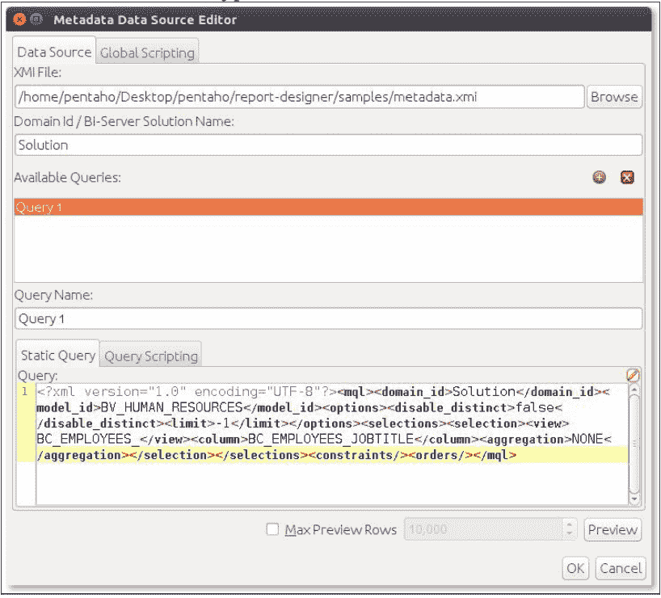

如窗口顶部所示，在此数据源中您还可以使用标准配置或脚本定义数据集。该脚本与您在 JDBC 数据源中看到的类似，因此我们将讨论重点放在常规设置上。

面板中（顶部）的第一项与 XMI 文件的定义相关。作为示例，我们使用了 Pentaho Report Designer 发行版中捆绑的 metadata.xmi 文件。在前面的屏幕截图中，您可以检查文件（在 report-designer/samples 文件夹中）的确切位置。

在“Domain Id”字段中，指定此元数据文件所属的解决方案目录名称。在“可用查询”面板中，您可以看到为当前数据源定义的所有查询的列表。如 JDBC 查询所示，您可以使用绿色加号图标（⊕）添加新查询，并使用红色图标（⊗）删除现有查询。

在“查询名称”字段中，您可以输入有意义的标签来标识查询，并在窗口底部，您可以看到查询内容。如 JDBC 数据源所示，查询内容可以使用静态查询或脚本定义。脚本与 JDBC 数据源中描述的相同，而静态查询采用 XML 格式。

鉴于查询的 XML 格式对用户不太友好，因此提供了元数据查询编辑器。要访问元数据查询编辑器，请单击面板右上角的小铅笔图标（✎）。单击后，会显示如下类似的窗口：

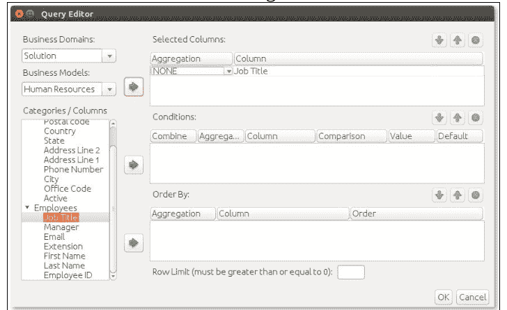

从“业务域”菜单和“业务模型”菜单中选择一个项目，然后将一个或多个“类别/列”添加到“所选列”和/或“条件”和/或“排序依据”中以定义您的查询。完成后，单击“确定”以确认定义。

如 JDBC 数据源所示，“最大预览行数”和“预览”按钮可让您检查一切是否按预期工作，并以数据表的形式显示一批数据结果。

## MongoDB 数据源

MongoDB 数据源允许您原生连接到著名的 NoSQL 数据库。为此，您必须已经拥有 MongoDB 数据库连接信息，例如主机名、端口号和身份验证凭据。

> *MongoDB（源自 humongous）是一款免费的开源跨平台文档型数据库程序。被归类为 NoSQL 数据库程序，MongoDB 使用类似 JSON 的文档，其中包含模式，存储为内容。*

选择后，此数据源类型会显示一个包含两个面板的模态窗口：左侧为查询列表面板，右侧为查询详细信息面板。查询列表面板与为 JDBC 数据源介绍的面板类似，您可以在其中看到添加查询（⊕）和删除查询（⊖）的图标。单击绿色加号（⊕）图标，会在可用查询中添加一个新的 Query 1，如下图所示：

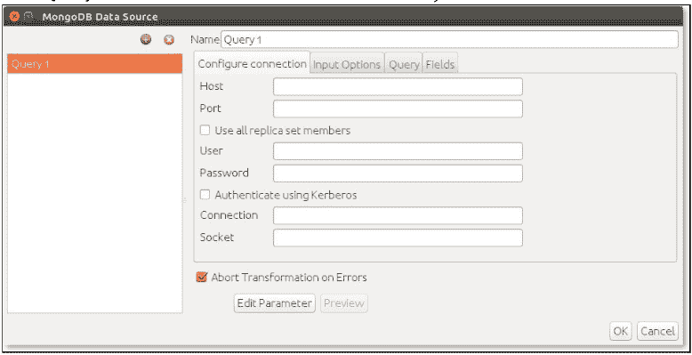

选择查询（或创建新查询）后，右侧面板会显示“名称”字段，您可以在其中更改查询的有意义标签，并在下方有一组四个选项卡用于设置到 MongoDB 源的连接。“配置连接”是第一个需要某些设置的选项卡。输入 MongoDB 数据库的主机名和端口号。您还可以通过冒号分隔主机名和端口号，并用逗号分隔每个主机名和端口号组合，为每个主机名指定不同的端口号，如 `<ip1>:<port1>,<ip2>:<port2>`。

如果希望 MongoDB 自动感知并尝试连接到可用主机，即使其中一个主机宕机，请选中“使用所有副本集成员”。在“用户”字段和“密码”字段中输入访问 MongoDB 数据库所需的凭据。如果使用此协议，请选中“使用 Kerberos 进行身份验证”。


> Kerberos 是一种计算机网络身份验证协议，它基于票据工作，允许在不安全的网络上通信的节点以安全的方式相互验证身份。

设置“连接”和“套接字”以定义源的可选超时。转到“输入选项”选项卡，在下面的屏幕截图中可以看到窗口的外观。在此选项卡中，您在编写查询之前指定所有指向正确数据库的设置：

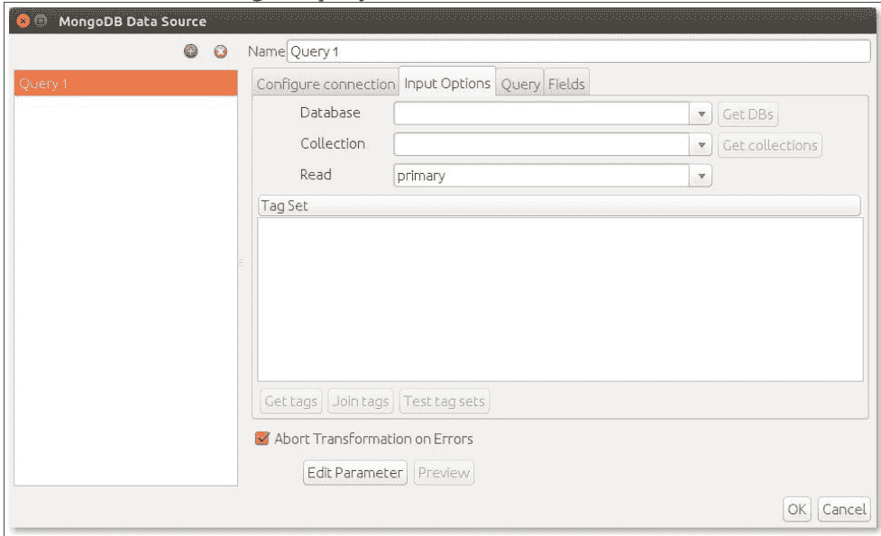

单击“获取数据库”按钮将使用可用数据库的名称填充下拉菜单。选择合适的数据库或使用该字段输入数据库名称。对于“获取集合”按钮和“集合”字段，使用相同的步骤，但针对的是 Mongo 集合。


> *Mongo 集合是 MongoDB 文档的分组。集合相当于 RDBMS 表。集合存在于单个数据库中。集合不强制执行模式。集合中的文档可以具有不同的字段。通常，集合中的所有文档具有相似或相关的用途。*

最后但并非最不重要的一点是，您可以在“读取”字段中指定读取偏好。如果要指定标签集，请单击“获取标签”按钮。在 MongoDB 数据库上指定的标签集会出现在窗口的“标签集”部分。如果要将标签集一起附加，以便一次性处理，请选择标签集，然后单击“连接标签”按钮。单击“测试标签集”按钮可查看与标签集条件匹配的节点列表。

转到“查询”选项卡，在下面的屏幕截图中可以看到窗口的外观：

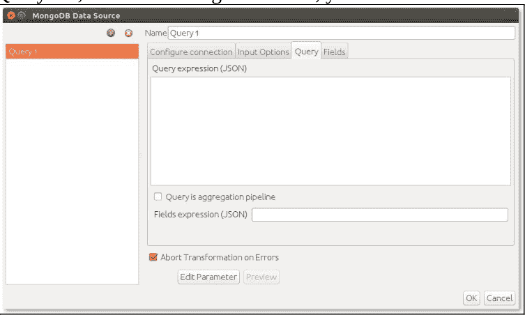

在此选项卡中，您可以使用两种不同的方法制定查询：创建查询作为 JSON 查询表达式或使用 Mongo 聚合框架。


> *Mongo 聚合框架处理数据记录并返回计算结果。聚合操作将多个文档中的值组合在一起，并可对分组数据执行各种操作以返回单个结果。*

使用 JSON 查询表达式类似于使用 Mongo `find()` 命令。为了使用 JSON 查询表达式模式，请确保未选中“查询为聚合管道”复选框。`find` 的查询参数在“查询表达式（JSON）”字段中输入，而投影参数在“字段表达式（JSON）”文本框中提供。

要使用聚合框架查询 MongoDB，请单击“查询为聚合管道”复选框，并在“查询表达式（JSON）”字段中输入一系列管道操作。此模式使用与 MongoDB `aggregation()` 命令相同的语法。您可以使用简单的字符串替换对 JSON 查询表达式和聚合管道查询进行参数化（您将在后面的章节中看到参数化是如何进行的）。

转到“字段”选项卡，在下面的屏幕截图中可以看到窗口的外观。在此选项卡中，您可以查看您指定的数据库和集合中的字段：

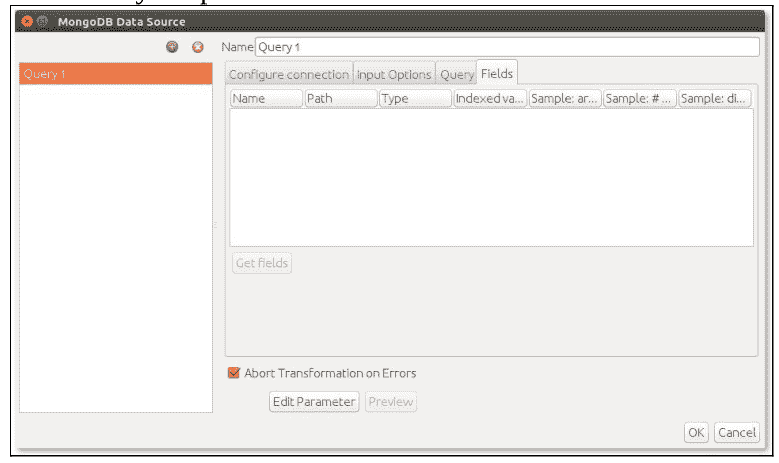

单击“获取字段”按钮，要求 Pentaho 确定哪些字段可用及其数据类型。然后字段将被显示。如有需要，您可以编辑字段的名称，并可以编辑 MongoDB 数据库中字段的路径。如果返回的是数组，您可以通过在括号中指示元素的编号来指定数组中的元素；例如，`$.myArrayElement[0]`（使用 `$.myArrayElement[*]` 表示整个集合）。

最后但并非最不重要的一点是，使用“出错时中止转换”复选框来请求

出现错误时中止，Edit Parameters 按钮用于编辑转换的参数，以及 Preview 用于测试连接并查看数据在导入 Report Designer 时的显示效果。

完成后，点击 OK。Pentaho Report Designer 现在可以访问您的 MongoDB 数据源。


> *在本书开发期间，我在使用 Pentaho Report Designer 7.0 和 7.1 版本时遇到了此数据源的一些问题。6.1 版本似乎工作正常。当然，在像 Report Designer 这样复杂的产品开发中这种情况可能会发生。如果您遇到类似问题，可以选择使用 Pentaho Data Integration 数据源作为替代方案来从 MongoDB 获取数据。*

## Pentaho Data Integration 数据源

如果您想要创建包含 PDI 转换中任意步骤数据的报表，请使用 Pentaho Data Integration 数据源选项。正如您可能知道的，Pentaho Data Integration 是 Pentaho 套件的核心工具之一，旨在实现功能完善的 ETL 和数据集成解决方案（完整介绍请查阅第 16 章，*在 Pentaho Data Integration 中使用报表*）。这种数据源类型特别有用，如果您想要创建包含 Excel 输入或其他 PDI 步骤的转换步骤数据的报表。

> 提示
> *如果您使用此类型的数据源，请记住将 <data-integration>/lib 中的所有 JAR 文件复制到 <report-designer>/lib，以便通过 Pentaho Report Designer 访问它。*

一旦选择此数据源类型，将显示一个模态窗口，如下所示：

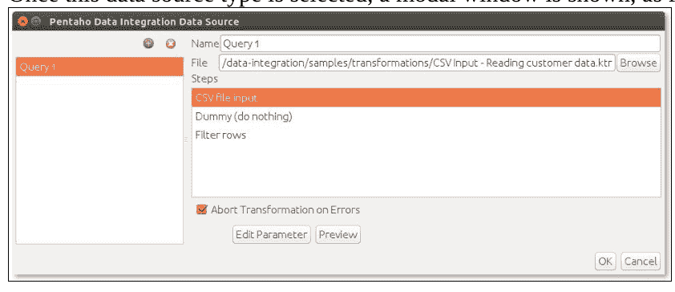

窗口左侧显示查询列表，带有众所周知的绿色加号图标 (+) 用于添加新查询，红色图标 (x) 用于删除现有查询。窗口右侧可以找到查询定义。与之前的数据源一样，Name 字段指定查询的有意义标签。File 字段指向一个 .ktr 文件（Pentaho Data Integration 用于转换的格式），底部面板列出了定义转换的步骤列表。从列表中选择一个步骤将指示 Pentaho Report Designer 将其用作数据源的数据生成器。

例如，您可以取 Pentaho Data Integration 发行版中 `<data-integration>/samples/transformations` 文件夹中存储的 `csv Input - Reading customer data.ktr` 文件。

为了完成描述，Preview 按钮与您在之前数据源中看到的相同，OK/Cancel 按钮是用于确认/取消当前操作的标准按钮。最后但同样重要的是，使用 Edit Parameter 按钮设置 PDI 转换的调用以使用正确的设置。


> 这种数据源类型因 Pentaho Data Integration 的功能而极具吸引力。Pentaho Data Integration 能够连接到各种来源，因此矛盾的是，您可以使用此数据源仅连接到 Pentaho 套件可以连接的所有可能来源。想要一个例子吗？打开 `<report-designer>/resources/datasources/MongoDb.ktr` 中的 `.ktr` 文件，看看它如何用于从 MongoDB 实例中提取数据。

## OLAP 数据源

**在线分析处理 (OLAP)** 数据源在涉及多维引擎时使用。


> *引用自关于 OLAP 的维基百科 (https://en.wikipedia.org/wiki/Online_analytical_processing)：多维结构被定义为关系模型的变体，使用多维结构来组织数据并表达数据之间的关系。即使数据被操作，它仍然易于访问并继续构成紧凑的数据库格式。多维结构在用于 OLAP 应用的分析数据库中相当流行。分析数据库使用这些数据库是因为它们能够迅速地对复杂的业务查询做出回答。*

Pentaho 套件提供了一个名为 Mondrian (http://community.pentaho.com/projects/mondrian) 的开源多维引擎。Mondrian 完全用 Java 编写，并执行使用 **多维表达式 (MDX)** 语言编写的查询，从关系数据库读取数据并以多维格式呈现结果。


> *引用自关于 MDX 的维基百科 (https://en.wikipedia.org/wiki/MultiDimensional_eXpressions)：MDX 是使用数据库管理系统进行 OLAP 的查询语言。与 SQL 类似，它是关系数据库的查询语言。它也是一个计算语言，其语法类似于电子表格公式。*

一旦可供数据源类型选择，您可以看到有两种不同的子组可用：OLAP 和 OLAP（高级）。OLAP（高级）数据源与标准 OLAP 数据源的区别仅在于设计和输入 MDX 查询的方法。标准 OLAP 数据源允许使用 Report Designer 内置的元数据查询编辑器，而 OLAP（高级）数据源要求您构建公式来计算查询，这使您在报表参数化功能方面拥有更大的控制权。

在两个子组中，您都可以找到一个名为去规范化（默认数据源假定它们是规范化的）的每个 OLAP 数据源的版本。规范化和去规范化是 MDX 查询的两种可能的分类，取决于结果数据集的结构。本书的范围不包括详细阐述数据规范化/去规范化的细节，但以下示例可以阐明两者之间的差异。

这是一个 MDX 查询的规范化形式示例：

| [Time].[(All)] | [Time].[Years] | [Measures].[Revenue] | [Measures].[Quantity] |
|---|---|---|---|
| 所有年份 | 2015 | 150,000 | 1,000 |
| 所有年份 | 2016 | 170,000 | 1,100 |
| 所有年份 | 2017 | 190,000 | 1,200 |

这是一个相同 MDX 查询的去规范化形式示例：

| [Time].[(All)] | [Time].[Years] | [Measures].[MeasuresLevel] | Measure |
|---|---|---|---|
| 所有年份 | 2015 | Revenue | 150,000 |
| 所有年份 | 2016 | Revenue | 170,000 |
| 所有年份 | 2017 | Revenue | 190,000 |
| 所有年份 | 2015 | Quantity | 1,000 |
| 所有年份 | 2016 | Quantity | 1,100 |
| 所有年份 | 2017 | Quantity | 1,200 |

考虑到规范化和去规范化数据源以完全相同的方式定义，并且唯一的变化在于结果格式，在以下描述中，我们不会详细说明去规范化的那些，假设它们可以以完全相同的方式定义。

## Pentaho 分析

Pentaho 分析数据源定义了对 Mondrian 多维引擎的访问。一旦选择，将显示一个模态窗口，如以下屏幕截图所示。

正如您在窗口顶部所看到的，在此数据源中您也可以使用标准配置或脚本定义数据集。脚本与您为 JDBC 数据源看到的类似，因此我们将讨论集中在常规设置上。

面板（顶部）中的第一个任务是关于 Pentaho 分析架构文件。请求的结构文件是 XML 格式的 Mondrian 架构。例如，我们使用了 Pentaho Reporting Designer 发行版中捆绑的 `steelwheel.mondrian.xml` 文件。在以下屏幕截图中，您可以检查文件（在 `report-designer/samples` 文件夹中）的确切位置：

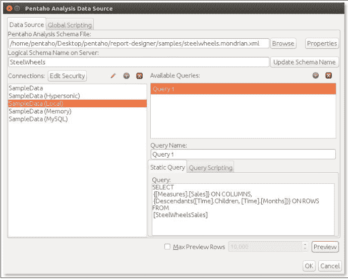

在 Logical Schema Name on Server 字段中，指定您感兴趣查询的 OLAP Cube 的名称。窗口下方，您可以看到 JDBC 连接面板（左侧）和查询面板（右侧）。两者

与之前数据源中看到的类似。

JDBC 连接面板在此指定，因为 Mondrian Engine 运行在关系型 DBMS 之上，因此是必需的。JDBC 连接的工作方式如本章前面所述。Edit Security 按钮允许您指定一些安全参数，图标可用于编辑（✏️）、添加（⊕）和删除（✖️）连接，下方面板列出现有连接。

查询面板再次与 JDBC 数据源类似，只是查询语法必须使用 MDX 语言。在查询面板中，您可以看到带图标（⊕）用于创建和图标（✖️）用于删除的 Available Queries、已定义查询的列表，以及名为 Query Name 的以下字段。在底部面板中，Static Query 选项卡和 Query Scripting 选项卡提供与 JDBC 连接相同的用户体验和内容。再次提醒，Static Query 选项卡的 Query 字段必须包含 MDX 查询，并且可以定义将在后续章节中描述的参数。

正如 JDBC 数据源中看到的那样，Max Preview Rows 和 Preview 按钮可让您检查一切是否按预期工作，并以数据表的形式显示一批数据结果。

## OLAP4J

OLAP4J 数据源定义了使用通用 API 访问任何 OLAP 服务器。OLAP4J 是一个用于 OLAP 的开放 Java API（http://www.olap4j.org）。可以将其视为 JDBC，但用于访问多维数据。

选择后，将显示如下模态窗口：

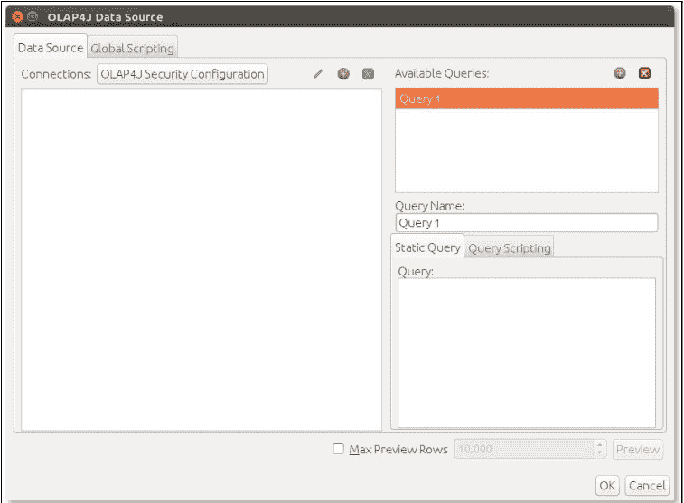

如您所见，用户界面的组件与 JDBC 连接完全相同：Data Source 选项卡和 Global Scripting 选项卡，以及连接面板（左侧）和查询面板（右侧）。它们与 JDBC 连接面板具有相同的含义和用途，只是 OLAP4J Security Configuration 按钮包含与 JDBC 不同的参数。当然，在这种情况下，Query 字段也应为 MDX 语言，并且可以定义参数。

请注意，需要设置的连接是自定义 JDBC 连接，设置类似于以下内容：Custom Connection URL:
jdbc:xmla:Server=http://<server>:<port>;Catalog=FoodMart;Cube=Budget
Custom Driver Class Name: org.olap4j.driver.xmla.XmlaOlap4jDriver

## Pentaho analysis - custom

Pentaho analysis（custom）数据源专门用于 OLAP（高级）组。它定义了与 Pentaho analysis 类似的对 Mondrian 多维引擎的访问，区别在于查询以动态计算的形式提供，而不是静态查询。

选择后，将显示如下模态窗口：

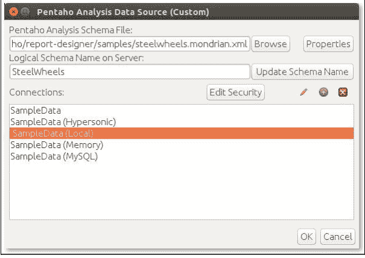

如您所见，所提供的字段是为 Pentaho analysis 提供的字段的子集。如本数据源介绍中所述，查询面板缺失。要指定 MDX 查询，公式会直接在运行时在报表定义中使用。您可以根据使用场景在 Master Report 元素的 name 属性中构建公式，如以下屏幕截图所示：

### 结构

### 数据
- 主报表
  - 页面页眉
  - 报表页眉
  - 组
    - 组页眉
    - 详细信息主体
      - 详细信息页眉
      - 详细信息
      - 无数据
      - 详细信息页脚
    - 组页脚
  - 报表页脚

### 样式

### 属性

| 名称 | 值 | 表达式 |
|---|---|---|
| query |  |  |
| name |  |  |
| limit |  |  |
| timeout |  |  |
| design-timeout |  |  |
| auto-sort | true |  |
| shared-connect... |  |  |
| data-cache |  |  |
| common |  |  |
| type | master-report |  |

## XML 数据源

XML 数据源相当容易理解，如果您不想使用数据库但想在报表中使用数据，对于来自外部系统的导出数据很有用。选择此数据源类型后，将显示如下模态窗口：

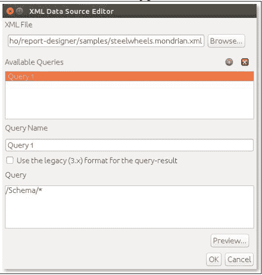

从顶部开始，第一个参数是关于指向 XML 文件。在此示例中，我们将使用存储在 `report-designer/samples` 文件夹中的 `steelwheels.mondrian.xml` 文件。


*如果您觉得 `steelwheels.mondrian.xml` 文件没有漂亮的数据集并且可能难以查询，您是对的！`steelwheels.mondrian.xml` 包含 Mondrian 架构的声明，并且不包含类似数据库导出的数据。不幸的是，这是 Pentaho Reporting 发行版中捆绑提供的可用内容，对于我们演示 XML 数据源的使用示例来说已经足够了。*

在 XML 文件选择下方，您可以看到可用查询列表，其中有众所周知的绿色加号图标（ ）用于添加新查询，红色图标（ ）用于删除现有查询。Query Name 字段是您可以更改查询有意义标签的地方。在 Query 字段中，您可以指定表示查询的静态字符串。Query 字段中使用的格式是 **XML 路径语言（XPath）** 格式。


*XPath 是一种用于从 XML 文档中选择节点的查询语言。此外，XPath 可用于从 XML 文档的内容计算值（例如字符串、整数或布尔值）。*

最后但同样重要的是，Preview... 按钮和 OK/Cancel 按钮是大多数先前数据源中描述的标准按钮。

## 表数据源

如果您需要管理静态且预定义的数据，而这些数据未存储在大量存储或配置文件中，则使用表数据源。与其他数据源相比，此数据源直接在 Pentaho Report Designer 内部定义其结构。因此，首先要做的是在查询之前声明，并在之后定义其结构，从一个两列表开始。表的定义很简单：您可以为列指定值，更改列名，并添加（或删除）行或列。

选择此数据源类型后，将显示如下模态窗口：

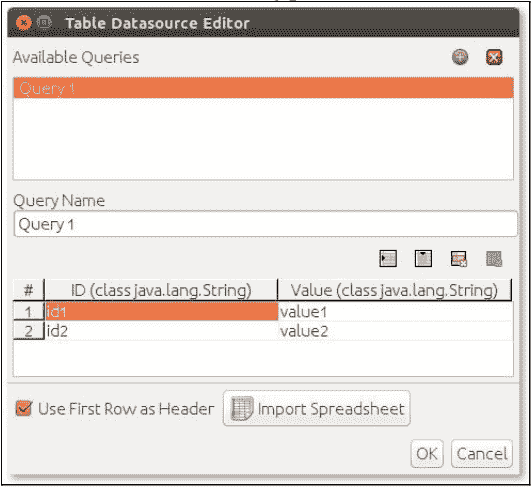

从窗口中可以看到，您可以从 Microsoft Excel 工作表开始定义表结构。为了完成功能，OK/Cancel 按钮是用于确认/取消当前操作的标准按钮。

## 高级数据源

高级数据源需要高级知识和技能，因此本节仅提供每个高级数据源的高级概述。

### 可脚本

可脚本数据源允许开发人员使用各种语言开发生成数据集的源代码。与之前的数据源一样，您可以创建多个查询并管理查询的添加/删除。

### 外部

当报表在 `.xaction` 中使用时，使用外部数据源。您可以参考官方文档中关于此数据源的（少量）文档。Pentaho 动作序列 XML 文档（`.xaction`）定义了数据库查询、报表生成和电子邮件操作等活动，以及它们发生的顺序。

### 序列生成器

序列生成器开发可在报表中使用的序列。与之前的数据源一样，您可以创建多个查询并管理查询的添加/删除。对于每个查询，您可以定义组（数字或系统）、序列（取决于组）以及其他一些参数。

### OpenERP 数据访问

OpenERP 数据访问是著名 Odoo ERP 和 CRM 系统（https://www.odoo.com）的数据源。界面相当简单，允许您执行标准搜索或自定义函数，以从开源 ERP 中提取数据。

## Pentaho 社区数据访问数据源

**社区数据访问（CDA）** 数据源是与所谓的 Pentaho CDA 相关的有趣类型。Pentaho CDA 的设计目的是为数据源提供极大的灵活性。大多数可用工具只能对单个数据源执行查询，并且没有简单的方法来组合来自不同数据库或不同语言的数据（例如将 SQL 查询的数据与 MDX 查询的数据组合）。这些任务通常需要独立的 ETL 作业来同步不同的数据源并构建新数据库。Pentaho CDA 是作为数据库连接与 **社区仪表板框架（CDF）** 之间的抽象工具开发的，但在这种情况下也用于报表。

选择此数据源类型后，将显示如下模态窗口：

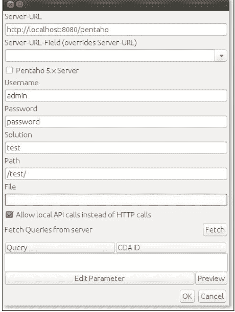

如窗口顶部所示，一个指向 Pentaho Business 的 URL

Analytics Platform 是必需的（您将在第 15 章 *在 Pentaho Business Analytics Platform 中使用报表* 中了解更多关于它的信息）。在定义凭据（用户名和密码）、解决方案和路径之后，获取按钮可让您提取 Pentaho Business Analytics Platform 中部署的所有可用 Pentaho CDA。列出后，您可以在底部面板中使用编辑参数按钮编辑传递给数据访问的参数。

为了完成描述，预览按钮与您在之前数据源中看到的相同，而 OK/Cancel 按钮是用于确认/取消当前操作的标准按钮。

## 摘要

在本章中，您学习了 Pentaho Report Designer 对数据源可以做的一切，发现了所有可用类型及其特定功能。您从介绍数据源在用户界面中的外观以及字段如何在报表布局中使用开始。然后您继续了解如何使用 Report Designer 管理所有可能类型的数据源，具体包括：

-   JDBC 数据源
-   元数据数据源
-   MongoDB 数据源
-   Pentaho Data Integration 转换数据源
-   各种版本的 OLAP 数据源（传统和通用、规范化和非规范化、标准和自定义）
-   XML 数据源
-   表数据源
-   高级数据源（可脚本化、外部、序列生成器和 OpenERP）
-   Pentaho 社区数据访问数据源

现在您阅读了本章，您应该对 Pentaho Report Designer 提供连接源的所有方式感到熟悉。这是开发简单和复杂的 Pentaho 报表过程中必须经历的第一步。

在下一章中，您将学习有关在 Pentaho 报表中包含图形和图表的一切。

## Including Graphics and Charts in Reports

在发现所有可能的数据源类型之后，本章将教您如何在 Pentaho 报表中加入图形和图表。您将开始了解如何从 Pentaho Report Designer 包含图形和图表，然后继续了解所有设置和配置的描述。图形和图表将逐一描述，就像我们对数据源所做的那样，目标是让您成为真正的专家，以获得最佳的最终结果；为您的客户和管理者提供最有用、最具吸引力的报表。

特别是，讨论的图表包括条形图、折线图、面积图、条线图、饼图、多饼图、环形图、气泡图、散点图、XY 条形图、XY 折线图（常规和扩展）、XY 面积图、XY 面积线图、瀑布图、雷达图、温度计图、条形迷你图、线形迷你图和饼形迷你图。

本章作为开发人员和信息技术人员的参考手册编写。目标是分享 Pentaho Report Designer 中可用的有关图形和图表的所有相关和高级功能。

### Including static images in reports

在 Pentaho 报表中包含静态图像很有用，因为这样您可以添加徽标以及一般图形，使最终结果对用户更具吸引力。

要在报表中包含静态图像，请从 Report Designer 调色板中选择图像图标 (🖼️) 并将其放置到报表中。双击该元素，或右键单击并选择编辑内容，以调出资源对话框，您可以在其中浏览到特定文件位置。您可以选择链接到选项以链接外部资源，也可以选择嵌入以将图像包含在 `.prpt` 文件中。


> *如果您不确定，使用嵌入式图像始终是一个不错的选择，因为您可以避免外部链接更改的负面影响。嵌入图像时，`.prpt` 文件的尺寸会更大。*

### Including dynamic images in reports

在 Pentaho 报表中包含动态图像很有用，因为这样您可以添加徽标以及一般图形，这些图形可能会根据数据源而变化。例如，我们可以想象报表根据用户的部门更改其徽标，或产品列表中的产品图像。

要向报表添加动态图像，请使用 Report Designer 调色板中的图像字段图标 (🖼️) 并将其放置在报表中。内容字段接受不同类型的图像输入以进行渲染。通过双击该元素，您可以编辑指向数据集正确字段的源。如果您有一个字段包含指向图像的 URL 或文件系统位置，则图像字段元素将渲染指定的图像。

### Including charts in reports

在 Pentaho 报表中包含图表之所以有所不同有两个主要原因：功能强大且易于使用。Pentaho 图表功能强大，因为它们能够以多种不同的样式将复杂信息表示为单张图像（图表本身）。它们易于使用，因为图表在报表中的包含可以通过配置（而不是开发）轻松完成，从数据源开始。

> *Pentaho Reporting 依赖于 JFreeChart。JFreeChart 项目成立于 2000 年 2 月，如今它是 Java 最广泛使用的图表库，迄今下载量超过 220 万次。*

要向报表添加图表，请从 Report Designer 调色板中拖动图表图标 (📊) 并将其放置在您想要查看图表的位置。通常，图表放置在分组频段中，如报表页眉或组页眉（很少放在页脚或页面页眉）。这是因为图表在应用于数据集合时才有意义，而不是单个值。无论如何，没有什么真正限制您的想象力，您可以将图表放置在报表中的任何位置。

放置到报表画布后，将显示类似以下内容的图像：

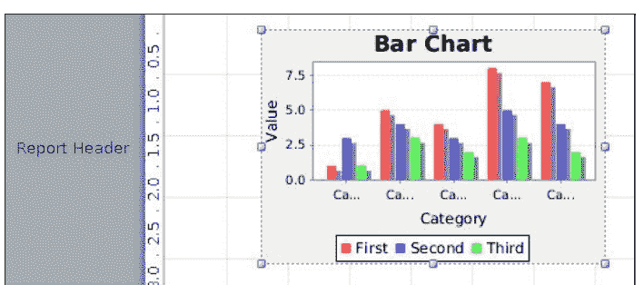

双击图像或右键单击并选择图表，将显示类似以下屏幕截图的图表编辑器：

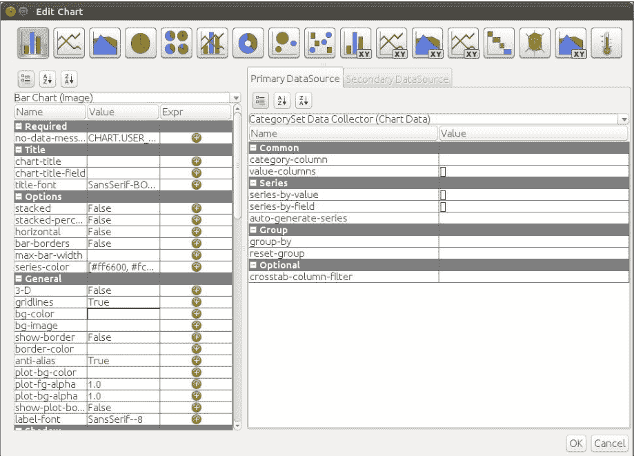

查看图表编辑器时，编辑图表时会显示三个主要区域。第一个区域位于面板顶部，列出了所有可用的图表类型（Pentaho Reporting 8.0 中为 17 种）。第二个区域位于左侧，包含与图表渲染相关的属性集。第三个属性选项卡区域位于右侧，与填充图表的数据相关。

选择一种图表类型后，属性面板会根据选择进行更新，以及数据属性面板。在以下各节中，您将详细了解所有图表类型的所有可用属性。

正如您所期望的，不同类型的图表适用于不同的用例。如果您想显示单个值随时间变化的趋势强度，最佳图表类型是：

-   Line
-   Area
-   XY line area
-   XY line

如果您直接比较两个或多个相关值，最佳图表类型选择是：

-   Pie
-   Ring
-   Bar
-   Line
-   Area
-   Radar

如果您想显示一组值如何直接影响另一组，最佳图表类型是：

-   Bar line combination
-   Waterfall

如果您比较大量数据点，最佳图表类型是：

-   XY dot (scatter plot)
-   Bubble
-   Pie grid (multipie)

## Types of datasets

所有图表类型都从不同类型的数据集接收数据。每个图表可以兼容一种或多种数据集类型。数据集类型可以在图表编辑器中通过右侧面板进行选择和管理。

以下是关于每种数据集类型的各节，详细描述其属性和含义。在描述过程中，您还将发现与每种数据集类型兼容的图表类型。此外，对于数据集类型，属性会被分组以便更好地管理和理解。


## 分类数据集

第一种数据集类型被称为 **分类数据集**，其中数据集的系列和值按类别分组。系列类似于子组。如果出现确切的类别和系列，图表会将值汇总为单个结果。以下表格是分类数据集的简单示例：

| 分类 | 系列 | 销售价格 |
|---|---|---|
| 店铺 1 销售 | 现金 | 14 |
| 店铺 1 销售 | 信用卡 | 12 |
| 店铺 2 销售 | 现金 | 100 |
| 店铺 2 销售 | 信用卡 | 200 |

使用分类数据集的图表有：条形图、折线图、面积图、柱线图、瀑布图和雷达图。

Pentaho Reporting 使用 `CategorySetDataCollector` 构建分类数据集。还提供 `PivotCategorySetCollector`，它会对类别和系列数据进行透视。收集器类实现了 Pentaho Reporting 的函数 API。您可以在图表编辑器中，在数据属性面板中，作为选项卡中的第一个下拉菜单来查看（并更改）收集器。

在以下部分中，您可以看到使用图表编辑器控制分类数据集而定义的属性集的列表。属性的分组方式与在元素属性面板中的分组方式相同。

### 通用属性

在以下表格中，您可以看到为通用属性定义的属性集的列表：

| 名称 | 类型 | 描述 |
|---|---|---|
| `category-column` | String | 表示类别的数据源字段名称 |
| `value-column` | Array of strings | 表示值的 数据源字段名称 |

### 系列属性

在以下表格中，您可以看到为系列属性定义的属性集的列表：

| 名称 | 类型 | 描述 |
|---|---|---|
| series-by-values | Array of strings | 指定您正在绘制的值。系列通常放置在图表图例中。 |
| series-by-fields | Array of strings | 指定您正在绘制的字段。系列通常放置在图表图例中。 |
| auto-generate-series | Boolean | 如果为 true，则在项目推进时，不会采取任何操作来累积数据。这仅应在指定组时使用，以便在组推进时可以正确累积数据。 |

### 分组属性

在以下表格中，您可以看到为分组属性定义的属性集的列表：

| 名称 | 类型 | 描述 |
|---|---|---|
| `group-by` | Selection | 此属性定义应收集数据的分组级别 |
| `reset-group` | Selection | 此属性定义应重置数据的分组级别 |

### 可选属性

在以下表格中，您可以看到为可选属性定义的属性集的列表：

| 名称 | 类型 | 描述 |
|---|---|---|
| `cross-tab-column-filter` | Selection | 此属性定义在交叉表中应过滤数据的分组级别 |

## 饼图数据集

与分类数据集不同，**饼图数据集** 定义了数据集的系列和值（未定义类别）。系列类似于子组。如果出现确切的系列，图表会将值汇总为单个结果。以下表格是饼图数据集的简单示例：

| 系列 | 销售价格 |
|---|---|
| 现金 | 14 |
| 信用卡 | 12 |
| 现金 | 100 |
| 信用卡 | 200 |

使用饼图数据集的图表组是饼图和环形图。

Pentaho Reporting 使用 `PieDataSetCollector` 构建饼图数据集。考虑到饼图数据集是分类数据集的简化版本，下面我们描述了控制饼图数据集而定义的属性集的差异：

- 在通用属性中，饼图数据集只有 `value-column` 属性，其中包含表示值的 数据源字段名称。请注意，与分类数据集不同，此字段不是字符串数组，而是字符串。
- 在系列属性中，饼图数据集只有 `series-by-field` 和 `auto-generate-series`。请参阅分类数据集以了解这两个属性的含义。
- 分组属性和可选属性与分类数据集相同。请参阅分类数据集以详细了解组中包含的属性。

## XY 系列和 XYZ 系列数据集

另外两种相似的数据集类型被称为 **XY 系列数据集** 和 **XYZ 系列数据集**。这两种数据集类型都是可按各种形式绘制的维值组。在这些数据集中，系列可用于绘制不同的线条等等。以下是一个 XY 系列数据集的简单示例：

| 系列 | 成本 (X) | 销售价格 (Y) |
|---|---|---|
| 现金 | 10 | 14 |
| 信用卡 | 11 | 12 |
| 现金 | 92 | 100 |
| 信用卡 | 105 | 200 |

如您所见，XYZ 系列数据集是三维值组，不同于 XY 系列数据集，后者是二维值组（其余都相同）。使用 XY 系列数据集的图表组是散点图、XY 柱形图、XY 折线图、XY 面积图、扩展 XY 折线图和 XY 面积线图。使用 XYZ 系列数据集的图表组与使用 XY 系列数据集的图表组相同，外加气泡图。

Pentaho Reporting 使用 `XY-SeriesCollector` 构建 XY 系列数据集，并使用 `XYZ-SeriesCollector` 构建 XYZ 系列数据集。这两个数据集定义了一组与分类数据集不太不同的属性。它们详细描述如下：

- 在通用属性中，XY 系列数据集和 XYZ 系列数据集定义 `x-value-columns` 和 `y-value-columns` 为分别表示 x 轴和 y 轴值的 数据源字段名称。只有 XYZ 系列数据集才提供 `z-value-columns` 属性。
- 系列属性、分组属性和可选属性与分类数据集相同。请参阅分类数据集以详细了解组中包含的属性。


*如果您查看 Pentaho Reporting 8.0（作为示例），还提供了一个名为 `IntervalXY-SeriesCollector` 的收集器。不幸的是，Report Designer 不适用于此类数据集，因此我们只能假设它将与此处详细描述的数据集接近。*

## 时间序列数据集

另一种数据集类型被称为 **时间序列数据集**，它是一个基于时间和日期绘制的二维值组。时间序列数据集更像 XY 系列而不是分类数据集，因为时间刻度以线性方式显示，不同时间参考之间有适当的距离。以下是一个时间序列数据集的简单示例：

| 时间 | 系列 | 销售价格 |
|---|---|---|
| 2017 年 6 月 02 日 晚上 11:05 | 现金 | 14 |
| 2017 年 6 月 04 日 下午 12:42 | 信用卡 | 12 |
| 2017 年 6 月 05 日 下午 04:25 | 现金 | 100 |
| 2017 年 6 月 07 日 下午 01:52 | 信用卡 | 200 |

使用时间序列数据集的图表组是散点图、XY 柱形图、XY 折线图、XY 面积图、扩展 XY 折线图和 XY 面积线图（与 XY 系列数据集完全相同）。

Pentaho Reporting 使用 `TimeSeriesCollector` 构建时间序列数据集。时间序列数据集定义了一组与分类数据集不太不同的属性。它们详细描述如下：

- 在通用属性中，时间序列数据集的 `category-time-column` 定义表示时间的 数据源字段名称，而 `time-period-type` 允许您定义粒度，从秒、分钟、小时、天、周、月、季度或年。提供了属性 `value-column`，其含义（和类型）与分类数据集相同。
- 系列属性、分组属性和可选属性与分类数据集相同。请参阅分类数据集以详细了解组中包含的属性。


## 温度计数据集

最后但同样重要，温度计数据集用于实现典型的 *交通灯* 指示器的变体。数据集仅需一个值即可工作，如果每个分组的数据行多于一行，图表收集器会将所有值聚合为一个总和。

由于其特定性质，该数据集仅由一个名为 thermometer 的图表使用，Pentaho Reporting 使用 `ThermometerDataSetCollector` 构建温度计数据集。温度计数据集定义了一组有限的属性，由 `value-column`（包含表示单个值的数据源字段名）和与分类数据集相同的分组属性组成。查阅分类数据集以详细了解分组中包含的属性。

## 样式和布局通用属性

正如你在第 5 章 *报表设计器中的设计与布局* 中所看到的，对于报表频段，以及在图表的情况下，样式和布局属性被分组以便于管理和理解。对于图表而言，样式和布局属性可以在图表编辑器的左侧面板中管理。属性组的管理方式与元素属性面板完全相同：行为相同，用户体验相同。当然，属性不同，具有不同的含义和行为，在本节中，你将了解更多关于它们的信息，发现所有相关细节。

正如我们对报表频段所看到的，大多数图表共享一组通用属性。以下属性在所有图表中通用。任何例外情况都会作为特定图表类型的一部分提及。

## 必需属性

定义为图表正确行为所必需的属性集：

| 名称 | 类型 | 描述 |
|------|------|-------------|
| `no-data-message` | String | 如果没有数据可用于渲染图表，则显示的消息 |

## 标题属性

定义为控制图表（可选）标题的属性集：

| 名称 | 类型 | 描述 |
|------|------|-------------|
| `chart-title` | String | 图表中在报表中呈现的标题 |
| `chart-title-field` | String | 表示图表标题的数据源字段 |
| `title-font` | String | 图表标题的字体族、大小和样式 |

## 通用属性

定义为控制图表通用属性的属性集：

| 名称 | 类型 | 描述 |
|------|------|-------------|
| 3-D | Boolean | 如果设置为 true，则以 3D 透视渲染图表。默认值设置为 false。 |
| bg-color | String | 图表的背景颜色。 |
| bg-image | String | 图表背景图像的路径。 |
| show-border | Boolean | 指示是否请求显示整个图表边框的标志。默认值为 false。 |
| border-color | String | 图表边框的颜色。 |
| plot-bg-color | String | 将绘图背景颜色设置为指定颜色。如果未设置，则默认为白色。 |
| plot-fg-alpha | Decimal | 设置绘图前景色相对于绘图背景的 alpha 值。默认值设置为 1.0。 |
| plot-bg-alpha | Decimal | 设置绘图背景色相对于图表背景色的 alpha 值。默认值设置为 1.0。 |
| anti-alias | Boolean | 如果设置为 true，则以抗锯齿方式渲染图表字体。默认值设置为 true。 |

## 图例属性

定义为控制图表图例的属性集：

| 名称 | 类型 | 描述 |
|---|---|---|
| show-legend | Flag | 控制图例的显示/隐藏的标志。默认值为 true。 |
| location | Selection | 图例相对于图表的位置。可能的值为：north、west、south、east、top、left、bottom 和 right。 |
| legend-bg-color | String | 背景颜色。第 5 章《报表设计器中的设计与布局》中讨论的颜色选择器在此属性中可用。 |
| legend-border | String | 指示图例边框是否应可见的标志。默认值为 true。 |
| legend-font | String | 图例中使用的字体。 |
| legend-font-color | String | 字体颜色。第 5 章《报表设计器中的设计与布局》中讨论的颜色选择器在此属性中可用。 |

## 脚本属性

定义控制图表处理的脚本的属性集：

| 名称 | 类型 | 描述 |
|---|---|---|
| Chart Post-Processing Script Language | Selection | 字段中使用的脚本语言。可能的值为：`beanshell`、`groovy`、`netrexx`、`javascript`、`xslt`、`jac1` 和 `jython`。 |
| Chart Post-Processing Script | String | 图表渲染后处理的源代码。 |

## 条形图

从这里开始，你将看到与不同类型图表相关的所有细节。条形图是第一个，显示按单个类别和系列分解的单个条形。条形图对于比较类别间数据的相对大小很有用。条形图利用分类数据集（之前介绍过），以及前面定义的通用属性。

在以下描述中列出了在可用属性方面的所有差异：

- 在此处引入选项集，具有以下属性：

| 名称 | 类型 | 描述 |
|---|---|---|
| `stacked` | Boolean | 如果设置为 true，系列值将层叠显示，而不是相对显示。 |
| `stacked-percent` | Boolean | 如果设置为 true，则确定每个系列的百分比，并根据这些百分比渲染条形高度。属性 `stacked` 必须设置为 true 才能使此属性生效。 |
| `horizontal` | Boolean | 如果设置为 true，图表的 x 轴和 y 轴会水平旋转。默认值设置为 false。 |
| `bar-borders` | Boolean | 如果设置为 false，则清除图表边框的默认渲染值。 |
| `max-bar-width` | Decimal | 条形的最大宽度（以像素为单位）。如果未设置，条形通常会扩展到图表内的可用空间。 |
| `series-color` | Array of strings | 渲染每个系列的颜色。第一个系列颜色的默认值已定义，但你可以使用颜色编辑器更改它。 |

- 在此处引入阴影集，具有以下属性：

| 名称 | 类型 | 描述 |
|---|---|---|
| `shadow-visible` | Boolean | 如果设置为 true，则显示图表的阴影。此值默认为 false。 |
| `shadow-color` | String | 阴影颜色。 |
| `shadow-x-offset` | Integer | x 轴上阴影的距离（以像素为单位）。此值默认为 0。 |
| `shadow-y-offset` | Integer | y 轴上阴影的距离（以像素为单位）。此值默认为 0。 |

- 通用集具有与通用通用集中描述相同的属性，以及以下列出的一些附加属性：

| 名称 | 类型 | 描述 |
|---|---|---|
| `gridlines` | Boolean | 如果设置为 true，则显示类别网格线。此值默认为 true。 |
| show-plot-border | Boolean | 如果设置为 false，则清除图表边框的默认渲染值。此值默认为 false。 |

- 在此处引入 X 轴集，具有以下属性：

| 名称 | 类型 | 描述 |
|---|---|---|
| x-axis-title | String | 设置主要数值数据轴的标题；通常在水平方向图表中为 x 轴。 |
| x-font | String | x 轴使用的字体。该属性使用字体选择器以提供友好的用户体验。 |
| x-tick-font | String | 图表中范围刻度使用的字体。该属性使用字体选择器以提供友好的用户体验。 |
| x-tick-format | String | 用于在图表中显示类别项的标签格式。如果希望显示类别项值，则需要此属性。可以在格式字符串中定义以下参数以访问项的详细信息：0 访问项的系列名称详细信息；1 访问项的类别详细信息 2 访问项的值详细信息。 |
| x-axis-label-width | Decimal | 设置最大类别标签宽度比率，确定每个类别标签应渲染的最大长度。如果类别名称非常长，这可能很有用。不可见的默认值为 20.0。如果标签被截断，请尝试增加此值。 |
| x-axis- |  |  |


| label-rotation | Decimal | 如果设置，则调整类别项标签旋转值。值应以度为单位指定。如果未指定，标签将水平渲染。 |
|---|---|---|
| category-margin | Decimal | 如果设置，则以像素为单位调整类别边距。 |
| lower-margin | Decimal | 指定图表中 y 轴与第一个条形之间的空间（以像素为单位）。 |
| upper-margin | Decimal | 指定最后一个条形与图表外边缘之间的空间（以像素为单位）。 |
| item-margin | Decimal | 如果设置，则以像素为单位调整项目边距。 |

- 在此引入 Y 轴设置，具有以下属性：

| 名称 | 类型 | 描述 |
|---|---|---|
| y-axis-title | String | 设置主数字数据轴的标题；通常在水平方向图表中为 y 轴。 |
| y-font | String | 设置范围轴标题的字体。 |
| y-sticky-0 | Boolean | 如果范围在轴中包含零，将其设为粘性会在设置为 true 时强制将轴截断为零。该属性的默认值是 true。 |
| y-incl-0 | Boolean | 如果设置为 true，范围轴将强制在轴中包含零。 |

| y-auto-range | Boolean | 如果设置为 true，范围轴将根据内容自动调整。 |
| y-min | Decimal | 在范围轴中渲染的最小值。 |
| y-max | Decimal | 在范围轴中渲染的最大值。要以该字体渲染范围刻度值。 |
| y-scale-factor | Decimal | 范围轴的缩放因子。 |
| y-tick-interval | Decimal | 图表中分隔范围刻度的数值间隔。 |
| y-tick-font | String | 用于渲染范围刻度值的字体。 |
| y-tick-ftm-str | String | 用于渲染数值范围刻度值的 `DecimalFormat` 字符串。 |
| y-tick-period | Selection | 如果 y（范围）数据集返回日期或时间数据，则指定 y 轴刻度间隔。 |
| enable-log-axis | Boolean | 如果设置为 true，则以对数刻度显示 y 轴。 |
| log-format | Boolean | 如果设置为 true，将以人类可读视图呈现对数刻度。 |

- 在此引入值设置，具有以下属性：

| 名称 | 类型 | 描述 |
|---|---|---|
| show-item-labels | Selection | 如果设置为 `Show Labels`，将显示项目标签。 |
| item-label-font | String | 用于项目标签的字体。 |
| item-label-rotation | Decimal | 项目标签旋转角度的度数。可能的值范围为 0 到 360。 |
| text-format | String | 确定域绘图标签的内容。有三个可能的值，可单独或全部使用：0 表示系列名称；1 表示类别；2 表示绘图值。 |
| numeric-format | String | 确定域绘图标签的内容。必须采用 Java 数字格式。 |
| date-format | String | 确定域绘图标签的内容。必须采用 Java 日期格式。 |
| url-formula | Selection | 在下拉菜单中可用的公式，用于确定 URL 情况下域绘图标签的内容。 |
| tooltip-formula | Selection | 在下拉菜单中可用的公式，用于确定域绘图标签工具提示的内容。 |

## 柱状图示例

要尝试你所学到的关于柱状图的内容，让我们在这里构建一个具体示例以实际操作。从一个空报表开始，正如你在第 4 章 *使用 Report Designer 创建报表* 中所学，创建一个 JDBC 数据源，正如你在第 6 章 *配置 JDBC 和其他数据源* 中所见。数据源使用 `SampleData (Local)` 连接，并如以下屏幕截图所示定义：

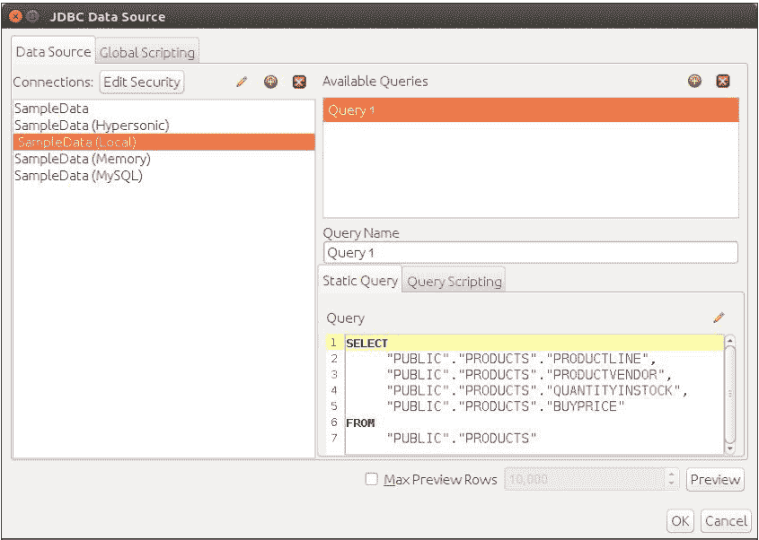

完成后，选择 File | Page Setup 并在 Orientation 面板中勾选 Landscape。然后按 OK 按钮并勾选 Do not change the layout 选项。确认后，从报表元素调色板上拖动图表图标并将其放置到 `Report Header` 频段。拉伸图表元素以覆盖页面的整个宽度，并将元素属性面板中 `size & position` 组中的 `height` 属性设置为 450。此设置将为你的图表提供更大的空间，以便在页面上正确显示。

通过双击图表元素，将显示图表编辑窗口，默认选择柱状图类型。将数据集面板中 `Common` 组中的 `category-column` 属性设置为 `PRODUCTLINE`，将 `value-columns` 属性设置为 `BUYPRICE`。在属性面板中，将 `General` 组中的 `3-D` 属性设置为 true，将 `Legend` 组中的 `show-legend` 属性设置为 false，并将 `Values` 组中的 `show-item-labels` 属性设置为 Show Labels。然后按 OK 按钮并通过按眼睛 (👁) 图标预览生成的报表。以下屏幕截图显示了你的第一个柱状图预览的样子：

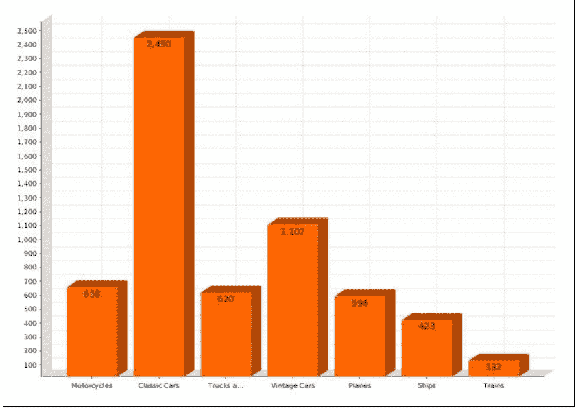


*始终养成自己实验的良好习惯，了解结果图表如何根据一个（或多个）属性的不同值而变化。作为练习，尝试更改一个（或多个）属性并使用预览查看 Pentaho 报表会发生什么。不要担心尝试高级设置，不会发生任何坏事，你只能学习。*

## 折线图

折线图为每个提供的系列在类别之间显示连接线。此图表有助于可视化趋势。折线图利用类别数据集（之前介绍过），以及前面定义的通用属性。以下描述列出了在可用属性方面的所有差异：

- 属性的选项集为此图表类型提供了特定内容：

| 名称 | 类型 | 描述 |
|---|---|---|
| `line-style` | Selection | 设置线系列线的样式。可能的值为：`solid`、`dash`、`dot`、`dashdot` 和 `dashdotdot`。默认值是 `solid`。 |
| `line-size` | Decimal | 设置线系列线的宽度。默认值是 `1.0`。 |
| `show-markers` | Boolean | 设置在适用图表中可见的点标记。默认值是 false。 |
| `horizontal` | Boolean | 如果设置为 true，图表的 x 轴和 y 轴将水平旋转。默认值设置为 false。 |
| `series-color` | Array of strings | 十六进制颜色值的逗号分隔列表。颜色按顺序使用，从数据集返回的第一个值开始。 |

- 通用集具有与柱状图描述相同的属性（通用公共集，以及另外的 `gridlines, show-plot-border`）

- X 轴集具有与柱状图描述相同的属性（不包括 `item-margin`）

- Y 轴和值集在此也提供了与柱状图描述相同的属性

## 折线图示例

作为示例，让我们重用为柱状图描述的相同数据源。从一个空报表开始，选择 File | Page Setup 并在 Orientation 面板中勾选 Landscape。然后按 OK 按钮并勾选 Do not change the layout 选项。确认后，拖动图表 (🖼) 图标并将其放置到 Report Header 频段。拉伸图表元素以覆盖页面的整个宽度，并将元素属性面板中 size & position 组中的 height 属性设置为 450。

通过双击图表元素，将显示图表编辑窗口。从顶部面板中选择折线图图标，并将数据集面板中 Common 组中的 category-column 属性设置为 PRODUCTLINE，将 value-columns 属性设置为 BUYPRICE。在属性面板中，将 Options 组中可用的 show-markers 属性和 horizontal 属性都设置为 true。最后但同样重要的是，将 Legend 组中的 show-legend 属性设置为 false，然后按 OK 按钮，然后通过按眼睛 (👁) 图标预览生成的报表。以下屏幕截图显示了你的第一个折线图预览的样子：

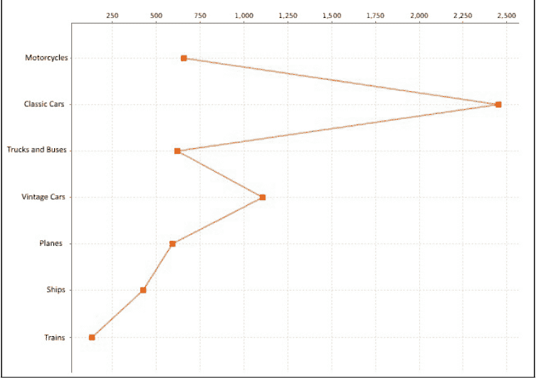


## 区域图

区域图将分类数据集显示为一条线，并填充线下方的区域。根据提供的系列数量，可能出现多个区域。区域图有助于可视化两个或多个数据集之间的差异。区域图使用前面介绍过的分类数据集，以及之前定义过的通用属性。以下描述列出了可用属性方面的所有差异：

- 选项属性集提供的属性与条形图所述的属性相同（不包括 `bar-borders` 和 `bar-max-width`）
- 通用集具有与条形图所述相同的属性（通用公共集，另外还有 `gridlines`、`show-plot-border`）
- X 轴、Y 轴和值集在此也提供了与条形图所述相同的属性

### 区域图示例

例如，让我们重用为条形图描述的相同数据源。从空白报表开始，选择 File | Page Setup 并在 Orientation 面板中勾选 Landscape。然后按下 `ok` 按钮并勾选 Do not change the layout 选项。确认后，拖动图表（📊）图标并将其放置到 `Report Header` 频段。将图表元素拉伸以覆盖页面的整个宽度，并在元素属性面板中将 `size & position` 组中的 `height` 属性设置为 `450`。

双击图表元素后，将显示图表编辑窗口。从上部面板选择区域图图标，并在数据集面板的 `Common` 组中直接将 `category-column` 属性设置为 `PRODUCTLINE`，将 `value-columns` 属性设置为 `QUANTITYINSTOCK, BUYPRICE`。在属性面板中，将 `Legend` 组中的 `show-legend` 属性设置为 `false`，并将 `Values` 组中的 `show-item-labels` 属性设置为 `Show Labels`。然后按下 OK 按钮并通过按下眼睛（👁️）图标预览生成的报表。以下截图显示了您第一个区域图的预览效果：

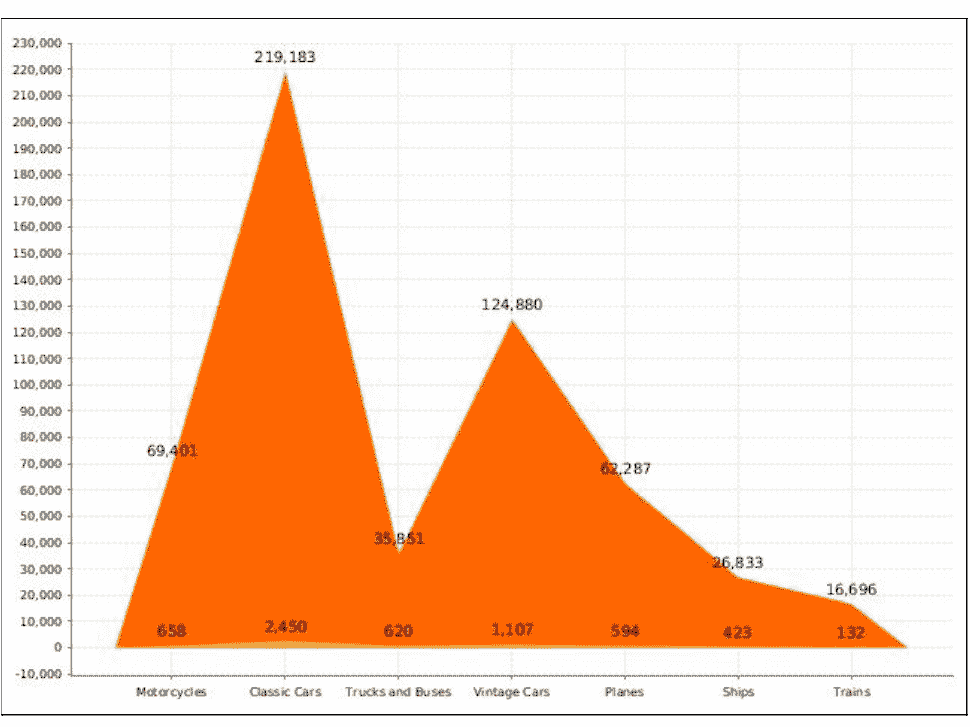


作为练习，尝试将 value-columns 属性的建议顺序从 [QUANTITYINSTOCK, BUYPRICE] 反转为 [BUYPRICE, QUANTITYINSTOCK]。预览报表时，您会看到两个主要变化：最高区域的颜色从橙色变为黄色，且第二个区域（最低的那个）不再可见。这种行为告诉我们值的顺序是相关的，应在报表设计过程中予以考虑。

## 饼图

饼图显示一个切片的、多彩的饼图，其各个切片由各个系列信息组成。饼图使用前面介绍过的饼数据集，以及之前定义过的通用属性。以下描述列出了可用属性方面的所有差异：

- 所需属性集为此图表类型提供了几个额外的属性：

| 名称 | 类型 | 描述 |
|------|------|-------------|
| `ignore-nulls` | Boolean | 指定是否应在图表中引用不存在的数据点。默认值是 true。 |
| `ignore-zeros` | Boolean | 指定是否应将零值数据引用到图表中。默认值是 true。 |

- 选项属性集为此图表类型提供了特定内容：

| 名称 | 类型 | 描述 |
|------|------|-------------|
| `slice-colors` | Array of strings | 十六进制颜色值的逗号分隔列表。颜色按顺序使用，从数据集返回的第一个值开始。 |
| `show-labels` | Selection | 定义是否应显示与图表值对应的标签。定义了两个可能的值：`Show Labels` 和 `Hide Labels`。默认值是 `Hide Labels`。 |
| `label-font` | String | 设置饼图各部分标签的字体。 |
| `label-format` | String | 确定域绘图标签的内容。有三个可能的值，可单独或全部使用：0 表示系列名称；1 表示值；2 表示百分比值。 |
| `rotate-clockwise` | Boolean | 指定数据集返回的值是按从左到右（顺时针）还是从右到左（逆时针）排序。默认值为 true（顺时针）。 |
| `explode-slice` | String | 要在饼图中引爆的系列名称列表。饼切片在 3D 饼图上不会引爆。可能的值为整数，表示您的数据集返回的数据点，从零开始。 |
| `explode-pct` | Decimal | 表示您希望扩展图表半径的百分比的小数值，以便为引爆的饼块腾出空间。值越大，块被引爆得越远。可能的值在 0.0 到 100.0 之间。 |

- 通用属性集提供了一些额外的属性：

| 名称 | 类型 | 描述 |
|------|------|-------------|
| `shadow-paint` | String | 图表阴影的颜色；这是图表后面的区域。按下 ... 按钮以显示可用颜色。 |
| `shadow-x-offset` `shadow-y-offset` | Decimal | 相对于图表的背景阴影坐标。允许负值。 |
| `url-formula` | String | 将链接关联到系列键和类别名称。 |
| `tooltip-formula` | String | 定义 `url-formula` 的工具提示（悬停文本）。 |

- 图例属性集提供了一些额外的属性：

| 名称 | 类型 | 描述 |
|------|------|-------------|
| `legend-label-format` | String | 确定图例标签的内容。有三个可能的值，可单独或全部使用：0 表示系列名称；1 表示值；2 表示百分比值。 |

### 饼图示例

例如，让我们重用为条形图描述的相同数据源。从空白报表开始，选择 File | Page Setup 并在 Orientation 面板中勾选 Landscape。然后按下 OK 按钮并勾选 Do not change the layout 选项。确认后，拖动图表（📊）图标并将其放置到 `Report Header` 频段。将图表元素拉伸以覆盖页面的整个宽度，并在元素属性面板中将 `size & position` 组中的 `height` 属性设置为 `450`。

双击图表元素后，将显示图表编辑窗口。从上部面板选择饼图图标，并在数据集面板中直接将 `value-column` 属性设置为 `BUYPRICE`，将 `series-by-field` 属性设置为 `PRODUCTLINE`。在属性面板中，将 `Legend` 组中的 `location` 属性设置为 `left`，并将 `General` 组中的 `3-D` 属性设置为 `true`。然后按下 OK 按钮并通过按下眼睛（👁️）图标预览生成的报表。以下截图显示了您第一个饼图的预览效果：

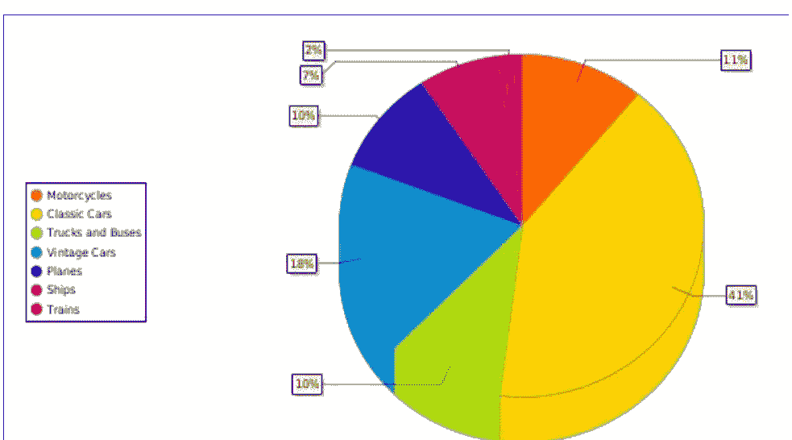

## 多饼图

多饼图基于分类数据集渲染一组饼图。此元图表将各个系列数据渲染为饼图，每个饼图在各个饼图内按各个类别细分。饼图使用前面介绍过的分类数据集，以及之前定义过的通用属性。以下描述列出了可用属性方面的所有差异：

- 标题属性集提供了一个额外的属性：

| 名称 | 类型 | 描述 |
|------|------|-------------|
| `pie-title-font` | String | 设置图表的饼图标题字体 |

- 选项属性集为此图表类型提供了特定内容：

| 名称 | 类型 | 描述 |
|------|------|-------------|
| `by-row` | Boolean | 切换类别和系列结果集。默认值是 true。 |
| `series-color` | Array of strings | 十六进制颜色值的逗号分隔列表。颜色按顺序使用，从数据集返回的第一个值开始。 |
| `show-labels` | Selection | 定义是否应显示与图表值对应的标签。定义了两个可能的值：`Show Labels` 和 `Hide Labels`。默认值是 `Hide Labels`。 |


|  |  | 标签 |
|---|---|---|
| `label-font` | String | 设置饼图各部分标签的字体。 |
| `label-format` | String | 确定域图标签的内容。可使用以下三种可能值中的任意一种或全部：0 表示系列名称；1 表示值；2 表示百分比值。 |
| `pie-no-data-message` | String | 如果饼图没有数据时显示的消息。 |

- 通用集具有与饼图所述相同的属性（通用公共集以及 `shadow-paint`、`shadow-x-offset`、`shadow-y-offset`、`url-formula` 和 `tooltip-formula` 另外）
- 图例集具有与饼图所述相同的属性（图例公共集以及 `legend-label-format` 另外）

## 多饼图示例

例如，让我们重用为条形图描述的相同数据源。从空白报表开始，选择 文件 | 页面设置 并在方向面板中勾选 横向。然后按 确定 按钮并勾选 不要更改布局 选项。确认后，拖动图表（📊）图标并将其放置到 `Report Header` 频带中。将图表元素拉伸以覆盖页面的整个宽度，并将元素属性面板中 `size & position` 组中的 `height` 属性设置为 `450`。

通过双击图表元素，将显示图表编辑窗口。从上部面板中选择区域图表图标，并在数据集面板中直接将 `category-column` 属性设置为 `PRODUCTVENDOR`，将 `value-columns` 属性设置为 `BUYPRICE`，并将 `series-by-field` 属性设置为 `[PRODUCTLINE]`。在属性面板中，在 `Legend` 组中将 `show-legend` 属性设置为 false，并在 `Options` 组中将 `label-format` 属性设置为 `{0}`。然后按 确定 按钮并通过按眼睛（👁️）图标预览生成的报表。以下屏幕截图显示了您第一个饼图的预览效果如下：

### 摩托车
### 经典汽车
### 卡车和公共汽车
### 复古汽车
### 飞机
### 船舶
### 火车

在标签方面，结果并不理想，但它让您了解使用多饼图可以涵盖的潜在用例。

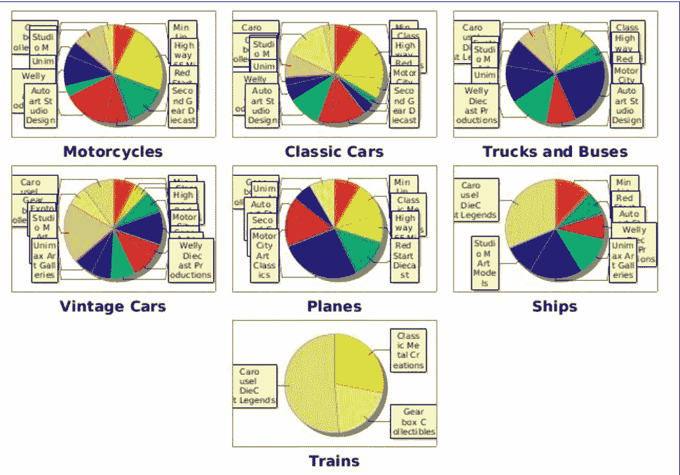

## 柱线图

柱线图结合了柱状图和折线图，允许以分类方式可视化趋势并进行比较。柱线图的独特之处在于它需要两个分类数据集来填充图表：第一个数据集填充柱状图，第二个数据集填充折线图。

> *请注意，柱线图是两个激活数据集面板中名为 Secondary DataSource 的第二个选项卡的图表类型之一。名为 Primary DataSource 的选项卡控制柱状图数据集，而名为 Secondary DataSource 的选项卡控制折线图数据集。*

柱线图使用前面定义的通用属性，包括分类数据集属性。此图表还继承了柱状图和折线图的属性。以下描述列出了可用属性方面的所有差异：

- 柱形选项集定义了与柱状图选项集中所述相同的属性，并增加了一个属性：`ctgry-tick-font`（string），定义图表中范围刻度使用的字体
- 折线选项集定义了与折线图选项集中所述相同的属性，但存在一些差异，描述如下：
  - 此处不可用水平属性
  - `series-color` 重命名为 `line-series-color`。如果未定义，`line-series-color` 使用柱形选项集中的 `series-color` 属性
  - `lines-label-font`（string）定义折线标签使用的字体
- 通用集具有与柱状图所述相同的属性（通用公共集，以及 `gridlines` 和 `show-plot-border` 另外）
- 阴影、x 轴和 y 轴集在此处也提供，其属性与柱状图所述相同

- 在此引入 Y2 轴集，具有以下属性：

| Name | Type | Description |
|---|---|---|
| y2-same-as-y-axis | Boolean | 将 Y2 轴（右侧轴）设置为与 Y1（左侧）轴相同的刻度间隔。 |
| y2-axis-title | String | 设置 Y2（右侧）数值数据轴的标题。 |
| y2-font | String | 设置 Y2（右侧）轴标题的字体。 |
| y2-sticky-0 | Boolean | 如果 Y2（右侧）轴的范围包含零，使其粘性将强制截断轴至零，如果设置为 true。 此属性的默认值是 true。 |
| y2-incl-0 | Boolean | 如果设置为 true，Y2（右侧）轴将强制包含零在轴中。 |
| y2-auto-range | Boolean | 如果设置为 true，Y2（右侧）轴将根据内容自动调整。 |
| y2-min | Decimal | Y2（右侧）轴中要渲染的最小值。 |
| y2-max | Decimal | Y2（右侧）轴中要渲染的最大值。 |
| y2-tick-interval | Decimal | 在图表中分隔 Y2（右侧）刻度的数值间隔值。 |

| y2-tick-font | String | Y2（右侧）轴的范围刻度值的渲染字体。 |
| y2-tick-fmt-str | String | Y2（右侧）轴的数值范围刻度值的 DecimalFormat 字符串。 |
| y2-tick-period | Selection | 如果 Y2（范围）数据集返回日期或时间数据，则指定 Y2（右侧）轴刻度间隔。 |

- 值集具有与柱状图所述相同的属性，其中使用 `show-label`（具有相同的含义、类型、值和行为）代替 `show-item-labels`

## 柱线图示例

例如，让我们重用为条形图描述的相同数据源。从空白报表开始，选择 文件 | 页面设置 并在方向面板中勾选 横向。然后按 确定 按钮并勾选 不要更改布局 选项。确认后，拖动图表图标并将其放置到 Report Header 频带中。将图表元素拉伸以覆盖页面的整个宽度，并将元素属性面板中 size & position 组的 height 属性设置为 450。

通过双击图表元素，将显示图表编辑窗口。从上部面板中选择柱线图图标，并在数据集面板的 Common 组中直接将 category-column 属性设置为 PRODUCTLINE 并将 value-columns 属性设置为 BUYPRICE。现在按 Secondary DataSource 选项卡并再次将 category-column 属性设置为 PRODUCTLINE，将 value-columns 属性设置为 QUANTITYINSTOCK。在属性面板中，在 Line Options 组中将 line-series-color 属性设置为 [#2a0cd0]，在 Legend 组中将 show-legend 属性设置为 false，并在 Values 组中将 show-labels 属性设置为 Show Labels。然后按 确定 按钮并通过按眼睛图标预览生成的报表。以下屏幕截图显示了您第一个柱线图的预览效果如下：

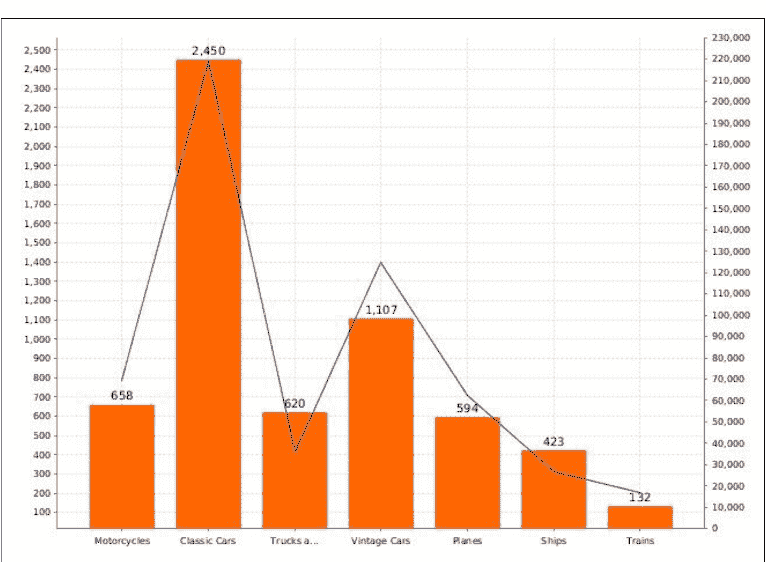

## 环形图

环形图与饼图相同，只是它以环形而非完整的饼形渲染。除了共享与饼图相似的所有属性外，它还在选项集中定义了 `section-depth` 属性（decimal）。

`section-depth` 属性定义环形图将填充圆形的百分比。值越大，环形中心空间越少。可能的值在 0.1 到 1 之间，其中 1 等同于饼图。

## 环形图示例

例如，让我们重用为条形图描述的相同数据源。从空白报表开始，将方向更改为横向并按前面的示例设置图表元素。

通过双击图表元素，将显示图表编辑窗口。从上部面板中选择环形图图标，并在数据集面板中直接将 `value-column` 属性设置为 `BUYPRICE` 并将 `series-by-field` 属性设置为 `PRODUCTLINE`。在属性面板中，将 `Legend` 组中的 `show-legend` 属性设置为 false，将 `section-depth` 属性设置为 0.4，并将 `label-format` 设置为 `{0} - {2}`（两者都在 `Options` 组中）。然后按 确定 按钮并通过按眼睛（👁）图标预览生成的报表。以下屏幕截图显示了您第一个环形图的预览效果如下：

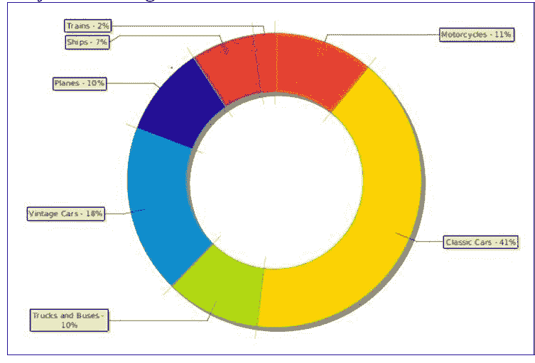


## 气泡图

气泡图允许您查看数据的三个维度。前两个维度是传统的 x 和 y 维度，也称为域和范围。第三个维度通过渲染的各个气泡的大小来表示。气泡图使用之前定义过的通用属性，包括 XYZ 系列数据集属性。以下描述列出了在可用属性方面的所有差异：

- 属性的标题集提供了一个额外的属性：
- 选项属性集提供了之前介绍的一些属性：`horizontal`、`series-color` 和 `label-font`。此外，还有 `max-bubble-size` 属性（十进制），定义首选最大气泡大小，作为所代表气泡值的百分比。可能的值为 1 到 100 之间的整数。
- 通用集具有与饼图描述相同的属性（通用通用集，以及 `shadow-paint`、`shadow-x-offset`、`shadow-y-offset`、`url-formula` 和 `tooltip-formula`）。
- X 轴和 y 轴集在此也提供，与条形图描述的属性相同。
- 值集具有条形图描述的属性的子集（特别是：`show-item-labels`、`item-label-font`、`url-formula` 和 `tooltip-formula`）。
- 图例集具有与饼图描述相同的属性（图例通用集以及 `legend-label-format`）。

| 名称 | 类型 | 描述 |
|------|------|-------------|
| `pos-title` | Selection | 设置显示图表标题的位置。可能的值为：north, west, south, east, top, left, bottom 和 right |

### 气泡图示例

例如，让我们重用为条形图描述的相同数据源。从空白报表开始，将方向更改为横向，并按前面的示例所述设置图表元素。

通过双击图表元素，将显示图表编辑窗口。从上部面板选择气泡图图标，并在数据集面板中直接将 `x-value-columns` 属性设置为 `BUYPRICE`，将 `y-value-columns` 和 `z-value-columns` 属性设置为 `QUANTITYINSTOCK`，并将 `series-by-field` 属性设置为 `PRODUCTLINE`。在属性面板中，将 `max-bubble-size` 属性（在 `Options` 组中）设置为 `100`，然后按 OK 按钮并通过按眼睛（👁️）图标预览生成的报表。以下屏幕截图显示了您第一个气泡图的预览效果：

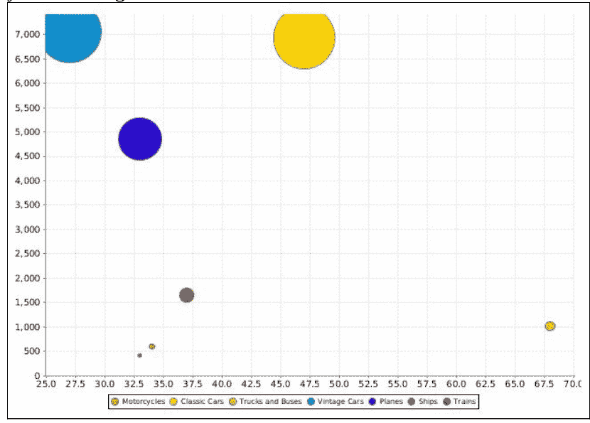

## 散点图

散点图将系列中的所有项目作为点渲染在图表中。此图表类型使用之前定义的通用属性，默认包括 XY 系列数据集属性。作为替代数据集，您也可以选择使用 XYZ 系列数据集或时间序列数据集。您可以使用 Primary DataSource 选项卡上部下拉菜单更改数据集。关于可用属性，以下描述列出了与本章开头介绍的通用列表的所有差异：

- 属性的标题集提供了与气泡图描述相同的属性（标题通用集以及 `pos-title`）。
- 选项属性集提供了之前介绍的一些属性：`stacked`、`horizontal` 和 `series-color`。此外还提供了 `dot-height` 和 `dot-width` 属性（整数），它们定义表示系列点的标记的高度/宽度（以像素为单位）。
- 通用集具有与通用集描述相同的属性，此外还具有 `show-plot-border` 和 `label-font`（请参阅条形图了解其定义）。
- X 轴和 y 轴集在此也提供，与条形图描述的属性相同。
- 值集具有条形图描述的属性的子集（更详细地说：`show-item-labels`、`item-label-font`、`url-formula` 和 `tooltip-formula`）。

### 散点图示例

例如，即使对于这种情况并不完美，让我们重用为条形图介绍的相同数据源。从空白报表开始，将方向更改为横向，并按前面的示例所述设置图表元素。

通过双击图表元素，将显示图表编辑窗口。从上部面板选择散点图图标，并在数据集面板中直接将 `x-value-columns` 属性设置为 `BUYPRICE`，将 `y-value-columns` 属性设置为 `QUANTITYINSTOCK`，并将 `series-by-field` 属性设置为 `PRODUCTLINE`。然后按 OK 按钮并通过按眼睛（👁）图标预览生成的报表。以下屏幕截图显示了您第一个散点图的预览效果：

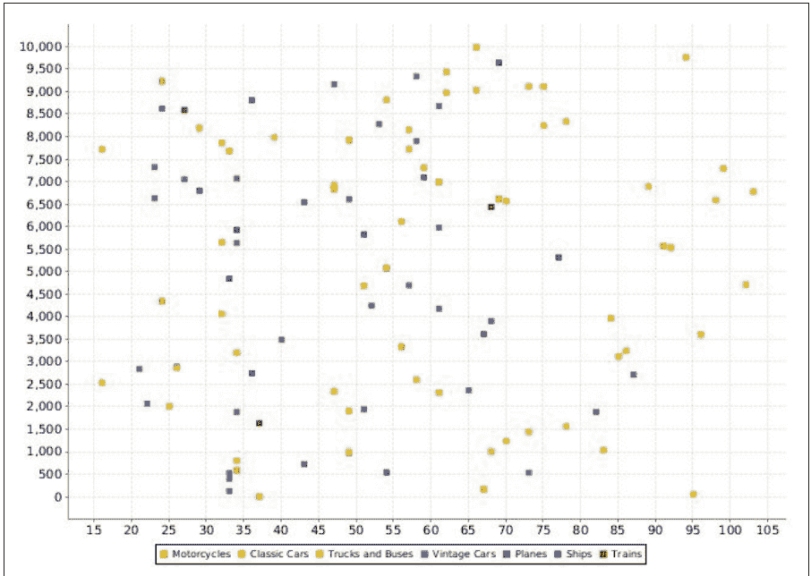

## XY 条形图、XY 折线图和 XY 面积图

XY 条形图、XY 折线图和 XY 面积图将 XY 系列数据集绘制为条形图、折线图或面积图。这些图表类型使用之前定义的通用属性，默认包括 XY 系列数据集属性。作为替代数据集，您也可以选择使用 XYZ 系列数据集或时间序列数据集。您可以使用 Primary DataSource 选项卡上部下拉菜单更改数据集。

关于 XY 条形图的可用属性，以下描述列出了与本章开头介绍的通用列表的所有差异：

- 标题集具有与气泡图描述相同的属性（标题通用集以及 `pos-title`）
- 选项集具有与条形图描述相同的属性，但不包括 `max-bar-width`
- 通用集具有与条形图描述相同的属性，但不包括 `gridlines`
- 阴影集具有与条形图描述相同的属性，但不包括 `shadow-color`
- X 轴集由不同的属性组成，如下所示：

| 名称 | 类型 | 描述 |
|---|---|---|
| `x-axis-title` | String | 设置域轴的标题（如果存在）。在典型的二维水平图表中，这是分类轴或 x 轴。 |
| `x-font` | String | 设置范围轴标题的字体。 |
|  |  |  |

| 属性 | 类型 | 描述 |
|---|---|---|
| `x-sticky-0` | Boolean | 如果范围包含轴中的零，使其粘性将强制轴在设置为 true 时截断到零。此属性的默认值是 true。 |
| `x-incl-0` | Boolean | 如果设置为 true，范围轴将强制包含零在轴中。 |
| `x-auto-range` | Boolean | 如果设置为 true，范围轴将根据内容自动调整。 |
| `x-min` | Decimal | 在范围轴中渲染的最小值。 |
| `x-max` | Decimal | 在范围轴中渲染的最大值。 |
| `x-tick-interval` | Decimal | 在图表中分隔范围刻度的数值间隔。 |
| `x-vtick-label` | Boolean | 设置域轴上刻度标签的方向；垂直为 true，水平为 false。默认值为 false。 |
| `x-tick-font` | String | 渲染范围刻度值的字体。 |
| `x-tick-ftm-str` | String | 渲染数值范围刻度值的 `DecimalFormat` 字符串。 |
| `x-tick-period` | Selection | 如果 x（范围）数据集返回日期或时间数据，则指定 x 轴刻度间隔。 |

- Y 轴集具有与条形图描述相同的属性，但不包括 `y-scale-factor`
- 值集是条形图描述的属性的子集，仅限于 `show-item-labels`、`item-label-font`、`url-formula` 和 `tooltip-formula`

关于 XY 折线图的可用属性，以下描述列出了与本章开头介绍的通用列表的所有差异：

- 标题集具有与气泡图描述相同的属性（标题通用集以及 `pos-title`）
- 选项集具有与折线图描述相同的属性，但不包括 `show-markers` 并包括 `stacked`（在条形图的选项组中引入）
- 通用集具有与条形图描述相同的属性，但不包括 `gridlines`
- X 轴集具有与 XY 条形图描述相同的属性
- Y 轴集具有与条形图描述相同的属性，但不包括 `y-scale-factor`
- 值集是条形图描述的属性的子集，仅限于 `show-item-labels`、`item-label-font`、`url-formula` 和 `tooltip-formula`

关于 XY 面积图的可用属性，以下描述列出了与本章开头介绍的通用列表的所有差异：

- 标题集具有与气泡图描述相同的属性（标题通用集以及 `pos-title`）
- 选项集具有与条形图描述相同的属性，但不包括 `stacked-percent` 并包括 `stacked`（在条形图的选项组中引入）、`line-style`、`line-size` 和 `show-markers`（在折线图的选项组中引入）
- 通用集具有与条形图描述相同的属性，但不包括 `gridlines`
- X 轴集具有与 XY 条形图描述相同的属性
- Y 轴集具有与条形图描述相同的属性，但不包括 `y-scale-factor`
- 值集是条形图描述的属性的子集，仅限于 `show-item-labels`、`item-label-font`、`url-formula` 和 `tooltip-formula`


## XY 柱状图、XY 折线图和 XY 面积图示例

例如，即使对于本例来说并不完美，让我们重用为柱状图介绍的相同数据源。从空白报表开始，将方向更改为横向，并按前例所述设置图表元素。

通过双击图表元素，将显示图表编辑窗口。从上部面板中选择 XY 柱状图图标，并在数据集面板中直接将 x-value-columns 属性设为 BUYPRICE，将 y-value-columns 属性设为 QUANTITYINSTOCK，将 series-by-field 属性设为 PRODUCTLINE。在属性面板中，将 stacked 属性（在 Options 组中）设为 true，然后按 OK 按钮并通过按眼睛（👁）图标预览生成的报表。以下屏幕截图显示了您第一个 XY 柱状图预览的样子：

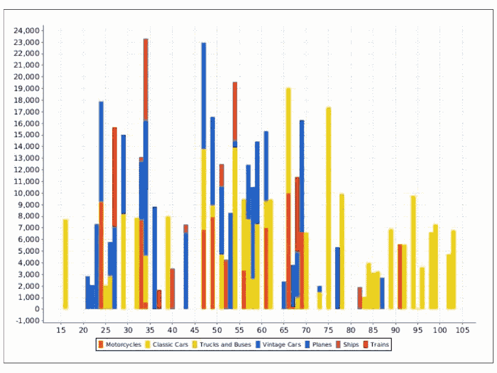

现在再次编辑图表元素，并将图表类型从 XY 柱状图更改为 XY 折线图（从上部面板中选择代表目标图表类型的图标）。按 OK 按钮并使用眼睛（👁️）图标预览生成的报表。以下屏幕截图显示了您第一个 XY 折线图预览的样子：

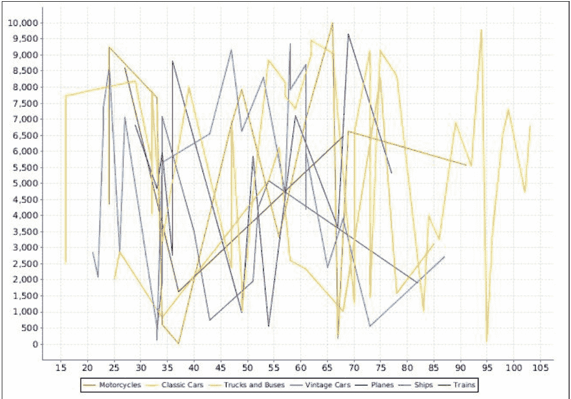

作为最后一个示例，再次编辑图表元素，并将图表类型从 XY 折线图更改为 XY 面积图（从上部面板中选择代表目标图表类型的图标）。在属性面板中，将 stacked 属性（在 options 组中）设为 false，然后按 OK 按钮并通过按眼睛（👁）图标预览生成的报表。以下屏幕截图显示了您第一个 XY 面积图预览的样子：

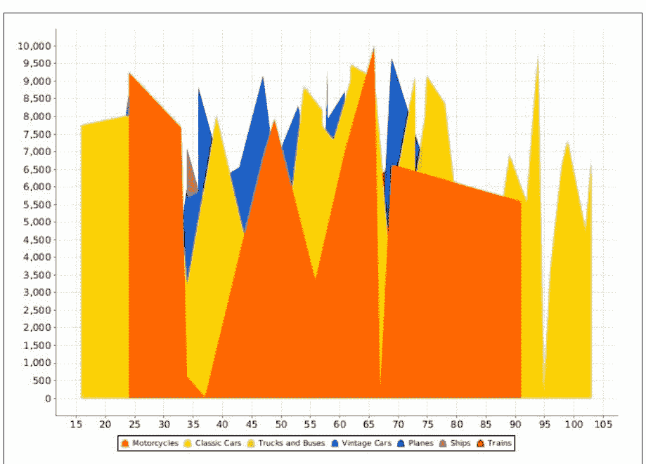

使用示例查询生成的图表并不理想，但它们足以实现我们展示 Jaspersoft Reporting 技术设置和行为的目标。如果您能在您的数据或 SampleData 数据库上定义更好的查询以获得更吸引人的结果，这将是一个很好的练习。

## 扩展 XY 折线图

扩展 XY 折线图允许渲染三种额外的图表类型：阶梯面积图、阶梯图和差异图。阶梯图表类型将 XY 系列数据集显示为一组阶梯，而差异图渲染两个 XY 系列并突出显示两者之间的差异。这些图表类型使用前面定义的标准属性，包括 XY 系列数据集属性作为默认值。作为替代数据集，您也可以选择使用 XYZ 系列数据集或时间序列数据集。您可以使用 Primary DataSource 选项卡上部下拉菜单更改数据集。

关于扩展 XY 折线图可用的属性，以下描述列出了与本章开头介绍的标准列表的所有差异：

- 标题集具有与气泡图所述相同的属性（标题通用集以及 `pos-title`）
- 选项集具有与折线图所述相同的属性，包括 `ext-chart-type`（可能的值为 `StepChart`、`StepAreaChart` 和 `DifferenceChart`）和 `stacked`（在柱状图的选项组中引入）
- 通用集具有与柱状图所述相同的属性，排除 `gridlines`
- X 轴集具有与 XY 柱状图所述相同的属性
- Y 轴集具有与柱状图所述相同的属性，排除 `y-scale-factor`
- 值集是柱状图所述属性的子集，仅限于 `show-item-labels`、`item-label-font`、`url-formula` 和 `tooltip-formula`

## 扩展 XY 折线图示例

例如，从上一个示例（XY 柱状图、XY 折线图或 XY 面积图）开始并编辑图表元素，将图表类型更改为扩展 XY 折线图（从上部面板中选择代表目标图表类型的图标）。在属性面板中，将 `ext-chart-type` 属性（在 `Options` 组中）设为 `StepChart` 并按 OK 按钮。然后使用眼睛（👁）图标预览生成的报表。以下屏幕截图显示了您第一个扩展 XY 折线图预览的样子：

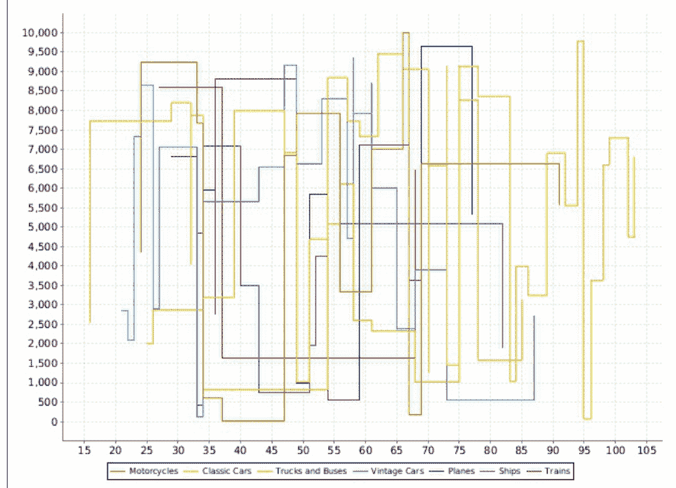


*通过将 `ext-chart-type` 属性（在 `Options` 组中）的值更改为 `StepAreaChart` 重复此练习，然后预览。稍后，将值更改为 `DifferenceChart` 并再次预览。此外，在这些情况下，您也可以通过在您的数据上或直接在 `SampleData` 数据库上定义更好的查询来获得更吸引人的结果。*

## 瀑布图

瀑布图显示一个跨越类别的独特堆叠柱状图。此图表在比较类别彼此之间时很有用。瀑布图中的最后一个类别通常等于所有其他类别的总和以适当渲染，但这基于数据集，而不是图表渲染。以下描述列出了可用属性方面的所有差异：

- 选项集具有柱状图所述属性的子集，仅限于 `horizontal` 和 `series-color`
- X 轴集具有与柱状图所述相同的属性，排除 `item-margin`
- 通用、y 轴和值集具有与柱状图所述相同的属性

## 瀑布图示例

例如，让我们重用为柱状图介绍的相同数据源。从空白报表开始，将方向更改为横向，并按前例所述设置图表元素。

通过双击图表元素，将显示图表编辑窗口。从上部面板中选择瀑布柱状图图标，并在数据集面板中直接将 `category-column` 属性设为 `PRODUCTLINE`，将 `value-columns` 属性设为 `BUYPRICE`。在属性面板中，将 `show-legend` 属性（在 `Legend` 组中）设为 false，并将 `show-item-labels` 属性（在 `Values` 组中）设为 `Show Labels`。然后按 OK 按钮并通过按眼睛（👁️）图标预览生成的报表。以下屏幕截图显示了您第一个瀑布图预览的样子：

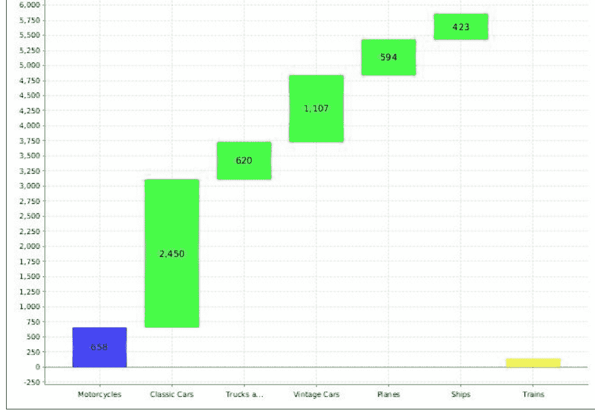

## 雷达图

雷达图渲染一个类似网络的图表，显示分类数据集。雷达图使用分类数据集（之前介绍过），以及前面定义的标准属性。以下描述列出了可用属性方面的所有差异：

- 属性的选项集提供了以下属性：

| 名称 | 类型 | 描述 |
|---|---|---|
| `line-width` | Decimal | 设置线系列线的宽度。默认值是 2.0。 |
| `head-size` | Decimal | 在值线和网格线与分类网格线相交处绘制的椭圆的大小。 |
| `series-color` | Array of strings | 按顺序应用于图表中系列的颜色列表。 |
| `gridline-interval` | Percentage | 确定绘制多少条网格线，以线间距计。例如，20% 将显示 5 条网格线，10% 将显示 10 条网格线。默认值为 25.0% 或四条线。 |
| `radar-web-filled` | Boolean | 确定网络层是否用纯色填充或保留为轮廓。 |

- 通用集具有与通用通用集所述相同的属性，并具有以下附加属性：`url-formula`、`tooltip-formula`（来自柱状图中的值集）和 `gridlines`（来自柱状图中的通用集）
- 此处引入了 Items 集，具有以下属性：

| 名称 | 类型 | 描述 |
|------|------|-------------|
| `label-font` | String | 设置项目标签的字体 |


## 雷达图示例

例如，从之前的示例（瀑布图）开始，通过更改图表元素的图表类型为雷达图（从上方面板中选择代表目标图表类型的图标）来编辑图表元素。然后按下 OK 按钮，并使用眼睛（👁️）图标预览生成的报表。以下截图显示了您第一个雷达图的预览效果：

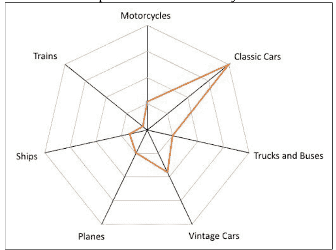

## XY 面积线图

XY 面积线图结合了 XY 面积图和 XY 线图，允许可视化趋势以及进行比较。XY 面积线图的特点是需要两个 XY 系列数据集来填充图表：第一个数据集填充 XY 面积图，第二个数据集填充 XY 线图。与您在条形线图中看到的一样，在这种情况下，主数据源选项卡和次数据源选项卡也都可用。

XY 面积线图使用前面定义过的通用属性，包括 XY 系列数据集属性。该图表还继承了 XY 面积图和 XY 线图的属性。以下描述列出了在可用属性方面的所有差异：

- 标题集具有与 XY 条形图所述相同的属性（标题通用集以及 `pos-title`）。
- 选项集具有与条形图所述相同的属性，但不包括 `max-bar-width`。
- 线选项集由不同的属性组成，介绍如下：

| 名称 | 类型 | 描述 |
|---|---|---|
| `line-series-color` | Array of string | 按顺序应用于图表中线系列的颜色列表 |
| `lines-label-font` | String | 指定每个数据点上方标签的字体 |
| `line-tick-fmt` | String | 指定用于渲染线轴标签的 Java `DecimalFormat` 字符串 |
| `line-tick-font` | String | 定义渲染线轴标签时使用的 Java 字体 |

- 通用集具有与条形图所述相同的属性，但不包括 `gridlines`。
- 值集是条形图所述属性的子集，仅限于 `show-item-labels`、`item-label-font`、`url-formula` 和 `tooltip-formula`。
- *X* 轴集具有与 XY 面积图所述相同的属性。
- *Y* 轴集具有与条形图所述相同的属性，但不包括 `y-scale-factor`、`enable-log-axis` 和 `log-format`，但包括 `y-vtick-label` 属性（十进制），定义 *y* 轴上刻度标签的方向；垂直为 true，水平为 false。默认值为 false。
- *Y2* 轴集具有与条形线图所述相同的属性，但不包括 `y2-tick-fmt-str` 属性。

## 温度计图表

温度计图表以其名称所描述的明显格式显示单个值。温度计是众所周知的“交通灯”指示器的变体，如果您需要快速显示单个数字是否在范围内，则很有用。温度计图表使用温度计数据集（之前已介绍），以及前面定义的通用属性。以下描述列出了在可用属性方面的所有差异：

- 选项集由不同的属性组成，介绍如下：

| 名称 | 类型 | 描述 |
|---|---|---|
| `show-labels` | Selection | 定义是否应显示与图表值对应的标签。定义了两个可能的值：`Show Labels` 和 `Hide Labels`。默认值是 `Hide Labels`。 |
| `label-fonts` | String | 设置标签的字体。 |
| `bulbRadius` | Integer | 温度计灯泡的半径。 |
| `columnRadius` | Integer | 温度计柱的半径。 |
| `thermometerUnits` | Selection | 可能的选项为 `None`、`Fahrenheit`、`Celsius` 和 `Kelvin`。默认值为 `None`。 |
| `criticalRangeHigh` | Integer | 可能值的上限。 |
| `criticalRangeLow` | Integer | 定义为临界的值的下限。 |
| `criticalRangeColor` | String | 如果值处于临界范围内，水银的颜色。可以在此属性中使用第 5 章 *Design and Layout in Report Designer* 中讨论的颜色选择器。 |
| `warningRangeHigh` | Integer | 处于警告范围内的值的上限。 |
| `warningRangeLow` | Integer | 处于警告范围内的值的下限。 |
| `warningRangeColor` | String | 如果值处于警告范围内，水银的颜色。可以在此属性中使用第 5 章 *Design and Layout in Report Designer* 中讨论的颜色选择器。 |
| `normalRangeHigh` | Integer | 处于正常范围内的值的上限。 |
| `normalRangeLow` | Integer | 可能值的下限。 |
| `normalRangeColor` | String | 如果值处于正常范围内，水银的颜色。可以在此属性中使用第 5 章 *Design and Layout in Report Designer* 中讨论的颜色选择器。 |
| `thermometerPaint` | String | 温度计的颜色。可以在此属性中使用第 5 章 *Design and Layout in Report Designer* 中讨论的颜色选择器。 |
| `mercuryPaint` | String | 水银的默认颜色。可以在此属性中使用第 5 章 *Design and Layout in Report Designer* 中讨论的颜色选择器。 |

## 温度计图表示例

例如，让我们重用为条形图引入的相同数据源。从空白报表开始，将方向更改为横向，并按前面示例所述设置图表元素。

通过双击图表元素，将显示图表编辑窗口。从上方面板中选择温度计图表图标，并在数据集面板中直接将 value-column 属性设置为 BUYPRICE。在属性面板中，在 Options 组中，将 criticalRangeHigh 设置为 10000，将 criticalRangeLow 设置为 75000，将 warningRangeHigh 设置为 7500，将 warningRangeLow 设置为 3000，并将 normalRangeHigh 设置为 3000。然后按下 OK 按钮并通过按眼睛（👁）图标预览生成的报表。以下截图显示了您第一个温度计图表的预览效果：


## 在报表中包含迷你图

如果您需要在少量相关数值数据点之间显示趋势，迷你图可能很合适。与图表不同且主要用于标题或分组频带，迷你图通常用于 Pentaho 报表的详细信息中，当然如果这样做有意义的话。


> *迷你图需要以逗号分隔的值作为输入，因此如果您的数据不是这种格式，您必须创建一个函数从数据源中提取数据并在每个数据点之间放置逗号。*

Pentaho Reporting 提供了三种不同的迷你图：`bar-sparkline` 由图标表示，`line-sparkline` 由图标表示，以及 `pie-sparkline` 由图标表示。如常，要使用迷你图，请从 Report Designer 调色板中拖动图标并将其放置在您想要查看图表的位置。所有配置和设置都可以通过元素属性面板进行管理，正如您在第 5 章 *Design and Layout in Report Designer* 中看到的那样，在专门介绍 `bar-sparkline`、`line-sparkline` 和 `pie-sparkline` 元素的部分。

## 摘要

在本章中，您学习了如何在报表中以多种不同的方式集成许多图表类型。您学习了如何配置图表的数据集以及如何自定义报表中每种图表类型的外观。您学习了如何填充分类系列数据集、饼图数据集、XY（和 XYZ）系列数据集、时间序列数据集和温度计数据集。您详细了解了 17 种不同图表类型的数十个属性。您还学习了如何在报表中包含静态和动态图像以及迷你图。

现在您已经阅读了本章，您应该对 Pentaho Report Designer 提供的所有渲染图表（以及图形）的所有方式感到自如。这是在开发复杂的 Pentaho 报表时的一项高级任务，使您成为处理实际用例的专家。

在下一章中，您将了解有关 Pentaho 报表中参数化、函数、变量和公式的更多信息。


## 参数化、函数、变量和公式

在前几章中，您学习了 Pentaho Report Designer、布局和设计，并了解了可用的元素和不同类型的数据源。在本章中，您将首先学习如何参数化报表。随后您将学习报表中可用的所有预定义函数和表达式。从那里开始，您将学习 Pentaho Reporting 的环境变量和公式功能，包括正确的语法和可用的公式方法。

本章作为开发人员和信息技术人员的参考手册编写。目标是分享 Pentaho Report Designer 中可用的关于参数化、函数、变量和公式的所有相关和高级功能。

### 报表参数化

报表参数化允许最终用户通过输入限制报表数据集或触发渲染决策的值来自定义 Pentaho 报表的結果。

报表参数化对于通过用户界面开发用户筛选也很有用。

在以下各节中，您将了解如何使用报表参数化，熟悉所有不同类型的报表参数，并学习如何使用 Pentaho Report Designer 创建和使用它们。在描述报表参数的创建和使用的过程中，将会呈现一个关于报表筛选器的实际示例。

### 使用报表参数

如第 6 章 *Configuring JDBC and Other Data Sources* 中所述，为 Pentaho Reporting 提供数据有许多不同的选项。它们都归类在 *data sources* 名称下，每种不同类型的数据源都有其自己的功能、语法和使用原因。

由于语法和功能不同，每种数据源类型使用其底层方法来参数化查询。例如，XPath、Kettle 和 MDX 的默认语法通过各自的 `DataFactory` 实现得到支持。每种数据源查询语法定义了如何指定参数，而 Pentaho Reporting 通过 `DataRow` API 提供这些参数。参数管理的两个例外包括 SQL 和静态数据。在 JDBC 中指定 SQL 语句时，您通常会指定问号来表示应指定哪些参数。

Pentaho Reporting 要求您按名称指定参数，因此在将查询传递给 JDBC 之前会对 SQL 查询进行一些解析。您可以将参数指定为 `${PARAM}`，并且 `SQLReportDataFactory` 会在执行准备好的 JDBC 调用之前用问号 (?) 替换每个命名参数。`NamedStaticDataFactory` 允许执行带参数的 Java 类方法。在配置 `DataFactory` 时提供的名称用于从提供的 `DataRow` 中解析值。

以下是包含一个名为 `productLine` 的参数的 SQL 查询示例，该参数在 `SampleData` 模式的 `PRODUCTS` 表上过滤产品的线：

```
SELECT
  *
FROM
  PRODUCTS
WHERE
  PRODUCTLINE = ${productLine}
```

*请注意，参数是与一组属性一起定义的（您将在以下各节中更好地看到这一点）。*


这意味着参数值的自动替换实际上取决于这些属性，并且在开发查询字符串时应考虑这一点。如果未这样做，查询可能会失败；例如，在 SQL 命令定义了单个值 WHERE 条件的地方提供了多值参数。

### 可用的报表参数类型

Pentaho Reporting 提供了一套丰富的不同参数，每个参数在 Pentaho Report Designer 或任何其他前端工具中呈现方式各不相同（您将在第 15 章 *Using Reports in Pentaho Business Analytics Platform* 中看到一个示例）。以下列表分享了 Pentaho Reporting 8.0 中可用的所有参数类型：

- **Drop-down**：定义典型的下拉列表并允许单值选择
- **Single value list**：定义包含值列表的面板并允许单值选择
- **Multi-value list**：定义包含值列表的面板并允许多选
- **Radio button**：定义包含值列表的面板并以单选按钮样式允许单值选择
- **Checkbox**：定义包含值列表的面板并以复选按钮样式允许选择
- **Single selection button**：定义包含按钮列表的面板（一值一个按钮）并允许单选
- **Multi-selection button**：定义包含按钮列表的面板（一值一个按钮）并允许多选
- **Textbox**：定义文本字段
- **Text area**：定义文本区域字段
- **Date picker**：定义用户友好的界面以选择单个日期/时间值

将 Pentaho Reporting 嵌入到自定义应用程序中时，渲染参数是嵌入程序的责任，如以下示例所示。所有参数类型都可以指定数据源用于填充可能的选项，以及用于验证。可以通过参数化用于填充选项的数据源来嵌套参数。例如，顶层的下拉参数，如国家，可以驱动二级单选按钮参数，如地区。查询按其在数据源列表中出现的顺序执行。

多值列表、复选框和多选按钮参数类型允许选择多个类型。这些参数类型返回值的数组而不是单个值。数据源，包括 SQL，具有特殊逻辑，可将生成的查询中的值数组映射。

### 创建参数

从 Report Designer 用户界面开始，您应该已经熟悉报表资源管理器（您可以在右上角面板中找到它）。报表资源管理器由两个不同的标签组成：Structure 和 Data。在前几章中，您已经使用过这两个标签，而 Data 标签是所有参数所在的位置。以下屏幕截图显示了报表资源管理器的外观


定义了两个参数：

您可以通过右键单击 Parameters 项并选择 Add Parameter... 来创建新参数。作为替代，您可以单击报表资源管理器中的参数图标或使用上部菜单，选择 Data | Add Parameter... 项。

一旦选中，会出现一个类似以下内容的模态窗口：


如您在左面板中看到的，您可以管理报表数据源，如您在第 6 章 *Configuring JDBC and Other Data Sources* 中所见，因为它们可以在参数定义中使用。右面板列出了定义参数所有属性的一组字段。面板在上部与属性相关分组，并且 Prompt 组用于设置参数的呈现方式。在下表中，为便于理解介绍了所有属性：

| Name | Type | Description |
|---|---|---|
| Name | String | 参数的名称。此属性将在数据源定义中使用，因此请仔细定义。 |
| Label | String | 在用户界面中显示以请求字段值的标签。 |
| Label Formula | String | 动态定义标签值的公式。 |
| Value Type | Selection | 参数的数据类型。可能的值为：String、Boolean、Number、Date、Date (SQL)、Time、Timestamp、Double、Float、Integer、Long、Short、Byte、BigInteger、BigDecimal、TableModel 和 Object。 |
| Data Format | String | 用于数字、日期、时间戳等的数据格式字符串。 |
| Data format formula | String | 动态定义格式值的公式。 |
| Default Value | String/array of strings | 参数的默认值。如果参数为多值，则值可以指定为数组。 |


| 默认值公式 | 字符串 | 动态定义默认值/值的公式。 |
| 后处理公式 | 字符串 | 定义对参数值进行后处理操作的公式。 |
| 必填 | 布尔 | 如果设置为 true，参数不能为空。默认值为 false。 |
| 隐藏 | 布尔 | 如果设置为 true，参数对用户不可见（但已定义）。默认值为 false。 |
| 显示类型 | 选择 | 从可能的 参数类型列表中选择的参数类型。 |
| 查询 | 选择 | 用于定义参数可能值的数据源。 |
| 值 | 选择 | 用于定义参数可能值的数据源字段。 |
| 显示名称 | 选择 | 用于定义参数可能显示名称的数据源字段。此属性仅在提供显示名称时可用。 |
| 显示值公式 | 字符串 | 定义参数显示名称的公式。此属性仅在提供显示名称时可用。 |
| 可见项 | 整数 | 可见项数。仅适用于多值参数。默认值为 0。 |

一旦所有请求的属性都已定义，点击 OK 按钮以创建参数并在报表资源管理器的 Data 选项卡中看到它列出。

## 使用参数创建报表

在本节中，让我们通过一个实际示例来展示报告参数如何在实践中创建和使用。与往常一样，这只是一个可以完成的事情的示例，但这是一个非常常见的需求，你将来肯定会重复使用。此示例展示了如何开发两个级联参数，其中一个取决于另一个的值。

更详细地说，让我们开发一个非常简单的报表，描述 SampleData 模式的 customers 表中可用的客户列表。正如你在第 6 章 Configuring JDBC and Other Data Sources 中所学到的，第一步是定义一个空报表（使用新建空报表图标（ ））。完成后，创建三个新的数据源（分别命名为 Details、cities 和 Countries），如下图所示：


Details 查询定义了报表详情并依赖于两个参数：国家和城市参数。cities 查询定义了特定国家中可能的城市列表。如你所见，查询使用国家参数来过滤给定国家中已有的城市。国家参数的这种使用定义了将要定义的两个参数之间的依赖关系。Countries 查询定义了可能的国家列表。一旦查询定义完成，请记住通过在报表资源管理器的 Data 选项卡中右键单击它并点击 Select Query 来选择 Details 查询。

现在数据源已正确设置，让我们从 Details 查询中拖动 COUNTRY、CITY 和 CUSTOMERNAME 字段并将其放置在 Details 频带中，如下图所示。请注意将 CUSTOMERNAME 字段拉伸以覆盖整个空间直至页面的右边缘。


为完成报表，让我们创建两个参数。如前所述，点击报表资源管理器中的参数图标并填写模态窗口，如下图所示左侧所述。此任务将创建国家参数。通过再次点击报表资源管理器中的参数图标并填写模态窗口，如下图所示右侧所述，来重复创建城市参数：


完成后，使用眼睛图标预览报表，你将在面板顶部看到两个交互式参数出现。花点时间与它们互动，改变国家参数的值并检查城市参数如何相应地变化。选择城市参数的值将相应地改变生成的报表。以下截图显示了如何


报表参数在报表预览中的外观：


在 https://github.com/fcorti/pentaho-8-reporting-for-java-developers 仓库中，具体在 chapter 08 - Parametrization, functions, variables and formulas/my_repo 目录下，你可以找到 sample_with_parameters.prpt 报表，它完全实现了这里描述的示例。随意使用 Report Designer 打开它并探索其设置和参数，以了解所有高级功能及其行为。

## 函数和表达式

Pentaho Reporting 在报表创建期间提供了许多可使用的函数和表达式。Pentaho Reporting 中的函数用于计算计算值，而 Pentaho Reporting 中的表达式是作用域仅限于当前数据集行的函数。函数可以维护状态，具有访问多行数据的能力。

## Report Designer 中的函数和表达式

从 Report Designer 用户界面开始，由于作用域不同，函数和表达式位于两个不同的位置。函数可以在报表资源管理器中找到，特别是在 Data 选项卡下的 Functions 组中。以下截图显示了报表资源管理器在定义了两个函数时的外观：


表达式与数据集相关，位于不同的位置：在元素属性面板中。具体来说，表达式位于面板的每个属性上，在显示图标的表格的第四列中。有两种可能的图标：绿色加号图标（🟢），表示未定义表达式，以及铅笔图标（✏️），表示已定义表达式。以下示例显示了两个属性：text-color 属性的静态值已填写而表达式为空，以及 bg-color 属性的静态值为空而表达式已填写。


> 如果为属性定义了表达式，则包含静态值的第三列将被忽略。此行为在报表设计期间很重要，如果你不了解它，可能会造成困扰。

## 创建和使用函数

从 Report Designer 用户界面开始，具体在报表资源管理器的 Data 选项卡中，你可以通过右键单击 Functions 项并选择 Add Function... 来创建新函数。作为替代，你可以点击函数图标（fx）或使用顶部菜单，选择 Data | Add Function... 项。

一旦选择函数创建，一个模态窗口会出现，类似于以下所示。该窗口包含可用函数类型的列表，按组分组以便更好地理解。展开右侧组，你可以选择要在报表中使用的函数类型。


一旦为你的需求选择了正确的函数类型，一个全新的函数将出现在报表资源管理器的 Data 选项卡列表中。选择新函数后，元素属性面板将显示所有可用属性，就像报表的常规元素一样。在以下各节中，将为每种函数类型介绍所有属性。

在报表中使用函数的方式与你在前几章中看到的其他报表元素完全相同：从 Data 选项卡拖动函数并将其放置在首选位置，直接放置在报表的频带中。

## 函数示例

例如，让我们重用在第 4 章 *Creating a Report with Report Designer* 中开发的名为 `report_01.prpt` 的报表。如果你遵循了建议，你应该在你的开发环境中的 `my_report` 文件夹中有该报表。如果没有，你可以从 https://github.com/fcorti/pentaho-8-reporting-for-java-developers 仓库下载，从 `Chapter 04 - Creating a report with Report Designer/my_reports` 路径。

目标是为此报表添加页码。此示例非常基础，但在你未来的开发中将非常有用。

一旦报表在 Report Designer 中打开，按本章前面解释的方式创建新函数：在报表资源管理器中选择 Data 选项卡，然后点击函数图标（fx）。对于函数类型，展开 `Common` 并选择 `Page`。一旦点击 OK 按钮，一个名为 `PageFunction1` 的新函数将被创建。


> *花点时间在从报表资源管理器的 Data 选项卡中选择新函数时检查元素属性面板中的属性。此时，你应该对属性的含义更有信心，并且可以轻松预测其目标和预期行为。*

现在名为 `PageFunction1` 的新函数可用，从报表资源管理器的 Data 选项卡中拖动它并将其放置在页脚的中央。为了达到完美，你还应通过点击顶部工具栏上的图标来居中内容的对齐方式。完成后，使用眼睛图标（👁）预览报表，你将看到如下图所示的页码。使用工具栏中的箭头图标 « ‹ › » 更改页面并检查结果。


|  |  |  |
|---|---|---|
| 首席技术官 | 405,985 | 459,650 |
| 工程副总裁 | 383,242 | 443,405 |
| 高级工程师 | 770,272 | 719,855 |
| 工程师 | 695,925 | 666,750 |
| QA 经理 | 374,863 | 437,420 |


*在 https://github.com/fcorti/pentaho-8-reporting-for-java-developers 仓库中，具体在 `Chapter 08 - Parametrization, functions, variables and formulas/my_reports` 路径下，你可以找到 `sample_with_page_numbering.prpt` 报表，它实现了这里描述的示例。欢迎使用 Report Designer 打开它并调整设置和参数，以了解所有高级功能和高级行为。*

## 创建和使用表达式

从 Report Designer 用户界面开始，具体来说在元素属性面板中，你可以通过点击绿色加号图标（⊕）为属性创建新的表达式。按下后，会出现类似以下内容的模态窗口：


在模态窗口中，你可以在顶部识别出一个下拉菜单，用于选择要定义的表达式类型，并在其下方有一个用于设置可用属性的面板（如果是 Open Formula，还会有 Formula 选项卡）。查看可用的表达式类型，它们正是之前介绍的函数类型的一个子集。关于这一点，我们可以观察到：

- 表达式和函数之间名称相同的类型具有完全相同的属性名称和行为。
- 既不是表达式类型也不存在的函数类型与数据集无关。如果考虑到表达式的定义（表达式是作用域仅限于当前数据集行的函数），这很有意义。


考虑到我们已在函数的描述中包含了表达式的描述（和行为），在以下各节中你将继续了解函数的细节，只需假定表达式具有相同的属性和行为。

```
= IF( ISEVEN(ROWCOUNT()); "#d2e8f4"; "white" )
```

## 可用的函数类型

在本节中，你将了解所有可用的函数类型。如本章前面介绍的那样，Report Designer 中每个函数都根据其所属的组进行分类。接下来你将为每个组找到一个部分，其中包含内容的简要介绍以及完整的属性和设置列表。

在描述每个组的特定属性之前，让我们先介绍所有组的通用属性：

| 名称 | 类型 | 描述 |
|---|---|---|
| 函数名称 | String | 用于在元素、公式和其他函数中引用函数或表达式 |
| 依赖级别 | Integer | 用于确定执行函数的顺序 |


包含在名为 Deprecated 和 Internal Function（请勿使用）的组中的函数将不予描述。原因很明显——你不应该使用它们。

## 通用函数

通用函数包括 Pentaho Report Designer 中最常用的函数：

此函数计算本章后面定义的 LibFormula 公式。此函数的属性如下：

| 名称 | 类型 | 描述 |
|------|------|-------------|
| 公式 | String | 要计算的公式。点击 ... 按钮将显示公式编辑器。有关详细信息，请参阅专门介绍公式主题的部分。 |
| 依赖级别 | Integer | 用于确定执行函数的顺序。 |

此函数返回当前页码。此函数的属性如下：

| 名称 | 类型 | 描述 |
|------|------|-------------|
| 页面增量 | Integer | 每次翻页时增加计数的数值 |
| 起始页码 | Integer | 开始计数的页码 |
| 重置于组名称 | String | 如果设置此值，则在命名组出现时页面总计值将被重置 |

总页数

此函数计算报表中的总页数。此函数定义的属性与之前介绍的相同：页面增量、起始页码和重置于组名称。

页码/总页数

此函数返回一个字符串，显示当前页码和总页数。此函数定义的属性在以下表格中描述，除页面增量、起始页码和重置于组名称外：

| 名称 | 类型 | 描述 |
|---|---|---|
| 格式模式 | String | 用于将当前页码和总页数渲染成的格式字符串。默认值是 `{0} / {1}: {0}` 以渲染当前页码；`{1}` 以渲染总页数。 |

## 报表函数

报表函数与报表的渲染相关：

| 名称 | 描述 |
|------|-------------|
| `Is Export Type` | 此函数如果报表字符串的导出类型以提供的导出类型属性开头则返回 true。此函数有一个属性如下： |
| `Row Banding` | 行条纹函数管理报表中行的背景颜色变化。此函数定义的属性在以下表格中描述，另外还有 `Reset on Group Name`： |

| 名称 | 类型 | 描述 |
|------|------|-------------|
| `Export Type ID` | String | 与报表导出类型字符串进行比较的字符串 |

| 名称 | 类型 | 描述 |
|------|------|-------------|
| `Number of Rows` | String | 在更改条纹颜色之前要渲染的行数 |
| `Active Banding Color` | String | 主要条纹颜色 |
| `Inactive Banding Color` | String | 次要条纹颜色 |
| 新组时重置状态 | Boolean | 如果设为 true，则对每个新组重置条纹颜色 |
| 新页时重置状态 | Boolean | 如果设为 true，则对每个新页重置条纹颜色 |
| 忽略交叉表 | Boolean | 如果设为 true，则不应用于交叉表 |

隐藏重复

此函数隐藏项目带中指定字段的重复元素。此函数定义的属性在以下表格中描述。

| 名称 | 类型 | 描述 |
| 字段名称 | String | 用于观察变化的字段 |
| 应用于命名元素 | String | 项目带中要隐藏的元素 |
| 忽略所有组分页 | Boolean | 如果设为 false，此函数将在组分页时重置自身 |
| 忽略所有页分页 | Boolean | 如果设为 false，此函数将在页分页时重置自身 |

隐藏页眉和页脚

如果导出类型不可分页，此函数会隐藏页眉和页脚。此函数定义的属性在以下表格中描述：

| 名称 | 类型 | 描述 |
|---|---|---|
| 导出描述符 | String | 此属性用于确定当前报表导出类型是否应禁用页眉和页脚。其默认值是 `table`。 |
| 隐藏页面带 | Boolean | 如果设为 true，则隐藏页面带。 |
| 禁用重复标题 | Boolean | 禁用任何重复的组页眉和页脚。 |

| 显示页脚 | 此函数隐藏除最后一页外的页脚。它没有其他属性。 |

## 汇总函数

汇总函数在报表处理的第一个阶段计算值，并在报表渲染期间使这些值可用：

| 名称 | 描述 |
|------|-------------|
| Sum | 此函数在报表的准备运行阶段对组内的字段求和，使总组和在报表生成的后续阶段可用。此函数定义的属性在以下表格中描述，另外还有字段名称和重置于组名称： |
| Count | 此函数在报表的准备运行阶段对组内的行计数，使总组计数在报表生成的后续阶段可用。此函数定义的属性与之前介绍的相同：重置于组名称和交叉表列过滤器。 |
| Count for Page | 此函数与 Count 函数相同，但也在每个页面的开头重置。 |
|  | 此函数在报表的准备运行阶段计算报表中组的出现次数，使总组计数在报表生成的后续阶段可用。此函数定义的属性在以下表格中描述： |

| 名称 | 类型 | 描述 |
|------|------|-------------|
| 交叉表列过滤器 | String | 用于在交叉表中过滤的字段 |

| 名称 | 类型 | 描述 |
|---|---|---|


## 组计数

| 名称 | 类型 | 描述 |
|------|------|------|
| 计数组名称 | 字符串 | 应计数的组的名称。如果设置为空，则统计父组内的所有组。 |
| 重置于父组名称 | 字符串 | 重置计数的组的名称。如果设置为空，则统计整个报表中的子组。 |

## 最小值

确定报表中指定字段的全局最小值。此函数的定义属性与前面介绍的相同：字段名称、重置于组名称 和 交叉表列过滤器。

## 最大值

确定报表中指定字段的全局最大值。此函数的定义属性与前面介绍的相同：字段名称、重置于组名称 和 交叉表列过滤器。

## 求和商

此函数对被除数和除数求和，然后将两者相除得到结果值，使用 Sum 函数对值求和。此函数的定义属性在下表中描述，除重置于组名称 和 交叉表列过滤器 外：

| 名称 | 类型 | 描述 |
|------|------|------|
| 被除数字段 | 字符串 | 此除法计算的被除数字段。 |
| 除数字段 | 字符串 | 此除法计算的除数字段。 |
| 舍入模式 | 整数 | Java 的 BigDecimal 舍入模式。请参阅 Java 文档以获取值。 |
| 精度 | 整数 | 返回的商的精度。默认值是 14。 |

| 名称 | 描述 |
|------|------|
| `Sum Quotient Percent` | 此函数是 `Sum Quotient` 函数的扩展，仅将最终结果乘以 100。它与 `Sum Quotient` 函数共享相同的属性。 |
| `Calculation` | 此函数在报表生成的准备运行阶段存储计算字段的结果，以便在报表中稍后访问。此函数的定义属性与前面介绍的相同：`Field Name`、`Reset on Group Name` 和 `Crosstab Column Filter`。 |
| `Sum for Page` | 此函数与 `Count` 函数相同，但在每个页面的开头也会重置。 |
| `Count for Page (Running)` | 此函数与 `Count` 函数相同，但会维护数据集中当前行数的数值，并在每个页面的开头重置。 |

## 运行函数

运行函数在报表渲染期间计算值，允许在整个报表中进行增量聚合信息。

| 名称 | 描述 |
|------|------|
| 求和（运行） | 计算报表中指定字段在行数上的总和值。此函数的定义属性与前面介绍的相同：字段名称、重置于组名称 和 交叉表列过滤器。 |
| 计数（运行） | 维护数据集中当前行数的数值。此函数的定义属性与前面介绍的相同：重置于组名称 和 交叉表列过滤器。 |
| 组计数（运行） | 此方法统计报表中组的出现次数。此函数的定义属性与前面介绍的相同：计数组名称 和 重置于父组名称。 |
| 计数不同（运行） | 此方法统计指定字段中值的不同出现次数。此函数的定义属性在下表中描述，除字段名称、重置于组名称 和 交叉表列过滤器 外。 |
| 平均值（运行） | 计算报表中行数内指定字段的平均值。此函数的定义属性与前面介绍的相同：`Field Name`、`Reset on Group Name`、`Rounding mode` 和 `Scale`。 |
| 最小值（运行） | 确定报表中行数上指定字段的最小值。此函数的定义属性与前面介绍的相同：`Field Name` 和 `Reset on Group Name`。 |
| 最大值（运行） | 确定报表中行数上指定字段的最大值。此函数的定义属性与前面介绍的相同：`Field Name` 和 `Reset on Group Name`。 |
| 总计百分比（运行） | 通过对所有数据行求和并将当前行除以总和来计算指定字段的百分比值。此函数的定义属性在下表中描述，除 `Field Name`、`Reset on Group Name`、`Crosstab Column Filter`、`Rounding mode` 和 `Scale` 外。 |

| 名称 | 类型 | 描述 |
|------|------|------|
| 忽略空值 | 布尔值 | 如果为 true，计数器将不考虑空值。默认值是 false。 |

| 名称 | 类型 | 描述 |
|------|------|------|
| `Scale Result To 100` | 布尔值 | 如果为 true，则将值乘以 100 |

## 高级函数

高级函数包括专门且通常不使用的函数：

| 名称 | 描述 |
|------|------|
| 消息格式 | 根据当前数据行格式化消息。此函数的定义属性在下表中描述。 |
| 资源消息格式 | 从资源包返回格式化的消息。此函数的定义属性在下表中描述，除 Null-String 外。 |

| 名称 | 类型 | 描述 |
|------|------|------|
| 消息模式 | 字符串 | 要渲染的字符串模式，其中行数据由 ${FIELD} 引用 |
| 编码 | 字符串 | 如果设置了 URL 编码属性，则使用此编码 |
| URL 编码所有值 | 布尔值 | 对消息中渲染的各个行数据进行编码 |
| URL 编码结果 | 布尔值 | 对最终结果进行编码 |
| 空字符串 | 字符串 | 如果引用的字段为空，则要渲染的值 |

| 名称 | 类型 | 描述 |
|------|------|------|
| 资源包标识符 | 字符串 | 资源包的名称 |
| 模式的资源键 | 字符串 | 要渲染的格式字符串，可能包含对当前行字段的引用，使用 ${FIELD} 语法 |

## 查找

此函数允许您根据键匹配在不同的字符串之间进行选择，基于键匹配的值。此函数的定义属性在下表中描述，除字段名称 和 空值 外：

| 名称 | 类型 | 描述 |
|------|------|------|
| 回退值 | 字符串 | 如果没有键匹配字段值，则返回此值。 |
| 键值 | 字符串数组 | 与字段进行比较的值。每个键应有一个对应的文本值。 |
| 文本值 | 字符串数组 | 它是一个字符串列表。根据哪个键匹配字段值，从列表中选择一个字符串。 |
| 匹配时忽略大小写 | 布尔值 | 如果设置为 true，则在进行键比较时忽略大小写。 |

## 间接查找

此函数允许您根据键匹配在不同的列之间进行选择，基于键匹配的值。此函数的定义属性在下表中描述，除 `Field Name`、`Key Values`、`Null Value` 和 `Ignore Case When Matching` 外：

| 名称 | 类型 | 描述 |
|------|------|------|
| 回退转发字段 | 字符串 | 如果没有键匹配字段值，则返回此字段的值。 |
| 转发字段列表 | 字符串数组 | 它是一个字段列表。根据哪个键匹配字段值，从列表中选择一个字段。 |

## 资源包查找

根据字段提供的键从资源包返回一个值。此函数的定义属性在下表中描述，除 `Field Name` 外：

| 名称 | 类型 | 描述 |
|------|------|------|
| 资源包标识符 | 字符串 | 资源包的名称 |

## 开放公式（高级）

此函数是公式表达式的有状态版本。此函数的定义属性在下表中描述，除 `Formula` 外：

| 名称 | 类型 | 描述 |
|------|------|------|

| | 初始化公式 | 字符串 | 如果指定，此公式将在 `Formula` 函数首次调用时被求值，而不是求值默认公式 |

## 图表数据和值数据函数

图表相关函数已在前一章中详细介绍，因此在此列表中无需重复说明，其属性和行为完全相同。值相关函数主要包含 `Thermometer DataSet Collection`，已在前一章中介绍过。

## 图片函数

如图表和值数据函数所述，图片相关函数已在前一章中详细介绍，因此在此列表中无需重复说明，其属性和行为完全相同。

## 脚本函数

脚本函数可通过各种脚本语言轻松自定义报表：

| 名称 | 描述 |
|------|-------------|
| `Bean-Scripting Framework (BSF)` | 该函数使用 Apache 的 Bean Scripting Framework 生成结果。有关 Bean Scripting Framework 的更多信息，请参阅 http://jakarta.apache.org/bsf for more information on the Bean Scripting Framework。The properties defined for this function are described in the following table: |
| `BeanShell (BSH)` | 该函数使用 BeanShell 框架生成结果。有关 BeanShell 的更多信息，请参阅 http://www.beanshell.org for more information on BeanShell。该函数定义的属性与之前为 `Expression` 引入的属性相同。 |

| 名称 | 类型 | 描述 |
|------|------|-------------|
| `Expression` | String | 在指定编程语言中定义的表达式 |
| `Expression Programming Language` | String | 表达式中使用的编程语言 |
| `Initialization Script` | String | 在指定编程语言中定义的脚本，在脚本语言环境初始化期间执行 |

## 目录函数

目录和索引在第 5 章 *Report Designer 中的设计和布局* 中作为报表元素引入。以下是与同一主题相关的函数说明：

| 名称 | 描述 |
|------|-------------|
| `Index Text Generator` | 它生成一个文本，作为定义漂亮目录的字符串集合。该函数定义的属性在下表中描述： |
| `Index Number Generator` | 它生成一个整数数组，定义漂亮的目录。该函数定义的属性与之前引入的属性相同：`Collect Details` 和 Depth。 |

| 名称 | 类型 | 描述 |
|------|------|-------------|
| `CollectDetails` | Boolean | 定义是否应在数据收集中包含明细项。 |
| `indexSeparator` | String | 定义索引元素之间使用的分隔符文本。默认为 .. |
| `Depth` | Integer | 定义目录的层级数。 |
| `Condensed Style` | Boolean | 定义是否在连续页码之间使用 -；例如，1, 2, 3, 4 将显示为 1-4。 |

| 名称 | 描述 |
|------|-------------|
| Index Generator | 索引生成器函数已在第 5 章 *Report Designer 中的设计和布局* 中详细介绍，因此在此无需重复说明，其属性和行为完全相同。 |
| Table of Contents Generator | 目录生成器函数已在第 5 章 *Report Designer 中的设计和布局* 中详细介绍，因此在此无需重复说明，其属性和行为完全相同。 |

## 环境变量

如果您将 Pentaho 报表发布到 Business Analytics Platform（有关介绍，请参阅第 15 章 *在 Pentaho Business Analytics Platform 中使用报表*），您可以使用某些环境变量来自定义和控制行为。环境变量在创建 Pentaho 报表时默认可用，并位于报表资源管理器的 Data 选项卡中。以下屏幕截图显示了报表资源管理器在展开环境变量时的外观：


环境变量可像往常一样通过拖放将其放置到报表中的正确位置。以下是变量列表及其简要含义说明：

| 名称 | 描述 |
|------|-------------|
| `env:hostColonPort` | Business Analytics Platform 的主机名和端口号。 |
| `env:locale` | 有关请求报表的客户端区域设置的信息。`env:locale-language` 和 `env:locale-short` 是另外两个可用的变量。 |
| `env:pentahoBaseURL` | Business Analytics Platform 的完整 URL，如 base URL 属性中设置的那样。 |
| `env:requestURL` | 资源的请求的完整 URL。 |
| `env:roles` | 返回当前运行此报表的 Business Analytics Platform 用户所属角色的逗号分隔列表。 |
| `env:roles-array` | 返回包含当前运行此报表的 Business Analytics Platform 用户所属角色的 Java 字符串数组。 |
| `env:serverBaseURL` | Business Analytics Platform 的 URL，不包括 Business Analytics Platform 应用程序上下文名称（默认上下文为 /pentaho/）。 |
| `env:solutionRoot` | 顶级 Pentaho 解决方案目录的路径。 |
| `env:username` | 返回当前运行已发布报表的人员的 Business Analytics Platform 用户名。 |

## 使用公式

除了在报表中提供函数外，公式还可用于在报表中生成动态内容。公式可用于派生元素属性和样式值。此外，前面定义的 `Open Formula` 和 `Open Formula (Advanced)` 函数可用于在报表中组合公式和函数机制。

Pentaho Reporting 中的公式基于 `Open Formula` 标准。该标准类似于 Excel 公式支持，也用于 OpenOffice 以及 Pentaho Metadata 等其他工具。该公式系统通常称为 `LibFormula`，它是报表公式子项目的库名称。

## 创建公式

正如您在关于函数和表达式的章节中所学，Open Formula 和 Open Formula (Advanced) 可用于两个位置：报表资源管理器的 Data 选项卡中以及元素属性面板中的每个属性表达式。一旦请求 Open Formula 或 Open Formula (Advanced)，公式编辑器将显示并访问 Formula/Initialization formula 属性。


如前面的屏幕截图所示，公式编辑器非常直观。查看窗口，您可以识别出：左侧为可用函数的列表，顶部有类别选择器；右侧为帮助面板，支持公式的组合，配有公式文本区域；底部为参考说明。


*使用字段选择（ icon ）在公式中使用可用元素。借助字段，公式编辑器定义数据源的字段、自定义函数和环境变量。如您所见，使用此功能，Pentaho Reporting 使用语法 [NAME] 标识一个字段。*

花点时间尝试使用公式编辑器。您会发现其使用非常简单。例如，您可以尝试开发公式以在 `Page Footer` 频段中显示报表的执行日期（建议尝试检查 `now()` 函数）。

```
IF([COL1] > 10; "Big"; "Small");
```

该公式使用 IF 函数，参数由分号分隔。第一个参数是一个比较，结果为 true 或 false。要引用外部数据列或命名函数，请在括号中引用该列，如 COL1 所示。如果比较示例求值为 true，则返回 IF 函数中的第二个参数。要指定字符串，请使用双引号，如 "Big" 和 "Small" 所示。如果语句求值为 false，则返回第三个参数。此外，术语 null 可用于表示空引用。


## 公式数据类型

列数据以及字面值都会映射到公式数据类型。以下数据类型受支持。不同类型之间可能相互继承。*any* 类型表示所有可用类型中的每一种。

| 名称 | 描述 |
|------|-------------|
| Array | 数组可以在公式中声明，或由函数生成。您可以使用以下语法指定一维或二维数组：`{ROW1|ROW2|ROW3...}`。此外，一行可以通过分号拆分为多个列。示例：`{1;2;3|4;5;6|7;8;9}`。 |
| Date | 日期类型继承自 `Numeric` 类型。此类型在 Java 中表示为 `java.util.Date` 对象，并表示完整日期的日期部分。 |
| DateTime | 日期时间类型继承自 `Numeric` 类型，以及日期和时间类型。此类型在 Java 中表示为 `java.util.Date` 对象。诸如 `DATEVALUE()` 之类的函数可用于生成 `date` 对象。 |
| Error | 各种公式函数可能失败。发生这种情况时，会创建错误。某些函数可用于确定是否发生错误。 |
| Logical | `Logical` 类型继承自 `Numeric` 类型。此类型的值为 `Boolean`，即 true 或 false。您可以通过函数 `TRUE()` 和 `FALSE()` 指定逻辑值。 |
| Numeric | 数值，表示为 Java 中的 `BigDecimal` 对象。此类型的字面值可能采用以下形式：`123`、`123.456`、`123e10` 或 `456E-10`，以及 `-1.2`。 |
| Text | 文本值，在 Java 中表示为 `String` 对象。此类型的字面值必须用双引号引起来，如 "Text Here"。要在字符串中放置双引号，请将其重复两次，如 " Here is a "" quote"。 |
| Time | 时间类型继承自 `Numeric` 类型。此类型在 Java 中表示为 `java.util.Date` 对象，并表示完整日期的 `Time` 部分。 |

## 公式运算符

以下运算符可在公式表达式中使用。请注意，所有运算符都作为按钮存在于公式编辑器中，位于公式文本区域正上方的右侧面板。

| 名称 | 描述 |
|------|-------------|
| + | 将两个数字相加。 |
| - | 减去两个数字。 |
| * | 将两个数字相乘。 |
| / | 将两个数字相除。 |
| ^ | 返回第一个值以第二个值为幂。 |
| = | 如果两个值相等则返回 true。 |
| <> | 如果值不相等则返回 true。 |
| < | 如果第一个值小于第二个值则返回 true。 |
| > | 如果第一个值大于第二个值则返回 true。 |
| <= | 如果第一个值小于或等于第二个值则返回 true。 |
| >= | 如果第一个值大于或等于第二个值则返回 true。 |
| % | 将数字除以 100，转换为百分比。例如，100 百分比将变为 1。 |
| & | 连接两个字符串。 |

## 可用的公式类别

Pentaho Reporting 定义了许多可在公式系统中使用函数。如在解释公式编辑器时所介绍，可用函数被分组到类别中以便更好地理解。以下是详尽的列表，以及每个函数的详细信息。描述分为不同的部分，每个部分都完全致力于提供的类别。一个唯一的例外是 all 类别，它包含所有类别中的所有函数。

## 日期或时间公式

这些函数允许创建和操作 `Date`、`Time` 和 `DateTime` 对象：

| 名称 | 描述 |
|------|-------------|
| DATE | 根据年、月和日创建 `Date` 对象。 |
| DATEDIFF | 返回两个日期之间的差值，取决于格式代码，格式代码可能为以下之一：- `y`：这表示年份差 - `m`：这表示月份差 - `d`：这表示天数差 - `yd`：这表示忽略年份的天数差 - `ym`：这表示忽略年份的月份差 - `md`：这表示忽略月份和年份的天数差 |
| DATETIMEVALUE | 将字符串解析为日期。字符串必须匹配其中一种受支持的格式。默认情况下，支持以下格式：`m/d/yy` 和 `yyyy-mm-dd`。 |
| DATEVALUE | 为具有可能日期格式的文本返回内部数字。 |
| DAY | 返回月份中的日期。 |
| DAYS | 计算两个日期之间的天数。 |
| HOUR | 返回时间的小时。 |
| MINUTE | 返回时间的分钟。 |
| MONTH | 返回一年中的数字月份，1 表示一月，以此类推。 |
| MONTHEND | 返回月末的日期。 |
| NOW | 使用当前时间创建 `DateTime` 对象。 |
| PREVWEEKDAY | 确定上一个工作日的日期。 |
| SECOND | 返回时间的秒。 |
| TIME | 根据小时、分钟和秒值创建 `Time` 对象。 |
| TIMEVALUE | 为以可能的时间输入格式显示的文本返回顺序号。 |
| TODAY | 使用当前日期创建 `Date` 对象。 |
| WEEKDAY | 返回星期几，1 表示星期日，以此类推。 |
| YEAR | 返回年份。 |
| YESTERDAY | 确定昨天的日期。 |

## 数据库公式

此类别的函数实现了一些类似 SQL 的函数，返回逻辑类型结果：

| 名称 | 描述 |
|------|-------------|
| BEGINSWITH | 如果字符串以另一个字符串开头则返回 true |
| CONTAINS | 如果字符串包含另一个字符串则返回 true |
| ENDSWITH | 如果字符串以另一个字符串结尾则返回 true |
| EQUALS | 如果两个字符串相等则返回 true |
| IN | 如果后续参数中的任何一个与第一个参数匹配则返回 true |
| LIKE | 像 SQL LIKE 函数一样工作，将第一个值与正则表达式进行比较 |

## 信息公式

在 Pentaho Reporting 中提供许多额外的函数，具有丰富的功能：

| 名称 | 描述 |
|------|-------------|
| CHOOSE | 返回索引引用的参数。 |
| COUNT | 返回值的数量。此函数也计算数组内的各个元素。 |
| COUNTA | 返回数组或数组中非空值的数量。此函数始终计算非数组，即使它们为空。 |
| COUNTBLANK | 返回表示值数组的引用中空值的数量。 |
| DASHBOARDMODE | 检查是否启用了 `dashboard-mode`。如果将 `body-fragment` 创建设置为 true 且导出类型为任何 HTML 导出，则 `dashboard-mode` 处于活动状态。 |
| DOCUMENTMETADATA | 从 `Document Meta-Data` 集合返回一个值。 |
| ENV | 返回给定字段的 `Meta-Data` 属性的值。 |
| ERROR | 使用给定消息引发求值错误。 |
| EXPORT TYPE | 返回报告的当前导出类型描述符。 |
| HASHCHANGED | 如果名称为文本的字段已更改则返回 true。 |
| IN | 如果后续参数中的任何一个与第一个参数匹配则返回 true。 |
| INDEX | 返回指定数组索引处的值。 |
| ISBLANK | 如果值为 null 则返回 true。 |
| ISEMPTYDATA | 检查当前结果集是否为空。 |
| ISERR | 如果值是错误，但不是 NA 错误则返回 true。 |
| ISERROR | 如果值是错误则返回 true。 |
| ISEVEN | 如果值是偶数则返回 true。 |
| ISEXPORT TYPE | 检查当前导出类型是否与指定的目标类型匹配。 |
| ISLOGICAL | 如果值是逻辑类型则返回 true。 |
| ISNA | 如果表达式已生成 NA 错误对象则返回 true。 |
| ISNONTEXT | 如果值不是文本则返回 true。 |
| ISNUMBER | 如果值是数字则返回 true。 |
| ISODD | 如果值是奇数则返回 true。 |
| ISREF | 如果值是引用则返回 true。 |
| ISTEXT | 如果值是文本类型则返回 true。 |
| LOOKUP | 查找外部值。这与字段选择 (▦) 图标产生的方括号运算符相同。 |
| METADATA | 返回给定字段的 `Meta-Data` 属性的值。 |
| NA | 返回错误 `NA`，或 `Not Available`。 |
| ROWCOUNT | 返回给定组的当前行号。 |
| VALUE | 将文本字符串转换为数值。 |


## 逻辑公式

这些函数执行各种布尔逻辑运算：

| 名称 | 描述 |
|------|------|
| AND | 如果所有表达式求值为 true，则返回 true；否则返回 false。请注意，任意数量的表达式可以一起进行 AND 运算。 |
| EQUALS | 返回 true 如果两个字符串相等。 |
| FALSE | 返回布尔值 false。 |
| IF | 如果第一个参数求值为 true，则返回第二个参数，否则返回第三个参数。 |
| IFNA | 返回第一个参数，除非它是 NA，在这种情况下返回第二个参数。 |
| NOT | 如果表达式为 true 则返回 false，如果表达式为 false 则返回 true。 |
| OR | 如果任一表达式求值为 true，则返回 true。请注意，任意数量的表达式可以一起进行 OR 运算。 |
| TRUE | 返回布尔值 true。 |
| XOR | 如果奇数个表达式求值为 true，则返回 true。 |

## 数学公式

这些函数提供各种形式的数值计算：

| 名称 | 描述 |
|------|------|
| ABS | 返回绝对值。 |
| ACOS | 返回一个数的反余弦。 |
| ACOSH | 返回一个数的反双曲余弦。 |
| ASIN | 返回一个数的反正弦。 |
| ATAN | 返回一个数的反正切。 |
| ATAN2 | 返回指定坐标的反正切。 |
| AVERAGE | 返回所有参数的平均值。这些值也可以是数组。数组的每个元素都会被计算以求平均值。 |
| AVERAGEA | 返回所有参数的平均值。这些值也可以是数组。数组的每个元素都会被计算以求平均值。文本和逻辑值也包含在计算中。 |
| COS | 返回一个数的余弦。 |
| EVEN | 将数字向上舍入到最接近的偶数整数。 |
| EXP | 计算以 $e$ 为底的指数。 |
| LN | 计算一个数的自然对数。 |
| LOG10 | 计算一个数的以 10 为底的对数。 |
| MAX | 返回所有参数的最大值。这些值也可以是数组。每个数组元素都会被计算，并返回最大值。 |
| MAXA | 返回所有参数的最大值。这些值也可以是数组。每个数组元素都会被计算，并返回最大值。文本和逻辑值也包含在计算中。 |
| MIN | 返回所有参数的最小值。这些值也可以是数组。每个数组元素都会被计算，并返回最小值。 |
| MINA | 返回所有参数的最小值。这些值也可以是数组。每个数组元素都会被计算，并返回最小值。文本和逻辑值也包含在计算中。 |
| MOD | 计算 *value 1* 除以 *value 2* 的除法余数。 |
| N | 返回一个值对应的数字。 |
| ODD | 将数字向上舍入到最接近的奇数整数。 |
| PI | 返回圆周率 pi 的值。 |
| POWER | 计算一个数被另一个数幂运算的结果。 |
| SIN | 返回一个数的正弦。 |
| SQRT | 返回一个数的平方根。 |
| SUM | 对两个或多个值求和。这些值也可以是数组。一维或二维数组的每个元素都会被相加。 |
| SUMA | 对两个或多个值求和。这些值也可以是数组。一维或二维数组的每个元素都会被相加。文本和逻辑值也包含在计算中。 |
| VAR | 基于样本计算方差。 |

## 四舍五入公式

这些函数提供各种形式的数值计算：

| 名称 | 描述 |
|------|------|
| INT | 将数字向下舍入到最接近的整数 |

## 文本公式

这些函数处理字符串并对其进行操作：

| 名称 | 描述 |
|------|------|
| ARRAYRIGHT | 返回数组的最后一个或最后几个元素。 |
| ASC | 将全角字符转换为半角 ASCII 和片假名字符。 |
| BEGINSWITH | 如果一个字符串以另一个字符串开头，则返回 true。 |
| CHAR | 将代码数字转换为 ASCII 字符或字母。 |
| CLEAN | 从给定文本中删除所有不可打印字符。 |
| CODE | 返回文本字符串中第一个字符的数字代码。 |
| CONCATENATE | 连接文本字符串。 |
| CONTAINS | 如果一个字符串包含另一个字符串，则返回 true。 |
| ENDSWITH | 如果一个字符串以另一个字符串结尾，则返回 true。 |
| EXACT | 如果两个文本值完全相等，则返回 true。 |
| FIND | 返回搜索字符串在文本中首次出现的索引，从指定的索引开始。索引参数是可选的。 |
| DOLLAR | 将数字向上舍入到指定的小数位数并将结果格式化为文本。 |
| LEFT | 返回字符串左侧最多 length 个字符的部分。 |
| LEN | 返回文本的长度。 |
| LIKE | 像 SQL LIKE 函数一样工作，将第一个值与正则表达式进行比较。 |
| LOWER | 返回全部小写的文本。 |
| MESSAGE | 使用给定的消息格式格式化值。 |
| MID | 返回 Text 中的子字符串，从 Start 开始，长度为 Length。 |
| PROPER | 返回输入字符串，每个单词的首字母转换为大写。 |
| QUOTETEXT | 给文本加引号。 |
| REPLACE | 用提供的 New 文本替换 Text 中从 Start 开始、长度为 Length 的部分。 |
| REPT | 返回 `Text` 重复 `Count` 次。例如，如果 `Text` 为 `test` 且 `Count` 为 `3`，结果将为 `testtesttest`。 |
| RESOURCELOOKUP | 返回字符串右侧最多 `Length` 个字符的部分。 |
| RIGHT | 返回文本的最后一个或最后几个字符。 |
| SEARCH | 在另一个字符串中查找一段文本（不区分大小写）。 |
| STRINGCOUNT | 统计字符串中新文本出现的次数。 |
| SUBSTITUTE | 在 `Text` 中用 `New` 子字符串替换 `Old` 子字符串。如果提供了 `Which` 索引，则只会替换第 *N* 个旧子字符串。 |
| T | 如果值类型为 `Text`，则返回该值，否则返回空字符串。 |
| TEXT | 将值转换为 `Text`。布尔值转换为 true 和 false。 |
| TRIM | 删除文本开头和结尾的任何空白字符。 |
| UNICHAR | 将代码数字转换为 unicode 字符或字母。 |
| UNICODE | 返回文本字符串中第一个 unicode 字符的数字代码。 |
| UPPER | 返回全部大写的文本。 |
| URLENCODE | 根据指定的编码对文本进行编码。如果未指定编码，则使用 ISO-8859-1。 |

## 用户定义公式

在此类别中包含所有由某种外部贡献开发的函数：

| 名称 | 描述 |
|------|------|
| ARRAYCONCATENATE | 连接数组。 |
| ARRAYCONTAINS | 检查所有给定值是否包含在数组中。 |
| ARRAYLEFT | 返回数组的第一个或前几个元素。 |
| ARRAYMIND | 返回给定数组的部分数组。 |
| CSVARRAY | 将 CSV 文本转换为数组。 |
| CSV TEXT | 生成逗号分隔的值列表。如果 Doquoting 设置为 true，则对所有字符串加引号。默认情况下，分隔符为逗号，可通过设置 separator 参数覆盖。默认情况下，字符串使用双引号加引号，可通过设置 Quote 参数覆盖。 |
| DRILLDOWN | 创建指向另一份报告的下钻链接。此函数实现与公式编辑器中的链接图标相同。该函数的用户界面比其他函数更复杂，可让你使用 URL、Pentaho 仓库或报告本身定义下钻。参数可以传递给目标资源以自定义数据。 |
| ENGINEERINGNOTATION | 以工程记数法返回该值。 |
| MPARAMETER TEXT | 返回表示该值的文本，适用于用作多选参数。 |
| MULTIVALUEQUERY | 从数据集查询的第一行返回单个值。 |
| NORMALIZEARRAY | 将数组、数据库或序列转换为平面数组。 |
| NULL | 返回空值（已弃用：改用 NA() 代替）。 |
| OPENINMANTLETAB | 根据条件生成代码以在新的 Mantle 选项卡中打开 URL。 |
| PARAMETERTEXT | 返回表示该值的文本，适用于用作参数。 |
| PARSEDATE | 使用 `SimpleDateFormat` 将文本转换为日期。 |
| SEQUENCEQUOTER | 将数组转换为带引号的文本以供展示。不要使用此代码构造查询。 |
| SINGLEVALUEQUERY | 从数据集查询的第一行返回单个值。 |
| URLPARAMETERSEPARATOR | 检查给定的 URL 片段是否包含参数 `Separator`，并打印 ? 或 &。 |


## 摘要

在本章中，您学习了报表参数化所涉及的细节。

您还学习了动态渲染报表的各种方式，包括学习所有可用的函数和表达式，以及学习环境变量和 `LibFormula` 语法和函数列表。

阅读完本章后，您应对 Pentaho Report Designer 提供的所有管理参数和函数（捆绑和自定义）的方式感到熟悉。这是在开发复杂的 Pentaho 报表时的一项高级任务，能使您成为处理复杂报表和行为的专家。

在下一章中，您将学习有关国际化和本地化的所有内容，以便以多语言创建 Pentaho 报表。

## 国际化与本地化

在描述了 Pentaho Reporting 的参数化、函数和表达式、环境变量和公式之后，本章您将学习 Pentaho 报表国际化和本地化的所有内容。这种 Pentaho Reporting 功能将使您能够管理报表以获得最佳的多语言支持，而不依赖于特定语言或字母表，而是使用一种通用方法，通过文本和字符串的标签以及用于替换它们的某些属性。

本章作为开发人员和信息技术人员的参考手册编写。目标是分享 Pentaho Report Designer 中可用的所有相关和高级的国际化和本地化功能。阅读完本章后，您应对 Pentaho Reporting 能够以您可能需要的各种语言定义报表的所有方式感到熟悉。

## 国际化与本地化

与所有现代软件一样，Pentaho Reporting 的开发遵循支持国际化的所有最佳实践和模式，以便可以在无需工程更改的情况下适应各种语言和地区。

本地化是通过添加特定于区域设置组件和翻译文本来使国际化软件适应特定区域或语言的过程。本地化（可能针对不同的区域设置多次执行）使用国际化提供的基础设施或灵活性（理想情况下仅执行一次，或作为持续开发的组成部分）。


> *此描述主要摘自维基百科对国际化和本地化的定义，您可以在 https://en.wikipedia.org/wiki/Internationalization_and_localization 找到。即使描述相当通用，它也非常适合 Pentaho Reporting 作为标准（且现代）的 Java 应用程序而开发。*

要国际化 Pentaho 报表，您必须在创建报表时使用 Pentaho Reporting 中提供的资源元素。每个资源元素定义一个资源基和资源键引用。通常，资源基指的是存储本地化名称的消息属性文件的名称。资源键引用是 `key` 和 `value` 的列表，其中 `key` 标识内容的唯一标识符，而 `value` 标识要呈现的内容。资源键使用的语法是 `key=value`。

有关 Java 中资源包的默认处理，请参阅 Java 的 *i18n* 资源包教程，网址为 http://java.sun.com/docs/books/tutorial/i18n/resbundle/concept.html。

## 使用资源本地化元素

在 Pentaho Report Designer 中，有三种不同的元素可用于本地化：`resource-label`、`resource-field` 和 `resource-message`。它们都可在报表元素调色板中使用，可以像往常一样使用——通过将元素拖放到右侧频带的所选位置，直接在报表画布上放置。

资源元素的核心思想是，这类元素包含资源的键值，而不是直接显示的值。一旦键值在报表元素中声明并使用，属性文件将包含键/值关联，并在运行时用于向用户显示最终内容。

在报表中使用 `resource-label` 元素可让您本地化带有静态文本的标签。如前所述，该元素包含静态资源键，该键将在运行时使用以下段落中详细说明的资源包解析。

在报表中使用 `resource-field` 元素可在一定程度上本地化动态数据。不是提供静态资源键，此元素类型指定键生成的字段数据源。有关动态本地化的完整解决方案，您可能需要研究使用 `Indirect Lookup` 函数（在第 8 章 *Parameterization, Functions, Variables, and Formulas* 中介绍），以便动态选择数据库中的不同本地化列来填充特定的动态字段。

在报表中使用 `resource-message` 元素可让您本地化消息，将多种数据类型（文本、字符串字段、日期字段和数字字段）写入一个对象。在这种情况下，该元素也包含静态资源键，该键将在运行时使用以下各节中详细说明的资源包解析。

## 本地化资源

如本章前所述，Pentaho 报表的本地化需要一些资源来解析报表元素中声明的键。从 Report Designer 用户界面开始，您可以从顶部菜单中访问资源，位于 File | Resources.... 选择后，资源编辑器将出现，如以下屏幕截图所示：


简而言之，资源编辑器不过是一个属性文件管理器。它默认包含默认文件（translations.properties），但您很快就会学习如何添加和删除其他属性文件。此处定义的属性文件是 Pentaho 报表的一部分，因此直接存储在 .prpt 文件中。

使用右侧的按钮，您可以创建、编辑、删除，甚至导入/导出属性文件。我们在此不会详细介绍每个按钮的行为，因为它应该很容易理解，考虑到它不过是众所周知的属性文件管理。

相反，我们想讨论如何管理特定资源文件的键/值对。例如，选择 translations.properties 资源并单击编辑按钮。单击后，将显示编辑属性窗口，如以下屏幕截图所示：


从这里开始，任务就是简单地编辑属性文件，您可以在其中以 `key=value` 格式添加、修改或删除条目。例如，您可以查看以下几对：

```
title=My report
companyName=ACME, Inc.
```


*始终仔细检查您将在资源文件中管理的键。键区分大小写，必须与报表元素中使用的键完全相同。如果拼写错误甚至一个数字，最终内容将不会显示，而且识别此类错误总是会浪费大量时间。*

## 管理资源包

为了完成有关本地化资源的主题，让我们为 i18n 管理（其中 18 代表单词 internationalization 中第一个 i 和最后一个 n 之间的字母数）的实际使用和影响增添一些色彩。

如 Java 的 i18n 资源包教程所述，报表中使用的正确键/值对由资源包定义，后跟语言代码和国家代码。例如，`translations_en_GB.properties` 文件包含英语（en）在大不列颠（GB）的资源键引用。您可以为特定语言和所有国家/地区定义通用资源包（在我们的示例中为 `translations_en.properties`），或为所有语言和国家/地区定义（在我们的示例中为 `translations.properties`）。


> *强烈建议为所有语言和国家/地区定义默认资源包（在我们的示例中为 `translations.properties`）。然后，您可以可选地添加更多资源包，专门针对语言和国家/地区。但是，请注意，键/值对应复制到每个资源包中，否则最终用户将看到部分本地化。*

最后但并非最不重要的一点是，您可以使用外部属性文件本地化 Pentaho 报表。这使您可以将属性文件在多个 `.prpt` 报表之间共享。要使用外部消息包（`.properties` 文件），请按前述描述定义键/值对，但将包放置在 Reporting Engine 的类路径上。如果您在 Pentaho Report Designer 中，请将文件添加到 `/resources` 目录。要使其在 Pentaho Analytics Platform 中被识别，请将文件放在 `pentaho/WEB-INF/classes` 目录中。


## 测试本地化

在正确设置 Pentaho 报表本地化后，您可能希望在所有可能的语言和国家/地区（用一个词来说，称为 locale）中测试它。为了实现这一目标，Pentaho Report Designer 可以配置为使用一种 locale 而不是另一种。

从 Report Designer 用户界面开始，您可以从上部菜单中访问 Pentaho Report Designer 设置，位于 File | Configuration...。选择后，报表配置将显示如下图所示。

在 `core-module` 设置中，您可以识别出 `.environment.designtime.Locale` 属性，该属性未定义默认值。要设置请求的 locale，请选中该属性并填写右侧的文本字段，该字段将变为可编辑。然后单击 OK 按钮并刷新报表以使配置生效。


## 报表本地化示例

为了在实践中了解本地化如何工作，让我们开发一个本地化 Pentaho 报表示例，您可以在未来的任务中使用。思路是重用之前的示例，将一些静态标签替换为 `resource-label`，并查看报表在几种不同语言中的外观（我们将使用英语和西班牙语作为示例）。

为此，让我们重用我们在第 4 章 *Creating a Report with Report Designer* 中看到的 `report_02.prpt`。如果您遵循了建议，您应该已将报表保存在开发环境中的 `my_report` 文件夹中。如果没有，您可以从 https://github.com/fcorti/pentaho-8-reporting-for-java-developers 仓库下载，从 `Chapter 04 - Creating a report with Report Designer/my_reports` 路径。

打开报表在 Report Designer 中后，在报表资源管理器 Structure 选项卡中选择 `label: Actuals per position title` 元素（您可以在 Master Report | Report Header 下找到它）。要将标签替换为 `resource-label` 元素，让我们单击上部菜单中的 Format | Morph | resource-label 项。此功能将转换元素的类型，同时保持相同的通用属性。为了完成任务，让我们将 `value` 属性（在通用集合中）设置为 `report.title`。

以完全相同的方式（使用 morph 功能），更改 Master Report | Group: DEPARTMENT | Details Body | Details Header 下的三个标签。对于职位标题的标题，将 `value` 属性设置为 `header.positiontitle`。对于实际值的标题，将 `value` 属性设置为 `header.actual`。对于预算的标题，将 `value` 属性设置为 `header.budget`。

现在报表已正确更新，是时候使用正确的键/值对设置资源包了。要设置资源，请选择 File | Resources...，然后选择 `translations.properties` 并单击 Edit 按钮。完成后，用默认值的属性文件填充（在我们的例子中为英语），描述如下： report.title = Actuals per position title
header.positiontitle = Position title

```
header.actual = Actual
header.budget = Budget
```

完成后单击 OK 按钮。要添加新的翻译文件，请按 Create 按钮并将 Entry Name 字段填写为 `translations_es.properties`。按 OK 按钮后，您将看到使用西班牙语 locale 创建了一个新的属性文件。选择新的属性文件并单击 Edit。完成后，用西班牙语键/值对填充属性文件，描述如下：

```
report.title = Título real por posición
header.positiontitle = Título del puesto
header.actual = Real
header.budget = Presupuesto
```

## 免责声明


*我希望 Google 为我提供了西班牙语的正确翻译。如果没有，我提前向我的西班牙语朋友道歉。这不是我的母语，但我认为西班牙语会是一个不错的替代语言，考虑到它被广泛使用，而 Pentaho 社区在西班牙语国家非常庞大。*

现在报表已正确本地化（默认语言为英语，西班牙语），让我们通过单击工具栏上的眼睛（👁）图标来预览它。以下屏幕截图显示了默认语言（英语）的预览：


## 按职位标题的实际值

## 高级管理层

| 职位标题 | 实际 | 预算 |
|---|---|---|
| CEO | 500,000 | 478,750 |
| SVP Partnerships | 531,780 | 519,179 |
| SVP Strategic Development | 226,000 | 226,395 |
| SVP WW Operations | 249,800 | 249,184 |
| CEO | 500,000 | 488,750 |

如您所见，报表标题和字段的三个标题标签与静态版本相同。要更改 locale，让我们单击上部菜单中的 File | Configuration... 并检查 `.environment.designtime.Locale` 属性。完成后，将右侧文本字段填写为 `es`（西班牙语的 *i18n* 代码）并按 OK 按钮。

现在 Report Designer 配置已更新为使用西班牙语 locale，让我们通过按工具栏上的眼睛（👁️）图标再次预览报表。以下屏幕截图显示了西班牙语的预览：


## 按职位实际标题

## 高级管理层

| 职位标题 | 实际 | 预算 |
|---|---|---|
| CEO | 500.000 | 478.750 |
| SVP Partnerships | 531.780 | 519.179 |
| SVP Strategic Development | 226.000 | 226.395 |
| SVP WW Operations | 249.800 | 249.184 |
| CEO | 500.000 | 488.750 |

现在轮到您来处理了。例如，您可以添加法语的本地化（fr 是 i18n 代码）或使用更详细的国家/地区，例如阿根廷西班牙语（es_AR 是 i18n 代码）、智利西班牙语（es_CL 是 i18n 代码）等等。


> 在 https://github.com/fcorti/pentaho-8-reporting-for-java-developers 仓库中，具体在 Chapter 09 - Internationalization and localization/my_reports 路径下，您可以找到 report_multilanguage.prpt 报表，它完全开发了这里描述的示例。请随意使用 Report Designer 打开它并操作设置和参数，以了解如何添加和自定义国际化和本地化。

## 摘要

本章中，您学习了使用 Pentaho Report Designer 进行国际化和本地化的所有内容。您从国际化（和 i18n）的定义开始，然后了解了 Pentaho 报表中本地化的含义。为了使其更实用，您了解了如何包含资源元素（`resource-label`、`resource-field` 和 `resource-message`）以及如何使用资源包解析内容。最后，您还了解了如何测试 Pentaho 报表的各种本地化。

为了完整描述，供将来参考，您还了解了如何将现有报表本地化为英语和西班牙语（但也可以以相同方式开发其他翻译）。

现在您阅读了本章，您应该对 Pentaho Report Designer 提供的所有国际化和本地化管理方式感到自如。这是在开发复杂的 Pentaho 报表时的一项高级任务，使您成为处理可在不同语言和国家/地区使用的复杂报表的专家。

在下一章中，您将学习如何向 Pentaho 报表添加子报表和交叉表。

## 子报表和交叉表

本章中，您将学习两个高级报表主题的内在细节：子报表和交叉表。子报表允许您在主报表中嵌入可重用的报表。正如您将看到的，有了示例的帮助，子报表可以采取多种形式，从多页详细报表到包含图表的汇总子报表。作为两种特定类型的子报表，您将了解目录元素和索引元素。除了子报表之外，您还将学习如何在报表中加入交叉表。交叉表允许您在单个数据值表中比较多个变量。

本章为开发人员和信息技术人员编写的参考手册。阅读本章后，您应该对 Pentaho Report Designer 中可用的子报表和交叉表的所有高级功能感到自如。这是专门介绍 Report Designer 的最后一章，它涵盖了 Pentaho Reporting 此前端工具的最后高级功能。


## Pentaho Report Designer 中的子报表

Pentaho Reporting 中的子报表可以包含在报表中的任何频段中，除了页眉和页脚频段。子报表接收一个参数 DataRow，其由父报表在渲染子报表时的当前状态决定。这些参数可在执行子报表查询时使用，或直接在子报表中引用。在子报表内部，您可以定义命名查询，这些查询可以引用传入的参数 DataRow，从而使子报表仅查询当前作用域的数据，而非父报表可用的整个数据集。

子报表可以是任意长度，可以以嵌套方式包含在其他子报表中，也可以在其父报表中并排呈现。跨越多页时，必须做出特殊考虑，包括如何处理主报表的页眉、页脚和组标题。本章将在以下示例中涵盖所有这些主题。

## 子报表示例

在此示例中，您将构建一个报表，其中包含一个非常经典的用例场景：主从报表，其中主报表由订单（订单号和日期）表示，而从报表由包含产品、数量和价格的子报表表示。首先，让我们从一个空报表开始（点击 Report Designer 中的空白报表图标（□））以及按照第 6 章 *Configuring JDBC and Other Data Sources* 中所述创建的 JDBC 数据源。JDBC 数据源应定义在 `SampleData (Local)` 连接上，内容如下：

```
SELECT
"PUBLIC"."ORDERS"."ORDERNUMBER",
"PUBLIC"."ORDERS"."ORDERDATE"
FROM
"PUBLIC"."ORDERS"
```

从这里，将 `ORDERNUMBER` 和 `ORDERDATE` 字段拖拽并放到空报表的 `Details` 频段中。将 `ORDERNUMBER` 样式更改为粗体，并将 `ORDERDATE` 拉伸以覆盖页面的剩余宽度。

到目前为止，这与您在前几章中学到的内容并没有什么不同。现在让我们添加一个代表订单详细信息的子报表。要添加子报表，请从元素调色板中拖拽子报表图标（≡）并将其放置在字段下方，位于 `Details` 频段中。放置后，将打开一个模态窗口，询问：您想要包含内联子报表还是带状子报表？如果您想要覆盖一个可自定义的矩形区域以放置内容，请选择内联子报表；如果您想要将内容放置在报表频段中包含的子频段中，请选择带状子报表。点击 Inline 按钮，将打开另一个带有子报表图标（≡）的选项卡，类似于一个全新的报表。

新选项卡包含子报表，它实际上是主报表内部的一个新报表。子报表由数据源、布局、元素以及您在阅读本书时到目前为止所看到的一切组成。作为一个真正的报表，一个窗口会要求您指定数据源。在我们的示例中，我们将创建一个全新的 JDBC 数据源，使用 `SampleData (Local)` 连接和以下查询。要创建数据源，请按下众所周知的绿色加号图标（⊕）并
按照第 6 章 *Configuring JDBC and Other Data Sources* 中所述的相同路径操作。

```
SELECT
"PUBLIC"."ORDERDETAILS"."PRODUCTCODE",
"PUBLIC"."ORDERDETAILS"."QUANTITYORDERED",
"PUBLIC"."ORDERDETAILS"."PRICEEACH"
FROM
"PUBLIC"."ORDERDETAILS"
WHERE
"PUBLIC"."ORDERDETAILS"."ORDERNUMBER" = ${ORDERNUMBER}
ORDER BY
"PUBLIC"."ORDERDETAILS"."ORDERLINENUMBER" ASC
```

在定义子报表内容之前，返回主报表（在报表画布中点击报表选项卡）并将子报表元素立即移动到 ORDERDATE 字段下方。将它拉伸以覆盖 ORDERDATE 元素的整个宽度，直到页面的右边缘。

返回子报表选项卡，将三个字段拖拽并放到空子报表的 Details 频段中。首先，将 QUANTITYORDERED 和 PRICEEACH 字段放置在频段的右侧，然后将 PRODUCTCODE 字段放置在左侧，并将其拉伸以覆盖整个空闲空间。

最后，让我们管理子报表中使用的 ORDERNUMBER 参数，或更准确地说，是子报表数据源中使用的参数。在此示例中，子报表在报表的 Details 频段中使用，每个子报表实例都依赖于特定的一个订单。要将订单号从主报表传递到子报表，必须配置一个参数。

正如您在第 8 章 *Parameterization, Functions, Variables, and Formulas* 中所学，报表参数位于报表资源管理器中，特别是 Data 选项卡中。此外，对于子报表而言，参数也可以从同一位置管理，但存在两个主要区别。第一个区别是子报表参数始终用于在主报表之间移动值，而不会询问用户。第二个区别是子报表参数分为导入参数和导出参数。如您所料，导入参数用于将值从主报表传递到子报表，而导出参数用于将值从子报表传递到主报表。

在我们的示例中，您需要导入一个参数以在子报表中使用 ORDERNUMBER 值。要定义参数，请在报表资源管理器中右键单击 Parameters 项并填写 Import Parameter 部分，如以下屏幕截图所述。要添加新的输入参数，请点击绿色加号图标（⊕）并用主报表中字段的名称填写 Outer Name。使用 Inner Name 为子报表中的本地参数命名（在我们的例子中，我们将为两者使用相同的名称）。


现在主报表和子报表已定义，您的报表的 Details 频段应如下图所示：


*如果您在开发环境中重复创建报表的练习，您会看到子报表中的可用空间被减少了。确实，您无法将元素放置在频段的左侧，该空间具有灰色背景和白色网格。这意味着主报表中子报表的宽度并未覆盖整个页面宽度，只有频段的右侧部分可以使用。如果您进入主报表并放大（或缩小）子报表元素的宽度，您会看到子报表会相应地放大（或缩小）。请记住这一点，因为它会影响您可以用元素填充的可用空间。*

点击报表画布中的眼睛图标（👁），生成的报表应如下图所示：

10,100    Mon Jan 06 00:00:00 CET 2003
          S24_3969    49    34
          S18_2248    50    68
          S18_1749    30    172
          S18_4409    22    87
10,101    Thu Jan 09 00:00:00 CET 2003
          S18_2795    26    145
          S24_2022    46    54
          S24_1937    45    31
          S18_2325    25    151
10,102    Fri Jan 10 00:00:00 CET 2003
          S18_1367    41    50
          S18_1342    39    123
10,103    Wed Jan 29 00:00:00 CET 2003
          S24_2300    36    102
          S18_2432    22    54
          S32_1268    31    104
          S10_4962    42    129


在 https://github.com/fcorti/pentaho-8-reporting-for-java-developers 仓库中，更准确地说，在 chapter 10 - Sub-reports and cross tabs/my_reports 路径下，您可以找到 subreport.prpt 报表，该报表完全按照此处描述的示例开发。随意使用 Report Designer 打开它并尝试设置和参数。

## 其他子报表示例

在离开子报表示例之前，让我们列出一些子报表可以大有帮助的用例；这里的意图是分享一个实用的参考，而非详尽的最终列表：

- **报表中的详细信息**：子报表最简单且容易的示例是报表中用于展示实体某些详细信息的空间部分。例如，您可以考虑信件的发件人或发票中的公司详细信息。
- **多页子报表**：与前面描述的示例非常相似，您可以考虑一个包含可能跨越多页的大型子报表的报表。例如，您可以考虑产品目录或库存清单。在这种情况下，子报表将在 `Report Header` 频段中定义，而不是 `Details` 频段中，但其他一切都将与您在此处看到的方式完全相同。区别在于子报表中的数据源可以检索可能跨越多页的长列表数据。
- **图表子报表**：您可以在子报表中使用的元素没有任何限制。例如，您可以使用图表，获得引人注目的结果。
- **并排子报表**：子报表的另一个功能是可以将两个或多个子报表水平放置在报表频段内，彼此相邻。使用此功能，您可以使用专用数据源专门化子报表，从不同的表或源（不一定只有一个源）中提取数据。
- **多个子报表**：您可以使用子报表的数量没有限制。结合本节中分享的示例，您可以使用模块化方法创建非常复杂的报表。如果您需要在长时间后进行更改开发或在不同开发人员的团队中工作，可以建议这种方法。


> _正如您在此处所学，子报表非常强大，但有一个缺点您应该注意：子报表在资源消耗方面可能非常昂贵。请勿滥用它们。_


## 目录和索引元素

尚未解释的两种特殊子报表类型：目录和索引。**目录（TOC）** 功能允许您基于报表内部映射的组生成 TOC，或指定要包含在 TOC 中的子报表。索引功能允许您基于报表中的字段（或组）生成索引。索引生成后，会显示字段名称出现的实例和页码。

## 索引示例

例如，让我们看看如何将索引添加到现有报表中，当然假设报表很大，由很多页定义（否则，索引意义不大）。用于添加索引的报表是一个基本报表，基于 JDBC 数据源构建，查询如下：

```
SELECT
"PUBLIC"."ORDERFACT"."ORDERDATE",
"PUBLIC"."ORDERFACT"."ORDERNUMBER",
"PUBLIC"."CUSTOMERS"."CUSTOMERNAME",
"PUBLIC"."ORDERFACT"."TOTALPRICE"
FROM
"PUBLIC"."CUSTOMERS" INNER JOIN "PUBLIC"."ORDERFACT" ON "PUBLIC"."CUSTOMERS"."CUSTOMER
ORDER BY
"PUBLIC"."ORDERFACT"."ORDERDATE" ASC
```

关于布局，基本报表定义的详细信息频段如下所示截图中所示：


通过在报表画布中使用眼睛图标（👁）预览报表，您可以看到它由 97 页定义。本示例的目标是在报表末尾添加一个索引，引用所有客户。

要添加索引，请从报表调色板中拖动索引图标（📄）并将其放置到报表页脚频段中。放置后，会出现与子报表相同的[content]
## 目录和索引元素

尚未解释的两种特殊子报表类型：目录和索引。**目录（TOC）** 功能允许您基于报表内部映射的组生成 TOC，或指定要包含在 TOC 中的子报表。索引功能允许您基于报表中的字段（或组）生成索引。索引生成后，会显示字段名称出现的实例和页码。

## 索引示例

例如，让我们看看如何将索引添加到现有报表中，当然假设报表很大，由很多页定义（否则，索引意义不大）。用于添加索引的报表是一个基本报表，基于 JDBC 数据源构建，查询如下：

```
SELECT
"PUBLIC"."ORDERFACT"."ORDERDATE",
"PUBLIC"."ORDERFACT"."ORDERNUMBER",
"PUBLIC"."CUSTOMERS"."CUSTOMERNAME",
"PUBLIC"."ORDERFACT"."TOTALPRICE"
FROM
"PUBLIC"."CUSTOMERS" INNER JOIN "PUBLIC"."ORDERFACT" ON "PUBLIC"."CUSTOMERS"."CUSTOMER
ORDER BY
"PUBLIC"."ORDERFACT"."ORDERDATE" ASC
```

关于布局，基本报表定义的详细信息频段如下所示截图中所示：


通过在报表画布中使用眼睛图标（👁）预览报表，您可以看到它由 97 页定义。本示例的目标是在报表末尾添加一个索引，引用所有客户。

要添加索引，请从报表调色板中拖动索引图标（📄）并将其放置到报表页脚频段中。放置后，会出现与子报表相同的提问：您是要定义内联子报表还是带状子报表？对于索引和 TOC，建议使用带状子报表，因为它将使用报表页面的 100% 宽度。

选择后，指向元素属性面板并将索引中的 data-field 属性设置为 CUSTOMERNAME。这指示 Report Designer 在客户名称上构建索引。当您双击索引元素时，另一个选项卡将打开，其中包含索引子报表。在这里，就像您对子报表所见的那样，您拥有一个功能齐全的布局，唯一特定不同之处在于数据源。

查看报表资源管理器中的 Data 选项卡，默认数据源称为 `design-time-data`，并且定义为 `Table` 类型。此特定数据源会自动为索引元素（以及 TOC 元素，字段略有不同）定义，以便在索引定义中使用。以下截图显示了数据源的外观：


使用 `item-data` 和 `item-pages` 字段生成索引数据字段名称和页码。

要构建自己的索引，请拖动字段并将它们放置到报表频段中，就像您在前几章中学到的那样。在我们的例子中，我们还想使用 `label` 元素添加一个标题；索引布局定义如下所示截图中所示：


现在主报表和索引已定义，让我们通过按报表画布中的眼睛图标（👁）预览它。以下截图中，您可以看到页码 97 的最终结果，即索引开始的位置。正如您所见，客户 AV Stores, Co. 被引用在第 4、60、61、69 和 70 页，客户 Alpha Cognac 被引用在第 10、24 和 87 页，等等。

## 索引

| 名称 | 页码 |
|---|---|
| AV Stores, Co. | 4.60.61.69.70 |
| Alpha Cognac | 10.24.87 |
| Amica Models & Co. | 53.57.58 |
| Anna's Decorations, Ltd | 14.21.79.80.85.86 |
| Atelier graphique | 7.59.73 |
| Australian Collectables, Ltd | 29.49.91 |
| Australian Collectors, Co. | 6.8.38.71.72.73 |
| Australian Gift Network, Co | 15.23.81 |
| Auto Associés & Cie. | 36.59.60 |
| Auto Canal+ Petit | 35.45.88.89 |


在 https://github.com/fcorti/pentaho-8-reporting-for-java-developers 仓库中，更确切地说，在 `Chapter 10 - Sub-reports and cross tabs/my_reports` 路径中，您可以找到开发此示例的 `example_of_index.prpt` 报表。请随意使用 Report Designer 打开它并调整设置和布局。

## Pentaho Report Designer 中的交叉表

交叉表（或交叉表）允许您在报表中查看维度数据。使用交叉表，您可以轻松查看两个或多个字段以及它们基于度量的关系。交叉表汇总数据库中的信息，并以网格形式布局，其中行代表维度（例如，国家、日期或销售人员），列代表另一个维度，交集包含聚合（通常是求和）。交叉表类似于 Microsoft Excel 中的数据透视表。

Pentaho Reporting 提供了创建基于交叉表的报表的能力。这些是特殊类型的报表，其渲染方式与其他标准报表不同。这些报表还期望数据采用特定格式。交叉表报表可以由多维查询驱动（如第 6 章 *配置 JDBC 和其他数据源* 中所述，Pentaho Reporting 提供了 Mondrian 和 OLAP4j 数据源来为报表提供多维数据），或可以使用 SQL 查询，如果列/行的结构类似于 MDX。

## 交叉表示例

作为几个示例，让我们展示两个使用交叉表的基本报表：第一个使用 MDX 查询显示按年份和市场的销售额，第二个使用 SQL 查询显示按地区和部门的实际值、预算和差异。为了展示不同类型的交叉表报表，第二个示例将显示多个度量。

首先使用 MDX 查询的第一个示例，让我们从一个空报表开始（在 Report Designer 中单击空白报表图标（ ））并使用一个 Pentaho Analysis 数据源创建，如第 6 章 配置 JDBC 和其他数据源 中所述。Pentaho Analysis 数据源应定义在 steelwheel.mondrian.xml 文件上，该文件捆绑在 Pentaho Reporting Designer 发行版中（在 <report-designer>/samples 文件夹中），SteelWheels 逻辑模式和 SampleData（本地）JDBC 连接。以下是要在 Static Query 字段中编辑的 MDX 查询：

```
SELECT
CrossJoin([Markets].Children, [Time].Children) ON ROWS,
[Measures].[Sales] ON COLUMNS
FROM
[SteelWheelsSales]
```

完成后，指向报表资源管理器 Structure 选项卡中的 Master Report 元素。特别是，右键单击 Master Report 元素并选择 Add Crosstab 项，如以下截图中所示：


单击该项后，将显示交叉表向导，如下一截图所示。填写字段，注意将 [Measures].[Sales] 的聚合函数更改为 sum：


按 OK 按钮后，您会看到报表布局中添加了一个新频段：新频段称为 Crosstab。在 Crosstab 频段中，您可以找到定义交叉表的所有元素，非常类似于前几章中介绍的常规元素。从那里，您可以像在前几章中学到的那样，以相同的方式处理布局（例如，格式化数字、突出显示标题等）。

此时，报表以非常简单和基本版本准备就绪，因此您可以单击报表画布中的眼睛图标（👁）获取预览。以下截图显示了预览的外观：


在 https://github.com/fcorti/pentaho-8-reporting-for-java-developers 仓库中，更确切地说，在 Chapter 10 - Sub-reports and cross tabs/my_reports


path，你可以找到开发了此处描述的示例的 *crosstab_mdx_datasource.prpt* 报表。如果使用此报表，请注意你需要更新数据源以指向包含 *steelwheel.mondrian.xml* 文件的正确路径。

作为另一个示例，让我们使用 SQL 查询而不是 MDX 查询开发一个类似的报表。开始这个第二个示例时，创建一个空报表（点击 Report Designer 中的空白报表图标（□））并设置一个 JDBC 数据源，该数据源的创建方法如第 6 章 *配置 JDBC 及其他数据源* 中所述。JDBC 数据源应定义在 `SampleData (Local)` 连接上，并使用以下查询：

```
SELECT
"PUBLIC"."QUADRANT_ACTUALS"."REGION",
"PUBLIC"."QUADRANT_ACTUALS"."DEPARTMENT",
SUM("PUBLIC"."QUADRANT_ACTUALS"."ACTUAL") AS "ACTUAL",
SUM("PUBLIC"."QUADRANT_ACTUALS"."BUDGET") AS "BUDGET",
SUM("PUBLIC"."QUADRANT_ACTUALS"."VARIANCE") AS "VARIANCE"
FROM
"PUBLIC"."QUADRANT_ACTUALS"
GROUP BY
"PUBLIC"."QUADRANT_ACTUALS"."REGION",
"PUBLIC"."QUADRANT_ACTUALS"."DEPARTMENT"
```

完成后，在报表资源管理器 Structure 选项卡中指向 `Master Report` 元素。特别是，右键单击 `Master Report` 元素并选择 Add Crosstab 项。点击该项后，将显示交叉表向导，如以下屏幕截图所示。填写字段时，请注意将 `ACTUAL`、`BUDGET` 和 `VARIANCE` 的聚合函数更改为 `Sum`：


在 https://github.com/fcorti/pentaho-8-reporting-for-java-developers 仓库中，更具体地说，在 Chapter 10 - Sub-reports and cross tabs/my_reports 路径下，你可以找到开发了此处描述的示例的 crosstab_sql_datasource.prpt 报表。随意使用 Report Designer 打开它并调整设置和参数。

以下屏幕截图显示了在报表画布中点击眼睛图标（👁）后的预览：


## 摘要

在本章中，你从零开始构建了子报表和交叉表的示例，探索了 Pentaho Reporting 提供的功能。你构建了一个主从子报表，演示了在两者之间传递参数的使用。你还构建了一个包含数据索引的子报表（在我们的示例中为客户名称）。为了为未来的开发提供参考，你还阅读了子报表在高级实际案例中的可能用途列表。

你还基于 MDX 和 SQL 查询构建了交叉表报表。这些交叉表报表包含多个行和列标题，并显示了关于销售额、实际值、预算和差异的汇总数据。

现在你阅读了本章，你应该对 Pentaho Report Designer 的所有功能感到熟悉（不仅限于子报表和交叉表）。从这里开始，本书将继续从开发角度探索 Pentaho Reporting SDK。如果你是开发者或信息技术人员，现在你已准备好开始使用 Pentaho Report Designer 并处理复杂的报表和用例。

作为开发者，你应继续阅读本书的其余部分，以了解更多关于如何在 Java 应用程序中开发和嵌入 Pentaho Reporting Engine 的内容。如果你是信息技术人员，你可以选择在此停止，或尝试探索 Pentaho Reporting 功能的技术发现之旅。

## PRPT 格式和用于构建它的 Java API

本章是完全致力于 Pentaho Reporting 的技术和高级功能的第一个章节。在本书的前几章中，你学习了有关 Pentaho Report Designer 的所有内容，从这里开始，你将开始使用 Pentaho Reporting SDK 进行开发。

在本章中，你将学习 Pentaho Reporting 的 `.prpt` 捆绑文件格式，以及 Pentaho Reporting Java API 的细节。你将被介绍到各种 XML 文件的模式，这些文件用于持久化报表的数据源、参数、表达式、布局和样式。

通过 Pentaho Java API 的示例，你将学习以编程方式构建报表是多么容易。你将逐步完成一个完整的示例，演示如何在报表中创建不同的报表频段以及不同的元素。

本章技术性很强，并以纯 Java 开发者的教程形式编写。在本章结束时，你将对 `.prpt` 格式以及以编程方式创建 Pentaho 报表的基础感到熟悉。后面的章节将假设你能够掌握此处解释的内容，因此请仔细阅读并确保你对所有解释的概念都充满信心。

## 理解序列化报表格式

在前几章中，你已经看到了 Pentaho 报表的格式，保存为 `.prpt` 捆绑文件。`.prpt` 格式是一种 ZIP 文件格式，其中包含呈现报表所需的所有资源，也称为捆绑包。`.prpt` 捆绑文件包含一组对呈现报表至关重要的 XML 文件，以及其他资源，例如嵌入式图像和子报表。该格式基于 OpenDocument 格式。

本节详细介绍了构成报表的主要文件，并提供了一个手工编写的报表示例。有了底层文件格式的知识，就可以在 Java 环境之外生成报表。

## .prpt 捆绑文件的结构

为了分享 .prpt 捆绑文件的确切细节，让我们从一个具体示例开始。随意选择一个 Pentaho 报表，从你开发环境中已有的报表中随机选择，或从 https://github.com/fcorti/pentaho-8-reporting-for-java-developers 仓库下载的一个。

一旦选择了 .prpt 捆绑文件，将其作为常规压缩归档解压，你将看到以下包含的文件和文件夹（某些文件和文件夹是可选的，实际上取决于报表的复杂性）：

| 名称 | 描述 |
|---|---|
| datasources | 包含 `compound-ds.xml` 和每个数据源一个文件的目录。例如，包含 JDBC 数据源的 `sql-ds.xml`，Mondrian 数据源的 `mondrian-ds.xml`，等等。 |
| META-INF | 包含 `manifest.xml` 的目录。清单文件包含包中所有内容文件的引用。 |
| resources | 包含报表定义中包含的资源（如图像等）的目录。 |
| subreport, ..., subreportN | 包含已定义子报表的目录。每个子报表创建一个子目录，其内容与主报表相同，并包含一组文件和文件夹。 |
| content.xml | 此文件故意保持为空。它可用于稍后注入全局模板。 |

| 文件 | 描述 |
|---|---|
| `datadefinition.xml` | 包含数据源定义（指向 `datasources` 文件夹中的 `compound-ds.xml`）、函数和表达式以及参数。 |
| `dataschema.xml` | 可能包含用于增加数据源丰富性的额外元数据。 |
| `layout.xml` | 定义报表频段和元素的整体结构。 |
| `meta.xml` | 此文件是 OpenDocument 标准的一部分，包含有关 `.prpt` 捆绑文件的信息。 |
| `mimetype` | 这是一个简单的文本文件，其中包含 `.prpt` 捆绑文件的 MIME 类型，值为 `application/vnd.pentaho.reporting.classic.` |
| `settings.xml` | 包含报表全局配置属性，以及未来运行时信息的占位符。 |
| `styles.xml` | 定义报表应以何种页面格式呈现、规定报表应如何呈现的样式规则、全局布局处理器、报表水印，以及最后报表的页眉和页脚部分。 |
| `translation.properties, ...` | 本地化文件。有关详细信息，请参阅第 9 章 *国际化与本地化*。文件的内容与国际化与本地化章节中你看到的内容完全相同。 |
| `wizard-specification.xml` | 包含在报表定义中使用报表向导时指定的数据。如果报表不是使用报表向导创建的，则该文件未定义。 |


在以下章节中，您可以阅读有关每个相关文件或文件夹的具体组成。如果某个文件（或文件夹）未被涵盖或描述充分，请不要担心；查看一个现有的 `.prpt` bundle 文件以了解其组成。XML 格式自解释且标签足够详细，能够让开发者清楚明白。


*`.prpt` bundle 文件解剖的描述有两大主要原因：首先，以便您深入理解 `.prpt` 格式的定义，其次，以便您无需使用 Pentaho Report Designer 即可手动修改 `.prpt` bundle 文件。当然，我们并不是说您应该手动编写 `.prpt` bundle 文件，但很明显，通过详细了解格式，您将完全掌控您的 Pentaho 报表。*

## datadefinition.xml 文件和 datasources 文件夹

`datadefinition.xml` 文件包含有关报表输入参数和报表数据源的信息，以及报表函数和表达式。此 XML 文件中的根元素是 data-definition，并使用 (http://reporting.pentaho.org/namespaces/engine/classic/bundle/data/1.0) 命名空间进行 XML 验证。

## 参数

参数被定义为 `data-definition/parameter-definition` 元素的子元素。参数有两种类型：普通参数和列表参数。普通参数在 XML 中以 `plain-parameter` 元素表示。普通参数定义以下属性：

| 名称 | 描述 |
|---|---|
| `default-value` | 参数的默认值 |
| `mandatory` | 如果设置为 true，则在报表渲染之前必须为此参数提供值 |
| `name` | 参数名称 |
| `type` | 参数的完全限定 Java 类型 |

列表参数在 XML 中以 `list-parameter` 元素表示。除了共享普通参数的相同属性外，列表参数还定义以下属性：

| 名称 | 描述 |
|---|---|
| `query` | 提供可选值列表的查询名称。 |
| `allow-multi-selection` | 如果设置为 true，此属性允许从查询结果中多次选择参数值，从而创建对象数组而不是单个对象。 |
| `key-column` | 键列在所选行内作为结果返回。 |
| `mandatory` | 如果为 true，则参数为必填项。 |
| `strict-values` | 如果设置为 true，则会对参数值进行验证以确定其是否属于查询结果的一部分。 |
| `value-column` | 值列在向用户展示数据时显示为选择项。可使用 `value-formula` 属性代替 `value-column`。 |
| `value-formula` | 值公式在向用户展示数据时显示为选择项。可使用 `value-column` 属性代替 `value-formula`。 |

子报表为其参数定义不同的 XML 元素层次结构。在子报表的上下文中，参数是从主报表上下文传入的，而不是用户或系统输入。子报表不使用 `parameter-definition` 元素作为父元素，而是使用 `parameter-mapping` 元素。定义了两种子报表参数类型：导入和导出。它们的 XML 元素标签为 `import-parameter` 和 `export-parameter`。它们都定义了以下两个属性：

| 名称 | 描述 |
|---|---|
| `alias` | 参数的别名。对于导入的参数，这是子报表中的名称。对于导出的参数，这是主报表中的名称。 |
| `name` | 参数的名称。对于导入的参数，这是主报表中的名称。对于导出的参数，这是子报表中的名称。 |

## 数据源引用

在 `datadefinition.xml` 文件中，通过 `data-definition/data-source` XML 元素指定对报表数据源的单个引用。如果单个报表中使用多个数据源，则必须使用组合不同数据源的复合数据源。`data-source` XML 元素定义以下属性：

| 名称 | 描述 |
|------|-------------|
| `report-query` | 主报表使用的命名查询 |
| `limit` | 如果指定，则定义报表主查询返回的行数限制 |
| `timeout` | 如果指定，则定义报表主查询的查询超时 |
| `ref` | 对指定数据源定义文件的引用 |

## 函数和表达式

报表中定义的每个函数和表达式都由一个 `expression` XML 元素表示。Expression 元素具有以下五个属性：

| 名称 | 描述 |
|------|-------------|
| `name` | 函数或表达式的名称。 |
| `class` | 函数或表达式的类类型。如果指定公式，则不是必需的。 |
| `deplevel` | 函数或表达式的依赖级别，决定执行顺序。 |
| `formula` | 如果指定，则定义执行的公式。 |
| `initial` | 如果指定，则定义初始执行的公式。 |

表达式还可能包含属性。这些属性以子 property 元素形式出现在 `properties` XML 元素中。每个 `property` XML 元素包含以下属性：

| 名称 | 描述 |
|------|-------------|
| `name` | 属性的名称 |
| `class` | 属性的类类型 |

最后，每个 `property` XML 元素包含一个文本节点，其中包含属性的值。

## Datasources 文件夹

对于报表中定义的每个数据源，都会创建一个包含连接所需信息的数据源文件。通常，这类文件存储在 `.prpt` bundle 文件中的 `datasources` 文件夹中。在本章中定义每个数据源文件超出了范围，但请尝试开发一个示例报表，然后以特定 `.prpt` bundle 文件作为示例进行检查。

如前所述，复合数据源通常用于在单个报表中引用多个数据源。对于每种数据源类型，都有等效的 XML 格式。这些格式记录在其 XML 模式文件中，可在下载报表引擎和扩展的源分发版时访问。

## layout.xml 文件

`layout.xml` 文件定义报表频段和元素的主要结构。每个频段都表示为一个 XML 元素，每个频段的元素都包含在该频段中。在 layout XML 文档的上下文中，使用了多个 XML 命名空间。主要命名空间包括：

- `core`：这定义了核心元素和属性
- `layout`：这定义了本文档中的大部分元素
- `styles`：这定义内联样式

`styles` 命名空间将在接下来的 `styles.xml` 部分中更详细地讨论。`core` 命名空间文档位于 http://reporting.pentaho.org/namespaces/engine/attributes/core。`layout` 命名空间指定为本文档的默认命名空间，位于 http://reporting.pentaho.org/namespaces/engine/classic/bundle/layout/1.0。

layout XML 文档包含一个根 layout XML 元素。该元素包含根级别频段信息。`layout` 元素可能包含定义报表级元数据的属性，例如报表的标题。以下子 XML 元素可在 layout 元素中指定：

| 名称 | 描述 |
|---|---|
| `preprocessor` | 可以在报表 layout 元素中定义任意数量的 `preprocessor` 元素。预处理器包含一个 `class` 属性，指定完全限定的 `preprocessor` Java 类，并且可能包含预处理器的 `property` 元素。预处理器可在报表渲染前对其进行操作。 |
| `layout-processors` | 某些操作元素布局的函数可能出现在 layout 文档的 `layout-processors` 元素中。例如，`ItemHideFunction` 被视为布局处理器，因此如果定义，它将被序列化在此文档部分中。 |


| 名称 | 描述 |
|------|-------------|
| `report-header` | `report-header` 元素指定报表头的布局。该元素包含一个名为 `root-level-content` 的子元素，其中包含对所有子元素的引用。请注意，`report-header` 是一个报表元素。因此，它可能包含通用元素属性和子元素，这些在本章的 *Report elements* 部分后面定义。 |
| `group` | `group` 元素定义报表中定义的组和明细频带的整个层次结构。该元素层次结构在本章的 *Group and detail band hierarchy* 部分有更详细的定义。 |
| `report-footer` | `report-footer` 元素指定报表脚部的布局。该元素包含一个名为 `root-level-content` 的子元素，其中包含对所有子元素的引用。请注意，`report-footer` 是一个报表元素。因此，它可能包含通用元素属性和子元素，这些在本章的 *Report elements* 部分后面定义。 |

还请注意，报表本身表示为一个报表元素。因此，除了之前定义的属性和子元素外，报表还可能包含报表元素中定义的属性和元素（这些内容在本章的 *Report elements* 部分后面介绍）。

## 组和明细频带层次结构

一个组可能包含 `group-body` 或 `data-body` 子 XML 元素。`group-body` 包含 XML 元素 `group`，用于表示分组的层次结构。除了包含 `group-body` 或 `data-body` 外，`group` XML 元素还可能包含 `group-header` 和 `group-footer` XML 元素。`group-header` 和 `group-footer` XML 元素可能包含一个 `root-level-content` XML 元素，其中包含子布局元素。

`data-body` XML 元素包含与报表中行级数据相关的频带。该 XML 元素可能包含 `detail-header`、`details`、`no-data` 和 `details-footer` 子 XML 元素。这些元素中的每一个都可能包含一个 `root-level-content` XML 元素，其中包含子布局元素。

## 报表元素

前几章中定义的每个报表元素都在 XML 中表示，定义其属性以及其在频带内的位置。最常见的元素在此突出显示。

所有元素都定义 `style:element-style` 子 XML 元素，其中包含单个元素的样式信息。最常见的样式元素是 `style:spatial-styles`，它定义元素在频带中的位置以及应以何种大小渲染：

```
<style:element-style>
  <style:spatial-styles x="20" y="240" min-width="100" min-height="20"/>
</style:element-style>
```

以下是一些主要报表元素的列表，以及创建它们的特定详细信息：

| 名称 | 描述 |
|------|-------------|
| label | `label` XML 元素渲染一个标签。该元素包含一个 `core:value` 子元素，其中使用 XML 文本作为标签值。 |
| text-field | `text-field` XML 元素渲染一个文本字段。该元素包含一个 `core:field` 属性，用于定义要渲染的字段。 |
| number-field | `number-field` XML 元素渲染一个数字字段。该元素包含一个 `core:field` 属性，用于定义要渲染的字段，以及一个 `core:format-string` 属性，用于定义要渲染的数字格式字符串。 |
| date-field | `date-field` XML 元素渲染一个日期字段。该元素包含一个 `core:field` 属性，用于定义要渲染的字段，以及一个 `core:format-string` 属性，用于定义要渲染的日期格式字符串。 |
| message | `message` XML 元素渲染一条消息。该元素包含一个 `core:value` 子元素。 |
| resource-label | `resource-label` XML 元素渲染一个资源标签。该元素包含一个引用消息包的 `core:resource-identifier` 属性，以及一个 `core:value` 属性，用于指定包中使用的键。 |
| resource-field | `resource-field` XML 元素渲染一个资源字段。该元素包含一个引用消息包的 `core:resource-identifier` 属性，以及一个 `core:field` 属性，用于指定用于确定要解析的键的字段。 |
| resource-message | `resource-message` XML 元素渲染一个资源消息。该元素包含一个引用消息包的 `core:resource-identifier` 属性，以及一个 `core:value` 属性，用于指定消息。 |
| rectangle | `rectangle` XML 元素渲染一个矩形。矩形的大小由前面定义的 `style:spatial-sizes` 元素确定。可以定义一个 `style:content-styles` XML 元素，用于指定诸如布尔属性 `draw-shape` 和 `fill-shape` 之类的属性，以及诸如 `fill-color` 之类的颜色属性。颜色以 RGB 十六进制表示法表示，例如 `#ff3333`。 |
| horizontal-line | `horizontal-line` XML 元素渲染一条水平线。线的长度由前面定义的 `style:spatial-sizes` XML 元素确定。定义一个 `style:content-styles` XML 元素以指定线条样式和颜色。 |
| vertical-line | `vertical-line` XML 元素渲染一条垂直线。线的长度由前面定义的 `style:spatial-sizes` XML 元素确定。定义一个 `style:content-styles` XML 元素以指定线条样式和颜色。 |
| sub-report | `sub-report` XML 元素渲染一个子报表。属性 `href` 指定子报表在 `.prpt` 包中的位置。该 XML 元素还可以通过 `style:element-style` 子 XML 元素包含有关其位置和样式的信息，以及通过 `input-parameter` 和 `output-parameter` XML 元素进行输入和输出参数映射。这些映射使用 `master-fieldname` 和 `detail-fieldname` 属性进行配置。 |
| content | `content` XML 元素渲染一张图片。图片二进制的位置由 `core:value` XML 元素确定。`content` 元素的缩放和纵横比属性可以通过指定带有 `scale` 和 `keep-aspect-ratio` 属性的 `style:content-styles` 元素来自定义。 |
| content-field | `content-field` XML 元素基于字段渲染动态图片。要渲染的动态内容的位置由 `core:field` XML 元素确定。`content-field` 元素的缩放和纵横比属性可以通过指定带有 `scale` 和 `keep-aspect-ratio` 属性的 `style:content-styles` 元素来自定义。 |

在 Pentaho Reporting 中定义了其他报表元素类型。表中列出的元素是最常见的元素，以及它们的一些主要属性和样式。

## settings.xml 文件

`settings.xml` 文件包含报表的全局配置属性，以及未来运行时信息的占位符。

配置设置的一个示例与公式表达式的执行相关。如果将属性 `org.pentaho.reporting.engine.classic.core.function.LogFormulaFailureCause` 设置为 true，并且将 Log4j 日志记录设置为 debug，当公式失败时，您将收到堆栈跟踪以及错误消息。

还有其他配置属性，主要用于 Pentaho Report Designer 等设计工具。在生成报表时，很少需要定义配置属性。

## styles.xml 文件

`styles.xml` 文件定义报表应以何种页面格式呈现、规定报表应如何呈现的样式规则、全局布局处理器、报表水印，以及最后报表的页面页眉和页脚部分。

`styles.xml` 文件包含 `style` 根 XML 元素，并包括与渲染样式相关的命名空间，包括前面定义的 `core` 和 `layout` 命名空间，以及作为默认命名空间的 `style` 命名空间，其位置为 http://reporting.pentaho.org/namespaces/engine/classic/bundle/style/1.0。可以在 `style` XML 元素中指定以下子元素：

| 名称 | 描述 |
|------|-------------|
| `page-definition` | `page-definition` XML 元素包含定义报表页面属性的属性。属性 `pageformat` 指定页面格式类型。属性 `horizontal-span` 和 `vertical-span` 定义报表应跨越多少页。`width` 和 `height` 属性定义纸张的宽度和高度。`orientation` 属性定义页面应以纵向、横向或反向横向布局。属性 `margin-top`、`margin-left`、`margin-bottom` 和 `margin-right` 定义报表的边距值。 |
| `style-rule` | 报表中可以定义多个 `style-rules`。样式规则具有 `name` 和 `parent` 属性，用于定义一组样式的继承树。在 `style-rule` 内，定义了诸如 `text-styles` 和 `spatial-styles` 之类的样式元素，其中包含特定的样式信息。 |
| `layout:layout-processors` | 某些操作整个报表布局的函数可能出现在样式文档的 `layout-processors` 部分。 |
| `watermark` | `watermark` XML 元素在背景中渲染，位于后面 |


| | |
|---|---|
| layout: watermark | 报告中的其他频段。此元素包含一个名为 `root-level-content` 的子元素，其中包含对子元素的全部引用。请注意，`watermark` 是一个报表元素，因此它可能包含前面定义的一般元素属性和子元素。 |
| layout:page-header | `page-header` XML 元素定义了每个页面的页眉内容。此元素包含一个名为 `root-level-content` 的子元素，其中包含对子元素的全部引用。请注意，`page-header` 是一个报表元素，因此它可能包含前面定义的一般元素属性和子元素。 |
| layout:page-footer | `page-footer` XML 元素定义了每个页面的页脚内容。此元素包含一个名为 `root-level-content` 的子元素，其中包含对子元素的全部引用。请注意，`page-footer` 是一个报表元素，因此它可能包含前面定义的一般元素属性和子元素。 |

## 手动创建 .prpt 捆绑文件

现在您已经了解了构成 `.prpt` 捆绑文件的所有不同文件，让我们看看如何手动创建它。不要在这里列出组成 `.prpt` 捆绑文件所需的所有强制性文件内容，让我们使用 https://github.com/fcorti/pentaho-8-reporting-for-java-developers 仓库；具体来说，让我们使用存储在 `Chapter 11 - The PRPT format and the Java API to build it/my_reports/uncompressed_prpt.` 中的文件夹。

请花时间检查文件夹结构及其包含的每个文件。它们共同定义了一个非常简单的报表，其中包含 JDBC 数据源和少量元素。

一旦确定了文件夹结构，请选择其中包含的所有文件并根据您的操作系统对其进行压缩（使用 `.zip` 格式）。将生成的 file 保存为 `example_xml.prpt`。现在，在 Pentaho Report Designer 中打开 `example_xml.prpt` 文件并单击眼睛图标（👁）以预览它。您应该会看到一个如下所示的报表：

|  |  |  |
|---|---|---|
| 10,100 | Mon Jan 06 00:00:00 CET 2003 | Shipped |
| 10,101 | Thu Jan 09 00:00:00 CET 2003 | Shipped |
| 10,102 | Fri Jan 10 00:00:00 CET 2003 | Shipped |
| 10,103 | Wed Jan 29 00:00:00 CET 2003 | Shipped |
| 10,104 | Fri Jan 31 00:00:00 CET 2003 | Shipped |
| 10,105 | Tue Feb 11 00:00:00 CET 2003 | Shipped |
| 10,106 | Mon Feb 17 00:00:00 CET 2003 | Shipped |
| 10,107 | Mon Feb 24 00:00:00 CET 2003 | Shipped |
| 10,108 | Mon Mar 03 00:00:00 CET 2003 | Shipped |
| 10,109 | Mon Mar 10 00:00:00 CET 2003 | Shipped |
| 10,110 | Tue Mar 18 00:00:00 CET 2003 | Shipped |
| 10,111 | Tue Mar 25 00:00:00 CET 2003 | Shipped |
| 10,112 | Mon Mar 24 00:00:00 CET 2003 | Shipped |


在 https://github.com/fcorti/pentaho-8-reporting-for-java-developers 仓库中，在路径 `Chapter 11 - The PRPT format and the Java API to build it/my_reports` 中，您可以找到 `example_xml.prpt`，它完全实现了这里描述的示例。

## 使用 Pentaho Reporting Java API 构建报表

现在您已经使用 Pentaho Reporting XML 格式构建了报表，是时候学习如何通过使用 Pentaho Reporting Java API 构建报表来进行类似练习了。为了避免遍历 Pentaho Reporting 的整个 Javadoc，本章仅涵盖要点。其中包括对重要包的引用，以便更轻松地找到构建报表所需的类、工厂和接口。Pentaho Reporting 的 Javadoc 可在 http://javadoc.pentaho.com/reporting/ 获取。

使用 Pentaho Reporting API 的第一步是初始化报表引擎并创建一个空的 MasterReport 对象：

```
// Initialize the reporting engine
ClassicEngineBoot.getInstance().start();

// Create a report object
MasterReport report = new MasterReport();
```

ClassicEngineBoot 和 MasterReport 类位于 org.pentaho.reporting.engine.classic.core Java 包中。

一旦创建了报表对象，您就可以逐步处理构成整个报表的各个组件。以下各节演示如何设置数据源、向报表添加参数、包含函数、向报表添加布局频段、向报表添加元素（您将学习如何添加标签和图表作为示例）以及自定义报表页面定义。

```
// Define a simple TableModel.
DefaultTableModel tableModel = new DefaultTableModel (
 new Object[][]
 {
 {"Line One", "Product One", 10, 100},
 {"Line Two", "Product Two", 20, 200},
 ...
 },
 new String[] {"Line", "Product", "Cost", "Quantity"}
);

// Create a TableDataFactory.
final TableDataFactory dataFactory = new TableDataFactory();
dataFactory.addTable("default", tableModel);

// Add the factory to the report.
report.setDataFactory(dataFactory);
```

```
// Define a plain parameter.
PlainParameter entry = new PlainParameter("Product", String.class);

// Make the parameter Mandatory.
entry.setMandatory(true);

// Add the parameter to our parameter definition.
paramDef.addParameterDefinition(entry);
```

```
// Create a formula expression.
FormulaExpression formula = new FormulaExpression();

// Configure the formulas properties.
formula.setName("totalCost");

formula.setFormula("=[Cost]*[Quantity]");

// Add the expression to the report.
report.addExpression(formula);
```

## 定义报表布局

与本章前面描述的 `layout.xml` 文档类似，定义构成报表布局的 Java Bean 包括报表页眉和页脚等通用报表频段，以及还包括明细频段的组频段层次结构。

### 通用报表频段

对于报表中定义的每个频段，例如报表页眉、报表页脚、页面页眉和页面页脚，都有等效的 Java 类可用，所有这些类都扩展自位于 `org.pentaho.reporting.engine.classic.core` 包中的通用抽象类 `Band`。这些频段都位于同一个包中。

每个频段都定义了一组 Java Bean 属性，但大多数只是使用在 `Band` 抽象类中定义的属性。该类定义的主要方法之一是 `addElement(Element element)`，您将在创建元素并将其添加到其父频段时稍后使用。`Band` 实现的子集还实现了 `RootLevelBand` 接口，该接口允许通过 `addSubReport(SubReport subreport)` 方法向频段添加子报表。诸如页面页眉、页面页脚和水印之类的频段不允许渲染子报表。以下是设置报表中报表页眉和报表页脚的示例：

```
// Creating report header and footer objects.
ReportHeader reportHeader = new ReportHeader();
ReportFooter reportFooter = new ReportFooter();
```

```
// Adding the report header and footer to the report.
report.setReportHeader(reportHeader);
report.setReportFooter(reportFooter);
```

这已经不能更简单了！

### 组频段层次结构

组频段也遵循这种简单的 Java Bean 模式。由于可以嵌套组，因此 API 稍微复杂一些。RelationalGroup 类用于常规的关系分组。CrosstabGroup 用于在报表中定义交叉表。CrosstabGroup API 超出了本章的范围，但在 Javadoc 中有很好的文档记录。

RelationalGroup 类可能包含组页眉和组页脚，以及 GroupBody 实现。GroupBody 是一个抽象类，SubGroupBody 和 GroupDataBody 扩展了它。SubGroupBody 允许嵌套组，而 GroupDataBody 包含 ItemBand 以及另外三个使用较少的频段，DetailHeader、DetailsFooter 和 NoDataBand。

要配置 RelationalGroup 类，您必须提供一组定义分组的数据行字段。这可以通过 addField(String field)、setFields(List fields) 或 setFieldsArray(String[] fieldsArray) 方法调用来完成。在此示例中，您将定义 RelationalGroup 和 ItemBand，并按 Name 字段分组。请注意，ItemBand 类代表报表中的明细频段。

```
// Creating the root relational group.
RelationalGroup group = new RelationalGroup();

// Using "Line" as the root grouping.
group.addField("Line");

// Creating a group data body.
GroupDataBody groupData = new GroupDataBody();

// Creating an item band.
ItemBand itemBand = new ItemBand();

// Place the item band within the group data body.
groupData.setItemBand(itemBand);

// Place the group data body within the root group:
group.setBody(groupData);

// Setting the root group within the report.
report.setRootGroup(group);
```


## 向报表添加元素

现在您已经为报表设置了所有频段，可以开始添加元素了。与之前为频段引入的类和接口不同，所有元素共享单一的类实现，`Element`，并由元素工厂创建。`Element` 类位于 `org.pentaho.reporting.engine.classic.core` 包中。主要的元素工厂集合位于 `org.pentaho.reporting.engine.classic.core.elementfactory` 包中。

要使用工厂，首先实例化工厂对象，然后配置工厂的 Java Bean setter。一旦您在工厂对象中构建好元素，调用 `createElement()` 以检索 `Element` 实例，然后将其添加到您的报表中。

## 添加标签元素

作为使用工厂的演示，以下代码使用 `LabelElementFactory` 类实例化一个 `Element`：

// Creating a label element factory instance.
LabelElementFactory factory = new LabelElementFactory();

// Configuring the label's text.
factory.setText("Product");

// Configure the label's location and size.
factory.setX(1f);
factory.setY(1f);
factory.setMinimumWidth(100f);
factory.setMinimumHeight(20f);

// instantiate the label element
Element label = factory.createElement();

在此示例中，您实例化了工厂，为标签设置了值，然后生成了标签 `Element` 实例。工厂还将样式属性作为 Java Bean setter 暴露，因此可以配置此元素的位置、大小和字体样式。

现在，将标签添加到前面定义的 `ReportHeader` 实例中：

// Adding the label to the report header.
reportHeader.addElement(label);

需要注意的是，对于未设置 Java Bean 属性的元素，它们会从其父频段继承默认值。例如，您可以在 `ReportHeader` 实例上指定粗体属性，所有文本元素将默认为该值：

// Setting the bold property to true, inherited by all child text elements.
reportHeader.getStyle().setStyleProperty(TextStyleKeys.BOLD, true);

## 添加图表元素

作为最后一个也是最有意义的示例，让我们展示如何以编程方式向报表添加图表。在此示例中，您将学习如何包含基于每个 `Product` 字段的 `cost` 字段的条形图。正如您在第 7 章 *包含图形和图表于报表中* 中所学，图表元素需要数据收集器；对于条形图，收集器是 `CategorySetDataCollector`。以下是 `collector` 对象的定义：

// Defining a data collector for the chart.
CategorySetDataCollector collector = new CategorySetDataCollector();
collector.setName("CategorySetCollectorFunction");
collector.setSeriesColumn(0, "Cost");
collector.setSeriesName(0, "");
collector.setValueColumn(0, "Cost");
collector.setCategoryColumn("Product");
collector.setAutoGenerateMissingSeriesNames(false);

所有可能的图表类型都可在 `org.pentaho.reporting.engine.classic.extensions.legacy.charts` 包中使用。对于条形图，必须使用 `BarChartExpression` 对象，如以下源代码所述：

// Chart layout.
BarChartExpression chartExpression = new BarChartExpression();
chartExpression.setShowLegend(false);
chartExpression.setSeriesColor(
  new String[] {"#abcd37","#0392ce","#f9bc02","#66b033","#cc0099"}
);

正如您之前在标签中看到的那样，使用 `Element` 对象将条形图添加到报表中：

// Declaring an element for the chart.
Element chartElement = new Element();
chartElement.setElementType(new LegacyChartType());
chartElement.setName("MySuperCoolChartFromApi");
chartElement.setAttributeExpression(
  AttributeNames.Core.NAMESPACE,
  AttributeNames.Core.VALUE,
  chartExpression);
chartElement.setAttribute(
  LegacyChartElementModule.NAMESPACE,
  LegacyChartElementModule.PRIMARY_DATA_COLLECTOR_FUNCTION_ATTRIBUTE,
  collector);
chartElement.getStyle().setStyleProperty(
  ElementStyleKeys.MIN_HEIGHT,
  200F);
chartElement.getStyle().setStyleProperty(
  ElementStyleKeys.MIN_WIDTH,
  500F);

// Adding the chart to the report header.
reportHeader.addElement(chartElement);

## 开发 Pentaho 报表示例

在此示例中，您将把之前学到的内容整合到一个简单的 Java 应用程序中。从第 3 章 *使用 Reporting SDK 入门* 中共享的基础示例开始，您将 `PentahoServlet1` 类更改为以编程方式构建报表（类重命名为 `PentahoServlet`）。其思想是以与前面各节中看到的类似的方式手动构建报表。

特别是，报表将包含：

- 一个表格数据源，列出一些虚拟产品，成本和数量作为度量
- 一个名为 `totalCostPerProduct` 的公式，计算 `[Cost]*[Quantity]`
- 报表页眉和页脚
- 在报表页眉中显示每个产品成本的条形图
- 报表页眉中的几个标签（`Product` 和 `TotalCost`）
- 报表详细信息的两个字段，产品（一个 `text` 字段）和总成本（一个 `number` 字段）

而不是在这里解释向 Maven 项目添加/删除什么内容，分享最终版本的源代码并描述如何运行它更有趣。开发报表的完整源代码版本可在 https://github.com/fcorti/pentaho-8-reporting-for-java-developers 仓库中找到，具体在 `Chapter 11 - The PRPT format and the Java API to build it/pentaho-reporting-manual-build` 文件夹中。

将 `pentaho-reporting-manual-build` 文件夹下载到本地机器，打开终端，进入此文件夹，然后执行以下命令：

```
mvn clean package
```

完成后，是时候通过执行以下命令来运行项目了：

```
java -jar target/dependency/jetty-runner.jar target/*.war
```

在浏览器中打开 `http://localhost:8080`，您应该会看到 PDF 格式的报表，如以下屏幕截图所示：


花时间深入了解项目的细节并在您的开发环境中运行它。如果您能尝试修改源代码以使用 JDBC 数据源而不是表格数据源（`SampleData` 架构包含在 Maven 项目的 `resources` 文件夹中），如果您能通过更改布局使报表更具吸引力，或者如果您能添加一个参数使其从 Java 工作，那就太好了。

## 摘要

在发现 Pentaho Report Designer 的基本和高级功能之后，本章是第一个完全致力于 Pentaho Reporting SDK 的技术和高级功能的章节。

在本章中，您了解了有关 Pentaho Reporting 的 `.prpt` 捆绑文件格式的所有内容，以及 Pentaho Reporting Java API 的详细信息。您了解了持久化报表的数据源、参数、表达式、布局和样式的各种 XML 文件的架构。

通过 Pentaho Java API 的示例，您了解了以编程方式构建报表是多么容易。您逐步了解了一个完整的示例，演示了在报表内创建不同的报表频段以及不同的元素。

现在您已经阅读了本章，您应该对 `.prpt` 格式以及使用 Pentaho Reporting API 开发 Pentaho 报表周围的所有技术细节感到熟悉。这是对开发人员的先进任务，使用 Java 在您的自定义项目中创建复杂的 Pentaho 报表并嵌入其中。

在下一章中，您将从开发的角度了解如何处理数据源（已在第 6 章 *配置 JDBC 和其他数据源* 中介绍）。您将了解如何使用 Pentaho Reporting SDK 以编程方式开发 Pentaho 报表并处理所有可能类型的数据源。


## 使用数据源进行开发

在本章中，您将使用各种方法在 Pentaho Reporting Engine 中加载数据，并深入了解 Pentaho Reporting Engine 如何与这些数据源交互以呈现报表。在第 6 章 *配置 JDBC 和其他数据源* 中，您学习了如何在 Pentaho Report Designer 中直接创建和使用所有可用的数据源类型。在本章中，您将借助示例了解如何将包含的 `DataFactory` 实现嵌入到您的环境中。您还将学习 Pentaho Reporting Engine Data API 规范的细节，以便在必要时实现自己的 `DataFactory`。

本章技术性很强，并作为纯 Java 开发人员的教程编写。在本章结束时，您将能够从开发人员的角度舒适地使用所有类型的数据源来创建所有可能的 Pentaho 报表。本章解释的内容相关，如果您作为开发人员创建自己的 Java 应用程序并嵌入 Pentaho Reporting Engine，想要控制报表中呈现的所有可能数据。

## Pentaho Reporting Engine Data API

**Pentaho Reporting Engine 数据 API** 是一个简单的 API，描述了 Pentaho Reporting 如何访问数据以填充报表。在本节中，您将了解该 API 的核心接口。本章后面讨论的所有单独实现都实现了此 API。

与 Pentaho Reporting Engine Data API 相关的有两个主要 Java 接口。您将首先了解的接口是 `org.pentaho.reporting.engine.classic.core.DataFactory`。`DataFactory` 接口的主要目的是生成一个实现 `javax.swing.table.TableModel` 接口的对象。`TableModel` 接口是一个非常简单的 API，用于访问二维单元格数据。这两个简单的 API 结合起来管理所有输入到 Pentaho Reporting 的数据。

要为 Pentaho Reporting Engine 实现自己的 Java 数据源，您所需要做的就是实现 `DataFactory` 和 `TableModel` 接口。但很可能，您将能够利用众多现有的 `DataFactory` 实现之一来加载您的数据。

## The DataFactory interface

`DataFactory` 接口定义了一些字段和一些方法，在本节中讨论。报表定义文件中指定的任何参数都作为 `DataRow` 参数对象的组成部分可用。如果查询作为子报表的一部分使用，则从主报表传递到子报表的参数也可用。如果执行查询时出现问题，实现者可能会抛出 `ReportDataFactoryException`，Reporting Engine 将正确处理该异常。

以下是字段的定义，附带简要的使用说明和含义：

| Field | Description |
|---|---|
| `QUERY_LIMIT` | 返回结果行的最大数量。如果设置为零，则返回所有行。 |
| `QUERY_TIMEOUT` | 查询返回的最大等待时间。如果设置为零，则不应使用超时。 |

以下是方法的定义，附带简要的使用说明和含义：

| Method | Description |
|---|---|
| `void cancelRunningQuery()` | 如果由实现的 `DataFactory` 支持，则 `cancelRunningQuery` 方法调用将取消 `DataFactory` 当前正在执行的查询。 |

| Signature | Description |
|---|---|
| Object clone() | 克隆当前的 DataFactory 对象。 |
| void close() | close 方法在由该 DataFactory 生成的所有 TableModel 接口的处理完成后调用一次。 |
| DataFactory derive() | derive 方法创建一个新的 DataFactory，该 DataFactory 应独立于父 DataFactory。通常，这只是对 DataFactory 实现的 clone() 方法的调用。 |
| String[] getQueryNames() | getQueryNames 方法返回 DataFactory 接口当前已知的可用查询名称列表。 |
| void initialize( Configuration configuration, ResourceManager resourceManager, ResourceKey contextKey, ResourceBundleFactory resourceBundleFactory) | initialize 方法为 DataFactory 提供对报表引擎的 ResourceManager 的访问权限，使 DataFactory 能够访问其正确加载所需的资源。ResourceManager 类是用于从文件系统加载报表时使用的同一类。 |
| boolean isQueryExecutable( String query, DataRow parameters) | 检查此 DataFactory 是否可以执行该查询。 |
| void open() | open 方法在初始化过程中调用，允许 DataFactory 在必要时进行初始化。 |
| TableModel queryData( String query, DataRow parameters) | queryData 方法由报表引擎调用以加载一个 TableModel 对象。这是主要工厂方法。查询名称和一组参数都传递给 DataFactory。 |

## The TableModel interface

`javax.swing.table.TableModel` 接口是 Java 平台 API 的一部分。Pentaho Reporting 使用 `TableModel` 接口访问呈现报表所需的二维数据。`TableModel` 接口的部分内容在 Pentaho Reporting Engine 中未使用。具体来说，以下四个方法未使用：`isCellEditable`、`setValueAt`、`addTableModelListener` 和 `removeTableModelListener`。所有未使用的方法都与更新 `TableModel` 相关。Pentaho Reporting Engine 以只读方式使用 `TableModel` 接口，因此这些方法不适用。报表引擎使用以下四个方法：

| Method | Description |
|---|---|
| Class<?><br>getColumnClass(<br>int columnIndex) | 返回列中所有单元格值的最具体的超类。 |
| int<br>getColumnCount() | 返回 TableModel 包含的列数。 |
| String<br>getColumnName(<br>int columnIndex) | 返回指定列索引的列名。 |
| int<br>getRowCount() | 返回 TableModel 包含的行数。 |
| Object<br>getValueAt(<br>int rowIndex,<br>int columnIndex) | 根据指定的行和列索引返回特定数据单元格。这是从 TableModel 实例检索信息的主要方法。 |

## DataFactory serialization

除了这些核心接口之外，Data API 还定义了用于序列化和反序列化 `DataFactory` 实现的接口和基本实现。这使得用户可以在客户端工具中定义数据源，并在服务器上执行报表期间使该信息可供报表引擎使用。此 API 部分相关的接口是 `DataFactoryReadHandler` 和 `DataFactoryWriteHandler`。

## Additional data source metadata

作为 `TableModel` 的扩展，Pentaho Reporting Engine 提供了 `MetaTableModel` 接口。`MetaTableModel` 定义了一个 API，用于访问作为数据源一部分可能可用的额外元数据。额外元数据的示例可以是字体或样式信息。

## Accessing data throughout a report

配置完 `DataFactory` 实现后，了解如何在报表中访问此数据非常重要。如第 11 章 *PRPT 格式和构建它的 Java API* 中所述，包含字段名称属性的元素通过数据源提供的列标题访问行数据。除了直接访问字段外，您还可以在函数和公式中访问此数据。

Pentaho Reporting 中的函数包含名为 `Field` 或 `Fields` 的属性，允许您从定义的数据源中选择字段列表。要在公式中引用字段，需要将字段名称用括号括起来。在公式中引用字段名称的示例可以是 `[Product]`。

当使用 Report Designer 中不直接支持的 `DataFactory` 时，例如 `hibernate.HQLDataFactory`，您需要手动在 Report Designer 中输入字段名称。在 Report Designer 中使用不受支持的 `DataFactory` 类的另一个问题是报表预览将无法使用。避免这些问题的一种策略是构建一个示例数据集，该数据集在 Report Designer 支持的 `DataFactory` 实现中包含相同的列标题，以便验证报表的外观符合预期。


## 现有的 DataFactory 实现

现在你已经学习了 Pentaho Reporting Engine Data API 基础知识，在本节中，你将深入了解作为 Pentaho Reporting Engine 组成部分的 `DataFactory` 实现。为了更好地理解，你将学习常用的 `DataFactory` 实现，包括最常用且使用最多的工厂的工作示例。正如你在本书前几章中多次看到的那样，所有示例都可在 https://github.com/fcorti/pentaho-8-reporting-for-java-developers 仓库中找到；具体在 `Chapter 12 - Developing using data sources` 文件夹中。


> *在以下所有示例中，你都找不到最终报告的预览。这并不是因为布局不相关，而是本章更侧重于数据源配置。我们在过去章节中分享过的建议始终如一：考虑到你拥有完整的源代码，并且你的目标是学习 Pentaho Reporting，请尝试在你的开发环境中运行这些示例作为练习。*

## TableDataFactory

`org.pentaho.reporting.engine.classic.core.TableDataFactory` 类是用于将数据加载到 Pentaho Reporting Engine 的最简单的 `DataFactory` 形式。
`TableDataFactory` 管理一组现有的 `TableModel` 实例并使其可供报表引擎使用。

要构造 `TableDataFactory`，你可以使用默认构造函数或以下便捷构造函数：public TableDataFactory(final String name, final TableModel tableModel);

此便捷构造函数使用特定名称向 `TableDataFactory` 所知的 `TableModel` 实例列表添加一个 `TableModel` 实例。添加 `TableModel` 实例到 `TableDataFactory` 的另一种方法是使用以下 API 调用：public void addTable(final String name, final TableModel tableModel);

`addTable` 方法向 `TableDataFactory` 维护的命名 `TableModel` 实例列表添加一个额外的表：虽然没有定义 `DataFactory` CSV，但有一个名为 `CSVTableModelProducer` 的辅助类可用，其位于 `org.pentaho.reporting.engine.classic.core.modules.misc.tablemodel` 包中。此 `CSVTableModelProducer` 类将生成另一个类 `CSVTableModel`，然后你可以将其添加到 `TableDataFactory`。

## TableDataFactory 示例

使用 `TableDataFactory` 类进行 Pentaho Report 开发的示例可在 https://github.com/fcorti/pentaho-8-reporting-for-java-developers 仓库中找到；具体在 `chapter 12 - Developing using data sources` 文件夹中。在文件夹内部，你将找到 `pentaho-reporting-data-table` 项目，使用 `PentahoServlet` 类，其源代码如下：

// Loading the Table DataFactory.
DefaultTableModel tableModel = new DefaultTableModel(
    new Object[][] {
        {"Product A", 123},
        {"Product B", 234},
        {"Product C", 345},
        {"Product D", 456}
    },
    new String[] {"Product", "Cost"});
TableDataFactory dataFactory = new TableDataFactory();
dataFactory.addTable("default", tableModel);
report.setDataFactory(dataFactory);

要运行该项目，在本地机器上下载 `pentaho-reporting-data-source-table` 文件夹，打开终端，进入此文件夹，并按给定顺序执行以下命令：

```
mvn clean install
mvn package
java -jar target/dependency/jetty-runner.jar target/*.war
```

在浏览器中打开 `http://localhost:8080`，你应该会以 PDF 格式看到 Pentaho 报表作为结果。

## SQLReportDataFactory

`org.pentaho.reporting.engine.classic.core.modules.misc.datafactory.sql.SQLReportDataFactory` 类允许你轻松使用 JDBC 和 SQL 为报表填充数据。

要在环境中正确设置 `SQLReportDataFactory`，你首先需要创建一个 `ConnectionProvider` 实例。可供使用的有三个 `ConnectionProvider` 实现（`StaticConnectionProvider`、`DriverConnectionProvider` 和 `JndiConnectionProvider`）。`ConnectionProvider` 接口和三个实现位于与 `SQLReportDataFactory` 相同的包中。

`ConnectionProvider` 接口定义了单个 `createConnection` 方法，该方法应返回一个 JDBC 连接，供 `SQLReportDataFactory` 在生成结果集以填充报表时使用。

## StaticConnectionProvider

`ConnectionProvider` 的第一个实现是 `StaticConnectionProvider` 类，其在构造函数中接受一个现有的 `java.sql.Connection` 对象：

```
ConnectionProvider conn = new StaticConnectionProvider(sqlConn);
```

## DriverConnectionProvider

`ConnectionProvider` 的第二个实现是 `DriverConnectionProvider` 类，它允许你轻松配置连接。`DriverConnectionProvider` 有一个默认构造函数，必须通过 setter 方法进行配置。在下表中，介绍了其中一些最相关的方法：

| 方法 | 描述 |
|---|---|
| `void setDriver(String driver)` | `setDriver` 方法的 driver 值应设置为 JDBC 中使用的驱动程序类的完全限定名称。 |
| `void setUrl(String url)` | `setUrl` 方法的 URL 值应设置为用于连接到数据库的 JDBC URL。 |
| `void setProperty(String name, String value)` | `setProperty` 方法向 JDBC 配置属性添加一个附加属性。诸如 `user` 和 `password` 之类的属性通常通过属性列表传递，以便通过 `java.sql.DriverManager` 生成新连接。 |


*请注意，通过使用 `DriverConnectionProvider`，每次在 API 上调用 `createConnection` 方法时，你都会为底层数据库创建一个新连接。这不是好也不是坏，但在开发过程中你应该意识到这一点。*

## JndiConnectionProvider

第三个可用的 `ConnectionProvider` 是 `JndiConnectionProvider`。`JndiConnectionProvider` 使用 **Java 命名和目录接口 (JNDI)** 来获取数据库连接。它有一个默认构造函数，以及以下可用于连接到 JNDI 数据源的 setter 方法。只有连接路径属性是强制性的。

在下表中，介绍了其中一些最相关的方法：

| 方法 | 描述 |
|---|---|
| `void setConnectionPath(String connectionPath)` | `setConnectionPath` 方法应设置为 JDBC 数据源的完整 JNDI 路径 |
| `void setUsername(String username)` | `setUsername` 方法是一个可选字段，在连接到数据源时可能需要 |
| `void setPassword(String password)` | `setPassword` 方法是一个可选字段，在连接到数据源时可能需要 |

JNDI 可在许多应用服务器中使用。它也可以在普通 Java 应用中使用 simple JNDI 的帮助，网址为 http://www.osjava.org/simple-jndi。以下列表显示了在不同环境中的 JNDI 连接字符串示例，假设你已在该环境中配置了 JNDI 数据源：

- **Tomcat Java:** `comp/env/jdbc/<DataSourceName>`
- **JBoss Java:** `<DataSourceName>`

## 使用 SQLReportDataFactory

一旦创建了 `ConnectionProvider`，现在是设置 `SQLReportDataFactory` 实例的时候了。`SQLReportDataFactory` 包含两个构造函数：第一个构造函数接受 `ConnectionProvider`，第二个构造函数接受一个现有的 `connection`，它在内部使用 `StaticConnectionProvider` 来提供连接。

除了配置 `ConnectionProvider` 之外，你还必须为 `SQLReportDataFactory` 提供要执行的查询。使用 `setQuery` 方法配置命名查询：

```
void setQuery(final String name, final String queryString)
```

`setQuery` 方法接收查询名称和 SQL 查询本身。如前所述，本章示例中的主报表使用名称 `default` 来引用主查询。

要在查询中包含报表参数，你可以在 SQL 中使用以下格式指定变量：`${<PARAMETER NAME>}`。会生成一个 `PreparedStatement`，并且这些变量会根据 JDBC 规范进行适当参数化，以避免潜在的 SQL 注入攻击。除了传统的 SQL 语句之外，你还可以调用 SQL 存储过程。这些调用以字符串 `call` 开头，并被 `SQLReportDataFactory` 识别，以确保执行正确的 JDBC API 方法。

如前所述，对所有 `DataFactory` 实例提供的 `QUERY_LIMIT` 和 `QUERY_TIMEOUT` 参数也适用于 `SQLReportDataFactory`。这些值会传递给 `Connection` 对象。因此，底层 JDBC 驱动程序也必须支持这些属性才能生效。


## SQLReportDataFactory 示例

在本节中，您将看到两个完整的 Maven 项目，两者都使用 `SQLReportDataFactory` 为 Pentaho 报表填充数据。两个示例都非常基础，重点在于数据源定义而非报表的布局。这两个 Maven 项目使用两种不同的提供程序开发相同的 Pentaho 报表：`StaticConnectionProvider` 和 `DriverConnectionProvider`。

开发报表的完整源代码可在 https://github.com/fcorti/pentaho-8-reporting-for-java-developers 仓库中找到；具体在 `Chapter 12 - Developing using data sources` 文件夹中。在该文件夹中，您将找到 `pentaho-reporting-data-source-static-jdbc` 项目，使用 `PentahoServlet` 类，其源代码如下：

```
...
// Defining the connection provider.
Connection connection = DriverManager.getConnection(
    "jdbc:hsqldb:./resources/sampledata/sampledata",
    "pentaho_user",
    "password");
StaticConnectionProvider provider = new StaticConnectionProvider(connection);

// Defining the query.
SQLReportDataFactory dataFactory = new SQLReportDataFactory(provider);
String sqlQuery = "SELECT PRODUCTNAME, QUANTITYINSTOCK FROM PRODUCTS";
dataFactory.setQuery("default", sqlQuery);
report.setDataFactory(dataFactory);
...
```

要运行该项目，请将 `pentaho-reporting-data-source-static-jdbc` 文件夹下载到本地机器，打开终端，进入此文件夹，并按给定顺序执行以下命令：

```
mvn clean install
mvn package
java -jar target/dependency/jetty-runner.jar target/*.war
```

然后在浏览器中打开 http://localhost:8080，您应该会以 PDF 格式看到 Pentaho 报表。

在同一个 `Chapter 12 - Developing using data sources` 文件夹中，在 `pentaho-reporting-data-source-jdbc` 子文件夹内，您将找到另一个项目，使用 DriverConnectionProvider 类，其源代码如下：

```
...
// Defining the connection provider.
DriverConnectionProvider provider = new DriverConnectionProvider();
provider.setDriver("org.hsqldb.jdbcDriver");
provider.setProperty("user", "pentaho_user");
provider.setProperty("password", "password");
provider.setUrl("jdbc:hsqldb:./resources/sampledata/sampledata");

// Defining the query.
SQLReportDataFactory dataFactory = new SQLReportDataFactory(provider);
String sqlQuery = "SELECT PRODUCTNAME, QUANTITYINSTOCK FROM PRODUCTS";
dataFactory.setQuery("default", sqlQuery);
report.setDataFactory(dataFactory);
...
```

要运行该项目，请执行与前面描述完全相同的任务；将 pentaho-reporting-data-source-jdbc 文件夹下载到本地机器，打开终端，进入此文件夹，并按给定顺序执行以下命令：

```
mvn clean install
mvn package
java -jar target/dependency/jetty-runner.jar target/*.war
```

然后在浏览器中打开 http://localhost:8080，您应该会以 PDF 格式看到 Pentaho 报表。

如您所见，在两个项目的源代码中，SQLReportDataFactory 的使用方式完全相同，且生成的报表在布局方面相同。

## XPathDataFactory

`org.pentaho.reporting.engine.classic.extensions.datasources.xpath.XPathDataFactory` 类允许您基于 XML 数据填充报表，前提是其格式特定。此 `DataFactory` 接受以行和列格式化的 XML，其中 **XPath** 表达式返回包含列元素的行元素列表。每个列元素的节点名称代表列名，每个列的文本数据代表列的值。`XPathDataFactory` 支持的行示例为：`<Row>
<Column1>Row 1 Data In Column 1</Column1>
<Column2>Row 1 Data In Column 2</Column2>
</Row>`

默认情况下，列值被类型化为 Java 字符串。`XPathDataFactory` 提供了指定某些 Java 数据类型的机制，包括以下内容：

- `java.lang.String`
- `java.sql.Date`
- `java.math.BigDecimal`
- `java.sql.Timestamp`
- `java.lang.Integer`
- `java.lang.Double`
- `java.lang.Long`

这些类型可以在 XML 中作为预处理器步骤或注释指定：

- **预处理器步骤：** `<?pentaho-dataset java.lang.Integer, java.lang.String?>`
- **根文档注释：** `<!-- java.lang.Integer, java.lang.String -->`
- **根结果集注释：** `<!-- java.lang.Integer, java.lang.String -->`

列类型应与第一行中的元素顺序相同。第一行之后，列的顺序无关紧要。列的名称将用于将其放置在生成的 `TableModel` 的正确位置。`java.sql.Date` 和 `java.sql.Timestamp` 类均需要一个长数值，对应自 1970 年 1 月 1 日 00:00:00 GMT 以来的毫秒数。

要创建 `XPathDataFactory`，请使用默认构造函数。要配置 `XPathDataFactory`，您必须指定一个 XML 文件以及一组 XPath 查询。有关 XPath 的良好介绍，请参阅 http://www.w3.org/TR/xpath。

下表中介绍了其中一些最相关的方法：

| 方法 | 描述 |
|---|---|
| `void setXqueryDataFile(String filename)` | `XPathDataFactory` 使用 Pentaho Reporting Engine 的 `ResourceManager` 加载 XPath 文件。要设置 XML 文件的位置，请使用此方法。 |
| `void setQuery(String name, String xpath)` | 可使用此方法添加命名查询。 |


*无法通过 XPath 轻松对行数据进行排序的标准方法，因此请确保在用 `XPathDataFactory` 加载数据之前数据已按正确顺序排列。无法排序限制了此 `DataFactory` 的功能。*

## XPathDataFactory 示例

使用 `XPathDataFactory` 类进行 Pentaho 报表开发的示例可在 https://github.com/fcorti/pentaho-8-reporting-for-java-developers 仓库中找到；具体在 `chapter 12 - Developing using data sources` 文件夹中。在该文件夹中，您将找到 `pentaho-reporting-data-source-xpath` 项目，使用 `PentahoServlet` 类，其源代码如下：

```
// Load report xpath data.
XPathDataFactory factory = new XPathDataFactory();
factory.setXqueryDataFile("file:./resources/xpathexample.xml");
factory.setQuery("default", "/ExampleResultSet/Row", false);
report.setDataFactory(factory);
```

以下是 `xpathexample.xml` 文件的内容：

```
<?xml version="1.0" encoding="UTF-8"?>
<?pentaho-dataset java.lang.String,java.lang.String,java.lang.Integer?>
<ExampleResultSet>
  <Row>
    <NAME>LibBase</NAME>
    <DESCRIPTION>Base library containing common functions </DESCRIPTION>
    <SIZE>113210</SIZE>
  </Row>
  <Row>
    <NAME>LibLoader</NAME>
    <DESCRIPTION>Loading and caching library</DESCRIPTION>
    <SIZE>53552</SIZE>
  </Row>
</ExampleResultSet>
```

请注意，Maven `pom.xml` 文件还应包含以下依赖项以下载正确的库：

```
<dependency>
  <groupId>pentaho-reporting-engine</groupId>
  <artifactId>pentaho-reporting-engine-classic-extensions-xpath</artifactId>
  <version>8.0-SNAPSHOT</version>
</dependency>
```

要运行该项目，请将 `pentaho-reporting-data-source-xpath` 文件夹下载到本地机器，打开终端，进入此文件夹，并按给定顺序执行以下命令：

```
mvn clean install
mvn package
java -jar target/dependency/jetty-runner.jar target/*.war
```

然后在浏览器中打开 `http://localhost:8080`，您应该会以 PDF 格式看到 Pentaho 报表。

## HQLDataFactory

`org.pentaho.reporting.engine.classic.extensions.datasources.hibernate.HQLDataFactory` 类允许您基于 Hibernate 查询填充报表。**Hibernate** 是一个开源关系持久化引擎。它允许您轻松地将 Java 对象持久化到数据库中。

与许多其他 `DataFactory` 实现类似，`HQLDataFactory` 使用连接到 Hibernate 的信息进行配置，并能够指定命名查询。`HQLDataFactory` API 定义了一个名为 `SessionProvider` 的接口，它使用该接口访问当前的 hibernate `Session` 对象。`SessionProvider` 包含一个单一的 API 方法 `getSession()`，它返回 `org.hibernate.Session` 的实例。此会话提供程序有两个已实现的版本：`StaticSessionProvider` 和 `DefaultSessionProvider`。

目前，`HQLDataFactory` 在 Pentaho Report Designer 中不可用作数据源，因此需要代码才能将 Hibernate 用作数据源。


> *HQLDataFactory 在此有文档记录，因为它被引用在官方 Javadoc 网站 (http://javadoc.pentaho.com/reporting/) 中。如您从 Pentaho 的构件仓库关于 hibernate 扩展的信息中看到的，链接为：http://repository.pentaho.org/artifactory/repo/pentaho-reporting-engine/pentaho-reporting-engine-classic-extensions-hibernate/，该库不再受支持，且最新更新为 3.9.2-GA 版本。*


## 静态会话提供程序

`StaticSessionProvider` 仅将 `org.hibernate.Session` 对象作为构造函数参数接收，使已存在的 `Session` 对象可供 `HQLDataFactory` 使用。如果您的系统已拥有初始化的 Hibernate 会话，则会使用此方法。

## 默认会话提供程序

DefaultSessionProvider 无需构造函数参数，并使用以下 API 调用从 Hibernate 生成 SessionFactory：sessionFactory = new Configuration().configure().buildSessionFactory();

创建的 sessionFactory 实例用于创建新会话，HQLDataFactory 使用这些会话查询 Hibernate。

HQLDataFactory 提供两个构造函数。第一个构造函数接收 SessionProvider，如前所述。第二个构造函数仅接收 Hibernate Session 实例，用于查询 Hibernate。该构造函数在内部使用 StaticSessionProvider 将 Session 传递给 HQLDataFactory。

实例化工厂后，您可以通过以下 API 调用向工厂添加命名查询：

```
void setQuery(String name, String queryString);
```

setQuery 方法接收查询名称和 Hibernate 查询，以便执行。

HQLDataFactory 使用 Hibernate 的查询语言，其文档详见 http://www.hibernate.org/hib_docs/reference/en/html/queryhql.html。您可以通过使用 HQL 语法 :ParameterName 在查询中包含报表参数。HQLDataFactory 支持最大结果数和查询超时参数。

## PmdDataFactory

`org.pentaho.reporting.engine.classic.extensions.datasources.pmd.PmdDataFactory` 类允许您使用 Pentaho 元数据查询填充报表。Pentaho 元数据允许数据库管理员为终端用户定义其关系数据的业务层，简化了查询数据的能力，同时保护用户免受数据库模式中可能存在的复杂性。Pentaho 的 **元数据查询语言** (**MQL**) 是一种基于 XML 的查询模型，可简化数据库查询，目前在 Pentaho 报表设计器和 **Pentaho Web Ad Hoc Report** 客户端工具中使用。为了使 `PmdDataFactory` 正确初始化，它必须能够访问某些 Pentaho 元数据配置属性，这些属性可以在运行时配置或通过配置文件传入。

## XMI 文件

如第 6 章《配置 JDBC 和其他数据源》中所述，**XMI** 文件包含已定义元数据模型的序列化版本，并且是执行 MQL 查询所必需的。XMI 文件包含有关如何连接到关系数据源的信息，以及关系数据的业务模型映射。该文件在运行时加载到 Pentaho 元数据的配置存储库中。XMI 文件可通过调用 `setXmiFile` 方法进行配置。此文件由 Pentaho Reporting Engine 的 `ResourceManager` 加载。

## 域 ID

元数据域 ID 用于将名称映射到元数据存储库中的 XMI 文件。此名称也在 MQL 查询文件中引用。因此，在 MQL 查询和 `PmdDataFactory` 中使用相同的名称非常重要。域可通过 `setDomainId` 方法设置。

## IPmdConnectionProvider

`PmdDataFactory` 使用 `IPmdConnectionProvider` 接口获取元数据域对象以及查询的数据库连接。
`IPmdConnectionProvider` 必须通过 `setConnectionProvider` 方法指定。默认实现 `PmdConnectionProvider` 管理 XMI 文件的加载以及根据 XMI 文件中提供的元数据信息确定要使用的数据库连接。

下表显示了 `IPmdConnectionProvider` 类最相关的方法：

| 方法 | 描述 |
|---|---|
| `IMetadataDomainRepository getMetadataDomainRepository(`
`String domain,`
`ResourceManager resourceManager,`
`ResourceKey contextKey,`
`String xmiFile)` | 基于域 ID 和 XMI 文件返回元数据存储库 |

## PmdDataFactory 示例

使用 `PmdDataFactory` 类的 Pentaho 报表开发示例可在 https://github.com/fcorti/pentaho-8-reporting-for-java-developers 仓库中找到；具体在 `Chapter 12 - Developing using data sources` 文件夹中。在该文件夹中，您将找到 `pentaho-reporting-data-source-pmd` 项目，使用 `PentahoServlet` 类，其源代码如下：

```java
// Loading MQL data source.
PmdDataFactory factory = new PmdDataFactory();
factory.setConnectionProvider(new PmdConnectionProvider());
factory.setXmiFile("resources/metadata.xmi");
factory.setDomainId("test");
factory.setQuery(
    "default",
    "<?xml version='1.0' encoding='UTF-8'?>" +
    "<mql>" +
    "  <domain_id>test</domain_id>" +
    "  <model_id>BV_ORDERS</model_id>" +
    "  <options>" +
    "    <disable_distinct>false</disable_distinct>" +
    "    <limit>-1</limit>" +
    "  </options>" +
    "  <selections>" +
    "    <selection>" +
    "      <view>CAT_PRODUCTS</view>" +
    "      <column>BC_PRODUCTS_PRODUCTNAME</column>" +
    "      <aggregation>NONE</aggregation>" +
    "    </selection>" +
    "    <selection>" +
    "      <view>CAT_PRODUCTS</view>" +
    "      <column>BC_PRODUCTS_MSRP</column>" +
    "      <aggregation>AVERAGE</aggregation>" +
    "    </selection>" +
    "  </selections>" +
    "  <constraints/>" +
    "  <orders/>" +
    "</mql>",
    null,
    null);
report.setDataFactory(factory);
```

请注意，该项目使用 `resources/metadata.xmi` 文件和 `resources/sampledata` HyperDB（从 `metadata.xmi` 文件链接）。

另请注意，Maven `pom.xml` 文件还应包含以下依赖项以下载正确的库：

```xml
<dependency>
    <groupId>pentaho-reporting-engine</groupId>
    <artifactId>pentaho-reporting-engine-classic-extensions-pmd</artifactId>
    <version>8.0-SNAPSHOT</version>
</dependency>
<dependency>
    <groupId>pentaho</groupId>
    <artifactId>pentaho-metadata</artifactId>
    <version>8.0-SNAPSHOT</version>
</dependency>
```

要运行该项目，请将 pentaho-reporting-data-source-pmd 文件夹下载到本地计算机，打开终端，进入此文件夹，并按给定顺序执行以下命令：

```
mvn clean install
mvn package
java -jar target/dependency/jetty-runner.jar target/*.war
```

然后在浏览器中打开 http://localhost:8080，您应该会以 PDF 格式看到 Pentaho 报表。

## Kettle 数据工厂

`org.pentaho.reporting.engine.classic.extensions.datasources.kettle.KettleDataFactory` 类允许您从 Kettle 转换填充报表。**Kettle** 是一种数据集成工具，也称为 **Extract Transform and Load (ETL)** 工具。Kettle 转换支持多种数据源输入和转换功能。Kettle，也称为 **Pentaho Data Integration**，提供了从 Excel、SQL、XML、文本和许多其他数据源合并数据的机制。它还提供了将结果组合成单个结果集的能力，Pentaho Reporting 可使用该结果集呈现报表。

要初始化 `KettleDataFactory`，您必须提供要执行的 Kettle 转换的位置，以及从中获取数据的转换中的步骤。这是通过 `KettleTransformationProducer` 接口完成的。提供了两种 `KettleTransformationProducer` 的实现。第一个是 `KettleTransFromFileProducer`，它从文件系统加载 Kettle 转换。`KettleTransFromFileProducer` 类必须使用以下参数实例化：final String transformationFile, // the path of the transformation file to execute.
final String stepName, // the step name to collect data from.
final FormulaArgument[] argumentNames, // the names of reporting properties to be passed into Kettle via Transformation Arguments.
final FormulaParameter[] variableNames // the names of reporting properties to be passed into Kettle via Transformation Parameters.

`KettleTransformationProducer` 的第二个实现是 `KettleTransFromRepositoryProducer`。它从现有的 Kettle 仓库加载转换。`KettleTransFromRepositoryProducer` 类必须使用以下参数实例化：

```
final String repositoryName, // the repository name.
final String directoryName, // the repository directory.
final String transformationName, // the transformation name in the repository.
final String stepName, // the step name to collect data from.
final String username, // the repository user name.
final String password, // the repository password.
final FormulaArgument[] argumentNames, // the names of reporting properties to be passed into Kettle via Transformation Arguments.
final FormulaParameter[] variableNames // the names of reporting properties to be passed into Kettle via Transformation Parameters.
```


`KettleDataFactory` 有一个默认构造函数。要向 `KettleDataFactory` 添加 Kettle 转换查询，请调用 `setQuery(String, KettleTransformationProducer)` 方法。

## KettleDataFactory 示例

使用 `KettleDataFactory` 类进行 Pentaho 报表开发的示例可以在 https://github.com/fcorti/pentaho-8-reporting-for-java-developers 仓库中找到；具体在 `chapter 12 - Developing using data sources` 文件夹中。在该文件夹中，您会找到 `pentaho-reporting-data-source-kettle` 项目，使用 `PentahoServlet` 类，其源代码如下：

// Loading Kettle data source.
KettleTransFromFileProducer producer = new KettleTransFromFileProducer (
  "resources/CSV Input - Reading customer data.ktr",
  "Dummy (do nothing)",
  new FormulaArgument[0],
  new FormulaParameter[0]);
KettleDataFactory factory = new KettleDataFactory();
factory.setQuery("default", producer);
report.setDataFactory(factory);

请注意，该项目使用了 `resources/CSV Input - Reading customer data.ktr` 文件，其中包含 Pentaho Data Integration 的转换，以及用于转换的 `resources/file/customer-100.txt`。

同时请注意，Maven `pom.xml` 文件还应包含以下依赖项以下载正确的库：

```
<dependency>
    <groupId>pentaho-reporting-engine</groupId>
    <artifactId>pentaho-reporting-engine-classic-extensions-kettle</artifactId>
    <version>8.0-SNAPSHOT</version>
</dependency>
<dependency>
    <groupId>pentaho-kettle</groupId>
    <artifactId>kettle-core</artifactId>
    <version>8.0-SNAPSHOT</version>
</dependency>
<dependency>
    <groupId>pentaho-kettle</groupId>
    <artifactId>kettle-engine</artifactId>
    <version>8.0-SNAPSHOT</version>
</dependency>
```

要运行该项目，请将 `pentaho-reporting-data-source-kettle` 文件夹下载到本地机器，打开终端，进入此文件夹，并按给定顺序执行以下命令：

```
mvn clean install
mvn package
```

```
java -jar target/dependency/jetty-runner.jar target/*.war
```

然后在浏览器中打开 `http://localhost:8080`，您应该会以 PDF 格式看到 Pentaho 报表作为结果。

## BandedMDXDataFactory 和 DenormalizedMDXDataFactory

在涉及多维引擎的情况下访问 **在线分析处理 (OLAP)** 数据源，已在第 6 章 *配置 JDBC 和其他数据源* 中描述。为了涵盖所有可能的使用场景，Pentaho Reporting Engine Data API 定义了两个不同的包：
`org.pentaho.reporting.engine.classic.extensions.datasources.mondrian` 和
`org.pentaho.reporting.engine.classic.extensions.datasources.olap4j`。

第一个，`org.pentaho.reporting.engine.classic.extensions.datasources.mondrian`，显然管理 **Mondrian** (http://community.pentaho.com/projects/mondrian) 数据源，而第二个，
`org.pentaho.reporting.engine.classic.extensions.datasources.olap4j`，管理 **OLAP4J** (http://www.olap4j.org) 数据源类型。

在这两个包中，两个类允许您填充报表：`BandedMDXDataFactory` 类，用于管理规范化的 **多维表达式 (MDX)** 查询，以及 `DenormalizedMDXDataFactory` 类，用于管理非规范化的 **多维表达式 (MDX)** 查询。


*有关规范化和非规范化 MDX 查询的定义和示例，请参阅第 6 章 配置 JDBC 和其他数据源；特别是 OLAP 数据源部分。*

原生情况下，OLAP 数据源支持具有两个以上轴的结果集。在 Pentaho Reporting 使用的传统结果集中，有列标题以及数据行。使用 OLAP 数据时，数据源需要确定如何将更丰富的 OLAP 数据映射到标准的 `TableModel` 数据源。

### BandedMDXDataFactory

使用 `BandedMDXDataFactory` 时，工厂将 OLAP 结果集的行轴和列轴映射到 `TableModel`。列标题显示列轴中选择的维度。行显示所选行轴信息。例如，如果在列轴上从时间维度中选择了年份，则在列标题中您会看到成员名称 `[Time].[2017]`。

`BandedMDXDataFactory` 对象针对 Mondrian 和 OLAP4J 的配置方式不同，即使它们使用相同的类和原则。对于 Mondrian，配置使用 `setDataSourceProvider(DataSourceProvider dataSourceProvider)` 方法来设置到 RDBMS 模式的连接，以及 `setCubeFileProvider(CubeFileProvider cubeFileProvider)` 方法来设置到 Mondrian 模式的连接。如您在 Javadoc 网站（[Javadoc 网站](http://javadoc.pentaho.com/reporting)）中看到的，`DataSourceProvider` 由 `DriverDataSourceProvider` 和 `JndiDataSourceProvider` 实现，而 `CubeFileProvider` 由 `DefaultCubeFileProvider` 实现。

对于 OLAP4J，您必须首先创建一个实现 `OlapConnectionProvider` 接口的对象，该对象将直接在 `BandedMDXDataFactory` 的构造函数中使用。`DriverConnectionProvider` 和 `JndiConnectionProvider` 提供了实现。

创建工厂后，在 Mondrian 和 OLAP4J 的情况下，您可以通过调用 `setQuery(String name, String mdxQuery)` 方法添加 **多维表达式 (MDX)** 查询。

### DenormalizedMDXDataFactory

`DenormalizedMDXDataFactory` 以非规范化或扁平化的方式将 OLAP 结果集的所有轴映射到 `TableModel`。列标题显示轴中选择的维度元数据以及所选度量元数据。例如，如果从时间维度中选择了年份，则在列标题中您会看到层级名称 `[Time].[Year]`。`DenormalizedMDXDataFactory` 通常与交叉表一起使用，并将在第 13 章 *国际化、子报表和 Java 中的交叉表* 中再次使用。

### BandedMDXDataFactory 示例

在本节中，您将看到两个完整的 Maven 项目开发完全相同的 Pentaho 报表：一个使用 Mondrian 原生提供程序，另一个使用 OLAP4J 提供程序访问相同的 Mondrian 模式。如本章前面介绍的那样，在这两种情况下都将使用 `BandedMDXDataFactory`，即使会使用两种不同的实现。

第一个示例是关于使用 Mondrian 原生提供程序。开发 Pentaho 报表的完整源代码可以在 https://github.com/fcorti/pentaho-8-reporting-for-java-developers 仓库中找到；具体在 `chapter 12 - Developing using data sources` 文件夹中。在该文件夹中，您会找到 `pentaho-reporting-data-source-mondrian` 项目，使用 `PentahoServlet` 类，其源代码如下：

```
...
// Data source provider.
DriverDataSourceProvider dsProvider = new DriverDataSourceProvider();
dsProvider.setDriver("org.hsqldb.jdbcDriver");
dsProvider.setProperty("user", "pentaho_user");
dsProvider.setProperty("password", "password");
dsProvider.setUrl("jdbc:hsqldb:./resources/sampledata/sampledata");

// Mondrian cube provider.
DefaultCubeFileProvider cubeProvider = new DefaultCubeFileProvider();
cubeProvider.setMondrianCubeFile("./resources/steelwheels.mondrian.xml");

// Loading Mondrian data source.
BandedMDXDataFactory factory = new BandedMDXDataFactory();
factory.setDataSourceProvider(dsProvider);
factory.setCubeFileProvider(cubeProvider);
factory.setQuery(
"default",
"SELECT " +
"{[Measures].[Sales]} ON COLUMNS," +
"{Descendants([Time].Children, [Time].[Months])} ON ROWS" +
"FROM" +
"[SteelWheelsSales]");
report.setDataFactory(factory);
...
```

要运行该项目，请将 `pentaho-reporting-data-source-mondrian` 文件夹下载到本地机器，打开终端，进入此文件夹，并按此顺序执行以下命令：

```
mvn clean install
mvn package
java -jar target/dependency/jetty-runner.jar target/*.war
```

然后在浏览器中打开 http://localhost:8080 ，你应该会看到 Pentaho 报表以 PDF 格式作为结果显示。

在同一个 Chapter 12 - Developing using data sources 文件夹中，在 pentaho-reporting-data-source-olap4j 子文件夹内，你会找到另一个项目，使用 OLAP4J 提供程序并包含 PentahoServlet 类，其源代码如下：

// Loading OLAP data.
DriverConnectionProvider provider = new DriverConnectionProvider();
provider.setDriver("mondrian.olap4j.MondrianOlap4jDriver");
provider.setUrl("jdbc:mondrian:");
provider.setProperty("Catalog", "./resources/steelwheels.mondrian.xml");
provider.setProperty("JdbcUser", "pentaho_user");
provider.setProperty("JdbcPassword", "password");
provider.setProperty("Jdbc", "jdbc:hsqldb:./resources/sampledata/sampledata");
provider.setProperty("JdbcDrivers", "org.hsqldb.jdbcDriver");

// Creating the factory.
BandedMDXDataFactory factory = new BandedMDXDataFactory(provider);
factory.setQuery(
"default",
"SELECT " +
"{[Measures].[Sales]} ON COLUMNS," +
"{[Descendants([Time].Children, [Time].[Months])} ON ROWS" +
"FROM" +
"[SteelWheelsSales]");
report.setDataFactory(factory);
...
```

要运行该项目，请执行与前面描述完全相同的任务；将 pentaho-reporting-data-source-olap4j 文件夹下载到本地机器，打开终端，进入此文件夹，并按以下顺序执行以下命令：

```
mvn clean install
mvn package
java -jar target/dependency/jetty-runner.jar target/*.war
```

然后在浏览器中打开 http://localhost:8080 ，你应该会看到 Pentaho 报表以 PDF 格式作为结果显示。

如你所见，运行这两个项目时，Pentaho 报表在布局和内容方面完全相同，这是有道理的，因为它们是通过不同方式（一种使用原生 Mondrian 提供程序，另一种使用 OLAP4J 提供程序）访问同一个 Mondrian 模式并使用相同的 MDX 查询。

## CompoundDataFactory

`org.pentaho.reporting.engine.classic.core.CompoundDataFactory` 类在处理包含与主报表不同数据源的子报表时非常有用。例如，使用 `CompoundDataFactory` 时，你可以为你的主报表查询使用 `SQLReportDataFactory`，为子报表查询使用 `XPathDataFactory`。`CompoundDataFactory` 具有默认构造函数，你可以通过调用 `add(DataFactory)` 或 `add(index, DataFactory)` 方法添加子数据工厂。`DataFactory` 实例按其索引的顺序被查询。

所有由 Report Designer 生成的报表都使用 `CompoundDataFactory`，使得用户可以在用户界面中为其报表添加不同类型的数据源。

## ScriptableDataFactory

`org.pentaho.reporting.engine.classic.extensions.datasources.scriptable.ScriptableDataFactory` 类允许你使用符合 Bean 脚本框架的脚本填充报表。**Bean 脚本框架 (BSF)** 是一组 Java 类，为 Java 应用程序提供脚本语言支持，并允许从脚本语言访问 Java 对象和方法。

`ScriptableDataFactory` 使用 Bean 脚本框架在不同的脚本语言中执行查询脚本，返回 `TableModel`，可作为 Pentaho 报表中的数据源使用。机制始终与之前的（也是最常见的）示例相同。

## 摘要

在本章中，在第 6 章 *配置 JDBC 和其他数据源* 完成介绍之后，你再次使用各种方法将数据加载到 Pentaho Reporting Engine 中。本章开始时，你被介绍到 Pentaho Reporting Engine 数据 API，发现了 `DataFactory` 接口以及 `TableModel` 接口及其关系和使用方式。

在你了解了所有可用的 `DataFactory` 实现后，包括最佳使用的技术细节描述，以及一些具体示例以展示开发过程中如何使用它们，你学会了如何访问数据来构建 Pentaho 报表。

现在你已经阅读了本章，你应该对 Pentaho Reporting Engine 数据 API 以及以编程方式开发 Pentaho 报表周围的所有技术细节感到熟悉。这对开发者来说是一项高级任务：在使用 Java 的自定义项目中创建复杂的 Pentaho 报表并嵌入其中。

在下一章中，你将看到一些其他高级功能，这些功能已在第 9 章 *国际化和本地化* 和第 10 章 *子报表和交叉表* 中介绍过。在阅读过程中，你将继续使用 Pentaho Reporting SDK 以编程方式处理 Pentaho 报表的开发。

## Internationalization, Subreports, and Cross Tabs Using Java

在第 12 章 *使用数据源开发* 之后，本章你将继续发现第 9 章 *国际化和本地化* 和第 10 章 *子报表和交叉表* 中已介绍的高级功能，但从开发角度出发。如往常一样，描述将采用 *通过示例学习* 的方法，并借助具体且可用的项目。

你将首先学习有关开发可在你想要的所有语言中本地化的 Pentaho 报表的全部内容。然后你将了解如何使用 Java 以编程方式开发子报表，最后但同样重要的是，你将了解如何使用 Java 开发交叉表。

本章技术性很强，是为 Java 开发者编写的教程。在本章结束时，你将从开发者的角度对 Pentaho Reporting 的所有高级功能感到熟悉。本章是涵盖构建自己的 Java 应用程序并嵌入 Pentaho Reporting Engine 的现有功能的最后一章。

## Internationalization and localization using Java

正如你在第 9 章 *国际化和本地化* 中学到的那样，与所有现代软件一样，Pentaho Reporting 的开发遵循所有最佳实践和模式以支持国际化，以便可以在无需工程更改的情况下适应各种语言和地区。在本节中，特别是从 Java 角度来看，你将达到同样的专业水平。在接下来的部分中，你将从 Java 角度了解 Pentaho 报表本地化的基础知识；然后你将继续了解如何测试本地化，最后，你将看到一些源代码的完整工作示例，可在众所周知的 GitHub 仓库中找到。

## Resources for localization using Java

要国际化报表，你必须在创建报表时使用 Pentaho Reporting 中可用的资源元素。每个资源元素定义一个资源基和资源键引用。通常，资源基指的是存储本地化名称的消息属性文件的名称。有关 Java 中资源包的默认处理，请参阅 Java 的 *i18n* 教程中关于资源包的内容，网址为 http://java.sun.com/docs/books/tutorial/i18n/resbundle/concept.html。

构建报表后，你需要配置应用程序以访问资源包文件。Pentaho Reporting 定义了 `ResourceBundleFactory` API，允许你自定义这些文件的加载方式。默认情况下，报表配置为使用 `DefaultResourceBundleFactory` 实现，该实现使用 Java 的 `ResourceBundle` 实现。此实现在 Java 类路径上解析提供的资源基值。

`ResourceBundleFactory` 还负责确定在渲染报表时使用的特定区域设置。`DefaultResourceBundleFactory` 使用默认系统区域设置，但也包含 `setLocale()` 方法以在必要时配置区域设置。我们将在示例中使用此行为，通过设置默认区域设置来控制报表的最终版本。

在报表中使用资源元素允许你本地化标签、字段和消息，正如你在第 9 章 *国际化和本地化* 中学到的那样。特别是，`resource-label` 在 `ResourceLabelElementFactory` 中有对应的类，`resource-field` 在 `ResourceFieldElementFactory` 中有对应的类，`resource-message` 在 `ResourceMessageElementFactory` 中有对应的类。在下面的示例中，你将只看到如何使用 `ResourceLabelElementFactory`，但其他资源工厂的使用遵循相同的原则。


## 使用 Java 测试本地化

如你在上一节中所读到的，ResourceBundle 的控制是通过 locale 完成的。默认情况下使用系统区域设置，可以通过以下源代码显式指定：

```java
Locale locale = new Locale();
```

如果你想控制（并更改）默认区域设置，可以使用以下源代码设置其值（示例展示如何设置西班牙语）：

```java
Locale locale = new Locale("es");
Locale.setDefault(locale);
```

这段小代码在测试期间非常有用，如果你想以编程方式控制 Pentaho 报表 的区域设置。在下面的示例中，你将看到如何从默认区域设置切换到自定义区域设置以测试最终版本。

## 使用 Java 进行报表本地化的示例

为了在实践中展示使用 Java 进行报表本地化的示例，让我们使用 https://github.com/fcorti/pentaho-8-reporting-for-java-developers 仓库；具体来说，项目 `pentaho-reporting-localization`，存储在 `Chapter 13 - Internationalization, sub-reports and cross-tabs using Java` 文件夹中。

在查看源代码之前，让我们先检查 `resources` 文件夹的内容，其中可以找到两个属性文件：

- `my-first-reporting-project_en.properties`: 包含英语语言的资源键
- `my-first-reporting-project_es.properties`: 包含西班牙语的资源键

你已经学习了 *i18n* 表示的基础知识，并且已经在第 9 章 *Internationalization and Localization* 的示例中使用了这些属性。要将属性文件包含在项目的分发包中，请向 `pom.xml` 文件添加以下 `resources` 标签：

```xml
...
<build>
  <finalName>pentaho-reporting-web-app</finalName>
  <resources>
    <resource>
      <directory>resources</directory>
    </resource>
  </resources>
  <plugins>
    ...
  </plugins>
</build>
```

现在让我们进入众所周知的 `PentahoServlet` 类，其中可以找到以下源代码：

```java
...
// Defining the default locale.
Locale locale = new Locale("es");
Locale.setDefault(locale);
```

```java
// Adding a resource label to the report header band.
ResourceLabelElementFactory labelFactory = new ResourceLabelElementFactory();
labelFactory.setResourceKey("ORDERNUMBER");
labelFactory.setResourceBase("my-first-reporting-project");
...
Element labelField = labelFactory.createElement();
reportHeader.addElement(labelField);
...
```

如你所见，第一个任务是设置西班牙语为默认区域设置。这是通过使用 `Locale locale = new Locale("es")` 然后将 `locale` 变量用作默认值来完成的。完成后，`ResourceLabelElementFactory` 类被声明以创建 `resource-label` 元素。`setResourceKey` 方法使你能够指向属性文件中的正确描述，而 `setResourceBase` 方法使你能够指向正确的属性文件。其余所有方法都与之前示例中使用的类似。

要运行项目，请打开终端，进入项目文件夹，并按以下顺序执行命令：

```
mvn clean install
mvn package
java -jar target/dependency/jetty-runner.jar target/*.war
```

在浏览器中打开 http://localhost:8080，你应该可以看到 Pentaho 报表，如以下屏幕截图所示：


要更改默认语言，如本章前面所述，将区域设置更改为 `Locale locale = new Locale("en")`。这样，你将要求项目使用英语区域设置作为默认值。通过再次编译项目并重复上述命令，你将获得以下预览，其中标签仅通过更改区域设置而更改：


## 使用 Java 的子报表

如你在第 10 章 *Subreports and Cross Tabs* 中所学，Pentaho Reporting 中的子报表允许你在主报表中包含功能齐全的报表。在本节中，特别是从 Java 角度来看，你将达到相同的专业水平。在以下各节中，你将学习 Pentaho 子报表的基础知识，然后继续了解 GitHub 仓库中可用的完整工作源代码示例。

## 使用 Java 的子报表

为了了解使用 Java 开发子报表，让我们描述用于其定义的各种组件。首先是 `SubReport` 类，用于在 `MasterReport` 中声明和管理子报表实例。与常规元素不同，子报表是使用 `addSubReport(SubReport subReport)` 方法添加到报表频带中的。

如你在第 10 章 *Subreports and Cross Tabs* 中所见，子报表在内容定义时始终使用不同的数据源。使用 Java，`MasterReport` 中声明的所有查询默认由子报表继承，但需要使用 `setQuery` 方法为 `MasterReport` 和 `SubReport` 指定查询。

如常发生的情况，子报表可能会使用来自 `MasterReport` 的一个或多个参数来指导正确的渲染。为了指定输入参数，`SubReport` 类提供了 `addInputParameter(String outerName, String sourceColumn)` 方法。

除了前面讨论的话题外，`SubReport` 的使用与常规 `MasterReport` 类似，你可以在其中添加元素、自定义布局等。

## 使用 Java 的子报表示例

为了在实践中展示使用 Java 的子报表示例，让我们使用 https://github.com/fcorti/pentaho-8-reporting-for-java-developers 仓库；具体来说，项目 `pentaho-reporting-subreport`，存储在 `Chapter 13 - Internationalization, sub-reports and cross-tabs using Java` 文件夹中。

如 `PentahoServlet` 类所示，`DataFactory` 使用以下代码片段声明 `default` 查询和 `default2` 查询：

```java
// Defining the queries.
SQLReportDataFactory dataFactory = new SQLReportDataFactory(provider);
dataFactory.setQuery(
"default",
"SELECT ORDERNUMBER, ORDERDATE FROM ORDERS");
dataFactory.setQuery(
"default2",
"SELECT PRODUCTCODE, QUANTITYORDERED, PRICEEACH FROM ORDERDETAILS " +
"WHERE ORDERNUMBER=${ORDERNUMBER} ORDER BY ORDERLINENUMBER ASC LIMIT 5");
report.setDataFactory(dataFactory);
```


> *请非常注意为 `DataFactory` 中声明的查询提供唯一名称。如果不这样做，你的应用程序的行为将不可预测，并且你将浪费大量时间痛苦地理解问题究竟出在哪里。*

如本章前面所述，`MasterReport` 和 `SubReport` 使用以下代码声明它们将要使用的查询：

```java
...
report.setQuery("default");
...
subReport.setQuery("default2");
...
```

在下面的 Java 代码片段中，你可以找到 `SubReport` 对象的声明、向子报表频带添加元素的示例，以及将子报表包含在主报表中的示例：

```java
...
// Creating the subreport.
SubReport subReport = new SubReport();
subReport.setQuery("default2");
subReport.addInputParameter("ORDERNUMBER", "ORDERNUMBER");
...
// Adding a field to the subreport's details band.
TextFieldElementFactory textFactory2 = new TextFieldElementFactory();
...
Element textField2 = textFactory2.createElement();
subReport.getItemBand().addElement(textField2);
...
// Adding the subreport to the report's details band.
itemBand.addSubReport(subReport);
...
```

要运行项目，请打开终端，进入项目文件夹，并按以下顺序执行命令：

```
mvn clean install
mvn package
java -jar target/dependency/jetty-runner.jar target/*.war
```

在浏览器中打开 http://localhost:8080，你应该可以看到 Pentaho 报表，如以下屏幕截图所示：


如你所见，结果的 Pentaho 报表与我们在第 10 章 Subreports and Cross Tabs 中使用 Pentaho Report Designer 开发的报表完全相同。换句话说，在这里你达到了对 Pentaho Report Designer 的相同专业水平，但使用的是你的 Java

开发技能。

## 使用 Java 的交叉表

在第 10 章 *子报表和交叉表* 中，你已经全面了解了交叉制表（或交叉表），它允许你在 Pentaho 报表中查看维度数据。在本节中，你将从 Java 角度达到同样的专业水平。在接下来的章节中，你将学习 Pentaho 交叉表的基础知识，然后再进入理解一个完整可用的源代码示例，该示例可在 GitHub 仓库中获得。

## 使用 Java 的交叉表

要了解使用 Java 开发交叉表，让我们介绍用于其定义的各种组件。首先是 `CrosstabGroup` 类，用于在 `MasterReport` 中声明和管理交叉表实例。与常规元素不同，交叉表是使用 `setRootGroup(CrosstabGroup crosstabGroup)` 方法添加到报表中的。

正如你在第 10 章 *子报表和交叉表* 中所看到的，交叉表可以使用 MDX 查询或具有类似 MDX 结构的更传统的 SQL 查询。在每种情况下，交叉表的组成都是分步骤完成的：首先定义交叉表行，然后定义交叉表列，最后才定义交叉表明细。

交叉表行的定义从 `CrosstabRowGroupBody` 对象开始，该对象可从 `CrosstabGroup` 实例的 `getBody()` 方法中识别。一旦识别，`getGroup()` 方法定义要使用的 `CrosstabRowGroup` 实例，用于设置查询字段（使用 `setField(String field)` 方法）、呈现标题的元素（使用 `getTitleHeader().addElement(Element element)` 方法），以及表示行值的元素（使用 `getHeader().addElement(Element element)` 方法）。

交叉表列的定义从 `CrosstabColumnGroupBody` 对象开始，该对象可从之前使用的 `CrosstabRowGroup` 实例的 `getBody()` 方法中识别。一旦识别，`getGroup()` 方法定义要使用的 `CrosstabColumnGroup` 实例，用于设置查询字段（使用 `setField(String field)` 方法）、呈现标题的元素（使用 `getTitleHeader().addElement(Element element)` 方法），以及表示列值的元素（使用 `getHeader().addElement(Element element)` 方法）。

交叉表明细的定义是通过向使用之前使用的 `CrosstabColumnGroup` 实例的 `getBody()` 方法识别的 `CrosstabCellBody` 实例添加新的 `CrosstabCell` 元素实例来完成的。`CrosstabCell` 元素使用 `addElement(Element element)` 方法定义，其中添加的 `Element` 为包含要聚合的度量的查询字段。

## 使用 Java 的交叉表示例

为了实践展示一个使用 Java 的交叉表示例，让我们使用 https://github.com/fcorti/pentaho-8-reporting-for-java-developers 仓库；具体来说，项目 pentaho-reporting-crosstab，存储在 Chapter 13 - Internationalization, sub-reports and cross-tabs using Java 文件夹中。

正如 PentahoServlet 类所示，DataFactory 在 Mondrian 立方体提供程序中声明了一个 MDX 查询。此示例中使用的 Mondrian 模式是你已在第 6 章 Configuring JDBC and Other Data Sources 中看到的。以下是定义 MDX 查询的源代码：

```
factory.setQuery(
"default",
"SELECT " +
" CrossJoin([Markets].Children, [Time].Children) ON ROWS," +
" [Measures].[Sales] ON COLUMNS " +
"FROM [SteelWheelsSales]");
```

在下面的源代码片段中，我们看到了 CrosstabGroup 实例的完整设置：

```
...

// Defining the cross tab.
CrosstabGroup crosstabGroup = new CrosstabGroup();

// Defining the cross tab rows.
CrosstabRowGroupBody rowBody = (CrosstabRowGroupBody) crosstabGroup.getBody();
CrosstabRowGroup rowGroup = rowBody.getGroup();
rowGroup.setField("[Markets].[Territory]");
rowGroup.getTitleHeader().addElement(createDataItem("[Markets].[Territory]"));
rowGroup.getHeader().addElement(createFieldItem("[Markets].[Territory]"));

// Defining the cross tab columns.
CrosstabColumnGroupBody columnGroupBody = (CrosstabColumnGroupBody) rowGroup.getBody();
CrosstabColumnGroup columnGroup = columnGroupBody.getGroup();
columnGroup.setField("[Time].[Years]");
columnGroup.getTitleHeader().addElement(createDataItem("[Time].[Years]"));
columnGroup.getHeader().addElement(createFieldItem("[Time].[Years]"));

// Defining the cross tab details.
CrosstabCellBody body = (CrosstabCellBody) columnGroup.getBody();
CrosstabCell cell = new CrosstabCell();
cell.addElement( createFieldItem("[Measures].[Sales]" ));
body.addElement(cell);

report.setRootGroup(crosstabGroup);
...
```

要运行该项目，请打开终端，进入项目文件夹，并按此顺序执行以下命令：

```
mvn clean install
mvn package
java -jar target/dependency/jetty-runner.jar target/*.war
```

在浏览器中打开 http://localhost:8080，你应该会看到如下截图中的 Pentaho 报表：


*正如你所见，结果的 Pentaho 报表与我们在第 10 章 Subreports and Cross Tabs 中使用 Pentaho Report Designer 开发的报表完全相同。换句话说，这里你达到了与 Pentaho Report Designer 相同的专业水平，但使用的是你的 Java 开发技能。*

## 摘要

在本章中，你已从开发角度完成了对 Pentaho Reporting 高级功能的探索。在实用且有用的示例的帮助下，你首先学习了如何使用 Java *i18N* 支持在不同语言中开发 Pentaho 报表。然后你看到了如何使用 Java 以编程方式开发子报表，最后看到了如何使用 Java 开发交叉表。

现在你已经阅读了本章，你应该对 Pentaho Reporting Engine 以及以编程方式开发 Pentaho 报表周围的所有技术细节感到熟悉。这是对开发人员来说的一项高级任务，创建复杂的 Pentaho 报表并将其嵌入到使用 Java 的自定义项目中。

作为开发人员，在下一章中你将看到如何基于事件构建交互式报表。事件绑定在 Pentaho 报表中定义，使得能够从报表内部接收事件通知。

## 构建交互式报表

在本章中，你将学习如何在报表中启用交互功能。交互式报表并不常见，但允许在各种输出格式中实现有趣的行为。本章涵盖的每种交互方法都基于特定的布局引擎。你将通过创建展示其能力的示例来学习 HTML 交互选项。根据定义，交互式报表基于事件。事件绑定在报表定义中定义，使得能够从报表内部接收事件通知。

本章技术性很强，并作为纯 Java 开发人员的教程编写。到本章结束时，你将学会如何修改报表定义以生成超链接事件和许多不同的 HTML 或 JavaScript 事件，以及如何在从报表触发事件时动态修改报表 HTML 文档对象模型。

## HTML 中的交互式报表

使用 Pentaho Reporting，可以在 HTML/JavaScript 环境中定义高度定制的交互式报表。Pentaho Reporting 定义了一组属性，当指定时，允许用户与报表之间实现丰富的交互。在本节中，你将对这些属性有一个概述，以及一个展示潜在用法的丰富示例。

在第 5 章 *报表设计器中的设计和布局* 中，你已经学习了有关 HTML 属性的所有内容，但在这里我们希望再次分享属性的细节以便更好地理解：

| 名称 | 描述 |
|------|-------------|
| `class` | 此属性将当前 HTML 元素的 `class` 属性设置为指定值。 |
| `name` | 此属性将当前 HTML 元素的 `name` 属性设置为指定值。 |
| `title` | 此属性将当前 HTML 元素的 `title` 属性设置为指定值。 |
| `xml-id` | 此属性允许为当前 HTML 元素命名，设置 `id` 属性，从而使其能够在外部脚本中引用。 |
| `append-body` | 此属性允许在当前元素渲染之前，将原始 HTML 放置在 HTML 文档的 body 中。 |
| `append-body-` | 此属性允许在 HTML 的 body 中放置原始 HTML |


| 属性 | 描述 |
|---|---|
| footer | 文档，在当前元素渲染之后。 |
| append-header | 仅在主报表级别定义，此属性允许在生成的 HTML 文档的头部包含原始 HTML。此位置传统上用于加载额外的 CSS 文件，以及外部 JavaScript 文件。 |
| on-click | 此属性在当前定义的元素上渲染 `onclick` HTML 属性。它是在用户点击元素时在浏览器中执行的 JavaScript 字符串。 |
| on-double-click | 此属性在当前定义的元素上渲染 `ondblclick` HTML 属性。它是在用户双击元素时在浏览器中执行的 JavaScript 字符串。 |
| on-mouse-down | 此属性在当前定义的元素上渲染 `onmousedown` HTML 属性。它是在用户按下鼠标按钮时在浏览器中执行的 JavaScript 字符串。这可用于检测拖拽操作的开始。 |
| on-mouse-up | 此属性在当前定义的元素上渲染 `onmouseup` HTML 属性。它是在用户释放鼠标按钮时在浏览器中执行的 JavaScript 字符串。 |
| on-mouse-move | 此属性在当前定义的元素上渲染 `onmousemove` HTML 属性。它是在用户移动鼠标时在浏览器中执行的 JavaScript 字符串。 |
| on-mouse-over | 此属性在当前定义的元素上渲染 `onmouseover` HTML 属性。它是在用户将鼠标移至元素上方时在浏览器中执行的 JavaScript 字符串。 |
| on-key-down | 此属性在当前定义的元素上渲染 `onkeydown` HTML 属性。它是在用户按下键时在浏览器中执行的 JavaScript 字符串。 |
| on-key-pressed | 此属性在当前定义的元素上渲染 `onkeypress` HTML 属性。它是在用户按下键时在浏览器中执行的 JavaScript 字符串。 |
| on-key-up | 此属性在当前定义的元素上渲染 `onkeyup` HTML 属性。它是在用户释放键时在浏览器中执行的 JavaScript 字符串。 |

```
document.getElementById('example').innerHTML =
(document.getElementById('example').innerHTML == 'Hello') ?
'Goodbye' : 'Hello';
```

## 包含外部 CSS 或 JavaScript 资源

使用主报表对象的 `append-header` 属性，可以在报表中包含 CSS 或 JavaScript。如果您编写了大量希望与报表分开的 JavaScript，或者想要包含有用的 JavaScript 库，这很有用，如以下示例所示。

`append-header` 值的示例可以是：

```
|<link type="text/css" rel="stylesheet" href="custom.css" />
```

在实现服务器时，重要的是确保引用的文件的相对路径可从当前文档访问。

## 使用 Java 的交互式报表示例

得益于 Pentaho Reporting 的功能，交互式报表的开发非常直接。作为交互式报表工作原理的演示，您将在此处看到如何开发不同类型的交互。这里分享的示例不可能穷举，但会为您提供可在未来开发中使用的最相关功能的概述。

## 从 Pentaho 报表打开静态 URL

我们要展示的第一个示例涉及一个非常基础的功能：通过点击报表元素打开自定义 URL。要亲眼看到一个可工作的示例，一个完整的项目可在 https://github.com/fcorti/pentaho-8-reporting-for-java-developers 仓库中找到，具体在 `interactive-report` 项目中，位于 `Chapter 14 - Building interactive reports` 文件夹。

查看该项目的源代码，有一件事我们在本书前几章中没有机会看到：如何使用 Java 预览 `.prpt` 格式的报表。在众所周知的 `PentahoServlet` 类中，您可以找到以下 Java 代码：

// Getting the report.
ResourceManager manager = new ResourceManager();
manager.registerDefaults();
Resource res = manager.createDirectly(
    new URL("file:resources/interactive_report_1.prpt"),
    MasterReport.class);
MasterReport report = (MasterReport) res.getResource();

前面这段 Java 代码从文件系统中存储的 `.prpt` 文件定义了 `MasterReport` 对象。`.prpt` 文件名为 `interactive_report_1.prpt`，您可以在项目的 `resources` 文件夹中找到它。本节描述的所有示例都基于此报表，因此请随意使用 Pentaho Report Designer 在上一章学到的方式打开并编辑它。

从这里开始，您可以决定使用以下 Java 代码以 PDF 格式预览内容：

```
response.setContentType("application/pdf");
PdfReportUtil.createPDF(report, response.getOutputStream());
```

或者，您也可以选择使用以下 Java 代码以 HTML 格式预览内容。正如您所期望的，为本示例的目的，您将看到 HTML 渲染。

```
response.setContentType("text/html");
HtmlReportUtil.createStreamHTML(report, response.getOutputStream());
```

要运行项目，请打开终端，进入项目文件夹，并按此顺序执行以下命令：

```
mvn clean install
mvn package
java -jar target/dependency/jetty-runner.jar target/*.war
```

在浏览器中打开 http://localhost:8080，您应该会看到如下截图中的 Pentaho 报表：


在报表中，您可以找到一个易于理解的可用交互的图例作为参考，但在本节中，您将逐一看到它们，并附有开发说明。第一个介绍的是与 STATIC URL 按钮相关。使用 Pentaho Report Designer 打开 interactive_report_1.prpt 文件，您可以看到四个属性被自定义，如下图所示：


第一个属性是 xml-id，用于设置元素的唯一标识符（在本例中为 button1），第二个是 on-click，包含打开 Google 页面作为静态 URL 的静态 JavaScript 源代码（window.open('http://www.pentaho.com', '_blank');）。另外两个属性（on-mouse-over 和 on-mouse-out）包含用于为代表按钮的标签元素着色的 JavaScript 源代码。以下截图显示了点击标签元素时的用户体验：

## 交互式报表示例

说明：
点击 ... 按钮以启动操作。
点击 QUANTITY 或 BUYPRICE 以查看隐藏
点击 PRODUCT 字段以启动并动态
点击 LINE 字段以启动列出报告的

静态 URL

更改标题

| LINE | PRODUCT |  |  |
|---|---|---|---|
| Classic Cars | 1968 Ford Mustang |  |  |
| Classic Cars | 1966 Shelby Cobra 427 S/C |  |  |
| Classic Cars | 1958 Chevy Corvette Limited Edition | 2,542 | 16 |
| Classic Cars | 1982 Camaro Z28 | 6,934 | 47 |
| Classic Cars | 1952 Alpine Renault 1300 | 7,305 | 99 |
| Classic Cars | 1965 Aston Martin DB5 | 9,042 | 66 |
| Classic Cars | 1957 Corvette Convertible | 1,249 | 70 |
| Classic Cars | 1949 Jaguar XK 120 | 2,350 | 47 |


(866) 660-7555

## 一款全面的数据集成和商业分析平台

免费试用

## 从 Pentaho 报表打开动态 URL

另一个相关的示例是对您之前看到的静态 URL 的改进。在本节中，您将看到两种不同的交互，通过点击报表元素打开动态 URL。从之前的报表开始，您可以点击每个行的 QUANTITY 字段或 BUYPRICE 字段。结果是一个模态窗口，其中包含产品的总成本，通过将 QUANTITY * BUYPRICE 相乘计算得出。在以下截图中，您可以看到用户体验是什么样的：


此交互的开发与之前的非常相似，得益于 on-click 属性。与静态 URL 的唯一区别是属性的值是使用以下公式动态计算的：

```
=CONCATENATE(
"alert('Total cost (Quantity * BuyPrice) = ";
[QUANTITY]*[BUYPRICE];
"!');"
)
```

如您所见，该公式是对 JavaScript 源代码的动态计算，并用包含结果的字符串进行提醒。

另一个使用动态 URL 的交互的有趣示例，可通过点击 PRODUCT 字段（每行）看到。在这种情况下，会在另一个窗口中打开 Google 页面，搜索所选产品。在下面的屏幕截图中，您可以看到点击 1958 Chevy Corvette Limited Edition ROW 的结果示例：


也在这种情况下，on-click 属性的开发实现了魔术。在下面的公式中，我们可以看到从报表元素（PRODUCTNAME 的文本字段）生成的 JavaScript 代码的动态部分： = CONCATENATE(
"window.open('','http://www.google.com/search?q=";
[PRODUCTNAME];
"','_blank');")

## 操作 Pentaho 报表的內容

为了展示元素操作的示例，在本节中您将看到如何更改标题（一个普通的 `label` 元素）的内容，使其显示当前时间的动态内容。再次从同一报表开始，点击 CHANGE TITLE 按钮，您将看到类似以下屏幕截图的结果：


如您所见，报表的标题相应地发生了变化。

该示例的开发遵循相同的原则，但应用略有不同：`title` 元素的 `xml-id` 属性已定义，而 `button` 元素的 `on-click` 属性包含以下作为静态文本的 JavaScript：

```
var currentdate = new Date();
document.getElementById('title').innerHTML = 'Title changed at ' +
  currentdate.getHours() + ':' + currentdate.getMinutes() + ':' +
  currentdate.getSeconds();
```

## 主/明细报表交互示例

最后，让我们看看如何开发报表之间最常见的交互之一：从一个报表导航到另一个报表，其中目标报表的内容取决于一个参数。要开发此示例，您需要第二个报表，在本例中命名为 `interactive_report_2.prpt`。第二个报表显示一行中包含的所有产品。正如您所预期的那样，行值是必填参数。

为了开发此交互，Java 项目包含另一个名为 `/reporting2` 的端点，连接到第二个报表。实现定义在 `PentahoServlet2` 类中，包含以下 Java 代码：

```
// Getting the report.
ResourceManager manager = new ResourceManager();
manager.registerDefaults();
Resource res = manager.createDirectly(
new URL("file:resources/interactive_report_2.prpt"),
MasterReport.class);
MasterReport report = (MasterReport) res.getResource();

// Mandatory parameter.
report.getParameterValues().put("LINE", request.getParameter("line"));

// Conversion to HTML and rendering.
response.setContentType("text/html");
HtmlReportUtil.createStreamHTML(report, response.getOutputStream());
```

现在第二个报表已准备好被调用，让我们看看如何在第一个报表 `interactive_report_1.prpt` 中开发此交互。源报表中所需开发始终相同：对目标 URL 的动态调用，定义报表元素的 `on-click` 属性。在本例中，`on-click` 属性定义如下：

```
=CONCATENATE(
"window.open('','";
"/reporting2?line=";
[PRODUCTLINE];
"','_self');"
```

在下面的屏幕截图中，用户体验展示了第一个报表（interactive_report_1.prpt）和第二个报表（interactive_report_2.prpt）之间的交互，当点击 LINE 字段的经典汽车行时：


如果您计划在复杂用例中开发交互式报表，请始终记住考虑与仪表板框架或 OLAP 客户端更相关的其他解决方案。建议始终记住，报表解决方案很棒，但其主要目标是在静态或参数化内容中显示详细或汇总数据。如果您强迫使用报表解决方案来开发仪表板或真正动态和交互的内容，失败的风险很高。请注意！

## 摘要

本章中，您学习了开发交互式报表的基础知识，并看到了一些可在未来开发中使用的实用示例。在发现技术解决方案后，已向您提出适度使用交互式功能的建议。

现在您已阅读本章，您应该能够使用超链接事件和许多不同的 HTML 或 JavaScript 事件生成交互式报表。本章结束了本书中关于 Java 开发和 API 的部分。在下一部分，您将看到如何在 Pentaho Suite 的其他组件中使用 Pentaho 报表。

## 在 Pentaho Business Analytics Platform 中使用报表

本章是关于在 Pentaho Suite 的其他组件中使用 Pentaho 报表的短系列的第一章。特别是在本章中，您将学习如何在 Pentaho Business Analytics Platform 中使用现有的 Pentaho 报表。Pentaho Business Analytics Platform 是一个用于最终用户和开发人员的 Web 应用程序，使他们都能够使用其分析工具，例如仪表板、透视会话，当然还有报表。

在本章中，您将介绍 Pentaho Business Analytics Platform 的基础知识，以及如何安装它并上传 Pentaho 报表的描述。之后，您将学习如何管理权限并使用 Pentaho CTools 直接调用或包含在 Pentaho 仪表板中预览报表。

本章作为开发人员和信息技术人员的教程编写。最好的学习方式是在阅读时在笔记本电脑上按照说明进行。到本章结束时，您将熟悉 Pentaho Business Analytics Platform 与 Pentaho 报表联合使用基础知识。这对于您未来的项目将非常有用，使您能够为最终客户和管理人员提供功能齐全的前端。

## 介绍 Pentaho Business Analytics Platform

作为 Pentaho 产品套件的一部分，Pentaho 提供了一个开源的 Business Analytics Platform。Business Analytics Platform 是一个 Web 应用程序，允许用户在企业商业智能系统中发布和管理报表。Business Analytics Platform 提供了许多功能，包括 Pentaho 报表的管理和执行。通过结合 Pentaho Reporting 和 Pentaho 的 Business Analytics Platform，信息技术人员可以在其环境中使用 Pentaho Reporting，而无需编写任何代码。除了报表的发布和执行之外，开源的 Business Analytics Platform 还允许调度、后台执行、安全性和更多功能。

使用 Pentaho 的企业版 Business Analytics Platform，可获得额外的功能，但在本书中，我们更喜欢使用社区版，因为它可下载且对所有人免费，无需任何费用。

## 安装 Business Analytics Platform

Pentaho Business Analytics Platform 的安装很简单，遵循 *unzip and run* 任务。运行 Pentaho Business Analytics Platform 的先决条件很简单；它需要一个已安装在您环境中的 JRE 8。Windows 操作系统和 Linux 操作系统均受支持。本章中显示的屏幕截图和预览均使用 Ubuntu 16.04.2 LTS 发行版完成。

在安装应用程序之前，您可以直接从官方 Pentaho 社区网站 (http://community.pentaho.com/) 或 Pentaho SourceForge 网站 (https://sourceforge.net/projects/pentaho/) 下载以 ZIP 文件分发的工件。在这两种情况下，您都应下载一个名为类似 `pentaho-server-ce-<version>.zip` 的 ZIP 文件。

一旦 ZIP 文件下载到您的环境中，将其解压到最终路径（在 Linux 操作系统上，建议使用 `/opt` 路径），您将在文件夹 `pentaho-server` 中拥有所有 Pentaho Business Analytics Platform 数据。

虽然您可能不敢相信，但这就是将 Pentaho Business Analytics Platform 安装到您的环境中所需的一切。

Pentaho Business Analytics Platform 主要是部署在 Apache Tomcat Servlet Container (https://tomcat.apache.org/) 中的 Web 应用程序。您可以通过打开终端并执行存储在 `pentaho-server` 文件夹中的 `start-pentaho` 脚本轻松运行 Pentaho Business Analytics Platform（Linux 操作系统的 `.sh` 扩展名文件，Windows 操作系统的 `.bat` 扩展名文件）。

要检查 Web 应用程序的运行情况，您可以查看日志文件 `<pentaho-server>/tomcat/logs/catalina.out`。一旦应用程序启动，您可以使用受支持的 Web 浏览器通过链接 `http://<server>:8080/pentaho` 访问用户界面。使用 Pentaho Business Analytics Platform

社区版，建议使用 Mozilla Firefox 或 Google Chrome，而不是 Microsoft Internet Explorer。

要以管理员身份访问，您可以使用用户名 `admin`，密码为 `password`。访问后，您的浏览器应如下图所示：


默认情况下，Pentaho Business Analytics Platform 发行版附带一个 HyperSQL 数据库（http://hsqldb.org/）实例，用于存储配置、数据以及正确运行所需的一切。就其特性而言，HyperSQL 数据库不建议用于生产环境，但目前它完全符合我们的目的。如果感兴趣，Pentaho Business Analytics Platform 也可以使用最常见的 RDBMS 和应用服务器运行。有关更多详细信息，请参阅官方文档。

## Business Analytics Platform 的基础

默认情况下，通过访问 Pentaho Business Analytics Platform 安装的主页，您可以访问 Pentaho 用户控制台。Pentaho 用户控制台是您访问 Pentaho 工具和功能的门户。Home 包含便捷访问按钮，以便您可以浏览文件、创建新的报表和仪表板、查看 Pentaho 文档，并快速打开最近查看或收藏的文件。

在本 书中，您将看不到 Business Analytics Platform 的所有可用功能。然而，我们希望您注意的是 Browse Files 按钮，您可以在其中打开一个窗口，使用浏览和文件窗格定位文件，并使用操作窗格管理它们。在下面的屏幕截图中，您可以看到 Browse Files 面板的样子：


Browse Files 页面可让您访问基于嵌入式 Apache Jackrabbit ([http://jackrabbit.apache.org/](http://jackrabbit.apache.org/)) 实例的 Pentaho 仓库，这是一个面向 Java 平台的开源内容仓库。Pentaho 仓库对我们的目的非常重要，因为它使用户能够以类似文件系统的用户体验（当然，它不是真正的文件系统）将所有报表、仪表板和一般资源存储在树形结构中。使用 Apache Jackrabbit 的主要优势是所有内容都可以通过 RESTful API 访问和管理，非常易于使用和集成。Pentaho 仓库是一个核心功能，在以下各节中被广泛使用。

## 在 Business Analytics Platform 中发布报表

要在 Business Analytics Platform 中使用 Pentaho 报表，第一步是将报表上传到 Pentaho 仓库。这是在执行每项操作（如预览、调度等）之前的前置任务。上传后，Pentaho 报表会自动发布，并可根据 Pentaho Business Analytics Platform 的权限和角色使用。

Pentaho 报表可以通过三种主要方式上传到 Pentaho 仓库：手动上传、使用 Pentaho Report Designer 发布以及批量导入。在下面的各节中，您将了解前两种方式，因为批量导入是建议在需要管理 Pentaho 仓库的整体或部分恢复时使用的方法。

### 手动上传报表

您可以通过 Pentaho 用户控制台的 Browse Files 页面直接手动上传 Pentaho 报表。上传 Pentaho 报表要做的第一件事是在左侧面板中选择一个文件夹。正如您所期望的，该文件夹将像常规文件系统一样包含报表（并且作为文件系统，您不能同时将报表存储在两个不同的文件夹中）。在右侧的操作面板上，您可以看到 Upload... 链接。点击该链接后，会出现上传模态窗口，您可以在其中从本地文件系统选择 .prpt 文件并指定一些高级设置。完成后，选择 OK 按钮，报表将直接上传到 Pentaho 仓库。

在下面的图像中，您可以看到报表上传到 Pentaho 仓库后 Browse Files 页面的样子：


### 使用 Pentaho Report Designer 发布报表

从 Pentaho Report Designer，您可以使用标准界面直接访问 Pentaho 仓库。如果查看顶部菜单中的 File 项目，您可以看到 Publish...。点击它后，一个模态窗口会要求您提供连接到现有 Pentaho 仓库的基本信息。连接后，另一个模态窗口会显示您可以深入浏览的文件夹结构，以找到报表的最终位置。确认后，.prpt 文件将被上传到其最终目的地。

在下面的屏幕截图中，您可以看到这三个步骤：


如果查看 Pentaho Report Designer 用户界面，您可以在顶部菜单的 File 中看到 Open from Repository... 项目。此功能允许您直接从现有 Pentaho 仓库打开报表。用户体验与前面描述的相同，使用此功能以及 Publish...，您可以使用集中的 Pentaho 仓库而不是本地文件系统进行开发。

## 管理数据源

将 Pentaho 报表发布到 Business Analytics Platform 并不足以让最终用户使用它。正如您在第 6 章 *Configuring JDBC and Other Data Sources* 中看到的，Pentaho 报表可以使用几种类型的数据源。其中一些在报表中直接定义数据源，而另一些仅定义指向外部定义的符号链接。如果您使用 JDBC 或 JNDI 连接到 DBMS（仅举一个常见示例），您还需要在 Pentaho Business Analytics Platform 中定义数据源。如果没有完全相同的定义，您的报表将无法使用，并在首次调用时引发异常。


> *请务必始终仔细检查 Business Analytics Platform 上数据源的定义是否与报表设计中使用的定义完全相同，包括名称（区分大小写）、类型、设置和参数。如果遗漏或拼写错误，报表将无法工作，即使报表完全相同且应该可以工作，您也会浪费大量时间。*

要在 Pentaho Business Analytics Platform 中管理数据源，顶部菜单中提供了一个友好的功能，包含在 File 项目中（您可以在下面的屏幕截图中看到预览）。该功能名为 Manage Data Sources。点击它后，会显示一个简单的窗口，您可以创建、修改和删除 JDBC 数据源和多维数据源（称为 analysis）。JNDI 数据源在某些配置文件中管理，这些文件在官方文档 https://help.pentaho.com/Documentation 中有详细记录。


您是否注意到 `SampleData (Local)` 数据源在 Business Analytics Platform 的默认安装中不可用？这就是为什么如果执行 `my_first_report` 会失败的原因。作为练习，使用 Pentaho Report Designer 直接从 Pentaho 仓库打开报表，并将数据源更改为 `SampleData`。然后再次发布报表，将其替换到 Pentaho 仓库中。作为替代方案，您可以将其从 Pentaho 仓库中删除，并替换为您可以在 https://github.com/fcorti/pentaho-8-reporting-for-java-developers 仓库中找到的报表，具体位于 `Chapter 15 - Using reports in Pentaho Business Analytics Platform/my_reports` 文件夹中。

## 预览报表

现在 Pentaho 报表已正确发布到 Business Analytics Platform，您可能期望开始使用它。我们能想到的最简单的用法就是预览。Pentaho 报表的预览可以通过两种不同的方式完成：手动使用浏览文件页面或通过直接链接。


## 从浏览文件页面预览报表

从浏览文件页面预览报表与点击 .prpt 文件并选择“Open”项或“Open in a new window”项一样简单。两者之间的区别很容易理解，但最终结果完全相同，即使目标窗口会不同。

http://localhost:8080/pentaho/api/repos/%3Apublic%3Amy_first_repo

URL 接受参数以过滤报表，且访问需要身份验证才能显示结果。如需进一步了解，请随时阅读官方文档 [官方文档](https://help.pentaho.com/Documentation)。

## 捆绑的报表预览

一旦访问 Pentaho 报表，即可使用报表设置中定义的默认输出格式进行预览。根据输出格式，浏览器要么直接渲染预览（主要针对 PDF 和 HTML），要么将其本地下载（针对 Excel、CSV、RTF 和纯文本）。

如果使用查看器（使用 `/viewer` 后缀），窗口顶部会显示一个工具栏。使用工具栏，您可以浏览页面、显示/隐藏参数、限制行数并刷新报表。工具栏下方，您可以找到报表的所有参数（如果已定义）、输出类型选择器以及用于刷新预览的 Update 按钮。

提到输出类型，默认情况下，您可以选择 HTML（分页、非分页和电子邮件）、PDF、Microsoft Excel（常规版和 2007 版）、CSV、RTF 和纯文本格式。通过在下拉菜单中更改选择，您会看到报表以所请求的格式自动更新。在以下截图中，您可以看到 PDF 输出格式的预览效果：

## 我的第一个报表

2017 年 7 月 26 日 @ 09:18

### 产品供应商 Autoart Studio Design

| 产品代码 | 产品名称 | 库存数量 | 购买价格 |
|---|---|---|---|
| S12_1099 | 1968 Ford Mustang | 68 | 95 |

### 产品供应商 Carousel DieCast Legends

| 产品代码 | 产品名称 | 库存数量 | 购买价格 |
|---|---|---|---|
| S24_1628 | 1966 Shelby Cobra 427 S/C | 8,197 | 29 |
| S24_2840 | 1958 Chevy Corvette Limited Edition | 2,542 | 16 |
| S700_2824 | 1982 Camaro Z28 | 6,934 | 47 |

### 产品供应商 Classic Metal Creations

| 产品代码 | 产品名称 | 库存数量 | 购买价格 |
|---|---|---|---|
| S10_1949 | 1952 Alpine Renault 1300 | 7,305 | 99 |
| S18_1589 | 1965 Aston Martin DB5 | 9,042 | 66 |
| S18_4721 | 1957 Corvette Convertible | 1,249 | 70 |
| S24_2766 | 1949 Jaguar XK 120 | 2,350 | 47 |
| S24_3856 | 1956 Porsche 356A Coupe | 6,600 | 98 |
| S24_4620 | 1961 Chevrolet Impala | 7,869 | 32 |

### 产品供应商 Exoto Designs

## 管理权限和计划

通过 Business Analytics Platform 使用 Pentaho 报表意味着您也可以完全控制谁可以做什么。Pentaho Business Analytics Platform 具有精细的权限调优系统，所有内容都可以通过浏览文件页面进行管理。从那里开始，您可以指向一个报表，您将在右侧面板上看到 Share 项。点击它后，会弹出一个模态窗口，您可以在其中控制所有权限。在继续之前，让我们先关注 Inherits folder permissions 检查。此功能特别使您能够非常轻松地在存储库结构中继承权限。如果您想中断并自定义继承，请取消选中此标志，并根据需要添加/删除角色和单个权限。在以下截图中，您可以看到此窗口的外观以及所有可能的设置：


在同一菜单中（浏览文件页面的右侧面板），您可以看到 Schedule 项。点击它后，会弹出一个模态窗口，要求进行一些配置。在以下截图中，您可以看到可以设置的所有主要设置：您可以决定报表的快照保存位置、执行日期/时间/频率以及输出格式。配置分为三个不同的步骤进行询问，如以下截图所示：


完成后，报表将被计划，您可以从 Schedules 页面检查、更改和控制其执行，如以下截图所示：


## 使用 Pentaho 报表创建仪表板

在第 14 章 *构建交互式报表* 中，我们讨论了限制报表之间的高级交互以避免项目失败。当视觉元素之间的交互变得复杂时，仪表板可能是建议的解决方案。在 Pentaho 套件中，开发仪表板的合适位置是 Business Analytics Platform，并得到 CTools 的支持。CTools 是一组工具和组件，旨在帮助您在 Pentaho 之上构建自定义仪表板。针对不同目的有特定的 CTools，但我们仅将其作为示例介绍，考虑到描述所有可能性和优秀功能需要一整本书。本节的目标是展示一个仪表板示例，使用 Pentaho 报表作为元素。

## 社区仪表板编辑器基础

CTools 的核心部分 **社区仪表板编辑器** (**CDE**) 包含在 Pentaho 用户控制台中，作为创建、编辑和预览 Pentaho 仪表板的图形工具。CDE 允许开发和部署 Pentaho 高级仪表板。这是一款非常强大且完整的工具，以无缝的方式将前端与数据源和自定义组件结合起来。

CDE 仪表板的开发基于三层定义。这三层共同定义了仪表板的最终版本。三层分别是：布局层、组件层和数据源层。

仪表板布局层可以通过简单的行和列组合创建，同时包含一些 HTML 块以及可能的图像。在布局视角中，您还可以提供一些外观属性。例如，您可以为某个元素设置背景颜色并为行和列的角落选择样式。

组件是仪表板的核心元素，并在组件层中进行管理。组件层可以在用户界面的组件视角中定义，您可以在其中找到所有可供选择的组件以包含在您的 Pentaho 报表中。

正如您在报表中学到的，仪表板也可以由各种不同的来源填充。在数据源视角中，您可以设置用于填充仪表板的数据的来源。基本上，您必须指定数据来自何处以及它是什么样的。

创建全新的 CDE 仪表板非常简单，直接从 Pentaho 用户控制台使用 File | New | CDE Dashboard 项即可。在以下截图中，您可以看到 CDE 仪表板的编辑面板，顶部右侧有三个视角图标：

## Pentaho 用户控制台 - 编辑:my first dashboard.wcdf - Mozilla Firefox

localhost:8080/pentaho/Home

文件 查看 工具 帮助

已打开

编辑:my first dashboard.wcdf

CDE 新建 保存 另存为... 重新加载 设置

我的第一个仪表板

布局 组件 数据源

## 报表组件介绍

关于 CDE 组件，有三种不同的类型可用：视觉组件（如图表、文本框等）、代表由组件共享的值的参数，以及允许您自定义其他组件的外观或行为的脚本。

本节重点介绍可用于 Pentaho 报表的视觉组件。特别是，它将介绍：`PRPT Component`、`Execute Prpt Component` 和 `Schedule PRPT Component`。

### PRPT Component

`PRPT` `component` 使您能够在仪表板的一部分中直接预览 `.prpt` 格式的 Pentaho 报表，由布局层驱动。布局中使用的查看器与本章前面介绍的完全相同。以下截图描述了组件的设置以及下一个示例中使用的配置：


## Execute Prpt Component

Execute Prpt Component 与 PRPT 组件类似，不同之处在于预览在模态窗口中打开，并且可以通过按钮访问。以下截图描述了组件的设置以及在下一个示例中使用的配置：


## Schedule PRPT Component

`Schedule PRPT component` 使您能够使用布局层中的按钮安排 `.prpt` 格式的 Pentaho 报表。按下按钮后，将显示一个模态窗口，其中包含本章前面介绍的相同设置。以下截图描述了组件的设置以及在下一个示例中使用的配置：


## Example of CDE dashboard

现在您已经了解 Pentaho 仪表板是什么以及其开发的基础知识，让我们看一个具体的示例，定义 `my_first_report` 报表的一个复杂预览。如果您按照本章前面描述的示例进行操作，您应该已经在 Pentaho 仓库的 `/public` 路径下拥有一个可用的 `my_first_report.prpt` 文件。如果没有，您可以在 https://github.com/fcorti/pentaho-8-reporting-for-java-developers 仓库中找到它，具体在 `Chapter 15 - Using reports in Pentaho Business Analytics Platform/my_reports` 文件夹中。

本节中我们将构建的示例仪表板将由一个左侧面板组成，使用页面大部分宽度，使用 `PRPT Component` 预览报表，以及一个右侧面板，包含两个按钮：连接到 `Schedule PRPT Component` 的 Schedule 按钮和连接到 `Execute Prpt Component` 的 Launch 按钮。

一旦您使用 Pentaho 用户控制台中的 File | New | CDE Dashboard 项创建了一个新的 CDE 仪表板，请在布局透视图中按以下截图所示设置行和列：


除了行和列的嵌套结构外，其他内容其实并不重要，但建议用正确的值填充 `Name` 属性（`obj1`、`obj2` 和 `obj3`），因为它将被用作组件与布局之间的链接。

完成后，单击组件透视图并双击右侧列表中的三个组件中的每一个（`PRPT Component`、`Schedule PRPT Component` 和 `Execute Prpt Component`）。此操作将自动把这三个组件添加到包含报表组件的中央面板中。

作为报表组件可用后，按前一张截图所述配置它们。需要设置且相关的必填属性如下：

- Name：这适用于全部三个组件，填写一个随机但有意义的字符串。
- Path：这适用于全部三个组件，填写 `/public/my_first_report.prpt` 字符串。此属性将组件指向仓库中存储的正确 Pentaho 报表。
- Label：这适用于两个按钮（`Schedule PRPT Component` 和 `Execute PRPT Component`）。此属性定义为每个按钮显示的内容。
- HtmlObj：这适用于全部三个组件。此属性是必填且相关的，因为它链接到布局层，具体到组件将显示的布局元素。

完成此任务后，可以使用顶部菜单中的 Save 项保存 CDE 仪表板。单击后，模态窗口会要求您输入 Pentaho 仓库的路径和名称。在此示例中，将使用 `my first dashboard` 名称。从那时起，Pentaho 仓库中会出现两个新文件。选择带有 CDE 蓝色图标的文件并单击右侧面板中的 Open 项，将显示类似以下截图的预览：


在 CDE 仪表板中，您应该能识别出开发的结构：左侧有一个大列，包含使用 `PRPT` Component 的预览，右侧有一个较小的列，包含三个较小的子行：第一个包含 Schedule 按钮，第二个仅为间隔，第三个包含 Launch 按钮。

*如果您想尝试 CDE 组件的所有属性*


以便发现它们的行为，我们强烈建议您花时间去做。正如 Pentaho Report Designer 所建议的那样，对于 CDE 仪表板也是如此，最好的老师是通过一些示例进行实验。不要担心做错什么。您不会对 Pentaho Business Analytics Platform 造成任何不良影响，只能学习。

要完成示例，在以下截图中您可以看到单击 Launch 按钮后浏览器的外观：


在以下截图中，您可以看到单击 Schedule 按钮时浏览器的外观：


作为本节要分享的最后一个主题，让我们看看如何使用公共 URL 访问 CDE 仪表板。正如您在 Pentaho 报表中所看到的，CDE 仪表板的公共 URL 定义如下：

- 基础 URL。在我们的示例中，http://localhost:8080/pentaho。
- 端点路径。在我们的示例中，/api/repos/。
- Pentaho 仓库中 .prpt 文件的路径，其中路径分隔符为分号 (:)。该字符串在 URL 中进行 URL 编码。在我们的示例中，%3Apublic%3A。
- CDE 仪表板的 URL 编码名称。在我们的示例中，my%20first%20dashboard 后跟 .wcdf 扩展名。
- 端点后缀。在我们的示例中，/generatedContent。

在以下 URL 中，您可以找到本章示例的链接：

```
http://localhost:8080/pentaho/api/repos/%3Apublic%3Amy%20first%20dashboard.wcdf/
```

*如果您在开发示例时遇到任何问题或太懒得开发它，在 https://github.com/fcorti/pentaho-8-reporting-for-java-developers 仓库中，具体在 `Chapter 15 - Using reports in Pentaho Business Analytics Platform/my_dashboards` 文件夹中，您*


可以找到此处介绍的 CDE 仪表板。要将其安装到 Pentaho Business Analytics Platform，只需将两个文件（一个带有 `.cdfde` 扩展名，另一个带有 `.wcdf` 扩展名）上传到 Pentaho 仓库的 `/public` 文件夹即可。

## 摘要

在本章中，您学习了如何在 Pentaho Business Analytics Platform 中使用现有的 Pentaho 报表，该平台是供最终用户和开发人员使用的前端 Web 应用程序。本章介绍了 Pentaho Business Analytics Platform 的基础知识，并提供了如何安装它以及上传 Pentaho 报表的说明。之后，您学习了如何预览它、如何管理权限、如何安排它以及如何使用 Pentaho CTools 开发 Pentaho 仪表板。

现在您已经阅读了本章，您应该对 Pentaho Business Analytics Platform 以及管理 Pentaho 报表的所有基本功能感到熟悉。这对于开发人员和信息技术人员来说是一项高级任务，用于管理最终客户和经理的前端。

在下一章中，您将了解更多关于在 ETL 作业中使用 Pentaho 报表的信息（https://en.wikipedia.org/wiki/Extract,_transform,_load），使用 Pentaho Data Integration（也称为 Kettle）。

## Using Reports in Pentaho Data Integration

在第 15 章 *Using Reports in Pentaho Business Analytics Platform* 中介绍了 Pentaho Business Analytics Platform 后，在本章中您将学习如何在 Pentaho Data Integration（也称为 Kettle）中使用 Pentaho 报表。这将提供强大的 ETL 功能。

在本章中，您将了解 Pentaho Data Integration 和 ETL 工具的一般基础知识，并提供如何安装它们以及将 Pentaho 报表用作输出任务的说明。像往常一样，本章中您将看到一个实际运行的示例。目标始终相同：通过示例学习。

本章作为开发人员和信息技术人员的教程编写。最好的学习方式是在阅读时在笔记本电脑上按照说明操作。到本章结束时，您将对使用 Pentaho Data Integration（也称为 Kettle）与 Pentaho 报表的基础知识感到熟悉。这对于您的未来项目将非常有用，使您能够使用功能齐全的 ETL 工具。


## 介绍 Pentaho Data Integration

作为 Pentaho 产品套件的一部分，Pentaho 提供开源数据集成。凭借直观的、图形化的、拖放式设计环境以及经过验证的可扩展、基于标准的架构，数据集成正日益成为组织在传统专有 ETL 或数据集成工具之外的选择。Pentaho Data Integration 在最初版本中被称为 Kettle，因此在你的调查中，你可能会发现它也被称为 PDI、DI 或 Kettle。

你可能知道 ETL 指的是以下流程：数据抽取是从同构或异构数据源中抽取数据，数据转换是将数据转换为适当的格式或结构以便查询和分析，数据加载是将数据加载到最终目标存储库中。本书不会教授 ETL 的基础知识，但你很容易找到大量专门针对此主题的文献。如果你不了解 ETL 原则和最佳实践，可以将 ETL 视为专门用于将数据从源移动到目标的批处理过程。

正如我们在 Pentaho Business Analytics Platform 中所做的那样，本章中你也将使用 Pentaho Data Integration 的社区版，因为它可下载且对所有人免费提供。当然，本章中的描述仅限于介绍以及与报表管理严格相关的内容。如果感兴趣，有大量资源可供你探索并成为该 ETL 工具的专家。

## 安装 Pentaho Data Integration

Pentaho Data Integration 的安装非常简单，只需执行 *解压并运行* 任务。运行 Pentaho Data Integration 的前提条件很简单；它需要 **Java 运行时环境 (JRE)** 8，已安装在你的环境中。支持基于 Windows 的操作系统和基于 Linux 的操作系统。本章中显示的屏幕截图和预览均使用 Ubuntu 16.04.2 LTS 发行版制作。

在安装应用程序之前，你可以直接从官方 Pentaho 社区网站 (http://community.pentaho.com/) 或 Pentaho SourceForge 网站 (https://sourceforge.net/projects/pentaho/) 下载以 ZIP 文件分发的构件。在这两种情况下，你应下载一个名称类似 `pdi-ce-<version>.zip` 的 ZIP 文件。

一旦 ZIP 文件下载到你的环境中，将其解压到最终路径（在基于 Linux 的操作系统上，建议使用 `/opt` 路径），你将在名为 `data-integration` 的文件夹中找到所有 Pentaho Data Integration。

你可能不会相信，但这就是将 Pentaho Data Integration 安装到你的环境中所需的一切。

Pentaho Data Integration 主要是一个在命令行运行的 Java 应用程序，并嵌入 Pentaho Data Integration 引擎。Pentaho Data Integration 附带了一些有用的工具：Spoon，一个允许你设计转换和作业的图形用户界面；Pan 和 Kitchen，用于运行转换和作业；以及 Carte，一个简单的 Web 服务器，允许你远程执行转换和作业。在本章中，你将在用例示例中看到 Spoon 和 Kitchen。

## Pentaho Data Integration 基础

如前所述，Pentaho Data Integration 是一个具有很少图形工具和界面的引擎。根据这一定义，以下各节描述了一些基本概念，以帮助理解其行为和原理。

## 作业和转换

作业和转换可能是 Pentaho Data Integration（以及 ETL 总体而言，但名称不同）中最重要的两个核心概念。
引用 Pentaho 的常见问题解答：

> "转换是关于从源到目标移动和转换行。作业更侧重于高级流程控制：执行转换、失败时发送邮件、通过 FTP 传输文件等等。另一个关键区别是：转换中的所有步骤并行执行，而作业中的步骤按顺序执行。"

正如你从此常见问题解答中读到的那样，转换基于数据流的概念，即大量数据从通用源迁移到通用目标。一个转换可以管理多个流，所有流均并行执行并由 Pentaho Data Integration 引擎管理。

在下面的图表中，你可以看到使用 Spoon 开发的一个非常基本的转换示例：


*谈到数据流，这可能是 ETL 引擎最令人印象深刻的优势之一。它能够根据服务器的有限资源并行管理大量数据。这是开发人员使用传统模式构建的常规应用程序的关键区别之一。*

谈到作业，作业在很大程度上基于任务序列的概念，其中必须声明起点。作业能够将其他作业或转换作为子任务包含的能力，使其成为管理复杂迁移和可重用操作的好方法。

在下面的图表中，你可以看到使用 Spoon 开发的一个非常基本的作业示例：


如图像所示，一个连接将一个转换步骤或作业条目与另一个连接。数据流的方向在图形视图窗格上用箭头表示。连接可以启用或禁用（例如用于测试目的），并且可以是有条件的（例如在成功或失败的情况下）。

作业和转换都可以定义参数和变量。参数被定义为执行的输入，可用于参数化任务。变量在执行流程中定义，可用于参数化任务，正如参数一样。

## 步骤和条目

步骤和条目分别是转换和作业的原子部分。

一个步骤是转换的一部分。Pentaho Data Integration 中提供超过 140 个步骤。这些步骤根据其主要功能进行分类；例如，输入、输出、脚本等。为了执行特定任务，例如从平面文件读取数据、过滤行以及如前例所示将日志记录到数据库，转换中的每个步骤都以特定方式设计。可以配置步骤以执行你需要的任务。一个步骤可以有多个连接——有些连接两个步骤，而有些仅作为步骤的输入或输出。一个名为 Pentaho Reporting output 的步骤可用于管理 Pentaho 报表。

一个作业条目是作业的一部分。作业条目可以为你提供广泛的功能，从执行转换到从 Web 服务器获取文件。Pentaho Data Integration 中提供超过 100 个条目，它们根据功能分组，与步骤的描述类似。可用的条目中没有直接支持 Pentaho 报表的。

## 数据库连接

正如你在 Pentaho Reporting 中学到的那样，对于 Pentaho Data Integration 也是如此，数据库连接用于从源读取或向目标存储库写入。对于 Pentaho Data Integration，这些数据源主要集中在数据库上，但由于步骤和条目的存在，你有机会访问不同类型的源或目标。

数据库连接可以在作业和转换之间共享，并可重复使用以便更好地管理和维护。支持的数据库列表与你在 Pentaho Reporting 中看到的没有区别。正如你所知，它包括各种不同的厂商、类型和成本。


## 存储与重用

作业和转换可以保存在存储中以便将来重复使用。Pentaho Data Integration 用于保存作业和转换的格式是 XML，因此可以保存到文件中。作业保存在扩展名为 `.kjb` 的文件中，而转换则保存在扩展名为 `.ktr` 的文件中。

由于它们是文件，作业和转换自然可以保存到文件系统中，但这并不是 `.kjb` 和 `.ktr` 文件可以存储的唯一位置。Pentaho Data Integration 能够从以下类型的存储中检索和存储作业与转换：

- **Pentaho 仓库**：你在第 15 章 *在 Pentaho Business Analytics Platform 中使用报表* 中已经了解过 Pentaho 仓库。从用户角度来看，Pentaho 仓库可作为由 Pentaho Business Analytics Platform 拥有的远程文件系统使用。Pentaho 仓库能够存储、检索和执行 `.kjb` 和 `.ktr` 文件。
- **数据库**：这是一个常规数据库，其中包含一些在创建时由 Pentaho Data Integration 构建并在检索、保存和执行期间管理的表。作业和转换不会以其 XML 格式保存，而是作为多行存储在多个自定义表中。
- **文件系统**：你已经了解到，使用文件系统时，作业和转换以 XML 格式保存为 `.kjb` 和 `.ktr` 文件。


> *即使支持三种不同的存储类型，也建议使用 Pentaho 仓库，因为使用 XML 格式存储作业和转换是标准做法（数据库存储不可读），并且它是集中化的且可通过 API 访问（文件系统仅限于服务器/机器本地）。*

## Spoon 客户端介绍

PDI 客户端（Spoon）是你安装在工作站上的桌面应用程序，可让你构建转换和作业或安排作业的运行时间。Spoon 包含在标准的 Pentaho Data Integration 发行版中，可以使用 `data-integration` 文件夹中的 `spoon` 脚本启动（`spoon.sh` 用于基于 Linux 的操作系统，`spoon.bat` 用于基于 Windows 的操作系统），如下所示：


你不会在本节中发现有关 Spoon 的所有细节，因为深入研究它确实需要一整本书。相反，我们想分享的是，通过图形界面，你可以直观地看到转换和作业中的流程，以及对它们的执行进行调试的完全控制。本章中展示的所有图像都是使用 Spoon 完成的，在以下章节中你将看到其实际用法的示例。

## Pentaho Reporting 输出步骤

Pentaho Reporting 输出步骤是唯一完全专用于 Pentaho Reporting 的 Data Integration 任务。作为一个步骤，它存在于转换中，并被归类在输出步骤中。

该步骤的主要目标是基于文件系统上本地存储的 `.prpt` 文件生成 Pentaho 报表。作为一个常规步骤，它接受数据流作为输入，并对流中的每一行执行任务。Pentaho Reporting 输出步骤可以直接从 Spoon 界面进行自定义，方法是右键单击它并选择编辑项。

在下面的屏幕截图中，你可以看到编辑窗口在 Spoon 界面中的外观：


在下表中，你可以阅读每个选项的简要描述，作为管理 Pentaho 报表的集成数据能力介绍：

| 选项 | 描述 |
|---|---|
| Step name | 步骤的名称。它在转换中必须是唯一的。 |
| Report definition file | 包含执行期间 .prpt 文件路径（包括文件名）的输入流字段。 |
| Output file | 包含执行期间输出文件路径（包括文件名）的输入流字段。 |
| Parameter fields | 你可以将一个或多个输入字段的值传递给报表中的预定义参数。要将数据传递给字符串数组，请确保数据以制表符分隔。你可以使用“获取报表参数”按钮从现有报表导入参数。 |
| Output processor | 用于生成输出文件的处理器，每一个对应一种可能的输出格式。 |

在本章描述的示例中，你将看到 Pentaho Reporting 输出步骤的具体使用。

## 介绍 Pan 和 Kitchen

为了完成对 Pentaho Data Integration 主要功能简要介绍，让我们看看如何从命令行执行通用作业或转换。为此，提供了两个名为 Pan 和 Kitchen 的 Pentaho 工具。

Kitchen 是一个可以执行由 Spoon 设计的作业的程序。Pan 是一个可以执行由 Spoon 设计的转换的程序。通常作业和转换以批处理模式安排，定期自动运行。Kitchen 和 Pan 捆绑在 Pentaho Data Integration 的标准发行版中，作为 `data-integration` 文件夹中的名为 `kitchen` 和 `pan` 的脚本提供（`kitchen.sh` 和 `pan.sh` 用于基于 Linux 的操作系统，`kitchen.bat` 和 `pan.bat` 用于基于 Windows 的操作系统）。

`kitchen` 和 `pan` 脚本可以使用多个参数启动，以控制和配置其执行。参数可以在命令行中指定，使用语法 `/param:value` 或 `-param=value`。

在下表中，你可以找到 `kitchen` 和 `pan` 脚本接受的主要参数：

| 参数 | 描述 |
|---|---|
| `rep` | 如果你使用的是 Pentaho 仓库名称或数据库。 |
| `user` | 如果你使用仓库或数据库，则为用户名。 |
| `pass` | 如果你使用仓库或数据库，则为密码。 |
| `trans` | 要启动的转换名称（在仓库中显示的名称）。仅适用于 pan。 |
| `job` | 要启动的作业名称（在仓库中显示的名称）。仅适用于 kitchen。 |
| `dir` | 包含转换/作业的路径，包括前导斜杠。 |
| `file` | 如果你调用本地 .ktr/.kjb 文件，则为路径和文件名。 |
| `level` | 日志级别（Basic、Detailed、Debug、Rowlevel、Error 和 Nothing）。 |
| `logfile` | 写入日志输出的本地文件名。 |
| `listdir` | 列出指定仓库中的目录。 |
| `listtrans` | 列出指定仓库目录中的转换。仅适用于 pan。 |
| `listjob` | 列出指定仓库目录中的转换。仅适用于 kitchen。 |
| `listrep` | 列出可用的仓库。 |
| `exprep` | 将所有仓库对象导出到一个 XML 文件。仅适用于 pan。 |
| `export` | 导出指定作业的所有关联资源。参数是 ZIP 文件的名称。仅适用于 kitchen。 |
| `norep` | 防止登录到仓库。如果不想执行本地 `.ktr/.kjb` 文件，则应设置环境变量 `KETTLE_REPOSITORY`、`KETTLE_USER` 和 `KETTLE_PASSWORD`。 |
| `safemode` | 以安全模式运行，可启用额外检查。仅适用于 `pan`。 |
| `version` | 显示版本、修订号和构建日期。 |
| `param` | 以 `name=value` 格式设置命名参数。例如，`-param:F00=bar` |
| `listparam` | 列出指定转换中定义的命名参数的信息。 |
| `maxloglines` | Pentaho Data Integration 内部保留的最大日志行数。设置为 `0` 以保留所有行（默认值）。 |
| `maxlogtimeout` | Pentaho Data Integration 内部保留时日志行的最大年龄（以分钟为单位）。设置为 `0` 以无限期保留所有行（默认值）。 |


## 使用 Pentaho 报表创建转换

现在你已经了解什么是 Pentaho 转换，以及开发的基础知识，让我们来看一个具体的示例，定义一个简单的 ETL 来生成众所周知的 `my_first_report.prpt` 文件的 PDF 输出。第一步要做的是将 `my_first_report.prpt` 文件复制到 Pentaho Data Integration 安装的 `data-integration` 文件夹中。这是因为它将在转换执行期间用作当前路径。如果你没有 `my_first_report.prpt` 文件可用，你可以从 https://github.com/fcorti/pentaho-8-reporting-for-java-developers 仓库下载，具体来说，从 `Chapter 15 - Using reports in Pentaho Business Analytics Platform/my_reports` 文件夹。

作为第一步，让我们运行 Spoon GUI 开始开发：打开一个终端，移动到 `data-integration` 文件夹，并运行 `spoon` 脚本。从顶部菜单中，单击 File | New | Transformation 项以创建一个空转换。完成后，右键单击空的右侧面板并选择 Properties。在打开的窗口中，用 `Transformation name` 字段的内容替换 `my first transformation` 值。然后单击 OK 按钮并按下顶部工具栏上的磁盘图标（💾）。确保将 `my first transformation` 文件保存在 `data-integration` 文件夹中。

现在转换已以空状态保存，从左侧面板选择 Design 选项卡，你将找到所有可用的步骤。展开 `Input` 集合，并将 `Data Grid` 步骤拖放到右侧面板。双击 `Data Grid` 步骤并填写编辑窗口的 Meta 选项卡，如以下屏幕截图所示：


在离开步骤配置之前，选择 Data 选项卡并按以下屏幕截图所示进行填写：


通过此操作，转换的第一步被定义，生成一个仅包含一行且包含两个字段的简单数据流：prpt_path 字段的值为 ./my_first_report.prpt，以及 output_path 字段的值为 ./my_first_report.pdf。如果你想查看数据流的样子，请单击 Preview 按钮。完成后，单击 OK 按钮以确认 Data Grid 设置。

返回左侧面板中的 Design 选项卡，展开 Output 集合，并将 Pentaho Reporting Output 步骤拖放到右侧面板，放在 Data Grid 步骤的右侧。为了指示转换按正确的顺序执行两个步骤，单击 Data Grid 步骤，并将右侧连接图标拖动到 Pentaho Reporting Output 步骤。以下屏幕截图显示了任务的视觉描述：


最终结果应如下所示：


现在数据流已设置，双击 Pentaho Reporting Output 步骤并按以下屏幕截图所示填写选项：


单击 OK 按钮以确认步骤配置，然后单击工具栏中的保存（💾）图标以保存转换的更新版本。现在转换已开发完成，通过在转换面板中单击播放图标（▶）运行它；通过单击运行按钮确认。在以下屏幕截图中，你可以看到执行的样子：


如转换的视觉表示所示，绿色勾号突出显示成功执行的步骤。在 Logging 面板中，可以看到详细的日志跟踪以供理解。为了确认一切都已成功执行，在 `data-integration` 文件夹中，你应该找到包含报表最终渲染的 `my_first_report.pdf` 文件。

如果你在开发示例时遇到任何问题或太懒于开发它，在 https://github.com/fcorti/pentaho-8-reporting-for-java-developers 仓库中，具体来说，在 `Chapter 16 - Using reports in Pentaho Data Integration` 文件夹中，你可以找到在此介绍的 `my first transformation.ktr`。要将其安装到 Pentaho Data Integration 中，只需将其下载到 `data-integration` 文件夹并使用 Spoon 作为常规文件打开即可。

## 使用 Pan 执行转换

为了完成示例，让我们看看如何使用 pan 脚本来从命令行运行转换，以便使用 crontab（https://en.wikipedia.org/wiki/Cron）定期安排执行。

按照本章前面给出的描述，打开一个终端并进入 data-integration 文件夹，在那里你应该找到 my first transformation.ktr，以及 my_first_report.prpt 文件。输入以下命令并按 Enter 按钮启动其执行： ./pan.sh -file:"my first transformation.ktr"

在以下屏幕截图中，你可以看到终端中执行的示例结果：


现在根据你的操作系统，使用 crontab 或其他调度程序安排命令应该很简单。

## 摘要

在本章中，你学习了如何在 Pentaho Data Integration，也称为 Kettle 中使用现有的 Pentaho 报表，提供强大的 ETL 功能。在本章中，你介绍了 Pentaho Data Integration 的基础知识，以及如何安装它并使用 Pentaho Reporting 输出步骤使用 Pentaho 报表。之后，你了解了 Spoon 客户端以及如何在命令行执行作业/转换，并了解了如何使用 Pentaho 报表开发转换。最后，你通过 Pan 执行了转换。

现在你已经阅读了本章，你应该对 Pentaho Data Integration 以及管理 Pentaho 报表的所有基本功能感到熟悉。这是对开发人员和信息技术人员的高级任务，用于管理未来项目的 ETL 批处理。

本章结束了本书专门介绍在 Pentaho 套件的其他组件中使用 Pentaho 报表的内容。在下一章中，你将学习最终主题，只为你的专业知识增添最新细节。

## Pentaho Reporting 每日构建和支持

本最后一章包含两个主要主题，希望对完善你在 Pentaho Reporting 方面的专业知识有所帮助。

第一个主题是关于下载、构建、安装和运行最新版本的 Pentaho Report Designer，通常称为 **nightly build**。同样，你将学习如何在你的 Java 项目中使用 nightly build；尝试具有最新增强功能的最新版本。该主题严格面向开发人员，将使你能够出于评估目的访问 Pentaho Reporting 的最新版本。

在本书的最后一个主题中，你将了解作为 Pentaho Reporting 的新开发人员和专家，你可能需要找到文档、资源、支持、结识社区等方式。该主题面向开发人员和信息技术人员，应帮助你在第一个项目和未来挑战中获得支持和帮助。

本章和本书以分享一个想法结束，在你获得了这个开源项目和社区的所有好处之后，你将成为真正的专家，有很多东西可以与所有 Pentaho Reporting 的新手分享。

## Pentaho Report Designer 每日构建

在前几章中，你学习了有关 Pentaho Reporting 8.0 稳定版的所有内容。稳定版可以按照第 2 章 *使用 Report Designer 入门* 中所述下载，但作为开源项目，Pentaho Reporting 的源代码可在 GitHub 上托管的公共仓库中获得。供将来参考，Pentaho Reporting 项目存储在 https://github.com/pentaho/pentaho-reporting。

在公共仓库中，你可以找到所有库、源代码以及了解 Pentaho Reporting 如何工作和开发所需的一切。查看仓库，通常有几个分支。master 分支托管 Pentaho 团队的每日提交。当然，源代码不能保证稳定，但它绝对是最新的软件版本。

在本节中，你将学习如何下载最新版本的源代码并构建它，创建所谓的 nightly build。使用 Pentaho Reporting nightly build 可能有两个主要原因：如果你想提前看到最新功能，而不必等待稳定版发布；以及如果你想 fork 它，添加或自定义官方源代码。


## 构建项目的先决条件

在深入构建工件之前，让我们列出开发环境的先决条件：

- Apache Maven 版本 3+。
- Java JDK 1.8。
- `settings.xml` 文件（[https://github.com/pentaho/maven-parent-poms/blob/master/maven-support-files/settings.xml](https://github.com/pentaho/maven-parent-poms/blob/master/maven-support-files/settings.xml)）存储在你的 `/.m2` 目录中（`.m2` 文件夹由 Apache Maven 用于托管依赖项）。`settings.xml` 文件包含从 Pentaho 的 Sonatype Nexus 仓库管理器（[https://public.nexus.pentaho.org/](https://public.nexus.pentaho.org/)）获取库和依赖项所需的一切。

当然，你的开发环境中应提供 `git` 客户端以本地克隆仓库。

**git clone https://github.com/pentaho/pentaho-reporting.git**

`git` 客户端将开始下载整个仓库及其所有子项目，几分钟后，完整的源代码将可在 `pentaho-reporting` 文件夹中使用。在根文件夹的 `README.md` 文件中，你可以找到多个主题的详细描述，例如：

- 如何构建它（在不同平台上）
- 如何运行测试和集成测试
- 如何在 IntelliJ IDE 上导入项目
- 如何安装它以及在哪里找到文档

在以下章节中，你将重点关注构建和运行 nightly build 的描述，以便你能够使用最新的（可能不稳定）版本进行评估。

## 构建发行版

在 `README.md` 文件中对构建发行版有很好的描述。所有必需的配置文件都由名为 `release` 的属性存在而激活。如果你还要构建 macOS 发行版，则还必须指定 `mac.jre.path` 属性，如以下命令所示：**mvn clean install -Drelease -Dmac.jre.path=YOUR_MAC_OS_JRE_PATH** **(YOUR_MAC_OS_JRE_PATH example jre1.8.0_121.jre\Contents\Home)**

启动后，命令将开始下载大量依赖项，并会出现很长的日志信息尾部。子项目构建完成后，单元测试将被启动，同时也会执行构建最终包所需的一切。


> *我希望你不必在几分钟内完成构建。取决于你的网络连接，下载依赖项时的任何失败以及其他一些意外行为，你可能需要超过半小时才能完成此任务。*

执行结束时，最终工件将以 `prd-ce-<version>.zip` 的名称生成在 `assemblies/winlinux(mac)/target` 文件夹中。该 ZIP 文件是你运行 Pentaho Report Designer 所需的一切，也是基于 Pentaho Reporting 构建个人项目所需的内容。

## 安装和运行 nightly build

从这里开始，安装任务与你在第 2 章 *开始使用报表设计器* 中学到的内容没有区别：解压 ZIP 文件到最终目标位置，打开终端，进入 `report-designer` 文件夹，并启动 `report-designer` 脚本。

## Pentaho Reporting SDK 夜间构建

一旦 Pentaho Reporting 工件构建完成，所有 Pentaho Reporting 库都将在其中可用，如第 1 章 *Pentaho Reporting 简介* 中所述。在本节中，你将学习如何在 Java 项目中使用 nightly build，使用 Pentaho Reporting 的最新（可能不稳定）版本进行评估。

假设你有一个使用 Pentaho Reporting 的现有 Java 项目，让我们在以下章节中了解如何更新它以使用 nightly build。作为示例，你可以使用 GitHub 仓库 https://github.com/fcorti/pentaho-8-reporting-for-java-developers 中提供的示例之一。

为准备项目，将其复制到工作文件夹中。作为示例，你可以使用存储在 `Chapter 03 - Getting started with Reporting SDK/pentaho-reporting-web-app` 文件夹中的项目。

## 更新 pom.xml 文件

准备现有项目的首要任务是更改 pom.xml 文件。使用编辑器打开 pom.xml，你会看到所有 Pentaho 依赖项都指向 <version>8.0-SNAPSHOT</version>。当然，如果你的项目使用不同版本，实际上没有任何变化。

对于所有 Pentaho 依赖项，将版本标签更新为 nightly build 版本。在我们的示例中，你将使用 <version>8.1-SNAPSHOT</version>。同样，如果你的项目使用不同版本，实际上没有任何变化。

保存 pom.xml 文件就是更新 Java 项目所需的一切。

## 添加 nightly build 库

如果你现在运行项目的构建，Apache Maven 客户端将尝试从 pom.xml 文件（在我们的示例中为 8.1-SNAPSHOT）请求下载所有 Pentaho 依赖项的最新版本。考虑到最新版本尚未发布到 Pentaho 的 Sonatype Nexus 仓库中，将会发生错误，你的构建将失败。

为了解决此问题，有一种变通方法，即将 Pentaho 最新依赖项添加到你的本地 Apache Maven 仓库。简而言之，当 Apache Maven 查找依赖项时，它首先在本地仓库（.m2/repository 文件夹）中查找，如果未找到，则尝试从远程仓库下载。通过将最新的 Pentaho 依赖项添加到本地 Apache Maven 仓库，你将跳过访问远程仓库的需求，从而避免失败。

> *请注意，这是一种变通方法，可让你使用最新的（可能不稳定）Pentaho Reporting nightly build。将库添加到本地 Maven 仓库不是最佳实践，应尽可能限制。*

要将库或一般工件安装到本地 Apache Maven 仓库，有一个类似以下命令的命令：

```
mvn
  install:install-file
  -Dfile=path/to/artifact/name.jar
  -DgroupId=...
  -DartifactId=...
  -Dversion=...
  -Dpackaging=jar
```

通过对每个 Pentaho 依赖项使用此命令，你可以使用 nightly build 更新本地 Apache Maven 仓库。以下是要运行的命令列表，以添加所有请求的依赖项，成功构建本书中描述的所有示例：**mvn install:install-file -Dfile=./report-designer/lib/classic-core-8.1-SNAPSHOT.jar -DgroupId=pentaho-reporting-engine -DartifactId=pentaho-reporting-engine-classic-core -Dversion=8.1-SNAPSHOT -Dpackaging=jar**

```
mvn install:install-file -Dfile=./report-designer/lib/classic-extensions-8.1-SNAPSHOT.jar -DgroupId=pentaho-reporting-engine -DartifactId=pentaho-reporting-engine-classic-extensions -Dversion=8.1-SNAPSHOT -Dpackaging=jar
```

```
mvn install:install-file -Dfile=./report-designer/lib/wizard-core-8.1-SNAPSHOT.jar -DgroupId=pentaho-reporting-engine -DartifactId=pentaho-reporting-engine-wizard-core -Dversion=8.1-SNAPSHOT -Dpackaging=jar
```

```
mvn install:install-file -Dfile=./report-designer/lib/libbase-8.1-SNAPSHOT.jar -DgroupId=pentaho-library -DartifactId=libbase -Dversion=8.1-SNAPSHOT -Dpackaging=jar
```

```
mvn install:install-file -Dfile=./report-designer/lib/libdocbundle-8.1-SNAPSHOT.jar -DgroupId=pentaho-library -DartifactId=libdocbundle -Dversion=8.1-SNAPSHOT -Dpackaging=jar
```

```
mvn install:install-file -Dfile=./report-designer/lib/libfonts-8.1-SNAPSHOT.jar -DgroupId=pentaho-library -DartifactId=libfonts -Dversion=8.1-SNAPSHOT -Dpackaging=jar
```

```
mvn install:install-file -Dfile=./report-designer/lib/libformat-8.1-SNAPSHOT.jar -DgroupId=pentaho-library -DartifactId=libformat -Dversion=8.1-SNAPSHOT -Dpackaging=jar
```

```
mvn install:install-file -Dfile=./report-designer/lib/libformula-8.1-SNAPSHOT.jar -DgroupId=pentaho-library -DartifactId=libformula -Dversion=8.1-SNAPSHOT -Dpackaging=jar
```

```
mvn install:install-file -Dfile=./report-designer/lib/libloader-8.1-SNAPSHOT.jar -DgroupId=pentaho-library -DartifactId=libloader -Dversion=8.1-SNAPSHOT -Dpackaging=jar
```

```
mvn install:install-file -Dfile=./report-designer/lib/librepository-8.1-SNAPSHOT.jar -DgroupId=pentaho-library -DartifactId=librepository -
```


```
Dversion=8.1-SNAPSHOT -Dpackaging=jar
```

```
mvn install:install-file -Dfile=./report-designer/lib/libserializer-8.1-
SNAPSHOT.jar -DgroupId=pentaho-library -DartifactId=libserializer -
Dversion=8.1-SNAPSHOT -Dpackaging=jar
```

```
mvn install:install-file -Dfile=./report-designer/lib/libxml-8.1-
SNAPSHOT.jar -DgroupId=pentaho-library -DartifactId=libxml -
Dversion=8.1-SNAPSHOT -Dpackaging=jar
```

```
mvn install:install-file -Dfile=./report-designer/lib/legacy-charts-8.1-
SNAPSHOT.jar -DgroupId=pentaho-reporting-engine -
DartifactId=pentaho-reporting-engine-legacy-charts -Dversion=8.1-
SNAPSHOT -Dpackaging=jar
```

```
mvn install:install-file -Dfile=./report-designer/lib/classic-extensions-xpath-
8.1-SNAPSHOT.jar -DgroupId=pentaho-reporting-engine -
DartifactId=pentaho-reporting-engine-classic-extensions-xpath -
Dversion=8.1-SNAPSHOT -Dpackaging=jar
```

```
mvn install:install-file -Dfile=./report-designer/lib/classic-extensions-pmd-
8.1-SNAPSHOT.jar -DgroupId=pentaho-reporting-engine -
DartifactId=pentaho-reporting-engine-classic-extensions-pmd -
Dversion=8.1-SNAPSHOT -Dpackaging=jar
```

```
mvn install:install-file -Dfile=./report-designer/lib/classic-extensions-kettle-
8.1-SNAPSHOT.jar -DgroupId=pentaho-reporting-engine -
DartifactId=pentaho-reporting-engine-classic-extensions-kettle -
Dversion=8.1-SNAPSHOT -Dpackaging=jar
```

```
mvn install:install-file -Dfile=./report-designer/lib/classic-extensions-
mondrian-8.1-SNAPSHOT.jar -DgroupId=pentaho-reporting-engine -
DartifactId=pentaho-reporting-engine-classic-extensions-mondrian -
Dversion=8.1-SNAPSHOT -Dpackaging=jar
```

```
mvn install:install-file -Dfile=./report-designer/lib/classic-extensions-olap4j-
8.1-SNAPSHOT.jar -DgroupId=pentaho-reporting-engine -
DartifactId=pentaho-reporting-engine-classic-extensions-olap4j -
Dversion=8.1-SNAPSHOT -Dpackaging=jar
```

## 编译和运行项目

现在你的 Java 项目已更新到最新的 Pentaho Reporting 版本，并且本地 Apache Maven 仓库中包含了可用的 nightly build，你可以像往常一样构建它，从终端运行 `mvn clean package` 命令。使用此变通方法，你将能够尝试 Pentaho Reporting 的最新 nightly build，其中包含最新的增强功能和特性。

## 从社区获取帮助

作为开源项目，Pentaho Reporting 拥有一个由个人和组织组成的社区，他们通过回答问题、提供翻译、提交和修复错误、编写文档，当然还有贡献代码来参与贡献。为了确保你能找到所需资源以参与 Pentaho Reporting 社区，以下是一些在线场所和工具列表，帮助你入门。

## 提问与帮助他人

今天，Pentaho Reporting 社区中有两种主要的沟通方式。第一种也是最广泛使用的方式是 Pentaho Reporting 论坛。这些论坛位于 http://forums.pentaho.org/ 下的主分类 Pentaho Reporting 中。你可以搜索和阅读论坛讨论，或注册一个账号提问。

另一种主要沟通方式是 Pentaho 的 IRC 频道，由 Pentaho 社区成员设立。该频道位于 FreeNode IRC (https://freenode.net/) 上，频道名为 ##pentaho。如果你没有 IRC 客户端，可以使用 FreeNode WebChat (http://webchat.freenode.net) 加入频道。大量活跃的 Pentaho 社区成员可随时解答技术问题。

## 在线文档

在阅读本书时，你已经看到 Pentaho 拥有一个专门的文档网站，可在 https://help.pentaho.com/ 访问。在该文档网站上，你可以找到有关最新版本的所有可用内容，以及与之前版本相关的内容。

Pentaho 托管了一个 wiki，其中包含 Pentaho 各项目的社区文档。你可以在 http://wiki.pentaho.com 找到该 wiki，其中包含指向 Pentaho Reporting 文档的链接，以及指导特定用例的技术提示。作为一个 wiki，社区成员可以为任何 Pentaho 项目贡献自己的技术提示或文档。

Pentaho 还在 http://reporting.pentaho.org 托管了一个专门面向 Pentaho Reporting 社区的子域名，其中包含有关最新版本和下载链接的信息。此外，Pentaho 开源项目的最新版本 Javadoc 在线托管于 http://javadoc.pentaho.com。Pentaho Reporting Javadoc 可在 http://javadoc.pentaho.com/reporting/ 找到。

## 提交错误并查看待办事项

要提交错误或查看 Pentaho Reporting 的待办事项，你可以访问 Pentaho 的 JIRA 错误跟踪系统 http://jira.pentaho.com。Pentaho Reporting 被分为两个主要项目：Pentaho Reporting Engine 和 Pentaho Report Designer。每个项目都包含一个路线图链接，其中列出了 Pentaho 和开源社区正在处理的优先活动列表。

## 贡献代码

如果你想为 Pentaho Reporting 添加新功能或修复错误，Reporting Engine 和 Report Designer 的源代码很容易访问。Pentaho 在 GitHub 仓库 https://github.com/pentaho/pentaho-reporting 中维护 reporting 项目。Reporting engine 的核心源代码位于 `engine` 子文件夹中，而 Report Designer 位于 `designer` 子文件夹中。通过访问 https://github.com/pentaho/pentaho-reporting/releases，你可以使用浏览器浏览数十个版本和版本变更。

Pentaho 收到的一种贡献类型是翻译的消息包。这些消息包位于 reporting 项目中，可通过在每个项目中搜索 `messages.properties` 文件找到。例如，`engine` 项目中就有许多此类文件。

## 企业支持

Pentaho 提供 Pentaho Reporting 的企业版，其中包括直接客户支持，以及额外的功能，例如 Pentaho Business Analytics Platform 中的企业审计。如果你在企业工作并希望购买企业许可证，可以通过访问 http://www.pentaho.com 直接联系 Pentaho。订阅客户可以访问 Pentaho，其中包含有关 Pentaho 所有产品的许多文章和企业文档。Pentaho 与大量合作伙伴合作提供咨询服务，可能包括从设置你的报表服务器到编写企业所需的自定义功能等一切内容。

## 成为专家后该怎么做

你是否看到了 Pentaho Reporting 的强大之处？而且在多年之后它仍然免费提供。你能想象有多少开发人员投入了多少努力才达到这种成熟度吗？得益于像 Pentaho Reporting 这样的工具，你节省了多少宝贵的时间？你将从论坛、聊天、公开文档学习中，或从真正的专家撰写的博客文章中学到多少东西？

现在可能是你从这一切中受益的时候了，但不要忘记，一旦你成为 Pentaho Reporting 专家，就要回馈他人。

像别人帮助你一样帮助他人。这让社区变得有价值。

## 总结

在本章中，你学习了如何使用 Pentaho Report Designer 以及 Java 项目中的 Pentaho 依赖项来构建和使用 Pentaho Reporting nightly build。在本书的最后一个主题中，你了解了作为 Pentaho Reporting 的新开发者和专家，如何查找文档、资源、支持、结识社区等所有方式。

感谢你抽出时间阅读本书。我希望你现在对 Pentaho Reporting 感到自在，并对使用它尝试新项目感到兴奋。祝你愉快！
