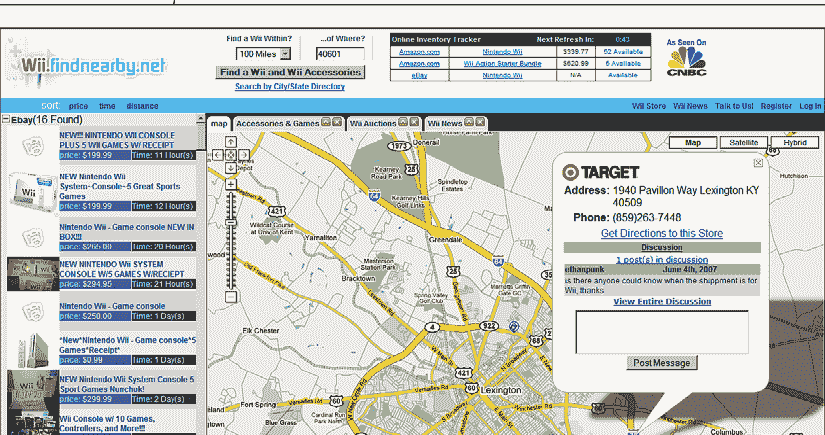
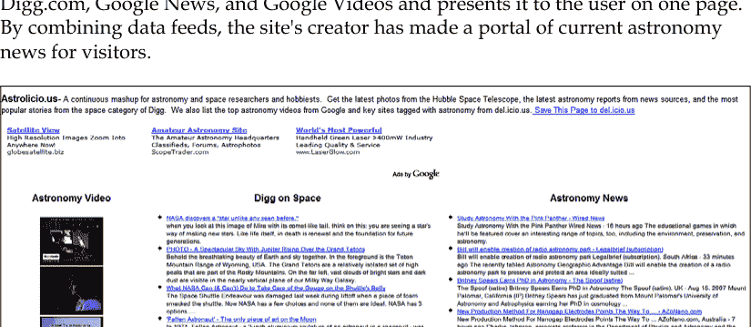

# 1

## Mashups 简介

Mashups，更具体地说，维基百科称其为网络应用混合体，近年来一直是网络应用中的一个令人兴奋的趋势。网络 Mashup 正如其名——将来自一个或多个来源的数据合并并以新方式呈现的网络应用。非常常见的是，数据所有者会鼓励并促进第三方使用数据。在许多情况下，这种促进是通过数据所有者为其数据提供应用程序编程接口（API）实现的。这些 API 遵循标准的网络服务协议，并且可以在多种编程语言中快速、轻松地实现，包括 PHP。由个人制作的新颖、创新的 Mashup，将传统上不太可能配对的数据组合在一起，每天都在不断涌现。

一个例子是 Wii Seeker 网站。当任天堂 Wii 于 2006 年 11 月发布时，许多人都知道会出现短缺。Wii Seeker 网站的目的是通过结合发往 Target 商店的预期初始发货信息和 Google 地图来帮助人们找到 Wii。Google 地图上的一个标记代表一家 Target 零售店。如果用户点击该标记，他们会看到有关商店的信息，例如地址。他们还会看到商店在发布当天预计拥有的 Wii 数量。通过在地图上表示数值库存数据，用户可以看到附近的 Target 商店，并在发布当天计划商店访问，以最大化实际找到 Wii 的机会。

在任天堂 Wii 发布后，该网站通过添加来自 eBay 的拍卖信息和来自 Amazon 的产品信息而重新焕发活力。他们还添加了 Circuit City 和 Walmart 等额外的连锁零售店。取而代之的是在每个商店查看任天堂 Wii 库存信息，该网站现在允许访客为彼此发布有关商店库存的笔记。

另一个 Mashup 例子是 Astrolicio.us。该网站查询来自 Digg.com、Google News 和 Google Videos 等网站的数据源，并在一个页面上向用户呈现。通过组合数据源，网站的创建者为访客制作了一个当前天文学新闻门户。

在主页上，用户可以快速浏览可能感兴趣的项目。对于新闻，每个新闻项目都会提供包含标题和摘要的要点。对于视频，用户会看到缩略图。如果用户点击链接，他们将被带到文章或视频的来源。该网站简洁、简单且信息丰富。使用来源的 API 制作它也相当容易。网站创建者从开始编码到上线可能不超过一个下午。

## Web 2.0 与 Mashups

仅仅几年时间，Mashup 是如何在各地突然兴起的？故事可以追溯到几年前的那段时间。在 2001 年科技行业金融泡沫破裂后，互联网公司重新集结并重新定义了自己。有商业经验需要学习，技术需要重新评估，人们的看法也发生了变化。到十年中期，许多趋势和差异变得清晰。“Web 2.0”一词开始出现，以区分新网站和在 90 年代末获得流行的网站。起初这个术语很模糊，似乎可疑地噱头十足。然而，旧与新之间的差异是真实的。它们不仅仅是历史和时间上的。像 Google、YouTube 和 Flickr 这样的网站展示了建立网络业务的新方法。这些网站通常具有简单的界面，完全拥抱网络服务，并将大量控制权交还给用户。许多这些网站完全依赖用户提供内容。2005 年 9 月，科技出版商 Tim O'Reilly 写了一篇题为 What Is Web 2.0 的文章，简明扼要地阐述了 Web 2.0 与 1.0 网站的特征。有两个特征是 Mashup 增长的直接催化剂：

- 数据的重要性
- 用户社区

### 数据的重要性

第一个特征是数据的重要性。谁拥有数据以及他们选择如何处理数据的问题变得非常重要。公司为什么要投入数百万美元收集数据和数据库系统，然后又免费提供给他人使用？答案是，通过开放他们的系统，Mashup 开发人员有助于扩大数据所有者的覆盖范围。

O'Reilly 用 MapQuest 的例子来说明这一点。MapQuest 在 90 年代中期到后期是地图领域的领导者。然而，他们的系统是封闭的，不允许外部方对他们的数据做任何事情。在 2000 年代初期，地图网站开始利用这一弱点。Yahoo! Maps、Microsoft Virtual Earth 和 Google Maps 进入市场，每个都有 API。尽管早期市场领先优势巨大，MapQuest 很快就输给了拥有开放数据的大玩家。类似的例子还有很多。Amazon 通过 Amazon 电子商务服务（ECS）开放了其数据。许多 Mashup 使用此网络服务创建自己的商店。Amazon 获得销售并向 Mashup 开发人员支付一定比例的费用。这为 Amazon 除了 www.amazon.com 之外创造了更多销售商品的渠道。将其与 BarnesAndNoble.com 这样的网站对比，后者不开放其数据。他们唯一的销售渠道是通过主网站。不仅他们失去了销售机会，而且缺乏 Amazon 拥有的附属忠诚度。

在我们之前的例子中，Wii Seeker 通过将买家引导至商店来帮助 Target。反过来，Wii Seeker 在其网站上获得广告收入和附属佣金。当用户从 astrolicious.us 点击链接时，Google Videos、Google News 和 Digg.com 会获得访客。Astrolicious.us 在投入很少的开发时间的情况下获得广告收入。

### 用户社区

第二个特征是用户添加的数据比我们曾经认为的更有价值。电子商务网站上的用户产品评论并非新鲜事。网络论坛也并非新鲜事。然而，网站如何使用这些信息以及谁拥有数据，正在变得重要。电影租赁网站 Netflix 一直允许用户对观看过的电影进行评分。基于这些推荐，Netflix 会推荐您可能喜欢的其他电影。最近，他们添加了一个名为“Friends”的新社交网络功能，您可以在其中看到朋友如何评价电影以及他们正在观看的内容。Friends 的一个功能是兼容性评分。比较您和朋友的推荐，Netflix 会得出您共同电影品味的百分比。

其他网站完全依赖用户添加的数据。YouTube 和 Flickr 分别免费提供视频和图片托管。然而，它们广泛采用的原因不仅仅是托管。在 Flickr 之前，有许多网站免费托管图片。那并非新鲜事。不同之处再次在于这两个网站对用户添加数据的处理。两个网站都提供社交网络功能。您可以对托管项目留下评分和评论，也可以订阅某人的个人资料。每当该人上传内容时，您都会收到新内容的通知。两个网站还允许民间分类法标记，这基本上允许上传者用自己的关键词描述内容。访客在查找内容时可以使用这些关键词进行搜索。标记已被证明是对搜索算法的巨大帮助。

因此，这两个新网站的特征使得小型网页开发者看起来更大。依托于大型互联网平台的数据，Mashup 开发者创建了数据所有者无法预见或因业务规则而受限的使用渠道。

## 如何创建 Mashup

在技术上，如果网站所有者不对网站上使用的数据与其实际呈现方式进行清晰分离，Mashup 现象就不可能发生。这一直是计算机应用程序开发的目标，因此，自万维网创建以来，网站和 Web 应用程序架构向这一阶段发展也就不足为奇了。这种分离正在迅速将万维网转变为所谓的 *语义网* ——一种哲学，即网页内容不仅为人类阅读而呈现，而且以软件和机器可以轻松处理的方式呈现。我们已从静态页面转向数据库驱动的网站，从表现性的 FONT 标签转向层叠样式表。也许不可避免的是，网络已成为促进 Mashup 开发的环境。

Mashup 的数据源多种多样。通常，数据所有者会通过官方应用程序编程接口向 Mashup 开发者提供其数据的访问权限。由于我们讨论的是 Web 应用程序，这些 API 使用 Web 服务，其协议种类繁多。Really Simple Syndication（RSS），一种用于呈现数据的格式家族，是另一种常见的促进 Mashup 采用的数据源。当官方方法不可用时，开发者在获取数据时会变得非常有创意。屏幕抓取是一种一直存在的方法。无论采用何种方法，Mashup 还处理各种数据格式。虽然 Mashup 可以很简单地创建，但 Mashup 开发者必须在工具知识方面灵活且全面。

开源软件在这种 Mashup 环境中特别适用。Apache 和 PHP 的组合使开发速度更快。由于是开源的，开发者会不断快速地添加新功能，以跟上 Web 服务世界的发展。

本书将介绍如何使用 PHP 使用常见的数据源。大多数官方 API 都基于三大 Web 服务协议——XML-RPC、REST 和 SOAP。我们当然会查看这些协议。API 和手工的原始 Web 服务请求当然不是获取数据的唯一方式。我们将查看使用第三方库与某些流行站点进行交互。Feed 也是一个重要的数据源，我们将使用它。通过为您提供 Mashup 世界中使用的工具的广泛概述，您应该能够快速开始开发自己的 Mashup。

## 更多 Mashup

为了获取更多示例和灵感，请查看这些流行的 Mashup：

- Popurls (popurls.com) – 收集热门网站的网址。
- Housingmaps.com (www.housingmaps.com) – 将 Craigslist 上的房屋 listing 绘制到地图上。
- Keegy (us.keegy.com) – 一个聚合不同来源新闻并为读者个性化展示的网站。
- Alkemis (local.alkemis.com) – 聚合并映射各种数据，例如在选定城市中的图片和实时网络摄像头。
- Gametripping.com (www.gametripping.com) – 棒球场卫星图和 Flickr 照片的集合。
