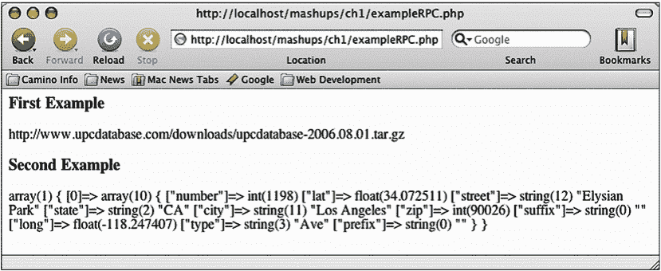
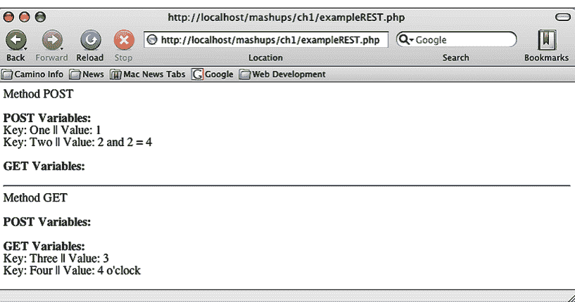
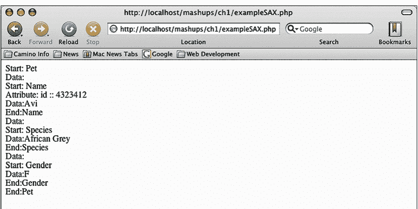
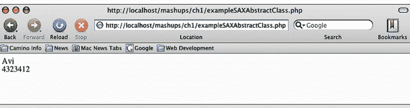
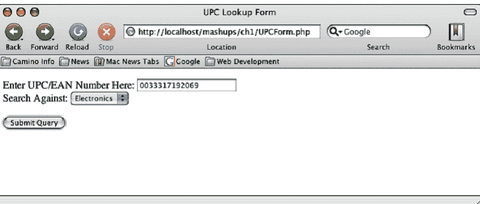
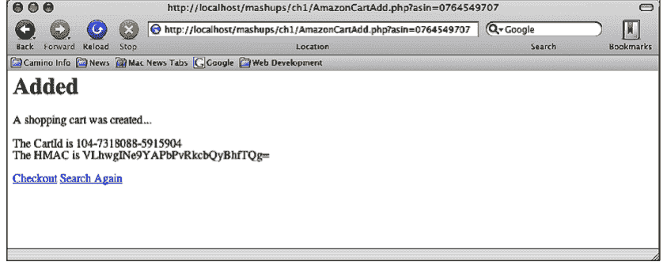
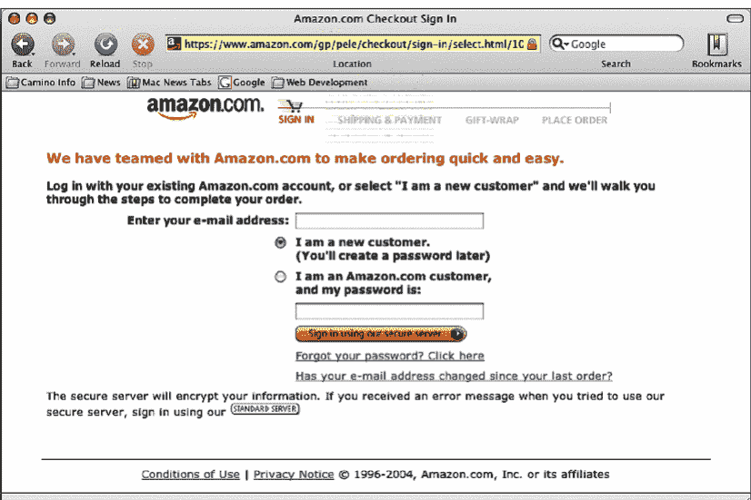

# 2
## 在亚马逊购买

## 项目概述

|  |  |
|---|---|
| 什么 | 构建一个应用程序，接收 UPC 符号并在 Amazon.com 上查询。 |
| 使用的协议 | XML-RPC, REST |
| 数据格式 | XML-RPC, XML |
| 重点介绍的工具 | PHP's XML-RPC Functions and SAX Functions |
| 使用的 API | Internet UPC Database, Amazon Web Services |

我们将从一个相对简单的项目开始。我们的项目将从用户接受 **通用产品代码** 号，从 Internet UPC Database 查找与 UPC 号码关联的产品信息，并允许用户通过我们的网站使用 Amazon.com 购买产品。换句话说，我们将基于 UPC 号码创建一个在线商店。通过使用 Amazon.com 的库存，用户可以从 Amazon.com 购买，但他们可以仅从我们的网站完成所有操作。虽然这样的网站可能不会让我们成为下一个电子商务之王，但它将向我们介绍两种最基本的 Web 服务——XML-RPC 和 REST。每种协议都要求我们以特定方式构建请求。

XML-RPC 将返回符合 XML-RPC 规范格式的 XML 文档。REST 响应则多种多样且形式自由。它们可能从纯文本字符串到巨大的复杂 XML 文档都有。虽然大多数 Web 服务返回描述性良好且格式良好的 XML 文档，但 REST 响应不受任何标准或规范的约束。我们将创建用于处理 XML-RPC 和 REST 请求的实用程序，可用于当前和未来的 Mashup。

## XML-RPC

作为当今的开发者，我们应该熟悉 XML。表面上看，它是一组打包并整齐组织成开始和结束标签的数据。更深入地看，这种 XML 结构使得机器易于读取和处理。因此，虽然 XML 对人眼来说可能很困难，但我们知道它是为机器通信而设计的。然而，如果机器之间没有对 XML 文档的任何约定结构，XML 的优势就基本上被消除了。这就是 XML-RPC 的用武之地。

RPC 是 **远程过程调用** 的缩写；由 UserLand 软件的 **David Winer** 于 1996 年开发。其目的是允许应用程序，无论每个程序如何不同或每个程序的目的如何，都以标准化方式在网络间相互通信。

在计算机术语中，过程调用是指操作系统与输入设备通信时执行的动作：*你刚刚在键盘上按了哪个键？你把鼠标移到了哪里？你用鼠标刚刚点击了什么？*

XML-RPC 将这一思想带入网络世界（RPC 中的“Remote”部分），通过创建一种标准，使一个程序能够从网络上的另一个程序获取信息。程序 A 向程序 B 发送远程过程调用。此调用可能包含程序 B 需要检索数据的参数。

例如，如果查询针对人名列表：*你是否只想检索名字为“Peter”的人的列表？你是否想将搜索范围缩小到某个城市？* 请求及其所有参数都以程序 B 理解的通用方式格式化。无论数据类型或大小如何，程序 B 都以程序 A 理解的通用方式返回答案。然后程序 A 可以根据用户的请求对数据进行任何操作。

### XML-RPC 结构

两个程序在网络间通信显然与操作系统与鼠标对话不同。操作系统具有超高速内部总线和在更低机器级别对话的能力的优势。使用 XML-RPC 的过程调用必须对程序中立并且对网络传输协议友好。它没有每秒数百次不断轮询另一台机器的奢侈。因此，XML-RPC 通信必须以最低公分母中最有效的方式完成其使命。这是通过将调用划分为严格格式的 XML 请求和响应来实现的。

### 官方规范


我们将对一个 XML 请求和响应调用进行一次轻松的游览。有关更正式的细节，您可以阅读 http://www.xmlrpc.com/spec 上的官方 XML-RPC 规范

### XML-RPC 请求

XML-RPC 请求作为 HTTP POST 请求运行。因此，它必须具有适当的 HTTP POST 头。实际的远程调用和参数，以 XML 格式，在头之后作为 HTTP 请求的主体。

```
POST /RPC2 HTTP/1.0
User-Agent: PHP5 XML-RPC Client (Mac OS X)
Host: betty.userland.com
Content-Type: text/xml
Content-length: 181
<?xml version="1.0"?>
<methodCall>
<methodName>examples.getStateName</methodName>
<params>
<param>
<value><int>42</int></value>
</param>
</params>
</methodCall>
```

头中的第一行 POST 和 Host 行告诉我们，此 XML-RPC 调用是到位于 betty.userland.com/RPC2 的 Web 服务。消息正文中第一个有用的信息是请求的调用名称，在本例中为 examples.getStateName。我们将整数 42 作为参数传递给 examples.getStateName。让我们逐一查看这些元素：

XML-RPC 调用中的根元素是 methodCall。它有一个必需的子元素 methodName，指定要请求的调用名称。每个请求只能有一个 methodCall。如果向调用传递参数，则它们被封装在 params 元素中。

过程调用可能需要无限数量的参数。XML-RPC 调用没有命名参数。换句话说，你在分配值之前不会为参数命名，例如：

```
// This is wrong. Parameters are not named.
<param name="myInt">
<value><int>42</int></value>
</param>
```

Instead, for functions requiring more than one parameter, the correct parameter order is defined by the remote function. You will have to check the API's documentation for this information and make sure you order the parameters correctly.

//The correct way to differentiate parameters is in their order as defined by the API
<params>
    <param><value><int>42</int></value></param>
    <param><value><int>13</int></value></param>
    <param><value><int>32</int></value></param>
</params>

In the request, each parameter is enclosed by a param element. Within each param, the actual parameter is wrapped up by a value element. Within this value element are the actual parameter values and data types.

## XML-RPC 数据类型

XML-RPC 参数可以是以下三种类型之一。每个类型在 value 元素内部以不同的方式表示。

- **标量：** 基本的原始数据类型
- **数组：** 类似于 PHP 的数字索引数组
- **结构体：** 等同于 PHP 世界中的关联数组

目前，我们将这些数据类型及其结构定义用作请求参数。然而，相同的 数据类型在整个 XML-RPC 中使用。服务器响应将以相同的模式返回数据。

### 标量值

标量值是在大多数语言中常见的原始数据类型。几乎每个标量值都必须由一个声明该值数据类型的元素封装。

### 字符串

这是你的基本文本字符串。它对应于 PHP 中的 string 数据类型。

```
<param>
    <value><string>Hello, world!</string></value>
</param>
```

由于这是最常见的数据类型，value 元素内部没有数据类型标签的任何值都将默认为字符串。例如，以下在 XML-RPC 中是完全合法的，并且将默认为字符串：

```
<param>
  <value>Goodbye, cruel world!</value>
</param>
```

### 整数

这是一个四字节有符号整数。它与 PHP 数据类型 integer 相同。因此，它可以使用更明显的标签 int 或 i4，表示四字节整数。

```
<param>
  <value><int>42</int></value>
</param>
// This is the same:
<param>
  <value><i4>42</i4></value>
</param>
```

### 双精度浮点数

Double 是一个双精度有符号浮点数。它等同于 PHP 中的 float。请注意，在 PHP 4 中也存在 double 数据类型，但已弃用，优先使用 float。

```
<param>
  <value><double>-44.352301</double></value>
</param>
```

### 布尔值

Boolean 是基本的是/否状态。它与 PHP 的 boolean 相同。不同之处在于，在 PHP 以及许多其他语言中，布尔值可以用关键字 TRUE 或 FALSE 表示，或用数值 1 表示真、0 表示假。在 XML-RPC 中，布尔值只能用 1 或 0 表示。

```
<param>
    <value><boolean>0</boolean></value>
</param>
```

### 日期/时间

日期/时间数据类型指定日期和时间值，精确到秒。它遵循格式 YYYYMMDDTHH:MM:SS。年、月、日、小时、分钟和秒在该格式中应显而易见。然而，“T”是一个字面量。PHP 中没有日期/时间数据类型，因此你必须将其表示为字符串。

```
<param>
    <value>
        <dateTime.iso8601>20060710T11:30:32</dateTime.iso8601>
    </value>
</param>
```

在 PHP 5 中，有一个日期参数 "c"，它将以 ISO 8601 格式返回日期/时间对象。它不会返回 XML-RPC 所需的确切格式，但稍后我们将使用一个函数自动将其编码为日期/时间类型。

### Base64 编码的二进制

要通过 XML-RPC 传输二进制信息，请将其编码为 base64 并用 base64 标签包裹。

```
<param>
    <value>
        <base64>Pj4UijBdhLr6IdvCc0Ad3NVP4OidTd8E1kRY5Edh</base64>
    </value>
</param>
```

PHP 中没有二进制数据类型，但你可以使用 file_get_contents 函数将文件编码为 base64 以进行 XML-RPC 传输。

### 数组

数字索引数组作为 value 元素内的单个结构传递。数组由特定的子元素和孙元素结构定义。

```
<params>
    <param>
        <value>
            <array>
                <data>
                    <value><string>One</string></value>
                    <value><string>Monkey</string></value>
                    <value><double>4.307400</double></value>
                </data>
            </array>
        </value>
    </param>
</params>
```

在实际看到数据之前，有两级子元素。array，它定义参数的值为数组；以及 data，它表示数据的开始。数据被封装的方式与标量值完全相同。数组中的每个项目都有一个 value 元素，它们可能有子元素来定义值的 数据类型。

数组可以是递归的。在每个 value 元素内，只要包含 array/data/value 的后代序列，就可以是另一个数组。

### 结构体

类似于数组，结构体是 PHP 关联数组在 XML-RPC 中的表示。每个项目都有一个命名键和值对。像数组一样，单个 struct 元素定义一个结构体。每个项目有一个 member 元素，每个 member 元素有一个必需的 name 元素，用于命名该项目，以及一个表示值的 value 元素。此外，像数组一样，value 元素遵循 XML-RPC 中标量值的定义规则。

```
<value>
    <struct>
        <member>
            <name>One</name>
            <value><string>This is a string</string></value>
        </member>
        <member>
            <name>Two</name>
            <value><boolean>1</boolean></value>
        </member>
        <member>
            <name>This is a Name</name>
            <value><double>-98.330000</double></value>
        </member>
    </struct>
</value>
```

因此，XML-RPC 请求基本上是 HTTP POST 操作，指定要调用的远程方法以及格式正确的参数。让我们看看服务器返回的响应。

## XML-RPC 响应

一旦我们发出请求，我们可以预期服务返回两种类型的响应之一。如果 XML-RPC 请求成功，我们将以 XML-RPC 规范定义的方式收到所请求的数据返回。如果出现错误，将返回特殊的 XML-RPC fault 消息。

类似于常规网页调用，头部将返回，结果在正文中。

```
HTTP/1.x 200 OK
Date: Fri, 11 Aug 2007 23:34:43 GMT
Server: Apache/1.3.33 (Darwin) PHP/5.1.4 DAV/1.0.3
X-Powered-By: PHP/5.1.4
Keep-Alive: timeout=15, max=100
Connection: Keep-Alive
Content-Type: text/xml
<?xml version="1.0" encoding="iso-8859-1"?>
<methodResponse>
    <params>
        <param>
            <value><string>A woeful jeremiad</string></value>
        </param>
    </params>
</methodResponse>
```

这是一个成功的 XML-RPC 响应。你应该觉得它很熟悉。methodResponse 是定义此为响应的根元素。之后是 params 子元素。每个返回的值都包含在 param 元素中。在其下方，每个值都遵循我们之前看到的标量值规则。此示例显示了服务返回的单个字符串值。然而，像请求一样，params 下的内容也可以是多值返回、数组或结构体，而不仅仅是单个值。例如，服务返回的数组看起来像这样：

```
<methodResponse>
    <params><param><value>
        <array>
            <data>
                <value><string>system.multicall</string></value>
                <value><string>system.listMethods</string></value>
                <value><string>system.getCapabilities</string></value>
            </data>
        </array>
    </value></param></params>
</methodResponse>
```

如果服务无法满足你的请求，它将返回一个 XML-RPC fault。methodResponse 将具有 fault 元素，而不是 params 元素。methodResponse 将始终具有 params 子元素或 fault 子元素，但不会同时具有两者。

XML-RPC fault 基本上是一个返回给你的结构体。此结构体中有两个命名成员。faultString 是错误的、人类可读的警报，faultCode 是服务分配的整数。faultString 和 faultCode 都未由 XML-RPC 规范定义或标准化。它们完全取决于服务器实现。

```
HTTP/1.x 200 OK
Date: Fri, 11 Aug 2007 23:41:18 GMT
Server: Apache/1.3.33 (Darwin) PHP/5.1.4 DAV/1.0.3
X-Powered-By: PHP/5.1.4
Keep-Alive: timeout=15, max=100
Connection: Keep-Alive
Content-Type: text/xml
<?xml version="1.0"?>
<methodResponse>
    <fault>
        <value>
            <struct>
                <member>
                    <name>faultCode</name>
                    <value><int>4</int></value>
                </member>
                <member>
                    <name>faultString</name>
                    <value><string>Too many parameters.</string></value>
                </member>
            </struct>
        </value>
    </fault>
</methodResponse>
```

## 在 PHP 中使用 XML-RPC

XML-RPC 是一个非常直接且有效的数据传输机制。请求和响应以统一的方式格式化。客户端和服务提供商可以轻松实现此简单协议。PHP 有一组用于处理 XML-RPC 数据的 XML-RPC 函数。


PHP 的 XML-RPC 函数文档位于：http://www.php.net/manual/en/ref.xmlrpc.php。集合虽小但弥足珍贵。它们可以分为使 PHP 应用成为 XML-RPC 客户端的函数，或创建由 PHP 驱动的 XML-RPC 服务的函数。如果 PHP 在编译时使用了 --with-xmlrpc 选项，则这些函数可用。

> 如果您查看官方 PHP XML-RPC 文档，您会看到它们被标记为“experimental”。然而，它们自 PHP 4.1 起就存在，并长期被认为稳定可靠，可用于生产环境。

要创建您的 mashup，您需要知道如何创建 XML-RPC 请求，如何调用服务，以及如何处理返回数据。我们将重点关注三个 PHP 函数来帮助我们做到这一点：xmlrpc_encode_request 用于将我们的 PHP 变量转换为 XML-RPC 格式，xmlrpc_decode 执行相反操作，而 xmlrpc_is_fault 检查对服务器的请求是否出错。

## 创建 XML-RPC 请求

我们的第一个任务是创建 XML-RPC 请求。此过程可以分解为单独的步骤：

- 1. 将 PHP 数据序列化为 XML-RPC 格式
- 2. 通过组合 HTTP 头和序列化数据创建 XML-RPC 请求
- 3. 调用服务

## 使用 XML-RPC Encode Request 序列化数据

在网络编程术语中，“serializing” 意味着将数据转换为可通过网络传输的格式。在我们的例子中，我们将把 PHP 变量值序列化为前面讨论的 XML-RPC 规范。为此，我们将使用 PHP 函数 xmlrpc_encode_request。xmlrpc_encode_request 将创建我们整个 XML-RPC 请求调用，从 methodCall 元素开始一直深入到 value 元素。

此函数需要两个参数。第一个是我们希望请求的远程调用的名称。xmlrpc_encode_request 将使用它来创建 methodName 元素。第二个参数是您希望传递的变量。它将使用它来创建 params 结构。对于此第二个参数，xmlrpc_encode_request 将自动检测传入的变量类型（变量类型、数值数组或关联数组），并将其格式化为 XML-RPC 规范规定的数据类型模式。

让我们尝试使用 xmlrpc_encode_request 创建不同类型的 XML-RPC 请求。

## 创建单参数 XML-RPC 请求

最简单的 XML-RPC 请求是单个参数。创建此简单脚本并将其放在您的 Web 服务器上：

```
<?php
$singleVar = "Hello!";
$requestMessage = xmlrpc_encode_request('theRemoteCall', $singleVar);
echo $requestMessage;
?>
```

使用 Web 浏览器访问此页面，并检查源代码。您的源代码将如下所示：

```
<?xml version="1.0" encoding="iso-8859-1"?>
<methodCall>
    <methodName>theRemoteCall</methodName>
    <params>
        <param>
            <value><string>Hello!</string></value>
        </param>
    </params>
</methodCall>
```

xmlrpc_encode_request 已为您创建了整个 XML-RPC 请求。

如果您操作传递的变量类型，xmlrpc_encode_request 足够智能，可以找出 XML-RPC 数据类型的等价物。我们可以使用以下脚本测试此功能：

```
<?php
$singleVar = "88";
settype($singleVar, "integer");
$requestMessage = xmlrpc_encode_request('theRemoteCall', $singleVar);
echo $requestMessage;
?>
```

在这里，我们首先将 $singleVar 的值分配为字符串，其值为“88”，settype 将在我们将其传递给 xmlrpc_encode_request 之前将 $singleVar 转换为整数。xmlrpc_encode_request 返回的 XML-RPC 值将通过将其包裹在 int 标签中来反映此数据类型。

同样，如果您使用 Web 浏览器访问此页面，您可以查看此返回结构：

```
<?xml version="1.0" encoding="iso-8859-1"?>
<methodCall>
    <methodName>theRemoteCall</methodName>
    <params>
        <param>
            <value><int>88</int></value>
        </param>
    </params>
</methodCall>
```

我们需要特别注意的还有两种特殊数据类型。

## Double 数据类型

第一种情况是 double 数据类型。xmlrpc_encode_request 总是将 double 填充到小数点后六位。例如，传递 1.6，

```
$singleVar = 1.6;
$requestMessage = xmlrpc_encode_request('theRemoteCall', $singleVar);
```

将导致以下 XML-RPC 片段：

```
<value>
    <double>1.600000</double>
</value>
```

此外，超过六位数字的任何内容都将被舍入。我们可以通过传递一个应向上舍入的长数字和一个应向下舍入的数字来了解其工作原理。

```
$roundedUp = 1.123456789;
$roundedOff = 1.87654321;
$requestMessage1 = xmlrpc_encode_request('theRemoteCall', $roundedUp);
$requestMessage2 = xmlrpc_encode_request('theRemoteCall',
$roundedOff);
```

这两个调用将导致这两个相应的 value 元素：

```
<value>
    <double>1.123457</double>
</value>
<value>
    <double>1.876543</double>
</value>
```

## Date/Time 和 Base64 数据类型

我们需要谨慎对待的第二种情况是 date/time 和 base64。它们在 PHP 中都没有等效的数据类型。如果您将它们分配给变量，PHP 将把该变量视为字符串。当它们被传递给 xmlrpc_encode_request 时，xmlrpc_encode_request 也会将它们视为字符串。

例如，如果我们有一个特殊的二进制数据字符串，PHP 只能将其视为字符字符串；

```
$singleVar = '8923hfjsd89783hiuyi9yhw938ihfasid9yh32iyr9wy';
$requestMessage = xmlrpc_encode_request('theRemoteCall', $singleVar);
```

将生成 XML-RPC 请求。如果远程调用特别查找 base64，远程调用将失败。

```
<value>
    <string>8923hfjsd8938ihfasid9yh32iyr9wy</string>
</value>
```

要告诉 PHP 它们是 XML-RPC 数据类型，我们需要在调用 xmlrpc_encode_request 之前使用一个特殊函数 xmlrpc_set_type。xmlrpc_set_type 接受两个参数，第一个是您希望更改的实际变量，第二个是您希望将其更改为的 XML-RPC 类型。

如果我们对同一个二进制字符串调用 xmlrpc_set_type 将其更改为 base64：

```
$singleVar = '8923hfjsd89783hiuyi9yhw938ihfasid9yh32iyr9wy';
xmlrpc_set_type($singleVar, "base64");
$requestMessage = xmlrpc_encode_request('theRemoteCall', $singleVar);
```

我们的 XML-RPC 请求结果将是服务所期望的。

```
<value>
    <base64>ODkyM2hmanNkODkzOGloZmFzaWQ5eWgzMml5cjl3eQ==&#10;</base64>
</value>
```

如果您有一个格式化为正确 date/time 格式的字符串，情况也是如此。

```
$singleVar = '20060814T09:08:23';
xmlrpc_set_type($singleVar, "datetime");
$requestMessage = xmlrpc_encode_request('theRemoteCall', $singleVar);
```

编码后，值将在 XML-RPC 请求中被正确的 date/time 元素包裹。

```
<value>
    <dateTime.iso8601>20060814T09:08:23</dateTime.iso8601>
</value>
```

xmlrpc_set_type 专门设计用于解决 XML-RPC 中 base64 和 date/time 类型的存在以及 PHP 中缺乏它们的问题。第二参数决定您希望转换为什么种 XML-RPC 数据类型，只能取 base64 或 date/time 的值。它并不是像 PHP 的 settype 那样的通用类型转换函数。

xmlrpc_encode_request 创建的其他结构，建立在其对标量数据的<|message|> 基本处理之上。这与 XML-RPC 的 structs 和 arrays 在值级别使用相同的<|message|> 基本标量模式的方式非常相似。主要限制是 xmlrpc_encode_request 只能接受一个参数作为其变量参数。它通过接受变量参数的不同数组结构并根据接收到的内容输出不同的 XML-RPC 请求来解决此问题。

## 创建多参数 XML-RPC 请求

有时，您可能会发现一个远程调用请求一个简单列表中的多个参数。为此，只需创建一个变量数组并将其作为 xmlrpc_encode_request 的第二个参数传递，如下所示：

```
<?php
    $dt = '20060814T09:08:23';
    xmlrpc_set_type($dt, "datetime");
    $listArray = array("One", 2.09, $dt);
    $requestMessage = xmlrpc_encode_request('theRemoteCall', $listArray);
    echo $requestMessage;
?>
```

这将创建一个 XML-RPC 请求，为每个变量创建一个 param 元素。如您所见，混合匹配数据类型是完全合法的。

```
<params>
    <param>
        <value><string>One</string></value>
    </param>
    <param>
        <value><double>2.090000</double></value>
    </param>
    <param>
        <value>
<dateTime.iso8601>20060814T09:08:23</dateTime.iso8601>
        </value>
    </param>
</params>
```


## 在 XML-RPC 请求中传递数组

请记住，XML-RPC 数组是一个序列化、按数字索引的 PHP 数组。我们需要将其作为 xmlrpc_encode_request 的第二个参数传递。然而，如果我们直接传递一个数组，xmlrpc_encode_request 将会创建一个多参数 XML-RPC 请求，就像我们刚才演示的那样。解决方案是将数值数组放入另一个数组中，并将新的组合作为 xmlrpc_encode_request 的第二个参数传递：

```
<?php
    $listArray = array("One", "Monkey", 4.3074);
    $requestMessage = xmlrpc_encode_request('theRemoteCall', $listArray);
    echo $requestMessage;
?>
```

这段代码将创建我们需要的 XML-RPC 数组。此片段将创建我们在本章前面看到的示例数组。


> 这之所以有效，是因为 XML-RPC 请求中的每个参数都放置在其自己的 value 元素内。技术上讲，我们只向 xmlrpc_encode_request 传递了一个参数。该函数将其识别为数值数组，并在 value 元素下创建了必要的结构。

## 在 XML-RPC 请求中传递结构体

XML-RPC 数组与结构体之间的关系，就像按数字索引的 PHP 数组与关联 PHP 数组之间的关系一样。知道这一点后，你可以合理推测，要创建结构体，我们所需要做的就是将传入的第二个参数从按数字索引的数组改为关联数组。

```
$listArray = array("One" => "This is a string", "Two" => "true", "This is a Name" => -98.33);
$requestMessage = xmlrpc_encode_request('theRemoteCall',
    array($listArray));
```

在此代码片段中，$listArray 在传递给 xmlrpc_encode_request 之前为数组值分配了键。这将创建我们在本章前面看到的示例结构体。

### 创建请求调用头

现在我们有了主体，就可以创建请求所需的 HTTP 头。头放在负载之前。我们倒过来工作，因为头的某一部分需要我们知道负载的长度。

让我们看一个完整的 XML-RPC 请求：

```
POST /rpc HTTP/1.0
User-Agent: XML-RPC Client
Host: www.upcdatabase.com
Content-Type: text/xml
Content-Length: 185
<?xml version="1.0" encoding="iso-8859-1"?>
<methodCall>
<methodName>lookupUPC</methodName>
<params>
    <param>
        <value><string>079400560704</string> </value>
    </param>
</params>
</methodCall>
```

看起来，其中有几个头项可以是静态的。其他项（已突出显示）可以变成变量。

- 1. POST 之后是我们在服务器上访问的脚本名称
- 2. 主机
- 3. 内容长度
- 4. 最后是负载

创建一个返回完整请求的函数会很高效。变量候选项将成为我们的参数。

```
function createPostRequest($remoteServer, $remotePath, $requestBody) {
    $theRequest = "POST " . $remotePath . " HTTP/1.0\n" .
    "User-Agent: XML-RPC Client\n" .
    "Host: " . $remoteServer . "\n" .
    "Content-Type: text/xml\n" .
    "Content-Length: " . strlen($requestBody) . "\n" .
    "\n" . $requestBody . "\n";
    return $theRequest;
}
```

createPostRequest 是一个简单的函数。它接受三个参数，并将它们与标准的 HTTP 请求头连接起来，以创建一个完整、完整的 XML-RPC 请求。它接受的三个参数是：

- $remoteServer 是服务器的名称和域名。例如，"www.amazon.com"。不要添加像 http:// 这样的协议，因为这不仅冗余，而且是非法的。
- `$remotePath` 是从服务器根目录开始的 XML-RPC 服务路径。该值以开始斜杠 (`/`) 开头，与目录结构中的绝对路径相同。例如 `"/services/xmlrpc"`。
- `$requestBody` 是由 `xmlrpc_encode_request` 返回给我们的部分。这是 XML-RPC 调用的 XML 部分。

此函数使用 `$remoteServer` 和 `$remotePath` 来构建头的第一行和主机行。主体 `$requestBody` 不仅被附加到请求中，而且其大小必须首先由 `strlen` 函数分析，以用于头的 content length 部分。


> 请注意我们在函数中如何连接头。虽然头在输出中被拆分并格式化以提高可读性，但行尾 (`"\n"`) 到下一行开头之间没有空格或制表符。这是 HTTP 协议的严格格式要求。如果行开头有任何空白，请求将失败。

## 使用套接字调用 XML-RPC

我们现在有一个格式完全的 XML-RPC 调用。所有变量都已序列化。我们的头也已创建。剩下的唯一事情就是实际调用服务并发送我们的请求。

套接字是调用 XML-RPC 的一种简洁方式。套接字基本上是到另一台机器的直接网络连接。我们可以构建到 XML-RPC 服务器的套接字并直接向其发送请求。这可以通过另一个基于我们的 `createPostRequest` 函数构建的函数来实现。该函数不仅会将请求发送到服务器，还会捕获结果并让我们稍后操作它。

```php
function send($remoteServer, $remotePort, $fullXMLRPCRequest) {
    $headers = '';
    $data = '';
    $socket = fsockopen($remoteServer, $remotePort);
    fwrite($socket, $fullXMLRPCRequest);
    while ($str = trim(fgets($socket))) {
        $headers .= $str . "\n";
    }
    while (!feof($socket)) {
        $data .= fgets($socket);
    }
    fclose($socket);
    return $data;
}
```

此函数还接受以下三个参数：

- `$remoteServer` 与你在 `createPostRequest` 中使用的变量完全相同。与其在 HTTP 头中的使用一样，不要包含协议 (http://)。
- `$remotePort` 是你希望通过连接的网络端口。对于标准的 HTTP 连接，这将是 80。
- `$fullXMLRPCRequest` 是带有头和负载的完整 XML-RPC 请求。这是从 `createPostRequest` 返回的部分。

此函数做了几件事。让我们分解一下：

在初始化一些变量后，我们使用 `fsockopen` 打开到远程服务器的连接。

```
$socket = fsockopen($remoteServer, $remotePort);
```

`fwrite()` 的调用将通过套接字直接将我们的 XML-RPC 请求发送到服务器。

```
fwrite($socket, $request);
```

套接字基本上是一个隧道。我们不仅通过它写入，还捕获服务器对其的响应。写入后，返回的第一件事是 HTTP 响应头。我们不需要此信息，因此可以只读取响应并将其转储到本地变量中，该变量将在函数执行完成时被丢弃。

```
while ($str = trim(fgets($socket))) {
    $headers .= $str . '\n';
}
```

头通过后，我们捕获真正想要的内容——XML-RPC 响应负载。

```
while (!feof($socket)) {
    $data .= fgets($socket);
}
```

当数据通过套接字传输时，我们捕获所有传输的内容并将其转储到本地变量中。一旦响应数据停止传输，我们就可以关闭套接字并将数据部分返回给函数调用者。

```
fclose($socket);
return $data;
```

在这一点上，我们已将变量传递给我们创建的函数 `createPostRequest()`，它返回了一个完整的 XML-RPC 请求。我们取了该请求并将其传递给我们定义的另一个函数 send()。该函数打开到远程服务器的套接字连接，写入请求并解析响应。它将此 XML-RPC 响应返回给我们。我们现在需要将 XML-RPC 响应转换为我们可以使用的 PHP 数据。

## 处理 XML-RPC 响应

为了从 XML-RPC 响应中提取数据并将其转换为 PHP 变量，我们将使用 xmlrpc_encode_request() 的互补函数 xmlrpc_decode()。xmlrpc_encode_request() 足够智能，可以接受变量，无论它们是原始变量、数组还是结构体，并将其转换为 XML-RPC 请求。

xmlrpc_decode() 将接受 XML-RPC 响应，查找返回的数据类型，例如它们是简单原始值、结构体还是数组，并返回直接的 PHP 值（如果是原始值）或值数组（如果是 XML-RPC 结构体或数组）。xmlrpc_decode() 还会处理 XML-RPC 响应错误。使用另一个函数 xmlrpc_is_fault()，我们可以评估返回值以查看它是否是一个错误并相应地处理它们。

让我们创建一个函数来演示 xmlrpc_decode() 和 xmlrpc_is_fault()。

```php
function processXMLRPCResponse($xmlrpcResponse) {
    $data = xmlrpc_decode($xmlrpcResponse);
    if (xmlrpc_is_fault($data)) {
        echo 'Error Code: ' . $data['faultCode'] . "\n";
        echo 'Error Message: ' . $data['faultString'];
    } else {
        if (is_array($data)) {
            var_dump($data);
        } else {
            echo $data;
        }
    }
}
```

此函数将 XML-RPC 响应作为参数。

此函数首先将 XML-RPC 响应通过 xmlrpc_decode()。如果要检查返回的值，它将是简单值或数组。如果服务只返回一个简单值，$data 将是该值。如果返回的是数组，$data 将是一个按数字索引的 PHP 数组。如果返回的是结构体或 XML-RPC 错误，$data 将是一个 PHP

关联数组。紧随 xmlrpc_decode() 之后的 if-else 语句和嵌套的 if-else 语句执行此评估。

第一个 if 语句调用 xmlrpc_is_fault()。此函数确定数据结构是否为 XML-RPC 错误。如果是，则返回值是一个关联数组，包含两个项目，其索引为 faultCode 和 faultString，其值分别为 faultCode 和 faultString 元素的响应。

如果不是错误，我们然后检查它是否为数组或值。在这里，我们只是简单地输出值。在实际使用中，你可能希望做类似将数组传递给另一个函数进行循环或搜索的操作。

## 创建一个 XML-RPC 解析器类

使用全部三个函数（createPostRequest、send 和 processXMLRPCResponse），我们拥有创建通用 XML-RPC 解析器实用程序类的一些基本工具。为了更简单地使用这些函数，我们可以添加一个公共门面函数来调用其他函数。

```
class XMLRPCParser {
    public function callService($remoteMethod, $parameters,
    $remoteServer, $remotePath, $port=80) {
        $requestXML = xmlrpc_encode_request($remoteMethod, $parameters);
        $fullRequest = $this->createPostRequest($remoteServer,
        $remotePath, $requestXML);
        $response = $this->send($remoteServer, $port, $fullRequest);
        return xmlrpc_decode($response);
    }

    private function createPostRequest($remoteServer, $remotePath,
    $requestBody) {
        $theRequest = "POST " . $remotePath . " HTTP/1.0\n" .
        "Host: " . $remoteServer . "\n" .
        "User-Agent: XML-RPC Client\n" .
        "Content-Type: text/xml\n" .
        "Content-Length: " . strlen($requestBody) . "\n" .
        "\n" . $requestBody . "\n";
        return $theRequest;
    }

    private function send($remoteServer, $remotePort,
    $fullXMLRPCRequest) {
        $headers = '';
        $data = '';
        $socket = fsockopen($remoteServer, $remotePort);
        fwrite($socket, $fullXMLRPCRequest);
```

```
while ($str = trim(fgets($socket))) {
    $headers .= $str . '\n';
}

$data = '';
while (!feof($socket)) {
    $data .= fgets($socket);
}
fclose($socket);
return $data;
}
public function processXMLRPCResponse($data) {
    if (xmlrpc_is_fault($data)) {
        echo 'Error Code: ' . $data['faultCode'] . "\n";
        echo 'Error Message: ' . $data['faultString'];
    } else {
        if (is_array($data)) {
            var_dump($data);
        } else {
            echo $data;
        }
    }
}
}
```

我们已经见过最后三个函数。第一个函数 callService() 是 xmlrpc_encode_request()、createPostRequest() 和 send() 函数的门面。任何想要进行 XML-RPC 调用的应用程序都可以直接使用 callService() 来处理所有事情。我们传递想要调用的远程方法、参数作为数组、远程服务器名称、服务的路径，以及如果需要的话端口号。函数中的第一行接收方法名称和参数，并使用 xmlrpc_encode_request() 获取 XML-RPC 请求。我们将请求连同服务器名称和服务路径一起传递给 createPostRequest()。这会返回给我们 XML-RPC 请求和有效的 HTTP POST 头。最后，我们将它传递给 send()，send() 会建立到服务器的套接字连接并发送 XML-RPC 请求。send() 的返回值是 XML-RPC 响应。

## 测试我们的 XML-RPC 解析器类

为了让这一切付诸实践，我们可以用它来调用一些公共的 XML-RPC 服务。在示例代码中，文件 exampleRPC.php 包含 XML-RPC 解析器类以及顶部用于调用一些服务的几行代码：

```php
$parser = new XMLRPCParser();
echo "<h3>First Example</h3>";
$returnedData = $parser->callService('latestDownloadURL',
    null,
    'www.upcdatabase.com',
    '/rpc',
    80);
$parser->processXMLRPCResponse($returnedData);
echo "<h3>Second Example</h3>";
$returnedData = $parser->callService('geocode',
    '1000 Elysian Park Ave., Los Angeles, CA',
    'geocoder.us',
    '/service/xmlrpc',
    80);
$parser->processXMLRPCResponse($returnedData);

class XMLRPCParser {
/* Rest of XMLRPCParser Class */
}
```

在第一行，我们创建 XML-RPC 解析器对象，它将被使用两次。在第一个示例中，我们将使用 Internet UPC 数据库 XML-RPC 服务调用名为 latestDownloadURL 的方法。这返回整个 Internet UPC 数据库的压缩副本的当前 URL。该服务位于 http://www.upcdatabase.com/rpc。我们将在 mashup 中稍后将其发送到 Amazon 之前使用它来查找产品信息。

此服务不接受任何参数。你会遇到很多不接受任何参数的 XML-RPC 方法。然而，xmlrpc_encode_request() 要求在第二个参数中传递参数。在这种情况下，只需像我们在这里所做的那样为 xmlrpc_encode_request() 的第二个参数传递 null。在此示例中，null 最终会在 callService() 函数的第一行被传递给 xmlrpc_encode_request()。

在第二个示例中，我们使用 http://geocoder.us/service/xmlrpc 上的地理编码器。Geocoder 接收一个地址并查找该地址的经度和纬度。远程方法称为 geocode，它接受你想要查找的地址字符串。在两个示例中，我们都将 callService() 的结果传递给 processXMLRPCResponse()，它只是简单地显示服务调用的结果。

现在我们准备好亲眼见证这一切了。将此文件保存到你的 Web 服务器并在浏览器中加载页面。

你应该会看到类似这样的内容：



在第一个示例中，返回的只是一个简单的字符串，processXMLRPCResponse() 只是将其输出到浏览器。在 geocoder.us 示例中，响应返回一个数组。processXMLRPCResponse() 将数组通过 var_dump() 传递，var_dump() 会输出数组中每个项目的键、值和值数据类型。

确认此类正常工作后，我们就可以将其用于我们的 mashup。请记住，在实际使用此类之前，先删除示例实例化和使用代码。

## 使用 PEAR 处理 XML-RPC

开箱即用，PHP 在处理 XML-RPC 方面做得相当不错。我们的方法有几个缺点。第一个是它要求 PHP 必须使用 -with-xmlrpc 选项编译。如果没有，你将不得不重新编译 PHP。如果你在受严格控制的企业环境中、在共享 Web 主机服务上，或使用预编译二进制文件，重新编译可能不是你的选择。

从开发工作量来看，我们的方法有点麻烦。xmlrpc_encode_request 和 xmlrpc_decode 为我们做了很多转换工作，但我们仍然需要创建 HTTP 头并深入使用套接字来建立到服务器的隧道。这两项任务似乎可以抽象到另一个函数中。幸运的是，PEAR 有一个 XML-RPC 扩展可以为我们完成这两件事。

PEAR，如果你不熟悉它，它是为 PHP 编译的一套官方第三方库。虽然它是一个独立的开源项目，但 PEAR 安装程序和包管理器包含在官方 PHP 发布版中。使用 PEAR 安装程序，你可以使用简单的命令行选项轻松安装、升级和卸载 PEAR 库。

要查看你当前安装了什么，进入 PHP 服务器的命令行并输入命令来列出已安装的 PEAR 扩展：

```
Buttercup:~ root# pear list
```

根据 PHP 的安装方式，你可能需要以 root 用户身份管理机器上的 PEAR 库。另一个问题是你的 PHP 可能是非标准的，并且可能没有安装 PEAR。如果是这种情况，你可以从 http://pear.php.net/package/PEAR/download 下载 PEAR。

假设你拥有正确的权限并且 PEAR 已安装，你可能会看到类似这样的内容：

```
Buttercup:~ root# pear list
Installed packages:
====================
Package Version State
Archive_Tar 1.1 stable
Console_Getopt 1.2 stable
...
PEAR 1.3.6 stable
XML_Parser 1.0.1 stable
XML_RPC 1.4.0 stable
```

这些是当前已安装的 PEAR 扩展。如果看到最后一行 XML_RPC，你就可以开始了。PEAR 的 XML-RPC 扩展已安装，你可以继续使用它。如果输出列表中没有 XML_RPC 行，你只需输入以下命令即可安装扩展：

```
Buttercup:~ root# pear install XML-RPC
```

让我们快速了解一下如何使用 XML_RPC 扩展与 XML-RPC 服务交互。让我们创建一个简单的脚本来调用 UPC Internet 数据库的服务：

```
<?php
require_once("XML/RPC.php");
$params = array (new XML_RPC_VALUE('079400560704', 'string'));
$msg = new XML_RPC_Message('lookupUPC', $params);
$client = new XML_RPC_Client('/rpc', 'www.upcdatabase.com');
$retVal = $client->send($msg);
$valueObj = $retVal->value();
echo $valueObj->scalarVal();
?>
```


第一行，require_once() 语句，将必要的 PEAR 库文件包含到我们的脚本中。一旦包含进来，PEAR 中的所有 XML_RPC 函数都将可供我们使用。此语句绝对要求是脚本中的第一行。下一行：

```
$params = array (new XML_RPC_VALUE('079400560704', 'string'));
```

构建一个参数数组。这里有几件事正在发生。首先，我们正在创建一个新的对象，XML_RPC_Value。在 PEAR 中，每个 XML-RPC 参数都放在自己的新的 XML_RPC_Value 对象中。然后参数被放在一个数组中。XML_RPC 接受这个数组并在请求中创建必要的 XML_RPC 参数结构。

XML_RPC_Value 对象接受两个参数。第一个参数是参数的值。第二个参数是参数的 XML_RPC 数据类型。虽然这种方法明确要求我们指定 XML_RPC 数据类型，但它消除了为日期/时间 和 base64 调用 xmlrpc_set_type() 的需求，使转换更一致，代码更简洁。

```
$msg = new XML_RPC_Message('lookupUPC', $params);
```

下一行接受我们希望调用的函数名称和刚刚创建的参数数组，并将其放入一个新的对象 XML_RPC_Message 中。返回值是创建 XML-RPC 请求消息所需的一切的对象表示。

最后，使用 XML_RPC_Message 对象和服务详细信息创建一个 XML_RPC_Client 对象。此客户端对象现在拥有创建 XML-RPC 请求所需的一切。它具有服务器名称、服务的路径以及远程调用的名称。该对象有一个方法 send()，它使用所有信息并向服务发出 XML-RPC 请求。我们调用 send()，传入包含参数的消息对象，以执行远程调用。

```
$retVal = $client->send($msg);
```

send() 自动获取服务响应并将其放入 XML_RPC_Response 类的对象中。

XML_RPC_Response 是一个 PHP 类，表示 XML-RPC 响应。它具有可以告诉我们响应是否为故障、故障是什么的方法，以及如果不是故障，则为实际响应值。要获取响应值，我们使用对象的方法 value()。

```
$valueObj = $retVal->value();
```

最后，我们得到原始数据。value() 返回另一个 XML_RPC_Value 对象，该对象仅保存远程调用给我们的 数据。我们调用 scalarVal() 来获取其实际保存的数据。请注意，无论响应是单个标量值、结构体还是数组，scalarVal() 都会返回它。正确检测和处理复杂返回值由我们负责。

简而言之，这就是使用 PEAR 创建 XML-RPC 客户端的方式。这是对所用 XML_RPC 对象的非常简短的介绍。对对象、属性和方法进行更深入的了解将有助于了解如何做更重要的事情，例如检测故障和更改调用的端口。有关 PEAR XML_RPC 的更多信息，您可以参考 Stoyan Stefanov 等人所著的《PHP Programming with PEAR》（ISBN 1904811795），由 Packt Publishing 出版。

## REST

自 XML-RPC 出现以来，其他 Web 服务标准应运而生，以满足 XML-RPC 未涵盖的需求。其中一些，如 SOAP 及其衍生产品，旨在为开发者提供更多功能和灵活性。其他一些，如 RSS，则用于特定细分领域。这与其他技术演进趋势类似，标准起初很简单，然后无论好坏都变得更加复杂。然而，最近一种新的 Web 服务标准变得流行，它违背了这一趋势。REST，即 Representational State Transfer 的缩写，并不是一个正式的标准，而是一种架构风格。

理论上，REST 丰富而现代。它的应用不限于万维网。然而，Web 浏览器和 Web 服务器在 REST 理论中很契合。REST 由 Roy Fielding 于 2000 年在博士论文中描述，试图描述基于网络的软件架构。

实际上，REST 简单而灵活。与 XML-RPC 类似，客户端向服务器发出请求，但相似之处基本到此为止。REST 请求只是一个 HTTP 请求。它们可以是标准的五种 HTTP 方法中的任何一种：GET、POST、PUT、DELETE 或 HEAD。后三种在 Web 应用开发中很少见，在 REST 世界中仍然很少见。POST 和 GET 很常见。然而，目前很多 API 仍会使用 GET，即使该操作更适合 POST。无论如何，REST 请求的操作方式与浏览器访问 Web 服务器非常相似。

可接受的参数在 API 中定义。对于基于 GET 的 REST，参数将位于 URL 查询字符串中。这与通过 GET 正常传递 URL 参数没有什么不同。我们不必以 XML 结构化请求。

同样，返回值完全由 API 决定。很多 API 返回某种 XML 结构。其他一些则简单返回没有结构的字符串值。后者在使用返回单个值而非多个值时尤其常见。没有返回标准化的错误结构。API 定义了如何返回错误。如何处理此响应完全由我们决定。

REST 的实践者认识到，即使是 XML-RPC 的简单性在某些情况下也可能过于复杂。它非常适合客户端与服务器之间不交换大量值的 Web 服务，尽管其灵活性确实允许复杂响应。REST 还认识到，从 HTTP 服务提供商的角度来看，数据类型完全是表面的。在 HTTP 中，传输的一切都是字符字符串。double 之所以是 double，是因为 XML-RPC 的 double 元素标签。同样，布尔值很容易用 "true/false"、"Y/N" 或甚至 "table/chair" 表示。服务有责任将 1.974234 视为 double 并将 "Y" 视为 true，这消除了我们在客户端进行类型转换的需求。

## REST and AJAX

REST 近期崛起的一个重要原因是它与另一种变得非常流行的架构设计配合得很好。异步 JavaScript 和 XML，即 AJAX 基于浏览器通过 JavaScript 的 XMLHttpRequest 对象向服务器发送少量信息，使用 JavaScript 文档对象模型函数解析回 XML 响应，并在不重新加载的情况下动态更新页面。XMLHttpRequest 只需要服务的 URL 以及参数名称及其值的 name/value 字符串。在 JavaScript 中拼接字符串以制作完整的 XML-RPC 请求将很困难且繁琐。你本质上必须完全用 JavaScript 编写一个格式良好的 XML 文档，混合两种语言。拼接 name/value 对的字符串以制作 URL，这正是 REST 所需要的，而且容易得多。虽然我们专注于使用 PHP 消费 REST，但请记住这一点，如果你在编写 JavaScript 客户端并且 API 中有可选择的协议。


## Working with REST in PHP

与 XML-RPC 类似，我们需要使用 PHP 创建 REST 请求并使用 PHP 处理响应。与 XML-RPC 不同，没有专门为 REST 创建的函数，但这不是必需的。由于 REST 只使用简单的 HTTP 请求，我们可以使用现有的网络函数来发出并捕获响应。结果将以 XML 返回。我们将查看两种处理它并将其转换为可用的 PHP 数据的方法。

## Making a REST Request

如我们之前所说，REST 基本上就像向 Web 服务器的网页请求。没有比这更 glamorous 的了。我们将查看几种启动此请求的方式。

## A GET and POST Refresher

我们之前构建了一个 POST 请求以便进行 XML-RPC 调用。让我们更仔细、快速地看看 GET 头和 POST 头之间的差异。

下面是一个最基本的 GET 请求：

```
GET /aService.php?One=1&Two=2+and+2%25&Three=3 HTTP/1.0
Host: localhost
User-Agent: A PHP Client
```

这里有几点需要注意：

- 1. `GET` 是第一行的第一个命令。
- 2. 服务的路径 `/aService.php` 紧随其后。
- 3. 查询字符串 `One=1&Two=2+and+2%25&Three=3` 是一组参数，位于路径之后。它与路径由问号分隔。每个参数由 & 分隔。
- 4. 参数值必须进行 URL 编码。在此示例中，"Two" 的值实际读作 "2 and 2%" 。
- 5. 头部之后没有正文。

现在，使用相同的参数，让我们将其转换为示例 POST 请求并与 GET 请求进行比较。

```
POST /aService.php HTTP/1.0
User-Agent: XML-RPC Client
Host: localhost
Content-Type: application/x-www-form-urlencoded
Content-Length: 28
One=1&Two=2+and+2%25&Three=3
```

- 1. `POST` 是该行的第一个命令。
- 2. 服务的路径也跟随此命令。
- 3. 参数 `One=1&Two=2+and+2%25&Three=3` 不跟随路径，而是构成请求的主体。
- 4. 值也进行了 URL 编码。


- 5. 通过 Web 浏览器发送的 POST 请求还必须具有值为 "application/x-www-form-urlencoded" 的 `Content-Type` 头。在 XML-RPC 中，由于 XML-RPC 请求是一个 XML 格式的文档，其值为 `text/xml`。
- 6. `Content-Length` 头必须具有 body 的长度。

HTTP 请求可以有更多头信息并且更加复杂。然而，对于进行 REST 请求的目的而言，这些是我们唯一需要的头信息。


> 你可能会注意到迄今为止所有的示例都使用的是 HTTP 1.0。这看起来可能很古老，因为 HTTP 1.1 已经存在多年了。我们使用旧协议的原因是，使用 HTTP 1.1 时，服务器可以并且经常会以分块响应进行响应。也就是说，为了节省响应时间，服务器会在不知道其大小的情况下开始发送实际响应，因此不会提供 Content-Length 头。虽然大多数现代客户端可以很好地处理这个问题，但 PHP 不能。套接字的特性使得我们必须基本上自己处理传输块。虽然这绝非不可能，但相当繁琐。因此，本书我们将坚持使用 HTTP 1.0。

## 使用套接字发起 REST 请求

了解 GET 和 POST 之间的差异后，我们可以对之前使用的 XML-RPC 请求函数（使用 POST）进行一些修改，使其适用于 REST。我们之前使用的套接字连接函数 send() 接受完整的 HTTP 请求，打开套接字并返回服务器响应。我们可以使用完全相同的函数来做同样的事情。我们需要做的就是创建完整的 HTTP 请求。我们可以修改另一个之前的函数 createPostRequest() 来生成 HTTP 请求。不过，有一些关键的不同之处需要我们更改：

- 1. 我们没有 xmlrpc_encode_request() 这种将 PHP 变量转换为格式化的 HTTP 正文的便利功能。
- 2. 变量必须转换为 URL 查询字符串，对于 GET，将其附加到服务路径之后；对于 POST，则作为请求的主体附加。
- 3. 虽然 XML-RPC 请求通过 POST 进行，但大多数 REST 请求使用 GET。然而，一些 API 可能需要 POST。我们应该准备好创建两者。

为了解决第一个问题和第二个问题的部分内容，我们将创建一个函数，该函数接受一个关联 PHP 数组，遍历它，将值编码为 URL 友好的格式，并从键和值创建单个查询字符串。

```
function makeParameterString($anArray) {
    $returnMe = '';
    foreach($anArray as $key => $value) {
        $returnMe .= "&" . $key . "=" . urlencode($value);
    }
    return substr($returnMe, 1);
}
```

此函数假定数组中的键是参数的名称，数组中的值是你想要传递的变量的值。此函数中的 foreach 循环遍历数组，并将每个数组项的名称和值对格式化为查询字符串。每个名称/值对都用 & 分隔，因此我们首先从它开始。我们将参数的名称 $key 拼接到字符串中，后跟等号以分配值，最后是 $value 表示的参数值。在拼接之前，值会通过 urlencode() 函数。在循环之外，我们使用 substr() 去掉第一个名称/值对的引导 & 符并返回它。

## 创建 GET 和 POST 请求函数

现在我们有了参数字符串，就可以创建头信息并据此生成请求。我们将从 POST 请求开始，因为它与 XML-RPC 版本非常相似。

```
function createPostRequest($remoteServer, $remotePath, $paramString) {
    $theRequest = "POST " . $remotePath . " HTTP/1.0\n" .
    "User-Agent: XML-RPC Client\n" .
    "Host: " . $remoteServer . "\n" .
    "Content-Type: application/x-www-form-urlencoded\n" .
    "Content-Length: " . strlen($paramString) . "\n" .
    "\n" . $paramString . "\n";
    return $theRequest;
}
```

此函数接受服务器地址、服务的路径以及参数字符串来生成完整的 HTTP POST 请求。唯一的区别是 Content-Type 头已从 text/xml（XML-RPC 请求所用）更改为 application/x-www-form-urlencoded，这是一种更通用的 POST 类型。

现在，我们可以创建一个用于生成 GET 请求的函数。这应该与 POST 请求非常相似，但参数需要移到第一行，方法改为 GET，并且 Content-Length 改为零，因为没有主体。

```
function createGetRequest($remoteServer, $remotePath, $paramString) {
    $theRequest = "GET " . $remotePath . "?" . $paramString . "
HTTP/1.0\n" .
    "Host: " . $remoteServer . "\n" .
    "User-Agent: XML-RPC Client\n\n";
    return $theRequest;
}
```

看第一行，我们看到方法现在写的是 GET 而不是 POST。路径按正常方式附加，不过现在我们附加一个问号以指示服务器将发送一些查询参数。参数的值在问号之后拼接。Content-Type、Content-Length 和主体被移除，因为在这里不需要它们。

以下函数将为我们获取 REST 服务响应。

## 创建 REST 解析器类

与 XML-RPC 解析器类类似，我们应该创建一个外观函数来简化 REST 调用。为了代码组织清晰，我们将把所有函数组织到一个类中。

```
class RESTParser {
    public function callService($parameters, $remoteServer, $remotePath,
    $httpMethod, $port=80) {
        $paramString = $this->makeParameterString($parameters);
        switch(strtoupper($httpMethod)) {
        case "POST":
            $fullRequest = $this->createPostRequest($remoteServer,
            $remotePath, $paramString);
            break;
        case "GET":
            $fullRequest = $this->createGetRequest($remoteServer,
            $remotePath, $paramString);
            break;
        default:
            $fullRequest = $this->createGetRequest($remoteServer,
            $remotePath, $paramString);
        }
        return $this->send($remoteServer, $port, $fullRequest);
    }
    private function makeParameterString($anArray) {
        $returnMe = '';
        foreach($anArray as $key => $value) {
            $returnMe .= "&" . $key . "=" . urlencode($value);
        }
        return substr($returnMe, 1);
    }
    private function createPostRequest($remoteServer, $remotePath,
    $paramString) {
        $theRequest = "POST " . $remotePath . " HTTP/1.0\n" .
        "Host: " . $remoteServer . "\n" .
        "User-Agent: XML-RPC Client\n" .
        "Content-Type: application/x-www-form-urlencoded\n" .
        "Content-Length: " .strlen($paramString) . "\n" .
        "\n" . $paramString . "\n";
        return $theRequest;
    }
    function createGetRequest($remoteServer, $remotePath, $paramString) {
        $theRequest = "GET " . $remotePath . "?" . $paramString . "
HTTP/1.0\n" .
        "Host: " . $remoteServer . "\n" .
        "User-Agent: XML-RPC Client\n\n";
        return $theRequest;
    }
    private function send($remoteServer, $remotePort,
    $fullXMLRPCRequest) {
        $headers = '';
        $data = '';
        $socket = fsockopen($remoteServer, $remotePort);
        fwrite($socket, $fullXMLRPCRequest);
        while ($str = trim(fgets($socket))) {
            $headers .= $str . '\n';
        }
        $data = '';
        while (!feof($socket)) {
            $data .= fgets($socket);
        }
        fclose($socket);
        return $data;
    }
}
```

此类使用前面描述的相同函数。除了将函数封装在类中之外，还新增了一个 callService() 外观。此函数与 XMLRPC 解析器类中的函数类似，有两个不同之处。首先，它不接受远程方法名作为参数，因为该概念在 REST 中不存在。其次，该方法期望 GET 或 POST 关键字来指定我们希望用于 REST 调用的 HTTP 方法。

总结来说，该类执行的事件序列如下：

- 1. 将参数数组传递给 makeParameterString 以获取 URL 编码的查询字符串。
- 2. 根据我们想要的请求类型，将其结果传递给 createGetRequest 或 createPostRequest。这将为我们提供带有正确头信息的完整请求。
- 3. 将完整的请求连同头信息一起传递给之前的 send 函数。这将为我们提供来自服务的 REST 响应。

## 测试我们的 REST 解析器类

为了测试我们的 REST 函数，我们可以在 Web 服务器环境中设置一个基本的 REST 服务。这将演示所有函数如何协同工作。我们将创建的服务基本上会接收传入请求，报告用于生成请求的方法，并报告随请求发送的任何 POST 或 GET 参数。

使用以下代码块创建一个文件：

```
Method <?= $_SERVER['REQUEST_METHOD'] ?>
<p>
<b>POST Variables:</b><br />
<?php foreach ($_POST as $key => $value) { ?>
    Key: <?= $key ?> | Value: <?= $value ?><br />
<?php } ?>
</p>
<p>
<b>GET Variables:</b><br />
<?php foreach ($_GET as $key => $value) { ?>
    Key: <?= $key ?> | Value: <?= $value ?><br />
<?php } ?>
</p>
```

将此文件命名为 RESTService.php 并将其放置在 Web 服务器上可从 Web 浏览器访问的区域。


该文件显示了使用 $_SERVER 全局数组访问文件的方法。然后它遍历全局 $_GET 和 $_POST 数组，并输出这些数组中的任何项目。

示例代码中包含一个名为 exampleREST.php 的示例 REST 客户端页面，它将与此服务交互。使用我们创建的 REST Parser 类，我们在页面顶部放置了一些测试代码，就像我们测试 XML-RPC 类时所做的那样。此代码将实例化 Parser 并创建两个数组。我们将使用第一个数组通过 POST 调用服务，使用第二个数组通过 GET 调用服务。

```php
<?php
    $params1 = array("One" => 1,  "Two" => "2 and 2 = 4");
    $params2 = array("Three" => 3, "Four" => "4 o'clock");
    $parser = new RESTParser();
    echo $parser->callService($params1, 'localhost', '/mashups/ch1/
        RESTService.php', 'POST');
    echo "<hr>";
    echo $parser->callService($params2, 'localhost', '/mashups/ch1/
        RESTService.php', 'GET');
    class RESTParser {
    /* Rest of RESTParser Class */
```
在此代码中，以“1”结尾的变量与 POST 请求相关联，以“2”结尾的任何内容都与 GET 请求相关联。为简洁起见，我们只查看其中一组的相关行。

```php
$params1 = array("One"=>1,  "Two"=>"2 and 2 = 4");
```
这段代码首先创建一个数组并将其分配给 $params1。

接下来，调用 callService()，启动事件链，它将数组作为 REST 请求的参数传递，以及服务器名称、服务的路径和我们希望使用的方法。callService() 的返回数据是 REST 服务返回的任何内容。我们只是输出返回值。

就像你为 XML-RPC 解析器类所做的那样，将此文件保存在你的 Web 服务器可提供服务的区域中。用你的 Web 浏览器打开此客户端页面。

你应该会看到以下内容：



水平规则分隔了两个 REST 请求。上半部分是使用 `createPostRequest()` 的 REST 调用的结果。服务遍历了 `POST` 变量并输出了它们。没有 `GET` 变量，因此该部分为空。在下半部分，情况相反。我们使用 `createGetRequest()` 并使用完全不同的变量集。服务找到了 `GET` 参数并输出了它们，但没有找到任何要输出的 `POST` 变量。

最后我们拥有了一个调用和存储 REST 服务的工具。是时候将 REST 结果处理成可在 PHP 中使用和操作的形式了。

## 处理 REST 响应

如果响应是一个简单的未格式化的文本字符串，我们可以使用我们声明并用来存储 `sendResult()` 返回值的变量轻松操作它。然而，REST API 很少会发送如此简单的内容。相反，它们更可能发送 XML 格式的响应。我们需要使用 PHP 加载 XML 文件，遍历它，提取我们需要的数据，并将其转换为 PHP 变量。

PHP 的工具箱中有一些解析器可用于处理原始 XML。它们可以分为 SAX-based 解析器或 DOM-based 解析器。SAX，即 Simple API for XML，是事件驱动的。解析器从 XML 流的开头开始，并在发生某些事件时执行 **回调函数**，例如元素的开始、元素值流的开始或元素的结束。回调函数是在某些事件发生时自动调用的函数。

当解析器经过 XML 文档中的任何一点时，它无法重新访问该点。如果它想这样做，就必须重新加载整个文档。

**DOM，文档对象模型处理，** 工作方式完全不同。解析器加载并在内存中存储整个 XML 文档。它将文档建模为元素的层次结构，因此 DOM-based 解析器也被称为树-based 解析器。我们可以使用某些 PHP 函数从文档的任何位置操作和提取信息。虽然这给了我们更大的灵活性，但将 XML 文档保存在内存中是资源密集型的。此外，为了从 DOM 中提取信息，PHP 在对数据进行任何操作之前必须在文档中进行某种搜索。在 SAX 中，没有搜索开销。解析器只需遍历文档并将数据交给其他函数处理。由于这些因素，DOM-based 解析被认为比 SAX-based 解析更慢、更耗资源。

这并不意味着树-based 处理没有其用武之地。能够在任何时候搜索文档而无需重新加载的开销是无价的，在你的职业生涯中 sooner or later 你会需要它。你为项目使用的哪种方法完全取决于你的应用程序以及你如何架构它。在未来的项目中，我们将探索 PHP 和 DOM 解析。现在，在本项目中，我们将使用 PHP 的 SAX 实现。

SAX 函数记录在 `http://www.php.net/manual/en/ref.xml.php`。这些函数有幸成为创建用于解析 XML 的第一组函数，自 PHP 3 以来就一直存在。默认启用，你无需重新编译 PHP 即可使用它们，除非你的 PHP 构建在编译时明确使用 `--disable-xml` 开关禁用了它们。

## 使用 PHP 和 SAX 的基本演练

虽然 PHP 的 XML 系列中有很多函数，但使用 PHP 进行基本的 SAX 处理只需六个步骤：

- 1. 创建一个 SAX 解析器。
- 2. 如果需要任何解析器选项，请设置它们。
- 3. 声明在遇到元素开始时将被调用的回调函数，以及在遇到结束元素时将被调用的函数。
- 4. 声明在遇到字符数据或元素之间的数据时将被调用的回调函数。
- 5. 将文档馈送到解析器中。
- 6. 释放解析器。

让我们用一个非常简单的脚本来看一下这个过程。此脚本名为 exampleSAX.php。

```php
<?php
    $xml = "<Pet>" .
          "  <Name id='4323412'>Avi</Name>" .
          "  <Species>African Grey</Species>" .
          "  <Gender>F</Gender>" .
          "</Pet>";
    $parser = xml_parser_create();
    xml_parser_set_option($parser, XML_OPTION_CASE_FOLDING, 0);
    xml_parser_set_option($parser, XML_OPTION_TARGET_ENCODING,
                          "UTF-8");
    xml_set_element_handler($parser, "startElement", "endElement");
    xml_set_character_data_handler($parser, "characterData");
    xml_parse($parser, $xml);
    function startElement($parser, $name, $attributes) {
        echo "Start: " . $name . "<br />";
        foreach ($attributes as $key => $value) {
            echo "Attribute: " . $key . " :: " . $value . "<br />";
        }
    }
    function endElement($parser, $name) {
        echo "End:" . $name . "<br>";
    }
    function characterData($parser, $data) {
        echo "Data:" . $data . "<br>";
    }
?>
```

在此脚本开始时，我们设置了一个模拟的 XML 文档片段并将其设置为变量 $xml。之后，我们可以开始 SAX 解析过程。

## 使用 PHP 的 XML 函数

我们要做的第一件事是使用函数 `xml_parser_create()` 创建一个解析器。此函数为我们返回一个 SAX 解析器，我们将在整个过程中使用它。

```
$parser = xml_parser_create();
```

要设置任何解析器选项，我们使用 `xml_parser_set_option()`。

```
xml_parser_set_option($parser, XML_OPTION_CASE_FOLDING, 0);
```

有四个选项可以更改：

| Option | Value | Description |
|---|---|---|
| XML_OPTION_CASE_FOLDING | 1 or 0 | 控制元素名称是否传递给回调函数。默认启用（1）。 |
| XML_OPTION_SKIP_TAGSTART | Integer | 指定在标签开头应跳过的字符数。默认值为零。 |
| XML_OPTION_SKIP_WHITE | 1 or 0 | 控制是否跳过仅包含空白的数据。默认禁用（0）。 |
| XML_OPTION_TARGET_ENCODING | String | 指定要使用的编码。支持 *ISO-8859-1*、*US-ASCII* 和 *UTF-8*。默认情况下，它是创建解析器时使用的编码。 |

中间两个选项在 PHP 4 和 5 以及 UNIX 和 Windows 版本的 PHP 之间表现出一些不一致的行为。使用时请谨慎。

第一个和最后一个选项是稳定的，而且你会不时遇到需要它们的情况。我们应该快速看一下它们。我们稍后会看到开始元素和结束元素回调函数如何接收元素的名称。我们需要在回调函数中测试元素的值。PHP 的 SAX 解析器在将元素名称传递给函数时会执行 **大小写折叠**。换句话说，元素名称的字母大小写会作为大写传递给回调函数。然而，XML 是区分大小写的。PHP 的这种默认行为有点有争议，因为 PHP 将元素名称视为全大写，而 XML 认为 `elementName` 和 `ELEMENTNAME` 是不同的。有些人认为在解析器中关闭大小写折叠是良好的编码实践。


另一个重要的选项是目标编码选项。默认情况下，SAX 解析器在调用 xml_create_parser() 时会将编码设置为脚本的编码。如果您处理的 XML 文档的编码不同，则需要使用 XML_OPTION_TARGET_ENCODING 来切换它。将您希望设置的编码作为 xml_parser_set_option() 的第三个参数传递。

```
xml_parser_set_option($parser, XML_OPTION_TARGET_ENCODING,
"UTF-8");
```

在更改选项后，我们可以为开始和结束元素设置回调函数。我们使用 xml_set_element_handler() 函数来完成此操作。

```
xml_set_element_handler($parser, "startElement", "endElement");
```

此函数接受三个参数。第一个是我们创建的解析器。第二个是开始元素回调函数的名称，第三个是结束元素回调函数的名称。有关 PHP 回调的更多说明，请参阅 http://uk.php.net/callback。

最后，在开始解析之前，我们需要设置另一个回调函数。我们需要指定当解析器遇到字符数据时将被调用的函数。我们使用 xml_set_character_data_handler() 来完成此操作。

```
xml_set_character_data_handler($parser, "characterData");
```

此函数的工作方式与 xml_set_element_handler 非常相似。它将解析器作为第一个参数，将回调函数的名称作为第二个参数。

在我们的示例脚本中，我们还定义了回调函数 startElement()、endElement() 和 characterData()。我们稍后会查看它们。只要它们在脚本中已定义且可用，您就可以使用 xml_parse() 开始解析 XML。

```
xml_parse($parser, $xml);
```

将解析器和 XML 作为参数传递给 xml_parse()。

## 设置回调函数

我们设置的回调函数的唯一作用是显示元素的名称、任何属性以及元素中存在的任何数据。函数 get 这些值 from 参数 passed to it by PHP, when the callback functions are called. 如果您熟悉面向对象编程，可以将回调函数的概念视为实现接口。当我们创建回调函数时，必须在方法签名中声明这些参数。让我们看看我们定义的每个回调函数的具体情况以及它们如何使用各个参数。

我们的开始元素回调仅显示元素名称并遍历元素拥有的任何属性。

```
function startElement($parser, $name, $attributes) {
    echo "Start: " . $name . "<br />";
    foreach ($attributes as $key => $value) {
        echo "Attribute: " . $key . " :: " . $value . "<br />";
    }
}
```

PHP 将解析器、元素的名称以及属性作为数组传递给开始元素回调。如果元素有任何属性，它们将作为关联数组在第三个参数中传递给回调。在这里，我们只是遍历该数组。

结束元素回调接收两个参数——解析器以及再次出现的元素名称。

```
function endElement($parser, $name) {
    echo "End:" . $name . "<br>";
}
```

我们的最后一个回调函数是在解析器遇到字符数据时调用的函数，即不是元素的数据。

```
function characterData($parser, $data) {
    echo "Data:" . $data . "<br>";
}
```

解析器作为第一个参数传递，数据的值作为第二个参数传递。我们再次简单地输出数据。

## 回调函数的实际运行

现在是时候查看脚本的实际运行情况以及回调函数的调用方式了。将脚本保存到可由 Web 服务器提供服务的区域。用 Web 浏览器访问该脚本。

您应该会看到以下内容：



在我们逐步分析时，请回想一下我们传递的 XML 文档的结构。有一个 Pet 元素，其中嵌套了三个元素（Name、Species、Gender），它们都包含数据。

事件和函数执行如下：

- 1. 遇到 Pet 元素，触发 startElement()。
- 2. 形如 Pet 之后空白的字符数据执行 characterData()。characterData 的 echo 语句仅为空白。
- 3. 遇到 Name 元素，触发 startElement()。该元素具有属性，开始元素回调的 $attributes 值是一个数组。
- 4. startElement() 内部的 foreach 循环被执行，Name 元素的属性值被遍历并输出。
- 5. Name 的值由于 characterData() 而出现，因为这次字符数据不仅仅是空白。
- 6. 在 Name 元素关闭时，调用 endElement()。
- 7. 对于 Species 和 Gender 元素，startElement()、characterData()、endElement() 序列再次执行。
- 8. 最后，在 Pet 元素关闭时调用 endElement()。

## 创建 SAX 解析器类

关于 SAX 需要注意的重要一点是，当遇到开始元素、字符数据或结束元素时，只有一个且仅有一个函数被激活。这有几个含义：

- 1. 当解析器遍历文档时，我们必须将我们关心的数值存储在更“全局”的变量中。它不能存储在回调函数的局部变量中，因为函数执行后它们会消失。
- 2. 我们必须检测要用作存储的“全局”变量。唯一的方法是在开始元素回调函数被调用时检查元素名称。我们在检查元素名称时也可以检测元素属性。
- 3. 由于我们必须在开始元素回调中比较元素名称，任何 SAX 解析器都高度定制于其解析的 XML 文档。对 XML 文档的任何更改都可能导致我们创建的任何 SAX 解析器需要更改。我们应尽力最小化必要的代码维护，因为解析器和 XML 文档紧密耦合。

创建一个解析器类来处理我们的 SAX 处理是满足需求并使用 SAX 事件驱动解析方法的一种简单高效的方式。此外，利用 PHP 5 的新面向对象特性，我们可以设计出具有一定灵活性的架构。

我们并不是要创建一个单一的解析器类，而是要创建两个类。第一个是抽象类。构造函数将声明解析器、设置选项并执行解析。开始元素、结束元素和字符数据回调函数的需要根据单个 XML 文档进行定制，因此它们将在此类中为抽象。

我们的第二个类将扩展此抽象类。第二个类将使用其自己的专用代码实现父类的抽象类。此类的属性是我们希望从 XML 文档中提取的值。这使我们能够将特定于 XML 文档的代码与通用代码分离。如果我们的应用程序需要解析更多 XML 文档，我们不必重写通用代码。我们只需扩展抽象类，加载和设置代码就会为我们准备好。虽然这听起来很复杂，但我们可以重构我们之前的示例代码。

```
abstract class SAXParser {
    private $parser;
    protected $tagName = "";
```

```
abstract public function startElement($parser, $name, $attributes);
abstract public function endElement($parser, $name);
abstract public function characterData($parser, $data);
protected function parse($xml) {
    xml_parse($this->parser, $xml);
}
public function __construct($xml) {
    $this->parser = xml_parser_create();
    xml_set_object($this->parser, $this);
    xml_parser_set_option($this->parser, XML_OPTION_CASE_FOLDING, 0);
    xml_set_element_handler($this->parser, "startElement",
        "endElement");
    xml_set_character_data_handler($this->parser, "characterData");
}
}
class PetParser extends SAXParser {
    public $petName;
    public $petId;
    public function startElement($parser, $name, $attributes) {
        if ($name == "Name") {
            $this->tagName = $name;
            $this->petId = $attributes['id'];
        }
    }
    public function characterData($parser, $data) {
        if ($this->tagName == "Name") {
            $this->petName = $data;
        }
    }
    public function endElement($parser, $name) {
        $this->tagName = "";
    }
}
```

## 检查类

我们的抽象类名为 SAXParser。我们创建的任何解析器类都将实现 SAXParser。SAXParser 有两个属性：tagName 和 parser。parser 是 PHP 使用 xml_parser_create 创建的 XML 解析器。通过将其作为对象，我们可以将解析器的创建和设置与实际的 XML 解析分离。我们将在查看构造函数和 parse 抽象方法时稍后看到这一点。tagName 是我们用来存储和检查元素名称的容器。当我们是

对某个元素感兴趣时，开始元素回调会将该元素的名称存储在此属性中。当字符数据回调在此处检测到值时，我们就知道这是一个我们感兴趣的元素，并且可以将其值存储在某处。我们在逐步解析过程中会看到其实际运行情况。

SAXParser 然后将开始元素、结束元素和字符数据回调声明为抽象方法。由于这些回调包含特定于 XML 文档的逻辑，这里发生了业务逻辑分离。解析器仍将像示例代码一样以相同的方式调用回调。因此，与讲解代码一样，我们必须像往常一样使用相同的[content]
对某个元素感兴趣时，开始元素回调会将该元素的名称存储在此属性中。当字符数据回调在此处检测到值时，我们就知道这是一个我们感兴趣的元素，并且可以将其值存储在某处。我们在逐步解析过程中会看到其实际运行情况。

SAXParser 然后将开始元素、结束元素和字符数据回调声明为抽象方法。由于这些回调包含特定于 XML 文档的逻辑，这里发生了业务逻辑分离。解析器仍将像示例代码一样以相同的方式调用回调。因此，与讲解代码一样，我们必须像往常一样使用相同的[content]
对某个元素感兴趣时，开始元素回调会将该元素的名称存储在此属性中。当字符数据回调在此处检测到值时，我们就知道这是一个我们感兴趣的元素，并且可以将其值存储在某处。我们在逐步解析过程中会看到其实际运行情况。

SAXParser 然后将开始元素、结束元素和字符数据回调声明为抽象方法。由于这些回调包含特定于 XML 文档的逻辑，这里发生了业务逻辑分离。解析器仍将像示例代码一样以相同的方式调用回调。因此，与讲解代码一样，我们必须像往常一样使用相同的[content]
对某个元素感兴趣时，开始元素回调会将该元素的名称存储在此属性中。当字符数据回调在此处检测到值时，我们就知道这是一个我们感兴趣的元素，并且可以将其值存储在某处。我们在逐步解析过程中会看到其实际运行情况。

SAXParser 然后将开始元素、结束元素和字符数据回调声明为抽象方法。由于这些回调包含特定于 XML 文档的逻辑，这里发生了业务逻辑分离。解析器仍将像示例代码一样以相同的方式调用回调。因此，与讲解代码一样，我们必须像往常一样使用相同的[content]
对某个元素感兴趣时，开始元素回调会将该元素的名称存储在此属性中。当字符数据回调在此处检测到值时，我们就知道这是一个我们感兴趣的元素，并且可以将其值存储在某处。我们在逐步解析过程中会看到其实际运行情况。

SAXParser 然后将开始元素、结束元素和字符数据回调声明为抽象方法。由于这些回调包含特定于 XML 文档的逻辑，这里发生了业务逻辑分离。解析器仍将像示例代码一样以相同的方式调用回调。因此，与讲解代码一样，我们必须像往常一样使用相同的[content]
对某个元素感兴趣时，开始元素回调会将该元素的名称存储在此属性中。当字符数据回调在此处检测到值时，我们就知道这是一个我们感兴趣的元素，并且可以将其值存储在某处。我们在逐步解析过程中会看到其实际运行情况。

SAXParser 然后将开始元素、结束元素和字符数据回调声明为抽象方法。由于这些回调包含特定于 XML 文档的逻辑，这里发生了业务逻辑分离。解析器仍将像示例代码一样以相同的方式调用回调。因此，与讲解代码一样，我们必须像往常一样使用相同的[content]
对某个元素感兴趣时，开始元素回调会将该元素的名称存储在此属性中。当字符数据回调在此处检测到值时，我们就知道这是一个我们感兴趣的元素，并且可以将其值存储在某处。我们在逐步解析过程中会看到其实际运行情况。

SAXParser 然后将开始元素、结束元素和字符数据回调声明为抽象方法。由于这些回调包含特定于 XML 文档的逻辑，这里发生了业务逻辑分离。解析器仍将像示例代码一样以相同的方式调用回调。因此，与讲解代码一样，我们必须像往常一样使用相同的[content]
对某个元素感兴趣时，开始元素回调会将该元素的名称存储在此属性中。当字符数据回调在此处检测到值时，我们就知道这是一个我们感兴趣的元素，并且可以将其值存储在某处。我们在逐步解析过程中会看到其实际运行情况。

SAXParser 然后将开始元素、结束元素和字符数据回调声明为抽象方法。由于这些回调包含特定于 XML 文档的逻辑，这里发生了业务逻辑分离。解析器仍将像示例代码一样以相同的方式调用回调。因此，与讲解代码一样，我们必须像往常一样使用相同的[content]
对某个元素感兴趣时，开始元素回调会将该元素的名称存储在此属性中。当字符数据回调在此处检测到值时，我们就知道这是一个我们感兴趣的元素，并且可以将其值存储在某处。我们在逐步解析过程中会看到其实际运行情况。

SAXParser 然后将开始元素、结束元素和字符数据回调声明为抽象方法。由于这些回调包含特定于 XML 文档的逻辑，这里发生了业务逻辑分离。解析器仍将像示例代码一样以相同的方式调用回调。因此，与讲解代码一样，我们必须像往常一样使用相同的[content]
对某个元素感兴趣时，开始元素回调会将该元素的名称存储在此属性中。当字符数据回调在此处检测到值时，我们就知道这是一个我们感兴趣的元素，并且可以将其值存储在某处。我们在逐步解析过程中会看到其实际运行情况。

SAXParser 然后将开始元素、结束元素和字符数据回调声明为抽象方法。由于这些回调包含特定于 XML 文档的逻辑，这里发生了业务逻辑分离。解析器仍将像示例代码一样以相同的方式调用回调。因此，与讲解代码一样，我们必须像往常一样使用相同的[content]
对某个元素感兴趣时，开始元素回调会将该元素的名称存储在此属性中。当字符数据回调在此处检测到值时，我们就知道这是一个我们感兴趣的元素，并且可以将其值存储在某处。我们在逐步解析过程中会看到其实际运行情况。

SAXParser 然后将开始元素、结束元素和字符数据回调声明为抽象方法。由于这些回调包含特定于 XML 文档的逻辑，这里发生了业务逻辑分离。解析器仍将像示例代码一样以相同的方式调用回调。因此，与讲解代码一样，我们必须像往常一样使用相同的[content]
对某个元素感兴趣时，开始元素回调会将该元素的名称存储在此属性中。当字符数据回调在此处检测到值时，我们就知道这是一个我们感兴趣的元素，并且可以将其值存储在某处。我们在逐步解析过程中会看到其实际运行情况。

SAXParser 然后将开始元素、结束元素和字符数据回调声明为抽象方法。由于这些回调包含特定于 XML 文档的逻辑，这里发生了业务逻辑分离。解析器仍将像示例代码一样以相同的方式调用回调。因此，与讲解代码一样，我们必须像往常一样使用相同的[content]
对某个元素感兴趣时，开始元素回调会将该元素的名称存储在此属性中。当字符数据回调在此处检测到值时，我们就知道这是一个我们感兴趣的元素，并且可以将其值存储在某处。我们在逐步解析过程中会看到其实际运行情况。

SAXParser 然后将开始元素、结束元素和字符数据回调声明为抽象方法。由于这些回调包含特定于 XML 文档的逻辑，这里发生了业务逻辑分离。解析器仍将像示例代码一样以相同的方式调用回调。因此，与讲解代码一样，我们必须像往常一样使用相同的[content]
对某个元素感兴趣时，开始元素回调会将该元素的名称存储在此属性中。当字符数据回调在此处检测到值时，我们就知道这是一个我们感兴趣的元素，并且可以将其值存储在某处。我们在逐步解析过程中会看到其实际运行情况。

SAXParser 然后将开始元素、结束元素和字符数据回调声明为抽象方法。由于这些回调包含特定于 XML 文档的逻辑，这里发生了业务逻辑分离。解析器仍将像示例代码一样以相同的方式调用回调。因此，与讲解代码一样，我们必须像往常一样使用相同的[content]
对某个元素感兴趣时，开始元素回调会将该元素的名称存储在此属性中。当字符数据回调在此处检测到值时，我们就知道这是一个我们感兴趣的元素，并且可以将其值存储在某处。我们在逐步解析过程中会看到其实际运行情况。

SAXParser 然后将开始元素、结束元素和字符数据回调声明为抽象方法。由于这些回调包含特定于 XML 文档的逻辑，这里发生了业务逻辑分离。解析器仍将像示例代码一样以相同的方式调用回调。因此，与讲解代码一样，我们必须像往常一样使用相同的[content]
对某个元素感兴趣时，开始元素回调会将该元素的名称存储在此属性中。当字符数据回调在此处检测到值时，我们就知道这是一个我们感兴趣的元素，并且可以将其值存储在某处。我们在逐步解析过程中会看到其实际运行情况。

SAXParser 然后将开始元素、结束元素和字符数据回调声明为抽象方法。由于这些回调包含特定于 XML 文档的逻辑，这里发生了业务逻辑分离。解析器仍将像示例代码一样以相同的方式调用回调。因此，与讲解代码一样，我们必须像往常一样使用相同的[content]
对某个元素感兴趣时，开始元素回调会将该元素的名称存储在此属性中。当字符数据回调在此处检测到值时，我们就知道这是一个我们感兴趣的元素，并且可以将其值存储在某处。我们在逐步解析过程中会看到其实际运行情况。

SAXParser 然后将开始元素、结束元素和字符数据回调声明为抽象方法。由于这些回调包含特定于 XML 文档的逻辑，这里发生了业务逻辑分离。解析器仍将像示例代码一样以相同的方式调用回调。因此，与讲解代码一样，我们必须像往常一样使用相同的[content]
对某个元素感兴趣时，开始元素回调会将该元素的名称存储在此属性中。当字符数据回调在此处检测到值时，我们就知道这是一个我们感兴趣的元素，并且可以将其值存储在某处。我们在逐步解析过程中会看到其实际运行情况。

SAXParser 然后将开始元素、结束元素和字符数据回调声明为抽象方法。由于这些回调包含特定于 XML 文档的逻辑，这里发生了业务逻辑分离。解析器仍将像示例代码一样以相同的方式调用回调。因此，与讲解代码一样，我们必须像往常一样使用相同的[content]
我们创建另一个名为 parse 的抽象方法，它将触发 XML 解析序列。它接受一个参数，即 XML，并使用对象的解析器调用 xml_parse。SAXParser 中的最后一个函数是构造函数。

此对象的构造函数设置了解析器。它创建解析器，将其放入 $parser 对象属性中，设置选项，设置处理器，并像示例中一样进行解析。唯一的区别是我们必须告诉 PHP 解析器在对象中使用。我们使用 xml_set_object 来实现。

```
xml_set_object($this->parser, $this);
```

此函数设置解析器的对象上下文。第一个参数是解析器。第二个参数是解析器所属的对象。由于我们在同一个对象中创建和使用解析器，请将 $this 传递给第二个参数。

> 当你在 PHP 对象中创建解析器时，xml_set_object 绝对至关重要。否则，PHP 将无法找到你指定的回调函数，你将收到错误。

下一个类是 PetParser，它是我们解析器的文档特定实现。所有 SAXParser 实现者都将遵循该类的通用结构。此类的属性是我们对 XML 文档中感兴趣的值。在此示例中，我们只对宠物的名称和 ID 号感兴趣，因此为它们创建属性。

此类中的方法来自 SAXParser 的抽象方法。我们从开始元素回调方法 startElement 开始。当 PHP 解析器遍历文档时，它会调用 startElement。此方法基本上是一系列 if 语句，用于检查触发调用的元素名称，由 $name 表示。如果它是我们感兴趣的元素，我们将元素名称存储在 SAXParser 的 tagName 属性中。接下来，当解析器调用字符数据回调时，它首先检查 tagName 属性。如果该值是我们感兴趣的内容，我们将其存储在我们声明的属性方法中。最后，结束元素回调会清除 tagName 的值。

让我们将示例 XML 文档应用到此讲解中。

- 1. 当遇到第一个元素 `Pet` 时，会调用 `startElement()`。
- 然而，没有 if 语句来捕获它，因此 `startElement()` 执行时什么也不做。
- 2. 接下来，当解析器到达 XML 文档中 `<Pet>` 的末尾时，会调用 `characterData()`。
- 3. 它检查 `tagName`，此时仍为空，什么也不做。
- 4. `endElement()` 将 `tagName` 设置为空字符串，即使它已经是空白。
- 5. 接下来，PHP 解析器到达 `Name` 元素。再次触发 `startElement()`。不过这次，if 语句捕获了 `$name`。`$name` 被存储在 `tagName` 属性中。
- 6. 由于 `Name` 元素有一个我们感兴趣的属性 `id`，我们还将该属性的值存储在类的 `petId` 属性中。如果我们不关心任何属性，我们就可以直接关闭 if 语句。
- 7. 这次，当调用 `characterData()` 时，它看到 `tagName` 中有值。更具体地说，if 语句看到我们位于 `Name` 元素内部。
- 8. 这是我们感兴趣的值，因此我们将其存储在类的 `petName` 属性中。
- 9. 然后调用结束元素回调，它会清除 `tagName`。如果下一个遇到的元素是我们不感兴趣的元素，这会导致整个过程被跳过。

## 使用和测试类

使用此类，从 XML 文档中提取数据我们只需要做两件事。首先，我们将 XML 传入构造函数。要实际使用提取的数据，我们访问实现类的属性。要亲眼看到这一点，请在示例代码中打开名为 `exampleSAXAbstractClass.php` 的文件。文件顶部有一些示例使用代码，随后是 `SAXParser` 和 `PetParser` 类。

```
<?php
    $xml = "<Pet>" .
    "<Name id='4323412'>Avi</Name>" .
    "<Species>African Grey</Species>" .
    "<Gender>F</Gender>" .
    "</Pet>";
    
    $pp = new PetParser();
```

```
$pp->parse($xml);
echo $pp->petName . '<br />';
echo $pp->petId;
abstract class SAXParser {
/* Rest of the SAXParser class and PetParser class */
```

将文件放在 Web 服务器的可服务区域并打开页面。你将在 Web 浏览器中看到以下内容：



此示例创建一个新的 PetParser，即实现类，并向其提供示例 XML。由于执行代码主要在 PetParser 的构造函数中，它在幕后执行其操作并提取我们所需的信息。我们通过指定 PetParser 的属性来输出该信息。

使用抽象类和一点纪律，我们将一个本可能很容易变成过程式的流程实现为优雅的实现。这种设计让我们可以重用创建解析器和执行所需的代码，可以轻松扩展到应用程序需要访问的任意数量的 XML 文档，并允许我们轻松维护业务逻辑代码。

我们现在拥有一套创建此 mashup 的工具和知识。

- 我们知道如何使用 XML-RPC 服务，并创建了一个通用实用类来为我们进行 XML-RPC 调用。
- 我们知道如何使用 REST 服务，并创建了一个通用实用类来为我们进行 REST 调用。

是时候查看我们将用于 mashup 的 API 了。

## Internet UPC 数据库 API

Internet UPC Database 是我们 mashup 的第一部分。该网站位于 http://www.upcdatabase.com，是一个有趣的项目。该网站是通用产品代码的库。用户可以输入 UPC 编号来查看产品是什么，并且可以通过添加 UPC 编号和产品描述为网站做出贡献。有商业供应商向人们出售这些信息。然而，作为一个开放的协作项目，Internet UPC Database 免费提供这些信息。其他网站已出现与数据库竞争，但我个人喜欢该网站，因为它是同类中最大、最古老的网站之一，内容明确发布在 **创意共享许可**（Creative Commons Attribution-ShareAlike 2.5）下，最重要的是，该网站提供 XML-RPC 服务来与其数据库交互。

XML-RPC 服务是免费且开放的。无需获取开发者密钥或进行身份验证。API 的主页位于 http://www.upcdatabase.com/xmlrpc.asp。要获取可用函数列表，我们只需从服务请求名为 `help` 的调用。要使用我们创建的 XML-RPC 类，我们可以使用以下代码：

```
$parser = new XMLRPCParser();
$returnedData = $parser->callService('help',
    null,
    'www.upcdatabase.com',
    '/rpc',
    80);
$parser->processXMLRPCResponse($returnedData);
```

一个名为 `UPCDatabaseHelp.php` 的工作版本在示例代码中。你可以将此文件放在 Web 服务器上。打开页面即可查看数据库的帮助文件。这将返回可用调用、必需参数和服务返回值的列表。此 API 并不是很复杂。只有少数几个调用，甚至更小的子集就能满足我们的需求。

### 帮助！

Internet UPC Database 对 `help` 的命名与常规略有不同。多数 XML-RPC 服务支持名为 `system.listMethods` 的调用，而不是 `help`，其作用相同。如果你在查找 XML-RPC 服务的文档时遇到困难，请尝试对该服务调用 `system.listMethods`。

此 API 中有两个调用是我们应关注的：`lookupEAN` 和 `lookupUPC`。一个根据 EAN 查询数据库并返回产品信息，一个根据 UPC 查询。


在继续之前，我们需要对所处理的“业务逻辑”有所了解。我们需要澄清通用产品代码 UPC 与欧洲商品编号 EAN（又称 European Article Number）之间的区别。UPC 是大多数人熟悉的，尤其是在美国。它是产品条形码下方的十二位数字。EAN-13 是 UPC 的更新版本。它有十三位数字。EAN 已在欧洲使用多年，如今已在全球范围内采用。UPC 开始逐渐消失，但我们在现实世界中仍会遇到它们，并且该术语在文化用语中作为这类数字的通用指代。然而，我们稍后需要记住技术上的区别，当用户提供十二位数字与十三位数字时。

两者都向我们返回一个结构体，xmlrpc_decode 会将其转换为关联数组。我们可以通过使用已知的 EAN 调用服务来查看返回给我们哪些信息。

```php
$parser = new XMLRPCParser();
$returnedData = $parser->callService('lookupEAN',
    '0737628087501',
    'www.upcdatabase.com',
    '/rpc',
    80);
$parser->processXMLRPCResponse($returnedData);
```

我们在 processXMLRPCResponse 中的通用 echo 代码将在浏览器中显示数组内容。

| 数组键 | 示例值 | 描述 |
|---|---|---|
| upc | "737628087501" | 该产品的 UPC 代码。 |
| pendingUpdates | 0 | 数据库中该产品的待更新数量，如有。 |
| isCoupon | false (Boolean) | 如果此 UPC/EAN 为优惠券。 |
| ean | "0737628087501" | 该产品的 EAN。 |
| issuerCountryCode | "us" | UPC/EAN 的国家代码 |
| Description | "Thai Kitchen Noodle Cart Single Serve Size Thai Peanut Instant Rice Noodles & Sauce" | 产品描述。 |
| found | true (Boolean) | 如果条目在数据库中被找到。 |
| size | "2.25 oz (64 g)" | 产品尺寸或重量。 |
| message | "Database entry found" | 来自服务的消息响应。 |
| issuerCountry | "United States" | 该产品来源地。 |
| lastModified | "2006-04-17 21:42:26" | 该产品在数据库中最后修改时间。字符串，不是 ISO8601 日期。 |

如果 UPC/EAN 有效但在数据库中未找到，则只返回其中两项。found 将为 false，且 message 将为 "No database entry found"。我们可以使用其中任意一项来测试结果。

请注意，查询会同时返回 UPC 和 EAN。这是 Internet UPC Database 的一个微妙特性。每次搜索都会翻译 UPC 和 EAN。这种翻译对我们的 mashup 至关重要。当我们更仔细地查看 Amazon Web Services 时，我们会发现如果搜索除 Amazon 美国站之外的任何 Amazon 商店，它可以直接使用 EAN 获取产品。如果搜索 Amazon 美国站，则必须提供 UPC。即使 EAN 已在美国货架上出现，美国站也不支持 EAN 搜索。反之，如果你手头有一个 UPC 编号并想在 Amazon 英国站搜索它，则必须将其转换为 EAN。

Internet UPC Database API 是一个基于简单 Web 服务协议的简单 API。现在让我们来看一个更复杂的 API，Amazon Web Services。

## Amazon API

Amazon Web Services（http://www.amazon.com/aws）是针对各种 Amazon 产品的一整套 Web 服务。Amazon 提供的产品中包括虚拟计算服务、数字存储服务和消息队列服务（你还以为他们只卖 DVD 和书……）。其中一些服务是收费的，如历史价格数据，而另一些服务，如 Alexa Web Service，则是免费的或在一定请求次数内免费。毫不奇怪，Amazon 为其传统的电子商务产品如图书和 DVD 提供了免费的 Web 服务，称为 Amazon 电子商务服务（ECS）。

在架构上，这些 Web 服务可作为 REST 或 SOAP 提供。根据 Amazon 首席 Web 服务布道者 Jeff Barr 的说法，其 85% 的 Web 服务开发者使用其 REST 服务。稍后，我们将为另一个 mashup 查看 SOAP，但现在，我们将加入那 85%，使用更简单的 REST 服务。

我们将要查看的是 ECS。在开始之前，你需要在 Amazon 注册一个 Access Key ID。该 ID 本身是免费的，可通过在 https://aws-portal.amazon.com/gp/aws/developer/registration/index.htm 注册获得。每当你使用 Amazon 的任何 Web 服务时，都需要将此密钥作为 Amazon 请求的参数之一传递。

### A Tour of ECS

Amazon 电子商务服务非常庞大。打印出来，开发者文档超过 450 页。ECS 有一个 Web 服务功能，他们称之为 operations（我们将沿用此术语），涵盖你在真正的 Amazon.com 上能做的所有事情。首先，对于此处涉及的任何内容的更多详细信息，你可以在 http://developer.amazonwebservices.com/connect/kbcategory.jspa?categoryID=5 找到 ECS 文档。那里收集了大量参考资料、操作指南和最佳实践论文。API 文档的当前和以前版本位于 http://developer.amazonwebservices.com/connect/kbcategory.jspa?categoryID=19。在撰写本书时，当前版本日期为 2007 年 8 月 30 日。你完全可以利用 ECS 构建一个 Amazon 克隆。关于 ECS 的整本书都已出版，而且篇幅也很长。对于我们的小型 mashup，我们将只关注几个功能。然而，值得一看使用 ECS 还能做什么：

- **搜索产品**
  ECS 具有强大的搜索功能。产品搜索分为各个索引。这些索引用于产品类别——图书、DVD、电子产品、运动用品等。还有组合索引，可将两个或多个索引组合在一起。例如，“video” 实际上是 DVD 和 VHS 索引的组合。每次搜索都可提供大量搜索参数。制造商、价格范围和状况等参数可让你精细调整搜索。
- **产品的详细信息**
  一旦找到所需产品，你可以检索该产品的大量信息。产品的基本信息，如价格、标题和描述，只是开始。Amazon 产品页面上几乎所有内容都可通过 ECS 返回，例如图片、评论、Listmania、销售排名和配件。专辑还可以返回专辑中的曲目列表。
- **通过 Web 服务的购物车**
  电子商务网站的购物车并不难创建，但可能很繁琐。幸运的是，ECS 有一个完整的部分来创建你自己的 Amazon 购物车。使用 ECS，你可以创建购物车、添加和删除商品，并将其传递到结账。
- **XSL 支持**
  ECS 的 REST 响应为 XML 格式。开发者需要正确处理和展示数据。XSLT 的支持使这一过程更简单。你可以提供的一个参数是 XSLT 模板的 URL。ECS 会在返回给你之前自动将 XSLT 模板应用于 XML 结果。
- **检索客户信息**
  ECS 有一种特殊模式可按姓名或电子邮件地址搜索客户。不能返回任何私人信息，如地址或信用卡信息。然而，你可以获取任何公开信息，如评论和愿望清单。
- **检索卖家信息**
  相反，你可以获取 Amazon Marketplace 卖家或商户的信息。同样，私人信息不可用，但你可以检索你在 Amazon.com 上看到的任何信息。你还可以检索他们当前销售的商品列表。
- **餐厅信息**
  坦白说，这似乎不符合 Amazon 的传统产品。然而，你可以通过 ECS 查询餐厅信息。城市数量有限，但你可以按价格范围、社区和菜系搜索。

### Anatomy of an ECS REST Request

了解如何发出 ECS 请求需要知道两件事。第一是服务的地址。第二是每个请求中的参数。每个请求都包含一些基本全局参数以及特定于操作的。

我们将在本节中查看所需的全局参数。很快，当我们开始 mashup 时，我们将看到一些操作特定参数的实际应用，当我们使用操作并在 ECS 文档中查找它们时。

### Location of Service

我们希望调用的服务的 URL 完全取决于我们想要使用的 Amazon 位置。


| 亚马逊地区 | REST 服务 URL |
|---|---|
| 美国 | http://webservices.amazon.com/onca/xml |
| 英国 | http://webservices.amazon.co.uk/onca/xml |
| 德国 | http://webservices.amazon.de/onca/xml |
| 日本 | http://webservices.amazon.co.jp/onca/xml |
| 法国 | http://webservices.amazon.fr/onca/xml |
| 加拿大 | http://webservices.amazon.ca/onca/xml |

根据您要针对的 Amazon 商店，这些是我们将使用的基础 URL。您将把参数附加到此 URL 的末尾。

每个函数都有自己需要传递的参数集。然而，有几个全局参数适用于每个 ECS 交易。其中一些是必需的，一些是可选的。在我们深入研究某些 ECS 交易的内部之前，我们应该先查看这些全局参数：

| 参数名称 | 有效值 | 描述 |
|---|---|---|
| 必需参数 |  |  |
| Service | "AWSECommerceService" | 指定您要使用 ECS 服务。 |
| SubscriptionID | 您的 Amazon 访问密钥 ID | 标识您的应用程序。这是您之前注册的 ID。 |
| Operation | 一个有效的操作名称 | 指定您希望执行的 ECS 操作。 |
| 可选参数 |  |  |
| AssociateTag | 您的 Amazon 联盟 ID | 用于在亚马逊联盟计划中识别您。 |
| ResponseGroup | 请参阅文档 | 控制服务返回的信息。有关允许的值，请参阅操作的文档。 |
| Validate | "True" | 用于调试目的，用于验证请求是否有效且结构良好，而不实际执行它。 |

例如，要在 Amazon 美国站搜索 MP3 播放器，您的 REST 请求 URL 可能如下所示：

```
http://webservices.amazon.com/onca/xml
?Service=AWSECommerceService
&SubscriptionID=(Your Key Here)
&Operation=ItemSearch
&AssociateTag=(Your Tag Here)
&ResponseGroup=Large
&searchIndex=Blended
&Keywords=MP3%20Players
```

在此示例中，ItemSearch 值触发了 Operation 参数的项目搜索。除了最后两个 searchIndex 和 keywords 之外，其他所有内容对所有交易都是必需的，而最后两个之所以必需是因为 ItemSearch。

最基本的形式下，对 ECS 的 mashup 基本上是对 ECS 进行一系列格式相似的 REST 请求。最大的挑战将是浏览所有可用的功能。

## 混合使用

我们现在对 Internet UPC 数据库和 ECS 有了更多的了解，不仅仅是知道一个是 XML-RPC 服务，一个是 REST 服务。我们可以开始混合使用。

我们的 mashup 将使用 ECS 和 UPC 数据库服务执行以下操作：

- 1. 一个表单将接受 UPC、短 UPC 或 EAN 以在 Internet UPC 数据库中查找完整的 UPC。
- 2. 使用 Amazon 的 ECS 查找价格和产品信息。在我们的网站上显示此信息。
- 3. 向访客提供购买此商品的机会。
- 4. 如果他们想购买，则使用 ECS 将商品添加到购物车。
- 5. 将用户传递到 Amazon.com 进行结账。

以下代码列表包含在示例代码中，并且只要您替换自己的 Amazon 访问密钥，就是 mashup 的一个功能版本。为了简洁起见，我将包含每个完整的脚本页面，并在我们进行时对其进行评论。

## 产品查询

我们将从一个简单的表单和操作页面开始。该表单接受 UPC 代码并具有下拉菜单。此下拉菜单包含 Amazon.com 中可用的一些类别，碰巧它们的值是 Amazon ECS 的 SearchIndexes。此表单在示例代码中名为 UPCForm.php。

```
<html>
    <head>
        <title>UPC Lookup Form</title>
        <meta http-equiv="Content-Type" content="text/html; charset=utf-8" />
    </head>
    <body>
    <form action="UPCAction.php" method="post">
    <p>
    Enter UPC/EAN Number Here: <input type="text" size="20" name="numberSubmitted" /><br />
    Search Against:
    <select name="SearchIndex">
            <option value="Apparel">Apparel</option>
            <option value="Video">DVDs/VHS</option>
            <option value="Electronics">Electronics</option>
    </select>
    </p>
    <input type="submit" />
    </form>
    </body>
</html>
```

此表单发布到名为 UPCAction.php 的页面。

```
<?php
    require_once('classes/XMLRPCParser.php');
    require_once('classes/RESTParser.php');
    require_once('classes/SAXParser.php');
    require_once('classes/AmazonSAXParser.php');
```

在这里，我们只是包含我们之前创建的 REST、SAX 和 XML-RPC 解析器的副本，以及 SAXParser 类的 Amazon 特定实现。我通过将它们放在名为 classes 的子目录中来组织它们，但您可以根据自己的喜好进行组织。

```
$XMLRPCparser = new XMLRPCParser();
$RESTParser = new RESTParser();
$amazonXMLParser = new AmazonSAXParser();
$submitted = trim($_POST['numberSubmitted']);
```

我们在这里进行一些对象创建。创建了 XML-RPC、REST 和 Amazon XML 解析器。传入的 UPC 代码位于名为 numberSubmitted 的字段中。由于我们稍后会检查和使用它，因此我们将其设置为名为 $submitted 的局部变量。

```
switch ($submitted) {
    case strlen($submitted) == 12:
        $upcDbCall = "lookupUPC";
        break;
    case strlen($submitted) == 13:
        $upcDbCall = "lookupEAN";
        break;
    default:
        $upcDbCall = '';
}
```

我们现在设置对 Internet UPC 数据库服务的第一次调用。该服务有两个可用的调用。lookupUPC 用于根据 UPC 代码查找产品信息。lookupEAN 用于根据 EAN 查找产品信息。如果提交了 12 位代码，我们将假设它是 UPC 代码并使用 lookupUPC。如果提交了 13 位代码，我们将假设它是 EAN 代码并使用 lookupEAN。此 switch 语句检测提交代码的长度并将我们将使用的服务名称存储在变量 $upcDbCall 中。

```
$returnedXMLRPC = $XMLRPCparser->callService($upcDbCall,
    $submitted,
    'www.upcdatabase.com',
    '/rpc',
    80);
```

设置完成后，我们调用 UPC 数据库 Web 服务，传递我们希望使用的调用名称（lookupEAN 或 lookupUPC）和提交的代码。其余参数、域、路径和端口是 UPC 数据库服务的必需值。如果您还记得，callService 方法以数组形式返回数据库服务返回的值。我们将此数组捕获到 $returnedXMLRPC 中。在成功查找时，无论我们使用 lookupEAN 还是 lookupUPC，返回的元素之一都是名为 upc 的元素，即该商品的 UPC 代码。

```
$restParams = array();
$restParams['Service'] = "AWSECommerceService";
$restParams['AWSAccessKeyId'] = 'Your Amazon Access ID Key';
$restParams['Operation'] = 'ItemLookup';
$restParams['XMLEscaping'] = 'Single';
$restParams['IdType'] = 'UPC';
$restParams['ResponseGroup'] = 'Large';
$restParams['ItemId'] = $returnedXMLRPC['upc'];
$restParams['SearchIndex'] = $_POST['SearchIndex'];
```

接下来，我们设置对 Amazon ECS 的调用。我们设置的 REST 类接受一个数组并用它准备一个 URL 查询参数字符串。这些行设置 ECS 调用的值。让我们更仔细地看看这些参数中的一些。

第一个重要的是您的 Amazon Web Services 访问密钥 ID。这是需要传递的全局参数之一。

之后是 Operation 参数。ECS API 参考的 Operations 部分按与客户信息、商品、购物车和卖家信息相关的操作进行分组。在商品操作中，您可以使用 ItemSearch 操作根据一组标准搜索商品，也可以使用搜索键使用 ItemLookup 操作查找特定商品。后者将为您提供有关产品的具体信息，例如价格和 Amazon.com URL。要使用 ItemLookup，您需要一个唯一标识符，而 UPC 代码就足够了。如果您没有标识符，通常会先执行 ItemSearch，然后使用该信息进行 ItemLookup。然而，由于我们有一个 UPC 代码，我们可以直接调用 ItemLookup。

现在我们有了操作，我们可以查看 ECS API 参考指南，看看除了全局参数之外还需要哪些其他参数。根据 API，要执行商品查找，我们需要在 IdType 参数中告诉它我们提供的是什么类型的唯一标识符。在我们的例子中，它是 UPC 代码。我们需要在名为 ItemId 的参数中传递标识符，并且还需要告诉它使用哪个 SearchIndex。我们从对 UPC 数据库服务的调用中找到了 UPC 代码，因此我们使用它来设置 ItemId。SearchIndex 是用户在表单中选择的。现在此参数数组已设置，我们可以使用它调用 RESTParser 的 callService() 方法来执行 Amazon ECS。

```
$amazonResponse = $RESTParser->callService($restParams, 'webservices.amazon.com', '/onca/xml', 'GET');
$amazonXMLParser->parse($amazonResponse);
```

我们将该结果交给我们的 Amazon XML 解析器。记住 Amazon XML 解析器是专门针对 Amazon ECS 提供的 XML 响应的解析器。我们将在查看此页面后查看该解析器的构造方式以及 Amazon ItemLookup 的 XML 响应。但是，现在，当我们浏览此页面的其余部分时，请注意该 XML 响应的值存储为 Amazon XML 解析器类中的属性。我们在脚本的 HTML 部分输入时访问这些属性。

```
?> 
<html>
    <head><title>UPC Action</title></head>
    <body>
    <?php
    if (is_array($amazonXMLParser->errorMessage)) {
?>


设置好 HTML 的 head 和 body 标签后，我们会检查 Amazon 的响应是否出错。如果出错，Amazon XML 解析器的 errorMessage 属性将是一个数组，其中包含 ECS 返回的错误信息，并且 is_array() 检查会返回 true。这个 if 语句本质上将我们的 HTML 页面分为两个部分。顶部部分只有在出现 ECS 错误时才会执行并显示，而底部部分只有在操作找到搜索的产品时才会执行并显示。

```
<h1>Error</h1>
There were problems with your lookup:
<ul>
<?php foreach ($amazonXMLParser->errorMessage as $key => $value) { ?>
<li><?= $value ?></li>
<?php } ?>
</ul>
```

在出现 ECS 错误时，使用 foreach 循环遍历 errorMessage 数组并在 HTML 无序列表中显示它们。

```
<?php } else { ?>
<h1>Found!</h1>
imageURL ?>" />
<p>
Price: <?= $amazonXMLParser->formattedPrice ?>
</p>
```

如果没有错误，则产品已找到。ECS 返回的值之一是 Amazon 上产品图片的 URL。返回的另一个值是价格。

```
<a href="AmazonCartAdd.php?asin==<?= $amazonXMLParser->asin ?>">Add This To My Cart</a>
```

返回的另一个值是 Amazon 标准识别号。虽然 UPC 对于查询来说是可以的，但 Amazon.com 非常喜欢使用 ASIN 编号作为标识符。这是 Amazon 自行生成的标识符，许多其他 ECS 操作也需要 ASIN 编号。我们将在将商品添加到购物车时使用此 ASIN 编号来标识商品。

```
<?php } ?>
<a href="UPCForm.php">Search Again</a>
</body>
</html>
```

最后，我们结束错误检查的 if 语句并结束表单。我们为用户方便起见添加了一个返回表单的链接。

## 处理 Amazon 的 XML 响应

动作页面在很大程度上依赖 AmazonSAXParser 来解析 Amazon 的响应。我要求你暂时相信并假设重要的响应值已作为值存储在 Amazon SAX 解析器类中。随着我们查看 Amazon ECS 响应以及 Amazon SAX 解析器如何与其交互，你的耐心和信任将会得到回报。

## 一个 ECS 查询响应

在示例应用程序中，Amazon 的响应被捕获在变量 $amazonResponse 中。你可以检查此变量来查看整个 Amazon ECS 响应。它也在名为 AmazonLookupResponse.xml 的文件中作为示例代码包含在内。成功查询 Amazon 商品的响应可能相当冗长。在本节中，让我们来看一下此响应的一些片段。

返回各种信息。典型 Amazon.com 产品页面上可以看到的所有内容都会在 XML 响应中返回，甚至还有很多你看不到的信息。例如，虽然你在 Amazon.com 上只能看到商品的一张图片，但实际上该商品有三张图片——小、中、大版本。

```
<SmallImage>
    <URL>http://ec1.images-amazon.com/images/P/B0001EMMQ.01._SCTHUMBZZZ_.jpg</URL>
    <Height Units="pixels">60</Height>
    <Width Units="pixels">29</Width>
</SmallImage>
```

这是返回的 XML 片段，其中包含小图片的信息。当我们第一次查看 SAX 时，使用的是 XML 响应简短且在根之外的简单示例。来自 Amazon 的此响应更像是我们在现实世界中会看到的样子——大且有嵌套。我们要找的是 URL 元素。然而，我们不能只抓取 URL 元素。这个 URL 元素是 SmallImage 的子元素。然而，文档中还存在其他 URL 元素。我们需要抓取 SmallImage 下的这个特定 URL。

另一种可能是查询失败。在这种情况下，我们会收到来自 Amazon 的错误。元素和结构与成功查询会大不相同，但需要关注的关键是 Errors 元素。

```
<Errors>
    <Error>
        <Code>AWS.MissingParameters</Code>
        <Message>Your request is missing required parameters. Required parameters include ItemId.</Message>
    </Error>
    <Error>
    <Code>AWS.MinimumParameterRequirement</Code>
    <Message>Your request should have at least 1 of the following
        parameters: ASIN, OfferListingId.</Message>
    
    </Error>
    </Errors>
```

每个触发的错误都是 Errors 元素的子元素。在每个错误中都有一个机器友好的 Code 元素和一个人类可读的 Message 元素。这是你经常会遇到的另一种情况——子元素数量可能因每次请求而不同。不仅错误代码是这种应用的常见情况，而且通过网络服务进行搜索结果也是如此。

让我们来看看 Amazon SAX 解析器类的结构，以及我们如何解决前面两个问题。

```php
<?php
class AmazonSAXParser extends SAXParser {
    private $inError;
    private $inImage;
```

这两个属性保存了解析过程中所在位置的状态信息。第一个询问是否处于 Error 元素中，第二个询问是否处于 SmallImage 元素中。这两个属性是布尔值，在解析过程中会被切换，并且在对象外部无法访问。

```php
public $errorMessage;
public $asin;
public $imageURL;
public $formattedPrice;
```

接下来这些属性是我们感兴趣的 XML 文档中的值。它们是错误信息、ASIN 代码、图片 URL 以及带有货币符号和小数点的格式化价格。

```php
public $cartId;
public $hmac;
public $purchaseURL;
```

这三个也是我们感兴趣的属性，但它们将在我们查看购物车时稍后使用。我将这些属性分组到此类中以保持应用程序简单。然而，将这两个属性放在它自己的单独类中是完全合法的。这种设计会让你走上一条道路，即每个 XML 响应，而不仅仅是每个应用程序，都有自己的类。从性能和代码维护的角度来看，这当然不是一件坏事。

现在我们从开始元素回调函数开始。

```php
public function startElement($parser, $name, $attributes) {
    if ($name == "Errors") {
        $this->tagName = $name;
        $this->inError = true;
        $this->errorMessage = array();
    }
}
```

让我们从错误检查开始。当遇到名为 Errors 的元素时，我们假设它确实是 Amazon 错误。我们捕获元素的名称，并将 inError 标志设置为 true。在字符数据回调函数中，我们将检查此标志。

由于存在一个或多个错误，我们将 errorMessage 属性初始化为数组。数组在存储多个元素值时提供了最大的灵活性。回到表单动作页面，if 语句中的 is_array 函数正在检查 errorMessage 是否在此处被转换为数组。

```php
if ($name == "Message") {
    $this->tagName = $name;
}

if ($name == "SmallImage") {
    $this->tagName = $name;
    $this->inImage = true;
}
```

用于捕获图片 URL 的方法类似。我们对小图片感兴趣。当进入 SmallImage 元素时，我们将 inImage 标志设置为 true。

```php
if ($name == "URL") {
    $this->tagName = $name;
}

if ($name == "ASIN") {
    $this->tagName = $name;
}

if ($name == "FormattedPrice") {
    $this->tagName = $name;
}

if ($name == "CartId") {
    $this->tagName = $name;
}

if ($name == "HMAC") {
    $this->tagName = $name;
}
```

其余这些与 SAX 解析器示例中的感兴趣元素类似。我们只需通过存储其名称来表示我们对它们感兴趣。

```php
public function characterData($parser, $data) {
    if ($this->inError == true && $this->tagName == "Message") {
        array_push($this->errorMessage, $data);
    }
}
```

我们现在处于字符数据回调函数中。第一个 if 语句捕获错误信息。实际的人类可读信息存储在 Message 元素中。开始元素回调已经将 inError 标志设置为 true，并在遇到 Message 元素时存储其名称。我们现在知道这是一条错误信息。因此，我们将其放入 errorMessage 数组中。

```php
if ($this->tagName == "ASIN") {
    $this->asin = $data;
}

if ($this->inImage == true && $this->tagName == "URL") {
    $this->imageURL = $data;
}
```

类似地，当找到小图片 URL 时，我们检查是否处于 SmallImage 元素中，然后查看我们正在查看的标签名是否确实是 URL。如果是，则将其存储在 imageURL 属性中。

```php
if ($this->tagName == "FormattedPrice") {
    $this->formattedPrice = $data;
}

if ($this->tagName == "CartId") {
    $this->cartId = $data;
}

if ($this->tagName == "HMAC") {
    $this->hmac = $data;
}
```

存储我们感兴趣的其他元素值。

```php
}
public function endElement($parser, $name) {
    if ($this->tagName == "Errors") {
        $this->inError = false;
    }

    if ($this->tagName == "SmallImage") {
        $this->inImage = false;
    }
}
```

在亚马逊上购买

一旦我们遇到结束的 `Errors` 和 `SmallImage` 元素，我们就不再处于任何特殊状态。我们在这里在 `endElement` 中清除这两个标志。

```
$this->tagName = "";
```

我们清除 `tagName` 属性，以确保我们不感兴趣的下一个元素不会被捕获。

```
    }
    }
?>
```

此时我们的表单已准备好使用。如果您将 `UPCForm.php` 加载到网络浏览器中，您可以输入 UPC 编号并点击提交按钮来查看其运行情况。




> 如果您输入图书的 UPC 编号，它们可能不会出现在 Internet UPC Database 调用结果中。图书通常使用特殊的 UPC 编号，以 978 开头，后跟 ISBN 编号。这是 UPC 和 EAN 编号的一个特殊子集，Internet UPC Database 不支持。


## 您自己的亚马逊购物车

简单查找产品是我们 mashup 的一个良好测试。我们可以通过允许用户实际购买商品来稍微美化一下应用程序。为了购买商品，我们需要创建一个购物车来存储商品。通常，我们必须自己创建购物车功能，或者使用第三方包，而该包可能具有比此简单应用程序所需更多的功能。幸运的是，Amazon ECS 可以在很少编码的情况下为我们管理购物车。

ECS 中有五个购物车操作：

- `CartAdd` 将商品添加到购物车
- `CartClear` 清空购物车
- `CartCreate` 创建购物车
- `CartGet` 获取购物车内容
- `CartModify` 修改购物车中的商品

所有操作都非常易于使用且文档齐全。我们将使用其中两个——`CartCreate` 和 `CartAdd` 来展示示例用法。

我们将在名为 `AmazonCartAdd.php` 的文件中使用这些操作。使用 `CartCreate` 操作，此脚本将为我们创建购物车并将商品添加到购物车。如果用户继续购物，脚本将跳过购物车创建，而是使用 `CartAdd` 将商品添加到现有购物车。为了记住购物车，ECS 要求我们始终向服务传递两个变量。我们将使用会话在整个应用程序中保存这些变量。

```
<?php
    session_start();
    require_once('classes/SAXParser.php');
    require_once('classes/AmazonSAXParser.php');
    require_once('classes/RESTParser.php');
    $RESTparser = new RESTParser();
    $amazonXMLParser = new AmazonSAXParser();
    $restParams = array();
    $restParams['Service'] = "AWSECommerceService";
    $restParams['AWSAccessKeyId'] = 'Your Amazon Access ID Key';
    $restParams['XMLEscaping'] = 'Single';
    $restParams['Item.1.ASIN'] = $_GET['asin'];
    $restParams['Item.1.Quantity'] = '1';
?>
```

我们像之前一样开始脚本。我们包含一些脚本并创建一些解析器对象。有一些关键区别。首先是启动会话的 `session_start` 调用。在我们之前的表单 action 页面中，我们链接到此页面并将 ASIN 传递给此页面以唯一标识产品。我们将此用于参数 `Item.1.ASIN`。这是告诉 ECS 我们添加的第一个商品是一个 ASIN 及其编号的参数名称。最后，我们传递另一个参数 `Item.1.Quantity`，以告诉 ECS 我们想要添加多少件商品。

```
<html>
<head></head>
<body>
```

```
<h1>Added</h1>
<?php
    if (!$_SESSION['cartId']) {
        $restParams['Operation'] = 'CartCreate';
        $response = $RESTParser->callService(
        $restParams, 'webservices.amazon.com', '/onca/xml', 'GET');
        $amazonXMLParser->parse($response);
        $_SESSION['cartId'] = $amazonXMLParser->cartId;
        $_SESSION['hmac'] = $amazonXMLParser->hmac;
    }
?>
```

这第一部分是创建购物车的地方。我们需要在会话中携带两个变量来标识此用户的购物车——cartId 和 hmac。两者均由 Amazon 生成，并在创建购物车时返回。在此首次会话中，我们检查 cartID 是否已存在于会话中。如果存在，我们之前已执行过此块，可以跳过。

否则，我们将 CartCreate 标识为我们希望调用的操作。然后我们调用此服务。XML 响应将被返回并使用我们的 Amazon 解析器进行解析。回想一下在 Amazon SAX 解析器类中，我们专门查找两个元素，CartId 和 HMAC。这两者在 CartCreate 操作的 XML 响应中返回。我们获取这些返回的值并将其存储在会话中。

```
<p>
    A shopping cart was created...
</p>
<p>
    The CartId is <?= $amazonXMLParser->cartId ?> <br />
    The HMAC is <?= $amazonXMLParser->hmac ?>
</p>
```

为了验证这一点，我们输出解析器找到的内容。此块仅在确实创建了购物车时才向用户显示。

```
<?php } else {
    $restParams['Operation'] = 'CartAdd';
    $restParams['CartId'] = $_SESSION['cartId'];
    $restParams['HMAC'] = $_SESSION['hmac'];
    $response = $RESTParser->callService(
    $restParams, 'webservices.amazon.com', '/onca/xml', 'GET');
    $amazonXMLParser->parse($response);
?>
```

如果 CartId 已存在于会话中，则此 if 块的其余部分会执行。在这里，我们只需要添加购物车商品。我们调用 CartAdd 来实现这一点。

```
<p>
    A shopping cart already exists, so one was not created...
</p>
<p>
    The CartId is <?=  $_SESSION['cartId']  ?> <br />
    The HMAC is <?=  $_SESSION['hmac']  ?>
</p>
<?php } ?>
```

本节直观地验证用户添加商品。

```
<a href="<?= $amazonXMLParser->purchaseURL ?>">Checkout</a>
<a href="UPCForm.php">Search Again</a>
</p>
</body>
</html>
```

最后，页面关闭。我们的 SAX 解析器捕获了名为 PurchaseURL 的元素。此 URL 是购物车的结账链接。我们在此页面的底部包含此链接。点击链接将用户引导至 Amazon 结账流程。

页面在我们浏览器中显示如下。



如果用户点击 **结账** 链接，Amazon.com 将接管结账和支付流程。



## 摘要

我们查看了两个 Web 服务以入门。Internet UPC Database 是一个基于 XML-RPC 的服务。虽然 ECS 同时提供 SOAP 和 REST 版本，但我们使用了更简单、更流行的 REST 工具。我们创建的 mashup 从 Internet UPC Database 查找产品信息并将其传递给 ECS。我们找到了产品在 Amazon.com 上的价格，并集成了 ECS 的购物车操作在我们的网站上创建购物车。最后，用户可以直接从 Amazon 购买商品。

在创建 mashup 时，我们创建了一些对象工具来调用 XML-RPC 和 REST 服务。REST 通常向调用者返回 XML 文档。使用 PHP 的 SAX 函数，我们创建了一个可扩展的面向对象 XML 解析器。我们将在以后的其他项目中使用这些工具。

XML-RPC 和 REST 是最简单的 Web 服务。随着我们进入后面的项目，我们将看到更复杂的协议，如 SOAP。
