# 3 创建自己的搜索引擎

## 项目概述

|  |  |
|---|---|
| **内容** | 使用来自 Microsoft 和 Yahoo! 的 Web 服务，构建自己的搜索引擎。 |
| **使用的协议** | REST, SOAP |
| **数据格式** | XML, SOAP |
| **特色工具** | SoapClient |
| **使用的 API** | Microsoft Live Search API, Yahoo! Web API |

到目前为止，我们已经积累了一些 mashup 经验，并使用了两种简单但流行的 Web 服务协议。我们将在本章中利用这些知识，通过创建一个稍微更有用的 Web 应用程序来在此基础上构建。我们还将介绍 SOAP，即当前流行的 Web 服务协议中最复杂、第三种协议。

在本章中，我们将创建自己的搜索引擎。过去，这需要大量的硬件资源和复杂的搜索和爬虫算法。幸运的是，像 Google、Microsoft MSN 和 Yahoo! 这样的搜索引擎已经为我们完成了这些工作。更幸运的是，这些网站已发布 Web 服务供我们查询其数据中心并检索结果。我们的主要优势是这三者都提供 Web API，因此我们可以利用三个引擎的数据。我们的应用程序不会只从一个搜索引擎获取一组结果，而是会查询每个引擎并在一页上向用户呈现结果。用户不再需要分别访问这些网站来搜索每个引擎。


In this project, we will use the APIs from Google, Microsoft's MSN, and Yahoo!. Yahoo! uses REST, which we already know about, to access its services. Microsoft Live Search is accessed through another web service called SOAP. Before we start building a search page, we will look at SOAP, and how PHP 5 interacts with it.

## SOAP

SOAP, formerly known as Simple Object Access Protocol (until the acronym was dropped in version 1.2), came around shortly after XML-RPC was released. It was created by a group of developers with backing from Microsoft. Interestingly, the creator of XML-RPC, David Winer, was also one of the primary contributors to SOAP. Winer released XML-RPC before SOAP, when it became apparent to him that though SOAP was still a way away from being completed, there was an immediate need for some sort of web service protocol.

Like XML-RPC, SOAP is an XML-based web service protocol. SOAP, however, satisfies a lot of the shortcomings of XML-RPC: namely the lack of user-defined data types, better character set support, and rudimentary security. It is quite simply, a more powerful and flexible protocol than REST or XML-RPC. Unfortunately, sacrifices come with that power. SOAP is a much more complex and rigid protocol.

For example, even though SOAP can stand alone, it is much more useful when you use another XML-based standard, called Web Services Descriptor Language (WSDL), in conjunction with it. Therefore, in order to be proficient with SOAP, you should also be proficient with WSDL.

The most-levied criticism of SOAP is that it is overly complex. Indeed, SOAP is not simple. It is long and verbose. You need to know how namespaces work in XML. SOAP can rely heavily on other standards. This is true for most implementations of SOAP, including Microsoft Live Search, which we will be looking at. The most common external specifications used by a SOAP-based service is WSDL to describe its available services, and that, in turn, usually relies on XML Schema Data (XSD) to describe its data types. In order to "know" SOAP, it would be extremely useful to have some knowledge of WSDL and XSD. This will allow one to figure out how to use the majority of SOAP services.

We are going to take a "need to know" approach when looking at SOAP. Microsoft Live Search's SOAP API uses WSDL and XSD, so we will take a look at SOAP with the other two in mind. We will limit our discussion on how to gather information about the web service that you, as a web service consumer, would need and how to write SOAP requests using PHP 5 against it. Even though this chapter will just introduce you to the core necessities of SOAP, there is a lot of information and detail. SOAP is very meticulous and you have to keep track of a fair amount of things. Do not be discouraged, take notes if you have to, and be patient.

> All three, SOAP, WSDL, and XSD are maintained by the W3C. All three specifications are available for your perusal. The official SOAP specification is located at http://www.w3.org/TR/soap/. WSDL specification is located at http://www.w3.org/TR/wsdl. Finally, the recommended XSD specification can be found at http://www.w3.org/XML/Schema.


## Web Services Descriptor Language (WSDL) With XML Schema Data (XSD)

Out of all the drawbacks of XML-RPC and REST, there is one that is prominent. Both of these protocols rely heavily on good documentation by the service provider in order to use them. Lacking this, you really do not know what operations are available to you, what parameters you need to pass in order to use them, and what you should expect to get back. Even worse, an XML-RPC or REST service may be poorly or inaccurately documented and give you inaccurate or unexpected results. SOAP addresses this by relying on another XML standard called WSDL to set the rules on which web service methods are available, how parameters should be passed, and what data type might be returned. A service's WSDL document, basically, is an XML version of the documentation. If a SOAP-based service is bound to a WSDL document, and most of them are, requests and responses must adhere to the rules set in the WSDL document, otherwise a fault will occur.

> WSDL is an acronym for a technical language. When referring to a specific web service's WSDL document, people commonly refer to the document as "the WSDL" even though that is grammatically incorrect.


Being XML-based, this allows clients to automatically discover everything about the functionality of the web service. Human-readable documentation is technically not required for a SOAP service that uses a WSDL document, though it is still highly recommended. Let's take a look at the structure of a WSDL document and how we can use it to figure out what is available to us in a SOAP-based web service.

Out of all three specifications that we're going to look at in relationship to SOAP, WSDL is the most ethereal. Both supporters and detractors often call writing WSDL documents a black art. As we go through this, I will stress the main points and just briefly note other uses or exceptions.

### Basic WSDL Structure

Beginning with a root definitions element, WSDL documents follow this basic structure:

```
<definitions>
    <types>
    ...
    </types>
    <message>
    ...
    </message>
    <portType>
    ...
    </portType>
    <binding>
    ...
    </binding>
</definitions>
```

As you can see, in addition to the definitions element, there are four main sections to a WSDL document: types, message, portType, and binding. Let's take a look at these in further detail.


> Google used to provide a SOAP service for their web search engine. However, this service is now deprecated, and no new developer API keys are given out. This is unfortunate because the service was simple enough to learn SOAP quickly, but complex enough to get a thorough exposure to SOAP. Luckily, the service itself is still working and the WSDL is still available. As we go through WSDL elements, we will look at the Google SOAP Search WSDL and Microsoft Live Search API WSDL documents for examples. These are available at http://api.google.com/GoogleSearch.wsdl and http://soap.search.msn.com/webservices.asmx?wsdl respectively.

### definitions Element

This is the root element of a WSDL document. If the WSDL relies on other specifications, their namespace declarations would be made here. Let's take a look at Google's WSDL's definition tag:

```
<definitions name="GoogleSearch"
    targetNamespace="urn:GoogleSearch"
    xmlns:typens="urn:GoogleSearch"
    xmlns:xsd="http://www.w3.org/2001/XMLSchema"
    xmlns:soap="http://schemas.xmlsoap.org/wsdl/soap/"
    xmlns:soapenc="http://schemas.xmlsoap.org/soap/encoding/"
    xmlns:wsdl="http://schemas.xmlsoap.org/wsdl/"
    xmlns="http://schemas.xmlsoap.org/wsdl/">
```

The more common ones you'll run across are xsd for schema namespace, wsdl for the WSDL framework itself, and soap and soapenc for SOAP bindings. As these namespaces refer to W3C standards, you will run across them regardless of the web service implementation. Note that some searches use an equally common prefix, xs, for XML Schema. tns is another common namespace. It means "this namespace" and is a convention used to refer to the WSDL itself.

### types Element

In a WSDL document, data types used by requests and responses need to be explicitly declared and defined. The textbook answer that you'll find is that the types element is where this is done. In theory, this is true. In practice, this is mostly true. The types element is used only for special data types.

To achieve platform neutrality, WSDL defaults to, and most implementations use, XSD to describe its data types. In XSD, many basic data types are already included and do not need to be declared.

| Common Built-In XSD Data Types | | |
|---|---|---|
| Time | Date | Boolean |
| String | Base64Binary | Float |
| Double | Integer | Byte |

For a complete list, see the recommendation on XSD data types at http://www.w3.org/TR/xmlschema-2/.

If the web service utilizes nothing more than these built-in data types, there is no need to have special data types, and thus, types will be empty. So, the data types will just be referred to later, when we define the parameters.

There are three occasions where data types would be defined here:

- 1. If you want a special data type that is based on a built-in data type. Most commonly this is a built-in, whose value is restricted in some way. These are known as simple types.


-   2. 如果数据类型是对象，则在 XSD 中称为 **复杂类型**，必须声明。
-   3. 一个 **数组**，可以描述为前两者的混合。

让我们看看在 `types` 元素中会遇到哪些示例。

## 简单类型

有时，你需要限制或细化内置数据类型的取值。例如，在医院的患者数据库中，名为 Age 的字段长度超过三位数是荒谬的。为了在 SOAP 世界中添加此类限制，你必须在此处在 types 部分将 Age 定义为新类型。

简单类型必须基于现有的内置类型。它们不能像复杂类型那样拥有子元素或属性。通常，简单类型使用 `simpleType` 元素定义，以名称作为属性，后跟限制或定义。如果简单类型是限制，则其所基于的内置数据类型在 `restriction` 元素的 `base` 属性中定义。

例如，年龄的限制可以如下所示：

```
<xsd:simpleType name="Age">
    <xsd:restriction base="xsd:integer">
        <xsd:totalDigits value="3" />
    </xsd:restriction>
</xsd:simpleType>
```

`restriction` 的子元素定义了值可接受的内容。`totalDigits` 用于基于字符长度限制值。以下是常见限制的表格：

| 限制 | 用途 | 适用范围 |
|---|---|---|
| enumeration | 指定可接受值列表。 | 除布尔类型外全部 |
| fractionDigits | 定义允许的小数位数。 | 整数 |
| length | 定义允许的确切字符数。 | 字符串和所有二进制 |
| maxExclusive/ maxInclusive | 定义允许的最大值。如果使用 Exclusive，则值不能等于定义；如果使用 Inclusive，则可以等于，但不能大于该定义。 | 所有数值和日期 |
| minLength/ maxLength | 定义允许的字符数或列表项的最小值和最大值。 | 字符串和所有二进制 |
| minExclusive/ minInclusive | 定义允许的最小值。如果使用 Exclusive，则值不能等于定义；如果使用 Inclusive，则可以等于，但不能小于该定义。 | 所有数值和日期 |
| pattern | 正则表达式定义允许的值。 | 全部 |
| totalDigits | 定义允许的最大位数。 | 整数 |
| whiteSpace | 定义制表符、空格和换行符的处理方式。可以是 preserve（无更改）、replace（制表符和换行符转换为空格）或 collapse（多个空格、制表符和换行符转换为一个空格）。 | 字符串和所有二进制 |

限制的实际示例可以在 MSN Search Web 服务 WSDL 中找到。查看定义 SafeSearchOptions 的部分。

```
<xsd:simpleType name="SafeSearchOptions">
    <xsd:restriction base="xsd:string">
        <xsd:enumeration value="Moderate" />
        <xsd:enumeration value="Strict" />
        <xsd:enumeration value="Off" />
    </xsd:restriction>
</xsd:simpleType>
```

在此示例中，SafeSearchOptions 数据类型基于字符串数据类型。然而，与普通字符串不同，SafeSearchOptions 的取值受 `restriction` 元素限制。在此情况下，后续有多个 `enumeration` 元素。SafeSearchOptions 只能是枚举列表中给出的值。也就是说，SafeSearchOptions 的值只能是 "Moderate"、"Strict" 或 "Off"。

限制并不是使用简单类型的唯一原因。限制之外还可以有另外两种元素。第一个是列表。如果一个元素是列表，则意味着传递给它的值是一个由空格分隔的值列表。列表使用 `list` 元素定义，后跟名为 `itemType` 的属性，该属性定义允许的数据类型。例如，此示例指定了一个名为 listOfValues 的属性，由所有整数组成。

```
<xsd:simpleType name="listOfValues">
    <xsd:list itemType="xsd:integer" />
</xsd:simpleType>
```

第二个是联合。联合基本上是两个或多个限制的组合。这使你能够更精细地调整允许的值。回到我们的年龄示例，如果我们的服务是医院儿科病房，仅接收 18 岁以下的人，我们可以用联合来限制值。

```
<xsd:simpleType name="Age">
    <xsd:union>
        <xsd:simpleType>
            <xsd:restriction base="decimal">
                <xsd:minInclusive value="0" />
            </xsd:restriction>
        </xsd:simpleType>
        <xsd:simpleType>
            <xsd:restriction base="decimal">
                <xsd:maxExclusive value="18" />
            </xsd:restriction>
        </xsd:simpleType>
    </xsd:union>
</xsd:simpleType>
```

最后，值得注意的是，虽然简单类型在 WSDL 的情况下主要用于元素的定义，但它们可以在任何需要定义数字的地方使用。例如，你有时会看到属性被定义，并且使用简单类型结构来限制其值。

## 复杂类型

一般来说，复杂类型是可以拥有多个元素或属性的任何内容。这与简单类型相对，后者只能有一个元素。复杂类型在 WSDL 中由 `complexType` 元素表示。复杂类型最常见的用途是在 SOAP 事务中作为对象的载体。换句话说，要将对象传递给 SOAP 服务，它需要在消息中序列化为 XSD 复杂类型。

`complexType` 元素的目的是明确定义构成复杂类型的其他数据类型。让我们看一下 Google WSDL 的一个片段作为示例：

```
<xsd:complexType name="ResultElement">
    <xsd:all>
        <xsd:element name="summary" type="xsd:string"/>
        <xsd:element name="URL" type="xsd:string"/>
        <xsd:element name="snippet" type="xsd:string"/>
        <xsd:element name="title" type="xsd:string"/>
        <xsd:element name="cachedSize" type="xsd:string"/>
        <xsd:element name="relatedInformationPresent" type="xsd:boolean"/>
        <xsd:element name="hostName" type="xsd:string"/>
        <xsd:element name="directoryCategory" type="typens:DirectoryCategory"/>
        <xsd:element name="directoryTitle" type="xsd:string"/>
    </xsd:all>
</xsd:complexType>
```

首先要注意的是 `xsd:` 命名空间在整个类型中的使用方式。这表示这些元素和属性是 XSD 规范的一部分。

在此示例中，定义了一个名为 ResultElement 的数据类型。我们现在还不完全知道它的用途，但我们知道它存在。元素标签表示复杂类型等同于对象属性。其第一个属性是 summary，`type` 属性告诉我们它是一个字符串，正如 ResultElement 的大多数属性一样。一个例外是 `relatedInformationPresent`，它是一个布尔值。另一个例外是 `directoryCategory`。它的数据类型为 DirectoryCategory。`type` 属性中使用的命名空间是 `typens`。这告诉我们它不是 XSD 数据类型。要了解它是什么，我们必须查找声明了 `typens` 的命名空间声明。

命名空间定义通常位于顶部的根元素标签中。在那里查看，我们发现我们的命名空间确实已定义：

```
<definitions name="GoogleSearch"
    targetNamespace="urn:GoogleSearch"
    xmlns:typens="urn:GoogleSearch"
```

根元素的名称是 GoogleSearch，这就是 `typens` 的目标。声明的值就是本文档本身。因此，DirectoryCategory 必须在本文档的其他地方定义。

在 WSDL 中进一步向下查找，我们找到了定义：

```
<xsd:complexType name="DirectoryCategory">
    <xsd:all>
        <xsd:element name="fullViewableName" type="xsd:string"/>
        <xsd:element name="specialEncoding" type="xsd:string"/>
    </xsd:all>
</xsd:complexType>
```

DirectoryCategory 似乎是另一个复杂类型。两个字符串元素构成了该对象。


查看此内容的目的是理解，基本上任何东西都可以成为主类的属性。对象的属性大多是 XSD 内置数据类型，但将其他复杂类型作为属性保存是完全合法的。

## Arrays

你会遇到的最后一个常见数据类型是数组。WSDL 中的数组有点不寻常。迄今为止，WSDL 一直使用 XSD 来定义数据类型。XSD 主要用于定义文档结构，而与 WSDL 不同，WSDL 用于定义网络传输负载。

在后者中，传递数组至关重要，而在前者中则没那么重要。因此并不令人意外，在 XSD 中声明数组并不是一件直接且容易的事情。

为了尽可能简化 WSDL 的编写，WSDL 在声明数组时放弃使用 XSD，而是使用 SOAP 的数组结构来定义自己的数组。在 WSDL 中，数组是通过创建复杂类型并将其限制（使用在简单类型中发现的相同 restriction 元素）为 SOAP 数组数据类型来声明的。之后，声明数组中每个元素的的数据类型。

在此示例中，声明了一个整数数组。

```
<xsd:complexType name="ArrayOfInteger">
    <xsd:complexContent>
        <xsd:restriction base="soapenc:Array">
            <xsd:attribute ref="soapenc:arrayType" wsdl:
                arrayType="integer[]"/>
        </xsd:restriction>
    </xsd:complexContent>
</xsd:complexType>
```

声明以 complexType 标签开始。我们使用 name 属性为数组命名。WSDL 惯例规定数组的名称应采用 "ArrayOfxxxx" 的格式，其中 xxxx 是数组中项目的类型，无论是内置数据类型之一还是在此 types 元素中定义的其它专用类型。

请记住，在 types 中，我们仅仅是在定义 Web 服务中可用的数据类型。我们尚未将其绑定到任何操作。如果 Web 服务有多个操作使用整数数组，后续的操作定义只需重用这一个数组。因此，使用像 ArrayOfInteger 或 ArrayOfDate 等通用名称是完全合法的。

名称为 complexContent 的标签是第一个也是唯一的子元素。然后我们开始 restriction。这里就是与 XSD 分歧的地方。首先，注意 base 属性。与我们之前见过的 restriction 标签不同，这个标签没有 xsd: 命名空间。相反，由于 WSDL 对数组使用 SOAP 编码，base 属性现在使用 soapenc: 命名空间，后跟名为 Array 的 SOAP 结构。

接下来是一个用于指定编码的 XSD 属性和一个名为 arrayType 的 WSDL 属性，用于定义数据类型。数据类型后跟打开和关闭的方括号。此示例使用整数。字符串数组将具有 string[]，而对象数组将具有复杂类型的名称后跟方括号。

数据类型可能是您需要从 WSDL 中理解的最重要的内容，除了稍后定义的实际操作本身之外。本节让我们知道需要将什么数据格式传递给操作参数，以及可以期望返回什么。

这只是对简单类型元素结构的一个概述。要了解每个内置数据类型和支持的限制的参考，请参阅 http://www.w3.org/TR/xmlschema-2/ 上的官方 XSD 数据类型建议。

## message Element

这是 definitions 根元素的四个子元素中的第二个。在此元素中，我们收集数据类型并将它们捆绑在一起，以便稍后在 portType 中使用，在那里我们实际定义可用的服务操作。Message 仅仅是数据类型和 portType 之间的抽象层。将 types 中的项目视为数据类型，message 将这些数据类型分配给参数。稍后，我们将把这些参数分配给 portType 中的实际操作。

消息的格式取决于稍后在 binding 元素中使用的 SOAP binding。binding 还会影响我们在实际编写 SOAP 消息体时创建 SOAP 消息的方式。我们稍后会更详细地看到这一点，不过现在请注意，SOAP binding 元素中的 style 属性可以是 rpc 或 Document。

### RPC Binding

如果 binding 是 rpc，即 Remote Procedure Call，如 XML-RPC 中的那样，消息仅仅是一个名为 message 的元素，每个元素包含一个或多个 part 元素。每个 part 都是 types 中某项的名称。

Google WSDL 为我们提供了另一个很好的示例：

```
<message name="doGoogleSearch">
    <part name="key"    type="xsd:string"/>
    <part name="q" type="xsd:string"/>
...
    <part name="oe" type="xsd:string"/>
</message>
```

WSDL 定义了一个名为 doGoogleSearch 的消息。它由大约 10 个 part 元素组成。这些 part 元素接受两个属性 name，用于定义参数名称，以及 type，即数据类型。在 doGoogleSearch 中，名为 key 的 part 是字符串。另一个名为 q 的也是字符串，以此类推。

```
<message name="doGoogleSearchResponse">
    <part name="return" type="typens:GoogleSearchResult"/>
</message>
```

另一个名为 doGoogleSearchResponse 的消息被定义。返回的参数名为 return，它是一个 GoogleSearchResult 对象。在 doGoogleSearch 中，数据类型是常规的 XSD 内置类型，它们未在 types 中提及。然而，GoogleSearchResult 显然不是 XSD 标准数据类型，因此我们必须回到 types 中查找对象定义。

### Document Binding

binding 元素的另一个常见值是 document。幸运的是，Microsoft Live Search API 为我们提供了 document binding 的示例。我们可以使用此 WSDL 中的消息来了解差异：

```
<wsdl:message name="SearchMessage">
    <wsdl:part name="parameters" element="tns:Search" />
</wsdl:message>
```

这里，message 元素与 rpc 版本相同。part 元素和 name 参数也存在。然而，取而代之的是 type 属性，有一个 element 属性。这是我们稍后在编写 SOAP 请求时将调用的操作名称。

我们如何知道 Search 需要什么参数？我们回到 types 部分查看。在这里，我们找到一个与 SearchMessage 中的元素同名的 element 数据类型：

```
<xsd:element name="Search">
    <xsd:complexType>
        <xsd:sequence>
            <xsd:element minOccurs="1" maxOccurs="1"
```

```
name="Request" type="tns:SearchRequest" />
</xsd:sequence>
</xsd:complexType>
</xsd:element>
```

在其中有一些数据规则，但此元素指向另一个名为 SearchRequest 的数据类型。我们再次在数据类型中查找 SearchRequest：

```
<xsd:complexType name="SearchRequest">
  <xsd:sequence>
    <xsd:element minOccurs="1" maxOccurs="1"
      name="AppID" type="xsd:string" />
    <xsd:element minOccurs="1" maxOccurs="1"
      name="Query" type="xsd:string" />
    <xsd:element minOccurs="1" maxOccurs="1"
      name="CultureInfo" type="xsd:string" />
    ...
  </xsd:sequence>
</xsd:complexType>
```

最后，我们看到 SearchRequest 是一个复杂类型，并且我们可以看到构成此对象的元素，从而知道 Search 操作将需要哪些参数。

这种文档跳转在 WSDL 世界中太常见了。幸运的是，WSDL 的基本元素和理论背后有一点逻辑和常识。它可能需要一点细心，但最终你可以在基于 SOAP 的服务中找到操作名称和参数。

## portType Element

最后，我们来到了实际 Web 服务操作的定义。这是在 portType 元素中完成的。将操作视为 Web 服务中可用的实际函数。portType 元素是操作组父元素。portType 仅仅是分类操作集的一种方式。例如，一个 Web 服务可能有一组仅供合作伙伴站点使用的操作，另一组服务仅供客户使用。合作伙伴使用的操作组可能在名为 PartnerOperations 的单个 portType 元素下，而客户使用的操作则分组在另一个名为 CustomerOperations 的 portType 下。不过大多数简单的 Web 服务只会有一个 portType 元素。Google 和 Microsoft Live Search API 就是如此，我们将对其进行查看。


每个操作都使用 `operation` 元素定义。每个操作可以是以下四种类型之一：

- 1. **单向**：客户端向服务器发送输入消息。
- 2. **请求-响应**：客户端向服务器发送输入消息。服务器使用输出消息进行响应。
- 3. **征求-响应**：服务器向客户端发送输出消息。客户端使用输入消息进行响应。
- 4. **通知**：服务器向客户端发送输出消息。

在这四种类型中，Web 服务中使用最广泛的是请求-响应方法。即使 Web 服务有一个仅接收输入以在服务器上操作数据的操作，最佳实践也规定服务应向客户端发送成功或失败的响应消息。此操作类型定义了 `operation` 元素的必要子元素。对于请求-响应，必须定义指定所用消息的 `input` 元素，并且需要包含指定关联消息的 `output` 元素。让我们再看一下 Google SOAP Search API 的 WSDL。

```
<portType name="GoogleSearchPort">
    <operation name="doGetCachedPage">
        <input message="typens:doGetCachedPage"/>
        <output message="typens:doGetCachedPageResponse"/>
    </operation>
    ...
</portType>
```

第一个定义的操作是 `doGetCachedPage`。它接收 `doGetCachedPage` 的输入消息并返回 `doGetCachedPageResponse` 消息作为输出。这告诉我们，要对 Google SOAP Search 服务执行 `doGetCachedPage` 操作，我们需要传递在 `doGetCachedPage` 消息中指定的任何参数。如果成功，我们将获得的数据将采用 `doGetCachedPageResponse` 消息中定义的形式。

将关系理解为“类型构成消息，消息构成操作”。

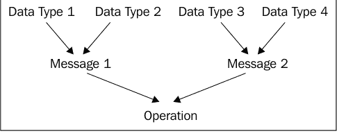

## 绑定元素

在 WSDL 中我们应注意的最后一个元素是 binding 元素。在 WSDL 中，这些是 SOAP 的扩展。此元素将 portType 中定义的操作绑定到特定的 SOAP 操作。除非您正在制作自己的 SOAP 客户端或编写 WSDL 文档，否则您不需要太多细节。然而，了解这里到底发生了什么还是很有帮助的。

WSDL portType 到 SOAP 操作的绑定在 binding 元素的 type 属性中声明。其值应指向一个 portType 元素的名称。

```
<binding name="GoogleSearchBinding" type="typens:GoogleSearchPort">
    <soap:binding style="rpc" transport="http://schemas.xmlsoap.org/soap/http"/>
    <operation name="doGetCachedPage">
        <soap:operation soapAction="urn:GoogleSearchAction"/>
        <input>
            <soap:body use="encoded" namespace="urn:GoogleSearch" encodingStyle="http://schemas.xmlsoap.org/soap/encoding/"/>
        </input>
        <output>
            <soap:body use="encoded" namespace="urn:GoogleSearch" encodingStyle="http://schemas.xmlsoap.org/soap/encoding/"/>
        </output>
    </operation>
```

子元素基本上是 SOAP 事务的元数据细节。我们在描述消息时谈到了 soap:binding 元素。此处的 style 属性就是设置 rpc 或 document 的地方。

您应注意的重要事项是 operation 元素。这些元素通过直接映射到 SOAP 操作来将 portType 操作暴露给 SOAP。如果 portType 操作未在此列出，它们将无法供调用者使用。其下可以有 body 元素。这些元素为操作提供 SOAP 特定的元数据。

此处的 use 属性要么是 encoded 要么是 literal。结合 binding 的 style 属性，它决定了 messages 部分和 SOAP body 元素是如何创建的。

在制作 mashup 的过程中，尤其是涉及专有数据时，您可能会遇到 SOAP 头的使用。SOAP 头通常包含有关事务本身的信息。头的一个常见用途是身份验证数据。在服务履行您的请求之前，您可能需要提供一些凭据。在 WSDL 中，头的要求在 bindings 中的 input 元素中定义。就像 messages 定义一样，它将使用 part 属性说明所需的数据类型。

```
<input>
    <soap:header message="tns:submitPassword" part=
        "xsd:string" use="literal"/>
    <soap:body
```

然后，您可以追溯 WSDL 到 message 部分，以找出需要在 SOAP 头中传递的确切元素名称。

```
<message name="submitPassword">
    <part name="password_header" element="Password" />
```

element 属性是关键。它说明您需要在 SOAP 头中传递的元素名称。在此示例中，此服务期望一个 SOAP 头，其中包含一个名为 Password 的元素，该元素是一个字符串，需要与 SOAP 消息一起传递。

我们不会在 Google 和 Microsoft Live Search API 中遇到头，但如果您在 WSDL 中遇到，请注意它们。

## 服务元素

最后，我们来到 service 元素。此元素为每个端口提供 SOAP 操作点的具体位置。每个端口在此处都有自己的元素，后跟指向服务的 SOAP 地址标签。Google 的 service 元素如下所示：

```
<service name="GoogleSearchService">
    <port name="GoogleSearchPort" binding="typens:
    GoogleSearchBinding">
        <soap:address location="http://api.google.com/search/beta2"/>
    </port>
</service>
```

这主要告诉我们，GoogleSearchPort 中发生的所有操作都在 URL http://api.google.com/search/beta2 处进行。如果我们直接访问服务，后续可能需要使用此信息。

## SOAP 消息

能够解读 WSDL 为我们提供了编写向服务发送 SOAP 消息所需的规则。我们现在可以对服务调用操作，以服务期望的数据类型传递服务所需的参数，并为服务器的响应做好准备。

SOAP 消息的结构相当直接。此外，SOAP 对请求和响应使用相同的结构。名为 Envelope 的元素是整个消息的根元素。在其中，名为 Header 的元素保存消息的路由数据。Body 元素保存消息内容。这可能是我们在请求时传递的参数，或我们在收到响应时获得的服务结果。最后，Fault 元素提供执行期间发生的任何错误的 information。结构上，SOAP 消息如下所示：

```
<?xml version="1.0"?>
<soap:Envelope
    xmlns:soap="http://www.w3.org/2001/12/soap-envelope"
    soap:encodingStyle="http://www.w3.org/2001/12/soap-encoding">
    <soap:Header>
        ...
    </soap:Header>
    <soap:Body>
        ...
        <soap:Fault>
        ...
        </soap:Fault>
    </soap:Body>
</soap:Envelope>
```

再次，我们不会对此进行过于详细的探讨。幸运的是，我们稍后将研究的 PHP 的 SoapClient 为我们隐藏了大量 SOAP 细节。然而，了解 SOAP 请求的结构对于使用 SOAP 客户端和故障排除至关重要。

### 信封

Envelope 元素将 XML 文档标识为 SOAP 消息。它必须完成两件事。首先，也是绝对必要的，是声明 SOAP 命名空间。其次，文档中必须设置编码样式。这两者都是通过 Envelope 元素的属性完成的。

```
<soap:Envelope
    xmlns:soap="http://www.w3.org/2001/12/soap-envelope"
    soap:encodingStyle="http://www.w3.org/2001/12/soap-encoding">
```

如果 SOAP 消息使用其他命名空间，也必须在此声明。例如，向 Google SOAP Search API 的正确请求在定义参数时需要声明 XSD 数据类型。为此，我们将在 Envelope 元素中在此处以命名空间声明 XSD 数据类型。

```
<SOAP-ENV:Envelope
    xmlns:SOAP-ENV="http://schemas.xmlsoap.org/soap/envelope/"
    xmlns:ns1="urn:GoogleSearch"
    xmlns:xsd="http://www.w3.org/2001/XMLSchema"
    xmlns:xsi="http://www.w3.org/2001/XMLSchema-instance"
    xmlns:SOAP-ENC="http://schemas.xmlsoap.org/soap/encoding/"
    SOAP-ENV:encodingStyle="http://schemas.xmlsoap.org/soap/encoding/">
```

### 头

如果服务需要任何头，它们应添加到 SOAP 头元素中。如果需要头，它们将在文档中注明，或在 WSDL 中明确说明。SOAP 头特定于 Web 服务实现。因此，每个头都需要命名空间限定。

在之前的密码示例中，服务期望一个名为 password 的元素，该元素是一个字符串，需要传递到 Header 中。我们像这样将其放在 SOAP 头中：

```
<soapenv:Header>
    <mysoap:password xmlns:mysoap="http://yourserviceURL">
    password
    </mysoap:password>
</soapenv:Header>
```

如果服务不需要头，我们可以省略 Header 元素。在 SOAP 规范中，此元素是可选的。

### 主体

最后，我们来到 SOAP 消息的主体。这里是我们将请求和所有必需参数传递给服务器的地方。此部分包含的内容及其结构完全由 Web 服务决定。最值得注意的是，我们参考 WSDL 中的 SOAP binding 元素来确定主体的确切结构。

在大多数公共 Web 服务情况下，模式相当简单。您希望调用的操作的名称是 Body 标签的子元素。其下，参数作为元素嵌套。


在最基本的形式中，body 元素看起来像这样：

```
<soapenv:Body>
    <nameOfOperationToBeCalled>
        <parameterOne>Parameter One</parameterOne>
        <parameterTwo>23.39</parameterTwo>
        <parameterThree>true</parameterThree>
    </nameOfOperationToBeCalled>
</soapenv:Body>
```

让我们看看 SOAP 绑定如何影响消息的创建。

## RPC 绑定

RPC 绑定需要在每个参数中传递参数的数据类型。我们可以看看如何向 Google SOAP Search API 发出请求：

```
<soapenv:Body>
    <ns1:doGoogleSearch>
        <key xsi:type="xsd:string">Your Google License Key</key>
        <q xsi:type="xsd:string">Orange Tabbies</q>
        <start xsi:type="xsd:int">0</start>
        <maxResults xsi:type="xsd:int">10</maxResults>
        ...
    </ns1:doGoogleSearch>
</soapenv:Body>
```

数据类型在 type 属性中声明。在 Google 的实现中，它使用 XSD 和 XSI 标准来定义数据类型。这些命名空间在 envelope 元素中就已声明。

## 文档绑定

在文档绑定中，数据类型不需要作为 body 的一部分。我们可以看看如何针对 Microsoft Live Search 服务进行调用，以了解其工作原理。

```
<soapenv:Body>
<ns1:Search>
    <ns1:Request>
        <ns1:AppID>Your MSN Search API Key</ns1:AppID>
        <ns1:Query>Orange Tabbies</ns1:Query>
        <ns1:CultureInfo>en-US</ns1:CultureInfo>
        ...
    </ns1:Request>
</ns1:Search>
</soapenv:Body>
```

这看起来与 RPC 绑定版本非常相似。ns1 是 Microsoft 架构命名空间，因此所有元素都需要它。像 RPC 一样，操作名称作为 Body 内的父元素。每个参数名称都是一个子元素，其参数值设置为元素的值。这次，没有数据类型属性。

## 错误

SOAP 中通过 Fault 元素标准化错误报告。如果请求出现问题，服务器会传递此元素。它始终作为 Body 元素的子元素出现。显然，在消费 Web 服务时，我们不需要处理编写 fault。然而，了解出现问题时返回的内容对于故障排除至关重要。

Fault 有四个子元素：

| 子元素 | 描述 |
|---|---|
| faultcode | 用于标识故障的四种代码之一。 |
| faultstring | 对出现问题情况的描述性解释。 |
| faultactor | 故障发生的位置。 |
| detail | 用于存放有关 body 元素的任何应用程序特定错误信息的容器。 |

在 SOAP 1.1 中，有四种可能的 fault 代码：

| faultcode | 描述 |
|---|---|
| VersionMismatch | Envelope 元素中 SOAP 命名空间声明的问题。 |
| MustUnderstand | Header 中的 MustUnderstand 属性未被理解。 |
| Client | 错误与客户端相关。请求格式错误。 |
| Server | 服务器处理错误。请求无法继续。 |

现在我们对 SOAP、WSDL 和 XSD 有了一些工作知识，可以将其用于开始编写 PHP 代码。

## PHP 的 SoapClient

了解 SOAP、WSDL 和 XSD 的复杂性非常有帮助。然而，编码每一个细节都是一个头痛。对于请求，我们必须大量操作和解析 XML 文档。说实话，SOAP 带有大量开销。我们必须手工创建 Envelope 和 Header，并手动创建消息体。当数据返回时，我们必须创建自己的解析器来遍历基于 XML 的 SOAP 文档。我们甚至还没有提到创建自己的套接字来与服务器通信。那有很多可能出错的地方。幸运的是，PHP 5 提供了与 SOAP 通信的出色接口。许多肮脏的细节都被隐藏起来并由客户端完成。我们根本不需要手动触及请求和响应。事实上，我们真的不需要在 XML 中做任何事情。此外，丑陋的网络连接也会自动为我们执行。

PHP 5 的 SOAP 接口是一个内置扩展，称为 SOAP。该扩展实际上包含六个类。SoapClient 是我们用来进行 SOAP 调用的类。我们还将查看 SoapFault 来处理错误。SoapServer 用于 PHP SOAP 提供程序。我们不会在 mashup 中使用它，但如果你将来想提供 SOAP 服务，这就是你要使用的类。其他三个类 SoapHeader、SoapParam 和 SoapVar 主要由 SoapClient 和 SoapServer 使用。除非你在 SOAP 和网络的真正底层层面折腾，否则你不会碰这些。

> SOAP 扩展的文档位于
> http://php.net/manual/ref.soap.php。

使用 SoapClient 发出 SOAP 请求的步骤非常简单直接。假设你对要访问的服务有所了解，整个过程最多分为四步：

- 1. 如果需要参数，将它们放入数组中。子对象和子数组必须嵌套。
- 2. 实例化 SoapClient 对象。SoapClient 支持两种操作模式——WSDL 和非 WSDL。我们很快会讨论这两种模式之间的区别，但现在要知道，客户端的实例化方式决定了使用哪种模式。
- 3. 使用 SoapClient 可用的方法调用服务。
- 4. 处理请求或错误。这涉及捕获结果并根据需要对其进行操作。

我们将逐步走完这四步来创建一个可工作的 SOAP 客户端。XMethods (www.xmethods.com) 是一个列出可自由使用的 Web 服务以供测试的网站。一个操作接收 URL 并返回网站上使用的超链接数组。在我们创建客户端时，我们将使用此服务进行测试。

## 创建参数

正如我们所讨论的，参数由 WSDL 决定。对于许多 Web 服务，会有一些关于可用操作和必需参数的文档。然而，在这种情况下以及许多其他情况下，没有文档。我们必须通过 WSDL 来工作。

WSDL 位于 http://webservices.daelab.net/temperatureconversions/TemperatureConversions.wso?WSDL。一个好的策略是从 binding 元素开始，然后向上追溯链条以获取操作名称，然后是必需的参数名称。

查看 binding，似乎有一个对我们有帮助的操作：

```
<binding name="TemperatureConversionsSoapBinding"
    type="tns:TemperatureConversionsSoapType">
        <soap:binding style="document" transport=
            "http://schemas.xmlsoap.org/soap/http"/>
        <operation name="CelciusToFahrenheit">
```

操作名称 CelciusToFahrenheit 看起来是我们想要的。

在 WSDL 中进一步向上查看，我们看到这段内容：

```
<portType name="TemperatureConversionsSoapType">
    <operation name="CelciusToFahrenheit">
        <documentation>Converts a Celcius Temperature to a Fahrenheit
            value</documentation>
        <input message="tns:CelciusToFahrenheitSoapRequest"/>
```

documentation 元素确认这是我们要找的。这个片段中的最后一行是 input 标签。message 属性指向一个名为 CelciusToFahrenheitSoapRequest 的消息。让我们看看这个消息：

```
<message name="CelciusToFahrenheitSoapRequest">
    <part name="parameters" element="tns:CelciusToFahrenheit"/>
</message>
```

这指向 types 元素。我们将在其中查找名为 CelciusToFahrenheit 的数据类型。

```
<xs:element name="CelciusToFahrenheit">
    <xs:complexType>
        <xs:sequence>
            <xs:element name="nCelcius" type="xs:decimal"/>
        </xs:sequence>
    </xs:complexType>
</xs:element>
```

最后，我们找到了需要传递的参数的确切名称和类型。我们需要向名为 CelciusToFahrenheit 的操作传递一个名为 nCelcius 的十进制数，以便获取我们想要的数据。

此参数要求相当简单，但很常见。所有需要由 SoapClient 传递的参数都必须放入关联数组中。

在你的 Web 服务器上创建一个可以提供服务的 PHP 文件。要为此请求创建参数，创建一个包含一个元素的数组。键是 nCelcius，而值是你想要转换的温度。

```
$params = array('nCelcius' => 37);
```

## 实例化 SoapClient

SoapClient 是一个对象，所有调用都通过此对象的方法进行，因此我们首先需要实例化它。在此之前，我们需要决定为 SoapClient 使用 WSDL 模式还是非 WSDL 模式。

在 WSDL 模式下，SoapClient 从远程服务器获取 WSDL 文件并自动判断服务上有哪些操作可用、需要哪些参数以及如何构造它们。在 WSDL 模式下，我们还有一些可用于查询服务的方法。例如，__getFunctions 返回服务可用的 SOAP 操作列表，而 __getTypes 返回使用的 SOAP 数据类型列表。

在非 WSDL 模式下，我们在实例化时指定 Web 服务的实际位置，而不是 WSDL，并在创建时指定文档的命名空间。在创建实际请求时，我们必须更加小心。

既然 WSDL 会自动完成很多事情，为什么有人会使用非 WSDL 呢？性能是一个原因。


在非 WSDL 模式下，你无需请求 WSDL 文档，也没有解析开销。控制是另一个原因。在非 WSDL 模式下，对于某些高级操作，你可能需要处理更细粒度的任务。有些人喜欢这样。

非 WSDL 模式还提供了一些其他情况下不可用的实例化选项。不过主要原因可能是你根本没有选择。WSDL 文件可能对你不可公开获取。为了让你的生活更轻松，我建议在可能的情况下始终使用 WSDL 模式。然而，在非 WSDL 模式下工作完全可以接受，在实践中也不罕见。我们将介绍如何使用这两种模式进行调用，并且稍后在实际的 mashup 中，我们将对其中一个调用使用非 WSDL。

## 在 WSDL 模式下实例化

是否使用 WSDL 模式还是非 WSDL 模式的 SoapClient 取决于你最初如何实例化 SoapClient。让我们来看一下该类的构造函数：

```
class SoapClient {
  __construct ( mixed wsdl [, array options] )
}
```

传递给它的第一个参数是 WSDL。通常这是一个指向 WSDL 文件的简单 URI，尽管 mixed 类型允许你将存储在字符串中的 WSDL 文件传递到此参数。第二个参数是一个可选的选项数组。

如果你想进入 WSDL 模式，只需将 WSDL 传递给第一个参数即可。

```
$client = new SoapClient(
'http://webservices.daelab.net/temperatureconversions/TemperatureConversions.wso?WSDL'
);
```

使用此对象进行的所有后续操作都将在 WSDL 模式下进行。

## 在非 WSDL 模式下实例化

创建非 WSDL 客户端稍微复杂一些。首先，wsdl 参数无关紧要。你必须向此选项传递 null 值。这也意味着你的客户端不会自动知道服务操作点在哪里。你必须手动告诉它。为此，在实例化时在选项数组中设置服务的位置和目标命名空间。换句话说，这个可选参数不再是可选的。这分别通过数组的 location 和 uri 元素完成。

```
$client = new SoapClient(
    null,
    array(
        'location' => 'http://webservices.daelab.net/temperatureconversions/TemperatureConversions.wso',
        'uri' => 'http://webservices.daelab.net/temperature'
    )
);
```

我们从哪里获取 URL 的 location 值？它是从 service 元素中获取的。它是端口的子 address 元素。uri 值也取自 WSDL，但位于最顶部。它是 definitions 元素的 targetNamespace 值。在本例中，它们是相同的值，但在许多实现中它们并不相同。


### 使用其他选项

> 你可能想查看 options 数组的文档，尽管大多数选项在大多数基本调用中并不需要，尤其是在 WSDL 模式下。它们都列在 SoapClient 构造函数页面 http://php.net/manual/function.soap-soapclient-construct.php 中。其中一个特定的选项 trace 非常有用。如果设置为 true，这将允许我们在稍后检查实际的 SOAP 信封，并进行一般调试。尽管如此，了解其他选项也很好，尤其是当你遇到 SOAP 服务的奇怪通信问题时。解决方案可能是在 options 数组中的一个设置。

这两种选项中的任何一种都会为我们提供一个名为 $client 的新的 SoapClient 对象。我们现在可以使用该对象的方法。

## 进行调用和使用 SoapClient 方法

在进行 SOAP 调用之前，让我们先看看可用的一些方法。如果你使用的是 WSDL 模式，两个方法会特别有用，__getFunctions 和 __getTypes。

请记住，当我们创建 SoapClient 对象时，PHP 已经查询了 WSDL。它不仅仅在心里记下 WSDL。它会读取它，并通过将操作翻译成 SoapClient 对象本身中的可用方法来让我们的生活更轻松。（我们稍后会看到这如何影响我们进行 SOAP 调用方式。）这样做时，它显然保存了可用函数和数据类型的列表。

要访问这些列表，请对 SoapClient 使用 __getFunctions 以返回 WSDL 中所有 SOAP 操作及其参数的数组。__getTypes 返回 WSDL 中使用的所有数据类型的数组。如果没有文档，这非常有用。

我们可以在 URL 提取服务上看到它的实际效果：

```
<?php
    $client = new SoapClient(
    'http://webservices.daelab.net/temperatureconversions/
                TemperatureConversions.wso?WSDL'
    );
?>
<h1>Types:</h1>
<?= var_dump($client->__getTypes()); ?>
<h1>Functions:</h1>
<?= var_dump($client->__getFunctions()); ?>
```

这段代码在示例中作为 SoapClientTest.php。运行该页面将在页面源中给出此输出：

```
<h1>Types:</h1>
array(8) {
    [0]=>
    string(49) "struct CelciusToFahrenheit {
    decimal nCelcius;
}"
    [1]=>
    string(74) "struct CelciusToFahrenheitResponse {
    decimal CelciusToFahrenheitResult;
}"
    [2]=>
    string(52) "struct FahrenheitToCelcius {
    decimal nFahrenheit;
}"
...
<h1>Functions:</h1>
array(4) {
    [0]=>
    string(80) "CelciusToFahrenheitResponse CelciusToFahrenheit(CelciusT
                    oFahrenheit $parameters)"
    [1]=>
    string(80) "FahrenheitToCelciusResponse FahrenheitToCelcius(Fahrenhe
    itToCelcius $parameters)"
    [2]=>
string(77) "WindChillInCelciusResponse WindChillInCelcius(
                    WindChillInCelcius $parameters)"
[3]=>
string(86) "WindChillInFahrenheitResponse WindChillInFahrenheit(
                    WindChillInFahrenheit $parameters)"
}
```

方法签名的格式非常像 C 风格。它对输入和返回使用对象提示。列出的第一个函数是 CelciusToFahrenheit。它接受一个 CelciusToFahrenheit 对象。

查看类型，我们看到 CelciusToFahrenheit 是一个仅包含一个元素的 struct，即一个名为 nCelcius 的 decimal。如我们在 WSDL 中发现的那样，这告诉我们需要向 CelciusToFahrenheit 操作传递一个名为 nCelcius 的参数。

返回值是一个 CelciusToFahrenheitResponse 对象。查看类型，我们将该对象追溯到一个名为 CelciusToFahrenheitResponse 的 struct。这是一个 struct，给出了以下定义：

```
string(74) "struct CelciusToFahrenheitResponse {
    decimal CelciusToFahrenheitResult;
```

最后，我们看到 CelciusToFahrenheitResponse 基本上是一个名为 CelciusToFahrenheitResult 的 decimal。你可以在 WSDL 中查看是否有更多细节。或者，由于你已经知道需要哪些参数，你可以直接进行 SOAP 调用并使用 SoapClient 检查结果。

你如何进行 WSDL 调用取决于你处于 WSDL 模式还是非 WSDL 模式。除了访问某些函数之外，这是唯一根据 WSDL 或非 WSDL 而变化的语法区域。

## 在 WSDL 模式下调用 SOAP 操作

在 WSDL 模式下，PHP 已将操作内部化并使其成为 SoapClient 对象的扩展。它们的使用极其简单。你可以将这些操作视为 SoapClient 对象的方法。

```
$params = array('nCelcius' => 37);
$client = new SoapClient(
'http://webservices.daelab.net/temperatureconversions/
TemperatureConversions.wso?WSDL',
array('trace' => true)
);
$result = $client->CelciusToFahrenheit($params);
```

## 在非 WSDL 模式下调用 SOAP 操作

在非 WSDL 模式下，SoapClient 不知道有哪些方法可用。为此，SoapClient 持有名为 __soapCall 的操作调用方法。此方法的唯一存在是为了针对服务启动 SOAP 调用，并且它接受两个参数。第一个是 SOAP 操作的名称。第二个是你希望传递给服务的 SOAP 参数的数组。重写上述调用在非 WSDL 模式下，我们得到以下内容：

```
$params = array('nCelcius' => 37);
$client = new SoapClient(
null,
array(
'location' => 'http://webservices.daelab.net/temperatureconversions/TemperatureConversions.wso',
'uri' => 'http://webservices.daelab.net/temperature'
)
);
$result = $client->__soapCall('CelciusToFahrenheit', $params);
```

请记住，我们需要在实例化 SoapClient 以进入非 WSDL 模式时提供 location 和 uri 选项，并且将第一个参数传递为 null。之后，我们可以使用 __soapCall 来调用该操作。

这两种方法中的任何一种都会将 SOAP 响应放入名为 $result 的变量中。现在，我们可以使用它来查看服务器返回给我们什么。

## 处理 SOAP 响应

在开始显示结果之前，我们需要看看它是否成功。

## 使用 SoapFault 处理 SOAP 错误

SoapClient 利用 PHP 5 中的新 try/catch 块来处理错误。如果出现问题，无论是我们的原因还是服务器返回了故障，SoapClient 都会抛出 SoapFault 对象。我们需要捕获它并优雅地处理错误。在以下示例中，我故意将方法名更改为 GetURLs。因为该方法不存在，所以它会失败。

```
try {
    $result = $client->ConvertTemp($params);
}
catch (SoapFault $e) {
    echo "Error!<br>";
```

```
echo "faultcode: " . $e->faultcode . "<br>";
    echo "faultstring: " . $e->faultstring . "<br>";
    echo "detail: " . $e->detail;
}
```

这样做的最佳方式是将对操作的调用包装在 try 块中。如果失败，catch 块将捕获 SoapFault 并将其放入对象中，在本例中为 $e。SoapFault 的文档位于 http://php.net/manual/function.soap-soapfault-construct.php。它除了构造函数之外没有其他方法。它确实有几个参数。这些参数直接对应我们之前讨论过的 SOAP 的 Faults 元素的子元素。因此，使用 SoapFault 对象，我们可以检查服务器发送给我们的 SOAP 消息。

运行上述代码块将在浏览器上生成以下消息：

```
Error!
    faultcode: Client
    faultstring: Function ("ConvertTemp") is not a valid method for this service
    detail:
```

当然，显示错误并不是你的唯一选择。你的业务规则可能会规定应用程序在出错时在后台执行其他操作。

## 处理成功结果

不过，希望我们的查询是成功的。如果是这样，SoapClient 将接收传入的响应 SOAP 消息，提取数据元素，将其放入 PHP 数据结构中，并返回给分配给 SOAP 调用的变量。

不幸的是，这既是福也是祸。好处是，一旦你理解了该特定 SOAP 响应创建的数据结构，就非常容易操作且功能强大。坏处在于达到理解数据结构这一点。

对于 XML 来说，理解元素和子元素非常容易。即使是长 XML 文档也很容易阅读，因为结构清晰。PHP 必须将此塞入一个包含对象、原始数据类型、原始数据类型的数组、对象的数组、包含其他数组的对象的数组等系统的体系中。不用说，这可能会变得相当混乱。虽然 SoapClient 在将 SOAP 数据类型映射到 PHP 数据类型方面做得非常出色，但人类需要一点耐心才能弄清楚 SoapClient 做了哪些决定。

幸运的是，我们有一些线索可以帮助我们。第一个线索是文档。不过，如果你生活在不完美的世界里，你可以求助于可靠的 WSDL 文档。回顾此操作的 portType，我们看到有一个输出消息。

```
<output message="tns:CelciusToFahrenheitSoapResponse"/>
```

然后我们可以再次向上追溯到 message 和 types 元素。

```
<message name="CelciusToFahrenheitSoapResponse">
    <part name="parameters" element=
        "tns:CelciusToFahrenheitResponse"/>
</message>
...
<xs:element name="CelciusToFahrenheitResponse">
    <xs:complexType>
        <xs:sequence>
            <xs:element name=
                "CelciusToFahrenheitResult" type="xs:decimal"/>
        </xs:sequence>
    </xs:complexType>
</xs:element>
```

这告诉我们应该期望一个名为 CelciusToFahrenheitResponse 的对象。其中包含一个名为 CelciusToFahrenheitResult 的十进制数。

我们的下一个线索是保存响应的 PHP 变量。在之前的示例中，我们将其存储在名为 $results 的变量中。我们可以将其通过 var_dump 传递以检查 SoapClient 如何映射数据。

通过 var_dump 传递它会产生以下结果：

```
object(stdClass)#2 (1) {
    ["CelciusToFahrenheitResult"]=>string(4) "98.6"
}
```

从第一行开始向下，我们看到第一行告诉我们整个变量是一个对象。第一个属性名为 CelciusToFahrenheitResult，且它是一个字符串。即使 WSDL 说这应该是一个十进制数，SoapClient 也会将其转换为字符串，因为 PHP 是无类型的。要访问华氏值，我们只需访问对象属性：

```
$result->CelciusToFahrenheitResult ->
```

现在我们可以把所有东西整合在一起。在本例中，让我们将 37 摄氏度转换为华氏度。我们的脚本将执行 SOAP 调用，检查错误并输出结果。

```
<?php

$params = array('nCelcius' => 37);

$client = new SoapClient(
'http://webservices.daelab.net/temperatureconversions/
TemperatureConversions.wso?WSDL',
array('trace' => true)
);
try {
    $result = $client->CelciusToFahrenheit($params);
} catch (SoapFault $e) {
    echo "Error!<br>";
    echo "faultcode: " . $e->faultcode . "<br>";
    echo "faultstring: " . $e->faultstring. "<br>";
    echo "detail: " . $e->detail;
}
?>
<html>
<head><title>Soap Test</title></head>
<body>
<?php if ($result) { ?>
    Fahrenheit: <?= $result->CelciusToFahrenheitResult ?>
<?php } else { ?>
    Problem with conversion.
<?php } ?>
</body>
</html>
```

此脚本名为 SoapClientTest2.php。在我们的网络浏览器上运行它会显示以下内容：

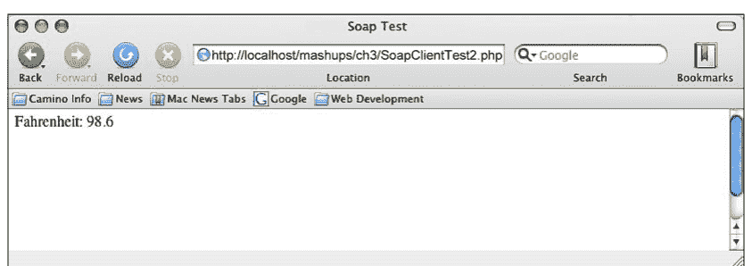

现在我们拥有了进行 SOAP 调用并使用 Microsoft Live Search 服务所需的所有背景知识。将此与我们已知的关于 REST 的知识结合起来，我们就可以开始创建我们的 mashup。在开始编写代码之前，由于每个 Web 服务的实现都不同，我们需要查看每个服务以了解我们要处理的内容。

## Microsoft Live Search Web 服务

Microsoft Live Search Web 服务是一个易于使用的 SOAP 服务。以下是几个关键亮点：

-   MSN Search Web 服务只有一个操作，名为 Search。页面的缓存版本作为 Search 结果的一部分可用。
-   MSN Search 的搜索请求限制为每天 20,000 次请求。
-   每次搜索最多返回 250 条结果。

MSN Search Web 服务的主页位于 http://msdn.microsoft.com/live/msnsearch/default.aspx。提供了广泛的文档、示例代码（.NET）和开发者论坛。你还需要一个许可证密钥，他们称之为 **AppID**，用于 Live Search。你可以在 http://search.msn.com/developer 获取它。

## 使用 Search

Microsoft Live Search Web 服务将所有相关操作和参数组织成对象。这对我们来说有点挑战，因为 SoapClient 的 SOAP 调用的 parameters 参数必须是数组。然后 SoapClient 将其序列化为服务喜欢的格式。我们必须构建一个超过两维的数组来适应这一点。然而，在构建此初始数组时我们必须小心。

表面上，Search 只需要一个参数——SearchRequest 对象。换算成 PHP 数组术语，这已经是一个数组层级。

此对象有几个属性：

| 属性 | 描述 | 可选时的默认值 |
|---|---|---|
| AppID | 你生成的 AppID。 | *Required* |
| Query | 你要搜索的查询词。 | *Required* |
| CultureInfo | 语言和区域信息。有关代码完整列表，请参阅 Microsoft Live Search Web 服务参考。 | *Required* |
| SafeSearch | 过滤成人内容的安全设置级别。值可以是 Strict、Moderate 或 Off。 | Moderate |
| Flags | 控制查询词在返回时是否被标记。值可以是 None 或 MarkQueryWords。 | None |
| Location | 控制搜索的定位数据（如适用）。有关适用性，请参阅 Microsoft Live Search Web 服务参考。 | *Optional, No default* |
| Requests | SourceRequest 对象的数组，可进一步控制结果的返回方式。 | *Required* |

SourceRequest 属性也记录得很好：

| 属性 | 描述 | 可选时的默认值 |
|---|---|---|
| Source | 可能的源搜索的枚举列表。有关完整列表，请参阅 Microsoft Live Search Web 服务参考，但此值应设置为 Web。 | *Optional, No default* |
| Offset | 以零为最相关，这是你希望返回的第一个结果。如果出于某种原因你只想要中等相关性的响应，请选择较大的数字。 | 0 |
| Count | 指定要返回的结果数。 | 10 |
| ResultFields | 搜索中要返回的字段的枚举列表。有关完整列表，请参阅 Microsoft Live Search Web 服务参考。要查看全部，请将此值设置为 All。 | All |

Requests 属性是一个对象数组，因此我们需要为其设置两个数组层级。然后，Microsoft Live Search 的完整参数如下所示：

```
$params = array('Request' => array(
    'AppID' => 'Your Microsoft Live Search AppID',
    'Query' => 'Orange Tabby Kittens',
```

```
'CultureInfo' => 'en-US',
'SafeSearch' => 'Strict',
'Flags' => '',
'Location' => '',
'Requests' => array(
    'SourceRequest' => array(
        'Source' => 'Web',
        'Offset' => 0,
        'Count' => 50,
        'ResultFields' => 'All')
    )
);
```

同样，所有字段都是必需的，但可以为空。Requests 的嵌套使得构造起来有点令人困惑，但 SoapClient 能很好地处理请求。设置完成后，我们就可以将其传递给 SoapClient 并调用 Search。这次，我将演示 WSDL 模式的使用。我们将调用包装在 try-catch 块中以检查错误。

```
$client = new SoapClient(
    'http://soap.search.msn.com/webservices.asmx?wsdl',
    array('trace' => true),
    );

try{
    $result = $client->Search($params);
}
catch(SoapFault $e) {
    echo "Error!<br>";
    echo "faultcode: " . $e->faultcode . "<br>";
    echo "faultstring: " . $e->faultstring. "<br>";
    echo "detail: " . $e->detail;
}
```

返回后，我们可以分解 $result 变量来查看如何解析响应。查看 var_dump 结果和文档，我们发现 $result 是 Response 类的一个对象。其中有一个名为 Responses 的对象属性。Responses 有一个名为 SourceResponse 的属性。SourceResponse 包含有关查询结果的信息。实际的查询结果位于名为 Results 的数组中，它是 SourceResponse 的一个属性。Results 数组的元素是名为 Result 的对象。Result 对象的属性包括 Title、Description、实际 URL、显示 URL 以及缓存版本的 URL。

```
$result->Response->Responses->SourceResponse->Results->Result
```

名为 MSNSoapTest.php 的示例文件演示了这一点。该脚本针对 Microsoft Live Search Web 服务执行基于 SOAP 的查询，并使用 Microsoft Live Search 响应结构解析结果。

```
<?php if ($result) { ?>
<table>
<tr>
<th>Title</th>
<th>URL</th>
</tr>
<?php foreach ($result->Response->Responses->SourceResponse
    ->Results->Result as $key => $value) { ?>
<tr>
<td><?= $value->Title ?></td>
<td><?= $value->Url ?></td>
</tr>
<?php } ?>
</table>
<?php } ?>
```

在浏览器中它将如下所示：

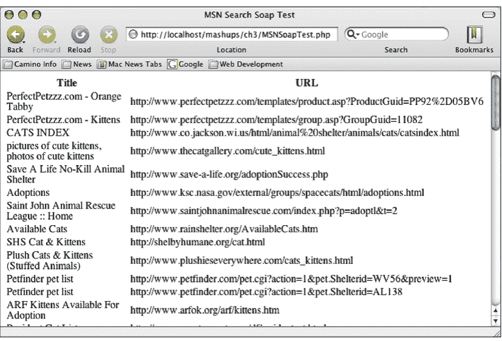

## Yahoo! 搜索 Web 服务

我们接下来要查看的第二个搜索服务是 Yahoo! Search Web Service。与其他 Microsoft Live Search 不同，该服务基于 REST。我们将利用上一章学到的知识来访问该服务。尽管如此，我们仍需要检查此 Web 服务，以了解需要传递哪些参数，以及可以期望返回什么。

该 Web 服务的主页位于 http://developer.yahoo.com/search/。与另外两个一样，该服务得到了优秀的文档、论坛社区和示例代码的支持。在所有三项服务中，Yahoo! 的示例代码更为丰富，并提供了 PHP、Perl、Python、Java、JavaScript 和 Flash 的示例。同样，与全部三项服务一样，您需要下载一个标识密钥。您可以在 http://api.search.yahoo.com/webservices/register_application 获取此密钥。

Yahoo! Search Web Service 实际上是一整套 Web 搜索服务家族。其他可用的服务包括音频搜索、图像搜索和新闻搜索。Web Search 接口是更传统的万维网搜索引擎，我们将重点关注它。

Yahoo! Search Web Service 与 Microsoft Live Search 有一些关键区别：

- 1. 基于 REST 的服务是一大福音，因为它非常易于使用，并且能很好地与更多技术集成，包括 Flash 和 JavaScript 等客户端技术。它也是一种诅咒，因为我们将无法享受 WSDL 等带来的优势。
- 2. Yahoo! Search Web Service 每天提供 5,000 次查询。

## 使用 Web 搜索

Web 服务的位置在 http://search.yahooapis.com/WebSearchService/V1/webSearch。我们必须包含以下几个参数：

| 参数名称 | 描述 |
|---|---|
| appid | 您的应用程序 ID。 |
| query | 您要搜索的查询词。 |
| region | 您要搜索的区域。 |
| type | 您希望返回的搜索类型。"all" 表示提交的整个查询，"any" 返回包含任一搜索词的所有结果。Phrase 将查询视为短语并相应处理。 |
| results | 要返回的最大结果数。最大值为 100。 |
| start | 您希望从哪个结果开始。 |
| format | 要查找的文件类型。 |
| adult_ok | 标志，表示是否希望过滤成人内容。 |
| similar_ok | 标志，表示是否希望包含重复结果。 |
| language | 响应的语言。 |
| country | 您希望将搜索限制到的国家。 |
| site | 您希望将搜索限制到的域名。 |
| subscription | 用于高级、付费内容的特殊容器。 |
| license | 您希望应用于搜索结果的 Creative Commons 许可。 |
| output | 返回搜索的格式。可以是 XML（默认）、JSON 或序列化 PHP。 |
| callback | 要调用的 JavaScript 回调函数。 |

Output 标志尤其重要。Yahoo! Web 服务可以将结果作为序列化 PHP 返回，因此我们可以直接将返回值传递给 unserialize()。我们无需将结果通过 SAX 解析器传递。

由于该服务是 REST，我们对参数有更大的灵活性。如果我们希望接受默认值，只需从参数中省略即可。这些值的简单参数数组可能如下所示：

```
$params = array('appid' => 'Your Yahoo! App ID',
    'query' => 'Orange Tabby Kittens',
    'region' => 'us',
    'type' => 'all',
    'results' => 50,
    'start' => 0,
    'format' => 'any',
    'adult_ok' => 1,
    'similar_ok' => 0,
    'output' => 'php'
);
```

我们将通过将 output 参数设置为 php 来利用序列化 PHP 功能。

要进行调用，我们将使用上一章创建的 RESTParser 类，实例化该类并进行 REST 调用。

```
require_once('classes/RESTParser.php');
$parser = new RESTParser();

$t = $parser->callService($params, 'search.yahooapis.com', '/WebSearchService/V1/webSearch', 'GET');
$result = unserialize($t);
```

注意最后一行。我们将 REST 调用的结果通过 unserialize()。现在结果可以通过 PHP 轻松操作。

返回值的 PHP 结构与 Microsoft Live Search 不同。响应不使用对象，主要是因为该概念在 REST 中不存在，但在 SOAP 中很常见。相反，Yahoo! 大量使用数组。

要访问服务返回的值，我们必须经过 ResultSet，它是 Result 对象的数组，然后必须遍历 Result 本身，因为它是一个包含返回对象的数组。例如，要从顶层到 Result 对象，我们将使用以下链：

```
result['ResultSet']['Result']
```

对于每个返回的 Result 对象，我们必须访问这些数组元素。我们可以使用示例 YahooTest.php 页面来演示：

```
<?php if ($result) { ?>
<table>
<tr>
<th>Title</th>
<th>URL</th>
</tr>
<?php foreach ($result['ResultSet']['Result'] as $key => $value) { ?>
<tr>
<td><?= $value['Title'] ?></td>
<td><?= $value['Url'] ?></td>
</tr>
<?php } ?>
</table>
<?php } ?>
```

注意我们如何将标题和 URL 作为数组元素访问，而不是对象。通过浏览器运行它将给出来自 Yahoo! 的结果！

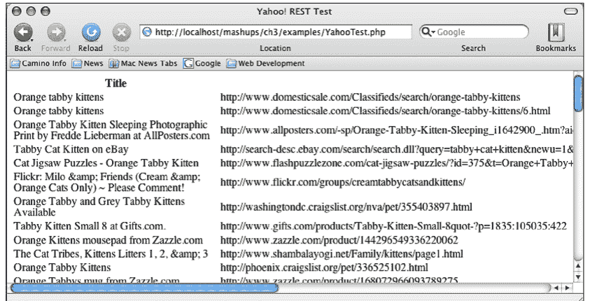

## 整合

现在是时候将所有内容整合在一起了。我们已经查看了 SOAP，它允许我们访问 Microsoft Live Search Web 服务。然后我们查看了每个单独的服务，并了解了它们如何接受和返回数据。现在让我们在统一的接口下将它们全部整合起来。

让我们从一个用于接受查询的前端表单开始。

```
<!DOCTYPE html PUBLIC "-//W3C//DTD XHTML 1.0 Transitional//EN"
"http://www.w3.org/TR/xhtml1/DTD/xhtml1-transitional.dtd">
<html xmlns="http://www.w3.org/1999/xhtml" lang="en_US" xml:lang="en_US">
<head>
<title>Mashups Chapter 2</title>
</head>
<body>
<form action="action.php" method="post">
<input type="text" size="20" maxlength="40" name="query"  />
<input type="submit" />
</form>
</body>
</html>
```


这将把查询发布到一个动作页面。对于我们的动作页面，我们只需取到目前为止编写的示例代码并将其整合。唯一要做的更改是确保某个对象唯一的一些变量名。在最开始，我们还包含了 Yahoo! Web Services 所需的 RESTParser 类。

```php
<?php
$q = $_POST['query'];
require_once('classes/RESTParser.php');
/******
* Begin MSN
*/
$params = array('Request' => array(
    'AppID' => 'Your Microsoft Live Search API Key',
    'Query' => $_POST['query'],
    'CultureInfo' => 'en-US',
    'SafeSearch' => 'Strict',
    'Flags' => '',
    'Location' => '',
    'Requests' => array(
        'SourceRequest' => array(
            'Source' => 'Web',
            'Offset' => 0,
            'Count' => 10,
            'ResultFields' => 'All')
        )
    );

$msnClient = new SoapClient("http://soap.search.msn.com/
    webservices.asmx?wsdl");

try {
    $msnResults = $msnClient->Search($params);
}
catch(SoapFault $msnError) {
    echo "Error!<br>";
    echo "faultcode: " . $msnError->faultcode . "<br>";
    echo "faultstring: " . $msnError->faultstring. "<br>";
    echo "detail: " . $msnError->detail;
}

/****
* End MSN
*/
```

```
/*****
 * Begin Yahoo!
 */
$params = array('appid' => 'Your Yahoo! App ID',
                'query' => $_POST['query'],
                'region' => 'us',
                'type' => 'all',
                'results' => 10,
                'start' => 0,
                'format' => 'any',
                'adult_ok' => 1,
                'similar_ok' => 0,
                'output' => 'php'
                );
$parser = new RESTParser();
$t = $parser->callService($params, 'search.yahooapis.com', '/WebSearchService/V1/webSearch', 'GET');
$yahooResults = unserialize($t);
/****
 * End Yahoo!
 */
?>
<html>
<head><title>Mashup Search Engine Results?</title></head>
<body>
<?php if ($msnResults) { ?>
<h1>Results from MSN</h1>
<table>
<tr>
<th>Title</th>
<th>URL</th>
</tr>
    <?php foreach ($msnResults->Response->Responses->SourceResponse->Results->Result as $key => $value) { ?>
        <tr>
            <td><?= $value->Title ?></td>
            <td><?= $value->Url ?></td>
        </tr>
<?php } ?>
</table>
<?php } ?>
<?php if ($yahooResults) { ?>
<h1>Results from Yahoo!</h1>
```

```
<table>
<tr>
<th>Title</th>
<th>URL</th>
</tr>
<?php foreach ($yahooResults['ResultSet']['Result'] as $key =>
$value) { ?>
<tr>
<td><?= $value['Title'] ?></td>
<td><?= $value['Url'] ?></td>
</tr>
<?php } ?>
</table>
<?php } ?>
</body>
</html>
```

我们的 mashup 已准备好使用。访问 `searchForm.php` 将为我们提供一个输入查询的表单。

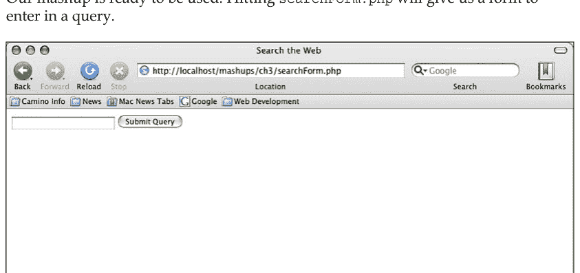

然后我们的动作页面将查询这两个 Web 服务并向用户显示结果。

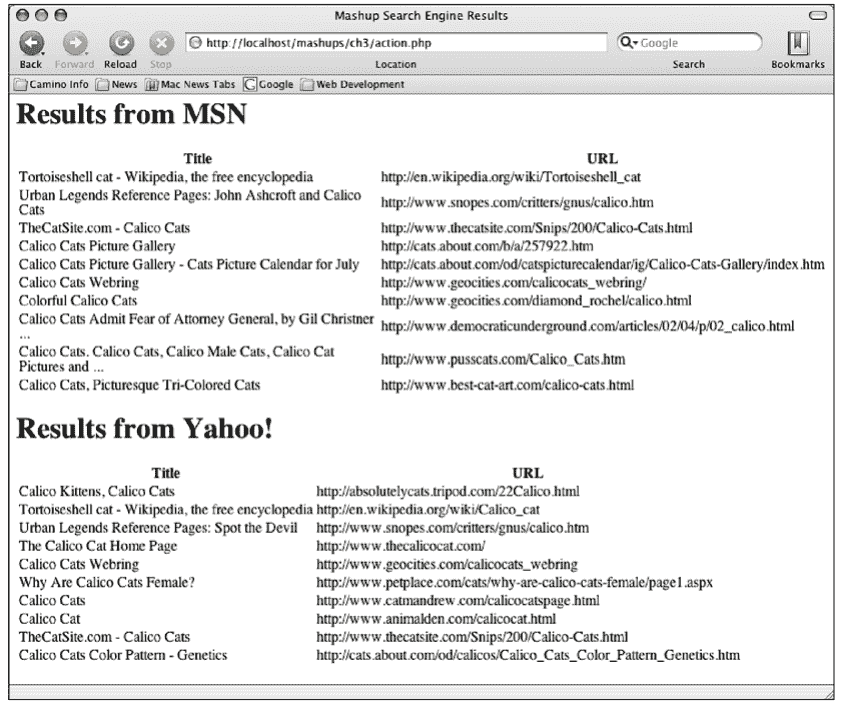

## 摘要

在本章中，我们介绍了 SOAP，这是迄今为止最复杂的 Web 服务协议之一。SOAP 严重依赖于 WSDL 和 XSD 等其他标准。我们查看了 WSDL 文档，并学习了如何从中确定可用的 Web 服务以及传递的数据类型。使用 PHP 5 的 SoapClient 扩展，我们随后与 SOAP 服务器交互以获取数据。这最终导致了我们 mashup 的创建，该 mashup 收集了来自 MSN 和 Yahoo! 的网络搜索结果。这个 mashup 不仅仅是关于 SOAP。通过使用 MSN 和 Yahoo! 的 Web 服务，我们现在已经接触到了 Web 服务领域中的三大巨头。如果未来我们使用他们的 Web 服务，我们将知道可以期待每种服务提供何种类型的文档和支持。

# 4

## 你自己的视频点唱机

### 项目概述

| 说明 | 将 Last.fm 和 YouTube 的 Web API mashup 以创建歌曲视频点唱机 |
| 使用的协议 | REST（提供 XML-RPC） |
| 数据格式 | XML, XSPF, RSS |
| 重点工具 | PEAR |
| 使用的 API | Last.fm and YouTube |

现在我们已经有了一定的 Web 服务使用经验，是时候对其使用进行微调了。XML-RPC、REST 和 SOAP 将是你使用 Web 服务并创建 mashup 时的常见伙伴。你会遇到很多不同的数据格式，以及 PHP 社区处理这些格式的有趣方式。这尤其如此，因为 REST 已变得非常流行。在 REST 中，没有正式化的响应格式，你会遇到从纯文本到临时 XML 再到基于 XML 的标准的各种返回格式。

我们后续的项目将侧重于让我们接触到一些新格式，并我们将研究如何通过 PHP 处理它们。我们将从一个项目开始，创建我们自己的个性化视频点唱机。这个 mashup 将从社交音乐网站 Last.fm 拉取音乐列表源。我们将从这些源中解析出艺术家姓名和歌曲标题，并使用该信息通过 YouTube Web 服务在用户贡献的视频网站 YouTube 上搜索视频。通过基于不断变化的源来选择歌曲，我们的点唱机选择不会是静态的，并且会随着音乐品味的演变而变化。由于 YouTube 是一个用户贡献的网站，我们也会看到对我们音乐的许多有趣解读。这个点唱机将是个性化、动态的，并且相当有趣。

Last.fm 和 YouTube 的 API 都通过 REST 提供其 Web 服务，而 YouTube 另外还提供 XML-RPC 接口。与之前的 API 一样，每次服务调用都会返回 XML。Last.fm 返回纯文本、一种名为 XSPF（XML Shareable Playlist Format）的 XML 播放列表格式，或 RSS（Really Simple Syndication）。对于 YouTube 来说，服务返回专有格式。之前，我们编写了自己的基于 SAX 的 XML 解析器来提取 XML 数据。在本章中，我们将研究 PEAR，即 PHP Extension and Application Repository，如何为我们在这个项目上完成 XSPF 解析工作，并且可能在其他项目中提供帮助。

让我们先看看我们将使用的各种数据格式，然后再看看 Web 服务本身。

## XSPF

XML 的最初目标之一是允许行业创建自己的标记语言来交换数据。因为任何人都可以创建自己的元素和模式，只要人们同意一种格式，XML 就可以用作该行业的通用数据传输语言。最早的基于 XML 的语言之一是 ChemXML，一种用于在化学行业内传输数据的语言。此后，又出现了许多其他语言。

XSPF 是一个完全的草根项目，旨在基于 XML 创建一种开放的、非专有的音乐播放列表格式。历史上，软件媒体播放器和音乐设备的播放列表设计仅用于机器或设备本身，模式由厂商自行设计。XSPF 的目标是创建一个可在软件、设备和网络间使用的格式。

XSPF 是一个非常简单的格式，易于理解。项目主页位于 http://www.xspf.org。在那里，你会找到一个快速入门指南，其中概述了一个简单的播放列表，以及官方规范 http://www.xspf.org/specs。基本上，一个典型的播放列表具有以下结构：

```
<?xml version="1.0" encoding="UTF-8"?>
<playlist version="1" xmlns="http://xspf.org/ns/0/">
    <title>Shu Chow's Playlist</title>
    <date>2006-11-24T12:01:21Z</date>
    <trackList>
        <track>
            <title>Pure</title>
            <creator>Lightning Seeds</creator>
            <location>
                file:///Users/schow/Music/Pure.mp3
            </location>
        </track>
        <track>
            <title>Roadrunner</title>
            <creator>The Modern Lovers</creator>
            <location>
                file:///Users/schow/Music/Roadrunner.mp3
            </location>
        </track>
        <track>
            <title>The Bells</title>
            <creator>April Smith</creator>
            <location>
                file:///Users/schow/Music/The_Bells.mp3
            </location>
        </track>
    </trackList>
</playlist>
```

`playlist` 是整个文档的父元素。它需要一个子元素 `trackList`，但可以有几个子元素作为播放列表本身的元数据。在此示例中，播放列表的标题在 `title` 元素中指定，创建日期在 `date` 元素中指定。在 `trackList` 下是构成播放列表的各个曲目。每首曲目由 `track` 元素封装。有关曲目的信息，包括其文件位置，由 `track` 下的元素封装。在我们的示例中，每首曲目都有标题、艺术家姓名和本地文件位置。官方规范允许更多曲目信息元素，例如曲目长度和专辑信息。

以下是 `playlist` 子元素汇总：

| 播放列表子元素 | 是否必需 | 描述 |
|---|---|---|
| trackList | 是 | 个别曲目元素的父级。这是播放列表的唯一必需子元素。如果播放列表没有歌曲，可以为空。 |
| title | 否 | XSPF 播放列表的人类可读标题。 |
| creator | 否 | 播放列表创建者的姓名。 |
| annotation | 否 | 对播放列表的评论。 |
| info | 否 | 包含有关播放列表的更多信息的页面 URL。 |
| location | 否 | 播放列表本身的 URL。 |


| 播放列表子元素 | 是否必需？ | 描述 |
|---|---|---|
| identifier | 否 | 播放列表的唯一 ID。必须是合法的统一资源名称（URN）。 |
| image | 否 | 代表播放列表的图像的 URL。 |
| date | 否 | 播放列表的创建（不是最后修改！）日期。必须采用 XML 模式 dateTime 格式。例如，“2004-02-27T03:30:00”。 |
| license | 否 | 如果播放列表受许可，则通过此元素指定许可。 |
| attribution | 否 | 如果播放列表改编自其他来源，则 attribution 元素会根据需要向原始来源归功。 |
| link | 否 | 允许在播放列表中包含非 XSPF 资源。 |
| meta | 否 | 允许在播放列表中包含非 XSPF 元数据。 |
| extension | 否 | 允许在播放列表中包含非 XSPF XML 扩展。 |

一个 `trackList` 元素包含无限数量的 `track` 元素来表示每个曲目。`track` 是 `trackList` 的唯一允许的子元素。`track` 的子元素为我们提供有关每个曲目的信息。下面的表格总结了 `track` 的子元素：

| 曲目子元素 | 是否必需？ | 描述 |
|---|---|---|
| location | 否 | 曲目音频文件的 URL。 |
| identifier | 否 | 播放列表的规范 ID。必须是合法的 URN。 |
| title | 否 | 曲目的可读标题。通常是歌曲的名称。 |
| creator | 否 | 曲目创建者的名称。通常是歌曲的艺术家。 |
| annotation | 否 | 对曲目的评论。 |
| info | 否 | 包含有关曲目更多信息的页面的 URL。 |
| image | 否 | 代表曲目的图像的 URL。 |
| album | 否 | 曲目所属专辑的名称。 |
| trackNum | 否 | 曲目在专辑中的序数位置。 |
| duration | 否 | 播放曲目的时间（以毫秒为单位）。 |
| link | 否 | 允许在曲目中包含非 XSPF 资源。 |
| meta | 否 | 允许在曲目中包含非 XSPF 元数据。 |
| extension | 否 | 允许在曲目中包含非 XSPF XML 扩展。 |

请注意，XSPF 非常简单且以曲目为导向。它并非设计为歌曲的存储库或数据库。操作列表的选项并不多。XSPF 只是一个可共享的播放列表格式，仅此而已。

## RSS

关于“什么是 RSS？”的最简单回答是，它是一种用于发布频繁更新的信息（如新闻条目、博客条目或播客集链接）的 XML 文件。新闻网站如 Slashdot.org 和《纽约时报》以 RSS 格式提供其新闻条目。随着新新闻条目的发布，它们会被添加到 RSS 订阅源中。由于基于 XML，第三方聚合软件使阅读新闻条目变得容易。使用一个软件，我可以让它从各种来源抓取订阅源并在一个位置阅读新闻条目。Web 应用程序也可以读取和解析 RSS 文件。通过为我的博客提供 RSS 订阅源，另一个站点可以抓取该订阅源并跟踪我的日常生活。这是一个小型网站以最小投资提供基本网络服务的方式。

更诚实的回答是，它是一组 XML 标准（用于发布新闻条目或博客等频繁更新的信息），彼此之间可能兼容性很低。每个版本发布背后也有一段冲突和纷争的故事。我们不会过多纠结于 RSS 的政治。我们只看结果。RSS 世界现在主要有三种类型：

- RSS 1.0 分支包括版本 0.90、1.0 和 1.1。其目标是可扩展和灵活。目标的缺点是它是一个复杂的标准。
- RSS 2.0 分支包括版本 0.91、0.92 和 2.0.x。其目标是简单易用。该分支的缺点是可能不足以满足复杂站点和订阅源的需求。

两种格式之间存在一些基本的结构相似性。在 XML 根元素之后，订阅源本身的元数据在顶部部分提供。元数据之后跟随一个或多个项目。这些项目可以是新闻故事、博客条目或播客集。这些项目是 RSS 订阅源的核心内容。

以下是从 XML.com 提供的 RSS 1.1 文件示例：

```
<Channel xmlns="http://purl.org/net/rss1.1#"
    xmlns:rdf="http://www.w3.org/1999/02/22-rdf-syntax-ns#"
    rdf:about="http://www.xml.com/xml/news.rss">

<title>XML.com</title>
<link>http://xml.com/pub/</link>
<description>
    XML.com features a rich mix of information and services for the
    XML community.
</description>
<image rdf:parseType="Resource">
    <title>XML.com</title>
    <url>http://xml.com/universal/images/xml_tiny.gif</url>
</image>

<items rdf:parseType="Collection">
    <item rdf:about=
        "http://www.xml.com/pub/a/2005/01/05/restful.html">
        <title>
            The Restful Web: Amazon's Simple Queue Service
        </title>
        <link>
            http://www.xml.com/pub/a/2005/01/05/restful.html
        </link>
        <description>
            In Joe Gregorio's latest Restful Web column, he explains
            that Amazon's Simple Queue Service, a web service offering a
            queue for reliable storage of transient
            messages, isn't as RESTful as it claims.
        </description>
    </item>

    <item rdf:about=
        "http://www.xml.com/pub/a/2005/01/05/tr-xml.html">
        <title>
            Transforming XML: Extending XSLT with EXSLT
        </title>
        <link>
            http://www.xml.com/pub/a/2005/01/05/tr-xml.html
        </link>
    <description>
        In this month's Transforming XML column, Bob DuCharme
        reports happily that the promise of XSLT extensibility via
        EXSLT has become a reality.
    </description>
    </item>
</items>
</Channel>
```

RSS 文件的根元素是一个名为 Channel 的元素。紧接着根元素之后是描述发布者和订阅源的元素。title、link、description 和 image 元素为我们提供了有关订阅源的更多信息。

实际内容嵌套在 items 元素中。即使订阅源中没有项目，items 元素也是必需的，但会为空。这些元素的使用可总结如下：

| Channel 子元素 | 是否必需？ | 描述 |
|---|---|---|
| title | 是 | 频道的可读标题。 |
| link | 是 | 订阅源的 URL。 |
| description | 是 | 订阅源的可读描述。 |
| items | 是 | 用于包裹 item 元素的父元素。 |
| image | 否 | 用于存放订阅源官方图像信息的部分。 |
| others | 否 | 任何不在 RSS 命名空间中的其他元素都可以选择在此处包含。命名空间必须已在前面声明，且子元素必须加前缀。 |

> 如果使用，image 元素需要自己的子元素来保存有关订阅源图像的信息。title 元素是必需的，而 link 元素指向图像的实际 URL 虽然可选，但会非常有用。

每个新闻博客或播客条目都由一个 item 元素表示。在此 RSS 文件中，每个 item 都有一个 title、link 和 description，分别由相应的元素表示。在 items 和 Channel 元素关闭之前，该文件包含两个 item。

请注意 rdf 命名空间的使用。RSS 1.0 分支大量使用 Rich Description Framework（RDF）。RDF 是一种 XML 框架，通过将主题组织在一起，使文档不仅对机器友好，而且对人类友好。要使用 RSS 1.0，我们不需要了解太多关于 RDF 的知识。然而，我们将在未来的项目中更仔细地研究它。目前需要记住的关键概念是，在 RSS 1.0 分支中，单个项目由 item 元素表示。

item 元素的子元素总结如下：

| Item 子元素 | 是否必需？ | 描述 |
|---|---|---|
| title | 是 | 项目的可读标题。 |
| link | 是 | 项目的 URL。 |
| description | 是 | 项目的可读描述。 |
| others | 否 | 任何不在 RSS 命名空间中的其他元素都可以选择在此处包含。命名空间必须已在前面声明，且子元素必须加前缀。 |

查看来自 IBM DeveloperWorks 的 RSS 2.0 订阅源，我们可以看到很多相似之处：

```
<rss version="2.0">
<channel>
<title>developerWorks : Linux : Technical library</title>
<link>http://www.ibm.com/developerworks/index.html</link>
<description>
The latest content from IBM developerWorks
</description>
<pubDate>Wed, 10 Jan 2007 01:03:11 EST</pubDate>
<language>en-us</language>
<copyright>Copyright 2004 IBM Corporation.</copyright>
<image>
<title>IBM developerWorks</title>
<url>
http://www-106.ibm.com/developerworks/i/dwlogo-small.gif
</url>
<link>
http://www.ibm.com/developerworks/index.html
</link>
</image>
<item>
<title>
```

<![CDATA[
工作时吹口哨以在计算机上运行命令
]]>
</title>
<description>
<![CDATA[
使用 Linux 或 Microsoft Windows、开源的 sndpeek 程序以及一个简单的 Perl 脚本，读取特定的音调事件序列——字面意义上吹口哨、哼唱或对着计算机唱歌——并根据这些音调运行命令。给计算机吹一声低沉的短哨声来检查你的电子邮件，或用贝多芬第五交响曲的开场乐段解锁屏幕保护程序。工作时吹口哨，提高效率
]]>
</description>
<link>
<![CDATA[
http://www.ibm.com/developerworks/library/os-whistle/index.html?ca=drs-
]]>
</link>
<category>文章</category>
</item>
<item>
<title>
<![CDATA[
在 Cell BE 处理器上编程高性能应用程序，第 1 部分：PLAYSTATION 3 上 Linux 的介绍
]]>
</title>
<description>
<![CDATA[
索尼 PLAYSTATION 3 (PS3) 是程序员获得新 Cell Broadband Engine (Cell BE) 处理器并对其进行试用的最简单、最便宜的方式。了解其中的热议所在，如何在 PS3 上安装 Linux，以及如何在 PS3 上开始为 Cell BE 处理器开发。
]]>
</description>
<link>
<![CDATA[
http://www.ibm.com/developerworks/linux/library/pa-linuxps3-1/index.html?ca=drs-
]]>
</link>
<category>文章</category>
</item>
</channel>
</rss>

与 1.1 feed 类似，2.0 首先提供有关 feed 和发布者的信息，然后是新闻项目。

1.1 和 2.0 之间存在一些关键差异：

-   `rss` 元素是 2.0 的根元素。
-   `channel` 元素跟在 `rss` 之后，并包含所有其他元素。
-   每个项目都由一个 `item` 元素表示，但项目没有像 1.1 中的 `items` 那样将所有项目分组在一起的父元素。

从结构上看，feed 很相似，但标签和嵌套的差异足以造成问题，尤其是考虑到程序是 RSS feed 的主要消费者。

RSS 2.0 在其命名空间中还提供了更多标准标签。RSS 2.0 认识到，除了标题、链接和描述之外，人们希望在频道和项目中包含大量通用信息。诸如发布日期、语言和类别等内容经常被使用。在 RSS 1.1 中，必须使用另一个标准并通过命名空间将其引入文档。这不仅增加了额外开销，而且为将发布日期等简单内容放入 feed 中创造了多种方式。

| 频道子元素 | 是否必需？ | 描述 |
|---|---|---|
| title | 是 | feed 的人类可读标题。 |
| link | 是 | feed 的 URL。 |
| description | 是 | feed 的人类可读描述。 |
| category | 否 | feed 的一个或多个类别。此元素的可用值没有统一标准。 |
| cloud | 否 | cloud 是一个集中式服务器，用于保存关于一组 RSS feed 的信息。此元素将保存有关在 feed 更新时在 cloud 服务器上调用的远程过程的信息。其属性为 domain、port、path、procedure 和 protocol。远程过程可以是 XML-RPC 或 SOAP。 |
| copyright | 否 | 如果内容受版权保护，则版权信息放在此元素中。 |
| docs | 否 | feed 文档的 URL。 |
| generator | 否 | 用于生成 feed 的程序名称。 |
| image | 否 | 用于存放 feed 官方图像信息的部分。 |
| language | 否 | feed 所写的语言。 |
| lastBuildDate | 否 | feed 的最后修改日期。 |
| managingEditor | 否 | 负责 feed 内容的人员的电子邮件地址。 |
| pubDate | 否 | feed 的最后发布日期。 |
| rating | 否 | feed 的 PICS（互联网内容选择平台）评级。有关 PICS 的更多信息，请参阅 http://www.w3.org/PICS/。 |
| skipDays | 否 | RSS 聚合器不应读取此 feed 的日期。 |
| skipHours | 否 | RSS 聚合器不应读取此 feed 的小时。 |
| textInput | 否 | 与此字段一起显示的文本输入字段的名称。 |
| ttl | 否 | TTL 代表“生存时间”。它是 feed 应保留在客户端缓存中的分钟数。 |
| webMaster | 否 | 负责此 feed 技术方面的人员的电子邮件地址。 |

同样，RSS 2.0 为 item 元素提供了更多可用的子元素。

| 项目子元素 | 是否必需？ | 描述 |
|---|---|---|
| title | 是 | 项目的人类可读标题。 |
| link | 是 | 项目的 URL。 |
| description | 是 | 项目的人类可读描述。 |
| author | 否 | 该项目的作者的电子邮件地址。 |
| category | 否 | 项目的一个或多个类别。此元素的可用值没有统一标准。 |
| comments | 否 | 项目读者评论页面的 URL。 |
| enclosure | 否 | 允许为项目包含媒体文件。媒体文件的 URL 包含在必需的属性 url 中。length 为媒体文件的字节数，type 为文件的 MIME 类型，也都是必需的。此标签最常见的用途是在播客中指定 MP3。 |
| guid | 否 | 项目的唯一标识符。 |
| pubDate | 否 | 项目的最后发布日期。 |
| source | 否 | 项目的第三方来源。用于项目的引用来源。 |

## Atom 订阅格式

有一种新的、第三种订阅 feed 称为 Atom。Atom 试图在两个 RSS 分支之间实现可扩展性和简洁性的目标。从结构上看，Atom feed 与 RSS 共享类似的模型——元数据后跟条目。然而，元素名称完全不同。我们在该项目中不会使用 Atom，但你应该了解它。尽管它是格式中最不成熟的，市场份额相对较小，但它是唯一得到行业标准机构（具体来说是互联网工程任务组）支持的格式，并且已经被 Google News 等巨头使用。

## YouTube 概述

如今 YouTube 几乎无需介绍。该网站与我们之前讨论的许多网站一样无处不在——Amazon、Google、Yahoo! 和 MSN。它的视频链接在电子邮件账户中被广泛传播。万一你生活得非常与世隔绝，我们将简要了解一下 YouTube 的功能、一些特性和其 Web API。

简而言之，YouTube 是一个允许用户通过互联网与公众分享自制视频的网站。用户可以上传任何他们想要的视频（在充分尊重版权法的同时），其他用户可以观看并对其进行评论。后者使 YouTube 除了分享视频之外，还成为一个强大的社交网络网站。

YouTube 的一些可用功能包括：

-   **视频标签**
  YouTube 依靠其用户社区来描述其存储库中的视频。这是通过允许用户将描述性词语和短语与特定视频关联来实现的。此过程称为 **tagging**。例如，如果我正在观看来自布鲁克林、纽约的乐队 They Might Be Giants 的现场表演片段，YouTube 允许我为该片段添加标签，“They Might Be Giants”、“Brooklyn”、“alternative”。
-   **视频搜索**
  YouTube 拥有一个强大的搜索引擎，可查询视频上的标签。通过按标签搜索，视频的描述得以民主化。如果 YouTube 的搜索引擎仅查询提交者提供的描述，那么该人对视频在搜索结果中的返回方式有很大影响。通过同时查询标签，搜索引擎可以找到社区认为应该返回的视频。在我们的例子中，关于“They Might Be Giants”，片段提交者可能没有注意到该乐队位于布鲁克林。然而，由于我为该片段添加了“Brooklyn”标签，任何寻找当地乐队的布鲁克林人也可能发现 They Might Be Giants。
-   **提交者订阅**
  YouTube 会跟踪用户的视频提交。然后自然允许其他用户订阅另一用户的提交。通过他们的恶作剧和抨击，少数人已在 YouTube 上获得了相当多的追随者，并找到了他们的十五分钟成名时光。
-   **社区**
  YouTube 通过允许用户对视频发表评论来增强其网站的社交属性。
-   **嵌入到其他网站**
  YouTube 允许用户在其自己的网站上嵌入视频。因此，YouTube 本质上充当视频托管服务。此外，外部网站也可以仅显示视频的快速缩略图，并附上指向视频及其在 YouTube 上的所有信息和评论的链接。

YouTube 的社交网络属性使其成为一个很好的网络服务主题，而该网站也充分利用了这一点。


## YouTube 开发者 API

与我们遇到的一些其他网络服务类似，YouTube 的 API 需要一个开发者 ID，在调用服务时需要将其传递给服务器。你可以在 http://www.youtube.com/signup?next=my_profile_dev 注册开发者 ID。获得 ID 后，你可以深入查阅文档。文档可在 http://www.youtube.com/dev_docs 找到。

可用的方法分为两类。方法要么与用户信息相关，要么与视频观看相关。YouTube 使用类似 Java 的点号命名法来命名其网络服务方法。例如，获取用户资料的方法名为 youtube.users.get_profile，而获取精选 YouTube 视频列表的方法名为 youtube.videos.list_featured。

每种方法都可以使用 REST 或 XML-RPC 调用。REST 请求将方法名作为参数以及所需的其他参数一起传递。使用的格式为 http://www.youtube.com/api2_rest?method=METHOD_NAME&parameter1=VALUE1&parameter2=VALUE2。例如，让我们来看一下 get_profile，它用于获取用户资料。该方法的文档（位于 http://youtube.com/dev_api_ref?m=youtube.users.getprofile）说明该方法需要三个参数：

- method 是方法名本身。对于 get_profile，method 的值是该方法的正式名称 youtube.users.getprofile。此参数仅在 REST 请求中需要，而本示例中使用的是 REST。
- dev_id，即你的开发者 ID。
- user，即你想要检索的用户的资料名称。

get_profile 的 REST 请求为 http://www.youtube.com/api2_rest?method=youtube.users.getprofile&dev_id=YOUR_DEVELOPER_ID&user=PROFILE_NAME。

在使用 XML-RPC 接口时使用相同的 方法名。要使用 XML-RPC，请求是一个标准的 XML-RPC 调用，只包含一个 param 元素，即一个 struct，每个 YouTube 方法参数都作为 struct 的值发送。方法名不会传递到 struct 中。相反，请遵循 XML-RPC 标准，将方法名放在调用的 methodName 元素中。在 XML-RPC 下，get_profile 的调用如下所示：

```
<?xml version="1.0" ?>
<methodCall>
    <methodName>youtube.users.get_profile</methodName>
    <params>
```
```
<param>
    <value>
        <struct>
            <member>
                <name>dev_id</name>
                <value>
                    <string>YOUR DEVELOPER ID</string>
                </value>
            </member>
            <member>
                <name>user</name>
                <value>
                    <string>PROFILE NAME</string>
                </value>
            </member>
        </struct>
    </value>
</param>
</params>
</methodCall>
```

服务器始终返回 XML 响应。每个方法的响应在文档中有详细说明。如果使用 REST，响应只是 XML 的字符串形式。如果使用 XML-RPC，则相同的文档化 XML 字符串会被转义并封装在 XML-RPC 响应包装器中。

我们可以通过 get_profile 来了解其工作原理。请查阅文档以了解响应的结构。根据文档，如果使用 REST，响应将如下所示：

```
<user_profile>
    <first_name>Shu</first_name>
    <last_name>Chow</last_name>
    <about_me>I pound on a keyboard for a living</about_me>
    ...
    <friend_count>3</friend_count>
    <favorite_video_count>7</favorite_video_count>
    <currently_on>false</currently_on>
</user_profile>
```

如果我们使用 XML-RPC 进行调用，XML 结构将相同，但此时 XML 是 methodResponse 元素中的一个字符串：

```
<?xml version='1.0' ?>
<methodResponse>
    <params>
```
```
<param>
  <value><string>
    <user_profile>
      <first_name>Shu</first_name>
      <last_name>Chow</last_name>
      <about_me>
        I pound on a keyboard for a living
      </about_me>
      ...
      <friend_count>3</friend_count>
      <favorite_video_count>7</favorite_video_count>
      <currently_on>false</currently_on>
    </user_profile>
  </string></value>
</param>
</params>
</methodResponse>
```

如你所见，YouTube API 简单、一致且文档完善。

## Last.fm 概述

Last.fm (http://www.last.fm) 将自己描述为一个社交音乐网络站点。这是一种基于用户贡献发现新音乐的有趣方式。用户可在该站点免费注册。然后你下载一个小型客户端程序在你的机器上运行。该程序通过 iTunes 和 WinAmp 等软件媒体播放器监控你正在播放的音乐。你也可以通过该程序为歌曲添加标签。程序会将歌曲信息（包括标签）上传回 Last.fm 服务器。根据艺术家、歌曲、流派以及其他人对歌曲的标签，Last.fm 会为你建立音乐档案。它利用该档案为你建立一个定制的流媒体电台，你也可以通过客户端程序收听，并推荐与你喜欢的音乐相似的其他艺术家和歌曲。


> 细心的用户可能会对安装一个将音乐收听习惯发送到某个服务器的桌面程序感到不满，这可以理解。然而，Last.fm 在保护隐私方面做得很好。首先，客户端程序是开源的。它不包含任何会损害你的隐私或计算机安全的恶意软件，并且代码对同行评审开放。其次，他们的隐私政策明确说明不会与第三方分享你的个人信息。最后，注册过程不会要求地址或姓名等信息，尽管你可以输入邮政编码或邮区号以查看你所在地区的音乐活动。它生成的音乐档案与你创建的账户和资料绑定。关于你个人的任何私人信息都不是必需的。

在我们逐步介绍项目和示例时，我将使用我自己的个人账户进行演示。这将确保示例确实有效。要真正将此项目个性化为你自己的，你应该考虑创建账户并通过 Last.fm 客户端程序上传一些曲目数据。

## Audioscrobbler Web 服务

Audioscrobbler Web Services API 是允许你访问 Last.fm 上显示数据的网络服务。Audioscrobbler 的主页位于 http://www.audioscrobbler.net/data/webservices。该网络服务基本上是一组 RSS 源，分为以下几个类别：

- **用户资料数据**：这是最大的源集合，该类别提供有关特定用户的数据。例如，有源列出他们收听最多的艺术家和热门曲目。
- **艺术家数据**：该类别汇总了 Last.fm 数据库中所有艺术家的数据。通过提供艺术家名称，你可以获取他们在 Last.fm 上收听最多的曲目、最大粉丝、收听他们最多的用户等信息。
- **专辑数据**：该类别保存有关专辑的信息。目前，该类别只有一个源。通过向 Info 源提供标题名称，你可以获取专辑的曲目列表。
- **曲目数据**：此处提供有关特定曲目的信息。
- **标签数据**：与 YouTube 类似，Last.fm 允许用户用自己的描述为歌曲添加标签。
- **群组数据**：与其他社交网络站点类似，Last.fm 提供用户可以创建和加入的群组。有关群组成员正在收听的内容的信息可在群组数据源中找到。
- **论坛数据**：Last.fm 有一个社区论坛。帖子以 RSS 源的形式提供。
- **LiveJournal 协议**：Audioscrobbler 可以通过此网络服务与 LiveJournal 网络服务进行交互。

查看 Audioscrobbler Web Services API 主页，我们看到每个源可以有最多四种格式——纯文本、通用 XML、XSPF 或 RSS。通常，可用的格式由其用途决定。例如，以 XSPF 格式输出用户信息是没有意义的，XSPF 是一种专门用于表示歌曲播放列表的格式。


网页服务文档并不完善，但非常简单，且文档以示例为主。在 API 主页上，每个 feed 的格式链接都是使用该 feed 的示例。涉及成员信息的 feed 使用用户 “RJ”，他是 Last.fm 的创始人之一。涉及艺术家信息的 feed，如热门听众，则使用多种艺术家。要使用任何 feed，只需取下你想要的播放列表和格式的 URL，并将其替换为用户或艺术家。

让我们试试一些示例。feed 易于使用和实验，因为 Audioscrobbler 的 feed 只是 URL，使用它们不需要开发者 ID。API 主页显示用户播放的热门曲目可通过纯文本、Last.fm 自有的 XML 格式以及 XSPF 播放列表获得。该页面上 RJ 的 XSPF 格式热门曲目的 URL 为 http://ws.audioscrobbler.com/1.0/user/RJ/toptracks.xspf。

如果我想查看我的热门曲目，只需将 RJ 替换为我自己的 Last.fm 用户名即可：http://ws.audioscrobbler.com/1.0/user/ShuTheMoody/toptracks.xspf。

艺术家 feed 使用 Metallica 作为默认示例。要查看 Metallica 的 Last.fm 顶级粉丝列表，请使用 API 主页上的 Top Fans feed：http://ws.audioscrobbler.com/1.0/artist/Metallica/fans.xml。要查看另一位艺术家的顶级粉丝，只需更改 URL 中的 Metallica 部分：http://ws.audioscrobbler.com/1.0/artist/Donnas/fans.xml。

## 使用 PEAR 进行解析

如果我们现在就开始 mashup，在 XSPF、YouTube 的 XML 响应和 RSS 之间，我们必须创建三个不同的解析器来处理全部三种响应格式。我们必须查阅文档并为全部三种格式创建灵活的解析器。如果其中任何一种格式的 XML 响应发生变化，我们也必须负责更改我们的解析器代码。这不是一个困难的任务，但我们应该意识到已经有人为我们完成了这项工作。有人已经拆解了 XML 代码。为了节省时间，我们可以利用这项工作用于我们的 mashup。

我们在第 1 章中早些时候使用过 PEAR 来帮助 XML-RPC 解析。对于本项目，我们将再次使用 PEAR，以免我们为将遇到的三种 XML 格式编写解析器而费心。

对于本项目，我们将查看用于 mashup 的三个包。File_XSPF 是一个用于提取和设置 XSPF 播放列表的包。Services_YouTube 是一个专门为我们处理 YouTube API 而创建的 Web Services 包。最后，XML_RSS 是一个用于处理 RSS feed 的包。

对于本项目，很好的是有三个特定包适合我们的 XML 和 RSS 格式。如果你需要处理没有特定 PEAR 包的 XML 格式，可以使用 XML_Unserializer 包。该包会接收一个 XML 并将其作为字符串返回。

## PEAR 是否适合你？


在开始安装 PEAR 包之前，我们应该看看是否可行将它们用于项目。PEAR 包使用命令行包管理器安装，该管理器包含在每个 PHP 核心安装中。要安装 PEAR 包，你需要对服务器具有管理访问权限。如果你处于共享托管环境中且你的托管公司很吝啬，或者如果你处于严格的企业环境中，获取服务器更改的麻烦大于其价值，PEAR 安装可能不被允许。你可以通过下载 PEAR 文件并将它们安装在你的 Web 文档目录中来解决此问题。然而，你随后必须自行管理包依赖关系和包更新。这种麻烦可能弊大于利，你可能最好编写自己的代码来处理该功能。

另一方面，PEAR 包通常能节省大量时间。包的目的要么是简化繁琐的任务，要么是与复杂系统交互。PEAR 开发者已经为你完成了困难的工作。此外，由于它们是用 PHP 而不是像 PHP 扩展那样的 C 编写的，如果文档不足，有能力的 PHP 开发者应该能够阅读代码作为文档。最后，许多包，包括我们将要查看的包的一个关键好处是，它们是对它们所交互内容的面向对象表示。值可以通过简单地调用对象的属性来提取，复杂连接可以通过简单的函数调用来点燃。这有助于保持我们的代码更干净和模块化。PEAR 的好处是否超过潜在障碍取决于你的具体情况。

## 包安装和使用

就像我们安装 XML-RPC 包时一样，我们将使用 install 二进制文件来安装我们的三个包。如果你还记得，安装一个包，只需在命令行中输入 install 后跟包名即可。在这种情况下，我们需要设置一些额外的标志以强制安装程序获取依赖项和处于 beta 状态的代码。

要安装 File_XSPF，请切换到机器的 root 用户并使用此命令：

```
[Blossom:~] shuchow# /usr/local/php5/bin/pear install -f --alldeps File_XSPF
```

此命令将下载包。-alldeps 标志告诉 PEAR 还要检查所需的依赖项并在必要时安装它们。下载的进度和结果将被报告。

对 Services_YouTube 执行类似的命令：

```
[Blossom:~] shuchow# /usr/local/php5/bin/pear install -f --alldeps Services_YouTube
```

通常，你不需要 -f 标志。默认情况下，PEAR 下载包的最新稳定版本。-f 标志，force，强制 PEAR 下载最新版本，无论其发布状态如何。截至本文撰写时，File_XSPF 和 Services_YouTube 没有稳定版本，只有 beta 和 alpha 分别。因此，我们必须使用 -f 来获取并安装此包。否则，PEAR 会抱怨最新版本不可用。如果你要下载的包处于发布状态，你将不需要 -f 标志。

XML_RSS 就是这种情况，它有可用的稳定版本。

```
[Blossom:~] shuchow# /usr/local/php5/bin/pear install --alldeps XML_RSS
```

之后，向 PEAR 发送 list-all 命令将显示三个新包以及你之前拥有的包。

PEAR 包基本上是自包含的 PHP 文件，PEAR 将其安装到你的 PHP includes 目录中。includes 目录是 php.ini 文件中的一个指令。导航到此目录以查看 PEAR 包的源文件。要使用 PEAR 包，你需要在代码顶部包含包的源文件。请参阅包的文档，了解如何包含主包文件。例如，File_XSPF 通过包含一个名为 XSPF.php 的文件来激活。PEAR 将 XSPF.php 放在名为 File 的目录中，而该目录位于你的 includes 目录内。

```
<?php
    require_once 'File/XSPF.php';
    //File_XSPF is now available.
```

## File_XSPF

XSPF 最新版本的文档位于 http://pear.php.net/package/File_XSPF/docs/latest/File_XSPF/File_XSPF.html。

该包简单易用。该包的核心是一个名为 XSPF 的对象。你实例化并使用此对象与播放列表交互。它具有检索和修改播放列表中的值的方法，以及将播放列表加载到内存中、将播放列表从内存写入文件以及将 XSPF 文件转换为其他格式的实用方法。

从播放列表获取信息包括两个简单的步骤。首先，XSPF 文件的位置传递给 XSPF 对象的 parse 方法。这会将文件加载到内存中。文件加载后，你可以使用对象的各种 getter 方法从列表中提取值。大多数 XSPF getter 方法与获取播放列表本身的元数据有关。要获取播放列表中曲目的信息，请使用 getTracks 方法。此方法将返回一个 XSPF_Track 对象数组。播放列表中的每个曲目都作为此数组中的一个 XSPF_Track 对象表示。然后你可以使用 XSPF_Track 对象的 方法来获取有关各个曲目的信息。

我们可以从 Last.fm 获取一个播放列表来说明其工作原理。Web 服务有一个成员最常播放歌曲的播放列表。名为 Top Tracks 的播放列表位于 http://ws.audioscrobbler.com/1.0/user/USERNAME/toptracks.xspf，其中 USERNAME 是你想要查询的 Last.fm 用户名。

示例中此页名为 XSPFPEARTest.php。它使用 File_XSPF 来显示我来自 Last.fm 的热门曲目播放列表。

```
<?php
    require_once 'File/XSPF.php';
    $xspfObj =& new File_XSPF();
    //Load the playlist into the XSPF object.
    $xspfObj->parseFile('http://ws.audioscrobbler.com/1.0/user/ShuTheMoody/toptracks.xspf');
    //Get all tracks in the playlist.
    $tracks = $xspfObj->getTracks();
?>
```

这一节首先创建 XSPF 对象并加载播放列表。首先，我们将 File_XSPF 包引入脚本。然后，我们实例化对象。parseFile 方法用于跨网络加载 XSPF 文件列表。这将播放列表绑定到 XSPF 对象。然后我们使用 getTracks 方法将播放列表上的歌曲转换为 XSPF_Track 对象。

```
<html>
<head>
<title>Shu Chow's Last.fm Top Tracks</title>
</head>
<body>
    Title: <?= $xspfObj->getTitle() ?><br />
    Created By: <?= $xspfObj->getCreator() ?>
```


接下来，我们准备显示播放列表。在此之前，我们先提取有关播放列表的一些信息。XSPF 对象的 getTitle 方法返回 XSPF 文件的 title 元素。getCreator 返回文件的 creator 元素。

```
<?php foreach ($tracks as $track) { ?>
    <p>
        Title: <?= $track->getTitle() ?><br />
        Artist: <?= $track->getCreator() ?><br />
    </p>
<?php } ?>
</body>
</html>
```

最后，我们遍历 tracks 数组。我们将数组的元素（它们是 XSPF_Track 对象）赋给 $track 变量。XSPF_Track 也有 getTitle 和 getCreator 方法。与 XSPF 中同名的方法不同，getTitle 返回曲目的标题，而 getCreator 返回曲目的艺术家。

运行此文件在你的网页浏览器中将返回一个填充了来自 Last.fm 的数据的列表。

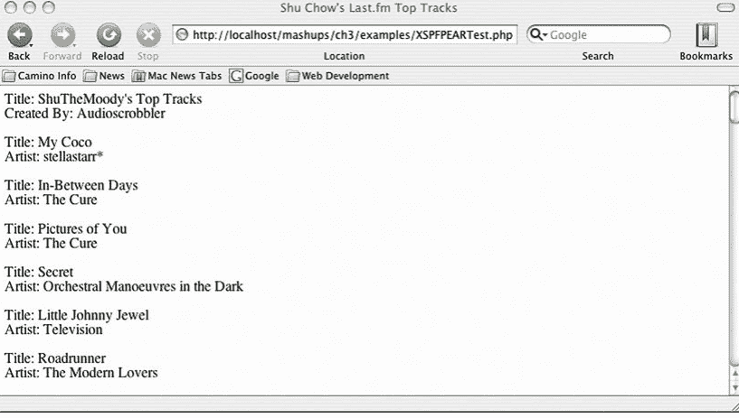

## Services_YouTube

Services_YouTube 的工作方式与 File_XSPF 非常相似。与 File_XSPF 一样，它是建立在更复杂系统之上的面向对象抽象层。在本例中，该系统是 YouTube API。

使用 Services_YouTube 与使用 File_XSPF 非常相似。将包包含在你的代码中，实例化一个 Services_YouTube 对象，并使用该对象的方法与服务交互。Services_YouTube 最新版本的官方文档位于 http://pear.php.net/package/Services_YouTube/docs/latest/。该包还包含在线工作示例，网址为 http://pear.php.net/manual/en/package.webservices.services-youtube.php。

许多方法处理获取成员信息，如他们的个人资料和已上传的视频。较小但非常重要的子集用于查询 YouTube 视频。我们将在我们的 mashup 中使用此子集。要获取带有特定标签的视频列表，请使用对象的 listByTag 方法。

listByTag 将查询 YouTube 服务并将 XML 响应存储在内存中。它不会返回我们可以直接管理的视频对象数组，但通过一次额外的函数调用，我们可以实现这一点。从那里开始，我们可以遍历视频数组，就像我们对 XSPF 曲目所做的那样。

示例文件 YouTubePearTest.php 说明了此过程。

```
<?php
    require_once 'Services/YouTube.php';
    $dev_id = 'Your YouTube DeveloperID';
    $tag = 'Social Distortion';
    $youtube = new Services_YouTube($dev_id, array('usesCache' => true));
    $videos = $youtube->listByTag($tag);
?>
```

首先，我们将 Services_YouTube 文件加载到脚本中。由于 YouTube 的网络服务需要 Developer ID，我们将该信息存储到一个局部变量中。之后，我们将要搜索的标签放在另一个名为 $tag 的局部变量中。在本例中，我们将查看 YouTube 上有关于有史以来最伟大的乐队之一 Social Distortion 的哪些视频。Services_YouTube 的构造函数接受此 Developer ID，并在每次查询 YouTube 网络服务时使用它。构造函数可以接受一个选项数组作为参数。其中一个选项是使用查询的本地缓存。使用缓存被认为是一种良好的做法，以避免猛击 YouTube 服务器并用完你的请求配额。

另一个选项是通过 options 数组中的 driver 键指定 REST 或 XML-RPC 作为协议。默认情况下，Services_YouTube 使用 REST。除非你有迫切需要使用 XML-RPC，否则可以保持原样。

实例化后，你可以调用 listByTag 来获取 YouTube 的响应。listByTag 只接受一个参数——我们想要的标签。

Services_YouTube 现在有了来自 YouTube 的结果。我们可以开始显示结果。

```
<html>
<head>
<title>Social Distortion Videos</title>
</head>
<body>
<h1>YouTube Query Results for Social Distortion</h1>
```

接下来，我们将遍历视频。为了获得视频对象数组，我们首先需要解析 XML 响应。我们使用 Services_YouTube 的 xpath 方法来完成此操作，该方法将使用强大的 XPATH 查询语言遍历 XML 并将其转换为 PHP 对象。我们将 XPATH 查询传递给该方法，它将为我们提供一个有用的对象数组。我们将在另一个项目中更详细地研究 XPATH 和 XPATH 查询。现在，请相信查询 //video 将返回一个我们可以检查的视频对象数组。

在循环中，我们显示每个视频的标题、视频的缩略图以及指向视频本身的超链接。

```
<?php foreach ($videos->xpath('//video') as $i => $video) { ?>
<p>
    Title: <?= $video->title ?><br />
    thumbnail_url ?>' alt='<?= $video->title ?>' />
<br />
    <a href='<?= $video->url ?>'>URL</a>
</p>
<?php } ?>
</body>
</html>
```

在我们的网页浏览器中运行此查询将为我们提供与我们提交的搜索词匹配的视频结果页面。


> 请注意，在运行 YouTubePearTest.php 文件之前，你必须安装 CURL。

### Social Distortion 的 YouTube 查询结果

标题: social distortion - story of my life


URL

标题: Social Distortion Reach for the Sky


URL

标题: Social Distortion Don't Take Me for Granted


URL

## XML_RSS

与其它 PEAR 扩展一样，XML_RSS 将非常复杂的东西 RSS 变成了一个非常简单易用的 PHP 对象。该包的完整文档位于 http://pear.php.net/package/XML_RSS/docs/XML_RSS。

与 Services_YouTube 和 File_XSPF 相比，XML_RSS 的基本理念有一个小的差异。后两个包将我们感兴趣的信息取出并放入 PHP 对象属性中。

例如，File_XSPF 将曲目名称放入 Track 对象中，你使用 getTitle() getter 方法获取曲目的标题。在 Services_YouTube 中，原则相同，但属性是公开的，因此没有 getter 方法。你可以直接在视频对象中访问视频的属性。

在 XML_RSS 中，我们感兴趣的值存储在关联数组中。该包中的可用方法获取数组，然后你直接操作它们。这是一个小的差异，但如果你想查看代码，应该注意这一点。这也意味着你必须查看包的文档，以了解有哪些数组键可供你使用。

让我们通过一个示例来看看它是如何工作的。示例代码中的文件名为 RSSPEARTest.php。Audioscrobbler 的其中一个 feed 为我们提供了一个用户最近播放的歌曲的 RSS 文件。该 feed 并非总是被填充，因为在几个小时后，播放的歌曲不再被视为最近的。换句话说，歌曲最终会因为太旧而从 feed 中删除。因此，最好将此 feed 用于 Last.fm 的重度用户。

RJ 是一个很好的例子。他似乎总是在听些什么。我们将从 Audioscrobbler 获取他的 feed：

```
<?php
    include ("XML/RSS.php");
    $rss =& new XML_RSS("http://ws.audioscrobbler.com/1.0/user/RJ/
                        recenttracks.rss");
    $rss->parse();
```

我们首先包含模块并创建一个 XML_RSS 对象。XML_RSS 是所有数组 get 方法所在的地方，也是该包的核心。它的构造函数接受一个变量——RSS 文件的路径。在实例化时，包会将 RSS 文件加载到内存中。

parse() 是实际执行 RSS 解析的方法。之后，get 方法将返回有关 feed 的数据。毋庸置疑，在对文件进行任何有建设性的操作之前，必须调用 parse()。

```
$channelInfo = $rss->getChannelInfo();
?>
```

包的 getChannelInfo() 方法返回一个数组，其中包含有关文件元数据（频道）的信息。该数组保存 RSS 文件的 title、description 和 link 元素。这些元素中的每一个都以与元素相同的键名存储在数组中。

```
<?= "<?xml version=\"1.0\" encoding=\"UTF-8\" ?>" ?>


返回的数据将以 UTF-8 编码。因此，我们需要将页面强制为 UTF-8 编码模式。这一行会将 XML 声明输出到网页顶部，以确保正确渲染。放置一个常规的 <?xml 声明会触发 PHP 引擎解析该声明。然而，PHP 不会识别该代码并会报错中断页面。

```
<html>
<head>
<title><?= $channelInfo['title'] ?></title>
</head>
<body>
<h1><?= $channelInfo['description'] ?></h1>
```

这里开始实际输出页面。我们首先使用 getChannelInfo() 返回的数组来输出 feed 的 title 和 description 元素。

```
<ol>
<?php foreach ($rss->getItems() as $item) { ?>
<li>
<?= $item['title'] ?>:
<a href="<?= $item['link'] ?>"><?= $item['link'] ?></a>
</li>
<?php } ?>
</ol>
```

接下来，我们开始输出 RSS 文件中的项目。我们使用 getItems() 来获取 RSS 中项目的相关信息。返回的是一个数组，我们用 foreach 语句遍历它。在这里，我们提取项目的 title 和 link 元素。我们显示标题，然后创建一个指向 Last.fm 上歌曲页面的超链接。RSS 中的 description 和 pubDate 元素也在 getItems 返回的数组中可供我们使用。

```
Link to User:
<a href="<?= $channelInfo['link'] ?>"><?= $channelInfo['link'] ?></a>
</body>
</html>
```

最后，我们使用频道的 link 属性在关闭页面的 body 和 html 标签之前创建一个指向用户 Last.fm 页面的超链接。

## 使用更多元素

在这个示例中，频道和项目数组中可用的元素有点有限。getChannelInfo() 返回的数组只有 title、description 和 link 属性。getItems() 返回的数组只有 title、description、link 和 pubDate 属性。这是因为我们使用的是 XML_RSS 的最新发布版本。在撰写本书时，其版本为 0.9.2。XML_RSS 的后续版本目前处于测试版，处理的元素更多。RSS 2.0 中的 category 和 authors 等元素可用。要升级到 XML_RSS 的测试版，请在命令行中使用 PEAR upgrade -f XML_RSS 命令。-f 标志与我们之前强制安装 Service_YouTube 和 File_XSPF 的测试版和 Alpha 版时使用的标志相同。或者，你也可以在开始时使用相同的 -f 标志安装 XML_RSS 的测试版。

如果我们在网页浏览器上运行此页面，我们可以看到我们请求的成功结果。

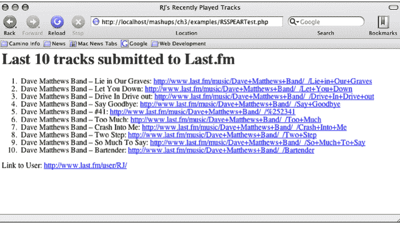

到目前为止，我们已经知道如何使用 Audioscrobbler feeds 获取信息。大多数 feeds 都是 XSPF 或 RSS 格式。我们大致了解 YouTube API 的工作原理。最重要的是，我们知道如何使用相应的 PEAR 包从每个 Web 服务中提取信息。是时候开始编写我们的应用程序了。

## 混合使用

如果你还没有，至少应该创建一个 YouTube 账号并申请一个开发者密钥。你还应该创建一个 Last.fm 账号，安装客户端软件，并在电脑上收听一些音乐。这将使视频点唱机个性化为你的音乐口味。这里的所有示例都假设你使用自己的 YouTube 密钥。我将使用我自己的 Last.fm 账号作为示例。由于 feeds 是开放且免费的，如果你选择不创建 Last.fm 账号，也可以使用相同的 feeds。

## Mashup 架构

显然，我们可以以多种方式设置应用程序。然而，我们将保持功能相对简单。

界面将是一个带框架的网页。顶部窗格是导航窗格。用于歌曲选择。底部部分是内容窗格，将显示和播放视频。

在导航窗格中，我们将创建一个包含所有歌曲的选择菜单。每个选项的值和标签都将是艺术家名称，后跟一个破折号，后跟歌曲名称（例如，“April Smith — Bright White Jackets”）。提供这两条信息将有助于 YouTube 缩小选择范围。

当用户选择一首歌曲并按下“Go”按钮时，应用程序将把内容页面加载到内容窗格中。此表单将通过 GET 参数将艺术家和歌曲信息传递给内容页面。内容页面将使用此 GET 参数查询 YouTube。页面将从其视频列表中调出第一个、相关性最高的结果并显示它。

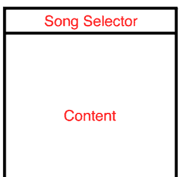

## 主页面

主页面在示例代码中命名为 jukebox.html。这是我们的框架集页面。它会非常简单。它唯一要做的就是定义我们将使用的框架集。

```
<html>
<head>
<title>My Video Jukebox</title>
</head>
<frameset rows="10%,90%">
<frame src="navigation.php" name="Navigation" />
<frame src="" name="Content" />
</frameset>
</html>
```

此代码定义了我们的页面。它有两个框架行。名为 Navigation 的导航部分占高度的 10%，名为 Content 的内容部分占剩余的 90%。首次加载时，mashup 将在导航页面加载歌曲列表，而其他内容为空。

## 导航页面

导航页面命名为 navigation.php。此页面将使用 File_XSPF 和 XML_RSS 从 Last.fm 的 Top Tracks 和 Recent Tracks feeds 加载用户的歌曲，并将它们合并以创建选择菜单。

```
<?php
require_once ('File/XSPF.php');
require_once ('XML/RSS.php');
```

开始时，File_XSPF 和 XML_RSS PEAR 包被加载。

```
$songsArray = array();
```

初始化一个用于保存所有歌曲的数组。我们需要它，因为我们处理的是两个 feeds——Top Tracks 和 Recent Tracks。此外，两个 feeds 返回的内容不同。File_XSPF 返回一个歌曲对象的数组。XML_RSS 返回一个关联数组，其属性名称是数组中的键。

```
//Top Tracks
$xspfObj =& new File_XSPF();
$xspfObj->parseFile('http://ws.audioscrobbler.com/1.0/user/ShuTheMoody/toptracks.xspf');
$topTracks = $xspfObj->getTracks();
```

首先，我们从 Top Tracks XSPF feed 创建一个歌曲对象的数组。

```
//Recent Tracks
$rss =& new XML_RSS('http://ws.audioscrobbler.com/1.0/user/
                    ShuTheMoody/recenttracks.rss');
$rss->parse();
$recentTracks = $rss->getItems();
```

我们从 XML_RSS 提取第二个关联数组：

```
foreach ($topTracks as $trackObj) {
    $songsArray[] =
        $trackObj->getCreator() . " - " . $trackObj->getTitle();
}
```

我们使用 Top Track 对象上的 getCreator() 和 getTitle() 方法以 Artist—Song 格式创建字符串，并将其放入 $songsArray 中。

```
foreach ($recentTracks as $tracksArray) {
    $tempSong =
        htmlentities($tracksArray['title'], ENT_COMPAT, 'UTF-8');
    $songsArray[] = str_replace('&ndash;', "-", $tempSong);
}
```

默认情况下，“Artist—Song”格式是 RSS feed 返回的格式。因此，我们可以直接提取它并放入 $songsArray 中。然而，我们首先需要做一些处理。由于数据来自基于 XML 的文件，某些字符会被编码。这包括艺术家和歌曲之间的破折号。第一行使用 PHP 的 htmlentities() 函数并将值从 XML 编码转换为等效的 HTML 实体。在这种情况下，RSS 文件中的破折号变为“&ndash;”。这个新值被放入名为 $tempSong 的变量中。下一行将 &ndash; 替换为常规的破折号字符，并将其推入 $songsArray。

```
$songsArray = array_unique($songsArray);
sort($songsArray);
```

最后，我们使列表更易于展示。array_unique() 将消除 Top Tracks feed 和 Recent Tracks feed 之间的重复歌曲。sort() 将为我们按字母顺序排序列表。这结束了初步所需的 PHP 代码。我们接下来可以开始 HTML 了：

```
?> 
<?='<?xml version="1.0" encoding="UTF-8" ?>' ?>
<html>
    <head><title>Selections</title></head>
    <body>
        <form method="GET" action="content.php" target="Content">

```
<select name="query">
<?php foreach ($songsArray as $key => $value) { ?>
    <option value="<?= $value ?>"><?= $value ?></option>
<?php } ?>
</select>
<input type="submit" value="Go" />
</form>
</html>
```

再次，在开始实际的 HTML 之前，我们使用 PHP echo 在此页面上声明编码。在 HTML 中，我们创建表单。表单将使用 GET 方法将所选选项值传递给针对 Content 框架的 content.php 页面。我们使用 $songsArray，它是我们之前填充来创建选择菜单的。

最后，添加一个输入按钮来触发加载。然后关闭表单和 html 标签。

## 内容页面

我们的内容页面，名为 content.php，在导航页面的表单提交时加载。表单会通过名为 query 的查询参数将艺术家和歌曲标题发送到 content.php。content.php 必须接收此参数，将其传递给 YouTube 的 Web API，并显示结果。

```
<?php

require_once ('Services/YouTube.php');

//YouTube parameters
$devId = 'YOUR OWN YOUTUBE DEVELOPER ID';
$tag = $_GET['query'];

//YouTube Result Parameters
$videosArray = array();
$firstVideo = null;
```

我们从一些基本初始化开始。我们引入 Services_YouTube 包，设置 $dev_id 变量，其中保存我们的 YouTube 开发者 ID，并设置一个名为 $tag 的变量，其中保存页面被调用时收到的 GET 参数。

接下来，设置一个数组来保存视频返回结果。声明一个名为 $firstVideo 的变量。查询可以，也经常会返回多个结果，其中最相关的结果排在顶部。$firstVideo 将保存此最相关的命中结果。

```
$youtube = new Services_YouTube($devId, array('usesCache' => true));
$videos = $youtube->listByTag($tag);

$videosArray = $videos->xpath('//video');
$firstVideo = $videosArray[0];
```

此块的前三行与 Services_YouTube 示例的操作方式相同：声明一个 Services_YouTube 对象，调用服务，并通过 XPATH 查询结果。

现在我们有了所有结果的数组。由于我们只关心最相关的结果，我们捕获索引位置 0 的那个并将其放入 $firstVideo 数组中。我们的设置 PHP 代码现已完成，我们可以开始 HTML。

```
?> 
<?= '<?xml version="1.0" encoding="UTF-8" ?>' ?> 
<html>
<head><title>Content</title></head>
<body>
<h1>YouTube Query Results for <?= $_GET['query'] ?></h1>
<?php if ($firstVideo) { ?>
```

在 HTML 中，我们遇到一个 PHP if 语句。此 if 语句检查 $firstVideo 数组是否实际包含内容。我们检查对象是否存在。

```
Title: <?= $firstVideo->title ?><br />
<object width="425" height="350">
<param name="movie" value="http://www.youtube.com/v/<?= $firstVideo->id ?>"></param>
<param name="wmode" value="transparent"></param>
<embed src="http://www.youtube.com/v/<?= $firstVideo->id ?>" type="application/x-shockwave-flash" wmode="transparent" width="425" height="350"></embed>
</object>
<p>
<a href="<?= $firstVideo->url ?>"><?= $firstVideo->title ?>'s YouTube Page</a>
</p>
```

如果对象存在，我们使用它来创建显示页面。视频对象在此部分中我们使用的三个属性有：

- title 是 YouTube 标题。
- id 是 YouTube 唯一标识符。
- url 是 YouTube 页面的 URL。

id 特别重要。YouTube 上每个视频的页面都有示例代码，您可以将其复制并粘贴到自己的网页中。这将把视频嵌入到页面中并在页面内播放。示例代码涉及一个 object、两个 param 标签和一个 embed 标签。我们已将此代码复制到我们的应用程序中。然而，我们用我们对象的 id 属性替换了硬编码的示例 id。

```
<?php } else { ?>
    No Results Found
<?php } ?>
</body>
</html>
```

我们添加一个 else 块，如果 YouTube 从查询中返回 nothing，则显示“未找到结果”消息。最后，我们关闭 body 和 html 标签。

将这三个文件放入 Web 服务器上同一可通过 Web 服务器访问的目录中。您可以通过在 Web 浏览器中启动 jukebox.php 来开始使用 mashup。

## 使用 Mashup

使用 mashup 非常简单。将 jukebox.html 加载到您的 Web 浏览器中。

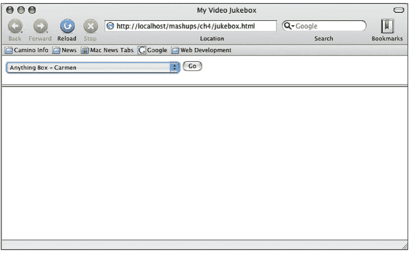

当您加载 `jukebox.php` 时，您将看到与上一页所示类似的页面。`navigation.php` 将加载，并且选择菜单将从我们的 Last.fm 订阅源创建。

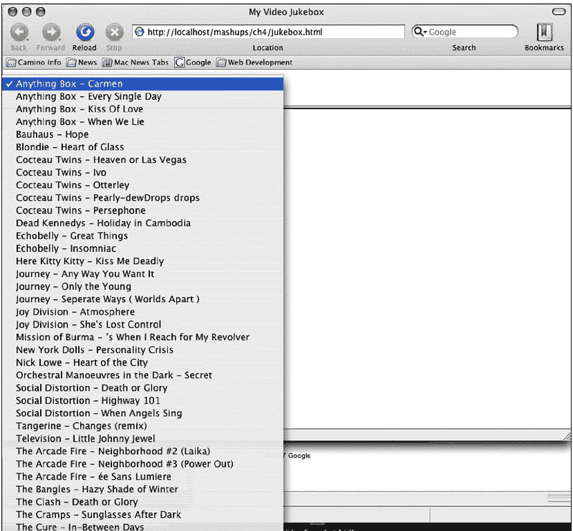

## 您自己的视频点唱机

点击菜单。您将看到来自两个订阅源的歌曲列表。选择一个并按下 Go 按钮。

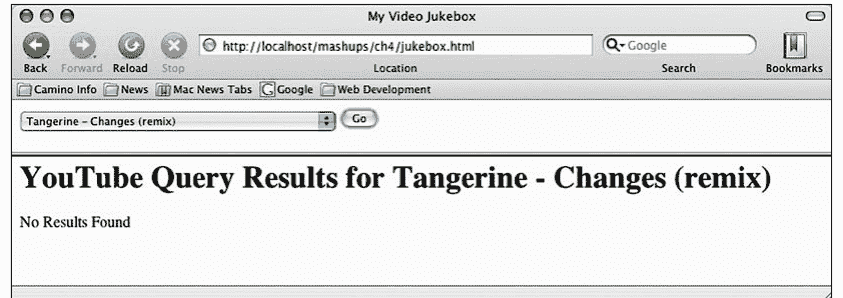

我第一次选择的是 Tangerine 的一首歌，没有返回结果。我们在内容窗格中看到错误消息。这并不奇怪，因为他们是总部位于宾夕法尼亚州匹兹堡的小型、正在崛起的本地乐队。一旦他们变得更受欢迎，他们的粉丝大军将会增长，希望有人会把东西放到 YouTube 上。

让我们选择一个更知名的乐队和歌曲。

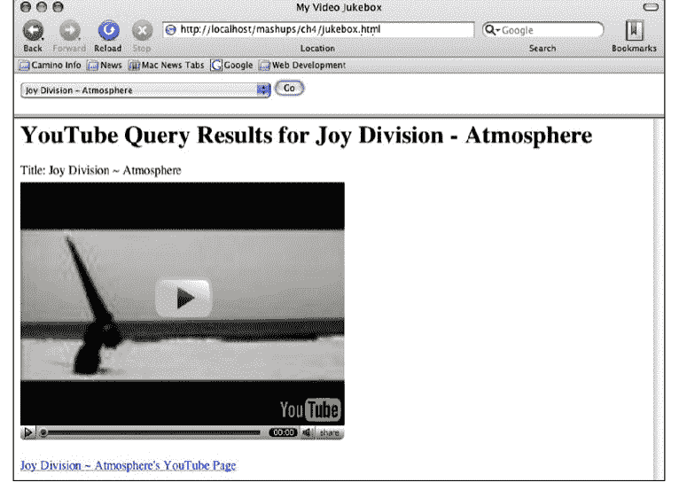

我们下一个选择是 Joy Division 的 Atmosphere，更加成功。在这种情况下，有人上传了 Atmosphere 的音乐视频。按下 Play 按钮将开始播放视频，而不会离开我们的 mashup。

这个 mashup 的优点在于 YouTube 的用户驱动特性。你无法确定会返回什么。在 Atmosphere 的情况下，我们看到了有人上传的官方音乐视频。在许多其他情况下，我们可以看到有人用摄像机录制并上传的罕见现场表演。有时我们会看到一些有创意的人制作了自己的音乐视频并将其设置为我们查询的音乐。其他时候，视频可能与歌曲完全无关，除了它在背景中播放。例如，当我提交 The Clash 的经典曲目 Death or Glory 时，唯一返回的视频是有人制作的致敬幻灯片，主角竟然是哈利波特明星 Daniel Radcliffe。

## 摘要

在这个 mashup 中，我们使用了两个不同的 Web API——一个来自视频存储站点的 YouTube，另一个来自社交音乐站点 Last.fm 的 XML 订阅源。我们查看了来自这两个站点的三种不同的基于 XML 的文件格式：用于歌曲播放列表的 XSPF、用于发布频繁更新信息的 RSS，以及 YouTube 的自定义 XML 格式。我们创建了一个 mashup，它获取两个 Last.fm 订阅源中的歌曲并查询 YouTube 以根据歌曲检索视频。

如果我们要创建自己的基于 XML 的解析器来解析这三种格式，这将比实际花费的时间多得多。我们发现 PHP 扩展和应用程序仓库 PEAR 已经有了我们可以使用的解析器；每种格式各一个。使用这些 PEAR 包，我们能够创建这些格式的面向对象抽象，这使我们能够轻松完成应用程序。

# 5

## 通过 SMS 的交通事件

## 项目概述

|  |  |
|---|---|
| **内容** | 将加州公路巡警实时事件网站的内容通过短信服务（SMS）传递给移动用户 |
| **使用的协议** | 不适用 |
| **数据格式** | RSS |
| **使用的工具** | PHP 的 DOM 扩展 |
| **使用的 API** | 411Sync |

而且，在这个项目中，我们将学习如何使用黑暗艺术。不，我不是在谈论通过黑魔法控制无意识的僵尸。我是在谈论屏幕抓取。

在这个项目中，我们将从加州公路巡警网站进行屏幕抓取。CHP 维护着一个交通事件网站。该网站每分钟自动刷新，确保用户获得加州各地事故的实时数据。如果您坐在电脑前，这非常有价值。如果您外出办事，除非您拥有支持互联网的个人数字助理，否则它将毫无用处。即便如此，该网站使用 JavaScript 和框架，可能无法在许多 PDA 网页浏览器上运行。比互联网 PDA 更广泛可用的是具有短信服务（SMS）功能的手机。我们的 mashup 将使 CHP 数据通过 SMS 而不是网页浏览器可用。


我们的应用程序将从 CHP 事故网站获取信息并将其修改为 RSS 文件。然后我们将在 411Sync.com 注册一个账户，以便只需发送一条短信到一个电话号码即可使用此订阅源。当用户向 411Sync.com 发送一条包含我们预留关键词的短信时，他们将访问我们的订阅源并以另一条短信的形式将其返回给用户。我们的混搭使数据更易获取，而且我们无需投资新硬件来发送短信。


> 411Sync.com 会向我们的脚本发出 HTTP 请求，因此该项目需要一个可公开访问的 Web 服务器用于开发和部署。这是本书中唯一具有此类要求的项目。

## PHP 方式的屏幕抓取

屏幕抓取一直是一种可疑的做法，也是许多诉讼的导火索。许多网站所有者不出所料地嫉妒地保护着自己的内容，对任何发送蜘蛛抓取数据并在自己的网站上使用的人都感到不满。他们将屏幕抓取者视为坏死的吸血鬼，窃取用户、抽取广告收入，并在不给予任何回报的情况下吸取服务器和带宽资源。另一方面，屏幕抓取者认为，如果内容提供者不想分享他们的数据，就不应该将其放在像万维网这样公开的地方。

在诚实的 Web 开发人员中，未经事先批准的屏幕抓取通常不受欢迎。从法律角度来看，根据所在地区，屏幕抓取的限制通常属于通过网站条款和条件条款的民事合同法范畴。希望进行屏幕抓取的人首先应该获得许可。否则，如果他们收到被抓取方律师发出的停止函就不应感到惊讶。是的，我们已获得加州公路巡警的许可，可以为本书进行屏幕抓取。

即使你克服了法律障碍，也还有技术障碍需要克服。早些时候，Web 屏幕抓取通常涉及用 Perl 等语言编写脚本，将信息加载到内存中。通过复杂且晦涩的正则表达式，程序会遍历文本并查找所需内容。如果程序对存储在表格第三列中的数据感兴趣，它必须遍历所有 <table>、<tr> 和 <td> 标签，保持在任何时刻的位置计数，判断是否对遇到的数据感兴趣，如果感兴趣，则将其存储在其他地方。屏幕抓取器必须考虑格式错误的 HTML。如果页面有任何更改，就需要重写。

幸运的是，这些繁琐的日子早已过去。有两个关键差异使今天的屏幕抓取比几年前容易得多。

首先，网站通过程序生成比手工编码的网站更常见。客户关系管理系统、文档管理系统、公告板论坛以及普通的数据库 Web 应用程序只是我们可能想要提取数据的一些示例。不仅数据更多，而且由程序生成页面理论上减少了人为编码错误的机会。编码错误越少，抓取程序就越不用担心不一致性。

第二个变化是文档对象模型的广泛采用。在第一章中，我们使用基于 SAX 的解析器解析 XML 文档。我们提到了基于 SAX 的解析器和基于 DOM 的解析器的区别。关键区别在于，基于 SAX 的解析器在读取数据时进行解析，而基于 DOM 的解析器在采取任何操作之前先将文档加载到内存中。当我们稍后查看数据源时，我们会看到 CHP 网站是基于 DOM 解析器的良好候选者，这也是我们将使用的方法。在真正使用基于 DOM 的解析器之前，我们应该知道文档对象模型到底是什么。

DOM 是一个官方的 W3C 规范，描述了 XML 文档的对象模型表示。持有该模型的任何东西都知道文档中的所有元素及其相互关系，如父级、子级和兄弟级。仅仅将文档保存在内存中是不够的；加载文档的东西还为开发人员提供了访问文档中数据的钩子。DOM 是以编程方式访问 XML 文档部分的手段。

一个实际的具体例子是 Web 浏览器如何查看 HTML 文档。浏览器知道有一个名为 HTML 的根元素。有两个名为 HEAD 和 BODY 的子元素。在 BODY 内，可能有元素如 P 和 TABLE。在 TABLE 中，有 TR 和 TD。浏览器知道某些 TD 元素彼此是兄弟元素，并且知道哪个特定的 TR 元素是某个 TD 元素的父元素。浏览器知道网页的每个部分与其他每个部分的关系。


> 文档中的所有元素、值和属性通常被称为 DOM 树，因为在视觉上绘制出来时，元素及其父级和子级通常看起来像树中的分支。

基于 DOM 的解析器以类似的方式工作。它将整个 XML 文档加载到内存中，通过不同的命令，你可以提取值或导航到文档的另一部分。所有操作都是针对内存中的文档进行的。你还可以创建节点并将其插入模型中。

PHP 5 在 DOM XML 函数中内置了一个基于 DOM 的解析器（http://www.php.net/manual/en/ref.dom.php）。解析器实际上是一组代表 DOM 组件的类，而记录的 DOM 函数是这些类中的方法。这些类是在 W3C DOM Level 3 规范中定义的接口。DOM 函数实际上相当紧密地遵循官方规范。官方规范可在 http://www.w3.org/TR/2003/WD-DOM-Level-3-Core-20030226/DOM3-Core.html 找到。下表总结了 W3C DOM 中的基本类及其在 PHP DOM 中的实现。

| DOM 类 | PHP 等效项 | 目的 |
|---|---|---|
| Document | DOMDocument | 表示整个 XML 文档。你可以将其视为根元素。在解析中，这是你首先开始的对象。 |
| Node | DOMNode | XML 文档的每个“部分”。在 DOM 中，一切都是某种类型的节点——元素是元素节点，属性是属性节点等。节点方法以高层次操作节点，如遍历树和命名。 |
| NodeList | DOMNodeList | 在 DOM 中，返回节点的方法通常在 NodeList 中，这正是其名称所暗示的——一个节点对象的列表。在 PHP 中，这些函数通常返回一个节点数组。 |
| Element | DOMElement | XML 文档中除根之外的元素；例如，“div”。 |
| Attribute | DOMAttribute | 元素内的属性，例如 class="content"。 |
| Text | DOMText | 在 DOM 中，Text 对象是元素或属性的文本值。 |
| ProcessingInstruction | DOMProcessingInstruction | 解析器处理指令。 |

以下图表显示了简单 XML 片段中的常见节点类型：

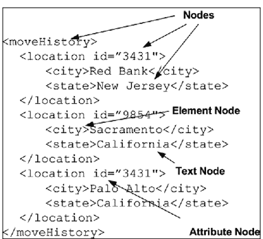

由于 PHP DOM 函数实现了基于类的规范，因此它们的工作方式与其他 PHP 函数略有不同。官方 PHP 文档需要一点调整才能找到你习惯的内容，并且由于函数是对象方法，你必须先创建对象才能使用它们。

当你在文档中查看 DOM 函数时，你会注意到类名也是函数名的一部分。PHP 中的类实现了 DOM 所需的接口。类的<|message|> 方法与它们命名的 DOM 组件相关。例如，DOMElement 类相当于 DOM 的 Element 接口，并影响文档中的元素。在 PHP.net 的函数参考中，其他函数通常按其类别按字母顺序组织。PHP.net 中的 DOM XML 函数在按字母顺序排列之前按类分组。

如果你浏览 DOM XML 文档，你会看到对象非常重要。大部分函数接收并返回其他 DOM XML 对象，而不仅仅是其他 PHP 函数的简单数据类型。初学者会喜欢将文档打开并放在手边，以查看函数返回哪些对象，因为返回类型显然会影响可用的函数。我们在解析代码时将看到这一点。

## 使用 DOM 函数解析

使用 DOM 函数解析的第一步是将 XML 文档加载到 DOMDocument 类中。你可以使用多个函数来执行此操作。每个函数都在 DOMDocument 中，并用于特定目的。


| 函数 | 用途 |
|---|---|
| DOMDocument->load() | 加载 XML 文件 |
| DOMDocument->loadHTMLFile() | 加载 HTML 页面 |
| DOMDocument->loadXML() | 加载 XML 文本字符串 |
| DOMDocument->loadHTML() | 加载 HTML 文本字符串 |

前两个函数 load() 和 loadHTMLFile() 用于加载 XML 文件或 HTML 页面。它们将资源 URL 作为输入参数。你可以传递本地服务器上的文件路径或指向另一台服务器的完全限定 URL。如果传递 URL，函数将向托管该文件的服务器执行 GET 请求。例如，加载的资源必须具有适当的内容类型。即内容类型必须分别是 text/xml 或 text/html。

接下来的两个函数 loadXML() 和 loadHTML() 具有相同的目的，但工作方式不同。与前两个函数通过网络获取文件不同，这两个函数加载 XML 或 HTML 的字符串表示。例如，如果你的 XML 或 HTML 存储在变量中，请使用这些函数来加载它们。

## 基本元素和属性解析

一旦文档已加载，你就可以开始使用 DOMDocument 类中的函数来提取信息。让我们逐步介绍一个示例会话。在本项目的示例代码中，有一个名为 domxmlexample.php 的文件。这个小示例展示了使用 DOM XML 的基本流程。该文件将一个小的 XML 块存储在变量中。然后我们的代码使用 PHP 的 DOM XML 函数从该块中提取数据。

```php
<?php
    $xml = '<posts>
<date>February 26, 2007</date>
<post author="James Edward Farley, III">
    <title>Damn Intarwebs!</title>
    <date>April 23, 2007</date>
</post>
<post author="Elizabeth Rankin">
    <title>Chinese New Year in New York City</title>
    <date>March 3, 2007</date>
</post>
<post author="Evan Spiegel">
    <title>I got an AppleTV</title>
    <date>May 2, 2007</date>
</post>
</posts>';
```

此示例使用了一段可能在博客订阅源中出现的少量 XML。根元素名为 posts，每个单独的帖子都包装在 post 元素中。author 是 post 元素中的一个属性。标题和日期信息是 post 的子元素。

```
$aDom = new DOMDocument();
    try {
        @$aDom->loadXML($xml);
    } catch (Exception $ex) {
        $aDom = false;
    }
```

DOMDocument 对象被实例化，但为空。我们使用 loadXML() 将 XML 字符串加载到 DOMDocument 中。

现在我们可以使用 DOMDocument 对象上的方法从自身中提取数据。第一个示例将从文档中提取所有日期。

```
<p>
    All Dates:<br />
<?php
    $allDates = $aDom->getElementsByTagName('date');
    foreach ($allDates as $date) { ?>
        Date: <?= $date->nodeValue ?> <br />
<?php } ?>
</p>
```

第一行调用 getElementsByTagName() 并获取文档中所有标签名为 date 的元素。这包括每个 post 内的所有 date 元素以及根元素之后紧跟的 date 元素：

```
<date>February 26, 2007</date>
<date>April 23, 2007</date>
<date>March 3, 2007</date>
<date>May 2, 2007</date>
```

在 DOM 中，getElementsByTagName() 将返回一个 NodeList 对象，即节点列表。列表是一种在其他语言（如 Java）中发现的特殊数据类型，属于数组类型。在 PHP 中，NodeList 的实现类似于 DOMElement 对象的数组。要使用我们提取的日期，必须遍历此数组。节点将其属性保存在 nodeValue 属性中。在此示例中，我们将此属性回显到浏览器。

这里的教训是 getElementsByTagName() 将返回所有元素，无论它们位于何处以及如何嵌套。如果我们想隔离嵌套在 posts 中的日期，我们需要先获取 posts。

```
<p>
  Post Dates:<br />
  <?php
  $posts = $aDom->getElementsByTagName('post');
  foreach ($posts as $post) {
      $postDate = $post->getElementsByTagName('date'); ?>
      Date: <?= $postDate->item(0)->nodeValue ?>
  <?php } ?>
</p>
<p>
```

第一行 PHP 代码将节点对象的数组放入名为 $posts 的变量中。

```
<post author="James Farley, III">
<post author="Elizabeth Rankin">
<post author="Evan Spiegel">
```

post 的每个子元素现在都可供我们使用。我们遍历 $posts 数组并从每个 post 元素中提取数据。现在，虽然我们仅限于 DOMElement 可用的方法，并且由于 DOMElement 实现了 DOMNode，因此 DOMNode 方法也可用。查看 DOMElement 文档，getElementsByTagName() 也是 DomElement 中的一个方法，因此我们将使用它。每次遍历 $posts 时，我们都会再次调用 getElementsByTagName()，但这次它仅限于我们所在的 post 元素。$postDate 将保存这个新的 DOMNodeList。我们可以再次遍历它，但由于我们知道 post 中嵌套有且只有一个 date 元素，因此可以使用 DOMNodeList 的 item() 方法直接访问它。

尽管 DOMNodeList 的功能类似于数组，但它并不完全相同。你不能像其他 PHP 数组那样通过在括号内放置数组索引来直接访问值。相反，item() 方法将返回数组元素。将你想要提取的索引值传递给 item()。由于唯一的 date 元素位于第一个位置，我们将索引参数零传递给 item()。这会返回一个 DOMElement，我们可以再次使用 nodeValue 属性获取其值。

```
Authors:<br />
<?php foreach ($posts as $post) { ?>
Author: <?= $post->getAttribute('author') ?><br />
<? } ?>
```

另一个常见任务是检索 XML 元素的属性。DOMElement 的 `getAttribute()` 方法可以完成此操作。此方法接受你在 DOMElement 中想要查找的属性名称并返回其值。在我们的示例 XML 中，post 作者的名称是 post 的一个属性。我们可以再次遍历 `$posts`。这次对于每个 post 元素，我们调用 `getAttribute()` 并传递字符串 "author"，即我们要查找的内容。文档指出 `getAttribute()` 只会返回属性值（而不是 DomAttribute 对象），因此无需访问任何进一步的属性或方法。如果需要节点，则有一个名为 `getAttributeNode()` 的伴随方法，它将返回节点而不是属性值。

在浏览器中加载此示例页面将返回下面的屏幕截图：

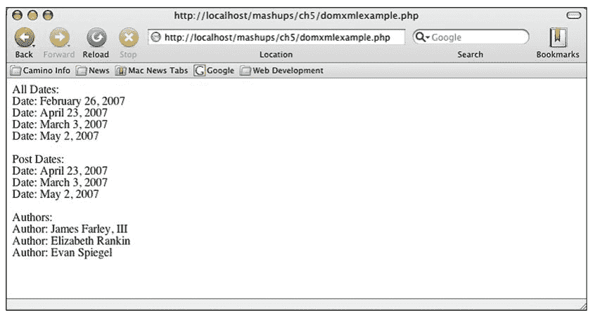

## 测试 Schema

上一个示例在 XML 文档结构良好时工作正常。然而，如果文档格式不正确，可能会发生脚本错误。例如，如果你使用方法检索元素，但该元素不存在，对其进行的任何 DOMElement 方法的后续调用将导致不存在的对象错误。为防止这种情况，DOM 函数包含一些查询和验证 XML 模式的方法。所有这些方法在成功时返回 true，失败时返回 false。你可以在对其调用方法之前使用这些方法来测试元素或对象是否存在。

| 对象 | 方法 | 描述 |
|---|---|---|
| DOMDocument | relaxNGValidate | 验证 RNG 文件是否格式良好 |
| DOMDocument | relaxNGValidateSource | 验证 RNG 数据字符串是否格式良好 |
| DOMDocument | schemaValidate | 验证 XML 文件是否格式良好 |
| DOMDocument | schemaValidateSource | 验证 XML 数据字符串是否格式良好 |
| DOMDocument | Validate | 根据其 DTD 验证 XML 字符串 |
| DOMElement | hasAttribute | 检查元素是否具有属性 |
| DOMElement | hasAttributeNS | 检查元素是否在给定命名空间内具有属性 |
| DOMImplementation | hasFeature | 检查文档实现是否具有某个 W3C 特性 |
| DOMNode | hasAttributes | 检查节点是否具有任何属性 |
| DOMNode | hasChildNodes | 检查节点是否具有任何子节点 |
| DOMNode | isDefaultNamespace | 检查给定 URI 是否为文档的默认命名空间 |
| DOMNode | isSameNode | 检查两个给定节点是否为同一节点 |
| DOMNode | isSupported | 检查文档是否在给定版本下具有某个 W3C 特性 |
| DOMText | isWhitespaceInElementContent | 检查文本节点是否包含空白字符 |

## 有关 PHP 对 DOM 的实现

DOM 函数完全面向对象的重要性不言而喻。如果查看官方 DOM 规范，你可以看到每个类中都有许多特殊属性。Node 类有许多处理其他节点的属性。例如，`firstChild` 保存第一个子节点，而 `nextSibling` 保存下一个兄弟节点。存在属性可让你从 DOM 中的任何节点向上、下和横向移动。


大多数 DOM 类都是 Node 类的接口。这意味着如果您有一个扩展 Node 的对象，您将可以访问这些导航属性。这不仅使您能够轻松地在文档中导航，还为您提供了提取数据的方式选择。

例如，DOMElement 扩展自 DOMNode。如果您有一个 DOMElement 对象，您只需使用 DOMNode 的 childNodes 属性即可将所有子节点作为 DOMNodeList 取回。DOMNode 的遍历属性总结如下表所示：

| 属性名称 | 返回类型 | 描述 |
|---|---|---|
| parentNode | DOMNode | 包含该 DOMNode 的父节点 |
| childNodes | DOMNodeList | 该 DOMNode 的所有直接子节点的 DOMNodeList |
| firstChild | DOMNode | DOMNode 的第一个子节点 |
| lastChild | DOMNode | DOMNode 的最后一个子节点 |
| previousSibling | DOMNode | 紧邻 DOMNode 前面的节点 |
| nextSibling | DOMNode | 紧邻 DOMNode 后面的节点 |

我们在之前的示例中做的事情之一是仅抓取与某篇帖子关联的日期。我们抓取了帖子，对其进行循环，使用 getElementsByTagName 提取另一个 NodeList，然后使用 item 方法并传入假设的索引位置。

```
<?php
$posts = $aDom->getElementsByTagName('post');
foreach ($posts as $post) {
    $postDate = $post->getElementsByTagName('date'); ?>
    Date: <?= $postDate->item(0)->nodeValue ?><br />
<?php } ?>
```

我们也可以这样写：

```
<?php
$posts = $aDom->getElementsByTagName('post');
foreach ($posts as $post) {
    $childNodes = $post->childNodes; ?>
    Date: <?= $childNodes->item(1)->nodeValue ?><br />
<?php } ?>
```

在此示例中，我们再次抓取帖子的 NodeList 并对其进行循环。然而这次，我们不必第二次调用 getElementsByTagName。相反，我们使用 DOMNodes 的 childNodes 属性抓取子节点。这也返回一个 NodeList，因此我们可以使用 item 方法抓取第一个元素。该方法的主要优势在于，我们使用属性（childNodes）而不是函数调用（getElementsByTagName）来获取相同的信息。访问属性理论上比调用函数更快，因为解析器无需进行思考——数据只是被传递和赋值。

## 警惕空白字符


我们对 item 方法使用索引位置 1，因为在创建的 XML 中，post 元素后有换行。返回的第一项，index(0) 本身就是换行。它是一个包含空白字符的 DOMText 对象。我们真正想要的是第二项，即 date 元素。这是在处理所有 XML 文档时常见的陷阱。即使您可能在感兴趣的元素之前或之后看到一个元素，中间也可能存在空白字符数据对象。

使用完整的 HTML 文件，让我们来看另一个使用这些属性的示例。名为 examplehtml.html 的示例文件是一个包含两个列表的小型、有效的 HTML 文件。

```
<!DOCTYPE HTML PUBLIC "-//W3C//DTD HTML 4.01//EN"
"http://www.w3.org/TR/html4/strict.dtd">
<html>
<head>
    <title>Test ID Page</title>
</head>
<body>
    <p>This is a test of lists.</p>
    <ul id="myList">
        <li>First Item</li>
        <li>Second Item</li>
        <li>Third Item</li>
    </ul>
    <ul id="anotherList">
        <li>You</li>
        <li>Won't</li>
        <li>See</li>
        <li>This</li>
        <li>At</li>
        <li>First</li>
    </ul>
</body>
</html>
```

请注意第一个无序列表的 id 属性为 myList，第二个无序列表的 id 属性为 anotherList。文件 domxmlexample2.php 是一个从该 HTML 文件进行一些基本提取的 PHP 脚本。

```
<?php
    $aDom = new DOMDocument();
    try {
        $aDom->loadHTMLFile('examplehtml.html');
    } catch (Exception $ex) {
        $aDom = false;
    }
}
```

该脚本的开头与第一个示例做的事情相同。我们创建一个新的 DOMDocument 对象并向其中加载一些 XML。这次，我们使用 loadHTMLFile() 加载 HTML 文件。

```
$firstUL = $aDom->getElementById('myList');
$secondUL = $firstUL->nextSibling;
?>
```

在这段代码中，我们抓取两个无序列表节点。第一个列表是通过 getElementById() 方法检索的，该方法将 id 属性的值作为参数并返回一个 DOMElement。第二个无序列表也可以使用相同的方法提取。然而，由于我们知道第二个列表与第一个列表处于同一 DOM 树层级，并且紧跟在第一个列表之后，我们可以使用 DOMNode 的 nextSibling 属性来检索它。

```
Looping through the first list:<br />
<?php foreach ($firstUL->childNodes as $value) { ?>
    <?= $value->nodeValue ?><br />
<?php } ?>
```

此 foreach 循环使用 childNodes 属性（它是一个 DOMNodeList）来检索第一个无序列表中的项目。循环中的每个 DOMNode 都被赋给 $value。每个 DOMNode 中的 nodeValue 属性是每个 li 元素的值。输出 nodeValue 属性将把 li 值显示在屏幕上。

```
Looping through the second list:
<?php foreach ($secondUL->childNodes as $value) { ?>
    <?= $value->nodeValue ?><br />
<?php } ?>
```

第二个列表的 ul 元素是通过 nextSibling 属性提取的。该属性是一个 DOMNode。这与 $firstUL 不同，因为 getElementById() 返回一个 DOMElement。然而就我们的目的而言，这已经足够了，因为核心导航属性和值都在 DOMNode 对象中。与之前的 foreach 循环类似，此块获取元素的子节点，并使用这些 nodeValue 属性来显示 li 元素的值。

```
What's the first item? <b><?= $firstUL->firstChild->nodeValue ?></b>
```

最后，这一行获取第一个无序列表的第一项并显示它。$firstUL 是第一个无序列表元素。firstChild 属性保存 li 元素。最后，我们显示其 nodeValue 属性以获取有关列表的信息。最后一行的目的是展示如何访问远离当前元素的元素。属性因为是对象，可以被链式调用。像这样遍历 DOM 树是完全合理的：

```
$testNode->parentNode->previousSibling->firstChild
```

虽然冗长，但这会从您所在的节点向上移动一级，横向移动一级到同一层级的上一个节点，然后向下移动一级。如果用家庭关系来思考，如果您是 testNode，那么您父母的兄弟姐妹的孩子就是您的堂/表兄弟姐妹。

在浏览器中运行此示例脚本将显示此解析的结果：

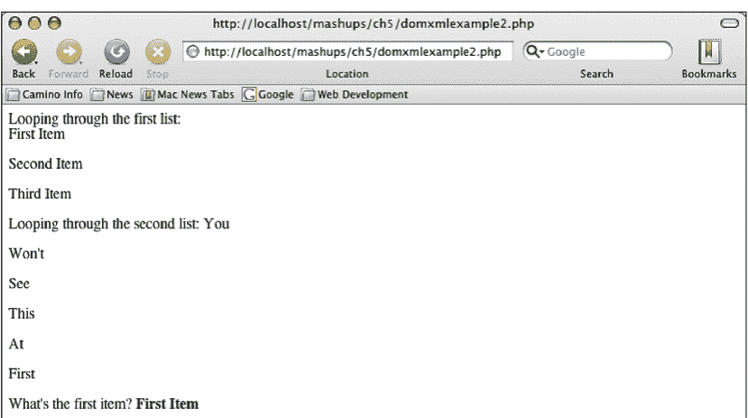

官方 PHP 文档中的 DOM 部分列出了已实现的 DOM 类、其方法和属性。然而，有时以图形方式查看会更容易。下图以 UML 类图的形式展示了 PHP 实现的 DOM 类。

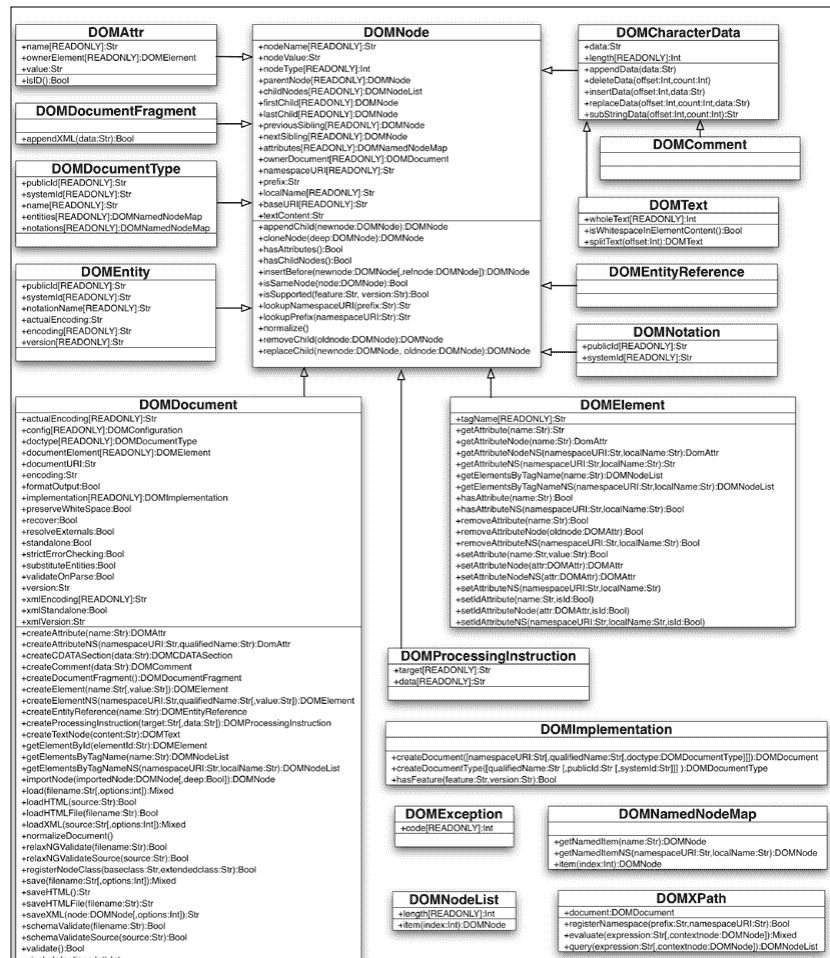

该图显示了每个对象的继承链，以及每个项目的属性和方法。一目了然，我们可以看到哪些类可以通过继承使用 DOMNode 属性和方法，以及我们处理的数据类型。类图并不难解释。每个框都是一个类。一个类分为三个部分。顶部部分是类的名称。中间部分列出属性。底部部分列出方法。如果中间或底部部分为空，则该类分别没有属性或类。

属性按以下格式列出：

```
VisibilityIndicator PropertyName:DataType
```

可见性指示符为加号 (+) 表示公共属性，井号 (#) 表示受保护属性，减号 (-) 表示私有属性。在 PHP DOM 的情况下，所有属性都是公共的。如果属性名称后有 [READONLY]，则表示该属性不能由开发者更改。在 DOMNode 中，有一个属性列为 +ownerDocument [READONLY] :DOMDocument。这意味着有一个名为 ownerDocument 的公共属性。它是只读的，访问它会得到 DOMDocument 数据类型。

方法按以下格式列出：

```
VisibilityIndicator MethodName(parameters):returnType
```

可见性指示符与属性相同，在 PHP DOM 中全部为公共。方法名不言自明。参数以 parameterName:datatype 对的形式出现。您不必担心参数名，因为它由函数使用。它只是列出以提示您传递什么。如果参数不在括号 [] 中，则为必需。括号中的参数是可选的。最后，给出了返回值的 数据类型。让我们看一个 DOMDocument 中的方法：+loadXML(source:Str[,options:Int]):Mixed。这是一个名为 loadXML 的公共方法。它有一个必需的字符串参数 source，和一个可选的名为 options 的整数参数。它返回 mixed 数据类型。您需要查阅文档以确切了解 source 和 options 是什么，以及您得到的 "mixed" 数据类型是什么。

从一个类到另一个类的箭头表示继承，父类是被指向的类。DOMText 的父类是 DOMCharacterData。DOMCharacterData 的父类是 DOMNode。


现在我们已经熟悉了将要使用的工具，是时候查看 API 和我们的数据源了。

## 411Sync.com API
411Sync.com 是一个网站，它在手机与可能通常不以移动友好格式存在的信息之间提供接口。一些它提供的手机管理服务包括：

- 创建和安排个人提醒
- 日历
- 股票投资组合提醒
- 支出追踪器
- 短信存储
- 移动搜索关键词

移动搜索关键词功能是我们将用于 mashup 以传递内容的工具。它是任何 Web 开发人员通过短信传递内容的巧妙免费方式。用户向 411Sync 的电话号码发送请求。411Sync 然后向你的 Web 服务器发出请求，传递你需要的任何参数。411Sync 获取返回的任何结果，进行格式化，然后发送回手机。

移动搜索关键词功能有开发者文档，位于 `http://www.411sync.com/cgi-bin/Developer`，其中详细说明了表单所需的字段、它们的含义以及有关必要 RSS 响应的更多信息。通过解析和传递开发者的 RSS 文件，411Sync 使移动开发变得简单。虽然通常需要花费大量时间和金钱来投资 SMS 基础设施，但小型开发者只需制作一个普通的 RSS 文件即可访问此渠道。调试也更简单，因为我们要做的就是制作 RSS 文件。

## 创建你的移动搜索关键词
在此之前，你作为 Web 开发人员，需要为 411Sync.com 注册一个免费账户。你可以在 http://www.411sync.com/cgi-bin/Register 进行此操作。你需要你的手机号码并知道你的手机运营商。注册后，点击 Log-in。你将被带到你的服务主页。

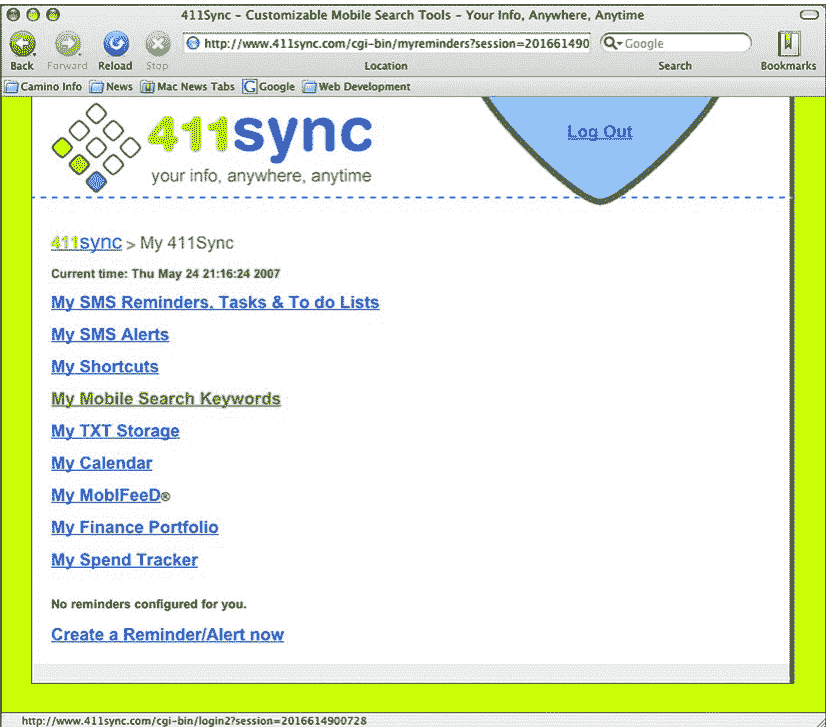

点击 **My Mobile Search Keywords** 查看你已创建的搜索关键词并创建新关键词。

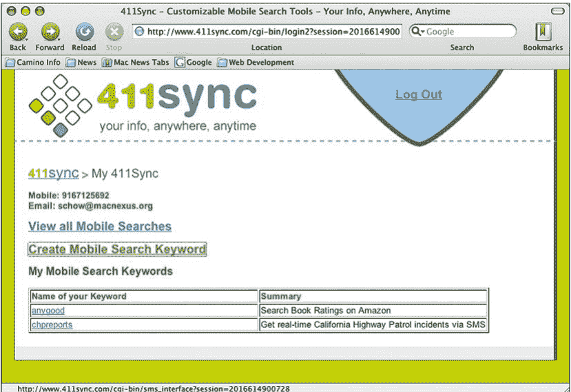

一旦你创建了一些移动搜索关键词，它们将在这里显示供你编辑。为我们的目的，你必须通过点击 **Create Mobile Search Keyword** 链接来创建一个新的。这将带你进入一个表单，用于创建你的关键词。

411Sync 会在他们的网站目录中为你宣传你的关键词。因此，关键词创建页面上的大多数问题都在询问你的网站是关于什么的。并非所有这些问题都会影响你的搜索方式。然而，有三个问题必须填写，并且需要一些思考才能使你的关键词正常工作。

## 为关键词命名
这个问题标识你的服务。它是用户发给 411Sync 的短信正文。因此，它应该描述服务是什么，并且在满足当前为六的最小字符长度要求的同时尽可能短。由于此关键词标识你的 feed，411Sync 会检查以确保该值在其系统中是唯一的。

我为我的服务选择的关键词是 "chpreports"。

## 用户使用你的搜索时的格式
虽然这个问题不会直接影响关键词行为，但它会让你思考用户需要输入什么。这个问题本质上是在询问用户必须发送给 411Sync 的完整短信内容。第一个词应该是关键词的名称。如果有任何变量，它们应被命名并用花括号括起来。

稍后，我们将看到我们需要一个变量来标识我们感兴趣的地理区域。因此在你创建服务时，请确保这个问题填写了关键词和花括号中的变量名。在示例中，我创建了一个移动搜索，内容为 chpreports {regionCode}。

## XML 数据的 HTTP 位置
这个问题询问你的 RSS 文件在哪里。这应该指向我们将要创建的脚本。请注意，如果用户需要输入变量才能使用你的搜索，你需要在此处手动设置 URL 以处理变量。例如，在上一个问题中我们确定了一个变量，regionCode。（我们需要它。"regionCode" 纯属信息性！）在脚本中，我们不会将其作为 $_GET['regionCode'] 访问。411Sync 会获取它看到的任何额外参数并直接将其附加到此 URL。

在创建我的 URL 时，我将此问题设置为：

```
http://www.shuchow.com/mashups/ch4/feed.php?rid=
```

由于参数只是传递给 URL，我们在这里捕获它。我们设置一个 URL，并在末尾开始查询字符串参数。在这种情况下，它名为 rid。当 411Sync 被激活并向服务发送参数和 GET 请求时，该参数将被粘在该 URL 的末尾。然后，我们的脚本将能够使用 $_GET['rid'] 访问它。

更详细地说，一个人请求的完整生命周期是：

- 1. 用户向 411Sync 发送短信。消息包含标识你的服务的关键词。消息后面还可能跟随一些参数。411Sync 将该参数发送到你的服务。
- 2. 411Sync 的服务器向你指定的 URL 发送 HTTP GET 请求。
- 3. 你的脚本执行，使用 411Sync 传递给它的任何 GET 参数。
- 4. 你的脚本将响应作为 RSS 文件发送回 411Sync。
- 5. 411Sync 解析此 RSS 文件，提取 title 元素。
- 6. 411Sync 传递 title 元素中的内容并向用户发送短信回复。

因此，我们需要创建的关键事物是一个 RSS 文件。不过有一些限制。其中一些限制在文档中有所说明，一些未记录，而一些只是移动开发的本质。

首先，411Sync 解析器会获取 RSS 文件中 title 元素中的所有内容并将其传递给用户。我们的 RSS 文件必须将所有内容塞入这些元素中。其次，虽然文档说该服务可以向用户传递 255 个字符，但这些是 UNICODE 字符。ASCII 的传递量会显著减少。因此，在响应中节省空间至关重要。最后，请记住在 9 位键盘上输入仍然有些困难。我们的应用程序需要仅要求用户提供最少量的输入。

我们需要定义创建此文件所需的参数。我们的 RSS 文件的内容将是来自加州公路巡警的交通信息。

## 加州公路巡警事故页面
本节将检查加州公路巡警事故页面。用户可以选择他们感兴趣的区域，页面将检索该区域的事故。我们希望让用户请求同一区域的交通报告，因此我们需要检查此页面如何创建内容。

## 通过短信的交通事故
我们将通过剖析事故页面的一般 HTML 结构来实现这一点。事故页面位于 http://cad.chp.ca.gov。

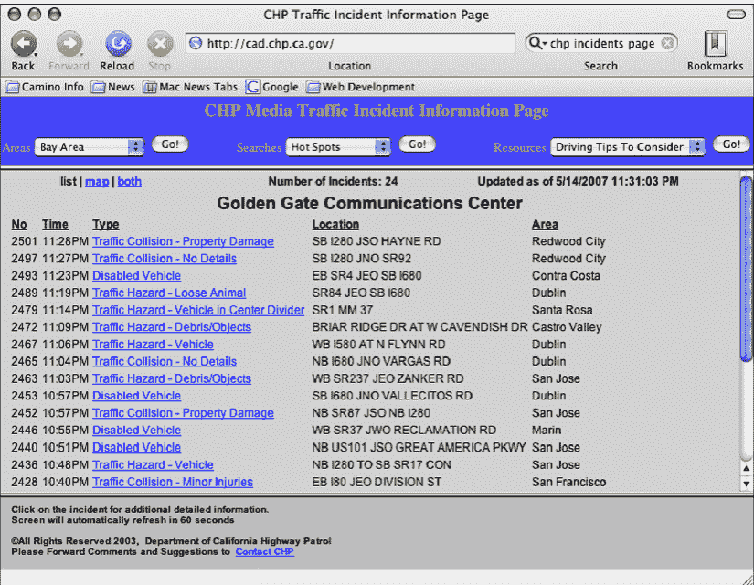

此页面分为三个框架。底部框架只是信息性和法律性的页脚。顶部框架包含一些导航。左上角标有 Areas 的下拉菜单列出了加州的城市中心。交通事故内容位于中间框架中。这些数据似乎以表格形式显示。有事故时间、事故类型、位置和一般社区的列。当 Areas 下拉菜单被激活并选择新区域时，内容页面会刷新为你选择的区域。从这种行为来看，我们可以猜测下拉菜单通过 JavaScript 事件向某处发送某种信息，很可能以 HTTP GET 或 POST 请求的形式发送，内容页面随之更改。

在你的 Web 浏览器中查看顶部标题的框架源代码。在 Mozilla 和 Opera 中，你可以通过右键单击顶部框架并选择 Frame | View Source 来实现。对于 Safari 或 Internet Explorer，你可以通过右键单击顶部框架并选择 View Frame Source，或在 Internet Explorer 的情况下选择 View Source 来实现。

让我们聚焦于创建 Areas 下拉菜单的部分。

```
<form name="areas" action="body.asp" target="bodyx">
<TR>
<TD ALIGN="left" >
<FONT COLOR="#CFB53F" SIZE="-1">Areas</font>
<SELECT name = "centerin" onchange="document.areas.submit()">
<Option Value="BFCC">Bakersfield</Option>
<Option Value="BSCC">Barstow</Option>
<Option Value="GGCC">Bay Area</Option>
...
<Option Value="VTCC">Ventura</Option>
<Option Value="YKCC">Yreka</Option>
<Option Value="ca">State Map</Option>
</Select>
<input type="submit" value="Go!">
</TD>
<TR>
</form>
```

从中可以得出以下几点：

- 菜单被包含在一个名为 areas 的表单中。action 指向 body.asp，它位于此页面的同一目录中。HTTP 方法未指定，因此将默认为 GET 请求。
- 表单的唯一项目是 SELECT 标签和提交按钮。
- select 元素名为 centerin。在 onchange 事件上，表单将被提交。因此，我们可以假设提交按钮仅用于未打开 Javascript 的浏览器。
- 菜单选项具有四个字符的值。前两个字符似乎与地理区域相关。后两个字符是 CC。


## 通过短信的交通事故

基于此，我们可以尝试向 body.asp 发出请求，使用 GET 参数 centerin，并使用菜单项之一的值。让我们尝试使用 URL http://cad.chp.ca.gov/body.asp?centerin=BSCC。此 URL 使用加州 Barstow 的值。

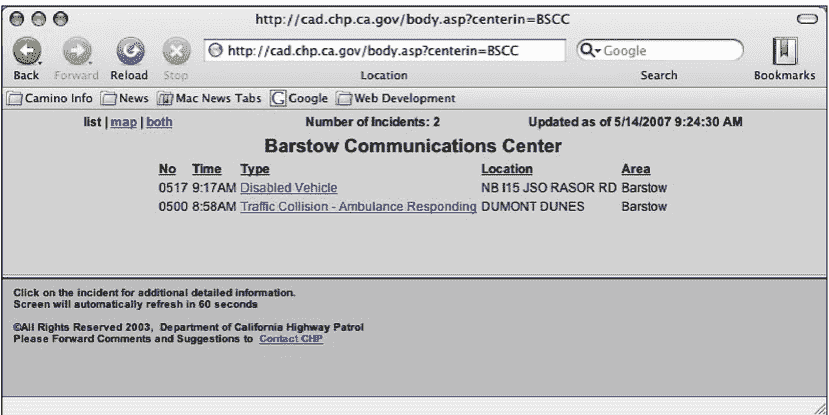

此页面看起来与主页相似，只是没有导航菜单。我们有兴趣了解顶部框架（现在包含内容）的构造方式。我们可以查看整个框架集的源代码。

```
<HTML>
    <HEAD>
    </HEAD>
    <FRAMESET ROWS="55%,*" >
        <FRAME NAME="sa" SRC="sa_list.asp?centerin=BSCC&style=l"
        SCROLLING="auto" MARGINWIDTH="2" MARGINHEIGHT="2" BORDER="1">
        <FRAMESET ROWS="*" BORDER=YES FRAMESPACING=20>
            <FRAME NAME="ii" SRC="./footer_default.asp" SCROLLING="auto"
            MARGINWIDTH="2" MARGINHEIGHT="2">
        </FRAMESET>
    </FRAMESET>
    <BODY>
    </BODY>
</HTML>
```

在这里，我们看到顶部框架的源代码是一个名为 sa_list.asp 的页面。它被传递了 URL 参数 centerin，即下拉菜单的原始名称，值为 BSCC，这是我们用于测试的值。还传递了另一个值为 style=l 的参数。让我们尝试使用这些查询参数访问该页面。

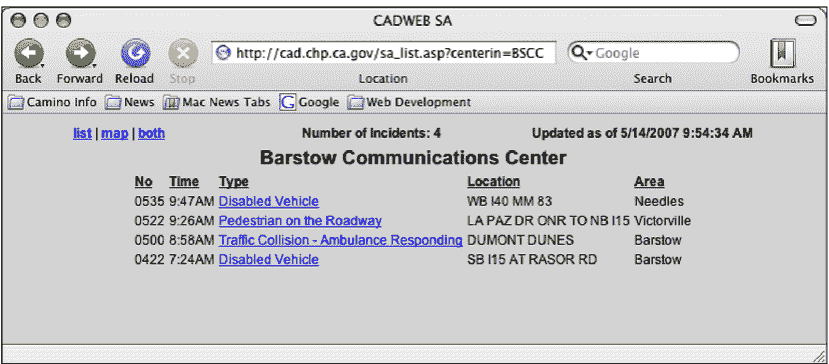

果然，这就是我们要找的页面。如果你在地址栏中将 centerin 的值更改为下拉菜单中的其他选项，你将获得另一个区域的页面。让我们看看 sa_list.asp 的 HTML：

```
<html>
<head>
<meta http-equiv="Refresh" content="30">
<meta name content="text/html charset=iso-8859-1">
<title>CADWEB SA</title>
<link rel="STYLESHEET" type="text/css" href="Inc/cadweb.css">
</head>
<BODY class="sa" ONLOAD="if((navigator.appName=='Netscape') && (navigator.appVersion.charAt(0)=='3') && (navigator.appVersion.indexOf('Win')+navigator.appVersion.indexOf('Mac')!=-2))document.bgColor=document.bgColor;">
<table border="0" align="center">
<tr>
<td class="Head" width="33%" align="Left">
<a href="set_nav.asp?centerin=BSCC&style=l" target="bodyx">list</a> |
<a href="set_nav.asp?centerin=BSCC&style=m" target="bodyx">map</a> |
<a href="set_nav.asp?centerin=BSCC&style=b" target="bodyx">both</a>
</td>
<td class="Head" width="33%" align="Left">
Number of Incidents: 4</td>
<td class="Head" width="33%" align="right">
Updated as of 5/27/2007 10:05:00 AM
</td>
</tr>
</table>
<table border="0" align="center">
<tr>
</td>
<td class="HeadT" colspan="5" align="center">Barstow
Communications Center</td>
</tr>
<tr>
<td class="HeadUl">No</td>
<td class="HeadUl">Time</td>
<td class="HeadUl">Type</td>
<td class="HeadUl">Location</td>
<td class="HeadUl">Area</td>
</tr>
<tr>
<td class="T">0535</td>
<td class="T" nowrap> 9:47AM</td>
<td class="T">
<A HREF=./iiqr.asp?Center=INCC&LogNumber=0535D0527&t=Disabled
%20Vehicle&l=WB%20I40%20MM%2083&b= TARGET="ii">Disabled Vehicle
</td>
<td class="T">WB I40 MM 83</td>
<td class="T">Needles</td>
</tr>
<tr>
<td class="T">0522</td>
<td class="T" nowrap> 9:26AM</td>
<td class="T">
<A HREF=./iiqr.asp?Center=INCC&LogNumber=0522D0527&t=
Pedestrian%20on%20the%20Roadway&l=LA%20PAZ%20DR%20CNR%20TO%20
NB%20115&b=4296%207C TARGET="ii">Pedestrian on the Roadway
</td>
<td class="T">LA PAZ DR ONR TO NB I15</td>
<td class="T">Victorville</td>
</tr>
<tr>
<td class="T">0500</td>
<td class="T" nowrap> 8:58AM</td>
<td class="T">
<A HREF=./iiqr.asp?Center=INCC&LogNumber=0500D0527&t=
Traffic%20Collision%20-%20Ambulance%20Responding&l=
DUMONT%20DUNES&b= TARGET="ii">Traffic Collision -
Ambulance Responding
</td>
    <td class="T">DUMONT DUNES</td>
    <td class="T">Barstow</td>
</tr>
<tr>
    <td class="T">0422</td>
    <td class="T" nowrap> 7:24AM</td>
    <td class="T">
        <A HREF=../iiqr.asp?Center=INCC&LogNumber=0422D0527&t=Disabled%20Vehicle&l=SB%20I15%20AT%20RASOR%20RD&b=TARGET="ii">Disabled Vehicle
    </td>
    <td class="T">SB I15 AT RASOR RD</td>
    <td class="T">Barstow</td>
</tr>
</table>
</body>
</html>
```

该页面分为两个表格。顶部表格是页面的页眉。对于我们的目的可以忽略它。第二个表格是内容。它是活动事件的表格。这就是我们需要提取的内容。

表格中的第一行是标题行。它告诉我们每一列包含的内容。列为：标识号、事件时间、事件类型、确切位置和一般区域。每一后续行包含一个事件。事件行中的每个单元格都有一个 class 属性，其值为 T。这似乎是我们数据的最佳标识符。我们现在对该页面的生成方式和结构有了很好的了解，因此可以创建我们的订阅源。

## 你的网站就是一个 API


对加州公路巡警网站的此次调查暗示了许多开发者正在采纳的一个概念——你创建的网站就是一个 API。你的网站不仅应该对他人进行 mashup 友好，还应该对屏幕阅读器和用户样式表等桌面应用程序友好。通过将你的网站视为内容 API，你可以增加网站的适应性。为此，请确保你的 HTML 代码格式良好，并且在结构上内容与表现之间有良好的分离。

## Mashup

我们现在已经掌握了有关此页面的一些关键信息。让我们回顾一下我们发现和学到的内容：

- 1. 411Sync.com 解析你服务器上的 RSS 文件并将其传递给用户。该服务可以从用户那里接收一个变量并将其传递到你的页面。
- 2. 事件页面位于 http://cad.chp.ca.gov/body.asp?centerin=xxcc，其中 "xxcc" 是一个四字符代码，用于定义要提取的区域。
- 3. 事件位于该页面的第二个表格中。
- 4. 事件的列始终按 ID 号、类型、位置和一般区域的顺序排列。
- 5. 每个事件单元格都有一个 class 属性，其值为 T。

基于这些因素、411Sync.com 的格式需求以及对移动用户的友好性，我们将把应用程序分解为以下组件：

- `clsIncident.php` — 事件对象，这是我们的“Model”组件。此类的所有功能只是保存有关事件的信息——时间、位置等。
- `clsDomParser.php` — 我们将借鉴第 1 章中基于事件的 SAX 解析器的做法。虽然使用 PHP DOM 解析并不是真正的基于事件的解析，但所有解析器都需要做一些基本的事情。例如，解析器需要加载 XML 数据。在这里，我们还可以指定解析器应加载 XML 数据还是 HTML 数据，以及数据本身是物理文件还是数据字符串。由于这些任务对所有 PHP DOM 解析器都是通用的，我们将创建一个抽象类，而所有特定于实现的解析逻辑将放在继承它的另一个类中。
- `clsCHPDomParser.php` — 此类将充当“Controller”对象。其工作是与面向外部的“View”页面交互并使用其他对象创建内容。其他类对 CHP 网站和结构几乎没有或没有了解。然而，此类将直接与 `sa_list.asp` 页面一起工作。
- `feed.php` — 这是 411Sync.com 将直接请求的唯一页面。换句话说，这就是我们的“View”页面。此页面的工作是接收来自 411Sync.com 的参数，将其传递给其他辅助类，等待这些辅助类的结果，并将结果作为 RSS 文件返回给用户。

## 事件类

此类位于示例代码的 classes 目录中。这是我们需要的唯一模型类。

```
<?php
    class Incident {
        private $incidentType;
        private $address;
        private $area;
        public function getIncidentType() { return $this->incidentType; }
        public function getAddress() { return $this->address; }
        public function getArea() { return $this->area; }
        public function setIncidentType($t) {$this->incidentType = $t; }
        public function setAddress($a) { $this->address = $a; }
        public function setArea($a) { $this->area = $a; }
    }
?>
```

除了我们稍后将创建的解析器类之外，这是唯一真正了解 CHP 网站的类。即便如此，它的了解也仅限于事件数据的结构。此类所做的一切只是保存有关事件的信息，并为信息提供 getter 和 setter 函数。我们将保留事件类型、地址和一般区域。出于节省空间的考虑，我们的第一个应用程序将不检索事件时间。

## DOM 解析器类

第 1 章中的基于事件的 SAX 解析器定义了子对象实现的解析函数、设置解析器，并具有执行文档解析的通用函数。我们新的父 DOM 解析器类名为 DomParser，在示例代码中的文件名是 clsDomParser.php，将以类似的方式运行。它将包含所有解析器必须执行的通用函数。

在 PHP DOM 的情况下，此类的通用任务是创建 DOM 并决定将数据作为 HTML 还是 XML 加载。关于使用哪种方式的决定在这里不会做出。那将与实现类绑定。此类所做的一切就是根据执行类想要的内容调用适当的 PHP 函数。

```
<?php
    abstract class DomParser {
        protected $dom;
```


我们首先将类定义为抽象类。接下来，我们定义一个类变量来保存 DOM。由于其他类无需直接操作 DOMDocument，因此我们将其设为受保护变量；

```
public function parse($url, $mode) {
    $returnMe = true;
    switch($mode) {
        case "HTML":
            try {
                @$this->dom->loadHTMLFile($url);
            }
            catch (Exception $ex) {
                $this->dom = null;
                $returnMe = false;
            }
            break;
        case "XML":
            try {
                $this->dom->loadXML($url);
            }
            catch (Exception $ex)
            {
                $this->dom = null;
                $returnMe = false;
            }
            break;
        default:
            $this->dom = null;
            $returnMe = false;
    }
    return $returnMe;
}
```

此 parse 函数仅调用适当的函数将数据加载到 DOMDocument 中。它接受两个参数——存储 XML 的 URL，以及如果我们想加载 XML 则为 XML 字符串值，如果我们想将其作为 HTML 加载则为 HTML 字符串值。switch 语句决定调用哪个适当的加载函数。如果加载成功，函数返回 true。如果失败，try-catch 块会将返回值设为 false。

请注意，对于 HTML 加载，我们在 DomDocument 上的加载函数调用前使用了 @ 符号。函数调用前的 @ 符号会抑制可能输出到浏览器的任何警告。大多数情况下，在 PHP 开发中，你希望看到发生的全部错误和警告。这是其中一个不希望看到这种情况的案例。如果 HTML 数据根据其 DOCTYPE 元素无效，DomDocument 会报告它并将其输出到屏幕。任何验证错误都会触发此输出，可以说互联网上大多数网页都是无效的。事实上，之前当我们检查 CHP 站点的代码时，导航页眉中缺少一个闭合的 TR 元素，而在 sa_list.asp 中，缺少闭合的 A 标签。如果不使用 @ 符号，你的结果很可能会充满 PHP 警告发送给用户。在我们的案例中，这些错误会导致输出中出现致命错误，因为我们的 feed 将不再是有效的 RSS。

幸运的是，在这种情况下使用 @ 的副作用很小。DomDocument 加载格式错误的 HTML 的能力非常宽容，不应影响代码的执行。

```
public function __construct() {
    $this->dom = new DomDocument();
}
}
?>
```

最后，定义了构造函数。当对象被实例化时，它会自动创建 DomDocument 并将其分配给类属性。

这个类现在可以被任何想要使用 PHP DOM 进行解析的东西使用。

## CHP DOM 解析器类

CHPDomParser 类在示例代码中命名为 clsCHPDomParser.php。该类保存了解析实际 CHP 网页的代码。它还必须与其他对象和公开的网页进行交互。它与 PHP 站点的耦合最紧密，并包含我们应用程序中的实际业务逻辑。

```
<?php
    class CHPDomParser extends DomParser {
        public function getRSSItems($rc) {
            $rc = strtoupper(trim($rc));
            $items = "";
```

第一个函数是除构造函数外该类中唯一的公共函数，并在对象实例化后由视图页面调用。此函数调用此类中的其他函数来创建内容。内容保存在名为 $items 的变量中，该变量返回给调用者。它接受一个参数 $rc，即区域代码。

```
if ($rc == 'HELP' || $rc == '') {
    $items = $this->getHelpItems();
```

为了让我们的应用程序更用户友好，我们应该定义一些帮助文本。此帮助文本在名为 getHelpItems() 的函数中定义，我们在此调用它。如果用户发送代码 "HELP"，或如果用户未发送任何参数，则会返回帮助文本。帮助文本的返回由第一个 if 块触发。

```
} else {
    $chpURL = $this->getCHPURL($rc);
```

如果用户的请求不是寻求帮助，那么我们将准备向 CHP 站点发出请求。我们的第一个任务将是创建指向 sa_list.asp 的 URL。URL 的创建由名为 getCHPURL() 的函数处理。URL 的一部分是区域代码，因此我们将提交的区域代码传递给此函数。

```
if ($this->parse($chpURL, 'HTML')) {
    $incidentObjects = $this->getIncidentObjects();
    $items = $this->incidentObjectsToItems($incidentObjects);
}
else {
    $items = "An error has occurred  Please try again.";
}
```

接下来，我们尝试解析 sa_list.asp。大量的工作在 getIncidentObjects() 函数中完成。它将解析事件行并返回一个 Incident 对象数组。然后我们将此数组传递给 incidentObjectsToItems()，它接收数组并将其格式化为返回给用户的文本字符串。此文本字符串填充到 $items 中。如果加载失败，$items 将填充一条通用错误消息。

```
}
return $items;
}
```

$items 然后返回给调用者。

```
private function getIncidentObjects()
{
    $incidentsArr = array();
    $counter = 0;
    $rows = $this->dom->getElementsByTagName('tr');
    foreach ($rows as $row)
    {
        $tds = $row->getElementsByTagName('td');
```

getIncidentObjects() 是主要的解析函数。它首先进行一些初始化声明。$incidentsArr 保存事件数组并将返回给调用者。另一个名为 $counter 的变量将用于跟踪我们在表格中的哪一列。

基本前提是我们感兴趣的 td 元素位于 tr 元素内。因此，我们使用 DOMDocument 上的 getElementsByTagName() 获取整个文档中的 tr 元素。然后我们遍历该 NodeList，并在 tr 节点上执行 getElementsByTagName() 来搜索 td 元素。

```
foreach ($tds as $td)
{
    if ($td->getAttribute('class') == 'T')
    {
        //we are in the data section
```

现在，我们必须遍历每一行的列。你可能会想知道为什么我们不一开始就直接获取所有 td 元素。原因是我们必须跟踪在此表格中的位置，以便识别哪个 td 元素保存事件类型、哪个保存地址、哪个保存区域。我们知道行后的第三个 td 是事件类型。我们知道行后的第四个 td 是地址，以此类推。如果一开始就获取所有 td 元素，由于整个页面上的其他表格或用于控制布局的任何其他 td 元素，编号就会出错。

我们只关心事件表格的 td 元素。因此，我们检查是否存在 class 属性以及其值是否为 T。如果为真，让我们继续使用 $counter 变量和 switch 语句来计数列。

```
switch($counter)
{
    case 0:
        //1st - start of a new incident
        $incident = new Incident();
        break;
```

如果计数器为零，意味着我们处于第一列，开始新行，这需要一个新的 `incident` 对象。在这里，我们创建一个：

```
case 1:
    //2nd - the time. Skip.
    break;
```

如果计数器为一，我们处于时间列。我们可以跳过它，因为我们决定不提取它以节省空间。

```
case 2:
    //3rd - The Incident Type
    $incident->setIncidentType($td->nodeValue);
    break;
```

计数器值为二意味着我们处于第三列，即事件类型列。我们获取节点值并将其存储到已创建的 `incident` 对象中。

```
case 3:
    //4th - Address
    $incident->setAddress($td->nodeValue);
    break;
case 4:
    //5th -> Area
    $incident->setArea($td->nodeValue);
    array_push($incidentsArr, $incident);
    $incident = null;
    break;
```

我们对第四列和第五列重复相同的过程。第五列是行的末尾，因此我们还需要进行一些清理。我们取出 `incident` 对象并将其放入将返回给调用者的 `$incidentsArr` 中。然后我们销毁 `incident` 对象，以便在下次遇到新行时重新创建。

```
}
if ($counter == 4)
{
    $counter = 0;
}
else
{
    $counter++;
}
```

This block increments or resets the counter when it encounters each "T" table cell.

```
    } //If
    } //Inner foreach
}  // Outer foreach
    return $incidentsArr;
} //Function
```

Finally, the incidents array is returned and the function is closed.

```
private function incidentObjectsToItems($incidents) {
    $itemsString = "";
    foreach ($incidents as $incident) {
        $itemsString .= $this->abbreviateIncidentType($incident->getIncidentType()) . ": " . $incident->getAddress()
            . ", " . $incident->getArea() . "--";
    }
    return $itemsString;
}
```

This function simply loops through an incidents array and formats it into a concise and compact string. The only thing to look out for is that we pass the incident type to abbreviateIncidentType(). This function abbreviates the incidents to give us more space. More on how this function works when we get to it.

```
private function getHelpItems() {
    $help = 'Fresno-FR, Los Angeles-LA, Monterey-MT, Sacramento-ST, ';
    $help .= 'Redding-RD, San Diego-BO, San Francisco Bay Area-GG';
    return $help;
}
```

This is the function that generates the help text. This is simply a list of acceptable region codes. Even though the pull-down menu has many more regions, we're going to limit the ones shown to the user just to keep the help text under the maximum payload size.

```
private function abbreviateIncidentType($type) {
    $returnType = $type;
    switch($type) {
        case strstr($type, 'Traffic Hazard'):
            $returnType = 'TH';
            break;
        case strstr($type, 'Collision'):
            $returnType = 'COL';
            break;
        case strstr($type, 'Hit and Run'):
            $returnType = 'H/R';
            break;
        case strstr($type, 'Hit & Run'):
            $returnType = 'H/R';
            break;
        case strstr($type, 'Disabled Vehicle'):
            $returnType = 'DV';
            break;
        default:
            $returnType = str_replace('a', '', $type);
            $returnType = str_replace('e', '', $returnType);
            $returnType = str_replace('i', '', $returnType);
            $returnType = str_replace('o', '', $returnType);
            $returnType = str_replace('u', '', $returnType);
    }
    return $returnType;
}
```

This function abbreviates the incident types. Some of the incident type labels are quite long. We do this simply to shorten the data returned. In case something slips by, the default case in this switch statement removes the vowels from the string.

```
private function getCHURL($rc) {
    $prefix = 'http://cad.chp.ca.gov/sa_list.asp?style=1';
    $returnMe = $prefix . '&centerin=' . $rc . 'CC';
    return $returnMe;
}
}
?>
```

At the end of the class is the getCHURL() function. This function simply injects the region code submitted by the user into the URL format that sa_list.asp requires.

Now we have our helper classes defined, we can tie them all together using the exposed view page.

## Creating the Feed Page

The feed page's job is just to include all necessary class files, call getRSSItems() from CHPDomParser, and format the returned values into a valid RSS file.

```
<?php
    $regionCode = $_GET['rid'];
    header('Content-type: text/xml; charset=UTF-8');
    require_once('classes/models/clsIncident.php');
    require_once('classes/clsDomParser.php');
    require_once('classes/clsCHPDomParser.php');
```

The first few lines prepare our script for the execution of code. We grab the GET variable named rid and set it to a local variable named $regionCode. We then set the content type of this file to XML using a header change. Finally, we include all of the classes we just created.

```
$parserObj = new CHPDomParser();
$text = $parserObj->getRSSItems($regionCode);
?>
```

Next, all we have to do to initialize the load, and parsing is to create the CHPDomParser object and then call getRSSItems(), passing the $regionCode. The items are returned and set in the variable named $text. That concludes the major PHP code in this file.

```
<?= '<?xml version="1.0" encoding="utf-8" ?>' ?>
<rss version="2.0">
    <channel>
        <title></title>
        <link></link>
        <description></description>
        <language>en-us</language>
        <copyright></copyright>
        <item>
            <title><?= $text ?></title>
            <description></description>
        </item>
    </channel>
</rss>
```

The RSS file is quite simple. Like the 411Sync documentation says, it passes the values in the `title` element back to the user. All we have to do, then, is output `$text` into the `title` element.

## Testing and Deploying

Our application is now complete. We can now test and deploy our application. After installing it into a publicly accessible web server, you can simulate the URL that 411Sync.com will use to hit your script. Don't forget to add the region code variable after `rid=` or "help".

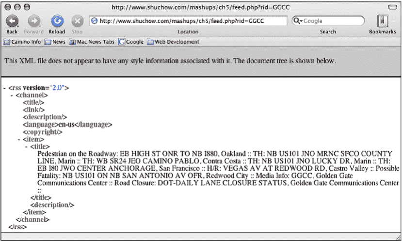

If this test is successful, we can be confident that our code executes properly and is successfully retrieving the data from the CHP site.

Next, we can see if 411Sync.com can successfully get to your page. 411Sync.com makes all of its searches available through a web interface. It is located at `http://www.411sync.com/cgi-bin/search`. In the search box, enter in your keyword and the region code then press **搜索**.

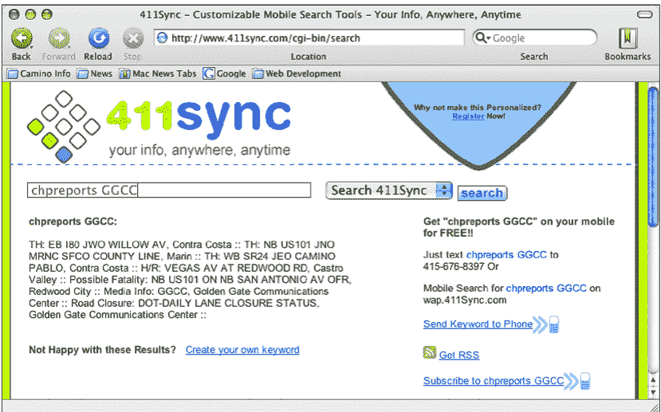

If this test is successful, try to send the same SMS message from your phone to 415-676-8397. You should soon receive an SMS message back with traffic information.

## Summary

In this chapter, we used the new PHP DOM extension found in PHP 5 to screen scrape information. This is a far more sophisticated and powerful way to extract information from websites than old methods that often would hard code a lot of structural information. After getting permission from the California Highway Patrol, we deconstructed the Live Incidents site to see how it works. With this knowledge, we used the PHP DOM extension to extract traffic incident data from the Live Incidents website, reformatted it, and prepared it for delivery through SMS. 411Sync.com makes creating mobile content very easy. All we had to do was create an RSS feed. Through keywords, 411Sync.com directs requests to our RSS feed and sends it back to the mobile device.
