# 6 London Tube Photos

## Project Overview

| What | 将伦敦地铁站位置绘制在 Google 地图上。当点击车站图标时，在 Flickr 上搜索该车站的照片并在地图上显示。 |
|---|---|
| 使用的协议 | REST |
| 数据格式 | XML, RDF, JSON |
| 重点工具 | SPARQL, RDF API for PHP, XMLHttpRequest Object (AJAX) |
| 使用的 API | Google Maps, Flickr Services |

We have used a lot of techniques and APIs in our projects. For the most part, things have mashed up together fairly easily with minimal issues. One of the reasons for this is that we have relied on PHP to create the presentation for our mashups. This simplifies the architecture of our mashup and gives us a lot of control. Many APIs, though, are JavaScript-based, and hence, any mashup will rely heavily on JavaScript for the presentation. This introduces a lot of other issues that we will have to deal with. In this mashup, we will encounter some of those issues, and look at ways to work around them. PHP will remain an important part of our mashup, but take a smaller role than it has played so far.

In this mashup, we will present a geographically-centric way to present pictures from the photo-sharing site, Flickr. When a user loads our application, they will be presented with a Google map of London. A pull-down menu of all the London Tube lines will be available. The user will select a line, and the application will load all of the Tube stations onto the map and display them with markers. If the user clicks on a marker, the name of the station will appear as a popup on the map. In the background, a search query against Flickr will be initiated, and any pictures of the station will appear in the popup as a thumbnail. Clicking on the photo will take the user to the photo's page on Flickr.


JavaScript 并不是我们将整合到工具箱中的唯一新工具。在着手用户界面之前，我们需要向应用程序中填充数据。我们需要查明哪些地铁站属于哪条线路，以及这些车站的位置。许多网站只有其中一项信息，而没有两者兼具。如果使用它们，不仅要处理两个数据源，还必须再次使用屏幕抓取。幸运的是，有一个地方同时包含这两项信息。该来源采用资源描述框架（Resource Description Format），这是一种我们在第 3 章中曾略作介绍的 XML 格式。在本 mashup 中，我们将更深入地研究 RDF，以及如何使用一种名为 SPARQL（SPARQL Protocol and RDF Query Language）的年轻查询语言从中提取数据。

## Preliminary Planning

请注意，预先规划 mashup 并非明智之举，但此应用程序会复杂得多，肯定需要一些事先思考。以前，我们的 API 在后台工作，提供数据。我们使用 PHP 从 API 检索数据，以其提供的任何格式接收数据，然后将响应格式化为面向用户的 HTML 输出，或格式化为用于从另一个 API 检索数据的另一种格式。PHP 在应用程序的设计方式上给予了我们很大的灵活性。

这次，一个 API，Google Maps，是 JavaScript API。另一个，Flickr Services，仍然基于服务器。两者无法直接相互通信，我们必须遵守各自设定的规则。比以往任何时候都更需要我们在尝试编写第一行代码之前仔细审视一切。

到目前为止，我们所知道的是：

- 1. 我们需要为地铁站找到一个数据源。我们需要找到每条线路中的车站名称，以及一些可用于在地图上地理定位的信息。后者更多地取决于接收端工具的能力。换句话说，由于我们将使用 Google Maps，我们必须查看 Google Maps 如何在其地图上放置标记，并将源数据调整为符合 Google Maps 的要求。
- 2. 我们将仅将 Google Maps API 用于展示。JavaScript 不能直接调用 PHP 函数或服务器端代码，PHP 也不能调用 JavaScript 函数。然而，我们可以使用 PHP 即时编写 JavaScript 代码，并且我们可以使用 JavaScript `XMLHttpRequest` 对象。`XMLHttpRequest` 对象可以通过发送 GET 或 POST 请求在不重新加载页面的情况下调用服务器资源。然后我们可以动态更新用户面前的页面。此过程通常被称为 AJAX，即异步 JavaScript 和 XML。


> 查看 Flickr Service 的文档页面 http://www.flickr.com/services/api/，我们发现可以选择的格式和协议种类繁多。我们所有主要请求协议 REST、XML-RPC 和 SOAP 都在其中。除此之外，我们还可以选择 JSON 或序列化 PHP 作为响应格式。还有大量已构建的语言工具包。您可以使用这些工具包直接从 PHP、ColdFusion、Java 等调用 Flickr。不幸的是，JavaScript 不在该列表中。

## Finding Tube Information

我们最大的问题是找到初始的地铁数据。没有这第一步，我们就无法创建 mashup。第一步的逻辑做法是查看官方地铁网站 http://www.tfl.gov.uk/tube/。浏览一番后，我们看到许多彩色的线路地图，但没有任何机器可读的内容——没有 feed，甚至连带车站的下拉菜单都没有。看起来官方网站作为数据源将是一个糟糕的选择。

我们应该查看 Google Maps API 看看它能接受什么。文档主页位于 http://www.google.com/apis/maps/documentation/。该网站有许多示例以及类、方法和属性参考。浏览后，我们看到 Google 地图标记由一个名为 GMarker 的类表示。有很多关于如何创建标记的示例，如下所示：

```
marker = new GMarker(point);
map.addOverlay(marker);
```

这很棒，但传递给 GMarker 类的 point 是什么？查看文档参考，我们发现它是一个 GLatLng 对象，该对象有两个简单属性——标记的经度和纬度。看起来创建标记最直接的方式是通过经纬度坐标。

排除官方地铁网站后，我们仍需找到各站点的经纬度信息。经过一番搜索，我偶然发现了 Jo Walsh 的网站 frot.org。Walsh 女士在开放地理数据方面做了大量工作，目前是开源地理空间基金会（http://www.osgeo.org/）的官员。在她的网站上，她谈到了 mudlondon，这是一个她创建的 IRC 机器人。作为该机器人的一部分，她编译了伦敦所有地铁站的 RDF 文件。该文件位于 http://space.frot.org/rdf/tube_model2.rdf。该文件的前半部分是每个车站的信息，包括经纬度位置。后半部分列出了每条线路及其车站。这两项信息正是我们所需要的。在联系她后，她慷慨地允许我们将此文件用于我们的 mashup。

作为一个基于 XML 的文件，我们可以像以前一样创建自己的解析器。然而，进一步搜索发现有一个用于 PHP 的 RDF 解析器。这应该能节省我们一些工作。

这种方法有一个问题。RDF 文件本身的大小超过 500 千字节。将此 RDF 文件视为 RSS 1.1 feed 并在运行时加载和解析是完全合理的。然而，这不是博客的流。地铁站不常变动。为了节省 Walsh 女士的带宽并大幅加快我们的应用程序，我们应该消除这种加载和解析。一个解决方案是将此文件直接保存到我们的文件系统。这将带来巨大的速度提升。另一个速度提升可以通过从数据库检索数据而不是每次都解析文件来实现。XML 解析器是 PHP 功能集中的一个相对较新的补充。它们不如数据库扩展成熟。与直接从数据库检索数据相比，XML 解析的性质也有一定的开销。看起来我们应该首先使用 RDF 解析来填充数据库，然后在应用程序中从数据库动态加载数据。

## Integrating Google Maps and Flickr Services

现在我们有了数据，并且大致知道如何使用该数据创建标记，我们需要研究如何将 Google Maps 中的 JavaScript 调用桥接到 Flickr Services 中的服务器调用。Flickr Services 提供了一个基于 REST 的端点。这意味着我们只需向端点发送 GET 或 POST 请求，提供我们的参数，即可获得数据返回。此外，一个返回选项是 JavaScript 对象表示法 JSON。理论上，我们可以在 JavaScript 中使用 XMLHttpRequest 对象发送 GET 请求，并直接从服务器获取 JavaScript。然后我们可以使用此 JavaScript 动态更改页面。这将使事情变得非常容易。

其主要障碍在于我们无法直接针对 Flickr Services 发出 XMLHttpRequest GET/POST 请求。这是因为跨脚本攻击是一个安全问题。为了应对这一点，所有 Web 浏览器都阻止一个站点向另一个站点发送 XMLHttpRequest。XMLHttpRequest 只能返回到页面所服务的服务器。

为了解决这个问题，我们可以在服务器上设置自己的 REST 服务。当用户点击标记时，XMLHttpRequest 会返回到我们的 REST 服务。我们的 REST 服务随后调用 Flickr 服务，我们只需将 Flickr 响应传回客户端。

## Application Sequence

我们现在有一个攻击计划和应用程序的初步架构。我们可以创建一个统一建模语言序列图来说明当访客使用我们的 mashup 时会发生什么。

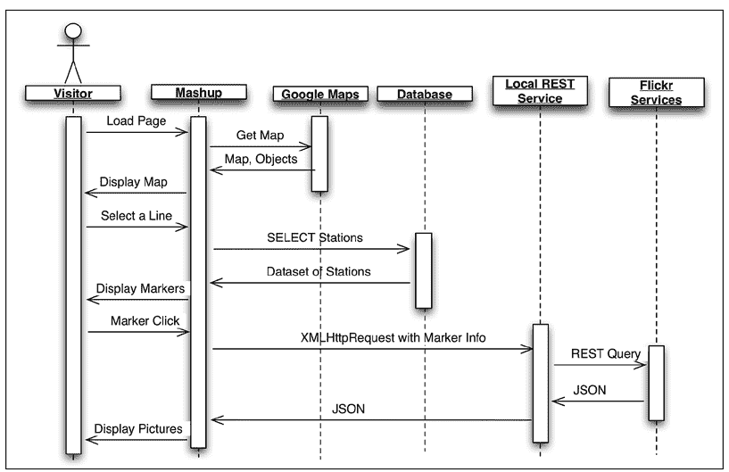

如果你不了解 UML，不用担心。该图保持 UML 记法的简化，易于理解。这基本上是总结用户加载 Flickr 图片集所经历步骤的一种花哨方式。虽然用户只需做三件事，但该图按顺序显示了幕后发生的情况。

该图让我们对所涉及的技术有了很好的了解。让我们看看我们将遇到的一些新格式。

## Resource Description Framework (RDF)

回顾第 3 章，我们将 RSS 1.1 描述为基于 RDF 的。RDF 到底是什么？许多人称 RDF 为“关于数据的元数据”，然后继续描述它如何超越了这一点。虽然 RDF 及其使用方式确实已经演变，但不要忘记“关于数据的元数据”这一方面很重要，因为它抓住了 RDF 的本质。


RDF 的目的是描述网络资源，即描述互联网上的某事物。例如，如果一个购物网站列出了某物的价格，那么价格究竟是什么？是以美元？墨西哥比索？还是俄罗斯卢布？对于一个网站来说，时间戳究竟是什么？机器解析器是否应该将 12 小时制的时间戳与 24 小时制的时间戳区别对待？XML 在非常高的层面上，本意是让各团体在交易格式上达成标准化。由于 XML 只是一种语言，实现细节被留给了相关方。RDF 是这一原始目标的下一步演进。它为该实现提供了一个框架。通过定义时间戳是什么，任何遇到该 RDF 文档的机器或人类都将毫无歧义地知道该时间戳是什么、它意味着什么以及应采用何种格式。

RDF 的基本概念和语法相当简单直接。RDF 将事物分组为它所称的三元组。一个三元组基本上表示“某物具有一个属性，其值为某物”。三元组使用主语、谓语和宾语的语法概念。在句子“该页面的大小为 21 千字节”中，该页面是主语。谓语是属性，在此例中为大小。宾语是该属性的值，即 21 千字节。通常在 RDF 中，主语由父元素的 about 属性表示。属性和值由该父元素下的元素和值对表示。页面大小的句子可以用 XML 记法表示如下：

```
<rdf:RDF
    xmlns:rdf="http://www.w3.org/1999/02/22-rdf-syntax-ns#"
    xmlns="http://www.example.org/pageProperties"
>
<rdf:Description rdf:about="http://www.shuchow.com/thecats.html">
    <creator>Shu Chow</creator>
    <title>My Cats</title>
    <lastMod>01/24/2007</lastMod>
    <size>21 kilobytes</size>
</rdf:Description>
</rdf:RDF>
```

在 RDF 中，每个元素都必须有命名空间。rdf 命名空间是必需的，并且必须指向 http://www.w3.org/1999/02/22-rdf-syntax-ns。这使我们能够访问构成该文档为 RDF 文档的核心 RDF 元素。在本文档中，我们三次访问 RDF 元素——一次作为文档的根元素，再一次使用 Description 元素来标识资源，再一次使用 about 属性来标识特定资源。用人类语言表述，标题可以表述为，“http://www.shuchow.com/thecats.html 处的网络资源，具有一个标题属性，其值为 'My Cats'”。更随意地说，我们可以说，“该页面的标题是 'My Cats'”。

将其分解为主语、谓语和宾语：

- 主语是 http://www.shuchow.com/thecats.html。
- 谓语是 title。这也可以表示为 URI。
- 宾语是 "My Cats"。

在 RDF 中，主语和谓语必须是 URI。然而，像前面的例子一样，谓语可以有命名空间。值可以是 URI，或者更常见的是字面量。字面量是谓语元素内的字符串值。

在我们的 mashup 中我们还会遇到另一个 RDF 元素。在前面的例子中，从上下文可以明显看出该网络资源是一个 HTML 页面。RDF Schema 规范有一个 type 元素的 resource 属性，它将主语分类为编程对象（与三元组对象相对），例如 PHP 或 Java 对象。

```
<rdf:RDF
    xmlns:rdf="http://www.w3.org/1999/02/22-rdf-syntax-ns#"
    xmlns="http://www.example.org/pageProperties"
>
<rdf:Description rdf:about="http://www.shuchow.com/thecats.html">
    <creator>Shu Chow</creator>
    <title>My Cats</title>
    <lastMod>01/24/2007</lastMod>
    <size>21 kilobytes</size>
    <rdf:type rdf:resource="http://www.example.org/objects#An_HTML_Page" />
</rdf:Description>
</rdf:RDF>
```

resource 属性始终是一个 URI。结合 type 元素，它们告诉我们，为了弄清楚这个资源到底是什么，我们应该访问 resource 属性的值。在此例中，该资源在 http://www.example.org/objects#An_HTML_Page 处有描述，其大概描述了一个 HTML 页面。

仅了解三元组的简单本质就足以让我们开始使用 RDF。在核心 RDF 规范中，还有一些与集合分组相关的元素。然而，由于规范设计为可扩展和扩展，超出这些的元素并不多。扩展的命名空间是 RDF 强大之处的来源。在我们的 mashup 中，我们将遇到更多扩展，并在遇到时更详细地检查它们。目前，我们已具备阅读和使用我们的经纬度数据源的基本技能。


> RDF 的常见扩展及其应用可以将 RDF 变成一个非常深奥的主题。要了解更多关于 RDF 的信息，W3C 创建了一个优秀的入门指南，位于 http://www.w3.org/TR/rdf-primer/。请注意，人们很容易陷入 RDF 的哲学基础——官方规范实际上是六份独立的文档。

## SPARQL

RDF 设计为一种数据存储。由此可知，RDF 推出后，人们就想要一种查询方式，就像传统数据库一样。SPARQL 是一种新的 RDF 查询语言，最近已成为 W3C 推荐标准。你可以将 SPARQL 视为编写查询，类似于数据库的 SQL，用来解析 XML 文件，特别是 RDF 文件。返回给你的结果是与 SQL 中一样的行列表。

大多数人都是借助查询数据库的命令行客户端来学习 SQL。这使我们能够试验和操作查询结构。幸运的是，SPARQL 也有类似的东西；SPARQLer，位于 http://www.sparql.org/sparql.html，是一款交互式网络工具，允许你指定网络上的 RDF 文档作为输入并对其编写 SPARQL 查询。它会像数据库客户端的结果一样向我们显示查询结果。在我们初步讨论 SPARQL 时，我们将使用此查询工具以及位于 http://www.shuchow.com/mashups/ch6/pets.rdf 的示例文档 RDF 文档。该 RDF 文档列出了我工资单供养的所有动物。

## Analyzing the Query Subject

在数据库世界中，在开始编写查询之前，你需要先了解一点模式，要么通过实体关系图（如果你有良好的文档），要么简单地使用 SHOW TABLES 和 EXAMINE SQL 命令。你需要对 SPARQL 做同样的事情。有时主机会有文档，但通常，你只需要阅读 RDF 文件以大致了解文档。让我们从打开我们将要使用的 RDF 文件开始练习，地址为 http://www.shuchow.com/mashups/ch6/pets.rdf。你的浏览器要么将此文件下载到硬盘，要么在窗口中打开它。如果在窗口中打开，它可能会应用样式表来美化呈现。在这种情况下，你需要查看文档的源代码才能看到所有标签和命名空间前缀。

此 RDF 文件非常直接简单。我们从根元素开始，后面跟着命名空间：

```
<rdf:RDF
    xmlns:mypets="http://www.shuchow.com/"
    xmlns:rdf="http://www.w3.org/1999/02/22-rdf-syntax-ns#"
    xmlns:rdfs="http://www.w3.org/2000/01/rdf-schema#"
>
```

命名空间 rdf 和 rdfs 绑定到 w3.org 资源，这告诉我们它们是行业标准。mypets 则绑定到 shuchow.com，即文件的域名。这意味着它很可能是由 shuchow.com 组织创建的专有词汇，以支持信息。要了解更多，我们可以访问该站点。如此应该会带我们找到有关我们将遇到的一些语法的文档。

文件的其余部分基本上是围绕 Description 元素包装的宠物列表，其中包含一些作为子元素的详细信息。Description 元素中的 about 属性指向此项目的确切主题。

```
<rdf:Description rdf:about="http://www.shuchow.com/thecats.html#avi">
    <mypets:name>Avi</mypets:name>
    <mypets:age>6</mypets:age>
    <mypets:gender>F</mypets:gender>
    <rdfs:type rdf:resource="http://www.shuchow.com/#parrot"/>
</rdf:Description>
```

每只宠物的名字、年龄和性别都是其各自元素的值。这些元素都命名空间为 mypets。项目的类型是一个指向描述此“事物”是什么的位置的 URI。对于此文件，它是一个虚构的 URI，仅用作区分我家动物类型的方式。在现实世界中，它也可能不指向真实文件，或者背后可能有复杂的 RDF 分类法定义。这些 Description 块针对每只宠物重复。

## Anatomy of a SPARQL Query

如果你了解 SQL，那么理解 SPARQL 查询的前几行应该很容易。让我们看一个简单的 SPARQL 查询来了解其各部分。假设我们想提取某只特定宠物的某条特定信息。假设我们想提取 Saffy 的年龄。我们知道在文档中，年龄是 mypets:age 元素的值。我们也知道宠物的名字 Saffy 在 mypets:name 元素中。我们需要一个查询来提取 mypets:age 的值，并限制为 mypets:name 的值。


这个 SPARQL 查询将为我们提供这些信息：

```
PREFIX mypets: <http://www.shuchow.com/>
SELECT ?age
FROM <http://www.shuchow.com/mashups/ch6/pets.rdf>
WHERE {
    ?Description mypets:name "Saffy" .
    ?Description mypets:age ?age
}
```

在查看此查询之前，我们需要说明几项语法上的事项。首先，在 SPARQL 中，URI 由小于号和大于号括起来。其次，SPARQL 查询依赖变量来命名值。变量名以问号开头表示。

此查询的第一行是 PREFIX 语句。PREFIX 语句对于查询在 RDF 文档中会遇到的每个命名空间都是必需的。在 pets.rdf 中，实际上有三个命名空间声明。然而，为了提取年龄，我们使用了 mypets:name 和 mypets:age，它们共享一个公共命名空间。因此，在我们的查询中，只需要为 mypets 命名空间添加前缀。格式为 PREFIX 关键字，后跟 RDF 文档中给出的命名空间名称、冒号，最后是 RDF 文档中给出的命名空间值。

下一行是 SELECT 语句。在 SELECT 语句中，列出您希望提取的 SPARQL 查询变量的名称。在 SQL 中，SELECT 语句后面跟随表列名或别名。在 SPARQL 中，变量在 WHERE 子句中定义并设置其值。SELECT 语句指定您希望提取的变量。我们很快就会查看如何定义 SPARQL 变量。为了简单起见，此示例使用我们感兴趣的元素名称 age 作为变量名 ?age。然而，只要 WHERE 子句中的第二行改为 ?Description mypets:age ?mangoes，SELECT ?mangoes 也会给出相同的结果。如果您希望提取多个变量，请在 SELECT 语句中列出每个变量，用空格分隔。

下一个语句是 FROM 语句。在 SPARQL 中，此语句是可选的。它用于指向 RDF 数据的来源。在许多解析器中，RDF 文档的位置是在 SPARQL 查询之外指定的。例如，一些解析器将 RDF 文档的 URL 作为构造函数参数。FROM 语句虽然不是必需的，但就像查询的注释。它告诉我们此查询是为特定 RDF 文档编写的。像程序员注释一样，虽然不是必需的，但包含此语句是良好的做法。在 SPARQLer 中，我们可以选择将源 URL 放在查询中或单独的字段中。

## 编写 SPARQL WHERE 子句

最后，我们来到 WHERE 子句。在 SQL 中，WHERE 子句缩小并细化我们正在查找的数据。在 SPARQL 中，它做同样的事情。它还为查询和解析器提供结构感。在 SQL 数据库中，表具有定义明确、一致的模式。RDF 文档是一个平面文件。从解析器的角度来看，根本无法保证任何结构。SPARQL WHERE 子句为解析器提供了对象和属性如何组织以及它们如何相互关联的思路。

### 基本原则

回顾 RDF 三元组的三个部分，以及它们代表的含义：

- 主语告诉我们这个三元组所描述的“事物”。
- 谓语指定主语的一个属性。
- 宾语是谓语的值。

三元组只是每个部分写在一行中并用空格分隔。

SPARQL WHERE 子句只是一系列串联起来的三元组。此外，三元组的每个部分都可以用变量替换。

例如，假设有一只名叫 Gilbert 的猫。他的眼睛是绿色的。

在简单的 RDF 中，他可以这样表示：

```
<rdf:Description rdf:about='http://www.example.com/cats#GilbertTheCat'>
    <name>Gilbert</name>
    <eyeColor>Green</eyeColor>
</rdf:Description>
```

以三元组形式，可以这样表示：

```
rdf:Description  name  "Gilbert"
```

这隔离了名字值为“Gilbert”的猫。我们关注的项目是主语。它由 rdf:Description 元素表示。Name 是主语的属性，使其成为谓语。名称的值，即此三元组中的宾语，是“Gilbert”。要指定三元组宾语的字面值，我们用引号将值括起来。

在查询中，我们可以用变量替换主语。

```
?catObject  name  "Gilbert"
```

现在，?catObject 持有对名字为 Gilbert 的猫的引用。我们可以使用此变量访问 Gilbert 这只猫的其他属性。要访问 Gilbert 的眼睛颜色，我们可以串联使用两个三元组：

```
?catObject  name      "Gilbert" .
?catObject  eyeColor ?eyeColor
```

要在 SPARQL 查询中串联三元组，请使用句点。这充当连接运算符，就像句点在 PHP 中使用一样。

在此分组中，第一个三元组将主语 Gilbert The Cat 放入 ?catObject 变量中。第二个三元组的主语是变量 ?catObject。这意味着第二个三元组的谓语和宾语将使用此主语。此第二个三元组将把 Gilbert 的眼睛颜色放入 ?eyeColor 变量中。要在 SPARQL 结果集中返回 eyeColor 变量，我们需要在 SELECT 语句中指定它。

> 在 SPARQL WHERE 子句中，需要记住的关键概念是所有变量都引用同一事物。WHERE 语句的顺序几乎无关紧要。重要的是执行结束时每个变量的值。

### 一个简单查询

这与我们之前从 pets RDF 文档中提取 Saffy 年龄的查询所应用的原则相同。

为了实际操作，让我们加载在线 XML 解析器。在 Web 浏览器中打开 SPARQLer (http://www.sparql.org/sparql.html)。您将看到一个简单的表单。文本区域是输入要运行的 SPARQL 查询的地方。只要查询中有 FROM 子句，您就可以将 Target graph URI 字段留空。表单上的其他选项也可以留空。以以下形式将年龄查询输入查询文本区域：

```
PREFIX mypets: <http://www.shuchow.com/>
SELECT ?age
FROM <http://www.shuchow.com/mashups/ch6/pets.rdf>
WHERE {
    ?Description mypets:name "Saffy" .
    ?Description mypets:age ?age
}
```

### SPARQLer - 通用处理器

通用 SPARQL 查询：输入查询，设置任何选项并按“Get Results”

```
PREFIX mypets: <http://www.shuchow.com/>
SELECT ?age
FROM <http://www.shuchow.com/mashups/ch6/pets.rdf>
WHERE {
  ?Description mypets:name "Saffy" .
  ?Description mypets:age ?age
}
```

Target graph URI（或在查询中使用 FROM）

XSLT 样式表（留空表示无）：/xml-to-html.xsl 或 JSON 输出：

单击 Get Results 按钮。SPARQLer 将去检索 pets.rdf，加载它，然后继续解析它。

### SPARQLer 查询结果

| 年龄 |
| --- |
| "10" |

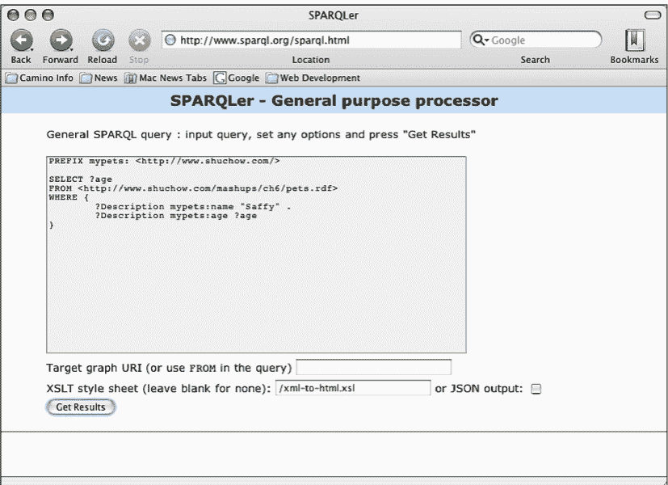

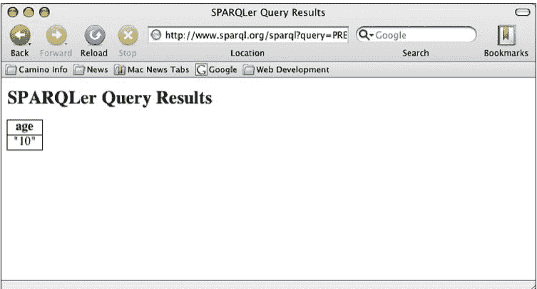

结果将显示 Saffy 的年龄为 10。

第一个三元组找到具有名字（由 mypets:name 元素指定）字面值为 Saffy 的项目。此项目的主题被放入 ?Description 变量中。请注意，在 WHERE 子句中两个三元组的谓语中，命名空间与元素名称一起包含。这是编写 SPARQL 查询时需要记住的另一件重要事情——如果 RDF 文档中的元素名称具有命名空间前缀，您还必须在 SPARQL 查询中包含该前缀，并在一个 PREFIX 语句中声明命名空间。

不仅此第一个子句将焦点锁定在 Saffy 上，而且它还设置了我们搜索的上下文并将其放入 ?Description 变量中。这在 SPARQL 中非常重要，因为每个子句都需要一个主语。得益于此子句，我们可以将 ?Description 用作其他 WHERE 子句的主语。

第二个语句如下所述：

> > “此三元组的主语由 ?Description 引用（我们在第一个三元组中已设置）。我感兴趣的此主语的谓语是 mypets:age。将此三元组的宾语放入名为 ?age 的变量中。”

这样思考查询虽然冗长，但必要。在学习和使用 SPARQL 时，牢记三元组的概念非常重要。很容易退回到 SQL 思维，认为“此子句根据元素为我获取站点名称”。然而，实际情况比这复杂得多。除非在整个查询中定义了主语，否则元素名称毫无用处。

在解析过程中，解析器发现 ?age 在文档中由“10”表示。?age 变量被返回，因为它在 SELECT 语句中指定。

此示例通过使用宠物的名字返回了仅一只宠物。我们可以不对值施加任何限制并返回所有结果。这就像没有 WHERE 子句的 SQL SELECT 查询（SELECT ColumnName FROM TableName）。

```
PREFIX mypets: <http://www.shuchow.com/>
SELECT ?name
FROM <http://www.shuchow.com/mashups/ch6/pets.rdf>
WHERE {
    ?Description mypets:name ?name
}
```

返回 SPARQLer 并输入此查询。此 WHERE 子句将执行并将所有 mypets:name 值放入名为 ?name 的变量中。我们的 SELECT 语句将此变量返回给我们。


你的 SPARQLer 结果集应如下所示：

| name |
|------|
| "Pim Pim" |
| "Saffy" |
| "Manfred" |
| "Lizzie Borden" |
| "Tera-San" |
| "Moose" |
| "Hoser" |
| "Mathilda" |
| "Opal" |
| "Wozniak" |
| "Dolly" |
| "Avi" |
| "Snowball" |

## 查询类型

在第一个查询中，我们使用了名称 `Saffy` 的字面值来查找所需内容。仅在字面值上搜索通常不是可靠的方法。之前我们提到，RDF Schema 词汇允许我们使用 `type` 元素将主体分类为 RDF 资源。下一个示例将展示如何对此元素进行限制。

假设我们希望获取所有鹦鹉的名称。我们的 `WHERE` 子句需要执行以下操作：

- 在 RDF 文档中找到鹦鹉。
- 提取它们的名称。

`type` 元素仍然是谓词。然而，该元素没有我们可以作为三元组对象的数值。相反，`resource` 属性值是此三元组中的对象。`resource` 是一个指向鹦鹉描述的 URI。请记住，三元组对象可以是字面值或 URI。再次说明，这个特定示例 URI 仅用于标识，并非正式的词汇定义，尽管有时可能是。此组合表示“该主体是鹦鹉”。从那里，我们可以像之前一样提取 `name` 元素。

限制要求与我们一直在做的事情类似。与其关联的三元组将使用 URI 而不是像前几个示例中那样使用带引号的字面值。我们可以通过在查询中使用大于/小于号指定 URI 来简单地指定它。

这个三元组就是这样：

```
?Description rdfs:type <http://www.shuchow.com/#parrot>
```

有时，你可能会发现此资源属性以本地锚点开头，即井号 (#) 后跟值，如下所示：

```
<rdfs:type rdf:resource="#value"/>
```

这个井号是对文档本身的引用，就像它在 HTML 锚标签中用于引用同一文档内的位置一样。

单独的 "#value" 对象在 SPARQL 三元组中并不构成完整的 URI。由于井号是冗余引用，我们还必须在三元组中包含查询文件的绝对路径。假设页面位于 http://www.example.com/this.rdf，要搜索这些值，你需要包含返回文档的完整 URI，以及井号后的值：

```
?Subject ns:predicate <http://www.example.com/this.rdf#value>
```

完整的 SPARQL 查询如下所示：

```
PREFIX mypets: <http://www.shuchow.com/>
PREFIX rdfs: <http://www.w3.org/2000/01/rdf-schema#>
PREFIX rdf: <http://www.w3.org/1999/02/22-rdf-syntax-ns#>
SELECT ?name
FROM <http://www.shuchow.com/mashups/ch6/pets.rdf>
WHERE {
    ?Description rdfs:type <http://www.shuchow.com/#parrot> .
    ?Description mypets:name ?name
}
ORDER BY ?name
```

运行查询返回以下结果：

| Name |
|------|
| "Avi" |
| "Dolly" |
| "Hoser" |
| "Moose" |

## 排序、限制和偏移

请注意，在此查询中，我们添加了 ORDER BY 子句。SPARQL 支持一组跟在 WHERE 子句之后的子句，用于组织返回的数据集。除了 ORDER BY，我们还可以使用 LIMIT 和 OFFSET 子句。

ORDER BY 子句的工作方式与 SQL 的 ORDER BY 子句非常相似。此子句按子句后的变量对返回的数据集进行排序。如果结果是字符串，则按字母顺序排序；如果是数字，则按顺序排序。升序和降序选项可分别通过使用 ASC 和 DESC 函数指定。

```
ORDER BY ASC(?name)
ORDER BY DESC(?name)
```

升序和降序子句是可选的。如果省略，默认是升序。

SPARQL 也支持 LIMIT 和 OFFSET 关键字，与 PostgreSQL、MySQL 以及其他关系数据库管理系统类似。LIMIT 和 OFFSET 后面都跟整数。LIMIT 将返回结果的数量限制为传递给它的整数。OFFSET 将返回结果的开始位置移动到该整数的位置，其中第一个返回结果的位置为零。

例如，pets.rdf 的列表中有 13 只动物。如果我们想按字母顺序获取第 7 只和第 8 只宠物，可以将 LIMIT 和 OFFSET 与 ORDER BY 结合使用。

```
PREFIX mypets: <http://www.shuchow.com/>
PREFIX rdfs: <http://www.w3.org/2000/01/rdf-schema#>
PREFIX rdf: <http://www.w3.org/1999/02/22-rdf-syntax-ns#>
SELECT ?name
FROM <http://www.shuchow.com/mashups/ch6/pets.rdf>
WHERE {
  ?Description mypets:name ?name
}
ORDER BY ?name
LIMIT 2
OFFSET 6
```

请注意，当使用 ORDER BY、LIMIT 或 OFFSET 时，顺序很重要。这三个子句必须在 WHERE 子句之后按此顺序出现。例如，这将不起作用：

```
OFFSET 6
ORDER BY ?name
LIMIT 4
```

## UNION 和 DISTINCT

UNION 关键字将多个 WHERE 分组连接在一起，与 SQL 中的 UNION 类似。返回的结果将是 WHERE 分组的组合。要使用 UNION 子句，请将各个分组用大括号括起来。用 UNION 关键字连接它们。将其全部放在常规 WHERE 大括号内。

例如，此查询将检索所有鹦鹉和雄性宠物的名称：

```
PREFIX mypets: <http://www.shuchow.com/>
PREFIX rdfs: <http://www.w3.org/2000/01/rdf-schema#>
PREFIX rdf: <http://www.w3.org/1999/02/22-rdf-syntax-ns#>

SELECT ?name
FROM <http://www.shuchow.com/mashups/ch6/pets.rdf>
WHERE {
  {
    ?Description rdfs:type <http://www.shuchow.com/#parrot>
    ?Description mypets:name ?name
  }
  UNION
  {
    ?Description mypets:gender "M" .
    ?Description mypets:name ?name
  }
}
ORDER BY ?name
```

| Name |
|------|
| "Avi" |
| "Dolly" |
| "Hoser" |
| "Hoser" |
| "Manfred" |
| "Moose" |
| "Moose" |
| "Snowball" |
| "Wozniak" |

这个并集并不能完全给出我们想要的查询。Hoser 和 Moose 这两只雄性鹦鹉同时出现在第一个子句和第二个子句中。SPARQL 支持另一个 SQL 关键字 DISTINCT，它将根据列排除已在之前子句中包含过的行。

只需添加 DISTINCT 关键字以确保唯一性，结果就会反映变化。

```
SELECT DISTINCT ?name
```

| name |
|------|
| "Avi" |
| "Dolly" |
| "Hoser" |
| "Manfred" |
| "Moose" |
| "Snowball" |
| "Wozniak" |

## 更多 SPARQL 功能

我们稍后编写的查询将需要更复杂的处理，但我们讨论过的功能已足以满足我们的 mashup 所需。SPARQL 还有许多更高级的功能，包括：

- 查询多个 RDF 文档（如果解析器支持）。
- 使用特殊运算符和 XPATH 函数的子集过滤返回结果的能力。

完整概述 SPARQL 所有功能的 Working Draft 文档可在 http://www.w3.org/TR/rdf-sparql-query/ 找到。尽管它仍处于 W3C 草案阶段，但许多解析器对该语言提供了很好的支持。在未来的 mashup 中，如果你遇到复杂的 RDF，熟悉 SPARQL 的高级功能以查看是否可行的数据提取方案是很有帮助的。

## RDF API for PHP (RAP)

现在我们对 RDF 和 SPARQL 有了一些了解，我们需要一种在应用程序中实际执行 SPARQL 查询的方法。PHP 没有用于 RDF 的核心函数，但有一个非常强大的第三方库称为 RDF API for PHP (RAP)。RAP 是一个开源项目，可以做你对 RDF 所需的几乎任何事情。RAP 基本上是一组 RDF 模型。每个模型都适合特定目的。

名为 MemModel 的模型是存储在内存中的 RDF 文件。另一个名为 DbModel 的模型用于将 RDF 模型持久化到关系数据库中。每个模型都有适合其目的的特定方法。DbModel 具有自动将模型插入关系数据库和从中检索的方法。

所有模型都继承自名为 Model 的通用抽象类的 方法。这些是适用于所有模型的通用实用方法。例如，所有模型都需要加载 RDF 文件才能对其进行任何操作。load() 方法实现了这一点。所有模型都可以使用 visualize() 方法进行图形化表示，该方法创建 RDF 文件的图形表示。0.94 版本包含一个名为 sparqlQuery() 的方法，它接受 SPARQL 查询并在模型上执行。我们将使用此方法创建 SPARQL 客户端。

项目主页位于 http://sites.wiwiss.fu-berlin.de/suhl/bizer/rdfapi/ 。你可以从那里下载最新版本。文档也可用，且非常详尽。下载代码并解压缩。它将创建一个名为 rdfapi-php 的目录。然后，将 rdfapi-php 放在应用程序结构中的目录中。此目录必须可由 Apache 访问，并且在位置和权限方面。

我们将使用之前几个示例 SPARQL 查询作为 RAP 的示例。在示例代码中，名为 rapExample.php 的文件执行两个 SPARQL 查询。让我们查看此文件，了解使用 RAP 进行 SPARQL 查询所需的步骤。

该文件顶部有一些初步的 PHP 设置代码。

```
define("RDFAPI_INCLUDE_DIR", "Absolute/Path/To/rdfapi-php/api/");
require_once(RDFAPI_INCLUDE_DIR . "RdfAPI.php");

//Create SPARQL Client
$sparqlClient = ModelFactory::getDefaultModel();
$sparqlClient->load('http://www.shuchow.com/mashups/ch6/pets.rdf');
```

我们需要做的第一件事是创建一个名为 RDFAPI_INCLUDE_DIR 的全局变量。其值是你刚刚安装的 rdfapi-php/api 目录的绝对路径。然后我们使用此全局变量包含 RdfAPI.php 文件。这两行对于每次使用 RAP 库都是必需的。

接下来，我们创建一个默认模型对象。默认模型是一个通用模型，所有其他模型都继承自它。它是在调用 getDefaultModel() 的语句中创建的。默认模型对象包含我们需要的基本方法。

最后这一行使用默认模型的 load() 方法加载 RDF 文件。这里，我们加载远程文件，但你也可以将 RDF 文件保存在本地。


请记住，FROM 子句在 SPARQL 查询中不使用。你在此处传递的文件实际上是真正的 RDF 源。能够加载远程文件显然意味着我们可以在所有基于 RDF 的 mashup 上使用此库，并且可以在运行时获取 RDF 数据。

在此之后，我们可以创建查询并执行它。

```
$query = '
PREFIX mypets: <http://www.shuchow.com/>
SELECT ?age
FROM <http://www.shuchow.com/mashups/ch6/pets.rdf>
WHERE {
    ?Description mypets:name "Saffy" .
    ?Description mypets:age ?age
}';

$result = $sparqlClient->sparqlQuery($query);
if ($result != false) {
    foreach ($result as $cat) {
        if ($cat != "") {
            echo "Age: " . $cat['?age']->getLabel();
        }
    }
}
```

在此块中，我们将 SPARQL 查询放入名为 $query 的变量中。我们将其传递给 sparqlQuery 方法。此方法位于默认模型中。它接受一个 SPARQL 查询并在内存中的 RDF 文件上执行它。其返回值是一个对象数组。每个数组中的键是我们添加到查询的 SELECT 子句中的变量，包括问号。这些是 RAP 库中的 Resources 对象。Resources 对象中的 getLabel() 方法返回变量的值。

要获取多个变量，我们只需在 foreach 循环中使用其他键。

```
$query = '
PREFIX mypets: <http://www.shuchow.com/>
SELECT ?name ?age
FROM <http://www.shuchow.com/mashups/ch6/pets.rdf>
WHERE {
    ?Description mypets:name ?name
    ?Description mypets:age ?age
}
LIMIT 5
';
```

$result = $sparqlClient->sparqlQuery($query);

if ($result != false) {
    foreach ($result as $cat) {
        if ($cat != "") {
            echo "Name: " . $cat['?name']->getLabel() . ", Age: " .
                $cat['?age']->getLabel() . "<br />";
        }
    }
}
```

运行此代码会在屏幕上产生以下输出：

```
Name: Snowball, Age: 14
Name: Lizzie Borden, Age: 14
Name: Saffy, Age: 10
Name: Pim Pim, Age: 12
Name: Tera-San, Age: 6
```

RAP 是一个相当强大的工具。我们只使用了其功能的一小部分。如果 RDF 是你应用程序的重要组成部分，那么探索这个庞大的库绝对是值得的。

## XMLHttpRequest 对象

我们接下来要查看的技术与我们使用过的面向服务器的工具不同。你可能听说过 AJAX，即异步 JavaScript 和 XML 传输。至少，你可能在 Google Mail 和 Yahoo! Mail 等网站上见过它。AJAX 允许 Web 浏览器在不刷新页面的情况下与服务器交互。与动态 HTML 结合，它在用户和网站之间创造了新的交互水平。在用户面前几乎瞬时的[content]
请记住，FROM 子句在 SPARQL 查询中不使用。你在此处传递的文件实际上是真正的 RDF 源。能够加载远程文件显然意味着我们可以在所有基于 RDF 的 mashup 上使用此库，并且可以在运行时获取 RDF 数据。

在此之后，我们可以创建查询并执行它。

```
$query = '
PREFIX mypets: <http://www.shuchow.com/>
SELECT ?age
FROM <http://www.shuchow.com/mashups/ch6/pets.rdf>
WHERE {
    ?Description mypets:name "Saffy" .
    ?Description mypets:age ?age
}';

$result = $sparqlClient->sparqlQuery($query);
if ($result != false) {
    foreach ($result as $cat) {
        if ($cat != "") {
            echo "Age: " . $cat['?age']->getLabel();
        }
    }
}
```

在此块中，我们将 SPARQL 查询放入名为 $query 的变量中。我们将其传递给 sparqlQuery 方法。此方法位于默认模型中。它接受一个 SPARQL 查询并在内存中的 RDF 文件上执行它。其返回值是一个对象数组。每个数组中的键是我们添加到查询的 SELECT 子句中的变量，包括问号。这些是 RAP 库中的 Resources 对象。Resources 对象中的 getLabel() 方法返回变量的值。

要获取多个变量，我们只需在 foreach 循环中使用其他键。

```
$query = '
PREFIX mypets: <http://www.shuchow.com/>
SELECT ?name ?age
FROM <http://www.shuchow.com/mashups/ch6/pets.rdf>
WHERE {
    ?Description mypets:name ?name
    ?Description mypets:age ?age
}
LIMIT 5
';
```

$result = $sparqlClient->sparqlQuery($query);

if ($result != false) {
    foreach ($result as $cat) {
        if ($cat != "") {
            echo "Name: " . $cat['?name']->getLabel() . ", Age: " .
                $cat['?age']->getLabel() . "<br />";
        }
    }
}
```

运行此代码会在屏幕上产生以下输出：

```
Name: Snowball, Age: 14
Name: Lizzie Borden, Age: 14
Name: Saffy, Age: 10
Name: Pim Pim, Age: 12
Name: Tera-San, Age: 6
```

RAP 是一个相当强大的工具。我们只使用了其功能的一小部分。如果 RDF 是你应用程序的重要组成部分，那么探索这个庞大的库绝对是值得的。

## XMLHttpRequest 对象

我们接下来要查看的技术与我们使用过的面向服务器的工具不同。你可能听说过 AJAX，即异步 JavaScript 和 XML 传输。至少，你可能在 Google Mail 和 Yahoo! Mail 等网站上见过它。AJAX 允许 Web 浏览器在不刷新页面的情况下与服务器交互。与动态 HTML 结合，它在用户和网站之间创造了新的交互水平。在用户面前几乎瞬时的[content]
请记住，FROM 子句在 SPARQL 查询中不使用。你在此处传递的文件实际上是真正的 RDF 源。能够加载远程文件显然意味着我们可以在所有基于 RDF 的 mashup 上使用此库，并且可以在运行时获取 RDF 数据。

在此之后，我们可以创建查询并执行它。

```
$query = '
PREFIX mypets: <http://www.shuchow.com/>
SELECT ?age
FROM <http://www.shuchow.com/mashups/ch6/pets.rdf>
WHERE {
    ?Description mypets:name "Saffy" .
    ?Description mypets:age ?age
}';

$result = $sparqlClient->sparqlQuery($query);
if ($result != false) {
    foreach ($result as $cat) {
        if ($cat != "") {
            echo "Age: " . $cat['?age']->getLabel();
        }
    }
}
```

在此块中，我们将 SPARQL 查询放入名为 $query 的变量中。我们将其传递给 sparqlQuery 方法。此方法位于默认模型中。它接受一个 SPARQL 查询并在内存中的 RDF 文件上执行它。其返回值是一个对象数组。每个数组中的键是我们添加到查询的 SELECT 子句中的变量，包括问号。这些是 RAP 库中的 Resources 对象。Resources 对象中的 getLabel() 方法返回变量的值。

要获取多个变量，我们只需在 foreach 循环中使用其他键。

```
$query = '
PREFIX mypets: <http://www.shuchow.com/>
SELECT ?name ?age
FROM <http://www.shuchow.com/mashups/ch6/pets.rdf>
WHERE {
    ?Description mypets:name ?name
    ?Description mypets:age ?age
}
LIMIT 5
';
```

$result = $sparqlClient->sparqlQuery($query);

if ($result != false) {
    foreach ($result as $cat) {
        if ($cat != "") {
            echo "Name: " . $cat['?name']->getLabel() . ", Age: " .
                $cat['?age']->getLabel() . "<br />";
        }
    }
}
```

运行此代码会在屏幕上产生以下输出：

```
Name: Snowball, Age: 14
Name: Lizzie Borden, Age: 14
Name: Saffy, Age: 10
Name: Pim Pim, Age: 12
Name: Tera-San, Age: 6
```

RAP 是一个相当强大的工具。我们只使用了其功能的一小部分。如果 RDF 是你应用程序的重要组成部分，那么探索这个庞大的库绝对是值得的。

## XMLHttpRequest 对象

我们接下来要查看的技术与我们使用过的面向服务器的工具不同。你可能听说过 AJAX，即异步 JavaScript 和 XML 传输。至少，你可能在 Google Mail 和 Yahoo! Mail 等网站上见过它。AJAX 允许 Web 浏览器在不刷新页面的情况下与服务器交互。与动态 HTML 结合，它在用户和网站之间创造了新的交互水平。在用户面前几乎瞬时的[content]
请记住，FROM 子句在 SPARQL 查询中不使用。你在此处传递的文件实际上是真正的 RDF 源。能够加载远程文件显然意味着我们可以在所有基于 RDF 的 mashup 上使用此库，并且可以在运行时获取 RDF 数据。

在此之后，我们可以创建查询并执行它。

```
$query = '
PREFIX mypets: <http://www.shuchow.com/>
SELECT ?age
FROM <http://www.shuchow.com/mashups/ch6/pets.rdf>
WHERE {
    ?Description mypets:name "Saffy" .
    ?Description mypets:age ?age
}';

$result = $sparqlClient->sparqlQuery($query);
if ($result != false) {
    foreach ($result as $cat) {
        if ($cat != "") {
            echo "Age: " . $cat['?age']->getLabel();
        }
    }
}
```

在此块中，我们将 SPARQL 查询放入名为 $query 的变量中。我们将其传递给 sparqlQuery 方法。此方法位于默认模型中。它接受一个 SPARQL 查询并在内存中的 RDF 文件上执行它。其返回值是一个对象数组。每个数组中的键是我们添加到查询的 SELECT 子句中的变量，包括问号。这些是 RAP 库中的 Resources 对象。Resources 对象中的 getLabel() 方法返回变量的值。

要获取多个变量，我们只需在 foreach 循环中使用其他键。

```
$query = '
PREFIX mypets: <http://www.shuchow.com/>
SELECT ?name ?age
FROM <http://www.shuchow.com/mashups/ch6/pets.rdf>
WHERE {
    ?Description mypets:name ?name
    ?Description mypets:age ?age
}
LIMIT 5
';
```

$result = $sparqlClient->sparqlQuery($query);

if ($result != false) {
    foreach ($result as $cat) {
        if ($cat != "") {
            echo "Name: " . $cat['?name']->getLabel() . ", Age: " .
                $cat['?age']->getLabel() . "<br />";
        }
    }
}
```

运行此代码会在屏幕上产生以下输出：

```
Name: Snowball, Age: 14
Name: Lizzie Borden, Age: 14
Name: Saffy, Age: 10
Name: Pim Pim, Age: 12
Name: Tera-San, Age: 6
```

RAP 是一个相当强大的工具。我们只使用了其功能的一小部分。如果 RDF 是你应用程序的重要组成部分，那么探索这个庞大的库绝对是值得的。

## XMLHttpRequest 对象

我们接下来要查看的技术与我们使用过的面向服务器的工具不同。你可能听说过 AJAX，即异步 JavaScript 和 XML 传输。至少，你可能在 Google Mail 和 Yahoo! Mail 等网站上见过它。AJAX 允许 Web 浏览器在不刷新页面的情况下与服务器交互。与动态 HTML 结合，它在用户和网站之间创造了新的交互水平。在用户面前几乎瞬时的[content]
请记住，FROM 子句在 SPARQL 查询中不使用。你在此处传递的文件实际上是真正的 RDF 源。能够加载远程文件显然意味着我们可以在所有基于 RDF 的 mashup 上使用此库，并且可以在运行时获取 RDF 数据。

在此之后，我们可以创建查询并执行它。

```
$query = '
PREFIX mypets: <http://www.shuchow.com/>
SELECT ?age
FROM <http://www.shuchow.com/mashups/ch6/pets.rdf>
WHERE {
    ?Description mypets:name "Saffy" .
    ?Description mypets:age ?age
}';

$result = $sparqlClient->sparqlQuery($query);
if ($result != false) {
    foreach ($result as $cat) {
        if ($cat != "") {
            echo "Age: " . $cat['?age']->getLabel();
        }
    }
}
```

在此块中，我们将 SPARQL 查询放入名为 $query 的变量中。我们将其传递给 sparqlQuery 方法。此方法位于默认模型中。它接受一个 SPARQL 查询并在内存中的 RDF 文件上执行它。其返回值是一个对象数组。每个数组中的键是我们添加到查询的 SELECT 子句中的变量，包括问号。这些是 RAP 库中的 Resources 对象。Resources 对象中的 getLabel() 方法返回变量的值。

要获取多个变量，我们只需在 foreach 循环中使用其他键。

```
$query = '
PREFIX mypets: <http://www.shuchow.com/>
SELECT ?name ?age
FROM <http://www.shuchow.com/mashups/ch6/pets.rdf>
WHERE {
    ?Description mypets:name ?name
    ?Description mypets:age ?age
}
LIMIT 5
';
```

$result = $sparqlClient->sparqlQuery($query);

if ($result != false) {
    foreach ($result as $cat) {
        if ($cat != "") {
            echo "Name: " . $cat['?name']->getLabel() . ", Age: " .
                $cat['?age']->getLabel() . "<br />";
        }
    }
}
```

运行此代码会在屏幕上产生以下输出：

```
Name: Snowball, Age: 14
Name: Lizzie Borden, Age: 14
Name: Saffy, Age: 10
Name: Pim Pim, Age: 12
Name: Tera-San, Age: 6
```

RAP 是一个相当强大的工具。我们只使用了其功能的一小部分。如果 RDF 是你应用程序的重要组成部分，那么探索这个庞大的库绝对是值得的。

## XMLHttpRequest 对象

我们接下来要查看的技术与我们使用过的面向服务器的工具不同。你可能听说过 AJAX，即异步 JavaScript 和 XML 传输。至少，你可能在 Google Mail 和 Yahoo! Mail 等网站上见过它。AJAX 允许 Web 浏览器在不刷新页面的情况下与服务器交互。与动态 HTML 结合，它在用户和网站之间创造了新的交互水平。在用户面前几乎瞬时的[content]
请记住，FROM 子句在 SPARQL 查询中不使用。你在此处传递的文件实际上是真正的 RDF 源。能够加载远程文件显然意味着我们可以在所有基于 RDF 的 mashup 上使用此库，并且可以在运行时获取 RDF 数据。

在此之后，我们可以创建查询并执行它。

```
$query = '
PREFIX mypets: <http://www.shuchow.com/>
SELECT ?age
FROM <http://www.shuchow.com/mashups/ch6/pets.rdf>
WHERE {
    ?Description mypets:name "Saffy" .
    ?Description mypets:age ?age
}';

$result = $sparqlClient->sparqlQuery($query);
if ($result != false) {
    foreach ($result as $cat) {
        if ($cat != "") {
            echo "Age: " . $cat['?age']->getLabel();
        }
    }
}
```

在此块中，我们将 SPARQL 查询放入名为 $query 的变量中。我们将其传递给 sparqlQuery 方法。此方法位于默认模型中。它接受一个 SPARQL 查询并在内存中的 RDF 文件上执行它。其返回值是一个对象数组。每个数组中的键是我们添加到查询的 SELECT 子句中的变量，包括问号。这些是 RAP 库中的 Resources 对象。Resources 对象中的 getLabel() 方法返回变量的值。

要获取多个变量，我们只需在 foreach 循环中使用其他键。

```
$query = '
PREFIX mypets: <http://www.shuchow.com/>
SELECT ?name ?age
FROM <http://www.shuchow.com/mashups/ch6/pets.rdf>
WHERE {
    ?Description mypets:name ?name
    ?Description mypets:age ?age
}
LIMIT 5
';
```

$result = $sparqlClient->sparqlQuery($query);

if ($result != false) {
    foreach ($result as $cat) {
        if ($cat != "") {
            echo "Name: " . $cat['?name']->getLabel() . ", Age: " .
                $cat['?age']->getLabel() . "<br />";
        }
    }
}
```

运行此代码会在屏幕上产生以下输出：

```
Name: Snowball, Age: 14
Name: Lizzie Borden, Age: 14
Name: Saffy, Age: 10
Name: Pim Pim, Age: 12
Name: Tera-San, Age: 6
```

RAP 是一个相当强大的工具。我们只使用了其功能的一小部分。如果 RDF 是你应用程序的重要组成部分，那么探索这个庞大的库绝对是值得的。

## XMLHttpRequest 对象

我们接下来要查看的技术与我们使用过的面向服务器的工具不同。你可能听说过 AJAX，即异步 JavaScript 和 XML 传输。至少，你可能在 Google Mail 和 Yahoo! Mail 等网站上见过它。AJAX 允许 Web 浏览器在不刷新页面的情况下与服务器交互。与动态 HTML 结合，它在用户和网站之间创造了新的交互水平。在用户面前数据几乎瞬时变化，使 Web 应用程序从未像桌面应用程序那样。

AJAX 的另一个好处是它可以大幅减少 Web 浏览器和 Web 服务器之间的流量。当我们查看传递给 Google Maps 的数据量时，我们就会明白为什么持续刷新会使应用程序变得太慢。

当我们讨论 AJAX 和 XMLHttpRequest 时，我们将构建一个非常简单的 Web 应用程序。该应用程序将从用户获取输入，将其传递给服务器，服务器将 XML 文档发送回浏览器，并使用 JavaScript 动态更改页面。该应用程序的客户端组件在示例代码中为 ajaxTest.html，对应的服务器组件名为 ajaxResponse.php。

不带 JavaScript 代码的 HTML 页面非常基础。

```
<html>
<head>
<script type="text/javascript" language="JavaScript">
...
</script>
</head>
<body>
<form name="theForm" action="#">
    <input type="text" name="inputField" size="10" />
    <input type="button" value="Click Me" />
</form>
<h1>Server Response Area</h1>
<span id="ServerResponse">Nothing yet</span>
</body>
</html>
```

此页面只是一个表单，其下方有一个段落，将使用 JavaScript 更新。

ajaxResponse.php 也同样简单。此脚本将接收名为 field 的查询参数，并将其作为非常简单的 XML 文档传回请求者。

```
<?php
    header("Content-type: text/xml; charset=UTF-8");
?>
<?= '<?xml version="1.0" encoding="utf-8" ?>' ?>
<response>
    <textField>You've entered: <?= htmlentities($_GET['field'])?>
    </textField>
</response>
```

这里的关键是页面将使用名为 field 的查询参数。

### XMLHttpRequest Object Overview

XMLHttpRequest 对象是 AJAX 的核心。这是内置于所有现代 Web 浏览器（5.0 及以上版本）中用于控制 HTTP 请求的对象。此对象类似于内置于 Web 浏览器的其他对象，例如用于控制所有表单元素的 form 对象，或用于控制 Web 浏览器窗口的 window 对象。AJAX 的本质实际上是使用 XMLHttpRequest 在页面加载后由某个 JavaScript 事件触发向服务器发出 HTTP 请求的技术。服务器返回一些数据，XMLHttpRequest 对象将服务器响应传递给页面上的某个 JavaScript 函数。再次使用 JavaScript，页面样式表信息和 Web 浏览器文档对象模型（DOM）会动态更改。让我们逐步了解一个简单的 XMLHttpRequest 的生命周期。

### Using the Object

生命周期由 JavaScript 事件启动。这可以是应用程序所需的任何内容——鼠标悬停、页面加载、按钮点击等。一旦触发，发生的步骤如下：

- 1. 创建 XMLHttpRequest 对象。
- 2. 定义我们将要发出的 HTTP 请求的目标服务器信息（URL、路径、端口等）。
- 3. 就像我们之前使用的 Web 服务一样，我们需要定义要在 HTTP 请求中发送的内容。这可能只是一个空字符串。
- 4. 指定回调函数并构建它。
- 5. 使用对象的 send() 方法发送请求。
- 6. 在回调中捕获服务器响应并使用它来更改页面。

### Creating the Object

创建 XMLHttpRequest 对象有两种方法，具体取决于访客使用的浏览器。如果用户使用的是 Mozilla 浏览器（Firefox、Camino）、Safari 或 Opera，我们只需创建一个新的 XMLHttpRequest() 来创建对象。如果他们使用的是 Internet Explorer 6，我们需要使用 ActiveX 创建一个 Microsoft.XMLHTTP 对象，它是 XMLHttpRequest 的克隆。使用这两种方法将返回的对象放入全局 JavaScript 变量中。我们可以使用 JavaScript 检测 XMLHttpRequest 对象或 Active X 的存在，以确定应使用哪种方法。

```
g_xmlHttp = null;
function createXMLHttpRequest() {
    if (window.XMLHttpRequest) {
        g_xmlHttp = new XMLHttpRequest()
    }
    else if (window.ActiveXObject) {
        g_xmlHttp = new ActiveXObject("Microsoft.XMLHTTP");
    }
}
```

此函数应在请求开始时调用。

### Making the HTTP Request

我们的 HTTP 请求的开始应该在用户执行某些操作之后。我们将在用户在文本字段上释放键时触发请求。也就是说，当用户按下键时，Web 应用程序将调用我们的 JavaScript 函数与服务器通信。

```
<input type="text" name="inputField" size="10" onkeyup="sendRequest()" />
```

此处的函数名为 sendRequest()。现在我们需要编写此函数。此函数将创建 XMLHttpRequest 对象，定义服务器参数，定义在捕获服务器响应时执行的回调函数，然后实际发送请求。

```
function sendRequest() {
    createXMLHttpRequest();
    var url = "/mashups/ch6/examples/ajaxResponse.php?field=" +
        document.theForm.inputField.value;
    g_xmlHttp.onreadystatechange = parseResponse;
    g_xmlHttp.open("GET", url, true);
    g_xmlHttp.send(null);
}
```

此函数中的第一条语句调用 createXMLHttpRequest()，它创建 XMLHttpRequest 对象并将其放入全局变量 g_xmlHttp 中。第二行将服务的 URL 放入变量中。这是服务的虚拟 URL。你也可以使用服务的绝对 URL，但我们稍后会讨论为什么绝对 URL 是不必要的。此语句的最后一部分将我们输入文本框的值放入名为 field 的查询参数中，这正是我们的服务所等待的。


The next three statements use XMLHttpRequest methods and properties. onreadystatechange is a property that holds the JavaScript callback function for this object. Set this to the name of the function, without opening and closing parentheses, that will be executed when the server responds. You can only select one callback function. To execute more, you will need to create a facade wrapper function that executes the others, and set the facade function as the callback.

open gets the object ready to send the request. The first two parameters are required. The first parameter is the HTTP method to use. The second is the URL. The third parameter is whether the object should be in asynchronous mode. It is optional, but it is a good idea to set this to true because the default value is false, and we do want to be in asynchronous mode. Otherwise, we would be in synchronous mode, which means that the rest of the JavaScript does not execute until XMLHttpRequest receives a response from the server.

send actually sends the request. send takes one required parameter, the body of the request. In this example, we are sending a null because we are just doing a GET request. The request does not have a body. If we were doing a POST, we would construct the parameters in a separate string and pass it as send's parameter. After send is called, the HTTP request is made and the callback function executes.

## Creating and Using the Callback

There are two main jobs of the callback function. The first is to capture the server response. The second is to do something with that response.

We start off our function with a couple of checks to make sure the data from the server has indeed arrived. If we didn't do this, the rest of our code will execute prematurely and without all the necessary parts from the server response.

The first if statement checks the readyState property of the XMLHttpRequest object. As the request executes and processes, this value gets changed. There are five possible values of this property:

| readyState value | Meaning |
|---|---|
| 0 | Uninitialized |
| 1 | Loading |
| 2 | Loaded |
| 3 | Interactive |
| 4 | Completed |

Only when the value is 4 is the data completely ready to be parsed and used by the web application.

The second if statement checks to see XMLHttpRequest's status property. This is the same code that reports 404 for missing file, 500 for internal server error, etc. A 200 is a successful transaction. We need to make sure the request is executed successfully, or the data might be useless.

```
function parseResponse() {
    if (g_xmlHttp.readyState == 4) {
        if (g_xmlHttp.status == 200) {
            var response = g_xmlHttp.responseXML;
            var outputArea = document.getElementById("ServerResponse").
                firstChild;
            var responseElements =
                response.getElementsByTagName("textField");
            outputArea.nodeValue =
                responseElements[0].firstChild.nodeValue;
        }
    }
}
```

The first line after the nested if statement captures the value in the responseXML property of the XMLHttpRequest object and places it in a variable. This property is where the browser keeps the response from the server. If you were to inspect it, you would see the direct XML from the server.

The second statement captures the node of the HTML page of where we are going to output the response. We use JavaScript's getElementById() function and traverse down the DOM.

We can use the same DOM functions in JavaScript to extract the information from the server response. This is what we do in the third statement. We know what we are interested in is located in the textField element of the response. We zero in on that and get that node.

Each DOM element keeps the text it displays in a property called nodeValue. In the fourth statement, we set the output area's nodeValue to the nodeValue of the response. This changes the webpage every time it is executed.

If you type in the text field of `ajaxTest.php`, you can see this code in action.

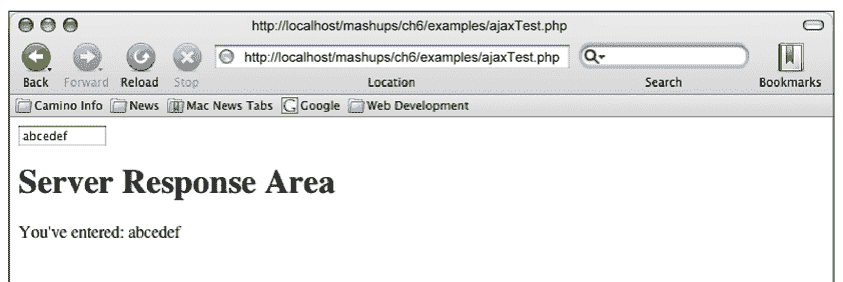

> In our code, we checked for an HTTP status of 200. While this is good practice, it requires the HTTP network protocol to be present in order to work. This means you must load the page in a web browser through HTTP. If you load the page through the file system (i.e. through `file:///ajaxTest.php`, instead of `http://localhost/.../ajaxTest.php`), status check will fail, and the code will not execute properly.

This is the standard way of triggering an AJAX application, and it works very nicely. The DOM parsing, however, can get messy. There are two DOMs you must parse—the local web page and the server response. Fortunately, you may have some alternatives to parsing the server response.

First off, `responseXML` has a sister property, `responseText`, that works exactly the same way. `responseText` holds the server response if it is any text string instead of XML. You can immediately use the response text instead of traversing through a DOM to get what you want. If you are merely a front-end developer for a much larger web development, and the company manifesto is to transfer everything via XML, this might not be an available option for you. Or, if your web service is used by third parties, it may be best to keep it as XML. However, if you are writing a very simple service to support just your application, know that you do not have to structure everything in XML. You can just pass a simple text string back and use `responseText` on the client end instead.

If your web service response is too complicated for a simple text string, you may want to consider formatting your text response in JavaScript Object Notation (JSON) to send this result back to the page. It will still be a text response, so you can use `responseText` and skip the parsing. JSON gives you the structure of XML with the simplicity of a text string. This next section will introduce us to JSON.

## Debugging AJAX


Debugging the request and response from the server can be tricky. We can't use a regular IDE. We need something to watch the HTTP streams. Luckily, if you are using Firefox, there is a Greasemonkey script that will do just that. Greasemonkey is a Firefox extension that allows users to write their own JavaScript and code against a site when they visit it. It can be found at https://addons.mozilla.org/firefox/748/. Once you have that installed, download the XMLHttpRequest debugging tip at http://blog.monstuff.com/archives/000250.html. This tool will watch everything that comes out from the browser, and everything going in. Other helpful extensions for Firefox include LiveHTTPHeaders, which show the request and response HTTP headers, and Firebug, a general JavaScript and CSS debugger. For Internet Explorer, a commercial tool called HTTPWatch is available to watch HTTP requests.

## JavaScript Object Notation (JSON)

JavaScript Object Notation is simply a transfer format, much like SOAP or XML-RPC. Unlike those two formats, JSON is not XML based. It is JavaScript code that is loosely based on a C-style definitions and formats. Although called JavaScript Object Notation, many server side languages have built parsers to interpret JSON format. Given this and its lightweight nature, it has become a popular alternative to XML when communicating between a web browser and a client. JSON's home page is at http://www.json.org.

## JavaScript Objects Review

Let's quickly review JavaScript objects first. To define a class in JavaScript, you simply treat it as if it was a function. To give the class properties, use the keyword this, followed by a dot, followed by the name of the property. To give the class methods, also use this, followed by a dot, the name of the function, an equal sign, the keyword function and then the function definition. For example, this could be a cat object in JavaScript:

```
function Cat (name) {
    this.name = name;
    this.gender;
    this.age;
    this.eat = function() {
        alert("Yum");
    }
    this.sleep = function() {
```


```
alert("zzzz...");
}
```

这个类定义需要一个名称作为构造函数，因为它是类定义中唯一必需的参数。猫可以像这样实例化：

```
aCat = new Cat("Quincy");
anotherCat = new Cat("Buddy");
```

JavaScript 对象非常基础。没有访问器关键字。一切都是公开的。你可以通过在对象上使用点符号简单地访问或设置属性。

```
aCat.gender = "F"; //Quincy is now a female
anotherCat.name = "Gilbert";  //Buddy just got a name change.
```

注意我们用来访问对象属性的点符号。我们在访问 JSON 属性时使用相同的点符号。

## JSON 结构

为了界定对象定义，对象名称后跟等号。对象的属性随后用大括号括起来。JSON 属性是以冒号分隔的名称/值对。

JSON 属性支持以下数据类型：

| 类型 | 格式 | 示例 |
|---|---|---|
| 数字 | 整数、浮点数或实数。实际的数字。 | 1, 2.8217 |
| 字符串 | 双引号值。 | "A Value", "Another Value" |
| 布尔值 | 真/假，无引号。 | true, false |
| 数组 | 方括号分隔的列表。 | [34, 498, 12] |
| 对象 | 大括号。 | { property one: value one } |
| 空值 | 空值。 | Null |

上面的 JavaScript 猫结构可以用 JSON 表示并扩展如下：

```
var cat = {
    name: "Quincy",
    gender: "F",
    age: 4,
    spayed: true,
    collar: {
        charm: "bell",
        color:  "green"
    }
}
```

如果用 XML 表示这只猫，会更繁琐，并且肯定会占用更多字节：

```
<cat>
    <name>Quincy</name>
    <gender>F</gender>
    <age>4</age>
    <spayed>true</spayed>
    <collar>
        <charm>bell</charm>
        <color>green</color>
    </collar>
</cat>
```

## 访问 JSON 属性

在上面的示例中，猫的属性可以通过以 cat 为父对象的点符号轻松访问。她的名字通过使用变量 cat.name 找到，她的年龄在 cat.age，等等。示例文件 jsonExample.html 展示了如何使用点符号访问响应中 JSON 对象的属性。你只需以对象的名称作为点符号层级进一步向下钻取。代码使用变量 cat.collar.color 显示 Quincy 的项圈颜色。

```
function getColor() {
    alert("Quincy's Collar Color: " + cat.collar.color);
}
```

JavaScript 是一种无类型语言（意味着你不必指定变量的数据类型），因此我们可以通过点符号直接使用属性。唯一可能需要转换或修改步骤的是 JSON 数组。例如，让我们在上面的示例中插入一个毛色数组。

```
age: 4,
furcolor: ["white", "orange"],
spayed: true,
```

`furcolor` 仍然可以通过点符号访问，但会有一些变化。如果直接访问数组，你会得到一个用逗号分隔的数组元素字符串。`cat.furcolor` 将为 "white, orange"。要访问单个元素，请像使用普通 JavaScript 数组一样在数组名称后附加方括号中的元素编号。`cat.furcolor[0]` 的值为 "white"。`cat.furcolor[1]` 的值为 "orange"。你还可以通过在点符号中在数组名称后访问 `.length` 来检查数组的长度。`cat.furcolor.length` 的值为 2。

## 序列化 JSON 响应

如示例所示，cat 已经是一个序列化的 JavaScript 对象。紧接着属性的大括号表明了这一点。这意味着我们可以通过点符号直接处理数据。

不过，很频繁地，你会收到 JSON 对象的字符串表示形式。一种这种情况是如果 JSON 对象存储在 `XMLHttpRequest` 对象的 `responseText` 属性中。当然，从结构上看对象是 JSON。然而，数据被转换为字符串。

要将 JSON 字符串转换为 JavaScript 对象，请将其通过 JavaScript `eval()` 方法。

```javascript
var cat = '{"name": "Quincy", "gender": "F", "age": 4, "spayed": true, "color": ["white", "orange"], "collar": { "charm": "bell", "color": "green" }}';
var quincyObj = eval('(' + cat + ')');

function getColor() {
  alert('Quincy\'s Collar Color: ' + quincyObj.collar.color);
}
```

`eval()` 方法会执行传递给它的任何内容。由于我们传递的是格式化为对象的东西，它将返回一个对象。这个反序列化到序列化的示例位于名为 `jsonTest.html` 的文件中。

请注意，在调用 `eval()` 时，我们必须用字面字符串括号将字符串括起来。这是因为虽然代码看起来像 JavaScript 对象，但 `eval()` 将字符串中的开大括号视为通用块的开始，而不是对象的开始。将它放在括号内会使解析器进入表达式解析模式，从而正确地将其解析为 JavaScript 对象。


> **eval() 时请小心**
> 使用 eval() 时要小心。它会盲目执行传递给它的任何代码，因此请确保你完全信任输入的来源。

最后，我们来到了我们的 API。我们只需要查看两个——Google Maps API 和 Flickr Web Services。

## Google 地图 API

Google Maps API 允许第三方开发者在其自己的网站上使用 Google Maps 的功能。作为 Google Maps 用户可以做的任何事情，都可以使用 Google Maps API 实现。Google Maps 文档主页位于 http://www.google.com/apis/maps/documentation/。文档相当详尽。我们将看看 API 基本是如何工作的，并集中于我们在 mashup 中将使用的功能。了解 API 如何组织是搜索信息并在未来项目中使用 Google Maps API 的关键步骤。

Google Maps API 需要一个 API 密钥。你可以在 http://www.google.com/apis/maps/signup.html 免费注册。此密钥在页面中包含 Google Maps API 时使用。在对 Google Maps 做任何事情之前，你需要获取此 API 密钥并将其源标签放在页面 head 标签的顶部。

```
<script src="http://maps.google.com/maps?file=api&amp;v=2&amp;key=Your Google API Key" type="text/javascript"></script>
```

该 API 是一个基于对象的 JavaScript API。中心对象是你看到的 Google 地图。Google Maps 上看到的一切，包括地图控件、图标、线条和白色信息窗口框，都只是添加到地图上的 JavaScript 对象。随着我们在本节中逐步介绍示例，我们将构建与示例中名为 googleMapTest.php 的页面相同的页面。

## 创建地图

地图是通过实例化 GMap2 类创建的。GMap2 构造函数的唯一必需参数是放置地图的 HTML 容器。通常，这是一个空的 div 标签。Google 地图将显示在此标签占用的空间中。这使得容器非常重要。你可以使用 CSS 在页面上定位地图，并且容器的大小决定了地图的大小。

让我们看一个简单的示例：

```
<html>
<head>
<title>Google Maps Scratch</title>
<script src="http://maps.google.com/maps?file=api&amp;v=2&amp;key=YOUR_GOOGLE_API_KEY" type="text/javascript"></script>
<script type="text/javascript">
var g_map;

function load() {
    if (GBrowserIsCompatible()) {
        g_map = new GMap2(document.getElementById("map"));
    }
}
</script>
</head>
<body onload="load()">
<div id="map" style="width: 800px; height: 600px"></div>
</body>
</html>
```

此简单页面将创建 Google 地图。我们声明一个名为 g_map 的全局变量来保存 Google 地图。load 函数在 onload 事件触发时运行。在 load 函数中，调用 Google JavaScript 函数 GBrowserIsCompatible 来检查浏览器兼容性。如果通过，我们通过实例化 GMap2 创建地图。我们使用 JavaScript DOM 函数 getElementById 将容器传递给 GMap2 构造函数。由于 div 元素的大小为 800 x 600 像素，此地图也将为 800 x 600 像素。

如果你实际运行此代码，你会发现它几乎没用。你只会得到一个空白的灰色地图。问题是地图不知道最初如何居中。你必须通过使用地图的 setCenter() 方法来指定这一点。setCenter() 实际上可以在任何时候调用，并且可以由任何事件触发。它接受 GLatLng 对象作为其参数。

## 地理编码

在使用 Google Maps 时，你会发现它在地图上执行任何操作时都严重依赖于经纬度坐标。问题是，在日常交流中，我们使用地址的频率比经纬度坐标更频繁。从地址翻译为经纬度坐标的过程称为地理编码。为了让使用 Google Maps 更容易，API 提供了名为 GClientGeocoder 的对象来为我们进行地理编码。


创建地理编码器时，首先实例化 GClientGeocoder 对象。该对象有一个名为 getLatLng() 的方法，它接受两个参数。第一个参数是你想要查询的地址字符串。第二个是服务器返回结果后会被调用的回调函数。

Google 的服务器会向回调函数传递一个 GLatLng 对象。GLatLng 对象仅以属性的形式保存纬度和经度坐标。如果需要创建 GLatLng 对象，必须传递两个参数——纬度和经度。可以通过使用该对象的 lat() 和 long() 方法再次访问这些属性。

使用 getLatLng() 的一个小不便之处是，该方法实际上不会向调用者返回 GLatLng 对象。然而，由于它会传递给回调函数，因此你必须创建一个回调函数才能使用地理编码结果。回到我们的代码，我们可以对 JavaScript 做一个小修改，使其以地址为中心。

```
<script type="text/javascript">
    var g_map;
    function load() {
        if (GBrowserIsCompatible()) {
            var geocoder = new GClientGeocoder();
            g_map = new GMap2(document.getElementById("map"));
            geocoder.getLatLng(
                "780 Arastradero Road, Palo Alto, CA 94306 USA",
                centerMapCallback);
        }
    }
    function centerMapCallback(returnedPoint) {
        g_map.setCenter(returnedPoint, 14);
    }
</script>
```

在此修改后的脚本中，我们在 load 函数中创建了一个 GClientGeocoder。我们像之前一样创建地图。之后，我们调用 getLatLng()，传入一个地址和回调函数 centerMapCallback。

在 centerMapCallback() 中，我们在参数中捕获 GLatLng 对象并将其传递给地图的 setCenter() 方法以进行实际居中。第二个参数，其值为 14，是缩放级别。当 API 需要缩放级别时，你可以提供 0 到 17 之间的整数。数字越大，缩放越近。

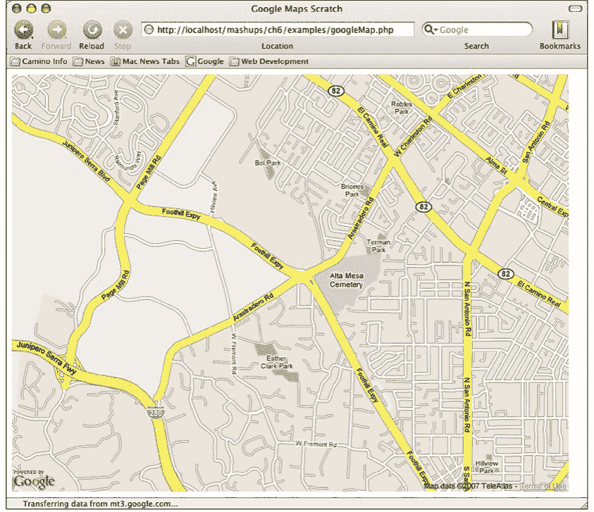

在这个 mashup 中我们不会进行任何地理编码，但你仍应熟悉 GClientGeocoder。我们将大量使用 GLatLng。这两个对象对 Google Maps API 非常重要。你会发现 mashup 通常都需要这两个对象。

## 标记

`GLatLng` 的一个常见用途是作为标记的参数。标记是 Google 地图用来标识地图上特定位置的指针。每个标记都是 `GMarker` 类的一个实例。

要在地图上创建基本标记，你只需要做两件事：
- 创建 `GMarker` 对象
- 将其添加到地图

在我们的示例中，我们只需在回调函数中添加两行额外代码即可完成这些任务，从而将标记添加到地址。

```
function centerMapCallback(returnedPoint){
    var marker = new GMarker(returnedPoint);
    g_map.setCenter(returnedPoint, 14);
    g_map.addOverlay(marker);
}
```

第一行实例化 `GMarker` 并将其放入名为 `marker` 的局部变量中。第二行像之前一样将地图缩放到中心。第三行将 `marker` 添加到 Google 地图。

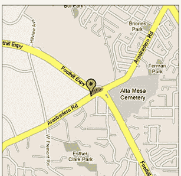

`GMarker` 可以接受第二个参数，即 `GMarkerOptions` 对象。这是一个唯一目的是调整标记的对象。使用它，你可以做诸如添加自定义图标或使标记可拖动等操作。你所需要做的就是设置 `GMarkerOptions` 对象的属性。

> 请参阅 `GMarkerOptions` 文档 http://www.google.com/apis/maps/documentation/reference.html#GMarkerOptions 以了解你可以对标记进行的所有操作。

## 事件

在 Google Maps API 类参考文档中，注意某些对象与其关联了事件。这些对象是用户可以看到并可以交互的东西，如地图本身、线条和标记。这允许你在用户执行操作时触发 JavaScript 函数。

事件由 GEvent 命名空间管理。要注册事件，必须使用 addListener() 方法将其添加到 GEvent 对象。addListener() 接受三个参数。首先，它接受你希望事件生效的对象。其次，它接受对象上可用的事件类型（click、drag 等）。最后，它接受在事件触发时执行的处理函数。

让我们为我们的标记添加一个事件。通过在回调函数中添加几行代码，我们可以添加一个在标记被点击时弹出的警告框。

```
function centerMapCallback(returnedPoint) {
    var marker = new GMarker(returnedPoint);
    g_map.setCenter(returnedPoint, 14);
    g_map.addOverlay(marker);
    GEvent.addListener(marker, "click", function() {
        alert("Marker clicked!");
    });
}
```

GEvent 不是我们创建的对象，因此无需实例化它。它在加载 Google Maps API 时会自动实例化。当标记上的 click 事件被触发时，处理函数将被执行。

## 信息窗口框

警告框相当单调。更有用的是使用 Google 地图时经常出现的白色弹出框。这些弹出框看起来像漫画书中的对话气泡。它们指向地图上的特定位置，并包含有关该位置的有用信息。在 Google Maps API 中，这些框被称为 InfoWindows。

InfoWindows 在 API 中由 GInfoWindow 类表示。关于 InfoWindows 最重要的是，对于每个 Google 地图，只有一个 InfoWindow。这对我们有两个影响。首先，当 InfoWindow 在用户视野中出现和消失时，发生的一切只是 InfoWindow 的可见性被切换。这可以通过 API 的内置事件（如点击 InfoWindow 的关闭按钮）或由开发者以编程方式完成，例如调用 InfoWindow 的 show() 或 hide() 函数。

其次，事件只是共享并更新同一个 `InfoWindow`。当你看到 `InfoWindow` 采用新内容时，就像在 Google 地图中从一个标记切换到另一个标记时发生的情况一样，`InfoWindow` 的内容是通过 JavaScript DOM 方法更改的。我们在使用 mashup 中的 `InfoWindow` 框时也必须这样做。

让我们进一步修改示例脚本。不要获取 JavaScript 警告框，让我们在用户点击标记时显示一个 `InfoWindow` 框。

请记住，每当你实例化地图时，每个地图都已经关联了一个 `InfoWindow` 框。因此，无需创建 `GInfoWindow` 对象。我们所要做的就是让它出现在我们想要的确切位置。

你可以通过将指向该点的 `GLatLng` 对象传递给 `GInfoWindow` 的 `reset()` 方法来设置 `InfoWindow` 框在特定点上方，然后使用对象的 `show()` 方法使其出现。然而，有一种更快的方法。在 Google 地图中，让 `InfoWindow` 框出现在标记上方是最常见的事情之一。正因为如此，Google Maps API 团队在 `GMarker` 对象上创建了执行此操作的方法。美妙之处在于该方法位于标记上，因此它会自动出现在标记上方。你不必追踪标记的纬度/经度。

我们只需修改事件处理程序以显示 `InfoWindow` 而不是警告即可。

```
GEvent.addListener(marker, "click", function() {
  marker.openInfoWindowHtml("<div><b>My Marker!</b></div>");
} );
```

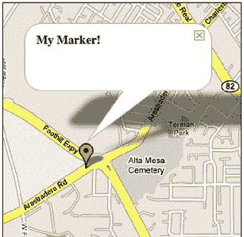

InfoWindow 的大小是内部最大 HTML 容器的宽度和高度。因此，你可以通过向封闭容器添加高度和/或宽度 CSS 属性来控制大小。例如，你可以通过放置一个 200 像素乘 300 像素的 div 标签来制作一个大约 200 像素乘 300 像素的 InfoWindow，如下所示：

```
.openInfoWindowHtml("<div style=\"width:220px; height:250px;\"> Some HTML</div>");
```

API 版本 2.5 及以上还添加了 InfoWindow 中标签的支持。要将 InfoWindow 转换为标签，请为每个标签创建一个 GInfoWindowTab。此类的构造函数接受两个参数。第一个是标签的标签，第二个是内容。将所有这些 GInfoWindowTab 对象放在一个 JavaScript 数组中。GMarker 类还支持名为 openInfoWindowTabs() 的方法。此方法接受一个 GInfoWindowTab 对象数组。调用它将打开一个 InfoWindow，但窗口将以标签界面显示，对象作为内容。

我们可以稍微调整回调函数以在 InfoWindow 中使用标签：

```
function centerMapCallback(returnedPoint) {
  var tabsArray = new Array();
  tabsArray[0] = new GInfoWindowTab("One", "<p>Content for Tab 1</p>");
  tabsArray[1] = new GInfoWindowTab("Two", "<p>Content for Tab 2</p>");

  var marker = new GMarker(returnedPoint);
  g_map.setCenter(returnedPoint, 14);
  g_map.addOverlay(marker);
  GEvent.addListener(marker, "click", function() {
    marker.openInfoWindowTabs(tabsArray);
  });
}
```

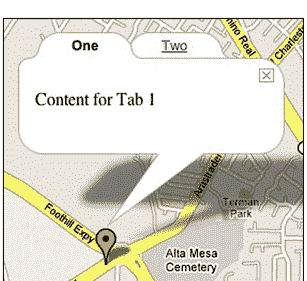


这就结束了 Google Maps 的基本功能。还有许多其他功能可用。其中一些强大的功能包括：

-   在地图上绘制线条的能力，类似于 Google Maps 提供路线指引时的情况。
-   一个返回 XML 的服务 REST 接口，允许你在服务器端应用程序中使用 Google Maps 数据库。
-   一个标记管理器，用于在不同缩放级别处理大量标记。
-   使用 `GMapTiles` 对象覆盖来自 Google Maps 的地图瓦片。

如果你在混搭应用中大量使用 Google Maps API，你还应该了解可用的众多选项对象。它们赋予你超越使用该 API 的许多其他混搭应用的灵活性。例如，使用 `GMarkerOptions` 对象，你可以在地图上创建自定义标记。

即使没有这些高级功能，你也能用 Google Maps 做很多事情。我们当然有足够多的东西来创建我们的混搭应用。

## Flickr 服务 API

Flickr 专注于照片分享，是现存最古老的社区驱动网站之一。它们也是为第三方开发者提供网络 API 的早期采用者。这些因素使它们拥有庞大的用户群和非常丰富的 API。Flickr Services 可能是我们见过的最灵活的网络 API。API 主页位于 http://www.flickr.com/services/api/。使用此 API 需要一个免费的开发者密钥。由于 Flickr 是 Yahoo! 的子公司，你还需要一个免费的 Yahoo! 账户。你将在 http://www.flickr.com/services/api/keys/ 被提示提供两者。从那里，你也可以同时注册两者。

就像我们见过的其他社交分享网站的 API 一样，Flickr Services 的 API 不仅关注其主题，还包含许多处理社区功能的方法。有一组丰富的方法允许你查询有关 Flickr 社区的信息。假设某人在其隐私设置中允许，你可以获取某人的博客条目和收藏照片等信息。还有一个处理 Flickr 群组信息的 API。它们允许你查找具有相似兴趣的人的照片和信息。

毫无疑问，两个最大的方法组与照片和相册集有关。用户可以将照片整理到相册集中以便组织。Flickr 与 Last.fm 和 YouTube 一样，很大程度上依赖用户标签。他们的照片搜索受人们标记内容的影响。

Flickr Services 最令人印象深刻的地方可能是请求和响应格式的选择。对于请求，你可以使用三种最流行的格式中的任何一种 – REST、SOAP 和 XML-RPC。对于响应，你可以选择 Flickr 自有的 XML 模式、SOAP、XML-RPC、JSON，甚至是序列化的 PHP 对象。无论你为请求和响应选择何种格式，Flickr Services 都有一种一致的处理方式。所有请求都使用相同的参数并返回相同的数据。你只需要为每种格式进行不同的格式化和解析。

### 执行搜索

由于 Flickr Services 非常一致，通过一个示例来了解其概览是最好的方式。在我们的混搭应用中，我们需要集中在照片方法组上。特别是，我们需要一个基于用户标签搜索照片的方法。让我们尝试执行一个搜索，就像我们为混搭应用所做的那样。

对于我们的请求和响应，我们会尽量保持简单。我们将使用 REST 发送服务请求。我们的 Web 应用程序由 PHP 驱动，因此序列化的 PHP 响应会很有趣。然而，由于 JavaScript 将承担大部分工作，我们将使用 JSON。来自 REST 调用的纯 XML 响应也是可以接受的，但避免使用它所需的 DOM 解析会更好。

方法名称相当自解释，并为我们提供了方法作用的许多线索。查看方法 flickr.photos.search 的文档 http://www.flickr.com/services/api/flickr.photos.search.html，我们发现它正是我们搜索照片所需的。

所有 Flickr REST 请求的 URL 都是 http://api.flickr.com/services/rest/。在此 URL 之后是方法参数，以 GET 请求格式提供。所有 REST 请求都有两个必需参数——method 和 api_key。method 的值是你希望调用的方法名称。api_key 的值是你的 Flickr API 密钥。要调用 flickr.photos.search，我们的完整 URL 将是：

```
http://api.flickr.com/services/rest/?method=flickr.photos.search&api_key=YOUR_FLICKR_API_KEY
```

方法文档页面列出了方法可以接受的所有参数。flickr.photos.search 的可用参数相当广泛。这给了我们大量调整搜索的能力。根据文档，唯一必需的参数是 api_key。然而，这有点误导，因为我们还需要提供一个搜索词。我们可以使用 tags 参数搜索标签，或使用 text 参数进行自由文本搜索。尽管两者都是可选参数，我们需要包含其中一个。否则，Flickr 将返回一条消息，称不支持空搜索。

要使用标签，提供一个以逗号分隔的搜索词列表。文本搜索只是一个自由文本字符串。无论哪种方式，使用 REST 时，请记住对你的词进行 URL 编码。

```
http://api.flickr.com/services/rest/?method=flickr.photos.search&api_key=YOUR_FLICKR_API_KEY&text=fender%20stratocaster
```

如果你使用 XML-RPC 或 SOAP，使用文档中列出的完全相同的参数，并按各自格式的要求格式化参数和值。对于 SOAP，端点位于 http://api.flickr.com/services/soap/。对于 XML-RPC，服务端点位于 http://api.flickr.com/services/xmlrpc/。

### 解析服务结果

如果你在 Web 浏览器中访问上述 URL，并在添加 API 密钥后，搜索将执行，你将收到来自服务器的实时响应。

```
<?xml version="1.0" encoding="utf-8" ?>
<rsp stat="ok">
<photos page="1" pages="20" perpage="100" total="1904">
    <photo id="412962278" owner="43203076@N00" secret="63e7e2e1f0" server="183" farm="1" title="Doin' Studio Time" ispublic="1" isfriend="0" isfamily="0" />
    <photo id="412463850" owner="63895350@N00" secret="26b97edbb5" server="172" farm="1" title="Norby with his Fender Stratocaster" ispublic="1" isfriend="0" isfamily="0" />
    <photo id="411598583" owner="75859527@N00" secret="657eb806c8" server="172" farm="1" title="Hocus Pocus" ispublic="1" isfriend="0" isfamily="0" />
    ...
</photos>
</rsp>
```

返回的格式是 Flickr 返回照片时使用的标准格式。默认情况下，一次调用返回每“页”100 个结果。photos 元素将单个 photo 元素分组到“页”中。每个 photo 元素代表搜索结果中返回的一张照片。你可以通过向调用传递 page 参数来更改当前页。或者，你也可以通过调用中的 per_page 参数更改每页返回的照片数量。

每个 `photo` 元素基本上是关于照片的属性集合。这些属性非常重要。我们需要了解它们才能加载照片。

| 属性 | 描述 |
|---|---|
| Id | 照片的唯一 ID。 |
| Owner | 拥有此图片的人的拥有者 ID。 |
| Secret | 用于帮助识别照片的次要标识符。 |
| Server | 存储此照片的服务器。 |
| Farm | 存储此照片的服务器场。 |
| Title | 图片的标题。 |
| isPublic | 布尔值，表示拥有者是否公开分享照片。 |
| isFriend | 布尔值，表示拥有者是否在你的好友列表中。 |
| isFamily | 布尔值，表示拥有者是否在你的家庭成员列表中。 |

最后三个布尔值取 1 或 0。它们还要求服务调用者使用 API 中的身份验证方法进行身份验证。

这就是我们想要的，但格式不对。我们希望结果以 JSON 返回。要获取 JSON 结果，我们需要向服务调用传递一个 format 参数。在这种情况下，该参数的值为 json。

```
http://api.flickr.com/services/rest/?method=flickr.photos.search&api_key=YOUR_FLICKR_API_KEY&text=fender%20stratocaster&format=json
```

添加该参数将使我们从服务器获得此响应。

```
jsonFlickrApi({
    "photos": {
        "page":1,
        "pages":20,
        "perpage":100,
        "total":"1904",
        "photo": [
        {"id":"412962278", "owner":"43203076@N00",
        "secret":"63e7e2e1f0", "server":"183", "farm":1,
        "title":"Doin\u2019 Studio Time", "ispublic":1, "isfriend":0,
        "isfamily":0},
        {"id":"412463850", "owner":"63895350@N00",
        "secret":"26b97edbb5", "server":"172", "farm":1, "title":
        "Norby with his Fender Stratocaster", "ispublic":1,
        "isfriend":0, "isfamily":0},

```


```
{ "id": "411598583", "owner": "75859527@N00",
"secret": "657eb806c8", "server": "172", "farm": 1, "title": "Hocus Pocus", "ispublic": 1, "isfriend": 0, "isfamily": 0 },
...
]
}
})
```

每个方法的文档页面都记录了该调用返回的 XML 格式。从那里，很容易对 JSON 等价物做出有根据的猜测。一般来说，XML 文档中的元素属性在 JSON 文档中是对象属性。嵌套元素被翻译成嵌套对象。搜索结果的主体，无论是博客条目、群组中的用户，还是像本例中的照片，都作为 JSON 数组返回。如果您在估算方法的确切转换时遇到困难，您始终可以像我们在这里所做的那样在浏览器中手动发出请求。

请注意，JSON 结果被封装在对 jsonFlickrApi 的调用中。默认情况下，API 假定您希望将 JSON 结果传递给 JavaScript 回调函数。如果您的应用程序中有一个名为 jsonFlickrApi 的函数，JavaScript 引擎在收到响应时将把 JSON 对象传递给该函数。引擎随后将自动执行该函数。这可以是您 JavaScript 中用于服务返回值的控制器。但是，您确实需要创建一个名为 jsonFlickrApi 的函数，并且必须将其设置好以对返回的 JSON 代码执行操作。如果您选择不使用此功能，可以通过在调用中向 nojsoncallback 参数发送 true（1）值来关闭此自动回调。这将给出完全相同的文本字符串，但不带 jsonFlickrApi()。

```
http://api.flickr.com/services/rest/?method=flickr.photos.search&api_key=YOUR_FLICKR_API_KEY&text=fender%20stratocaster&format=json&nojsoncallback=1
```

## 检索照片或照片页面

现在我们有了结果，可以使用这些数据从 Flickr 检索照片。Flickr 中的图像 URL 具有以下格式：

```
http://farm{FARM-ID}.static.flickr.com/{SERVER-ID}/{ID}_{SECRET}{SIZE}.jpg
```

除了大小之外，所有其他变量都可以直接从 flickr.photos.search 的 Web 服务调用响应中提取。

FARM-ID 是 farm 属性。SERVER-ID 是 server 属性。ID 是 id 属性。SECRET 是 XML 中的 secret 属性。SIZE 是您想要的照片大小。它是一个下划线后跟一个字符。该字符可以取以下字母中的任意一个：

| 后缀 | 含义 | 最大像素边长 |
|---|---|---|
| _o | 原始尺寸 | * |
| _b | 大 | 1024 |
| None | 中等 | 500 |
| _m | 小 | 240 |
| _t | 缩略图 | 100 |
| _s | 小方块 | 75 px x 75 px |

其中第一张照片的 XML 返回如下：

```
<photo id="411598583" owner="75859527@N00" secret="657eb806c8"
server="172" farm="1" title="Hocus Pocus" ispublic="1" isfriend="0"
isfamily="0" />
```

我们可以使用此信息构造一个指向该照片小版本的 URL：

```
http://farm1.static.flickr.com/172/411598583_657eb806c8_m.jpg
```

原始尺寸的工作方式略有不同。它们在名为 originalsecret 的属性中拥有自己的密钥代码，并且您必须包含文件类型扩展名，该扩展名可以从另一个名为 original_format 的属性中获取。要获取这些属性，您需要在原始请求中 extras 参数中请求它们。该参数接受一个逗号分隔的属性列表，这些属性可能未包含在默认响应中。

```
http://api.flickr.com/services/rest/?method=flickr.photos.search&api_key=YOUR_FLICKR_API_KEY&text=fender%20stratocaster&format=json&nojsoncallback=1&extras=originalsecret,original_format
```

请查阅方法的文档以查看是否有任何额外参数可用。

指向照片网页的 URL 的工作方式类似。URL 采用以下格式：

```
http://www.flickr.com/photos/{USER-ID}/{PHOTO-ID}
```

文档概述了您可以链接的几种不同的内容，例如，您可以构造指向照片集或用户个人资料的 URL。

## Mashing Up

我们已经为这个 mashup 游览了很多技术。其中一些相当前沿，但为了纳入相对较新的规范是必要的。毫不奇怪，您的数据源并不总是来自 Web API。保持灵活并寻找可在应用程序中使用的新技术很重要。最后，我们有了开始构建应用程序的知识。

数据库是一个很好的起点。回想一下我们的序列图，访客在任何时候都会直接或间接地与应用程序的多个不同组件交互。许多组件依赖于 Google 地图先构建，但地图依赖于数据库作为标记位置的来源。

## 构建和填充数据库

我们的 mashup 需要三件事：地铁站、Tube 系统的线路，以及哪些车站属于哪些线路。我们还需要记住一个车站可以属于多条线路。由于我们的数据来源是 Tube Station RDF 文档，让我们仔细查看该文档，看看我们能获得什么。

## 检查文件

页面的前半部分由车站组成。一个典型的车站看起来像这样：

```
<rdf:Description rdf:about="http://london.openguides.org/index.cgi?id=Acton_Town_Station;format=rdf#obj">
<os:y>179613</os:y>
<dc:subject>Tube</dc:subject>
<name>Acton Town Station</name>
<dc:title>Acton Town Station</dc:title>
<rdfs:type rdf:resource="http://www.w3.org/2003/01/geo/wgs84_pos#SpatialThing"/>
<geo:long>-0.280009</geo:long>
<space:connects rdf:resource="http://london.openguides.org/index.cgi?id=Turnham_Green_Station;format=rdf#obj"/>
<os:x>519478</os:x>
<rdfs:seeAlso rdf:resource="http://london.openguides.org/index.cgi?id=Acton_Town_Station;format=rdf#obj"/>
<geo:lat>51.502833</geo:lat>
</rdf:Description>
```

我们至少需要一个名称和一个经纬度对用于 Google 地图。name、geo:long 和 geo:lat 元素似乎提供了这些信息。我们肯定需要提取这些。将这个“事物”放在主语/谓语/宾语的上下文中，rdf:about 属性将为我们提供主语。如果需要，我们可以用它作为唯一标识符。我们还看到有一个 type/resource 元素，可能将此项标识为地铁站；这也可能有用。

在这个文档中，我们找不到实际的线路列表。然而，这个文档的后半部分很有趣。它们是一组块，但比车站块小。

```
<rdf:Description rdf:about="http://space.frot.org/a_space/id5276761">
<rdfs:type rdf:resource="http://space.frot.org/rdf/space.owl#Tube_Line"/>
<rdf:predicate rdf:resource="http://frot.org/space/0.1/connects"/>
<rdf:subject rdf:resource="http://london.openguides.org/index.cgi?id=North_Ealing_Station;format=rdf#obj"/>
<dc:title>Piccadilly Line</dc:title>
<rdf:object rdf:resource="http://london.openguides.org/index.cgi?id=Ealing_Common_Station;format=rdf#obj"/>
</rdf:Description>
```

它们似乎是以三元组格式描述的空间关系列表。rdfs/resource 对告诉我们它是一条地铁线。然而，每条线路中都有许多这样的条目。rdf:predicate、rdf:subject 和 rdf:object 标签揭示了这一点。这些项目告诉我们，在该线路中，主语，该主语直接对应于车站的 rdf:about 属性，根据 rdf:predicate 连接到宾语，该宾语也直接对应于 rdf:about 属性。基本上，这些项目告诉我们主语车站在某条线路中连接到宾语车站。它们使用三元组为我们绘制线路地图。

因此，我们可以简单地挑选出这些来获取线路车站。由于 rdf:subject 元素是连接链的开始，我们只需挑选出 rdf:subject 并按 dc:title 过滤即可获取线路中的所有车站。

这是 Tube 线路存在的唯一提示。然而，我们真正需要做的只是提取线路名称和它们所属的车站。

## 创建我们的数据库模式

一条线路有多个车站，而一个车站可以属于多条线路。这听起来像是需要一个连接表的任务。我们将保持简单，只提取车站的名称、纬度和经度，以及线路的线路名称。


我们的数据库模式将如下所示：

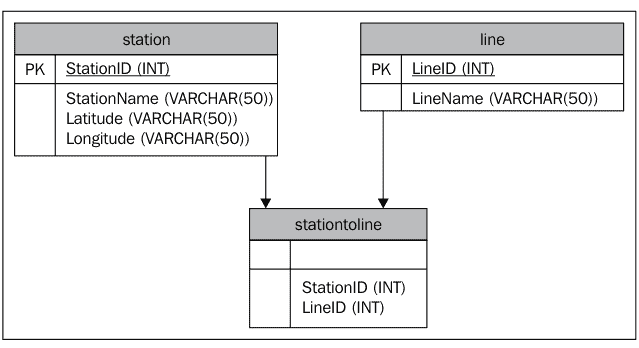

我们在示例代码中包含了一个名为 `londontube.sql` 的 SQL 文件。该文件将创建一个带有外键约束的数据库。你可以直接在 SQL 导入工具中运行此文件，例如 MySQL 命令行或 phpMyAdmin，以创建此数据库。对于所有其他 RDBMS 设置，请创建一个名为 londontube 的数据库并模仿该模式。

> 不要忘记为该数据库上的用户至少授予 `SELECT` 和 `INSERT` 权限，并设置密码！

## 构建 SPARQL 查询

用于从 RDF 填充这些表，我们需要为每个表编写一个 SPARQL 查询。首先，我们需要填充所有车站。其次，我们需要一个 SPARQL 查询来填充所有线路。在插入线路和车站之后，我们需要使用生成的 SQL ID 并将其插入到 stationtoline 关联表中。

在创建这些查询时，我们可以在 SPARQLer 中回头检查我们的工作。务必将 Data URL 字段更改为伦敦地铁 RDF `http://space.frot.org/rdf/tube_model2.rdf`。

### 车站查询

我们的车站查询必须从 RDF 文档中提取名称、纬度和经度。我们可以用以下查询来实现：

```
PREFIX : <http://xmlns.com/foaf/0.1/>
PREFIX geo: <http://www.w3.org/2003/01/geo/wgs84_pos#>
PREFIX rdf: <http://www.w3.org/1999/02/22-rdf-syntax-ns#>
PREFIX rdfs: <http://www.w3.org/2000/01/rdf-schema#>

SELECT DISTINCT ?stationName ?lat ?long
FROM <tube_model2.rdf>
WHERE {
  ?type rdfs:type <http://www.w3.org/2003/01/geo/wgs84_pos#SpatialThing> .
  ?type :name ?stationName .
  ?type geo:lat ?lat .
  ?type geo:long ?long
}
ORDER BY ?stationName
```

在顶部，我们定义了所需的前缀。请注意第一个前缀。车站的名称位于 name 元素中，该元素没有前缀。它属于默认命名空间。如果在 SPARQL 中使用默认命名空间前缀，则必须声明它们。为此，按通常方式创建 PREFIX 语句，但命名空间部分仅为空冒号。

SELECT 语句告诉解析器获取三个变量，?stationName、?lat 和 ?long。WHERE 子句细化搜索并设置这些变量。

第一个三元组将搜索范围缩小到车站。还记得我们在 RDF 文档中查看车站时，它有一个 type/resource 对来标识它为车站吗？type 在 rdfs 命名空间中，但其 resource 属性在 rdf 命名空间中。即使我们在第一个 WHERE 子句中没有显式使用 rdf 命名空间，该值也在该命名空间中，因此我们也需要为其提供 PREFIX 声明。此语句在名为 ?type 的变量中设置了我们其他子句的主语。

另外三个三元组设置了我们在 SELECT 语句中请求的变量。它们本质上以相同的方式工作。它们使用 ?type 中的主语来查找谓词，即我们想要的元素。这些三元组的客体被放入 ?stationName、?lat 和 ?long 变量中。

### 线路查询

这看起来比最初想象的要容易。我们的线路查询必须获取系统中所有的线路。然而，RDF 文件没有仅包含线路的部分。它确实有描述线路中所有连接的部分。我们可以简单地抓取所有这些连接项，并在线路名称上使用 DISTINCT 关键字，以确保我们只获取每个线路的一个。

```
PREFIX dc: <http://purl.org/dc/elements/1.1/>
PREFIX rdfs: <http://www.w3.org/2000/01/rdf-schema#>
FROM <tube_model2.rdf>
SELECT DISTINCT ?lineName
WHERE {
    ?type rdfs:type <http://space.frot.org/rdf/space.owl#Tube_Line> .
    ?type dc:title ?lineName
}
ORDER BY ?lineName
```

WHERE 子句本身，根据与前一个查询类似的 type/resource 组合，从 dc:title 元素获取所有线路名称。然而，DISTINCT 关键字会过滤掉所有重复实例。

### 线路到车站查询

还记得之前 RDF 项本身不像 SQL 那样具有关系。我们可以通过使用查询来查找子对象的主题来解决这个问题。我们必须这样做才能映射线路和车站之间的关系。

```
PREFIX : <http://xmlns.com/foaf/0.1/>
PREFIX dc: <http://purl.org/dc/elements/1.1/>
PREFIX rdf: <http://www.w3.org/1999/02/22-rdf-syntax-ns#>
PREFIX rdfs: <http://www.w3.org/2000/01/rdf-schema#>

SELECT DISTINCT ?lineName ?stationName
FROM <tube_model2.rdf>
WHERE {
    ?line rdfs:type <http://space.frot.org/rdf/space.owl#Tube_Line> .
    ?line dc:title ?lineName .
    ?line rdf:subject ?infourl .
    ?infourl dc:title ?stationName
}
ORDER BY ?lineName ?stationName
```

此查询要求线路名称和车站名称配对。属于某条线路的所有车站都应与该线路一起包含。如果一条线路有十二个车站，结果集中应有十二条包含该线路的条目，每个车站在这对中各有一条条目。

WHERE 子句中的第一行足够简单。它将所有地铁线路的主语设置在 ?line 变量中。第二行通过将其设为 dc:title 谓词的客体来设置我们想要提取的 ?lineName 变量。第三行变得有趣。

在 RDF 文档中，这些连接项具有 subject 元素。

```
<rdf:subject rdf:resource="http://london.openguides.org/index.cgi?id=Wapping_Station;format-rdf#obj"/>
```

这些 subject 元素告诉我们，此连接项的主语是 resource 属性值。然后，WHERE 子句中的第三行将 rdf:resource 值设置在名为 ?infoUrl 的变量中。还记得我们之前查看车站时注意到车站的 Description 元素中的 rdf:about 属性可用于作为这些车站的唯一标识符吗？这正是它派上用场的地方。这些标识符在这些连接项的 rdf:resource 中使用。

在第四行中，我们使用此车站标识符 URL 作为主语来获取车站名称。第四行查找具有唯一车站 URL 的所有主语并对这些项进行操作。换句话说，它回头查看页面前半部分中的车站项。

最后，在 SELECT 语句中，我们为 ?lineName 添加 DISTINCT 关键字。这是因为两个车站之间的连接在我们的文档中实际上被表示了两次。你会发现一条语句说“车站 A 连接到车站 B”，稍后在文档中，你会发现“车站 B 连接到车站 A”。这并非偶然，但会导致每个连接被列出两次。DISTINCT 将消除这种情况。

我们已成功解决了关系问题。虽然 SQL 中没有经典的外键约束，但我们确实有可以在此文件中使用的标识符。幸运的是，我们有一个设计良好的文档，但这可能并不总是如此。你可能需要查询多个文档，或者可能需要在 SPARQL WHERE 子句中变得更加复杂。

## 数据库填充脚本

现在我们有了 SPARQL 查询，是时候真正使用它们来填充我们的数据库了。我们将编写一个过程式脚本，使用 RDF API for PHP 来实现这一点。

由于 RAP 是面向对象的，我们将为此脚本采用以模型为中心的方法。在示例章节代码中，本节将介绍名为 populateDB.php 的脚本中的代码。在 classes/models 目录中，有两个文件，clsLine.php 和 clsStation.php。它们代表数据库中的线路表和车站表。它们只是容器。数据库中的每一列都由类中的属性表示，每个属性都有一个公共的 getter 和 setter 方法来访问它。

clsLine.php 文件如下所示：

```
<?php
    class Line {
        private $lineId;
        private $lineName;
        public function getLineId() { return $this->lineId; }
        public function getLineName() { return $this->lineName; }
        public function setLineId($i) { $this->lineId = $i; }
        public function setLineName($n) { $this->lineName = $n; }
    }
?>
```

clsStation.php 如下所示：

```
<?php
    class Station {
        private $stationId;
        private $stationName;
        private $lat;
        private $long;
        public function getStationId() { return $this->stationId; }
        public function getStationName() { return $this->stationName; }
        public function getLat() { return $this->lat; }
        public function getLong() { return $this->long; }
        public function setStationId($i) { $this->stationId = $i; }
        public function setStationName($n) { $this->stationName = $n; }
        public function setLat($l) { $this->lat = $l; }
        public function setLong($l) { $this->long = $l; }
    }
?>
```


这些“普通旧 PHP 对象”通用性足够，可以在我们应用程序中稍后重用。

基于我们的数据库模式，我们的 `populateDB.php` 需要执行以下步骤：

- 1. 从 RDF 文件中获取所有线路。
- 2. 将所有线路插入表中。
- 3. 记住插入时生成的表主键。
- 4. 从 RDF 文件中获取所有车站。
- 5. 将所有车站插入表中。
- 6. 记住插入时生成的表主键。
- 7. 从 RDF 文件中获取线路中的所有车站。
- 8. 使用插入时生成的键，并根据 RDF 文件中的查询将它们正确插入到车站-线路连接表中。

我们的脚本以 RAP 所要求的标准初始化和准备代码开始。此外，我们还包含了两个模型对象定义。

```php
define("RDFAPI_INCLUDE_DIR", "Absolute/Path/To/rdfapi-php/api/");
require_once(RDFAPI_INCLUDE_DIR . "RdfAPI.php");
require_once('classes/models/clsLine.php');
require_once('classes/models/clsStation.php');
```

接下来，创建 SPARQL 客户端。我们将 tube 文档的 URL 传递给 load() 方法。

```php
//Create SPARQL Client
$sparqlClient = ModelFactory::getDefaultModel();
$sparqlClient->load('http://space.frot.org/rdf/tube_model2.rdf');
```

我们需要创建数据库连接。如果您不使用 MySQL，请根据需要修改此部分，并根据用户进行自定义。

```php
//Create MySQL Client
$mySQLConn = @mysql_connect("127.0.0.1", "DB USER NAME", "DB USER PASSWORD") or die("Couldn't connect to the MySQL server.");
$db = mysql_select_db("londontube", $mySQLConn) or die("Couldn't connect to the londontube database.");
```

现在是创建一些将查询 RDF 文档的函数的时候了。

第一个是 getAllStations() 函数。此函数将查询 RDF 文档并返回一个车站对象数组。

```php
function getAllStations(&$sparqlClient) {
    $returnArray = array();
    $query = '
PREFIX : <http://xmlns.com/foaf/0.1/>
PREFIX geo: <http://www.w3.org/2003/01/geo/wgs84_pos#>
PREFIX rdf: <http://www.w3.org/1999/02/22-rdf-syntax-ns#>
PREFIX rdfs: <http://www.w3.org/2000/01/rdf-schema#>
SELECT DISTINCT ?stationName ?lat ?long
FROM <tube_model2.rdf>
WHERE {
    ?type rdfs:type
    <http://www.w3.org/2003/01/geo/wgs84_pos#SpatialThing> .
    ?type :name ?stationName .
    ?type geo:lat ?lat .
    ?type geo:long ?long
}
ORDER BY ?stationName';
    $result = $sparqlClient->sparqlQuery($query);
    if ($result != "false") {
        foreach ($result as $station) {
            if ($station != "") {
                $stationObj = new Station();
                $stationObj->setStationName($station['?stationName']->getLabel());
                $stationObj->setLat($station['?lat']->getLabel());
                $stationObj->setLong($station['?long']->getLabel());
                $returnArray[$station['?stationName']->getLabel()] = $stationObj;
            }
        }
    }
    return $returnArray;
}
```

此函数以我们之前构建的 SPARQL 查询开始，并使用传递给它的 SPARQL 客户端将其对加载的 RDF 文档执行。请记住，查询获取名称、纬度和经度。结果集包含每个车站的一行。foreach 循环遍历此结果集。它将每个结果对象放入名为 $station 的 RAP 资源对象中。对于结果集中的每个车站，都会实例化一个新的车站。使用 setter 方法，$station 中的结果填充每个车站对象的名称、纬度和经度。然后它将此对象放入要返回的数组中，以车站名称作为键。由于 RDF 中没有整数标识符，我们将不得不使用下一个最好的方法。车站和线路的名称将不得不作为键。

同样的原则适用于 getAllLines()，它从 RDF 文档中获取所有车站线路。

```php
function getAllLines(&$sparqlClient) {
    $returnArray = array();
    $query = '
PREFIX dc: <http://purl.org/dc/elements/1.1/>
PREFIX rdfs: <http://www.w3.org/2000/01/rdf-schema#>
FROM <tube_model2.rdf>
SELECT DISTINCT ?lineName
WHERE {
    ?type rdfs:type
        <http://space.frot.org/rdf/space.owl#Tube_Line> .
    ?type dc:title ?lineName
}
ORDER BY ?lineName';
    $result = $sparqlClient->sparqlQuery($query);
    if ($result != "false") {
        foreach ($result as $line) {
            if ($line != "") {
                $lineObj = new Line();
                $lineObj->setLineName($line['?lineName']->getLabel());
                $returnArray[$line['?lineName']->getLabel()] = $lineObj;
            }
        }
    }
    return $returnArray;
}
```

同样的原则适用于 getAllLines()，它从 RDF 文档中获取所有车站线路。同样，线路名称是此数组中的键。

最后，我们创建一个查找车站到线路关系的函数。

```php
function getLinesAndStations(&$sparqlClient) {
    $returnArray = array();
    $i = 0;
    $query = '
PREFIX : <http://xmlns.com/foaf/0.1/>
PREFIX dc: <http://purl.org/dc/elements/1.1/>
PREFIX rdf: <http://www.w3.org/1999/02/22-rdf-syntax-ns#>
PREFIX rdfs: <http://www.w3.org/2000/01/rdf-schema#>
SELECT DISTINCT ?lineName ?stationName
FROM <tube_model2.rdf>
WHERE {
    ?line rdfs:type <http://space.frot.org/rdf/space.owl#Tube_Line>
    ?line dc:title ?lineName .
    ?line rdf:subject ?infourl .
    ?infourl dc:title ?stationName
}
ORDER BY ?lineName ?stationName';
    $result = $sparqlClient->sparqlQuery($query);
    if ($result != "false") {
        foreach ($result as $relationship) {
            if ($relationship != "") {
                $returnArray[$i]['line'] = $relationship['?lineName']->getLabel();
                $returnArray[$i]['station'] = $relationship['?stationName']->getLabel();
                $i++;
            }
        }
    }
    return $returnArray;
}
```

这个数组与另外两个一样，首先使用 SPARQL 查询加载的 RDF 文档。然而，返回的数组与另外两个不同。我们没有创建任何模型对象来保存关系，因此没有使用类似的东西。相反，我们返回一个多维数组。整数是索引，每个值内部是一个关联数组。关联数组将线路和车站名称组合在一起。

现在我们有三个返回三个数组的函数。让我们调用它们并开始处理数组。

```php
$linesArr = getAllLines($sparqlClient);
$stationsArr = getAllStations($sparqlClient);
$joinArr = getLinesAndStations($sparqlClient);
```

此块将数组存储在 $linesArr、$stationsArr 和 $joinArr 中。首先，我们将对 $linesArr 数组进行操作。

```php
foreach ($linesArr as $line) {
    $sql = 'INSERT INTO line (LineName) VALUES (\'' . addslashes(
        $line->getLineName()) . '\'\');
    $e = mysql_query($sql, $mySQLConn);
    $line->setLineId(mysql_insert_id($mySQLConn));
}
```

此 foreach 循环将 $linesArr 数组中的每个 Line 对象插入数据库。代码中的最后一句话将从插入中获取新的 ID 号并将其存储在对象属性中。另一个 foreach 循环对车站执行相同的操作。

```php
foreach ($stationsArr as $station) {
    $sql = 'INSERT INTO station (StationName, Latitude, Longitude)
    VALUES (\'' . addslashes($station->getStationName()) . '\', \''
    . addslashes($station->getLat()) . '\', \'' . addslashes($station->getLong()) . '\'\');
    $e = mysql_query($sql, $mySQLConn);
    $station->setStationId(mysql_insert_id($mySQLConn));
}
```

完成此操作后，我们仍然拥有线路和车站的数组。然而，每个对象的 ID 属性现在都已使用数据库分配的主键编号设置。我们需要在填充连接表时使用此属性。

```php
foreach ($joinArr as $key => $value) {
    $sql = 'INSERT INTO stationtoline (LineID, StationID) VALUES (' .
    $lines[$value['line']]->getLineId() . ',' . $stations[$value[
    'station']]->getStationId() . ')';
    $e = mysql_query($sql, $mySQLConn);
}
```

请记住，$join 是一个多变量数组，'line' 是关联数组中具有线路名称的键，而 'station' 是具有车站名称的键。我们使用这些键来获取 $linesArr 和 $stationsArr 中的对象。一旦

我们有这些对象，只需使用 ID 获取方法来获取该车站或线路的数据库主键 ID 即可。这些 ID 用于插入的 SQL 语句中。

在你的网页浏览器中运行此文件一次，你将拥有一个完全填充了伦敦地铁车站信息的数据库。是时候创建我们 mashup 的网页前端了。

## TubeSource 数据库接口类

此 mashup 将始终具有所有车站的下拉菜单。一旦用户选择一条线路，页面将自行刷新，并且该线路的车站将被标记。这意味着两件事：

- 1. 我们需要一个函数从数据库中提取地铁线路的名称。
- 2. 我们需要一个函数根据线路从数据库中提取车站名称。

我们将为此创建一个数据库接口类。它将是来自数据库的所有地铁信息的来源。在示例中，此文件位于 classes 目录中，名为 clsTubeSource.php。所有与数据库交互的操作都将在此类中进行。

```php
class TubeSource {
    private $dbConn;
    public function getAllLines() {
        $returnArray = array();
        $sql = 'SELECT LineID, LineName FROM line';
        $e = mysql_query($sql, $this->dbConn);
        while ($row = mysql_fetch_array($e)) {
            $lineObj = new Line();
            $lineObj->setLineId($row['LineID']);
            $lineObj->setLineName($row['LineName']);
            array_push($returnArray, $lineObj);
        }
        return $returnArray;
    }
    public function getStationsByLine($lineid) {
        $returnArray = array();
        $sql = 'SELECT S.StationName, S.Latitude, S.Longitude FROM
            stationtoline AS SL
            INNER JOIN station AS S
            ON SL.StationID = S.StationID
            WHERE SL.LineID = ' . $lineid;
        $e = mysql_query($sql, $this->dbConn);
        while ($row = mysql_fetch_array($e)) {
            $stationObj = new Station();
            $stationObj->setStationName($row['StationName']);
            $stationObj->setLat($row['Latitude']);
            $stationObj->setLong($row['Longitude']);
            array_push($returnArray, $stationObj);
        }
        return $returnArray;
    }
    public function __construct(&$dbConn) {
        $this->dbConn = $dbConn;
    }
}
?>
```

此类在构造函数中接收一个数据库连接对象。其两个方法 getAllLines() 和 getAllStationsByLine() 分别返回 Line 对象和 Station 对象的数组。它们以与 SPARQL 查询类似的方式处理并填充模型类。getAllStationsByLine() 将线路的主键 ID 作为参数，并将其用于 WHERE 子句中。

## 主用户界面

在此阶段，我们可以创建主用户界面页面，以查看我们的 mashup 的进展情况。让我们创建绘制 Google 地图并在用户选择线路时绘制标记的功能。此页面需要执行以下操作：

- 1. 创建并显示 Google 地图。
- 2. 包含用于显示车站标记的 JavaScript。
- 3. 调用 TubeSource 数据库类。
- 4. 为用户提供一个下拉菜单，其中填充了来自 TubeSource 的数据。

主页的这种基本形式名为 index-Basic.php。我们将逐步介绍处理所有列出功能的页面部分。稍后，我们将修改页面以添加 Flickr 调用以获取照片。

```php
<?php
$googleKey = 'YOUR GOOGLE API KEY';
require_once('classes/models/clsLine.php');
require_once('classes/models/clsStation.php');
require_once('classes/clsTubeSource.php');
```
```

此页面以一些初步初始化开始。Google API 密钥被设置在一个变量中。我们的所有模型类以及 TubeSource 类都被包含在内。

```php
//Create MySQL Client
$mySQLConn = @mysql_connect("127.0.0.1", "tubeapp", "tubular") or die("Couldn't connect to the MySQL server.");
$db = mysql_select_db("londontube", $mySQLConn) or die("Couldn't connect to the londontube database.");
//Create a DB abstraction object
$tubeSourceObj = new TubeSource($mySQLConn);
```

我们需要创建数据库代码。在这里，数据库客户端被创建，并且 TubeSource 使用该客户端进行实例化。

```php
$linesArr = $tubeSourceObj->getAllLines();
if ($_GET['line']) {
  $stationsArr = $tubeSourceObj->getStationsByLine($_GET['line']);
}
?>
```

接下来的几行结束了初步的 PHP 代码。第一行调用 TubeSource 的 getAllLines() 来获取所有线路。返回的 Line 对象数组 $linesArr 将用于创建下拉菜单。

如果向此页面传递了 GET 参数，我们将调用 TubeSource 的另一个方法 getStationsByLine()。这将为我们获取存储在数组中的线路的 Station 对象。

接下来，我们开始我们的 HTML 和 JavaScript。

```html
<html>
  <head>
    <title>London Tube Stations</title>
```

```html
<script src="http://maps.google.com/maps?file=api&amp;v=2&amp;key<?= $googleKey ?>" type="text/javascript"></script>
<script type="text/javascript">
var g_map;
```

JavaScript 首先声明了一些全局变量，用于在整个应用程序中保存信息。

```javascript
function load() {
    if (GBrowserIsCompatible()) {
        var point = null;
        g_map = new GMap2(document.getElementById("map"));
```

load 函数将由 body onload 事件执行。此函数的目的在于创建 Google 地图并在需要时绘制标记。这将地图加载到 g_map 全局变量中。

```javascript
g_map.addControl(new GSmallMapControl());
g_map.addControl(new GMapTypeControl());
g_map.setCenter(new GLatLng(51.5099983215,
-0.134690001607), 11);
```

这三行代码操作我们的地图。前两行添加了一些控件。你可以向 Google 地图添加一系列控件。第一行添加了你在 Google 地图上看到的平移和缩放命令的小版本。第二行在地图右上角添加了地图类型控件按钮。这些按钮控制地图是典型的街道地图、卫星地图还是混合地图。

第三行将地图居中到一个位置。通过研究、试验和错误，我找到了伦敦市中心的纬度和经度。我们将坐标传递给 GLatLng 对象，设置一个不错的缩放级别 11 以显示伦敦大部分区域，并将其传递给 setCenter() 方法。

```php
<?php if ($_GET['line'] && count($stationsArr) > 0) {
    foreach ($stationsArr as $station) { ?>
        point = new GLatLng(<?= $station->getLat() ?>,
        <?= $station->getLong() ?>);
        g_map.addOverlay(createMarker(point,
        '<?= addslashes($station->getStationName()) ?>'));
<?php } } ?>
    }
}
```

本节创建标记。我们使用 PHP 来帮助我们。如果向页面传递了线路 GET 参数并且车站数组不为空，那么我们需要为每个车站创建一个标记。仍然在 PHP 中，我们使用 foreach 循环进行遍历。由 point 表示的 GLatLng 对象使用 PHP 对象的纬度和经度属性创建。如果我们只是使用此点并将其传递给地图的 addOverlay 方法，我们将在地图上创建一个标记。然而，我们希望对其做一些额外处理，例如创建事件。

我们使用此点并将其传递给另一个函数 createMarker()。此函数创建标记，为其添加事件监听器，然后返回相同的标记。

```javascript
// Creates a marker at the given point with the given number label
function createMarker(point, stationName) {
  var marker = new GMarker(point);
  GEvent.addListener(marker, "click", function() {
    marker.openInfoWindowHtml("<div style=\"width:220px;
    height:250px;\"><b>" + stationName + "</b></div>");
  });
  return marker;
}
```

在函数的第一行创建了一个标记。请记住，GEvent 对象是在你调用 Google 地图时创建的。它的工作是监视所有 Google 地图对象上的事件。我们通过 addListener() 方法告诉它监听此标记上的点击。

在回调函数的参数中，我们定义标记被点击时将发生什么。在这里，我们告诉地图使用 openInfoWindowHtml() 打开信息窗口。我们使用车站名称提供 HTML 作为参数。打开时，信息窗口将出现在标记上方。车站的名称将是窗口中唯一的內容。

```html
</script>
</head>
<body onload="load() " onunload="GUnload()">
```

在我们的 body 标签中，我们通过调用 load() 来启动地图创建。我们还在页面退出时添加对 GUnload() 的调用。GUnload() 是 Google 地图 API 的一部分。它的工作是关闭任何内存泄漏。每当你使用 Google 地图时，在 onunload 页面事件中调用它始终是一个好主意。

```html
<form name="selectionForm" action="index-Basic.php" method="get">
<select name="line">
  <option value="">Select a Line</option>


## 伦敦地铁照片

```
<?php foreach($linesArr as $lines) { ?>
    <option value="<?= $lines->getLineId() ?>" <?= $_GET['line'] == $lines->getLineId() ? "selected=\"selected\"" : "" ?>><?= $lines->getLineName() ?></option>
<?php } ?>
</select>
<input type="submit" value="Go!" />
</form>
```

这段代码块绘制了我们用于线路选择的表单对象。PHP foreach 循环遍历地铁线路数组以获取每个线路对象。

```
<div id="map" style="width: 800px; height: 600px"></div>

</body>
</html>
```

此时，地图已可正常使用。你拥有一个可以绘制伦敦地铁系统中车站的 mashup。你可以四处导航、选择线路，并点击标记查看你点击的是哪个车站。

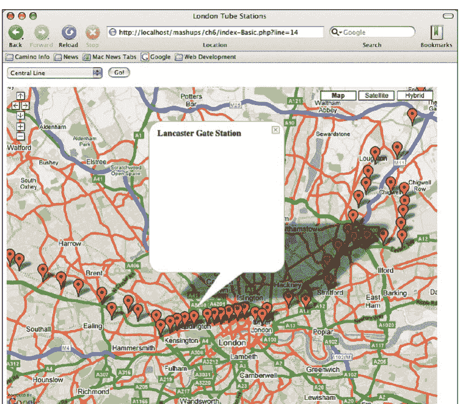

## 使用 AJAX 调用 Flickr 服务

通过稍作修改，我们可以添加对 Flickr 服务的调用。一般来说，我们希望的策略是在用户点击标记时使用 XMLHttpRequest 对象发出 HTTP 请求。执行此操作的合适位置是在标记事件监听器的回调函数中。我们已经知道车站的名称，因此可以将其作为搜索 Flickr 的依据。

这是一种非常可接受的策略，但存在一个巨大问题。一般来说，浏览器无法使用 XMLHttpRequest 向另一台服务器发出 HTTP 请求。这是为了防止跨站脚本攻击，即恶意网站运行代码窃取用户与另一网站之间的敏感信息。实际上，这意味着 XMLHttpRequest 调用只能返回页面源自的服务器。在这种限制下，我们如何使用 XMLHttpRequest 从我们的网站向 Flickr 服务发出调用？

## 创建 XMLHttpRequest 代理

解决方案是在我们的服务器上创建一个 Web 服务代理。Web 服务器将执行 Flickr 服务调用，而不是浏览器。我们的 XMLHttpRequest 操作将在代理上执行 GET 请求并将 Flickr 服务参数传递给代理。然后代理将向 Flickr 发出请求，并将响应原样传回 Web 浏览器。浏览器不知道也不关心真实数据源来自 Flickr。在示例代码中，在 services 目录下，代理名为 searchFlickr.php。这是一个小文件，其唯一工作就是执行此操作。

```
<?php
require_once('../classes/RESTParser.php');
$restParser = new RESTParser();
```

我们将使用 Flickr 的 REST 接口。在此代码中，我们将使用第一章创建的相同 REST 解析器来处理 REST 调用。

```
$paramArray = array();
foreach ($_GET as $key => $value) {
    if ($key == 'format' || $key == 'nojsoncallback' || $key == 'text')
    {
        $paramArray[$key] = $value;
    } else {
        die("Unallowed Parameter Passed.");
    }
}
```

我们初始化一个 Flickr 服务参数数组。当实际进行服务调用时，我们会将此数组传递给 REST 解析器。此数组通过遍历 GET 数组并将数组键和值添加到 $paramArray 中来填充。由于此页面对全世界开放，因此最好对其进行一些安全保护。在这里，我们只允许从调用页面传递三个 Flickr 参数。否则，脚本将终止。

```
//Add the API Key to the Request
$paramArray['api_key'] = 'YOUR FLICKR SERVICES KEY';
$paramArray['method'] = 'flickr.photos.search';
$paramArray['per_page'] = '4';
$paramArray['page'] = '1';
$paramArray['text'] .= ' London tube';
```

这种方法的另一个好处是我们可以在服务器上隐藏 API 密钥。如果是 JavaScript 发出此调用，我们就必须在前端代码中公开密钥，任何人都可以窃取它。对于 Google API 密钥来说这不是太大的问题，因为该密钥受域名限制。然而，Flickr 服务密钥没有此类限制。在这里，我们在服务器上将其添加到参数数组中。密钥通过服务器到服务器的通信传递，用户永远看不到它。

作为额外的安全措施，我们在此处还指定了 Flickr 方法。这确保只有 flickr.photos.search 方法可以从此脚本调用。

我们传递了两个额外的参数以使结果更易于管理。per_page 将限制 Flickr 返回的结果为每页仅 4 张照片。然后我们使用 page 参数告诉 Flickr 只返回一页。结果是 Flickr 最多返回四张照片。

此块中的最后一行将 "London tube" 添加到传递给 Flickr 的搜索查询词中。这纯粹是为了缩小搜索范围。

```
echo $restParser->callService($paramArray, 'api.flickr.com', '/services/rest/', 'GET');
?>
```

最后，我们将参数数组连同 Flickr 服务的服务器和端点信息一起传递给 RESTParser 的 callService() 方法。该方法返回服务器的响应，我们只需将其回显给请求方。

## 修改主 JavaScript

现在我们可以修改 mashup 的 index 页面。在本章的示例代码中，有一个名为 `index.php` 的文件。这是 mashup 的完整、完成的首页。它基本上是之前 `index-Basic.php` 的版本，但添加了 Flickr 服务调用。我们将讨论此版本与基本版本的不同之处。

我们需要做的第一件事是添加一些全局变量以便跟踪。

```
var g_xmlHttp;
var g_stationName;
var g_flickrString;
var g_map;
```

第一个，`g_xmlHttp`，是 `XMLHttpRequest` 对象的容器。接下来两个，`g_stationName` 和 `g_flickrString`，用于保存来自 Flickr 服务响应的信息。我们在遇到它们时将讨论其需求。最后，`g_map` 与之前相同的 Google 地图容器。

## 发出 XMLHttpRequest

在发出 `XMLHttpRequest` 请求之前，我们需要一个函数在即将发出请求时创建 `XMLHttpRequest` 对象。这是通过 `createXMLHttpRequest()` 函数完成的。

```
function createXMLHttpRequest() {
    if (window.XMLHttpRequest) {
        g_xmlHttp = new XMLHttpRequest()
    } else if (window.ActiveXObject) {
        g_xmlHttp = new ActiveXObject("Microsoft.XMLHTTP");
    }
}
```

此代码使用标准的浏览器检查来查看浏览器是否可以创建原生的 `XMLHttpRequest` 对象，或者如果是 Internet Explorer，则通过 `ActiveXObject` 创建 `Microsoft.XMLHTTP` 请求对象。然后对象被放置在 `g_xmlHttp` 中。

我们在修改后的事件监听器回调函数的第一行调用 `createXMLHttpRequest()`。

```
GEvent.addListener(marker, "click", function() {
    createXMLHttpRequest();
    g_stationName = stationName;
    retrieveFlickrPhotos(stationName);
    marker.openInfoWindowHtml("<div style=\"width:220px; height:250px;\">\"<b>\" + stationName + \"</b><p style=\"text-align:center;\"> </p></div>");
});
```

当 AJAX 响应返回时，浏览器必须更新 InfoWindow。此时，浏览器将不知道所点击车站的名称，因此我们将其存储在全局变量中。此第二条语句更多是为了用户友好性而非应用程序功能。

每当有人点击标记时，应用程序应发出 AJAX 请求。因此，它需要在点击事件中包含在这里。我们必须在新函数 retrieveFlickrPhotos() 中定义请求执行。该函数将实际创建 Flickr 搜索参数，因此我们需要传递车站名称作为搜索词。

```
function retrieveFlickrPhotos(stationName) {
    var url = "services/searchFlickr.php? format=
        json&nojsoncallback=1&text=" + escape(stationName);
    g_xmlHttp.onreadystatechange = parseFlickrSearch;
    g_xmlHttp.open("GET", url, true);
    g_xmlHttp.send(null);
}
```

此函数首先准备返回我们服务器上 searchFlickr.php 服务的 URL。我们向此 URL 添加 Flickr 服务参数。我们传递的参数总结如下：

| 参数 | 值 | 注释 |
|---|---|---|
| format | json | 我们希望响应为 JSON 格式。 |
| nojsoncallback | 1 | 我们不希望在收到 JSON 响应时自动执行回调。此功能将由 XMLHttpRequest 回调处理。 |
| text | 车站名称和额外搜索参数 | 我们需要通过 JavaScript escape() 函数传递名称以使其适合 URL。我们还传递 "London" 和 "tube" 术语以缩小搜索范围。后者纯粹是为了优化结果。 |

之后，服务调用被执行。我们定义一个名为 parseFlickrSearch() 的回调来处理响应。


## 竞态条件

之后，我们应该创建 `parseFlickrSearch()` 并定义如何使用 Flickr 照片更新 `InfoWindow`。不过，在此之前，我们需要稍微谈谈 **竞态条件**。

竞态条件这一概念起源于电子设计，但已被软件设计师采纳。简单来说，就是代码在先决条件满足之前就开始执行。这在 C、C++ 和 Java 等多线程语言中是一个常见陷阱。PHP 作为单线程语言，通常不会遇到太多竞态条件问题。PHP 中的一个例外以及竞态条件的例子是文件操作。

如果你使用 PHP 的 `copy()` 函数将文件复制到某个位置，操作系统需要在你对副本进行操作之前完成复制。否则，对副本的操作将会失败。对于 4 千字节的文本文件，这可能不是问题，但想象一下移动一个 700 兆字节的 CD 镜像。即使使用快速 RAID，复制也可能需要一分钟左右，在此期间，你的脚本必须等待。

在使用 Web 服务开发时，我们需要调用其他网络，因此需要意识到由于网络延迟而产生的竞态条件。AJAX 只会增加更多复杂性。AJAX 应用程序的代码执行在浏览器中进行，对 Web 服务器上发生的事情一无所知。如果在服务器完成之前发出多个异步请求，AJAX 应用程序可能会看到奇怪的结果。请求检索到的数据可能与发起该请求的请求不完全匹配。换句话说，你在屏幕上看到的内容可能由几步之前的某个操作引起。我们的代码必须成功处理这些情况。

在解析代码时，我们会在多个地方遇到竞态条件。我们可以采用许多策略来对抗竞态条件，而且这些策略通常针对具体问题量身定制。然而，解决方案往往归入更广泛的类别。一种对抗竞态条件的方法是在用户不与系统交互时预先缓存数据，这样网络延迟和系统超时等问题就不那么重要了。另一种解决方案是保留并持有资源，以便在需要时可用。当我们查看我们的竞态条件时，我们只需确保在执行代码之前每个资源都已到达。

我们第一次遇到竞态条件是在点击标记时。此时，InfoWindow 会打开。AJAX 请求已被发起，但它必须经过我们的代理，等待 Flickr 的响应，然后再通过我们的代理返回。我们面临一定的网络延迟。与此同时，我们的用户看到一个空白窗口。

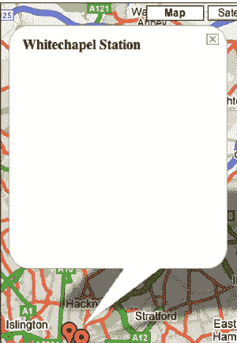

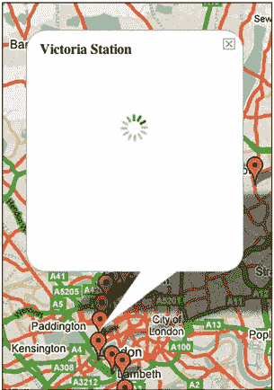

左边有什么在发生吗？服务是否找到了任何照片？服务器是否超时？用户不知道。这种情况并不致命，但表明我们必须处理时序问题。一个完全合理的做法是告诉用户确实有事情正在发生，请耐心等待。在右边，我们在用户界面中添加一个“loading”图形来告诉用户等待。

如果我们点击了一个标记，你是更愿意看到左边空白，还是像右边那样的状态反馈？

要添加此功能，我们只需在打开 InfoWindow 时传递的 HTML 字符串中添加一个图像标签即可。

```
marker.openInfoWindowHtml("<div style=\"width:220px; height:250px;\\\n\"><b>\" + stationName + \"</b><p style=\"text-align:center;\"></p></div>\");
```

## 自行制作加载图形


到处都有许多存储库提供可免费下载使用的加载图像。如果没有一个符合你的口味，你可以自己制作。幸运的是，有一个网站可以帮助你。Ajaxload.info (http://www.ajaxload.info/) 提供许多基本的加载设计，并允许你使用任何颜色进行自定义。

## 解析 AJAX 响应

让我们继续我们的响应解析代码。本节将介绍如何从对 Flickr 服务的调用中获取数据以及如何更新网页。第一步是创建 parseFlickrSearch()，这是我们在使用 XMLHttpRequest 发出 HTTP 请求时指定的回调函数。

```
function parseFlickrSearch() {
    if (g_xmlHttp.readyState == 4) {
        var results = eval('(' + g_xmlHttp.responseText + ')');
        var photo = results.photos.photo;
        var totalPhotos = results.photos.total;
        var l_flickrString = "";
    }
}
```

我们首先检查请求的状态。如果请求已完成，我们将继续执行代码。之前我们并不知道，通过等待，我们实际上是在处理一个竞态条件。

if 语句之后的第一条语句将存储在 XMLHttpRequest 属性 responseText 中的 Flickr 响应放入 results 变量中。这是在代码通过 eval() 执行之后。

下一行直接进入返回的照片列表。记住 Flickr 服务响应的前几行：

```
<?xml version="1.0" encoding="utf-8" ?>
<rsp stat="ok">
<photos page="1" pages="20" perpage="100" total="1904">
    <photo id="412962278" owner="43203076@N00" secret="63e7e2e1f0"
    server="183" farm="1" title="Doin' Studio Time" ispublic="1"
    isfriend="0" isfamily="0" />
```

服务为找到的每张照片返回一个 photo 元素。在 JSON 中，这被视为一个数组。因此，将 photo 视为照片对象的数组。

我们设置一个变量 `totalPhotos` 来管理返回的照片总数。我们设置最后一个局部变量 `l_flickrString` 来存储来自 Flickr 的本地结果。这是一个局部变量，将被附加到全局 `g_flickrString`。

```
g_flickrString = "<div><b>" + g_stationName + "</b><br />"
```

将在 `InfoWindow` 中的 HTML 存储在变量 `g_flickrString` 中。在这里，我们通过重复车站的名称来开始字符串，该名称在标记首次被点击时已存储在全局变量中。

```
if (totalPhotos > 0) {
  for (x = 0; x < totalPhotos; x++) {
    l_flickrString = "&nbsp;" +
      "<a href='http://www.flickr.com/photos/PHOTO_OWNER/PHOTO_ID' />" +
      "</a>";
    l_flickrString = l_flickrString.replace(/PHOTO_OWNER/g, photo[x].owner);
    l_flickrString = l_flickrString.replace(/PHOTO_ID/g, photo[x].id);
    l_flickrString = l_flickrString.replace(/PHOTO_FARM/g, photo[x].farm);
    l_flickrString = l_flickrString.replace(/PHOTO_SERVER/g, photo[x].server);
    l_flickrString = l_flickrString.replace(/PHOTO_SECRET/g, photo[x].secret);
    g_flickrString = g_flickrString + l_flickrString;
  }
}
```

这里是 Flickr 数据实际填充的地方。`if` 子句确保返回了一些结果。如果有结果返回，我们使用 `for` 循环遍历照片对象，并将循环次数限制为 `totalPhotos`。每次循环都会创建一个包含返回图片的 URL 和指向照片页面的锚标签的字符串。该字符串存储在 `l_flickrString` 变量中。为了可读性，我们在字符串中使用了一些 Flickr 值的占位符，然后使用 JavaScript `replace()` 方法将这些占位符与 `photo` 数组中的实际值交换。最后，`l_flickrString` 被附加到全局 `g_flickrString`。

```
} else {
    g_flickrString = g_flickrString + "<p>No photos found for this station.</p>";
  }
}
}
```

之后，我们关闭 if-else 块。else 语句表示如果没有找到结果，则更新 g_flickrString 并显示一条消息，告知用户搜索为空。此函数的唯一工作是创建将出现在 InfoWindow 中的 HTML 字符串。让我们看看如何使用此字符串更新 InfoWindow。

主要的填充发生在 updateInfoBox()。

```
function updateInfoBox() {
    if (g_flickrString == undefined) {
        var timeout = window.setTimeout("updateInfoBox()", 3000);
    } else {
        g_map.getInfoWindow().getContentContainers()[0].innerHTML = "<div>" + g_flickrString + "</div>";
        //Cleanup
        g_flickrString = null;
        g_stationName = null;
    }
}
```

此函数是由事件监听器调用的最后一个函数。

```
GEvent.addListener(marker, "click", function() {
    createXMLHttpRequest();
    g_stationName = stationName;
    retrieveFlickrPhotos(stationName);
    marker.openInfoWindow("<div style=\"width:220px; height:250px;\"><b>" + stationName + "</b><p style=\"text-align:center;\"></p></div>");
    updateInfoBox();
});
```

然而，请记住服务调用发生在其他地方。在信息被检索时，窗口已经存在。这又是另一个竞态条件。如果我们在设置之前调用 g_flickrString，你会发现它是未定义的。如果 g_flickrString 为空，使用 setTimeout() JavaScript 函数在三秒后再次调用自身。这种执行延迟是在 AJAX 实现中经常使用的一种策略。

如果找到了结果，我们获取 InfoWindow 框的 DOM 节点。这是通过 Firefox 中的 DOM Inspector 完成的。之后，我们可以将 g_flickrString 附加到节点中。最后，我们通过将它们设置为 null 来清理全局变量。


## London Tube Photos

经过漫长的等待，我们的 mashup 已完成。我们可以拿它去试驾。在浏览器中加载网页，并使用下拉菜单选择一条线路。该线路的标记将会出现。

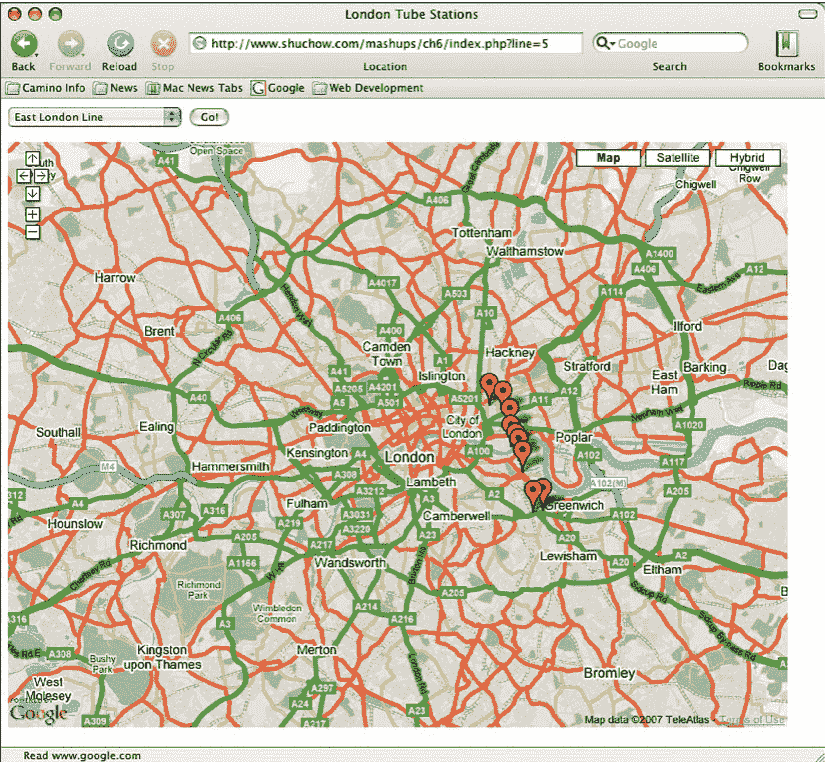

点击其中一个标记。

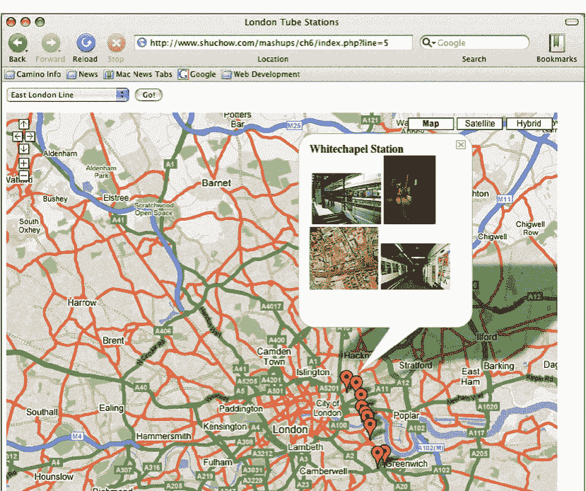

`InfoWindow` 将会弹出。通过 AJAX，我们的应用程序已经在 Flickr 上搜索我们的车站。当找到它时，前四张照片将被添加到 `InfoWindow` 中。
