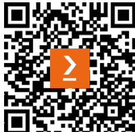

## 前言

_使用 Laminas 进行 PHP Web 开发_ 作者 Flávio Gomes da Silva Lisboa 是一本非常好的书，如果你对使用 PHP 进行 Web 开发感兴趣的话。作者展示了如何使用分步方法，通过 Laminas 开源项目（前身为 Zend Framework）实现一个完整的电子商务应用程序。我非常喜欢作者的方法，不仅介绍了框架的用法，还介绍了许多最佳实践，如测试驱动开发、行为驱动开发、敏捷开发原则等。如果你想使用 PHP 构建专业的 Web 应用程序，这绝对是一本值得拥有的书。

> _Enrico Zimuel，Elastic 首席软件工程师，PHP Framework Interop Group 成员，曾任 Zend Framework 核心开发人员_

## 贡献者

## 关于作者

**Flávio Gomes da Silva Lisboa** 是 SERPRO 的一名开发分析师，参与了巴西政府的多个项目，是软件开发课程的讲师，软件开发学科的教师，以及巴西 PHP 社区的成员。他还曾是餐厅和工业厨房桌面应用程序的程序员，以及巴西银行国际董事会的系统分析师。他有时会写科幻浪漫小说，如 *唯一者：孤独与和谐* 和 *Pandino，皇帝*。你可以在 `https://fgsl.eti.br` 上阅读更多关于他和他的冒险的信息。

我想感谢那些一直陪伴在我身边并支持我的人，尤其是我的妻子 Maria 和女儿 Koriander。她们是我想要进步的原因。这段文字之所以可读，要归功于 Divya Selvaraj 和 Rakhi Patel 出色的工作。我也要感谢 Er Galvão 和 Matt Fletcher 进行了准确的技术审查。我不能忘记 Eduardo Bona 和 Anderson Burnes，当我教授 Zend Framework（现为 Laminas）给几个 IT 学院学生班级时，他们是课程协调员。有必要也感谢 Marcos Melo、Walter Zapalowski、Guilherme Funchal 和 Antonio Tiboni，他们是 SERPRO 的同事，帮助我参与了一个使用 Zend Framework 的国际项目。最后，我需要提到与 Anderson de Paula 长期合作培训 PHP 开发者的岁月。当然，如果没有 Packt Publishing 团队的出色支持，这本书就不可能完成，他们给了我难以置信的写作体验。非常感谢 Kushal Dave、Mark D'Souza、Sonam Pandey 以及 Packt Publishing 参与本书制作的每一位成员。

## 关于审阅者

Matt Fletcher 是一位经验丰富的软件工程师，超过 20 年来一直在设计和开发 PHP Web 应用程序。他目前是 SilverDoor Apartments 的开发经理，SilverDoor Apartments 是全球服务式公寓领先的预订代理。他领导一个国际开发团队，使用 Laminas 框架和 API Tools 交付一系列企业工具。他的工作包括审查拉取请求、规划系统架构以及交付高质量项目。

## 前言

Laminas 是一个用于构建 PHP 应用程序的框架。任何编程语言都有多种框架，PHP 也不例外。那么，为什么要选择 Laminas 呢？ Erich Gamma 是一位著名的计算机科学家，也是 JUnit 和 Eclipse 等广泛使用工具的主要设计者，他表示，框架是面向对象系统中最高层级的复用。为此，框架需要受开发者的控制。框架不应该太臃肿，试图为开发者做太多事情，或者以开发者不希望的方式来做。此外，框架应始终允许开发者改变他们做事的方式——它们必须灵活。框架不应该自命不凡，强迫开发者使用其所有组件，仿佛它们就是特定问题的最终实现。框架应该足够谦逊，认识到开发者才是针对特定问题拥有最佳解决方案的人，并允许他们将自己的解决方案集成到框架的通用组件中。Laminas 是一个符合 Erich Gamma 期望的框架。Laminas 诞生于 2005 年，最初名为 Zend Framework，其架构逐渐成熟，为构建面向对象的 PHP 应用程序提供了一组松耦合且可配置的组件。

Laminas 框架使 PHP Web 开发者能够使用演进式架构创建功能强大的 Web 应用程序。开发者希望学习 Laminas，以便基于松耦合组件的复用来构建 Web 应用程序。使用 PHP 的开发者将能够通过这本 Laminas 实用指南将其知识付诸实践。本书提供了一种实践导向的实现方法和相关方法论，能让你快速上手并高效工作。本书包含对核心概念的逐步解释、实用示例和自我评估问题，你将能够快速创建复用 Laminas 组件的 PHP 程序。

你将学习如何创建分层的 PHP Web 应用程序的基本结构，理解 Laminas 的 MVC 组件，并了解如何在使用 Laminas 开发时利用 Eclipse 平台。随后，你将根据一家虚构企业的需求构建一个电子商务应用程序，并学习如何使用 Laminas 组件实现这些需求。读完本书后，你将能够使用 Laminas 在 PHP 语言中构建 MVC 应用程序。

### 本书适用人群

本书面向具备 PHP 基础知识的 PHP 开发者。适用于那些刚开始使用 PHP 进行 Web 开发之旅，并希望学习如何使用最佳工具和实践的开发者。

### 本书内容概览

第 1 章，为 PHP 应用程序引入 Laminas，阐述了 Zend Framework 从演进到更名为 Laminas 的架构发展过程，并讨论了吸取的教训。

第 2 章，为我们的电子商务应用程序搭建环境，将搭建本书中将要构建的示例应用程序的开发环境。

第 3 章，将 Laminas 作为库与测试驱动开发一起使用，通过一个基于简化用例的简单示例，解释如何在现有 PHP 应用程序中仅使用一个 Laminas 组件。

第 4 章，从对象关系映射到 MVC 容器，涵盖了使用对象关系映射处理数据库、抽象 SQL 语句，以及将 Laminas 框架作为容器用于面向对象 PHP 应用程序的控制反转。

第 5 章，创建虚拟商店项目，介绍我们计划构建的电子商务项目的需求。

第 6 章，使用行为驱动开发的模型和对象关系映射器，是我们使用 `laminas-db` 将实体关系模型映射到对象模型的章节。我们还将学习如何使用行为驱动开发方法创建模型。

第 7 章，请求控制和数据视图，展示了如何在 MVC 应用程序中使用 Laminas 的控制器层和视图层实现。

第 8 章，创建表单并实现过滤器和验证器，介绍了一些用于处理数据输入的 Laminas 组件。

第 9 章，事件驱动身份验证，涵盖了开发安全应用程序的基本主题之一：身份验证。

第 10 章，事件驱动授权，涵盖了开发安全应用程序的另一个基本主题：授权。

第 11 章，实现产品购物篮，描述了产品购物篮的实现，这是虚拟商店的一个基本组件。

第 12 章，审查并改进我们的应用程序，专门用于审查和改进示例电子商务应用程序。

第 13 章，技巧和窍门，提供了一些技巧和窍门，可帮助你作为开发者解决在构建 Web 应用程序时可能出现的一些问题。

第 14 章，最后的思考，总结全书，勾勒出我们未在示例应用程序中使用的其他组件所带来的未来可能性。


### 为了充分利用本书

| 本书涵盖的软件/硬件 | 操作系统要求 |
| :--- | :--- |
| Laminas MVC 3.3.4 或更高版本 | Windows、macOS 或 Linux |
| Eclipse IDE for PHP developers 4.24 或更高版本 | 已安装 JDK 的 Windows、macOS 或 Linux |
| XAMPP 7.4.29 / PHP 7.4.29（最低版本）或 8.1.6 / PHP 8.1.6（推荐版本） | Windows、macOS 或 Linux |

如果您使用的是本书的数字版，我们建议您亲自输入代码，或从本书的 GitHub 仓库获取代码（下一节中提供了链接）。这样做可帮助您避免与复制和粘贴代码相关的潜在错误。

### 下载示例代码文件

您可以从 GitHub 下载本书的示例代码文件：https://github.com/PacktPublishing/PHP-Web-Development-with-Laminas。如果代码有更新，将在 GitHub 仓库中同步更新。

我们丰富的图书和视频目录中还提供其他代码包，网址为 https://github.com/PacktPublishing/。请查看！

### 下载彩色图片

我们还提供一个包含本书中使用的屏幕截图和图表彩色图片的 PDF 文件。您可以在此处下载：https://packt.link/qw7ug

### 本书使用的惯例

本书中使用了多种文本惯例。

正文中的代码：表示文本中的代码词、数据库表名、文件夹名、文件名、文件扩展名、路径名、虚拟 URL、用户输入和 Twitter 账号。示例：“The .phtml files have a combination of HTML and PHP code and the .js files contain exclusively JavaScript code。”

代码块设置如下：

```
public function getArrayCopy()
{
    return get_object_vars($this);
}
```

当我们希望将您的注意力引向代码块的特定部分时，相关行或项目将加粗显示：

```
public static function encrypt(String $text)
{
    $text = strrev(hash('sha256', $text));
    return hash('md5', $text);
}
```

任何命令行输入或输出都按以下方式编写：

```
Failed asserting response code "302", actual status code is "404"
```

**粗体**：表示新术语、重要单词或屏幕上看到的单词。例如，菜单或对话框中的单词以 **粗体** 显示。示例：“保存文件并单击 Update dependencies 按钮。”

> 提示或重要说明
>
> 如下所示。

### 联系我们

我们始终欢迎读者反馈。

**一般反馈**：如果您对本书的任何方面有疑问，请发送电子邮件至 customercare@packtpub.com，并在邮件主题中注明书名。

**勘误**：尽管我们已竭力确保内容的准确性，但错误仍难免。如果您在本书中发现错误，我们将不胜感激，如果您能向我们报告。请访问 www.packtpub.com/support/errata 并填写表格。

**盗版**：如果您在互联网上以任何形式发现我们作品的非法副本，我们将不胜感激，如果您能向我们提供位置地址或网站名称。请使用包含材料链接联系 copyright@packt.com。

**如果您有兴趣成为作者**：如果您在某个主题上有专长，并有兴趣撰写或参与编写图书，请访问 authors.packtpub.com。

### 分享您的想法

读完《使用 Laminas 进行 PHP Web 开发》后，我们非常乐意听取您的想法！请单击此处直接前往本书的 Amazon 评论页面并分享您的反馈。

您的评论对我们和技术社区非常重要，将帮助我们确保提供高质量的内容。

### 下载本书免费 PDF 副本

感谢您购买本书！

您喜欢随时随地阅读，但无法随身携带印刷书籍吗？您购买的电子书与您选择的设备不兼容吗？

别担心，现在每本 Packt 图书都可免费获取该图书的 DRM-free PDF 版本。

随时随地、在任何设备上阅读。直接从您喜爱的技术图书中搜索、复制并粘贴代码到您的应用程序中。

福利远不止于此，您每天还可以在收件箱中独家获取折扣、新闻通讯和优质免费内容。

按照以下简单步骤获取权益：

1. 扫描二维码或访问下方链接



https://packt.link/free-ebook/9781803245362

2. 提交购买证明

3. 完成！我们将把免费 PDF 和其他权益直接发送到您的电子邮件。
