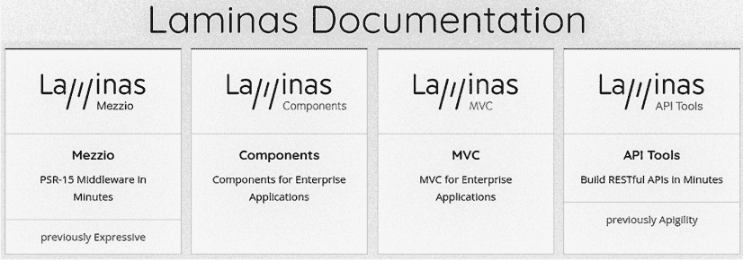

## 介绍用于 PHP 应用程序的 Laminas

2019 年 4 月，Linux 基金会宣布启动一个新项目：Laminas。这实际上是一个自 2006 年起就存在的项目的新名称，即 Zend Framework。从那时起，安装量已达 4 亿次的 PHP 框架有了一个供应商中立的家。但 Zend Technologies 多年来并未放弃其同名产品。Zend 继续提供企业支持，其中包括关键任务支持、企业适配器扩展、长期支持以及来自 PHP 专家的按需指导。

本章介绍了 Zend Framework 架构直到更名为 Laminas 的演进过程，并讨论了吸取的教训。在本章中，您将了解框架团队在其演进过程中为何做出某些决定而不是其他决定。这些主题是开发者使用框架的动机，而 Laminas 被介绍为 PHP 开发者的一个选择。

在本章中，我们将讨论以下主题：

- 我们为什么需要 Web 框架？
- 从 Zend Framework 到 Laminas
- Laminas 社区的技术和社会基础设施

### 我们为什么需要 Web 框架？

有人可能会问，为什么我需要框架？这样的人也可能会问，为什么我需要使用类？毕竟，PHP 很简单，不需要类。只需几行代码，您就可以生成一个带有数据库处理数据的页面。PHP 创建者 Rasmus Lerdorf 在演讲中始终声称，PHP 速度快，工作时既不需要类也不需要框架。2014 年，Mariano Iglesias 在 PHP Conference Brazil 上发表演讲，捍卫无框架的未来。嗯，Rasmus 和 Mariano 都是对的，这取决于我们讨论的软件复杂性。我们无法将只有几个统计数据的个人页面与企业系统相比。当我们谈论面向对象编程（OOP）和框架时，我们主要谈论的是复杂性控制。

Martin Fowler 表示，大多数人对 **架构** 一词认同的含义之一是一组难以更改的决策。对于软件项目，这些决策涉及软件的期望特征。当您思考软件的期望特征时，重要的是要记住，交付第一个稳定版本只是软件生命周期中的一个里程碑。

### 持续集成和持续交付

您一定听过 **持续集成** 和 **持续交付** 这两个术语。这些方法之所以存在，是因为变化是持续的。软件可能因多种原因而更改：可能需要新功能，因为客户要求或竞争对手已经拥有它们，必须修复错误，计算机平台在发展，受众在增长，立法在变化。因此，客户、竞争对手、环境和政府将迫使软件发生变化。对于未来我们可能有许多疑虑，但可以肯定的是，变化一定会发生。

> 注释
>
> Jean-Marcel Belmont 将持续集成定义如下：
>
> “[...] 一项源代码在主干上同时合并和测试的软件工程任务。[...] 持续集成是持续的，因为开发人员在开发软件的同时可以持续集成软件组件。” 您可以在 Jean-Marcel Belmont, Packt Publishing 的《Hands-On Continuous Integration and Delivery》中了解更多信息。
>
> Jez Humble 和 David Farley 在其书籍《Continuous Delivery》(Addison-Wesley) 中，将此术语定义为尽可能频繁地发布软件新功能，以降低交付所带来的风险。

软件是一个不断成长的有机体。Frederick Brooks 在他的著作 *人月神话* (Addison-Wesley) 中指出，软件存在四个复杂度级别：

- 一个 **程序**，其算法只能存储在一个人脑中；换句话说，只有一个人能理解它。这是一个任务非常有限的特定程序。
  - 此类软件满足特定需求，可以在简短的对话中解释，尽管只有创建者才能运行和维护它。
- 一个 **编程产品**：任何人在极少文档的情况下即可运行和维护的程序，并且人类可读。
- 一个 **编程系统**：一组程序，其中一个程序与其他程序结合以执行更复杂的任务。


- **编程系统产品**：比单个程序复杂和昂贵九倍，其逻辑能装进单个程序员的脑袋里。

这种软件需要一个庞大的团队来维护。它无法装进一个人的脑袋。不容易解释它是如何工作或如何组织的。但根据 Brooks 的说法，这是大多数软件开发工作的目标。

> **注意**
> 《人月神话》是软件工程领域的经典著作。尽管它是在敏捷软件开发兴起之前写成的，但其对软件开发复杂性和任务并行化困难的分析至今仍然适用。

处于持续变化中的复杂软件需要长期保持一些特性。我们说的是经久耐用的软件，而不是用一周就扔掉的软件。有些软件是短暂的，因此你不必过分担心其结构。自动代码生成工具非常适合生成很快就会被丢弃的代码。但需要演进的软件需要深入理解软件的工作原理。事实上，经久耐用的软件需要一些关键特性：最小复杂度、松耦合、可扩展性和可重用性。这些可取特性中的每一个都与一个关键特性相关联：易于维护。

说复杂系统必须具有最小复杂度似乎有悖。实际上，当我们说编程系统产品复杂时，我们指的是一个拥有许多部分且规模庞大的系统。最小复杂度指的是这些部分的内部组织及其连接方式。并不指望开发团队的每个成员随时都了解整个系统的一切，但理想情况下，团队中的任何成员都能轻松理解系统的一部分，以便在必要时进行更改。

Erich Gamma 在接受 Bill Venners 采访时表示，当前的软件环境过于复杂，如果不复用现有代码就无法创建应用程序。Gamma 假设 OOP 是开发的标准范式，因为它提供了复用所必需的可扩展性。Gamma 指出，OOP 中有三种复用级别：类复用、模式复用和框架。他强调，框架是最高级别的复用，因为它们识别了解决问题的关键抽象，并提供包含多名开发者的知识和经验的实现。

> **注意**
> 你可以在 https://www.artima.com/articles/erich-gamma-on-flexibility-and-reuse 阅读与 Erich Gamma 的完整访谈。

## 框架的有用性

当你使用框架开发软件时，你不仅像使用类库那样复用类。类库就像软件开发中的外包。你使用类库是因为你想专注于特定的业务问题，而不是别人已经解决的通用问题。但你会调用类库中的类。框架遵循好莱坞法则：不要打电话给我们，我们会给你打电话。框架类会调用你的类。它负责软件的通用行为，并允许你定义自定义行为。当你使用框架时，就像你的软件是一个特许加盟商。你的软件共享其他软件拥有的相同基础设施。当特许人解决一个问题或改进业务的某个功能时，它会为所有加盟商解决。当框架为一个问题提供解决方案时，它会为使用它的所有应用程序解决一个通用问题。正如地下城主所说，一个人的命运是所有人共享的。

我们使用框架是为了让软件易于维护。因此，框架必须帮助我们创建最小复杂度的代码，并使用松耦合组件复用现有代码。一旦框架实现了设计模式和架构模式，它就为通用问题提供了解决方案，因此在其演进过程中，它专注于改进通用解决方案。Erich Gamma 表示，框架在高级别提供默认功能。对软件默认问题的关注使该框架能够控制应用程序，就像经理或顾问一样。

当我们看到像 Mariano Iglesias 这样优秀的软件开发者反对框架时，他实际上是在反对别的东西：框架病（frameworkitis）。正如 Bill Venners 在与 Erich Gamma 的对话中所说，这个术语意味着“想把一切都变成框架的疾病”。Erich Gamma 说，一些名为框架的软件实际上想为开发者做太多的事情。问题是，当它们尝试这样做时，以并非所有开发者都想要的方式去做——甚至更糟的是，以开发者无法更改的方式去做。

一个真正的框架必须说：“不用担心，我控制你的应用程序，并会为你处理通用问题。”而患有框架病的框架则会说：“不用担心，我生成代码并以最佳方式为你做一切，你不需要更改我的实现——事实上，你无法更改。”嗯，这种行为与不断变化的场景背道而驰。框架病让开发者从爱变成恨。起初，他们爱上一个似乎能为他们做一切的工具，然后又恨上那个他们被绑定且无法更改的工具。幸运的是，Laminas 并非如此。

## 从 Zend Framework 到 Laminas

在电影《X战警》（2000）的开场中，查尔斯·泽维尔教授说，突变是我们进化的关键。他补充说，正是通过突变，我们才从单细胞生物进化成为地球上的主导物种。软件就像一个有机体。它需要演进才能生存。有时它需要进行大量改变，看起来就像突变。改变的必要性要求软件允许被更改。难以更改的软件是灭绝的候选者。

软件的演进可能表现为用另一个组件替换一个组件。替换可能是为了维护或改进可扩展性、性能或安全性所必需的。但是，如果更换软件的一个组件很难或几乎不可能，改进就必须以困难的方式进行，通常是通过重写现有代码。

模式有助于组件替换，因为组件共享相同的模式。如果公司里每个开发团队都为组件使用不同的模式来创建软件，那么共享组件就会很困难，从而禁止复用，而复用是经久耐用软件的可取特性。

## 我与 Zend Framework 的初次相遇

2005 年，我加入了一家拥有多个软件开发部门的大型 IT 公司。该公司开发政府软件，并拥有数千个使用各种编程语言的项目。问题是，每个团队都为其项目使用不同的标准，因此组件复用几乎不存在。此外，过去由初始编码量低的工具所做的决策历史，在长远来看导致了技术锁定。多个团队使用了框架，但每个团队都为同一种语言使用了不同的框架。因此，共享组件的困难依然存在。

2007 年，我正在为一个正在勘探新技术的部门工作，我的团队必须选择一个框架来标准化公司的 PHP 应用程序开发。巧合的是，那年在圣保罗市举办了一场关于 PHP 框架的研讨会。我们参加了此次活动，并聆听了三场演讲，每场都关于一个框架：CakePHP、Symfony 和 Zend。我之前已经从第一届 PHP 巴西大会了解了 CakePHP，我公司的几位同事已经在使用 Symfony。然而，Zend Framework 对我来说是一个全新的事物。这不应该令人惊讶，因为 Zend Framework 的第一个稳定版本就是那年发布的。但它自 2005 年起就一直在开发中。

观众对 CakePHP 和 Symfony 演讲的反应类似。当演讲者在终端执行生成代码的命令时，观众说：“_哇！_”但在 Zend 的演讲中，当他们看到没有代码生成器时，他们感到沮丧。演讲者听取了抱怨并回答说，虽然 Zend 没有代码生成工具，但它非常灵活，不会过于强加。幸运的是，一位听众指出，该框架架构似乎关注维护应用程序，而不仅仅是创建它。

离开活动现场时，我听到几个人说他们会使用 CakePHP 或 Symfony，强调代码生成工具。这些人可能没有深入的软件开发经验，或者更确切地说，没有维护现有软件的经验。还有其他工具可以帮助代码生成，例如集成开发环境。框架是可复用的，是复用代码的工具，而不是新代码创建工具。


其中一位演讲者正在销售一本关于五个框架分析的书籍，其中包括当时活动上介绍的三个框架。我买下了它，阅读了它，并对这些框架进行了测试，用每个框架实现了相同的应用。在分析的五个框架中，具有最小复杂度、松耦合、可扩展性和可重用性等最佳特性的是 Zend Framework。它高度可配置，并且不会阻止使用其他框架的组件。当时，**PHP 框架互操作性组**（**PHP-FIG**）尚不存在，但我们需要提供互操作性的工具。

## PHP 框架互操作性组

2009 年，在 PHP Conference Brazil 上，一些 PHP 演讲者做了一场名为 _PHP 框架_ 的讲座。这是对“框架之争”的一种戏弄性引用。每位演讲者都捍卫自己最喜欢的框架并攻击其他框架。也许并非真正存在框架之争，但事实是，一旦你采用了某个框架，就很难使用其他框架的组件，因为每个框架都遵循自己的模式。这种情况在同一年，即 2009 年开始改变，当时一群 PHP 专家在美国芝加哥会面，为 PHP 社区建立组件规范。这个组最初被称为 PHP 标准组。第一个规范是关于自动加载标准——这有助于 Composer 的出现。2011 年，该组将名称更改为 **PHP 框架互操作性组**（**PHP-FIG**）。此后，出色的 PHP 项目的成员们会面讨论并编写名为 **PHP 标准推荐**（**PSRs**）的规范。多个框架和其他 PHP 应用程序已采用了 PHP-FIG 的规范。

## Zend Framework – PHP 应用程序的参考架构

Zend Framework 使我们能够为 PHP 应用程序创建参考架构，帮助应用程序演进。应用程序可以使用内部组件（位于其结构内且仅为其服务的组件），也可以使用可重用组件（由多个应用程序共享的组件）。一个组件可以执行超出参考架构模式实现职责的任务，甚至可以替换某一层的实现（但使用相同的接口）。

要解决特定问题，软件架构师首先必须寻找现有的可解决该问题的组件。如果存在但不满足所有要求，应分析扩展它的可能性。只有作为最后手段，才应创建新组件。在这种情况下，组件作为内部组件诞生，以满足特定应用程序的需求。但组件架构必须被视为通用架构，以便以后可以发布和改进，使其成为可重用组件。Zend Framework 有一个关注这些问题的结构。

Zend Framework 的首个稳定版本是在 PHP 5.3 之前发布的，因此 ZF1 没有使用命名空间。当时尚未有 Composer，所以 ZF1 有自己的自动加载实现。但正如我提到的，Zend Framework 结构中存在的一个方面是能够进行更改的可能性。事实上，不稳定版本已经带来了如下可配置代码：

```
Zend_Controller_Front::run('/path/to/controllers' );
```

Zend Framework 不会确定控制器类的目录，而是让开发者自行选择。曾经有一个建议的项目结构，今天有一个 **模型-视图-控制器**（MVC）应用程序骨架可供开始构建应用程序，但更改项目元素地址的可能性仍然存在。

Zend Framework 的另一个有趣特性是认识到 PHP 应用程序已经存在，你需要演进现有应用。新项目并不总是有需求，但生产环境中运行的应用需要维护。因此，Zend Framework 从一开始就允许使用与 MVC 实现解耦的组件。能够使用 Zend Framework 组件重构应用程序，意味着可以将非核心业务任务外包出去，而无需更改所有内容。变更是必要的，但如果能够缓慢、逐步且安全地进行，会更好。

Zend Framework 逐步演进，与 PHP 编程语言和其他软件开发技术的演进保持同步，同时融入设计模式和编程范式。2008 年，Zend Framework 1.5 版本采用了带有 `Zend_Layout` 组件的 **两步视图** 模式，并提供了一个创建动态表单的组件 `Zend_Form`。同年，1.6 版本通过 `Zend_Test` 组件扩展了 PHPUnit。2009 年，Zend Framework 获得了代码生成工具 `Zend_Tool` 和反转控制组件 `Zend_Application`。Eclipse 和 Netbeans 等 IDE 很快就提供了与 `Zend_Tool` 的集成。

即使在第一个主要版本中，Zend Framework 也开始（甚至可选地）提供创建模块的可能性。在 Zend Framework 术语中，模块是可以重用的自包含单元。模块架构非常适合必须划分为多个子系统的复杂系统。在微服务的世界里，模块允许你创建一个最初是单体应用，但可以逐渐转换为分布式系统的应用程序。

你可能会问，_我们为什么不直接使用微服务来创建应用程序呢？_ 答案是另一个问题：_这真的有必要吗？_ 今天，我们拥有云环境提供的弹性资源，但这并不是分配我们暂时不需要的资源的理由。我们不需要提前做出改变，但要为改变做好准备。蛋糕有足够的烘烤时间。

在 2.0 版本中，Zend Framework 演进了模块架构，并提升了组件的一致性和性能。代码被重构为使用命名空间，并引入了两个新组件：`EventManager`（MVC 实现使用的事件驱动编程多种策略的组合）和 `ServiceManager`（依赖注入容器）。自 2.0 版本以来，组件之间的解耦程度显著提高。

2.5 版本为 Zend Framework 带来了激进的变化。每个组件都有了自己的版本控制仓库，并拥有独立的生命周期。此外，类的自动加载和组件安装现在由 Composer 处理。在 2.4 版本之前，Zend Framework 是一个 _全部下载但只使用所需内容_ 的框架。从 2.5 版本开始，它变成了 _下载并仅使用所需内容_ 的框架。

Zend Framework 3.0 版本将 PHP 的最低依赖版本更新至 7 版本，充分利用了语言中实现的改进。此外，Zend Framework 3.0 带来了一个专门用于创建中间件的微框架 **Expressive**。这个微框架严格遵循 PHP-FIG 的 PSRs，并且与所使用的组件完全独立。

Zend Framework 就这样结束了。是的，它结束了，因为正如我们在章节开头所说，它现在叫做 Laminas。_Lamina_ 意为 _刀片_。之所以取这个名字，是因为该框架允许创建分层应用程序，但层要薄，也就是说，具有最小必要层大小。正如 X 教授所说，演进是缓慢的。但有时演进会跨越式前进。从 Zend Framework 到 Laminas 的变更要求对所有类名进行重构。此外，社区的技术和社交基础设施也在改变。但这次跃进是好的，因为一个拥有多年经验的框架现在更加开放了。你将在这里学习它！

## Zend Framework 与 Laminas 的区别

在社区生态系统方面，Zend Framework 与 Laminas 存在一些差异。Zend Framework 作为一个开源项目，接受代码贡献。Laminas 同样可以接收捐赠，因为它隶属于一个非营利组织。Zend Framework 有论坛和 Slack 频道供社区进行讨论和贡献。此外，Laminas 每月举行面向公众的会议，并记录 **技术指导委员会**（TSC，一个由具备技术知识并管理项目的成员组成的团体）的投票。换句话说，Laminas 比 Zend Framework 更开放社区参与，也更加透明。这很好！你可以 - _如果你愿意_ - 积极参与到一个帮助你创建面向对象 Web 应用程序（内置多种设计模式）的产品开发中来。

Steve McConnell 指出，编程语言的选择是软件项目的关键构建决策。PHP 社区则表示，PHP 特别适合 Web 开发。但编程语言只是你在创建和维护 Web 应用程序项目时需要考虑的众多方面之一。这就是我们要讨论 Laminas 的原因。

## Laminas 社区的技术和社交基础设施

我们将讨论 Laminas 的许多功能，但当然不会涵盖一切。Laminas 的主要参考来源是官方文档，可在 `https://docs.laminas.dev` 上查阅。




图 1.1 – Laminas 文档主页

文档主页上的 **组件** 和 **MVC** 选项与本书内容直接相关。不过，Laminas 还包含微框架 **Mezzio**（原名 Expressive）和 **API 工具**，后者是一个基于 Laminas 组件构建的 API 生成器。

所有组件的源代码可在 `https://github.com/laminas` 处供下载和贡献。你会发现有超过 100 个包含成熟组件的仓库。在此页面上，你可以打开 issue 来修复错误或请求新功能——请记住，对于功能，你获得的响应程度将取决于社区的兴趣。如果你有改进现有组件甚至创建新组件的想法，请提交实现代码，而不仅仅是规范说明。为自由开源项目做贡献是了解软件开发的绝佳方式，也能帮助你在同行中建立知名度，他们随后可能成为你的顾问。为 Laminas 做贡献的指南可在 `https://github.com/laminas/.github/blob/main/CONTRIBUTING.md` 处找到。

Roger Pressman 将软件定义为计算机程序及其相关文档的组合。人也是软件文档的一部分，因为他们通常持有尚未转化为显性知识的隐性知识。当文档不足时，我们可能需要寻求他人的帮助，录音对话也可以成为文档。你可以在官方讨论论坛中与参与或关注 Laminas 的人交流，该论坛可在 `https://discourse.laminas.dev` 访问。

你可以通过向 `security@getlaminas.org` 发送消息来报告潜在安全漏洞。如需了解 Laminas 的安全策略，请阅读 `https://getlaminas.org/security`。

你可以通过打开 issue 并在论坛上发帖提问来获得社区支持；你甚至可以通过扩展组件自己解决问题。但如果你需要 *按需咨询支持* 或 *长期支持*，可以考虑 Zend Technologies 的企业支持。如需了解该服务的更多信息，请阅读 `https://www.zend.com/products/laminas-enterprise-support`。

在对 Laminas 进行此概述后，下一章我们将准备使用该框架进行开发的环境。

### 摘要

软件就像一个生命体：它诞生、成长，终有一天会消亡。当然，我们不希望自己的软件过早消亡。为此，我们需要赋予软件一些特性，使其能够长期生存。本章我们讨论了有助于创建可重用且易于维护软件的框架。

我们介绍了 Laminas 的历史，它是一个用于构建 PHP Web 应用程序的免费开源框架。我们展示了它的演进过程，以及它作为可演进应用程序框架的设计方案。

在下一章，我们将准备使用 Laminas 开发 PHP Web 应用程序的环境。
