## 为我们的电子商务应用程序设置环境

要建造一栋房子，我们需要各种工具和材料。工具越先进，盖房子就越容易；材料越好，房子越耐用。软件亦是如此。合适的工具可以帮助提高生产力，合适的组件可以使软件更容易维护。在本章中，我们将为本书中将要构建的示例应用程序设置开发环境：一个允许客户注册和购买商品的虚拟商店。所选工具均为面向世界上最常用操作系统的免费开源软件（OSS）。

本章将涵盖以下主题：

- 安装通用 PHP：超文本预处理器（PHP）环境，包括 Web 服务器、PHP 解释器和关系数据库管理系统（RDBMS）
- 安装和使用 Laminas 的两种不同方式
- 安装集成开发环境（IDE）——Eclipse 平台
- 将 Laminas 相关命令集成到 Eclipse 工具栏
- 本书练习中将使用的数据模型

具体来说，本章将包含以下部分：

- 安装 Laminas
- 配置 IDE——适用于 PHP 开发者的 Eclipse
- 集成 Laminas 和 Eclipse
- 管理 MySQL

### 技术要求

本书使用 Laminas MVC 3.3.4，该版本至少需要 PHP 7.4。然而，PHP 7.4 的支持已于 2022 年结束，因此建议至少使用 PHP 8.0，并鼓励使用 PHP 8.1。你可以在 https://www.php.net/supported-versions.php 上查看 PHP 支持的截止日期。

要创建和运行本书中的代码，你至少需要一个 PHP 解释器、一个 Web 服务器和一个 MySQL/MariaDB 实例（如果你调整数据库脚本，也可以使用 PHP 支持的任何数据库）。每种软件都有多种安装方式，且有些软件包将它们集成在一起。XAMPP 是一个捆绑 Apache HTTP Server、PHP 和 MySQL/MariaDB 的软件包。你可以从 https://www.apachefriends.org/download.html 下载适用于 Windows、Linux 或 macOS 的 XAMPP。由于它可用于世界上大多数操作系统，我们将其作为默认的 PHP 环境。此外，XAMPP 提供了一个控制面板，可让你轻松启动/停止 Apache 和 MySQL。在下面的截图中，我们展示了 Linux 上的 XAMPP 控制面板示例：

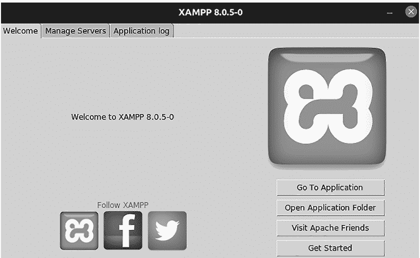

图 2.1 – XAMPP 控制面板窗口

Apache Friends（XAMPP 的托管项目）的主页有一个简短且不错的视频，介绍了安装过程：https://www.apachefriends.org/index.html。

XAMPP 还附带一个 **phpMyAdmin** 实例用于管理 MySQL 数据库。一旦你通过 XAMPP 控制面板启动了 Apache 和 MySQL，就可以在 `https://localhost/phpmyadmin` 访问 phpMyAdmin。

我们有时会使用命令行。为了避免在终端中使用 PHP 解释器的完整路径，你必须将包含 PHP 解释器的目录添加到 PATH 环境变量中。PHP 位于以下路径：

- c:\xampp\php（适用于 Windows）
- /opt/lampp（适用于 Linux）
- /Applications/XAMPP/bin（适用于 OS X）

安装好 PHP 环境后，你必须安装 **Composer**，它是 PHP 的依赖管理器。你可以从 `https://getcomposer.org/download` 下载它。将 `composer.phar` 文件放在与 PHP 解释器相同的目录中。对于 Linux 和 OS X 用户，只需将文件重命名为 `composer` 并授予其运行权限。对于 Windows 用户，请按照 `https://getcomposer.org/doc/00-intro.md#installation-windows` 中的说明操作。

从现在起，我们的工作区将是 XAMPP 安装目录下的 `htdocs` 文件夹。我们将在该文件夹中创建所有示例。请记住：在本书中，当我提到 **工作区** 时，指的就是 `htdocs`。确保 `htdocs` 文件夹具有读写权限，以便你可以使用自己的用户在其中运行命令，并使用 IDE 打开文件。

> **注意**
> 如果你已经安装了 Web 服务器、PHP、Composer 和 MySQL，可以使用它们，但本书假设使用 XAMPP，因此关于目录结构和程序的引用均与 XAMPP 相关。

### 安装 Laminas

你可以通过以下任一方式安装 Laminas：

- 为现有 PHP 应用程序（或没有 MVC 的小型应用程序）安装 Laminas 的独立组件
- 为基于 MVC 架构的新应用程序安装骨架应用程序

### 通过 Laminas 的独立组件安装 Laminas

让我们以安装对象关系映射（ORM）和数据库抽象组件 laminas-db 为例。在 htdocs 文件夹中，运行以下命令：

```
composer require laminas/laminas-db
```

此命令将创建一个名为 vendor 的文件夹并下载 laminas-db 组件及其依赖项。要加载组件的类，你需要导入 vendor/autoload.php 文件。暂时，你只需检查 Composer 是否正常工作。稍后我们将使用独立组件构建基本示例，所以不必担心。成功下载后，你可以删除 laminas-db。如仅需删除该组件，请运行以下命令：

```
composer remove laminas/laminas-db
```

此命令将删除 vendor 文件夹中的 laminas-db 组件，但会保留 vendor 文件夹。htdocs 根目录下的该文件夹（vendor）不会被使用，因此你可以将其删除。我们将为项目创建一个特定的文件夹。

### 通过 MVC 骨架应用程序安装 Laminas

要使用 Laminas 启动 MVC Web 项目，你有三种选择，如下所示：

- 1. 通过 https://github.com/laminas/laminas-mvc-skeleton Git 仓库克隆骨架。

克隆后，你需要删除版本控制。可以通过进入 laminas-mvc-skeleton 文件夹并删除其中的 .git 文件夹来完成。.git 文件夹是 Git 仓库结构的一部分。它不会显示在 GitHub 页面上，但在克隆仓库时会被创建。之后，你可以将 laminas-mvc-skeleton 文件夹重命名为你的项目名称。

- 2. 通过以下链接下载骨架：https://github.com/laminas/laminas-mvc-skeleton/archive/refs/heads/1.3.x.zip。

解压缩文件并将文件夹重命名为 laminas-mvc-skeleton。

- 3. 使用 Composer 安装骨架。

我们将使用第三种方法。为此，请运行以下命令：

```
composer create-project -sdev laminas/laminas-mvc-skeleton
myfirstlaminas
```


此命令的输出将以以下消息开头：

```
Creating a "laminas/laminas-mvc-skeleton" project at "./myfirstlaminas"
```

从存储库下载文件后，项目创建者将向您询问以下内容：

```
Do you want a minimal install (no optional packages)? Y/n
```

现在，您必须回答 Y，因为这只是下一个练习的预览。

之后，您将有一个名为 myfirstlaminas 的文件夹。我们将启动一个网页服务器，将 public 子文件夹作为 Web 根目录。为此，请运行以下命令：

```
php -S localhost:8000 -t myfirstlaminas/public/
```

当然，如果您在 Windows 上运行，目录分隔符是 \\。

您可能会收到以下错误消息：

```
Failed to listen on localhost:8000 (reason: Address already in use)
```

如果是这种情况，那是因为端口 8000 被另一个进程占用。没问题——您可以使用 8008 或其他可用端口。

假设您已成功在端口 8000 上启动网页服务器，如果输入地址 http://localhost:8000，您将能够看到以下屏幕截图中显示的主页：

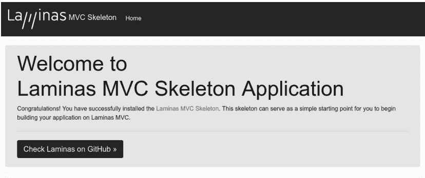

图 2.2 – MVC 骨架应用程序的主页

尝试请求一个不存在的页面，例如 `http://localhost:8000/otherpage`。在这种情况下，您将看到类似于此处所示的页面：

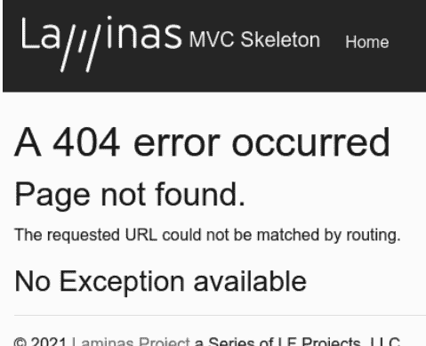

图 2.3 – 页面未找到错误页面

这些页面表明 Laminas MVC 组件已成功安装。对于我们的练习，PHP 的内置 Web 服务器已经足够，因为我们处于开发环境中。

但如果您想使用生产 Web 服务器，则有关 Apache 和 nginx 针对 Laminas 的配置的客观参考如下：

- `https://docs.laminas.dev/tutorials/getting-started/skeleton-application/#using-the-apache-web-server`
- `https://docs.bitnami.com/installer/infrastructure/nginx/get-started/use-laminas`

现在我们可以说，我们用 Laminas 制作了一个“Hello World”应用程序。框架的代码已安装并正在产生可见结果。我们有盖房子的砖块，但只用双手搬运砖块可能会很困难。有时，使用手推车不错。其他时候，使用卡车可能更好。让我们使用卡车来搬运许多软件砖块：一个 IDE。

### 配置 IDE – 适用于 PHP 开发人员的 Eclipse

Laminas 不依赖于任何 IDE 即可工作。事实上，您可以使用 Vi 或 Visual Studio Code (VS Code) 进行 PHP 编程；就最终结果而言，没有区别。但是，编程活动可能非常复杂且充满细节，在查找错误原因时很容易迷失。具体来说，使用 PHP 交付一些结果非常容易，但随着单个程序增长并成为复杂应用程序，也很容易失去控制。我们需要帮助控制软件系统复杂性的工具，并让我们专注于实现客户为之付费的用例或用户故事。

在本书中，我们建议将 Eclipse 平台用作 Laminas 的 IDE。Eclipse 具有可插拔的特性——您可以根据需要添加和删除工具。许多公司和社区为 Eclipse 提供插件，该平台有一个市场，您可以在其中找到数百个将 Eclipse 与其他系统集成的组件。您可以根据自己的实际情况调整 Eclipse，而不是为了某个工具调整工作流程。

为方便起见，已经有许多针对特定用途的 Eclipse 发行版。其中，有一个用于 PHP：Eclipse PHP 开发工具 (PDT)。您可以从 https://www.eclipse.org/pdt/#download 下载它。Eclipse 需要 Java 开发工具包 (JDK)。如果您还没有安装 JDK，请先安装，然后下载 PDT。安装本质上是文件解压缩。最终，您会在 eclipse 文件夹中得到一个名为 eclipse.exe (Windows) 或仅 eclipse (Linux/OS X) 的可执行文件。运行此文件时，Eclipse 将打开一个询问工作区的窗口。您必须输入 XAMPP 的 htdocs 文件夹路径，如以下屏幕截图所示：

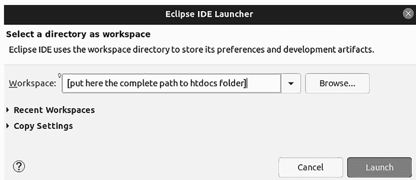

图 2.4 – Eclipse 工作区设置

定义工作区后，Eclipse 将打开带有 Welcome 内部窗口的主窗口，如以下屏幕截图所示。您可以关闭此窗口，因为我们不需要它：

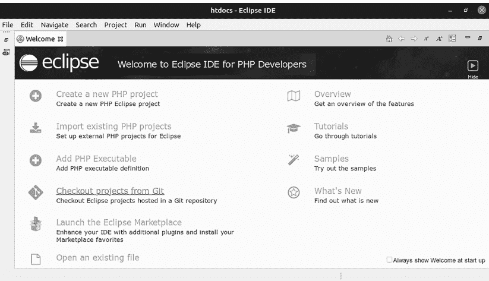

图 2.5 – Eclipse PDT 的 Welcome 视图

不必担心丢失 **Welcome** 窗口中的链接，因为其中的所有链接在 Eclipse 菜单中都可用。关闭 **Welcome** 窗口后，您将看到一组内部窗口，如以下屏幕截图所示：

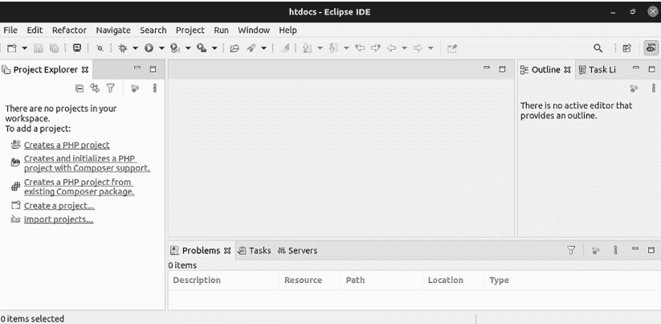

图 2.6 – Eclipse PDT 的 Welcome 视图（续）

左侧，您可以看到 **项目资源管理器** 窗口，其中以树结构列出了 PHP 项目。右侧，您可以看到一个名为 **大纲** 的窗口，可以在其中查看中央窗口中打开文件的结构；这是不同文本编辑器的容器。底部，您可以看到 **问题** 窗口，其中显示与打开文件相关的错误消息和警告。这些窗口以及与我们练习无关的其他窗口组成了 *PHP 透视*。

> **视图和透视**
> 
> Eclipse 界面中有两个核心概念：视图和透视。一个内部窗口称为 *视图*，而一组视图称为 *透视*。您可以通过单击 **窗口 | 显示视图** 打开任何视图。同样，您可以通过 **窗口 | 透视 | 打开透视** 打开一个透视。

当然，Eclipse 还有更多功能。请放心，我们将在需要时讨论每个与 Laminas 开发相关的功能。接下来，我们将学习如何将任何程序与 Eclipse 集成，以及为什么这对于使用 Laminas 很有用。

### 集成 Laminas 和 Eclipse

在集成用于创建 Laminas 项目的命令后，我们需要在 Eclipse 中配置 PHP 环境。

您可以按照以下步骤操作：

- 1. 转到 **窗口 | 首选项 | PHP**。
- 2. 首先要定义的项目是 PHP 可执行文件。
- 3. 选择左侧的 **已安装的 PHPs** 项目，如以下屏幕截图所示，然后单击右侧的 **添加...**：

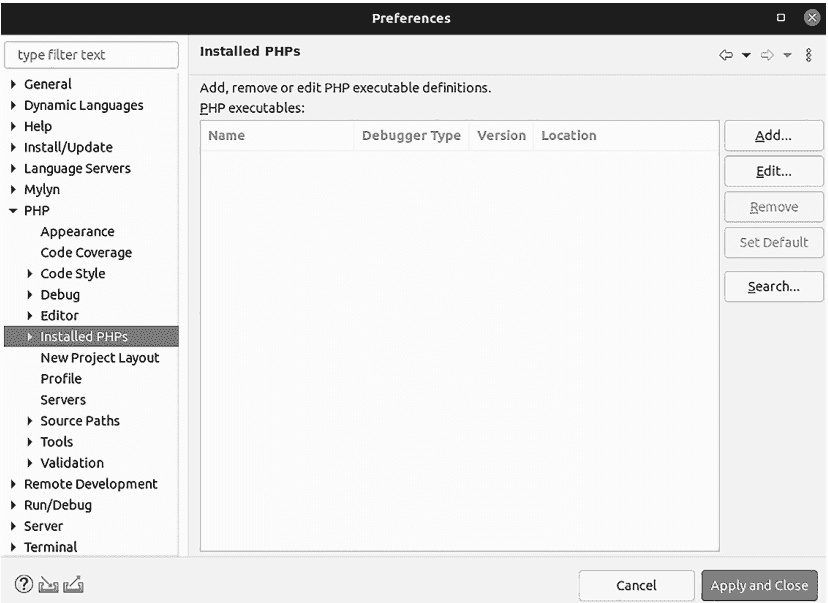

图 2.7 – PHP 环境首选项

- 4. 将打开一个窗口，如以下屏幕截图所示。您必须配置多个 PHP 可执行文件，因此每个文件都必须有不同的名称。在这里，我们将使用仅一个名为 PHP 的可执行文件：

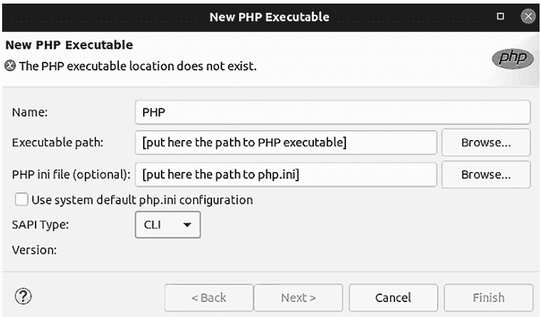

图 2.8 – PHP 可执行文件配置

- 5. 填写 PHP 可执行文件和 php.ini 文件的路径。
- 6. 选择 SAPI 类型值，然后单击完成。

现在，我们将在 Eclipse 中配置调用 Composer 的 create-project 命令。您可以通过单击 运行 | 外部工具 | 外部工具配置... 来完成此操作，以达到以下屏幕：

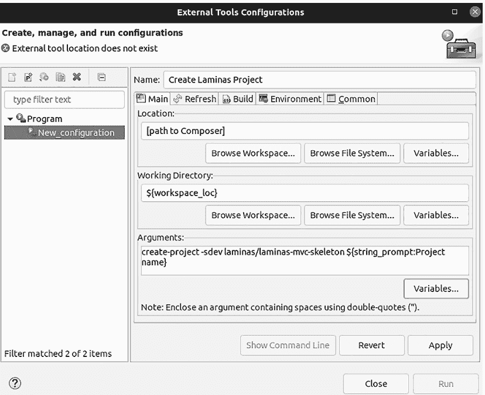

图 2.9 – Composer create-project 的配置

接下来，双击 *图 2.9* 所示屏幕左侧的 **程序** 以创建新的程序配置。在右侧，您将看到一个 **主** 选项卡，您将以如下方式填写它：

- **名称**: 创建 Laminas 项目
- **位置**: 这里，您必须键入 Composer 可执行文件的完整路径
- **工作目录**: ${workspace_loc}
- **参数**: create-project -sdev laminas/laminas-mvc-skeleton ${string_prompt:Project name}

${...} 等表达式是 Eclipse 变量。${workspace_loc} 变量包含当前 Eclipse 工作区的完整路径。${string_prompt} 变量则包含用户在对话框中输入的文本。当 Eclipse 运行程序时，将打开此对话框。您可以编写要在此对话框中显示的消息，方法是在 string_prompt 术语后加上冒号并附加文本。因此，要显示“项目名称”消息，请编写 ${string_prompt:Project name}。还有其他变量，您可以通过单击“变量”按钮查看所有变量。

主选项卡显示程序的工作部分，但为了使程序出现在 Eclipse 工具栏中，我们必须在 常用 选项卡下选择一个选项，如以下屏幕截图所示：

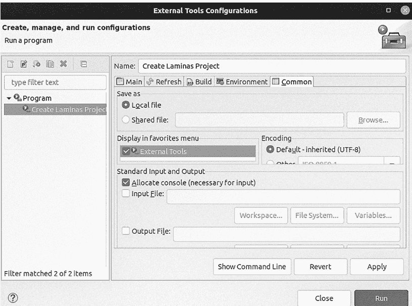

图 2.10 – 将程序启用为菜单项

如图 2.10 所示，常用 选项卡有一个名为“在收藏夹菜单中显示”的框。您必须选中框内的 外部工具 选项，以便程序在菜单中可见。之后，您可以单击 应用 以保存配置。

然后，您可以单击工具栏中的 外部工具 按钮。该按钮的图标是一个带有红色工具箱的绿色播放符号。如以下屏幕截图所示，该按钮将打开一个包含我们的“创建 Laminas 项目”程序的列表：


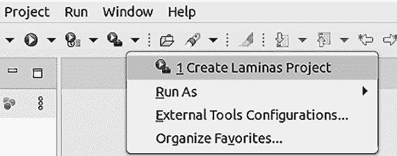

图 2.11 – 菜单中的“创建 Laminas 项目”命令

单击**创建 Laminas 项目**将打开一个对话框，如以下屏幕截图所示。将`mysecondlaminas`作为项目名称，然后单击“确定”：

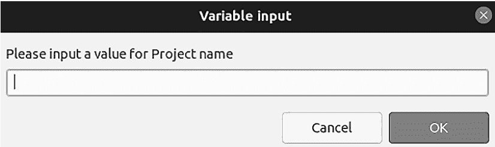

图 2.12 – “创建 Laminas 项目”命令的对话框

名为**控制台**的视图将在底部打开，并显示您在终端中运行该命令时会看到的相同输出。当`<terminated>`出现在**控制台**视图的顶部时，即表示完成，如以下屏幕截图所示：

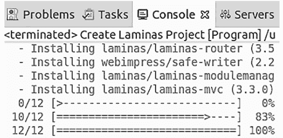

图 2.13 – 控制台视图

要打开新项目，您必须访问以下屏幕截图中显示的“文件 | 新建 | PHP 项目”菜单。将**项目名称**字段填写为`mysecondlaminas`，然后单击**完成**：

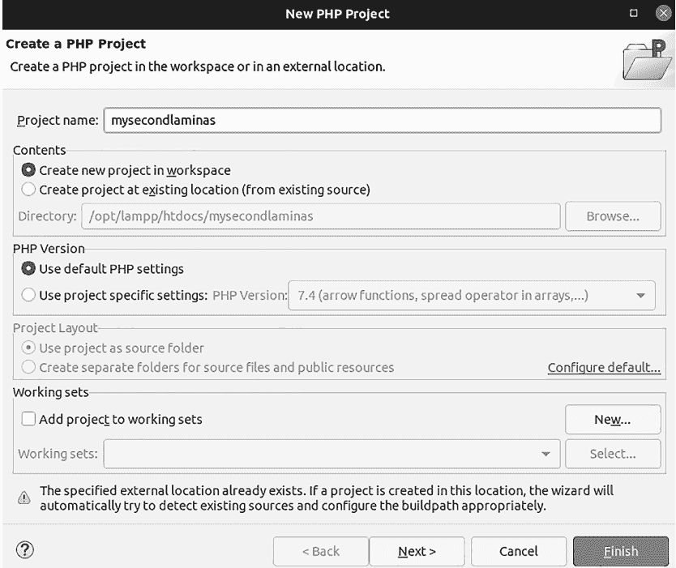

图 2.14 – 新 PHP 项目屏幕

`mysecondlaminas`项目现在将在**项目资源管理器**视图中打开。如果您单击项目名称，它将显示其内容，如以下屏幕截图所示：

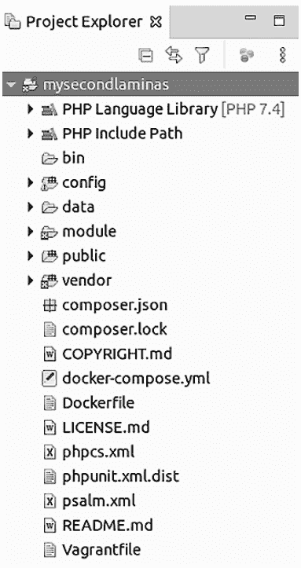

图 2.15 – mysecondlaminas 项目

该项目不是由 Eclipse 创建的，而是因为它已存在而与 Eclipse 关联。现在，Eclipse 将 mysecondlaminas 文件夹识别为 PHP 项目，并启用与该编程语言相关的所有功能。

现在您知道如何在 Eclipse 中创建 Laminas 项目了，您可以删除 mysecondlaminas 项目。为此，您必须右键单击项目名称并选择**删除**。这将打开以下对话框：

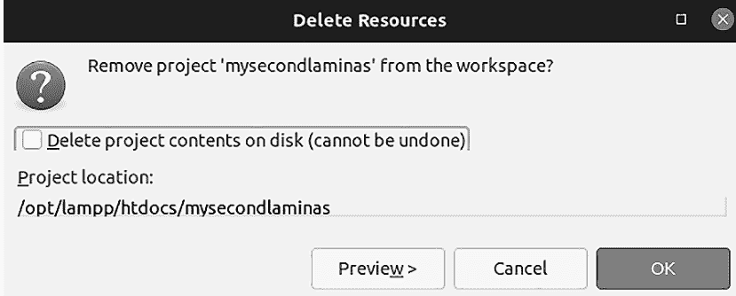

图 2.16 – 删除资源对话框

现在冷静点。等等。如果您单击“确定”，将取消该项目作为 Eclipse 项目的关联。它将继续存在于文件系统中。要真正删除项目并删除所有文件，您必须选中**删除磁盘上的项目内容（此操作无法撤销）**选项。是的，这是一条令人生畏的消息，但您可以选中它并删除`mysecondlaminas`项目，因为我们不再需要它了。是的，这次您可以单击“确定”——无需担心。

如果我们需要在 Eclipse 与其他程序之间进行更多集成，我们将适当地进行这些集成。目前，只需知道您能够将程序集成到 Eclipse 工具栏中即可。此外，您可能也迫不及待地想要做点什么——我是说，一些可以运行的代码。保持冷静——在开始编码之前，我们需要为练习定义数据模型。我们开始吧！

### 管理 MySQL

如前所述，XAMPP 自带一个用于管理 MySQL 数据库的 phpMyAdmin 实例，可通过 `https://localhost/phpmyadmin` 访问。在 XAMPP 中，默认情况下 MySQL 超级用户 `root` 没有密码。因此，当您第一次访问 phpMyAdmin 时，将进入 phpMyAdmin 主页，如以下屏幕截图所示：

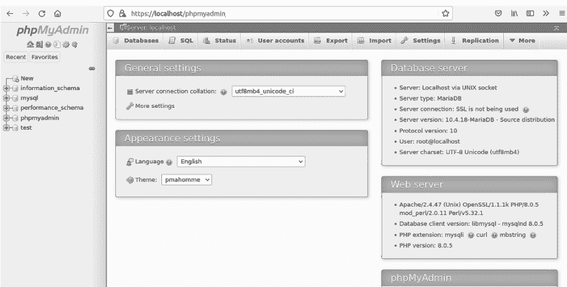

图 2.17 – phpMyAdmin 主页

此页面包含两个框架：左侧显示数据库树，右侧显示环境概览。

如您所见，已经存在一些系统数据库，例如 information_schema 和 performance_schema。还有一个名为**新建**的节点。单击**新建**，您将在右侧看到以下屏幕截图所示的框架：

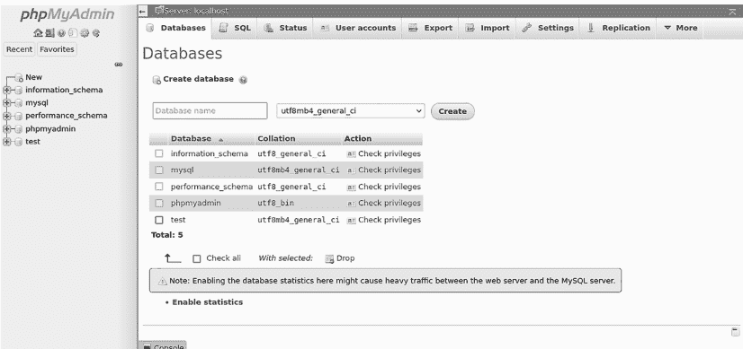

图 2.18 – phpMyAdmin 主页（续）

您可以使用此框架创建将在我们的练习中使用的数据库。只需填写数据库名称的输入文本，然后单击**创建**。我们需要创建两个数据库：`school` 和 `whatstore`。创建它们。您将能够在左侧看到它们。不用担心表，因为我们将使用脚本来创建它们。这些脚本可在 https://github.com/PacktPublishing/PHP-Web-Development-with-Laminas/tree/main/databases 获取。

`school` 数据库将用于_启动引擎_。它只有两个表：`classes` 和 `students`。它是一个学校系统的精简版，但存在一对多关系。带有字段和数据类型的表结构可以在以下屏幕截图中看到：

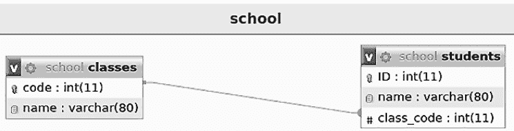

图 2.19 – school 数据库的数据模型

`whatstore` 数据库将用于我们的挑战性练习——电子商务应用程序。它有 12 个表，分为 2 组。

一组是业务核心，由以下表组成：

- customers
- discounts
- inventory
- order_items
- products
- purchase_orders
- transactions

另一组是管理模块，由以下表组成：

- employees
- employee_roles
- resources
- resources_role
- roles

带有字段和数据类型的表结构可以在以下屏幕截图中看到：

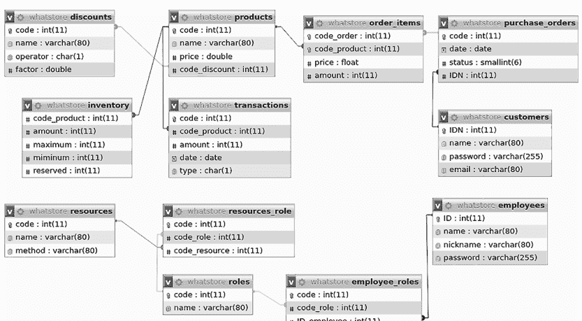

图 2.20 – whatstore 数据库的数据模型

`school` 数据库的脚本是 `school.sql` 文件，`whatstore` 数据库的脚本是 `whatstore.sql`。您可以从 GitHub 仓库下载它们。

几段前我告诉过您什么是**统一资源定位符 (URL)**——还记得吗？要从这些脚本创建表，我们可以使用 phpMyAdmin 的导入页面。首先，在左侧选择一个数据库，单击其名称。例如，让我们选择 `school` 数据库。选择该数据库后，单击右侧框架中的**导入**选项卡。然后，您将看到类似于以下屏幕截图所示的页面。要导入脚本，请单击**浏览**按钮并在文件系统中查找文件。对于 `school` 数据库，脚本是 `school.sql`，对吧？

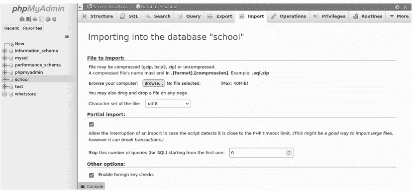

图 2.21 – phpMyAdmin 导入页面

选择脚本文件后，您必须单击右侧页面底部的**执行**，如以下屏幕截图所示：

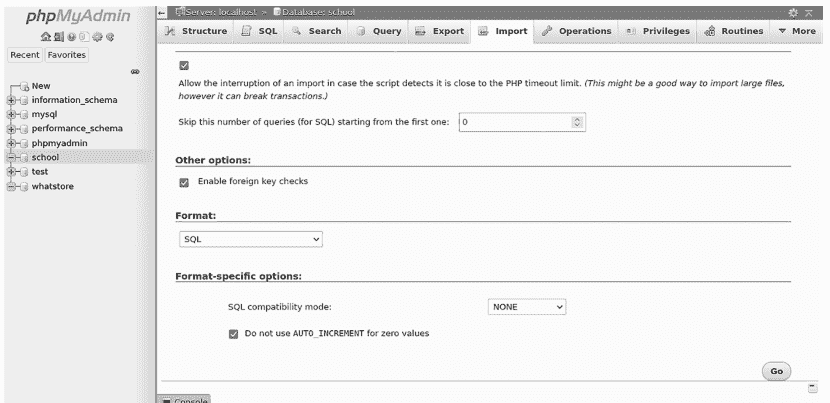

图 2.22 – 导入页面底部的“执行”按钮

等待脚本处理完成，您将看到以下页面，其中包含导入结果：

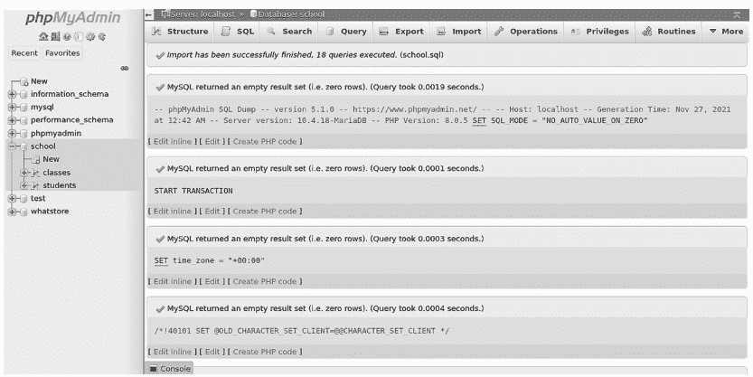

图 2.23 – 结构化查询语言 (SQL) 架构导入过程结束

在左侧，我们将看到新的表节点。对于 `school` 数据库，我们将看到 `classes` 和 `students` 节点。现在，对 `whatstore` 数据库执行相同的过程。

我们终于完成了开发环境的配置。我们拥有练习所需的一切。希望您已成功遵循环境指南，以避免在下一章中出现不愉快的惊喜。正如本杰明·富兰克林所说：“未准备即是准备失败。”

### 摘要

在本章中，我们安装了一个通用的 PHP 环境，包含 Web 服务器、PHP 解释器和关系型数据库管理系统。该环境基于 XAMPP，这是一个用于 PHP 开发的免费软件和开源软件包，适用于最常用的操作系统。

我们学习了安装和使用 Laminas 的两种不同方式：作为 PHP 应用程序（无论其结构是 MVC 还是非 MVC）使用的隔离组件；以及作为 MVC 应用程序的容器，将应用程序的控制权委托给框架。

我们还安装了一个免费开源 IDE：Eclipse for PDT。我们演示了如何将带有**命令行界面 (CLI)** 的程序集成到 Eclipse 工具栏中，配置一个在 Eclipse 内创建 Laminas 项目的条目。

最后，在 phpMyAdmin（嵌入到 XAMPP 中）的帮助下，我们创建了本书练习所需的数据库——school 和 whatstore。

在下一章中，我们将通过一些使用 school 数据库的练习来学习使用 Laminas 编程的基础知识。


