## 将 Laminas 用作带测试驱动开发的库

接下来的两章将为你使用 Laminas 做好准备。准备工作分为三个阶段，以便让你逐渐适应在 Laminas 中编写代码。在本章中，我们将经历第一阶段，我们将基于一个精简的用例通过一个简单示例来加以说明，展示在现有 PHP 应用程序中只使用一个 Laminas 组件是可行的。我们将首先使用 `laminas-db` 组件来抽象数据库连接。在下一章中，我们将介绍其他两个阶段。

你可以假设性地从上一章跳转到 *第 5 章，创建虚拟商店项目*，但这就像有人把一把光剑交给你没有任何训练，并告诉你在首次任务中面对达斯·维德。相反，让我们保持冷静，好好为战斗做准备。

在本章中，我们将涵盖以下主题：

- 了解软件需求
- 使用 TDD 开发我们的用例
- 生成代码覆盖率报告

### 技术要求

要在本章中实现示例，需要以下项目：

- XAMPP 8 或更高版本
- Eclipse for PHP Developers 2021-12 或更高版本
- 上一章中创建的 school 数据库

所有这些项目的安装或创建在 *第 2 章，为我们的电子商务应用程序设置环境* 中进行了说明。

本章示例最初是在一台配备 7.6 GB 内存、1.0 TB 磁盘空间和带有 4 个 2.50 GHz 内核的 CPU 的计算机上开发的。

本章生成的代码完全可在 https://github.com/PacktPublishing/PHP-Web-Development-with-Laminas/tree/main/chapter03 上获得。

### 了解开发软件的需求

我们需要正确的需求来开发软件——如果我们的需求错了，我们将生产出错误的软件。无论我们拥有多么出色的框架、多么惊艳的 IDE 或多么优秀的持续集成环境，都无关紧要。如果我们有好的工具，但需求错了，我们只会更快地交付错误的软件。

> 非常重要的注意事项
> 框架无法修复你需求中的错误。

废话不多说，让我们来看看我们的需求。想象你正在开发一个学校管理系统。更准确地说，你被委托开发管理班级和学生的子系统。如你所见，这些学校元素组之间有若干共同细节。我们强调相似之处，因为这在进行代码复用时很方便。

假设已进行了仔细的需求确定，你收到了以下用例，用于首先实现班级注册。

### 用例 – 管理学校班级

本用例各流程的共同前提条件是存在一个名为 school 的数据库，其中有一个名为 classes 的表，以及应用程序与数据库之间的有效连接。共同异常是 SQL 错误。以下是我们需要的用例流程列表：

- 列表流程（基本）
  - 描述：用户请求班级列表
- 插入流程（备选）
  - 描述：用户插入一个新班级
  - 后置条件：在表中找到带有输入数据的记录
- 更新流程（备选）
  - 描述：用户更新一个现有班级
  - 后置条件：在记录中找到更改
- 删除流程（备选）
  - 描述：用户删除一个现有班级
  - 后置条件：不再找到该记录

既然你已经了解了我们用例所需的流程，让我们开始为这个用例实现一个结构。

### 为用例实现一个结构

既然我们已有需求，让我们使用以下步骤创建一个名为 school1 的 PHP 项目：

1. 在 Eclipse 中，访问 File | New | PHP Project。
2. 在“新建 PHP 项目”窗口中（见图 3.1），键入 school1 并单击 Finish：

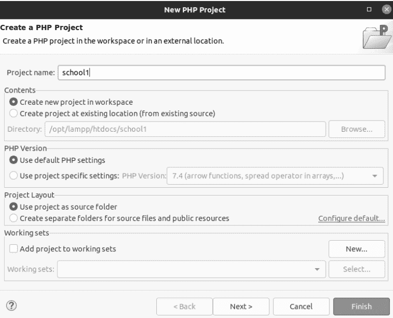

图 3.1 – 创建 school1 项目

之后，你将在“项目资源管理器”视图中看到一个名为 school1 的节点，如图 3.2 所示：

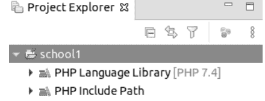

图 3.2 – “项目资源管理器”视图中的 school1 项目

你是否认为有问题，因为子节点右侧显示的 PHP 版本（PHP 语言库）低于已安装的版本？这似乎很奇怪，因为你之前已配置了 PHP 解释器。但是，如果你访问 Window | Preferences 菜单并选择 PHP | Installed PHPs 项目，你将看到正确的 PHP 版本，如图 3.3 所示：

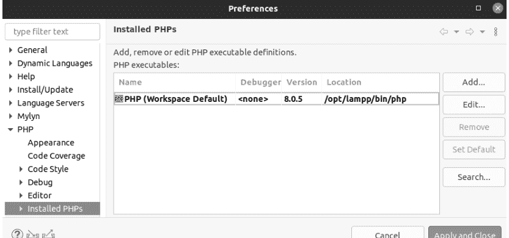

图 3.3 – Eclipse 中配置的 PHP 解释器

好吧，没什么问题。在“项目资源管理器”视图中显示的版本是 PHP 的语法和标记验证版本。这意味着 Eclipse 的 PHP 代码编辑器将验证直到该版本所定义的元素。如果你因为想立即使用最新功能而感到不安，我请你保持冷静。你可以毫无问题地使用最新功能，因为只有解释器理解的内容才重要。例如，PHP 8 为函数提供了命名参数，而 PHP 7 没有。如果你在 PHP 文件中使用命名参数，Eclipse 的 PHP 代码编辑器（针对 PHP 7.4 准备）会将命名参数高亮显示为错误。但是，如果你使用的是 PHP 8 解释器，代码将成功运行。换句话说，忽略关于 PHP 8 专属功能的错误消息。它们是错误警报，将在下一个 Eclipse 版本中消失。

比静态代码警告更重要的是为运行代码编写测试。是的，我们将创建测试。在一段时间内，我们将在编写一些实现之后再编写测试——这并不是很好。为什么这不好？如果你在为某事编写测试之前就实现了它，你可能会忽略测试。但如果你先创建测试，你就确保有东西来检查你的代码是否正常工作。正是出于这个原因，我们将在下一节中，根据测试驱动开发（TDD）的准则，在完整实现之前创建测试。

请参阅此处（图 3.4）使用统一建模语言（UML）组件图构建的架构草稿，用于班级注册用例。这是我们将在 school1 项目中实现的唯一用例：

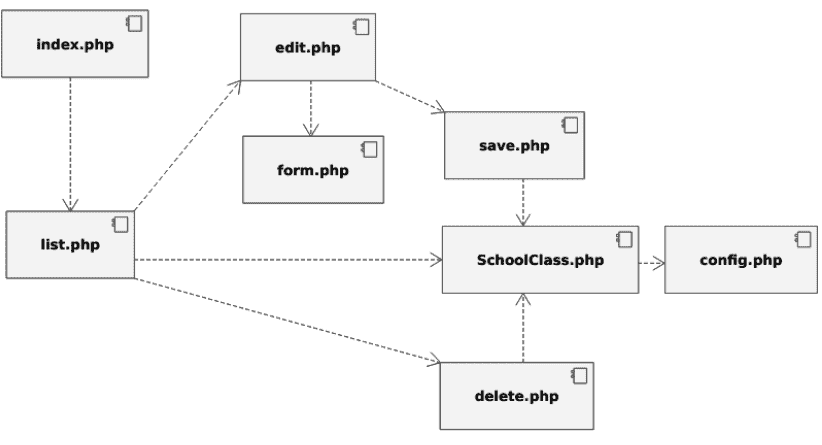

图 3.4 – school1 项目文件的 UML 组件图

如图 3.4 所示，我们将学校班级的注册规划为一组七个 PHP 文件。这些文件的用途如下：

- `index.php`: 指向主页，是操作的起点
- `list.php`: 显示带有 `insert`、`update` 和 `delete` 类超链接的班级列表
- `edit.php`: 显示用于插入或更新班级的表单
- `form.php`: 为 `edit.php` 定义表单
- `save.php`: 将类插入或更新到数据库中
- `delete.php`: 从数据库中删除一个类
- `SchoolClass.php`: 一个学校班级模型，封装了对 classes 表的处理
- `config.php`: 包含用于数据库连接的配置数据

名为 SchoolClass 的类的属性和方法在图 3.5 的类图中展示：

| SchoolClass |
|---|
| + code : int |
| + name : string |
| + getAll() |
| + save() : bool |
| + delete() : bool |
| + __construct(code : int = 0, name : string = "") |

图 3.5 – SchoolClass 的 UML 类图

SchoolClass 类具有与 classes 表字段相等的属性。这个类还具有以下方法：

- getAll: 返回列表流程的数据
- save: 执行插入和更新流程
- delete: 执行删除流程
- __construct: 使用特定记录的数据初始化一个实例

> 注意：Laminas 不要求完全面向对象的项目
>
> 你在 PHP 中不必使用面向对象编程（OOP）。你可以自由只使用结构化编程、只使用 OOP，或者结合两种范式。Laminas 并不将你束缚于 OOP，尽管它是在 OOP 下实现的。它不强加你的软件项目的整体结构，因此你可以根据实际需求使用类。

好吧，由于我们只有最小的项目文档，让我们使用以下步骤实现我们的学校班级注册：

1. 在 Eclipse 中，选择 school1 项目，访问 File | New | PHP File 菜单，并在文件名字段中键入 index.php。
2. PHP 文件编辑器将在 Eclipse 窗口中间打开一个视图，其中有一行以 `<?php` 开头。
3. 删除此文件中的所有内容。
4. 然后，按 CTRL + 空格键。你将看到模板列表，如图 3.6 所示：


```
### New CSS File - new css file
<!> html
### New HTML File (4.01 frameset) - html 4.01 frameset
### New HTML File (4.01 strict) - html 4.01 strict
### New HTML File (4.01 transitional) - html 4.01 transitional
### New HTML File (5) - html 5
### New XHTML File (1.0 frameset) - xhtml 1.0 frameset
### New XHTML File (1.0 strict) - xhtml 1.0 strict
Press 'Ctrl+Space' to show Template Proposals
```

图 3.6 – 为 HTML 文档使用模板

- 5. 此功能允许我们填充带有重复内容的 Web 文件，这些内容是您总是需要编写的，例如文档的开始和结束标记。

- 6. 选择 New HTML File (5) - html 5 项。Eclipse 将使用 HTML 5 基本结构填充文件。我们将根据以下源代码添加特定内容：

### index.php

```
<!DOCTYPE html>
<html>
  <head>
    <meta charset="UTF-8">
    <title>Classes Registration</title>
  </head>
  <body>
    <h1>Classes Registration</h1>
    <p>
      <a href="edit.php">Add a new class</a>
    </p>
    <table>
      <thead>
        <tr>
          <th>code</th>
          <th>name</th>
        </tr>
      </thead>
      <tbody>
<?php
require 'list.php';
?>
      </tbody>
    </table>
  </body>
</html>
```

- 7. 如在组件图中所示（参见图 3.4），index.php 文件依赖于 list.php 文件。第一个文件保留静态内容，而第二个文件生成动态内容。由于我们已创建第一个文件，现在将创建第二个文件。

- 8. 选择 school11 项目，访问 文件 | 新建 | PHP 文件 菜单，并在文件名字段中输入 list.php。将以下代码输入文件：

### list.php

```
<?php
use School\\SchoolClass;
foreach(SchoolClass::getAll() as $row) :
?>
<tr>
<td><a href="edit.php?code=<?=$row['code'] ?>"><?=$row['code'] ?></a></td>
<td><?=$row['name'] ?></td>
<td><a href="delete.php?code=<?=$row['code'] ?>">Remove</a></td>
</tr>
<?php
endforeach;
```

- 9. list.php 文件包含一个重复循环，用于遍历由 SchoolClass 类提供的集合以列出学校类。我们使用 foreach 结构的替代语法，该语法使用 endforeach 而不是花括号。当 PHP 代码嵌套在 HTML 代码中时，这种替代语法很有用，因为它更清晰。我们现在只有几行代码，但随着代码行数增多，理解 PHP 代码块的众多不同开始和结束可能会变得混乱。

- 10. 代码编辑器中必定会出现警告，因为我们尚未创建类 `SchoolClass`。如图 3.7 所示，代码编辑器左右两侧都显示了警告。在左侧，编辑器显示一个红色方块内带有白色 X 的灯泡图标。在右侧，编辑器显示红色矩形：

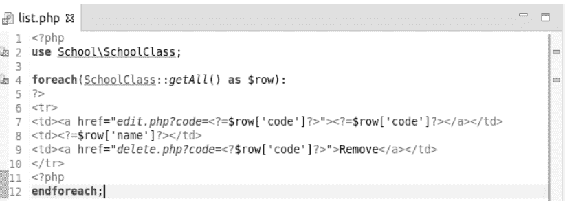

图 3.7 – 两侧的错误警告

- 11. 左侧的图标允许我们尝试修复错误。单击其中任何一个时，Eclipse 将显示修复建议。右侧的矩形会突出显示行中的错误。

这结束了管理学校类用例的基本结构。接下来，我们将在实现更多业务代码之前创建测试。

### 创建我们的第一个自动化测试

让我们现在创建第一个自动化测试，以检查 `SchoolClass::getAll` 静态方法是否返回我们预期的内容。但是……我们预期什么？一组数组，每个数组都带有 `code` 和 `name` 键。

在创建第一个测试用例之前，让我们将 **PHPUnit** 安装到我们的项目中。我们将使用 **Composer** 来完成此操作；不过，这次我们将在 Eclipse 内部使用 Composer。

要安装 PHPUnit，请执行以下步骤：

- 1. 右键单击 `school11` 项目并访问 **配置 | 添加 Composer 支持** 菜单，如图 3.8 所示。

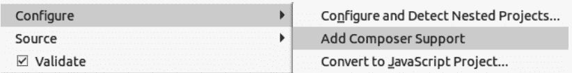

图 3.8 – 添加 Composer 支持

- 2. 一个名为 `composer.json` 的文件将在项目根目录中创建。Eclipse 将打开一个用于编辑 `composer.json` 文件的视图：

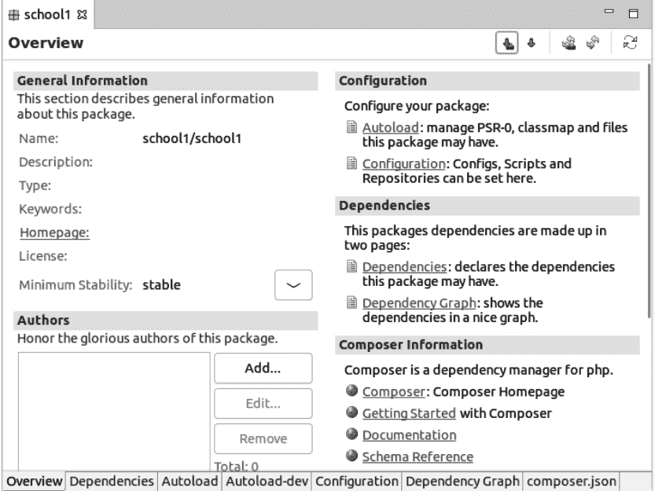

图 3.9 – Composer 视图

- 3. Composer 视图底部有几个选项卡。其中一个是 **依赖项**。此选项卡填充与项目依赖项相关的 `composer.json` 部分。

- 4. 单击 **依赖项** 选项卡，视图将显示两个用于包含依赖项的部分：

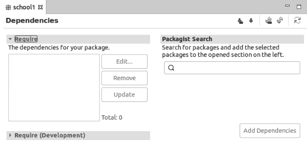

图 3.10 – Composer 视图的依赖项选项卡

- 5. 我们将添加一个开发依赖项 PHPUnit，这是一个用于 PHP 应用程序的测试框架。
- 6. 单击屏幕底部的 **要求（开发）** 部分，该部分将在视图中展开。
- 7. 在右侧，有一个名为 **Packagist 搜索** 的搜索框。我们可以在此处安装存储库 (https://packagist.org) 中可用的任何依赖项。
- 8. 在其中键入 `phpunit`，插件将列出所有名称匹配 `phpunit` 的可用包。搜索使用部分匹配，而非精确匹配（参见 **图 3.11**）：

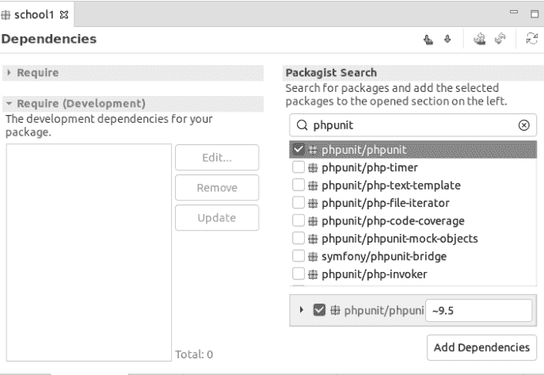

图 3.11 – 搜索要安装的包

- 9. 选择 **phpunit/phpunit** 项并单击 **添加依赖项** 按钮。最新可用版本的 PHPUnit 包将插入到左侧的列表中。

- 10. 单击 **composer.json** 选项卡以查看 Eclipse Composer 插件生成的代码：

### composer.json

```
{
	"name" : "school1/school1",
	"require-dev" : {
		"phpunit/phpunit" : "~9.5"
	}
}
```

- 11. 别忘了按下 **CTRL + S** 保存更改。Composer 插件会生成代码但不会自动保存。

- 12. 在 Composer 视图顶部右侧，有一些按钮。最左侧的第一个按钮是 **安装依赖项**：

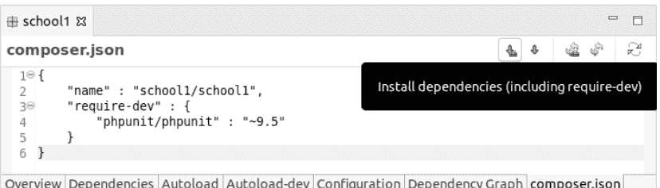

图 3.12 – 使用 Composer 安装依赖项

- 13. 单击 **安装依赖项** 按钮，Eclipse 将运行 `composer install` 命令。

- 14. 您将看到 Composer 将创建一个名为 `vendor` 的文件夹和两个文件 `composer.lock` 和 `composer.phar`：

- vendor
- composer.json
- composer.lock
- composer.phar

图 3.13 – Composer 文件和文件夹

- 15. composer.lock 文件是已安装依赖项的状态文件。composer.phar 文件是 Composer 的可执行文件，下载后用于与 Eclipse 中配置的 PHP 一起运行。
- 16. 由于已创建 composer.lock 文件，您必须使用 **更新依赖项** 按钮来更新通过 Composer 安装的组件：

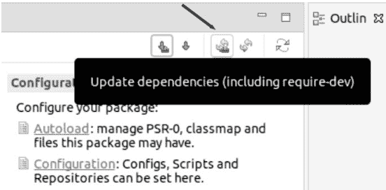

图 3.14 – 更新依赖项按钮

太棒了！最终，我们已将 PHPUnit 实例安装到我们的项目中。

> **提示**
> 建议您关闭并重新打开项目，以确保自动补全选项会考虑已安装的依赖项。

因此，我们已经了解如何从用例创建 PHP 项目结构，以及如何在 Eclipse 中安装测试框架的依赖项。在下一节中，我们将在测试的帮助下进一步开发我们的用例。

### 使用 TDD 开发我们的用例

从现在开始，我们将开始使用 TDD。这是一种由 Kent Beck 推广的方法，他是 *敏捷软件开发宣言* 的签署者之一。Beck 表示，TDD 是一种无惧编程的方式。当你在创建被测试的代码之前编写测试时，你实际上是在将需求编写为代码。一个随时可运行的测试会告诉我们代码是否随时满足需求。仅仅创建能正常工作的代码是不够的。我们需要在每次更改后保持代码的可运行状态。测试会告诉我们更改是否导致代码停止工作。

### 敏捷软件开发宣言

2001 年，17 名软件开发人员发表了一份宣言，阐述了他们关于更好软件开发方式的想法。这个“敏捷宣言”提出了四个主要价值观和十二条原则，以指导开发人员管理软件构建。宣言的理念是作者采用的几种方法的结合。这些方法旨在改善软件开发过程的质量和软件作为产品的质量，并承认变化是唯一的常数。该宣言可在 https://agilemanifesto.org 上查阅。

在下一节中，我们将实践敏捷开发的一种方法，即在创建将被测试的类之前先创建测试类。

### 创建我们的 SchoolClassTest 测试类

让我们现在通过执行以下步骤来创建我们的第一个测试：

- 1. 在 Eclipse 中，选择 `school1` 项目并访问 文件 | 新建 | 文件夹 菜单。
- 2. 创建一个名为 `test` 的文件夹：

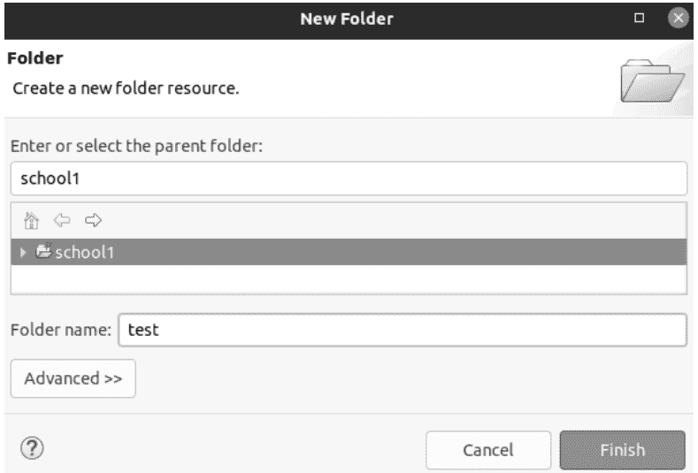

图 3.15 – 创建测试文件夹


3. 使用 File | New | Class 菜单选择测试文件夹并创建一个类。Eclipse 将打开一个如图 3.16 所示的窗口：

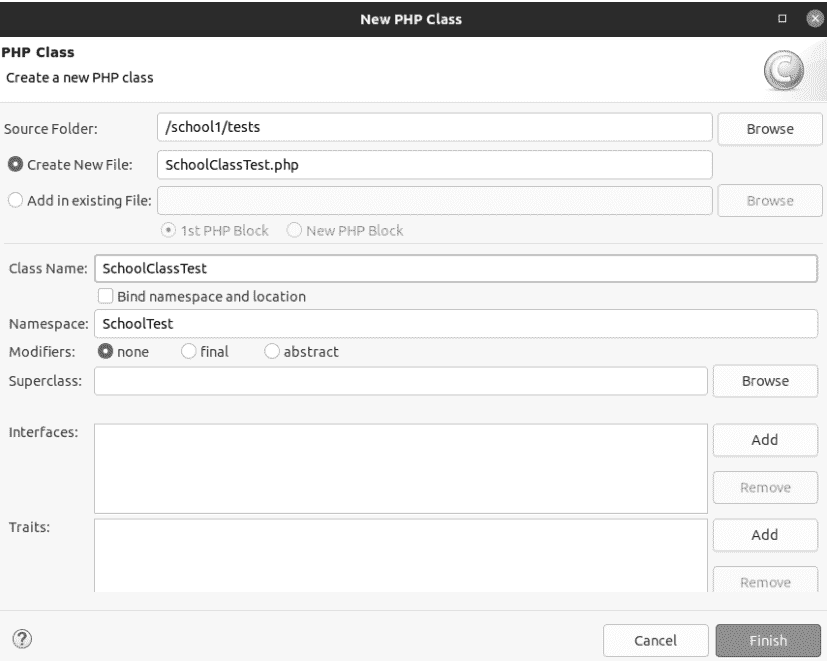

图 3.16 – 创建 PHP 类

4. 按以下方式修改 New PHP Class 窗口中的字段：
- 类名：设置为 SchoolClassTest
- 绑定命名空间和位置：取消选中
- 命名空间：设置为 SchoolTest

5. 单击 Superclass 字段右侧的 Browse 按钮。Eclipse 将打开一个窗口，如图 3.17 所示：

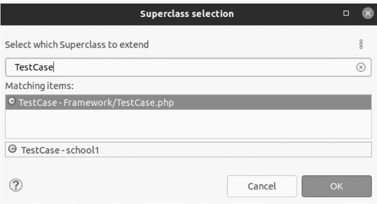

图 3.17 – 选择父类

- 6. 在顶部的文本框中输入 TestCase，**TestCase** 类将显示在列表中。
- 7. 选择 **TestCase** 并单击 OK。
- 8. 在下一个窗口 **New PHP Class** 中，单击 **Finish** 按钮。代码编辑器将打开并显示以下代码：

### SchoolClassTest.php

```php
<?php
namespace SchoolTest;
use PHPUnit\Framework\TestCase;
class SchoolClassTest extends TestCase
{
}
```

现在，我们基于 PHPUnit 拥有了测试用例类的骨架。此测试用例可以在 Eclipse 中运行。你可以右键单击测试类文件并访问 Run As | PHPUnit Test 菜单。如果现在执行此操作，你将在 Console 选项卡下看到以下内容：

> PHPUnit 9.5.10 by Sebastian Bergmann and contributors.
> W                     1 / 1 (100%)

这表明我们可以在 Eclipse 中运行 PHPUnit 并查看测试输出，就像打开了一个终端窗口一样。在 Eclipse 中运行 PHPUnit 避免了在两个程序窗口之间切换。Eclipse 提供了一个类似飞机驾驶舱的单一面板。W 代表 Warning。它意味着没有测试。

在本节中，我们学习了如何为测试创建文件夹以及如何创建扩展 PHPUnit TestCase 的测试类。具体来说，我们创建了 SchoolClassTest 测试类。你可能已经忘记了，但我们所做的一切都是为了为 SchoolClass 业务类创建测试。在下一节中，我们将真正开始实践 TDD。

> **什么是业务类？**
> 与客户业务直接相关的类可以称为业务类。这类类具有业务规则。软件中可以有许多其他类与业务类进行交互。在 MVC 模式中，业务类被称为模型。

### 在 SchoolClass 类中创建测试方法

请记住，我们在 list.php 文件中调用业务类 SchoolClass 以获取学校类集合。那么，让我们创建一个测试来检查这一点。等等，创建一个测试？但我们不是已经创建了 SchoolClass 类了吗？没错！在 TDD 中，我们从一个失败的测试开始，因此在编写测试之前不需要创建 SchoolClass。我们只需要类接口，我们可以从图 3.5 的类图中获得该接口。

没错，我们知道 SchoolClass::getAll 方法必须返回一个可迭代值。那么，让我们按照以下步骤为其编写测试：

- 1. 在 SchoolClass 类中创建一个名为 testListing 的方法。
- 2. 将 SchoolClass::getAll 方法的输出赋值给名为 $rows 的变量。
- 3. 将此 $rows 变量作为参数传递给 $this->assertIsIterable 方法。

SchoolClass 测试类将类似于以下代码：

### SchoolClassTest.php

```php
<?php
namespace SchoolTest;
use PHPUnit\Framework\TestCase;
use School\SchoolClass;
class SchoolClassTest extends TestCase
{
    public function testListing()
    {
        $rows = SchoolClass::getAll();
        $this->assertIsIterable($rows);
    }
}
```

testListing 方法通过 assertIsIterable 方法检查 SchoolClass::getAll 的结果是否可迭代。请注意，我们添加了一个 use 语句来导入 SchoolClass 类。你可以再次运行测试用例。Console 选项卡下的输出必须如下：

```text
PHPUnit 9.5.10 by Sebastian Bergmann and contributors.
E                 1 / 1 (100%)
```

E 代表 error。是的，这不太准确，但别担心！有一个选项卡显示更清晰的数据。单击 PHPUnit 选项卡，你将看到如图 3.18 所示的视图：

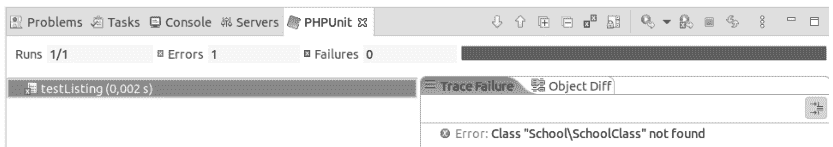

### 图 3.18 – PHPUnit 选项卡

PHPUnit 选项卡在右侧显示失败的跟踪。在这种情况下，错误消息是 Class "School\SchoolClass" not found。太棒了！我们有一个失败的测试——这是 TDD 的第一步。现在，我们将进入第二步——实现足够的代码以供测试运行。

### 创建 SchoolClass 类

开发期间，错误消息是我们的朋友，因为它们告诉我们需要做什么。如果找不到 SchoolClass 类，那么我们必须找到它。为了找到此类，它需要存在。让我们创建这个类：

- 1. 在 `school11` 项目中创建一个名为 `src` 的文件夹。
- 2. 右键单击 `src` 文件夹，并通过修改以下详细信息来创建类：
  - **类名**：设置为 `SchoolClass`
  - **绑定命名空间和位置**：取消选中
  - **命名空间**：设置为 `School`

- 3. 我们想要实现 `SchoolClass::getAll` 静态方法。首先，让我们为该静态方法编写方法接口：

### SchoolClass.php

```php
<?php
declare(strict_types=1);
namespace School;
class SchoolClass
{
    public static function getClass() : iterable
    {
    }
}
```

- 4. 终于到了大家期盼的时刻——我们将使用 `laminas-db` 组件来实现从表类读取记录。你还记得通过 Composer 安装 PHPUnit 时的情形吗？现在，我们将使用 Composer 安装 `laminas-db`。

- 5. 双击 `composer.json` 文件，Composer 视图将打开。

- 6. 单击 **Require** 部分并搜索 `laminas-db`。

- 7. 选择 `laminas/laminas-db` 项目并单击 **Add Dependencies** 按钮。

- 8. 按下 `CTRL + S` 并单击 Composer 视图右上角的 **Update dependencies** 按钮。

好了！现在，我们有一个用于访问数据库的组件。

但是 `SchoolClass` 类将如何使用 `laminas-db` 呢？我们的业务类需要查找 Laminas 数据库组件的类。你说得对。我们需要配置类的自动加载，以便每个类都能加载另一个类。

### 配置类的自动加载

让我们使用以下步骤配置类的自动加载：

- 1. 在 **Composer** 视图中，单击 **Autoload** 选项卡。你将看到类似于 *图 3.19* 中所示的视图。

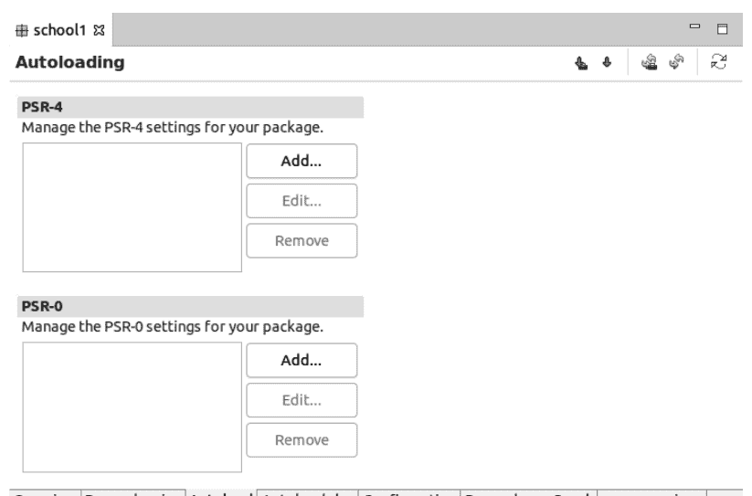

图 3.19 – Composer 视图的 Autoload 选项卡

Autoload 选项卡有两个部分，PSR-4 和 PSR-0。这些部分与 PHP-FIG 关于类自动加载的规范相关。PSR-0 已弃用且仅存在于旧代码中。对于新代码，我们必须使用 PSR-4。

- 2. 在 PSR-4 部分中单击 **Add...** 按钮。将打开一个名为 **Edit Namespace** 的窗口（参见图 3.20）：

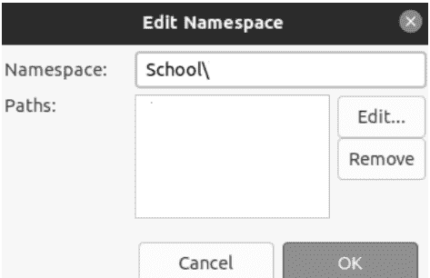

图 3.20 – Edit Namespace 窗口

- 3. 在 **Namespace** 字段中输入 `School\` 并单击 **Edit...** 按钮。将打开一个名为 **Namespace Paths** 的新窗口（参见 *图 3.21*）：

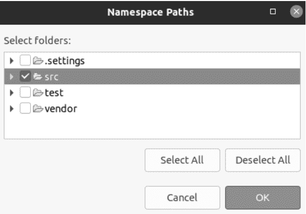

图 3.21 – Namespace Paths 窗口

- 4. 在 **Namespace Paths** 窗口中，选择 `src` 文件夹并单击 **OK**。返回 **Edit Namespace** 窗口，单击 **OK**。

- 5. 我们做了什么？我们已将 `School\` 命名空间与 `src` 文件夹关联。这意味着使用 `School\` 命名空间声明的类和接口将在 `src` 文件夹中查找。

你已成功配置与功能需求相关的类的自动加载。现在让我们为测试类也做同样的操作。

### 配置测试类的自动加载

接下来，我们将为测试类配置自动加载：

- 1. 在 Composer 视图中，单击 **Autoload-dev** 选项卡。

- 2. 此选项卡与 **Autoload** 选项卡具有相同的结构。区别在于，**Autoload-dev** 仅处理开发期间使用的类——换句话说，就是不会打包用于生产环境安装的类。测试类在生产环境中不是必需的，因为它们仅在开发期间和部署前使用。

- 3. 在 **Autoload-dev** 选项卡的 **PSR-4** 部分中，单击 **Add...** 按钮。

- 4. 在 **Edit Namespace** 窗口中，将 `SchoolTest\` 输入到 **Namespace** 字段中。


- 5. 单击 **编辑...** 按钮并选择 `tests` 文件夹。单击 **确定**，返回 **编辑命名空间** 窗口后，单击 **确定**。

- 6. 我们做了什么？我们已将 `SchoolTest` 命名空间关联到 `tests` 文件夹。这意味着使用 `SchoolTest` 命名空间声明的类和接口将在 `tests` 文件夹中搜索。

- 7. 为了使这些关联正常工作，需要重新生成自动加载文件。

- 8. 按 `CTRL` + `S` 保存更改，并单击 **安装依赖项** 按钮。

- 9. 不会安装任何依赖项，但由于自动加载配置发生了更改，Composer 将重新生成自动加载文件。

现在，我们可以在 `SchoolClass` 中使用 `laminas-db`，而无需使用 PHP 命令来导入 Laminas 类，例如 `include` 或 `require`。

在下一节中，我们将实现包含数据库连接数据的配置文件。

### 创建 config.php 文件并重新运行 SchoolClassTest 测试用例

嗯，根据我们的组件图，`SchoolClass` 依赖于一个名为 `config.php` 的文件。我们将在名为 `config` 的文件夹中创建此文件。在 `school1` 项目的根目录下创建此 `config` 文件夹。然后，在 `config` 文件夹中，创建一个 `config.php` 文件。此文件的内容如下：

### config.php

```php
<?php
return [
    'db' => [
        'driver' => 'Pdo_Mysql',
        'database' => 'school',
        'username' => 'root',
        'password' => '',
        'hostname' => '127.0.0.1'
    ]
];
```

此文件中的数组包含 laminas-db 文档中定义的数据库连接参数：https://docs.laminas.dev/laminas-db/adapter/#creating-an-adapter-using-configuration。config.php 文件减少了与数据库相关的代码更改。您可以更改数据库服务器甚至数据库驱动程序，而无需更改其他文件的源代码。config.php 中定义的数组将由 Laminas 的 Adapter 类使用。使用此类，我们可以建立到数据库的连接并执行 SQL 语句。此类实现了由四人帮（Erich Gamma、Richard Helm、Ralph Johnson 和 John Vlissides）在经典著作《设计模式：可复用面向对象软件的基础》中编目的适配器设计模式。该模式有助于在具有不同接口的组件之间轻松切换，例如使用不同驱动程序的数据库。因此，我们将编写 SchoolClass::getAll 方法的内容：

### SchoolClass::getAll

```php
public static function getAll() : iterable
{
    $config = require (realpath(__DIR__ . '/../config') .
        'config.php');
    $adapter = new Adapter($config['db']);
    $statement = $adapter->query('SELECT * from classes');
    $resultSet = $statement->execute();
    return $resultSet;
}
```

SchoolClass::getAll 方法从 config.php 文件读取数组，并将 db 键注入 Adapter 类的实例中。使用此实例，我们准备一条 SQL SELECT 语句并执行它。

> **注意：自动代码补全**
>
> 在 Eclipse 代码编辑器中输入类名时，可用类列表将变得可见。因此，如果从自动补全列表中选择一个类，Eclipse 将自动添加命名空间行。但如果您不这样做，请检查命名空间是否存在于文件顶部。例如，Laminas 数据库适配器的命名空间是 Laminas\\Db\\Adapter\\Adapter。

现在，我们可以再次运行 `SchoolClassTest` 测试用例。您将在 **PHPUnit** 选项卡下（参见 _图 3.22_）看到 `SchoolClass::getAll` 方法的代码已通过测试：

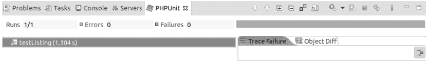

图 3.22 – 显示 testListing 的 PHPUnit 选项卡

### 创建新的 testInserting 测试方法

我们已创建自动化测试，但它不是单元测试。由于我们正在连接真实数据库，`SchoolClassTest->testListing` 方法是一个集成测试：它不仅测试 `SchoolClass` 的接口，还测试与数据库的连接。

现在可以通过浏览器请求 `index.php` 页面来测试用户界面吗？嗯，虽然我们有从数据库读取数据的代码，但 `classes` 表中没有记录。因此，列表中没有学校班级。在测试列表页面之前，最好先实现插入逻辑。

我们将按照以下代码片段，向 `SchoolClassTest` 添加一个名为 `testInserting` 的新测试方法：

```php
public function testInserting()
{
    $schoolClass = new SchoolClass(0, '1st year');
    $schoolClass->save();
    $config = require (realpath(__DIR__ . './../config').
        '/config.php');
    $adapter = new Adapter($config['db']);
    $qi = function ($name) use ($adapter) {
        return $adapter->platform->quoteIdentifier($name);
    };
    $fp = function ($name) use ($adapter) {
        return $adapter->driver->formatParameterName($name);
    };
    $statement = $adapter->query('SELECT name from classes where ' . $qi('name') . ' = ' . $fp('name'));
    $resultsSet = $statement->execute(['name' => '1st year']);
    $this->assertCount(1, $resultsSet);
    $statement = $adapter->query('DELETE from classes where ' . $qi('name') . ' = ' . $fp('name'));
    $resultsSet = $statement->execute(['name' => '1st year']);
}
```

SchoolClassTest->testInserting 方法检查 SchoolClass->save 是否为 classes 表生成一条新记录。该测试方法会删除记录以重置数据状态。当然，此测试方法假设 classes 表的 name 字段禁止重复值。因此，必须只有一个名为 '1st year' 的记录。作为 TDD 第一步的一部分，如果您现在运行此测试，它将失败。原因很明显：SchoolClass->save 方法不存在。让我们来实现它！

> **注意：用于处理字段名和值的闭包**
>
> 在 SchoolClassTest->testInserting 方法中，我们使用 $qi 和 $fp 闭包分别对字段名进行引用和对值进行格式化。因此，例如，如果我们将数据库从 MySQL 更改为 PostgreSQL，则无需更改类中的代码，只需更改 config.php 文件中的连接参数即可。此外，适当格式化值可以避免 SQL 注入攻击。

根据我们的类图，SchoolClass->save 方法返回一个布尔值。如果方法成功插入，则返回 true；否则返回 false。此方法的代码如下：

```php
public function save() : bool
{
	$adapter = self::getAdapter();

	$fp = function ($name) use ($adapter) {
		return $adapter->driver->formatParameterName($name);
	};

	$statement = $adapter->query('INSERT INTO
		classes(name) VALUES ('. $fp('name') . ')');

	try {
		$statement->execute(['name' => $this->name]);
	} catch (\Exception $e) {
		error_log($e->getMessage());
		return false;
	}

	return true;
}
```

要插入新记录，我们需要连接到数据库。因此，我们将数据库适配器创建代码提取到单独的 SchoolClassTest::getAdapter 静态方法中：

```php
private static function getAdapter(): AdapterInterface
{
    $config = require (realpath(__DIR__ . '/../config') .
        '/config.php');

    $adapter = new Adapter($config['db']);

    return $adapter;
}
```

这样，我们就可以避免为每个需要连接数据库的方法重复此代码。当然，我们必须重构 SchoolClassTest::getAll 方法以使用 SchoolClassTest::getAdapter：

```php
public static function getAll(): iterable
{
    $adapter = self::getAdapter();

    $statement = $adapter->query('SELECT * from classes');
    $resultSet = $statement->execute();

    return $resultSet;
}
```

回到 SchoolClassTest->save 方法，您应该注意，它使用 $this->name 属性执行 SQL INSERT。因此，必须定义该属性并赋值。实际上，我们需要向类中添加两个属性，分别对应 classes 表中的每个相关字段：

```php
public int $code = 0;
public string $name = '';
```


> **为什么在类中使用公共属性？**
>
> 创建类时，有一种规范规定必须创建私有属性和公共方法。因此，如果你需要读取或写入某个属性，就需要为此创建一个方法。如果你有二十个属性，且需要读写全部属性，就需要创建四十个方法。问题在于：这真的有必要吗？如果你在读取前或写入后不对数据属性进行转换，就只是在浪费时间，使用一个方法去做你本可以直接完成的事情。

创建 SchoolClass 类的实例时，必须填充 $code 和 $name 属性。因此，我们需要声明构造方法：

```php
public function __construct(int $code = 0, string $name = '')
{
    $this->code = $code;
    $this->name = $name;
}
```

现在，你可以成功运行测试用例。我们可以列出并插入学校班级。

### 创建编辑表单 edit.php

是时候在 edit.php 文件中创建编辑表单了。为什么？因为我们需要一个用户界面来添加学校班级。通过“文件 | 新建 | PHP 文件”将以下代码输入到项目根目录。以下源代码即为 edit.php 的内容：

## edit.php

```html
<!DOCTYPE html>
<html>
<head>
<meta charset="UTF-8">
<title>Classes Registration</title>
</head>
<body>
<h1>Classes Registration</h1>
<form action="save.php" method="post">
Name: <input type="text" name="name" autofocus="autofocus">
<br/>
<input type="hidden" name="code"><br/>
<input type="submit" value="save">
</form>
<p>
 <a href="index.php">Homepage</a>
</p>
</body>
</html>
```

此网页将生成如图 3.23 所示的页面：

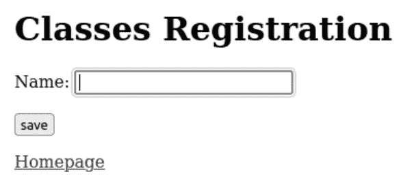

图 3.23 – 从 edit.php 文件渲染的表单

如你所料，此 Web 表单无法成功请求，因为 save.php 文件不存在。那么，让我们来创建它：

### save.php

```php
<?php
use School\SchoolClass;
require 'vendor/autoload.php';
$name = ($_POST['name'] ?? null);
$schoolClass = new SchoolClass(0, $name);
$schoolClass->save();
header('Location: index.php');
```

save.php 的内容非常简单（在我们创建插入测试之后）。该文件从通过 HTTP POST 发送的 HTML 表单中获取字段 name 的值，并将其传递给 SchoolClass 实例，以将数据持久化到 classes 表中。接下来，该文件通过 header PHP 函数发送状态码为 302 的 HTTP 请求，将页面重定向到 index.php。

好了，你现在可以使用 edit.php 中的表单插入一个学校班级。列表将为空。别担心！这是因为我们需要导入 Composer 的 autoload.php 文件。只需在 list.php 的 use 语句之后添加以下行即可：

```php
require 'vendor/autoload.php';
```

添加该行后，你可以刷新 index.php 页面，将看到如下页面：

### 班级注册

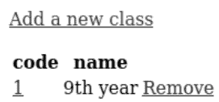

图 3.24 – 学校班级列表

太棒了！我们可以通过 Web 界面插入并列出学校班级。现在，我们将实现更新操作。当然，我们将从测试开始。

### 创建 SchoolClassTest->testUpdating 测试方法

以下源代码展示了 SchoolClassTest->testUpdating 测试方法：

```php
public function testUpdating()
{
    $schoolClass = new SchoolClass(0, '1st year');
    $schoolClass->save();
    $schoolClass = SchoolClass::getByName('1st year');
    $schoolClass->name = '2nd year';
    $schoolClass->save();
    $schoolClass = SchoolClass::getByName('2nd year');
    $this->assertEquals('2nd year', $schoolClass->name);
    $schoolClass->delete();
    $schoolClass = SchoolClass::getByName('2nd year');
    $this->assertEmpty($schoolClass->name);
}
```

此测试尝试插入一个新的学校班级，然后修改该班级的名称。作为 TDD 第一步的一部分，如果你现在运行此测试，它将失败。没错，这是预期的。如果此时测试通过，那确实有大问题了！

你应该注意到，我们此次使用 SchoolClass->delete 方法将学校班级从表中删除。该方法在类图中已有规划，使用它比重复多行代码更好。

接下来，让我们成功运行测试。你应该已经注意到，SchoolClassTest->testUpdating 方法调用了 SchoolClass::getByName 方法。该方法不存在，因此我们需要创建它。让我们在类构造方法之后创建此方法：

```php
public static function getByName($name = null): SchoolClass
{
    $adapter = self::getAdapter();
    $qi = function ($name) use ($adapter) {
        return $adapter->platform->quoteIdentifier($name);
    };
    $fp = function ($name) use ($adapter) {
        return $adapter->driver->formatParameterName($name);
    };
    $statement = $adapter->query('SELECT * from classes
        WHERE ' . $qi('name') . ' = ' . $fp('name'));
    $resultSet = $statement->execute([':name' => $name]);
    if ($resultSet->count() == 0) {
        return new SchoolClass();
    }
    $row = $resultSet->current();
    return new SchoolClass((int)$row['code'], $row['name']);
}
```

SchoolClass::getByName 方法与 SchoolClass::getAll 方法相似，至少在语句创建之前是这样。SQL SELECT 按名称过滤，如果未找到记录，将返回一个空的 SchoolClass 实例。仅此就足以成功运行测试吗？嗯，你可以运行测试来发现答案——不行！

当我们实现 SchoolClass->save 方法时，该方法只准备插入记录，而非更新记录。因此，即使你更改了 SchoolClass 类对象的名称，在调用 SchoolClass->save 方法时，它也会尝试插入记录，因为那里只有插入代码。因此，我们必须修改此方法，使其也能执行更新操作。该方法将如下所示：

```php
public function save() : bool
{
    $adapter = self::getAdapter();
    $fp = function ($name) use ($adapter) {
        return $adapter->driver->formatParameterName($name);
    };
    if (empty($this->code)) {
        $statement = $adapter->query('INSERT INTO
            classes(name) VALUES ( ' . $fp('name') . ' )');
        $params = ['name' => $this->name];
    } else {
        $statement = $adapter->query('UPDATE classes SET
            name= ' . $fp('name') . ' WHERE code=' .
            $fp('code'));
        $params = [
            'code' => $this->code,
            'name' => $this->name
        ];
    }

    try {
        $statement->execute($params);
    } catch (\Exception $e) {
        error_log($e->getMessage());
        return false;
    }

    return true;
}
```

学校班级的代码由表自动生成，因此我们不期望进行插入。如果代码有值，我们假设这是一个更新操作。测试现在能通过吗？不行，因为 SchoolClass->delete 方法尚不存在。别浪费时间——创建它：

```php
public function delete(): bool
{
    $adapter = self::getAdapter();
    $fp = function ($name) use ($adapter) {
        return $adapter->driver->formatParameterName($name);
    };
    $statement = $adapter->query('DELETE FROM classes WHERE
        code=' . $fp('code'));
    try {
        $statement->execute([
            'code' => $this->code
        ]);
    } catch (\Exception $e) {
        error_log($e->getMessage());
        return false;
    }
    return true;
}
```

现在，你可以成功运行测试了。终于，我们从红色状态进入了绿色状态。SchoolClass 的当前实现允许我们修改 edit.php 和 save.php 文件，以便通过 Web 界面更改学校班级。

### 修改 edit.php

让我们从 edit.php 开始：

## edit.php

```php
<?php
use School\SchoolClass;
require 'vendor/autoload.php';
$code = ($_GET['code'] ?? null);
$schoolClass = SchoolClass::getByCode($code);
?>
<!DOCTYPE html>
<html>
<head>
<meta charset="UTF-8">
<title>Classes Registration</title>
</head>
<body>
<h1>Classes Registration</h1>
<form action="save.php" method="post">
Name: <input type="text" name="name"
```


```html
autofocus="autofocus"
value="<?=$schoolClass->name?>"><br/>
<input type="hidden" name="code" value="<?=
    $schoolClass->code?>"><br/>
<input type="submit" value="save">
</form>
<p>
<a href="index.php">Homepage</a>
</p>
</body>
</html>
```

这个文件的前一版本与当前版本有什么区别？答案是 PHP 块代码，包括 autoload.php 文件的导入、通过 HTTP GET 发送的参数 code 的读取，以及从代码中恢复 SchoolClass 实例。等一下！这个 SchoolClass->getByCode 方法是从哪里来的？你很聪明！它还不存在！我们必须实现它！开始吧：

```php
public static function getByCode($code = null): SchoolClass
{
    $adapter = self::getAdapter();
    $qi = function ($name) use ($adapter) {
        return $adapter->platform->quoteIdentifier($name);
    };
    $fp = function ($name) use ($adapter) {
        return $adapter->driver->formatParameterName($name);
    };
    $statement = $adapter->query('SELECT * from classes
        WHERE ' . $qi('code') . '=' . $fp('code'));
    $resultSet = $statement->execute(['code' => $code]);
    if ($resultSet->count() == 0){
        return new SchoolClass();
    }
    $row = $resultSet->current();
    return new SchoolClass((int)$row['code'],$row['name']);
}
```

是的，SchoolClass->getByCode 方法与 SchoolClass->getByName 方法非常相似。如果你注意到了这一点，那就好。不用担心，我们稍后会消除重复。但现在我们需要专注于通过 Web 界面更新学校班级。由于带有编辑表单的页面已更改，让我们更改 save.php 文件，它负责持久化。

### 修改 save.php

此文件将按以下方式编写：

```php
<?php
use School\\SchoolClass;
require 'vendor/autoload.php';
$code = ($_POST['code'] ?? null);
$name = ($_POST['name'] ?? null);
$schoolClass = new SchoolClass((int)$code, $name);
$schoolClass->save();
header('Location: index.php');
```

请注意，我们只更改了传入的参数 code。此参数的值决定了操作是插入还是更新。通过此更改，您现在可以更改插入的学校班级的名称。尝试插入几个学校班级，然后更改其中一些的名称。

现在，是大家期待已久的时刻——删除学校班级。

### 创建 delete.php 文件

根据我们的组件图和 list.php 文件中的超链接，删除操作必须位于 delete.php 文件中。让我们创建它：

## delete.php

```php
<?php
use School\\SchoolClass;
require 'vendor/autoload.php';
$code = ($_GET['code'] ?? null);
$schoolClass = SchoolClass::getByCode((int)$code);
$schoolClass->delete();
header('Location: index.php');
```

请记住，我们已经实现了 `SchoolClass->delete` 方法并进行了测试。现在，您可以通过 Web 界面插入、编辑、删除和列出学校班级。您可以在 `school11` 文件夹中按如下方式启动 PHP 内置 Web 服务器：

```bash
php -S localhost:8000
```

访问 `localhost:8000` 地址并尝试学校班级功能。管理学校班级的用例已实现。但是，由于我们使用 TDD，询问我们的所有代码是否都有测试覆盖是很重要的。我们可以通过生成名为代码覆盖率的报告来通过 PHPUnit 发现这一点。

### 生成代码覆盖率报告

让我们使用 Eclipse 的 **外部工具配置** 来自动化生成代码覆盖率报告的命令。您之前在 _第 2 章，为我们的电子商务应用程序设置环境_ 中做过此类配置，还记得吗？让我们再做一次：

- 1. 像之前一样访问 **运行 | 外部工具/外部工具配置...** 菜单，并在 **主** 选项卡下创建具有以下参数的配置：
  - 名称：Code Coverage
  - 位置：`${project_loc}/vendor/bin/phpunit`
  - 工作目录：`${project_loc}/src`
  - 参数：`--coverage-html code_coverage`
- 2. 不要忘记在 **常用** 选项卡下勾选 **外部工具** 项目：

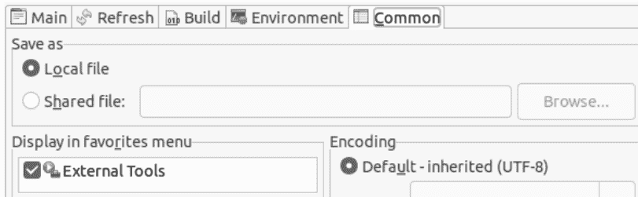

图 3.25 – 菜单中显示外部工具的复选框

- 3. 保存配置后，单击 **应用** 和 **关闭**。
- 4. 要生成代码覆盖率报告，我们需要为 PHPUnit 创建一个配置文件。我保证，这是我们最后一次需要使用终端。

在工作区的 `school1` 目录中，键入以下命令：

```bash
vendor/bin/phpunit --generate-configuration
```

对于 PHPUnit 提出的每个问题，您都将选择默认选项。输出将如下所示：

```
Bootstrap script (relative to path shown above; default:
vendor/autoload.php):
Tests directory (relative to path shown above; default:
tests):
Source directory (relative to path shown above; default:
src):
Cache directory (relative to path shown above; default:
.phpunit.cache):
Generated phpunit.xml in /opt/lampp/htdocs/school1.
Make sure to exclude the .phpunit.cache directory from
version control.
```

此命令将生成一个名为 phpunit.xml 的文件。编辑此文件并更改此参数：

```xml
forceCoversAnnotation="true"
```

将其更改为以下内容：

```xml
forceCoversAnnotation="false"
```

在 school1 项目中创建一个名为 code_coverage 的文件夹。

最后，选择 school1 项目并在工具栏上运行新的代码覆盖率配置。您可以在 Eclipse 的 **控制台** 选项卡下跟踪报告的生成过程，它将以以下消息结束：

```
Generating code coverage report in HTML format ... done
[00:00.013]
```

您将找到一个 index.html 文件。您可以使用 Eclipse 内置浏览器打开它，选择该文件并访问 **打开方式 | Web 浏览器** 弹出菜单。您应该看到以下屏幕：

/opt/lamp/htdocs/school1/src / (仪表板)

| | 行数 | 函数和方法 | 类和特性 |
|---|---|---|---|
| 总计 | 69.35% 43 / 62 | 57.14% 4 / 7 | 0.00% 0 / 1 |
| SchoolClass.php | 69.35% 43 / 62 | 57.14% 4 / 7 | 0.00% 0 / 1 |

### 图例

低：0% 到 50%   中等：50% 到 90%   高：90% 到 100%

由 php-code-coverage 9.2.10 使用 PHP 7.4.3 和 PHPUnit 9.5.10 生成，时间为 Tue Dec 21 2:10:01 UTC 2021。

图 3.26 – 代码覆盖率仪表板

- 11. 请注意，我们的 SchoolClass 类没有完全被测试覆盖。缺少什么？报告可以回答这个问题。
- 12. 单击 SchoolClass.php 链接。它将打开一个关于代码覆盖率详细信息的页面，如图 3.27 所示：

| | 类和特性 | 函数和方法 | 行数 |
|---|---|---|---|
| 总计 | 0.00% 0 / 1 | 57.14% 4 / 7 CRAP | 69.35% 43 / 62 |
| SchoolClass | 0.00% 0 / 1 | 57.14% 4 / 7 16.14 | 69.35% 43 / 62 |
| __construct | | 100.00% 1 / 1 1 | 100.00% 3 / 3 |
| getByCode | | 0.00% 0 / 1 6 | 0.00% 0 / 13 |
| getByName | | 100.00% 1 / 1 2 | 100.00% 13 / 13 |
| getAll | | 100.00% 1 / 1 1 | 100.00% 4 / 4 |
| save | | 0.00% 0 / 1 3.07 | 80.00% 12 / 15 |
| delete | | 0.00% 0 / 1 2.08 | 72.73% 8 / 11 |
| getAdapter | | 100.00% 1 / 1 1 | 100.00% 3 / 3 |

图 3.27 – SchoolClass.php 的详细代码覆盖率

关于 SchoolClass.php 的页面显示，SchoolClass->getByCode 方法没有覆盖率，而 SchoolClass->save 和 SchoolClass->delete 方法未完全覆盖。如果您向下滚动页面，可以看到所有源代码均按照代码覆盖率着色。我们知道 SchoolClass->getByCode 方法没有被测试覆盖，因为我们没有创建测试。SchoolClass->save 和 SchoolClass->delete 方法的问题是，与异常相关的部分从未被测试执行。

`SchoolClass->getByCode` 方法可以通过简单地更改 `SchoolClassTest->testInserting` 测试方法来实现覆盖。因此，让我们编写以下代码：

```php
public function testInserting()
{
    $schoolClass = new SchoolClass(0, '1st year');
    $schoolClass->save();
    $schoolClass = SchoolClass::getByName('1st year');
    $this->assertEquals('1st year', $schoolClass->name);
    $code = $schoolClass->code;
    $schoolClass = SchoolClass::getByCode($code);
    $this->assertEquals('1st year', $schoolClass->name);
    $schoolClass->delete();
    $schoolClass = SchoolClass::getByCode($code);
    $this->assertEmpty($schoolClass->name);
}
```

我们不会为异常创建测试，因为这样做目前并不相关。我们已经对代码有了良好的测试覆盖，但最重要的是，我们学会了如何借助 Eclipse 只需单击一下即可完成。我们还学习了如何在 Eclipse 内使用 Composer，增加了关于 Eclipse 与 PHP 开发工具集成的知识。

### 摘要

在本章中，我们学习了如何使用独立的 Laminas 组件。我们为学校班级设计了注册功能，安装了 PHPUnit，将其与 Eclipse 集成，安装了 `laminas-db`，并将其连接到 `school` 数据库。因此，我们可以看到可以在没有 MVC 核心的情况下使用 Laminas 组件。具体来说，示例项目 `school11` 促进了我们了解如何使用 `laminas-db` 抽象数据库连接。`school11` 项目展示了 PHP 应用程序如何将 Laminas 用作库来调用框架组件。这是一个应用程序控制主执行流程的场景。

同时，我们遵循了在创建被测试代码之前先创建测试的良好实践。这非常重要，因为在后续章节中我们将始终从测试开始。因此，我们将结合 Laminas 组件的强大功能和 TDD 的优势。

在下一章中，我们将把 `school11` 项目重构为一个新项目，以在使用 `laminas-db` 组件方面再进一步。`school11` 项目完全可在 `https://github.com/PacktPublishing/PHP-Web-Development-with-Laminas/tree/main/chapter03/school11` 获取。


