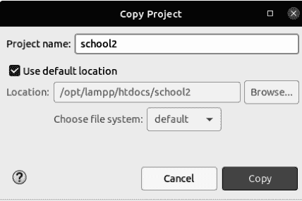

## 从对象关系映射到 MVC 容器

本章继续为使用 Laminas 做准备。在这里，我们将介绍最后两个阶段：

- 使用对象关系映射（ORM）处理数据库，抽象 SQL 语句
- 使用 Laminas 框架作为容器实现面向对象 PHP 应用程序的控制反转

首先，我们将解释在 laminas-db 的帮助下实现的 ORM 基础。然后，我们将通过构建 MVC 应用程序向您介绍 Laminas 的基础知识。这些基础对于创建电子商务应用程序非常重要，学习它们将非常宝贵。您可以跳转到第 5 章，创建虚拟商店项目，但您可能会感觉自己正试图用滑翔机攻击死星。保持冷静，准备好战斗。

在本章中，我们将涵盖以下主题：

- 使用 ORM
- 用例 – 管理学生
- 将 Laminas 用作容器

### 技术要求

与本章相关的所有代码均可在 https://github.com/PacktPublishing/PHP-Web-Development-with-Laminas/tree/main/chapter04 处找到。

### 使用 ORM

您已学习如何使用 `laminas-db` 及其实现的 **适配器** 设计模式连接到关系数据库。但是，尽管我们创建了一个允许通过配置在不同 SQL 数据库供应商之间切换的结构，但我们仍在编写 SQL 语句。当直接在应用程序代码中编写 SQL 语句时，我们必须选择特定的 SQL 方言。虽然存在 SQL 标准，但事实是，存在一些差异，例如引号的使用和函数名称。

例如，在 MySQL 中，对 `whatstore` 数据库的 `resources` 表的查询将采用以下形式：

```
SELECT `code`, `name`, `method` FROM `resources`
```

另一方面，PostgreSQL 中的同一查询将如下所示：

```
SELECT "code","name","method" FROM "public"."resources"
```

由此可见，这些供应商各自的引号字符不同。如果在另一个供应商中使用其中一个的 `SELECT` 查询，将发生错误。想象一下，因为要从一个供应商迁移到另一个供应商而更改应用程序的多个文件。

您可能会说，基于正则表达式的字符串替换可以快速解决这个问题。但是，除了引号问题之外，数据库函数之间还存在差异。例如，MySQL 会汇总多个表记录中字段的值，如下所示：

```
SELECT GROUP_CONCAT(`name`) as `names` FROM `resources`
```

但是 PostgreSQL 使用另一个函数来获得相同的结果：

```
SELECT string_agg("name",',') AS "names" FROM "public"."resources"
```

因此，如果应用程序直接编写 SQL 语句，数据库迁移可能是一项艰巨的任务。

ORM 避免了在需要从一个数据库供应商迁移到另一个供应商时重写代码。这种便利之处得益于 SQL 语句封装。

要开始使用 ORM，我们将学习如何将表视为对象。`laminas-db` 组件实现了 **表数据网关** 和 **行数据网关** 设计模式，分别允许将表或记录集视为对象，并允许将单个记录视为对象。在本章中，我们将使用表数据网关模式。

### 表数据网关

马丁·福勒在其著作《企业应用架构模式》（Addison-Wesley 出版）中将表数据网关定义为“充当数据库表网关的对象”。该对象旨在处理表中的多行。网关也是一种设计模式的名称。马丁·福勒在同一本书中将网关定义为“封装对外部系统或资源访问的对象”。数据库对于 Web 应用程序来说是外部系统，因此一些对象关系模式扩展网关模式是合情合理的。您可以使用表数据网关搜索单个记录，但该对象始终返回一个记录集（在本例中，是只包含一个元素的集合）。

### 行数据网关

马丁·福勒在其著作《企业应用架构模式》（Addison-Wesley 出版）中将行数据网关定义为“充当数据源中单个记录网关的对象”。虽然表数据网关关注记录集，但行数据网关关注单个记录。

在本章中，我们将创建一个 `school12` 项目，该项目将使用 `laminas-db` 实现 ORM。这个 `school12` 项目与 `school11` 项目的不同之处在于职责分离。在 `school11` 中，同一个类（`SchoolClass`）存储业务数据并处理与数据库的通信。现在，我们将有一个在内存中存储数据但不知道数据源的类，以及另一个用于读写数据库的类。这种方法避免了将业务规则与数据存储模型耦合。我们可以按以下方式分离职责：

1. 在 `htdocs` 文件夹中复制 `school11` 项目，并在同一个 `htdocs` 文件夹中将其命名为 `school12`。请记住，我们在《第 2 章，为我们的电子商务应用程序设置环境》中约定，`htdocs` 文件夹将是本书中的工作空间。您可以通过右键单击 `school11` 项目并点击 **复制**，或直接按 `Ctrl + C` 来执行此操作。然后，按 `Ctrl + V`，您将看到一个对话框，如图 4.1 所示：



图 4.1 – 复制项目的对话框

2. 确保 **项目名称** 字段填写为 `school12`；然后，单击 **复制**。

3. 右键单击 `school11` 项目并单击 **关闭项目** 项。

我们正在关闭第一个项目，因为我们不再需要它，如果它保持打开状态，我们可能会不小心更改该项目中的文件，以为它属于 `school12` 项目。从现在起，我们将在 `school12` 项目上工作。

### 用例 – 管理学生

在这个第二个项目（`school12`）中，我们将实现另一个用例，*管理学生*。这个用例与*管理学校班级*非常相似。两者都有四个流程，与创建、恢复、更新和删除操作相关。不同之处在于 `student` 模型依赖于 `school class` 模型。因此，*管理学生*用例流程的前提条件是 `classes` 表必须至少有一条记录。

### 实现用例

到目前为止，您已经知道如何创建文件夹。因此，让我们按照以下步骤实现一个用例：

1. 在项目根目录下创建一个名为 `view` 的新文件夹。

2. 在此文件夹内，创建两个更多文件夹：`schoolclass` 和 `student`。

`view` 文件夹是与用户界面相关的文件的明确划分。这种组织将帮助我们识别哪些属于表现层。

3. 接下来，选择以下文件：

- `delete.php`
- `edit.php`
- `index.php`
- `list.php`
- `save.php`

4. 将这些文件复制到 `view/schoolclass` 和 `view/student` 文件夹中。

5. 现在，您可以从项目根目录中删除所有这些文件，但 `index.php` 文件除外。`index.php` 文件是应用程序的入口点，并将充当其他文件的协调器。`index.php` 文件类似于房子的前门。您需要进入房子才能访问房间。同样，用户在访问其他 PHP 文件之前必须使用 `index.php`。

6. 将此 index.php 文件的内容替换为以下源代码：

### index.php

```
<!DOCTYPE html>
<html>
<head>
<meta charset="UTF-8">
<title>School Management</title>
</head>
<body>
<h1>School Management</h1>
<ul>
<li><a href="view/schoolclass">School classes
 </a></li>
<li><a href="view/student">Students</a></li>
</ul>
</body>
</html>
```

正如您所见，主页是一个带有两个注册链接的静态页面。此时，index.php 文件纯粹用于展示。现在，我们将重构其他展示文件。让我们从我们在 school1 项目中实现的用例开始，即管理学校班级。

我们需要更改 view/schoolclass 和 view/student 文件夹内文件中导入 autoload.php 文件的路径。由于这些文件夹内的文件之前位于应用程序根目录，因此路径现在不正确。从现在起，view/schoolclass 和 view/student 文件夹内所有导入 autoload.php 的文件必须在开头包含以下一行：

```
require realpath( __DIR__ . '/../../../vendor' ) . '/autoload.php';
```

如果不做此更改，您不会对与该路径相关的错误感到惊讶。提供了完整的源代码，但编写代码而不是复制粘贴是一种良好的实践。当您输入时，可能会犯错并需要检查您输入的代码以避免错误。此过程有助于消化内容。了解自己在做什么非常重要；否则，您将只是一个“代码操作员”。

这些初步步骤让我们了解了新项目结构的大致轮廓。我们有两个注册，一个用于学校班级，另一个用于学生。让我们先从重构从 school1 项目继承的学校班级代码开始。请记住，测试类保持在同一位置。


### 运行 SchoolClassTest->testListing 测试

现在我们已经实现了用例，让我们运行第一个测试。

我们将创建一个测试，以检查学校班级列表是否成功生成。此测试将由 SchoolClassTest->testListing 方法实现：

- 1. SchoolClassTest->testListing 方法如下所示：

```
public function testListing()
{
    $rows = SchoolClassTable::getInstance()->getAll();
    $this->assertIsIterable($rows);
}
```

当然，这个测试会失败，因为 SchoolClassTable 类尚不存在。这个类是使用 laminas-db 实现的表数据网关模式。SchoolClassTable 实例不是直接通过 new 运算符创建的，而是由 **单例模式** 的实现提供，该模式限制了类的实例数量。当你知道特定上下文中只需要一个类的实例，并且不希望开发人员在实现新功能或修复 bug 后意外创建另一个实例时，这种模式非常有用。**单例模式** 需要一个私有构造函数、一个用于单一实例的静态属性，以及一个用于创建和恢复此实例的静态方法。SchoolClassTable 类必须保留在 src 文件夹中。

### 注意
从现在起，我们不会再讨论已经知道的事情，例如使用 Eclipse 创建类。

- 2. 在 src 文件夹中创建 SchoolClassTable 类，始终使用 School 命名空间。此类需要一个学校班级数据表网关的实例。因此，我们将为 SchoolClassTable 实现一个 $instance 属性，如下所示：

```
private static ?SchoolClassTable $instance = null;
```

$instance 属性类型前的问号允许我们将其初始化为 null。我们会推迟对象创建，直到需要它时才创建。

- 3. SchoolClassTable 的构造函数如下所示：

```
private function __construct(TableGatewayInterface
    $tableGateway)
{
    $this->tableGateway = $tableGateway;
}
```

请注意，我们正在将 TableGatewayInterface 的实例注入到 $this->tableGateway 属性中。TableGatewayInterface 是表数据网关实现的接口。在依赖注入上下文中，使用接口而不是类是良好的做法，因为这使得替换实现变得容易。我们将在这里使用 Laminas 的表数据网关实现，但接口允许你在不更改 SchoolClassTable 类的情况下将实现更改为其他实现。变化是不可避免的；但是，我们可以减少更改的数量和重写代码的需求。

- 4. 最后，为了完成 **单例模式**，我们将有一个 SchoolClassTable::getInstance 方法：

```
public static function getInstance() :
SchoolClassTable
{
    if (null == self::$instance) {
        $adapter = self::getAdapter();
        $resultSetPrototype = new ResultSet();
        $resultSetPrototype->setArrayObjectPrototype
        (new SchoolClass());
        $tableGateway = new TableGateway('classes',
        $adapter, null, $resultSetPrototype);
        self::$instance = new
        SchoolClassTable($tableGateway);
    }
    return self::$instance;
}
```

laminas-db 的 TableGateway 类需要注入 AdapterInterface 实例。此实例由我们从 school11 项目的旧 SchoolClass 类中带来的 SchoolClassTable::getAdapter 方法提供。

请注意，虽然我们使用的是 laminas-db 的数据库适配器实现，但你可以将其替换为任何实现 AdapterInterface 的东西。这是 Laminas 的一个基本特性：你可以用兼容的其他组件替换大多数组件，或者编写自己的组件。你有将任务委托给现成组件的便捷选项，但你也有通过实现自定义代码来完全控制的权力。当然，你可以在开源软件中始终编写自己的代码，但在现实中，将你的组件连接到现有组件有时是困难的。

你可能对 TableGateway 构造函数的第四个参数感到好奇：

```
$tableGateway = new TableGateway('classes', $adapter, null, $resultSetPrototype);
```

第一个参数是表名。第二个参数是数据库适配器对象。第三个参数是可选的，允许我们注入扩展表网关功能的对象。第四个参数也是可选的，但如果提供，允许我们将结果集的元素封装为模型类的实例。通常，由 TableGateway 执行的 SQL SELECT 语句的返回值将是 ArrayObject（PHP 原生类）的集合。但 ResultSet 类通过 setArrayObjectPrototype 方法，允许我们定义结果集的类型。在此示例中，我们定义了由 SchoolClassTable 进行的查询将返回 SchoolClass 实例的集合。

没错，到此为止，我们已经解决了 SchoolClassTable 缺失的问题。但是 SchoolClassTest->testListing 测试仍然失败。此故障发生是因为测试期望 SchoolClassTable 实例具有 getAll 方法。此时，我们将避免重复工作。既然两个用例有相似之处，你是否同意它们共享公共代码？getAll 方法就是一个示例。StudentTable 类（我们需要为管理学生用例实现）也需要 getAll 方法。

当一个或多个类有重复代码时，是时候创建一个封装公共代码的父类了。

- 5. 因此，我们将在 src 文件夹中创建一个 AbstractTable 类。此类必须按如下方式实现 getAll 方法：

```
public function getAll() : iterable
{
    return $this->tableGateway->select(null);
}
```

这是面向对象的梦想：只有一行代码。该方法包含完全的外包。这是什么意思？getAll 方法本身不做任何事情。getAll 方法必须调用另一个方法。我们不亲自编写 SQL SELECT 语句，而是让 TableGateway 实例通过其 select 方法来编写它。我们不需要编写 SQL SELECT 语句或担心引号。

AbstractTable 将保留我们项目中表数据网关实现的公共代码；AbstractTable 还声明了 TableGateway 实例的属性：

```
protected TableGatewayInterface $tableGateway;
```

这是一个受保护的属性，因为它只对 AbstractTable 的子类可见，子类将处理它。

我们已经确定 `SchoolClassTable` 必须扩展 `AbstractTable`，并且数据库适配器创建是两个表数据网关实现的公共功能，因此静态 `getAdapter` 方法必须位于 `AbstractTable` 类中。

现在，`SchoolClassTest->testListing` 方法将成功运行。但是，其他测试方法将失败。当然，我们也需要重构它们。

- 6. 让我们重构 `SchoolClassTest->testInserting` 方法。此测试方法涵盖插入、选择和删除操作。我们插入一条记录，检索它，然后删除它：

```
public function testInserting()
{
    $schoolClassTable = SchoolClassTable::
        getInstance();

    $schoolClass = new SchoolClass(0, '1st year');
    $schoolClassTable->save($schoolClass);

    $schoolClass = SchoolClassTable::getInstance()
        ->getByField('name', '1st year');
    $this->assertEquals('1st year',
        $schoolClass->name);
    $code = $schoolClass->code;
    $schoolClass = SchoolClassTable::
        getInstance()->getByField('code', $code);
    $this->assertEquals('1st year',
        $schoolClass->name);
    $schoolClassTable->delete($schoolClass->code);
    $schoolClass = SchoolClassTable::
        getInstance()->getByField('code', $code);
    $this->assertEmpty($schoolClass->name);
}
```

如果你现在尝试运行 `SchoolClassTest` 测试用例，它将失败，因为 `SchoolClassTable` 类没有 `getByField` 方法。此方法将替换 `school1` 项目中旧 `SchoolClass` 类的 `getByCode` 和 `getByName` 方法。


- 7. 不过，getByField 方法可以由 AbstractTable 类实现，因为它是通用的：

```php
public function getByField(string $field, $value) : AbstractModel
{
	$where = [
		$field => $value
	];
	$rowSet = $this->tableGateway->select($where);
	if ($rowSet->count() == 0) {
		$modelName = $this->modelName;
		return new $modelName();
	}
	return $rowSet->current();
}
```

getByField 方法允许搜索任何字段。如您所见，如果未找到记录，该方法将返回由 $this->modelName 属性定义的类的一个实例。在 SchoolClassTable 类中，此属性声明如下：

```php
protected string $modelName = 'School\\SchoolClass';
```

此属性允许 AbstractTable 的每个子类告知其模型类，并确保该方法将返回一个 AbstractModel 的实例。

等一下！AbstractModel 是什么？它是我们模型的泛化。它实现了两个通用方法，一个用于数据输入 exchangeArray，另一个用于数据输出 toArray。

### AbstractModel.php

```php
<?php
declare(strict_types = 1);
namespace School;

abstract class AbstractModel
{

	public function exchangeArray($data)
	{
		$attributes = get_object_vars($this);
		foreach ($attributes as $attribute => $value) {
			$this->$attribute = (is_int($this->$attribute) ?
				(int) $data[$attribute] : $data[$attribute]);
		}
	}

	public function toArray()
	{
		return get_object_vars($this);
	}
}
```

exchangeArray 方法接收一个数据数组并将值放入相应的属性中。而 toArray 方法则返回一个包含属性值的数组。

现在测试能成功运行吗？当然不能！

- 8. 我们必须在 AbstractTable 类中实现 save 方法：

```php
public function save(AbstractModel $model): bool
{
    $set = $model->toArray();
    $keyName = $this->keyName;
    try {
        if (empty($model->$keyName)) {
            unset($set[$keyName]);
            $this->tableGateway->insert($set);
        } else {
            $this->tableGateway->update($set, [
                $keyName => $set[$keyName]
            ]);
        }
    } catch (\Exception $e) {
        error_log($e->getMessage());
        return false;
    }
    return true;
}
```

save 方法将艰苦的工作委托给 TableGateway 的 insert 和 update 方法。逻辑与 school1 项目中原先的 SchoolClass 类相同：在插入和更新之间的选择取决于表生成的主键的值。请注意，主键字段的名称由 $this->keyName 属性给出。该属性必须由 AbstractTable 类声明，如下所示：

```php
protected string $keyName;
```

- 9. SchoolClassTest 测试用例暂时无法运行，因为我们必须在 AbstractTable 类中实现 delete 方法：

```php
public function delete($value) : bool
{
    try {
        $this->tableGateway->delete([
            $this->keyName => $value
        ]);
    } catch (\Exception $e) {
        error_log($e->getMessage());
        return false;
    }
    return true;
}
```

现在 SchoolClassTest 测试用例能成功运行吗？还不能。

- 10. 您必须先创建 SchoolClass 类，如下所示：

### SchoolClass.php

```php
<?php
declare(strict_types = 1);
namespace School;
class SchoolClass extends AbstractModel
{
    public int $code = 0;
    public string $name = '';

    public function __construct(int $code = 0, string $name = '')
    {
        $this->code = $code;
        $this->name = $name;
    }
}
```

最后，我们可以成功运行 SchoolClassTest 了。现在，我们必须调整存储在 view/schoolclass 文件夹中的用户界面文件。为什么需要进行此调整？原因有两个。第一是现在我们将使用 SchoolClassTable::getInstance 返回的对象的 getAll 方法。第二是返回集合的元素不是数组，而是对象。

### 调整 CRUD 文件

让我们从列出学校班级的文件开始：

### list.php

```php
<?php
use School\SchoolClassTable;

require realpath(__DIR__ . '/../../../vendor') . '/autoload.php';

$baseUrl = '/view/schoolclass/';

foreach(SchoolClassTable::getInstance()->getAll() as $row):
?>
<tr>
    <td><a href="<?=$baseUrl?>edit.php?code=<?=$row->code?>"><?=$row->code?></a></td>
    <td><?=$row->name?></td>
    <td><a href="<?=$baseUrl?>delete.php?code=<?=$row->code?>">Remove</a></td>
</tr>
<?php
endforeach;
```

请注意，$row 变量是一个对象。如果您记得，在 school1 项目的等效文件中，$row 变量是一个数组。现在，表类的记录被映射为 SchoolClass 类的对象。

带有编辑表单的文件也必须进行调整，以使用 SchoolClassTable 和对象属性，而不是数组元素：

### edit.php

```php
<?php
use School\SchoolClassTable;
require realpath(__DIR__ . '/../../../vendor') . '/autoload.php';

$code = $_GET['code'] ?? null;
$schoolClass = SchoolClassTable::getInstance()->getByField('code', $code);
?>
<!DOCTYPE html>
<html>
<head>
<meta charset="UTF-8">
<title>Classes Registration</title>
</head>
<body>
<h1>Classes Registration</h1>
<form action="save.php" method="post">
Name: <input type="text" name="name" autofocus="autofocus" value="<?=$schoolClass->name?>"><br/>
<input type="hidden" name="code" value="<?=$schoolClass->code?>"><br/>
<input type="submit" value="save">
</form>
<p>
<a href="index.php">Go back</a>
</p>
</body>
</html>
```

edit.php 文件将数据提交到 save.php，就像 school1 项目中的对应文件一样。save.php 文件使用两个类 SchoolClass 和 SchoolClassTable 进行持久化。第一个类包含数据，第二个类包含操作。

save.php 文件将如下所示：

### save.php

```php
<?php
use School\\SchoolClass;
use School\\SchoolClassTable;
require realpath(__DIR__ . '/../../../vendor' .
    '/autoload.php');
$code = (int) ($_POST['code'] ?? 0);
$name = ($_POST['name'] ?? '');
$model = new SchoolClass($code,$name);
$schoolClassTable = SchoolClassTable::getInstance();
$schoolClassTable->save($model);
header('Location: /view/schoolclass/index.php');
```

对象应该帮助我们作为开发者。它们是工具，而不是戒律。当使用对象有帮助时，就使用它。但如果没有理由使用对象，则避免使用。遵循此准则，我们不需要创建对象来删除学校班级记录。

只需传递代码，如 delete.php 文件所示：

### delete.php

```php
<?php
use School\\SchoolClassTable;
require realpath(__DIR__ . '/../../../vendor' .
    '/autoload.php');
$code = ($_GET['code'] ?? null);
$schoolClassTable = SchoolClassTable::getInstance();
$schoolClassTable->delete($code);
header('Location: /view/schoolclass/index.php');
```

现在，您可以通过 school12 的 Web 界面管理学校班级。但我们承诺这个项目还将实现学生注册。两种注册（学校班级和学生）的实现相似，因此我们只会展示不同的部分。

我们将有一个扩展 AbstractTable 的 StudentTable 类。但与 SchoolClassTable 不同，StudentTable 类重写了 getByField 和 getAll 方法。这是因为 TableGateway 的默认查询（使用 select 方法制作）只读取一个表，忽略关系。要向 TableGateway 执行的 SQL SELECT 添加 INNER JOIN 子句，我们需要使用 Select 类的一个实例：

```php
public function getAll() : iterable
{
    $select = new Select($this->tableGateway->getTable());
    $select->join('classes', 'classes.code = students.class_code', [
        'class_name' => 'name'
    ]);
    $rowSet = $this->tableGateway->selectWith($select);
    return $rowSet;
}
```

Select 类有一个 join 方法，允许设置 INNER JOIN 子句。join 方法的第三个参数允许我们选择表的列并指定数组键的别名。要使用带有 INNER JOIN 的查询，我们将 Select 对象注入到 TableGateway 的 selectWith 方法中。selectWith 方法返回一个 ResultSet 对象，就像 select 方法一样。

当我们将 Student 类与 SchoolClass 类进行比较时，Student 类也存在差异。Student 类重写了从 AbstractModel 继承的 exchangeArray 和 toArray 方法。

重写 exchangeArray 方法是因为它需要实例化 SchoolClass 类。一个学生依赖于一个学校班级。这是我们用例的一个约束。我们不能没有学校班级来关联学生。如在 Student->exchangeArray 的实现中所见，Student 类有一个 $this->schoolClass 属性：

```php
public function exchangeArray($data)
{
    $this->id = ((int) $data['ID'] ?? 0);
    $this->name = ($data['name'] ?? '');
    $this->schoolClass = new SchoolClass();
    $this->schoolClass->code = ((int) $data['class_code']
        ?? 0);
    $this->schoolClass->name = ($data['class_name'] ?? '');
}
```


`class_name` 字段是 `classes` 表中字段名的别名。我们已在通过 `Select` 类创建的 `INNER JOIN` 中定义了该别名。

虽然我们在内存中将数据作为对象处理，但需要将数据转换为数组以将其持久化到表中。因此，在 `Student->toArray` 方法中，我们将对象替换为主键值：

```
public function toArray()
{
    $attributes = get_object_vars($this);
    $attributes['class_code'] = $attributes['schoolClass']
        ->code;
    unset($attributes['schoolClass']);
    return $attributes;
}
```

要插入新学生，我们需要将其与学校班级关联。这需要在学生的编辑表单中提供学校班级列表。在下面的代码部分，我们可以看到 `view/student` 的 `edit.php` 文件中创建此列表的部分：

```
<select name="class_code">
<?php
$schoolClasses = SchoolClassTable::getInstance()->getAll();
foreach($schoolClasses as $schoolClass) :
?>
<option value="<?=$schoolClass->code?>"
    <?=($schoolClass->code == $Student->schoolClass->code ?
    'selected="selected"' : '')?>>
    <?=$schoolClass->name?></option>
<?php
endforeach;
?>
</select>
```

这些是学校班级与学生注册之间的主要区别。`school2` 项目完整可用于 `https://github.com/PacktPublishing/PHP-Web-Development-with-Laminas/tree/main/chapter04/school2`。针对学生注册有一个 `StudentTest` 测试用例和一个代码覆盖率报告。尝试完整的应用程序并比较两个注册的代码。在 Eclipse 中，您可以通过选择两个文件并单击鼠标右键，然后选择 **与其他项比较/互相比较** 来比较两个文件。

现在您知道了如何抽象数据库连接以及如何使用 `laminas-db` 创建 ORM。

在下一节中，我们将重新实现学校班级和学生注册，但这次我们将使用 `laminas-mvc` 组件作为应用程序的容器。

## 将 Laminas 用作容器

当您将 Laminas 用作库时，您的代码会调用 Laminas 组件。这就是我们在 `school1` 和 `school2` 项目中所做的。现在，我们将使用 Laminas 作为框架，该框架将调用您的代码。以前，Laminas 包含在我们的应用程序中。现在，我们将创建一个将包含在框架中的应用程序。实际上，我们将根据 Laminas 的 MVC 结构重写我们的代码。

由于这是为更复杂和完整的应用程序做准备，我们将仅展示学校班级列表的实现，但请不要担心，因为完整代码可在本节末尾获取。但请尝试在从存储库复制代码之前，先根据说明自行实现代码，以便您可以将自己的预期与提供的代码进行比较。

与之前一样，我们需要通过创建新项目来为实现做准备。让我们来创建吧！

### 创建 school3 项目

要创建 `school3` 项目，请执行以下步骤：

- 1. 创建项目。

  您还记得我们在 Eclipse 工具栏中配置了一个创建 Laminas 项目的选项吗？我们在上一章中完成了此操作。好吧，您可以使用它来创建 `school3` 项目。

  使用 `File | New | PHP Project` 菜单选项打开项目。

- 2. 将 PHPUnit 作为开发依赖项添加到 `school3` 项目。

- 3. 不要忘记保存 `composer.json` 文件并单击 **更新依赖项** 按钮。

> **允许插件**
> 
> 在从骨架创建项目后安装组件时，您可能会被问及 **您是否信任 ‘laminas/laminas-component-installer’ 执行代码并希望立即启用它？** 以及 **您是否信任 ‘laminas/laminas-skeleton-installer’ 执行代码并希望立即启用它？**。这些消息与 Composer 插件有关。您可以回答 y。

- 4. 安装 PHPUnit 后，右键选择 `school3` 项目并访问 Run As | PHPUnit Test 项。您将在 Console 选项卡上看到以下消息：

```
Fatal error: Uncaught Error: Class "Laminas\\Test\\PHPUnit\\Controller\\AbstractHttpControllerTestCase" not found
in /opt/lampp/htdocs/school3/module/Application/test/
Controller/IndexControllerTest.php:11
```

此错误发生是因为 Laminas 骨架项目依赖于 `laminas-test` 组件，这是一个用于 PHPUnit 的扩展，允许我们测试 Laminas 控制器。由于您已在 `composer.json` 编辑器中安装了 PHPUnit，请搜索 `laminas/laminas-test` 包并安装它。我们在 *第 3 章，使用 Laminas 作为库进行测试驱动开发* 中学习了如何安装 Composer 包。

- 5. 现在您可以成功运行测试了。但运行的是哪个测试呢？是 `module/Application/test/Controller` 文件夹中的 `IndexControllerTest` 类。

> **在 PHP 7 中测试 Laminas MVC 时出错**
> 
> 您可能记得，在 *第 2 章，为我们的电子商务应用程序设置环境* 中，我们展示了 `laminas-mvc` 的 PHP 要求。`composer.json` 文件允许 PHP 7。但是，如果在 PHP 7 下运行 `IndexControllerTest`，则 `testIndexActionViewModelTemplateRenderedWithinLayout` 测试方法会出现错误。事实上，错误是因为 `$this->assertQuery` 方法依赖于仅从 PHP 8 开始可用的联合类型。您可以将 `$this->assertQuery` 替换为其他断言方法，并在 PHP 7 下继续使用 `laminas-test`，但最好将 PHP 升级到 8 版本。但是，如果出于某些原因必须使用 PHP 7，则删除 `testIndexActionViewModelTemplateRenderedWithinLayout` 方法。

既然我们已运行测试，现在将创建一个新模块。

### 创建 School 模块

Laminas MVC 应用程序被组织为一组模块。Laminas 中的模块是最大的复用单元。模块是自包含的。它有自己的配置和自己的 MVC 实现。要使用 `laminas-mvc` 实现我们的学校班级注册，我们将创建另一个名为 `School` 的模块。Laminas 模块位于 `modules` 文件夹中。有一个名为 `Application` 的默认模块。`Application` 模块包含您在上一章中查看的示例主页。

我们将使用 `Application` 模块作为新模块的模型：

- 1. 将 `modules` 文件夹中的 `Application` 文件夹复制到同一 `modules` 文件夹中的 `School`。

Laminas 中模块的命名空间就是模块的名称。因此，Application 模块的命名空间是 Application，那么 School 模块的命名空间必须是 School。在重建实现时，我们将更改每个文件的命名空间。让我们从模块的最小代码开始。

- 2. 在 modules.config.php 文件中注册模块。

modules.config.php 文件位于项目根目录的 config 文件夹中。此文件包含以 PHP 数组形式列出的启用模块列表。列表之外的模块会被忽略，就好像它们不存在一样。这使得通过从 modules.config.php 中删除模块来禁用模块变得容易。您可以看到 Application 是最后一项。这不是随机的。最后一个模块是决定布局的模块。布局是视觉元素的排列。对于 Web 应用程序，布局是使用层叠样式表 (CSS) 定义的。我们的新模块 School 没有布局，因此不能是最后一个。

- 3. 将 School 作为 Application 之前的一项添加。

modules.config.php 中列出的模块会被查找。但是，只有当模块具有自动加载配置时，才会找到它们。您应该记得我们已为 school1 项目通过 Eclipse 配置了自动加载。您可以使用相同的功能来配置 school3 的 composer.json。

- 4. 在 Composer 代码编辑器中选择 Autoload 选项卡。您将看到 Application 模块已有一个 PSR-4 配置。您必须添加一个带有以下参数的新自动加载配置：

  - * **Namespace:** `School\\`
  - * **Paths:** `module/School/src/`

我们还必须为测试类添加一个 PSR-4 自动加载配置。

- 5. 选择 Autoload-dev 选项卡。添加一个带有以下参数的配置：

  - * **Namespace:** `SchoolTest\\`
  - * **Paths:** `module/School/test/`

- 6. 保存 composer.json 文件并单击 **更新依赖项（包括 require-dev）** 按钮。

> **直接编辑 composer.json**
> 
> 我们使用特定表单所做的每项更改也可以直接进行。您可以单击 composer.json 视图底部的 **composer.json** 选项卡。编辑器将文件作为文本文件打开。您可以看到其他选项卡所做的更改，也可以直接进行更改。


现在可以找到 `School` 模块了。但它还无法正常工作。我们必须确保 `School` 模块内的每个文件都有正确的命名空间。

### 确保模块具有正确的命名空间

确保模块具有正确命名空间的过程涉及某些步骤。让我们按以下步骤开始：

- 1. 创建一个测试类。由于我们将 `Application` 模块复制为 `School` 模块，因此在 `module/School/test/Controller` 文件夹中有一个 `IndexControllerTest.php` 文件。删除此文件，并在同一文件夹中创建一个名为 `SchoolClassControllerTest.php` 的新文件。

此新文件必须包含一个扩展 `AbstractHttpControllerTestCase` 的 `SchoolClassControllerTest` 类，后者是 `laminas-test` 组件的一部分。它提供了用于测试 `laminas-mvc` 控制层的断言方法。这是我们以前项目中缺少的东西。你应该记得，我们测试过模型类，但请求取决于我们与网页浏览器的交互。现在我们可以在不使用网页浏览器或手动发送 HTTP 请求的情况下覆盖这部分内容。

`SchoolClassControllerTest` 类的命名空间是 `SchoolTest`，正如我们在 `composer.json` 中配置的那样。

- 2. 实现 `setUp` 方法以加载应用程序配置：

```php
public function setUp() : void
{
    $this->setApplicationConfig(
        include __DIR__ . '/../../../../config/application.config.php'
    );

    parent::setUp();
}
```

此 `setUp` 方法创建一个作为应用程序容器的对象。我们将在下一章详细了解它。目前，假设你可以访问测试所需的所有应用程序资源。

### 实现测试方法

现在，我们可以按照以下步骤开始实现测试方法：

- 1. 创建一个方法来测试学校类列表，testListing：

```php
public function testListing() : void
{
    $this->dispatch('/schoolclass', 'GET');
    $this->assertResponseStatusCode(200);
    $this->assertCommonRules();
}
```

testListing 方法模拟对端点 `/schoolclass` 的 HTTP 请求，并期望得到状态码为 200 的 HTTP 响应。

没错，但是 `$this->assertCommonRules` 方法的调用怎么办？嗯，我们已经在这里推进了。事实是，SchoolClassControllerTest 的测试方法有共同的断言，因为它们向同一个控制器类发送请求。

- 2. 与其重复相同的行，不如将它们封装到一个私有方法中：

```php
private function assertCommonRules() : void
{
    $this->assertModuleName('school');
    $this->assertControllerName('schoolclass');
    // as specified in router's controller name alias
    $this->assertControllerClass('SchoolClassController');
    $this->assertMatchedRouteName('schoolclass');
}
```

assertCommonRules 方法具有以下断言：

- `$this->assertModuleName`: 检查模块 - 参数值将按照 CamelCase 规范进行转换。这是什么意思？值 school 将转换为 School，首字母大写，即实际的模块名。
- `$this->assertControllerName`: 检查控制器名称的别名——这将在后面看到。
- `$this->assertControllerClass`: 检查控制器类的名称（不含命名空间）。
- `$this->assertMatchedRouteName`: 检查 URL 请求的模式是否匹配已配置的路由。

- 3. 自第 2 章“为我们的电子商务应用程序设置环境”以来我们一直使用的 Laminas 应用程序骨架，为 PHPUnit 提供了一个模板文件 `phpunit.xml.dist`。将其复制为 `phpunit.xml`。你可以看到，测试套件配置为仅运行 Application 模块的测试：

```xml
<testsuite name="Laminas MVC Skeleton Test Suite">
    <directory>./module/Application/test</directory>
</testsuite>
```

- 4. 修改前面的代码片段以运行任何模块的测试：

```xml
<testsuite name="Laminas MVC Skeleton Test Suite">
    <directory>./module/*/test</directory>
</testsuite>
```

太棒了！当我们有一个失败的测试时，就可以迈出 TDD 的第一步，即红色步骤。

### 运行测试

按照以下步骤运行测试：

- 1. 选择 `school3` 项目，然后单击 **运行方式 | PHPUnit 单元测试** 选项。

当然，测试会失败，因为 `SchoolClassController` 不存在。

- 2. 创建 `SchoolClassController` 来管理学校类列表的生成。此类的文件必须创建在 module/SchoolClass/src/Controller 文件夹中。事实上，Laminas 中模块的所有类都位于 `src` 文件夹，所有控制器类都位于 `src/Controller` 文件夹。此类需要两个方法：一个用于注入表数据网关的构造函数，以及一个用于调用表数据网关的方法：

### SchoolClassController.php

```php
<?php
declare(strict_types = 1);
namespace School\Controller;

use School\Model\SchoolClassTable;
use Laminas\Mvc\Controller\AbstractActionController;
use Laminas\View\Model\ViewModel;

class SchoolClassController extends AbstractActionController
{
    private ?SchoolClassTable $schoolClassTable = null;

    public function __construct(SchoolClassTable $schoolClassTable)
    {
        $this->schoolClassTable = $schoolClassTable;
    }

    public function indexAction()
    {
        $schoolClasses = $this->schoolClassTable->getAll();
        return new ViewModel([
            'schoolClasses' => $schoolClasses
        ]);
    }
}
```

正如我们所见，构造函数接收一个 `SchoolClassTable` 实例并将其赋值给 `$this->schoolClassTable` 属性。`indexAction` 方法使用该属性获取学校类列表，并通过 `ViewModel` 类将其传递到视图层。

如果你不需要 PHP 7 兼容性，可以找到以下内容：

```php
private ?SchoolClassTable $schoolClassTable = null;

public function __construct(SchoolClassTable $schoolClassTable)
{
    $this->schoolClassTable = $schoolClassTable;
}
```

将其替换为：

```php
public function __construct(private SchoolClassTable $schoolClassTable)
{
}
```

这是从 PHP 8 开始可能的。

- 3. 创建一个 Model 文件夹。将目标中的命名空间更改为 School\Model。

没错，但 SchoolClassTable 类从哪里来？我们已经创建过它了！

- 4. 将 school2 项目 src 文件夹中的所有文件复制到 module/School/src/Model 文件夹。

现在，模型层的大部分代码已经准备就绪。但是，我们需要更改一些行。让我们回到控制器类来理解这一点。

正如你在上一段源代码中看到的，SchoolClassController 类接收一个 SchoolClassTable 实例。但谁来注入这个实例？不是你，因为 MVC Laminas 应用程序中的控制器不是直接实例化的。你需要使用一个工厂类。

- 5. 在 School 模块的 src/Controller 文件夹中创建一个名为 SchoolClassControllerFactory 的工厂类：

### SchoolClassControllerFactory.php

```php
<?php
namespace School\Controller;

use Interop\Container\ContainerInterface;
use Laminas\ServiceManager\Factory\FactoryInterface;

class SchoolClassControllerFactory implements FactoryInterface
{
    public function __invoke(ContainerInterface $container, $requestedName, ?array $options = null)
    {
        $schoolClassTable = $container->get('SchoolClassTable');

        return new SchoolClassController($schoolClassTable);
    }
}
```

SchoolClassControllerFactory 类使用依赖注入容器来检索 SchoolClassTable 的实例。事实上，$container 对象的 get 方法使用一个键来定位 SchoolClassTable 的工厂。这个键将我们引导到一个名为 SchoolClassTableFactory 的类。

- 6. 使用以下源代码创建一个 SchoolClassTableFactory 类：

### SchoolClassTableFactory.php

```php
<?php
declare(strict_types = 1);
namespace School\Model;

use Laminas\Db\TableGateway\TableGateway;
use Laminas\Db\TableGateway\TableGatewayInterface;
use Laminas\Db\ResultSet\ResultSet;
use Laminas\ServiceManager\Factory\FactoryInterface;
use Interop\Container\ContainerInterface;

class SchoolClassTableFactory implements FactoryInterface
{
    public function __invoke(ContainerInterface $container, $requestedName, ?array $options = null)
    {
        $adapter = $container->get('DbAdapter');
        $resultSetPrototype = new ResultSet();
        $resultSetPrototype->setArrayObjectPrototype(new SchoolClass());
        $tableGateway = new TableGateway('classes', $adapter, null, $resultSetPrototype);
        return new SchoolClassTable($tableGateway);
    }
}
```

你可能会说：“我在哪里见过这个……”你说得对。这段代码是 SchoolClassTable 的静态 getInstance 方法的内容。因此，SchoolClassTable 不再需要这个方法，因为创建实例的责任已交给工厂类。


- 7. 删除 SchoolClassTable 的 getInstance 方法，并将该类的构造函数改为 public。这意味着你需要找到以下行：

```
private function __construct (TableGatewayInterface
$tableGateway)
```

将其替换为以下行：

```
public function __construct (TableGatewayInterface
$tableGateway)
```

控制器工厂类依赖于特定配置来查找数据表网关工厂类。

$container 对象的 get 方法使用的键是一个别名。此别名必须在配置文件中定义。由于我们在 School 模块中使用 SchoolClassTable，我们将在 School 模块的 module.config.php 文件中定义此配置。此文件位于模块的 config 文件夹中，这很合理。

- 8. 将 module.config.php 的命名空间改为 School。此文件实际上是带有模块配置的 PHP 数组。你将找到一个名为 controllers 的键，如下所示：

```
'controllers' => [
    'factories' => [
        Controller\IndexController::class =>
            InvokableFactory::class,
    ],
],
```

此代码片段显示 IndexController 类与 InvokableFactory 类相关联。InvokableFactory 是 laminas-mvc 提供的控制器工厂。此基本工厂在不进行依赖注入的情况下创建关联类的实例。我们不使用 IndexController。

- 9. 从 src/Controller 文件夹中删除 IndexController.php 文件。必须按如下更改上述代码片段：

```
'controllers' => [
    'aliases' => [
        'schoolclass' => Controller\
            SchoolClassController::class
    ],
    'factories' => [
        Controller\SchoolClassController::class =>
Controller\SchoolClassControllerFactory::class
],
],
```

是的，除了更改 factories 中的关联外，我们还添加了将 "schoolclass" 字符串与 SchoolClassController 关联的键别名。此关联起什么作用？它有助于将路由与实际控制器名称解耦。

- 10. 更改 router 键内部的 routes 键。删除 router 的当前值，并将其替换为以下内容：

```
'routes' => [
    'schoolclass' => [
        'type' => Segment::class,
        'options' => [
            'route' => '/schoolclass[/:action'
            [/:code]]',
            'defaults' => [
                'controller' => 'schoolclass',
                'action' => 'index',
            ],
        ],
    ],
],
],
```

路由是 URL 模式与控制器类之间的关联。laminas-router 组件中有几种可用的路由类型。在此示例中，我们使用允许参数的 Segment 路由。在 '/schoolclass[/:action[/:code]]' 模式中，括号之间的部分是可选的，冒号后面的单词是参数。defaults 键定义省略参数的假设值。请注意，我们为 controller 和 action 定义了默认值。controller 键的值是 SchoolClassController 的别名。

你可能忘了，但别名的值是传递给 SchoolClassControllerTest 的 $this->assertControllerName 方法的值。事实上，你可以使用别名或类的完整名称。

现在可以成功运行测试用例了吗？嗯，测试仍然会失败，因为我们需要配置 SchoolClassTable 的别名。

- 11. 通过向 module.config.php 的数组中添加 service_manager 键来配置别名。此键位于以下数组的第一级：

```
'service_manager' => [
    'factories' => [
        'SchoolClassTable' => Model \
            SchoolClassTableFactory::class
    ]
],
```

依赖注入容器将使用 factories 内部定义的键来调用声明为值的工厂。

现在可以运行测试了吗？不行。

- 12. 将 School/src 文件夹中 Module 类的命名空间改为 School。Module 类加载 module.config.php 文件，因此如果找不到，模块配置将被忽略。

做出此更改后，我们可以运行测试了，对吗？不，因为我们需要配置数据库连接。保持冷静并进行配置。我们将继续使用 school 数据库，即 school11 和 school12 项目使用的同一数据库。

- 13. 安装 laminas-db。幸运的是，你知道如何操作。但这次，由于你在带有 laminas-mvc 的项目中安装 laminas-db，你将在 Console 选项卡中看到以下提示：

```
Please select which config file you wish to inject
'Laminas\Db' into:
[0] Do not inject
[1] config/modules.config.php
[2] config/development.config.php.dist
Make your selection (default is 1)
```

这允许你（选择性地）将 laminas-db 注入到应用程序中作为模块。如前所述，Laminas 中的模块是最大的复用单元。你可以仅为开发环境注入组件（选项 2）。但我们将 laminas-db 注入为生产环境的组件，因此请选择选项 1。

- 14. Composer 接下来会询问以下内容：

```
Remember this option for other packages of the same type?
(Y/n)
```

回答 Y，以便避免在接下来安装的 Laminas 组件中再次出现上述提示。请记住，laminas-db 需要连接参数。根据 Laminas 的最佳实践，我们必须将全局配置（适用于任何环境）与本地配置（适用于特定环境）分开。

- 15. 将全局配置放在项目根目录下 config/autoload 文件夹中的 global.php 文件中。school 项目的内容必须如下：

### global.php

```
<?php

use Laminas\Db\Adapter\AdapterServiceFactory;
return [
    'db' => [
        'driver' => 'Pdo_Mysql',
        'database' => 'school'
    ],
    'service_manager' => [
        'factories' => [
            'DbAdapter' => AdapterServiceFactory::class
        ]
    ]
];
```

与之前项目的数据库配置不同之处在于使用了 AdapterServiceFactory，其昵称为 DbAdapter。此类使用 db 键的数据来创建我们老朋友 Adapter 类的一个实例。对吧，但其他参数呢？嗯，其他参数可能因环境而异。因此，我们必须将它们放入 local.php 文件。虽然 global.php 对所有环境都相同，但每个环境都有不同的 local.php。因此，local.php 文件不得成为版本控制的一部分。骨架附带一个名为 local.php.dist 的模板。

- 16. 从 `config/autoload` 文件夹复制 `local.php.dist` 到同一文件夹中的 `local.php`，并用以下代码填充：

### local.php

```
<?php
return [
    'db' => [
        'hostname' => 'localhost',
        'username' => 'root',
        'password' => ''
    ]
];
```

我们已拥有所有必要数据。你一定很想知道测试现在是否能成功运行。

- 17. 运行测试：

```
1) SchoolTest\\Controller\\SchoolClassControllerTest::testListing
Failed asserting response code "200", actual status code is "500"

Exceptions raised:
Exception 'Laminas\\View\\Exception\\RuntimeException' with message 'Laminas\\View\\Renderer\\PhpRenderer::render: Unable to render template "school/school-class/index"; resolver could not resolve to a file' in /opt/lampp/htdocs/school3/vendor/laminas/laminas-view/src/Renderer/PhpRenderer.php:492
```

运行时，你会收到上述错误消息。此消息出现的原因是控制器操作没有对应的视图。

请注意，错误消息明确指出应用程序期望 `school/school-class/index` 模板。Laminas 控制器层和视图层之间存在一种约定。从路由接收 HTTP 请求的控制器方法带有 `Action` 后缀。当 `Action` 方法结束并返回 `ViewModel` 对象时，框架会查找与方法名相同但不带 `Action` 后缀的文件。因此，`indexAction` 方法对应名为 `index` 的文件。视图文件的默认扩展名是 `.phtml`。


- 18. 在 School 模块的 view/school/school-class 文件夹中创建 index.phtml 文件。

view 文件夹有一个 application 子文件夹，它是从 Application 模块复制的文件夹副本。

- 19. 删除这个子文件夹，因为它对 School 模块没有用。

- 20. 在 view 文件夹内创建 school 文件夹，并在 school 文件夹内创建 school-class 文件夹。

view 下的第一级文件夹与控制器类相关。第二级与控制器操作相关。view 文件夹内文件夹和文件的名称必须使用小写。当类或方法的名称由多个名称组成时，相关文件夹和文件名必须用连字符分隔。

- 21. 在 school-class 文件夹内创建 index.phtml 文件，如下所示：

### index.phtml

```
<h1>Classes Registration</h1>
<p>
 <a href="<?=$this->url ('schoolclass',
 ['action' => 'edit']) ?>">Add a new class</a>
</p>
<table>
 <thead>
 <tr>
 <th>code</th>
 <th>name</th>
 </tr>
 </thead>
 <tbody>
 <?php
 foreach($this->schoolClasses as $row):
 ?>
 <tr>
 <td><a href="<?=$this->url
 ('schoolclass',['action' => 'edit', 'code'
 => $row->id]) ?>"><?=$row->code?></a></td>
 <td><?=$row->name?></td>
 <td><a href="<?=$this->url('schoolclass',
 ['action' => 'delete', 'code' => $row->code]) ?>">Remove</a></td>
 </tr>
 <?php
 endforeach;
 ?>
 </tbody>
 </table>
 <p><a href="<?=$this->url('home') ?>">Homepage</a></p>
```

$this->schoolClasses 属性是由 SchoolClassController 的 indexAction 方法通过 ViewModel 类定义的。这个文件的真正区别在于使用了 $this->url 方法。该方法从某些 module.config.php 文件中声明的路由创建 URL。

- 22. 最后，您可以成功运行测试！

等等，我们难道不需要在 Web 界面中导航吗？好吧，您可以通过此处实现的列表部分导航，或者通过下载完整项目来导航。

- 23. 启动 Web 服务器。就像我们使用“hello world”项目所做的那样，您可以使用 PHP 的内置 Web 服务器。在 school3 文件夹内，运行以下命令：

```
php -S localhost:8000 -t public
```

现在您可以在 localhost:8000 访问 school3 应用程序。

如果这里的某些细节看起来像魔法，请不要担心；每个细节将从下一章开始解释。第 3 章“使用 Laminas 作为带测试驱动开发的库”和第 4 章“从对象关系映射到 MVC 容器”的主要目的是避免从纯 PHP 经验突然跃迁到 Laminas 开发方式。您可以在 Laminas 文档中找到快速入门指南，但它就像一个改进的“hello world”，没有数据库处理。

因此，您已完成本节，拥有一个小型 MVC Laminas 应用程序，其中框架调用您的代码，而不是您的代码调用框架组件。

school3 项目完全可用于 https://github.com/PacktPublishing/PHP-Web-Development-with-Laminas/tree/main/chapter04/school3。您可以安装、导航和处理学校班级和学生。在此准备之后，您已准备好开展我们精彩的电子商务项目。您很快将深入理解 Laminas MVC 实现的每一层。

### 摘要

在本章中，我们学习了如何使用 `laminas-db` 实现 ORM。

有用于 PHP 的 ORM 生成工具，例如 **Doctrine**，它可以从数据库架构为您创建类。但是，代码生成工具有时会产生不必要的代码，并从开发人员手中夺取 ORM 的控制权。使用 `laminas-db`，开发人员对 ORM 拥有完全控制权，并可以避免代码生成工具有时产生的冗余代码。

我们逐步演进代码库，直到能够使用 `laminas-mvc` 来包含我们的代码。我们还牢记最佳实践，在创建被测试代码之前先创建测试。这种 TDD 经验将为我们迎接下一挑战做好准备。

在下一章中，我们将提高 Web 应用程序开发的复杂度。我们将开始实现一个电子商务项目，以探索 Laminas 组件提供的许多功能。
