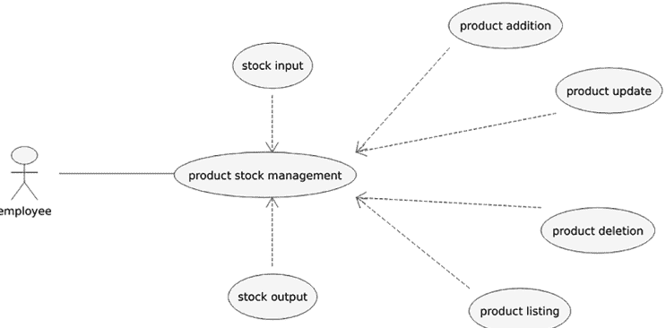
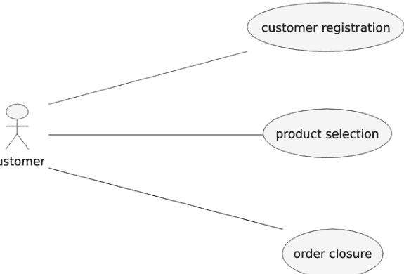
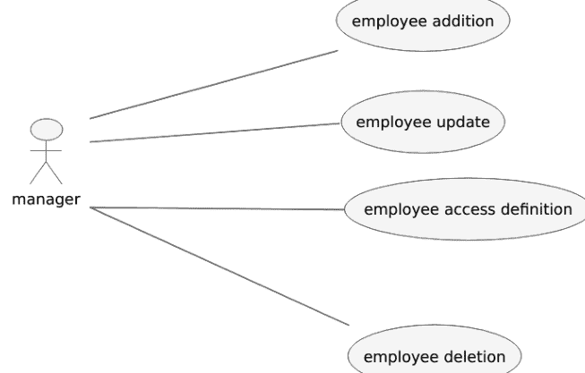
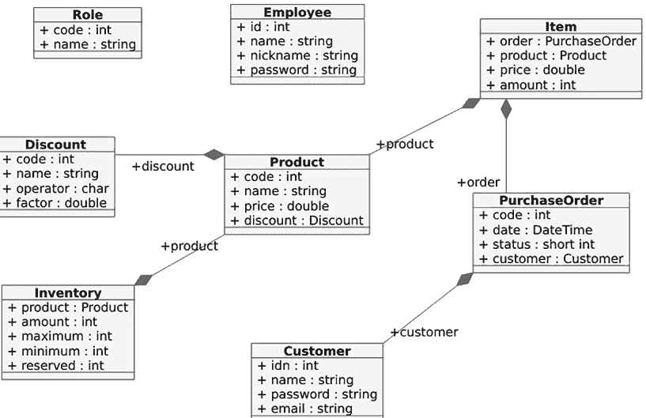
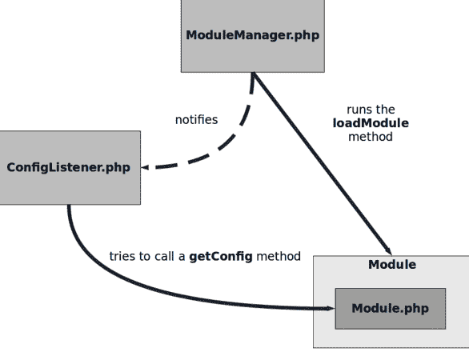
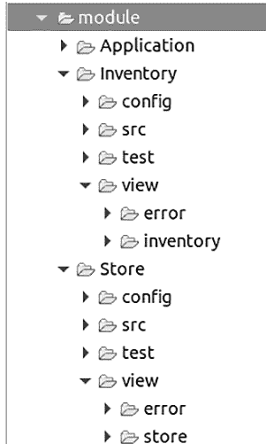

## 创建虚拟商店项目

本章介绍我们计划构建的电子商务项目的需求、用例、类图以及应用程序的总体结构创建。我们将启动一个更复杂的应用程序，它可以作为创建 PHP 企业 Web 应用程序的参考。

到本章结束时，您将能够使用 Laminas 框架作为容器和服务提供商来创建复杂软件项目的结构。

在本章中，我们将涵盖以下主题：

- 了解示例 Web 应用程序的项目需求
- 识别用例和角色
- 了解 *whatstore*（我们的虚构百货商店）的类图
- 创建项目实例

### 技术要求

虚拟商店项目的环境已在 *第 2 章，为我们的电子商务应用程序设置环境* 中准备好。硬件参考配置已在 *第 3 章，使用 Laminas 作为带测试驱动开发的库* 中介绍。本章生成的代码可在 `https://github.com/PacktPublishing/PHP-Web-Development-with-Laminas/tree/main/chapter05` 中完整查看。

### 了解示例 Web 应用程序的项目需求

我们将为项目构思一个虚构的背景故事。您是一家软件公司的所有者。您的公司名为 *Sheet Software*。有一天，您的公司受雇为一家名为 *Whatstore* 的百货商店创建电子商务网站。您可能会认为这家百货商店的名称听起来更像一个问题，但实际上，这个名称是 *We Have All Things Store* 的缩写。这家公司确实销售许多产品。不幸的是，合同不包括为客户公司建议更好的名称。因此，我们可以专注于软件构建。

在与 Whatstore 首席执行官 Mr. Heythere 的几次会议后，为虚拟商店定义了一些需求：

- 1. 虚拟商店系统必须有两个不同的区域：一个面向客户（销售区），另一个面向员工（管理区）。第一个区域必须允许客户将商品放入购物篮并支付。第二个区域必须允许员工注册产品、进行库存管理、更改价格并提供折扣。

- 2. 客户区域的主页必须允许按名称（完全或部分）搜索商品。

- 3. 商品页面必须显示商品名称、价格和库存数量。每个商品都必须有一个按钮将商品添加到购物篮。

- 4. 必须有一个始终可见的购物篮链接，允许客户查看所有选定的商品，更改每个商品的数量，移除商品或关闭订单。

- 5. 客户应该能够在流程中的任何时间点自行注册。他们在选择商品时不需要注册，但在结账时，客户应该自动注册。

- 6. 订单关闭时，必须在库存中预留请求的商品数量。当商品准备交付时，该数量必须从库存中扣除。

- 7. 系统必须对管理区域实施访问控制，允许他们定义谁可以做什么。

这些功能需求提供了所请求系统的总体概览。在下一节中，我们将为用例完善这些需求。正如我们在上一章中所经历的那样，用例可以帮助我们开发，不仅因为它提供流程，还因为我们可以从用例生成测试用例。测试用例反过来有助于我们维护软件的稳定性。


### 识别用例和参与者

在上一章中，我们制定了简化的用例规范（管理学校班级）。在本章中，我们将仅在此处展示用例图。就我们的目的而言，图表及随后的评论已足够。

Whatstore 虚拟商店有两个主要参与者：客户和员工。首先，我们将展示员工参与者的用例图。在客户从商店购买东西之前，商店需要有产品。图 5.1 显示了与产品库存维护相关的用例：



图 5.1 – 员工参与者的用例

如我们所见，我们的电子商务系统将具有产品注册功能。嗯，你已经在上一章的示例中获得了创建注册的经验。但是，产品库存除了创建、读取、更新和删除（CRUD）操作之外，还有一些操作。商店持有的某种产品的数量存储在产品注册的不同表中，正如我们在第 2 章「为我们的电子商务应用程序设置环境」中所见。每种可用产品的数量可以通过与商品获取或销售相关的特定操作来更改。

你可能会发现，图 5.1 展示了一些根据我们在第 3 章「将 Laminas 作为库与测试驱动开发相结合」中采用的方法，仅属于操作流程的用例。你必须记住，学校系统中的 CRUD 操作属于同一个用例。这对我们的准备很方便，因为我们需要对项目有一个更简化的视图。因此，将流程分组在一个用例中更好。从现在开始，我们将处理更多细节，因此最好将操作划分开来，以创建更小且更易读的测试。

既然我们有可供出售的产品，客户就可以与系统交互。如我们在图 5.2 中所见，客户有三个主要流程：注册、产品选择和订单结算：



图 5.2 – 客户参与者的用例

客户可以自行注册。但是员工呢？谁将员工添加到系统中？我们可以看到，应该有一个创建员工的参与者：经理。经理也可以是员工，但承担管理角色的员工。图 5.3 显示了与经理参与者相关的用例：



图 5.3 – 经理参与者的用例

因此，我们为系统识别了三个参与者：客户、员工和经理。用例的参与者可以帮助我们识别类，尽管这并不意味着每个参与者都会转化为类。

在第 2 章「为我们的电子商务应用程序设置环境」中，我们展示了应用程序的模型-实体关系（MER）。实际上，此工件是通用需求定义的一部分。实体也有助于我们识别类。我们在上一章中使用了对象关系映射，并看到类和表之间存在相似性。

接下来，从用例和 MER 的结合中，我们将展示类图，该图将用于应用程序模型的实现。

### 理解 Whatstore 的类图

图 5.4 显示了 Whatstore 系统的类图。你可以观察到，有两组类：一组独立的类，Role 和 Employee，以及另一组具有依赖关系的类。与客户相关的用例中的类之间的耦合应该是清楚的，考虑到大多数需求都提到客户搜索、选择或订购产品。



图 5.4 – 类图

Role 类从何而来？此前，我们说过经理是员工扮演的角色。经理角色允许员工从系统中插入、更新和删除其他员工。如果首席执行官希望，此角色可以与多个员工关联。当前经理随时可能失去其角色。我们可以定义一个 `Manager` 类来处理这种特定的特权场景。这需要进一步思考。

如果系统请求了一个新角色怎么办？例如，一个可以插入员工，但不能更新或删除员工的角色。我们应该创建一个新类吗？我们尽量避免软件系统中不必要的更改。每次更改通常会增加更多复杂性，并且倾向于随着时间的推移，使添加新功能和查找 bug 原因变得更加困难。

我们必须以一种不需要更改源代码的方式允许对软件系统进行更改。架构必须足够灵活，以允许通过配置进行调整。我们必须寻找允许由于插入新数据或系统元素之间的关联而发生行为变化的结构。如果我们有一个通用的角色结构，我们可以随时创建新角色。员工的行为可以通过员工与角色之间的关联来更改。

软件将会改变。让我们专注于为系统（和我们的预算）增加价值的变化。考虑未来，并尝试创建可以轻松适应特定情况的通用结构。这种理想的灵活性特性是 `Role` 和 `Employee` 类之间解耦的原因。

当然，我们正试图通过 Whatstore 的虚构故事来简化一个电子商务系统。我们将尽可能涵盖许多主要功能，并将利用每一个机会来评论对任何复杂 Web 应用程序项目都有用的架构方面。

目前，我们已具备所需的输入。在下一节中，我们将基于 Laminas 框架开始使用主要架构结构实现。

### 创建项目实例

在先前处理过其他事情之后开始一个新项目，是多么美妙啊？现在你更有信心了。你拥有一个配备合适工具的准备环境。让我们练习一下之前章节中学到的内容。在 Eclipse 中使用 **创建 Laminas 项目** 外部工具配置，创建名为 **whatstore** 的项目。请记住，创建后，你需要使用 **文件 | 新建 | PHP 项目** 菜单打开项目。实际上，Eclipse 不会创建新的 PHP 项目，但它会打开文件系统中现有的项目。

创建项目后，你可以使用嵌入式 PHP Web 服务器启动应用程序（假设你正在 **whatstore** 目录内运行），方法如下：

```
php -S localhost:8000 -t public
```

如果你在浏览器中打开 `localhost:8000` 地址，你将看到 Laminas 的欢迎页面，就像你在第 2 章「为我们的电子商务应用程序设置环境」中所做的那样。但是，为什么我们将 `-t` 参数与 `public` 值一起使用呢？我们将在下一节中了解这一点。

### 理解 Laminas 项目的结构

让我们从新项目的目录中了解 Laminas 项目的结构：

- bin：此文件夹用于存储自动化脚本
- config：此文件夹存储应用程序配置
- data：此文件夹用于存储不需要共享的数据，例如缓存文件
- module：这是应用程序的核心，包含模块的文件夹，我们将在本节中详细讨论
- public：这是应用程序的公共部分，唯一可被用户访问的文件夹
- vendor：这是 Composer 管理的依赖项的默认文件夹

因此，我们通过指向 public 文件夹来启动应用程序，因为 public 是用户的 Web 根目录。它是用户的唯一访问点，避免了不必要地暴露应用程序的主要部分。public 与其余部分之间的这种分离使应用程序类似于被深壕环绕的城堡（里面可能有鳄鱼或更糟的东西）。public 文件夹就像这座城堡的吊桥。你必须走过桥才能进入城堡。因此，在 Web 服务器的文件系统配置中，你可以拒绝访问除了 public 以外的任何文件夹。

我们说过 module 文件夹是应用程序的核心。这确实如此。试着删除这个文件夹看看会发生什么。嗯，module 文件夹可以有一个或多个模块，它们位于符合 CamelCase 模式命名的子文件夹中。让我们查看默认 Application 模块的内容，以了解模块的一般结构：

- config：此文件夹存储模块配置
- src：此文件夹存储实现用例的类
- test：此文件夹存储测试用例
- view：此文件夹存储 HTML 页面的模板文件

这种结构非常适合 MVC 实现。模型和控制器层的元素在 src 文件夹中。视图层的元素在 view 文件夹中。这是 Laminas 模块的提议和默认结构。可以更改此结构中的一切，但通常没有必要。Laminas 有其模式，但它是可配置的。

运行时的真实配置是应用程序配置与模块配置的组合。应用程序配置处理共享资源，例如多个模块使用的数据库连接。模块配置起初只能处理模块包含的资源。但是，模块可以使用另一个模块的资源，尽管不建议建立高度耦合。


Laminas 的 MVC 实现具有一个 ModuleManager 类，它将各个模块编排为唯一的应用程序。ModuleManager 负责将多个模块的配置合并为单个配置。图 5.5 显示了模块配置读取的简化方案，该过程在循环内进行：



图 5.5 – 监听器的配置读取

事实上，此过程涉及更多的类和接口，但我们将在第 7 章，请求控制与数据视图中进一步了解。目前，了解主要元素就足够了。

每个模块在 src 文件夹内都有一个 Module 类。ModuleManager 在应用程序配置的 modules.config 文件中列出的模块进行查找。当 ModuleManager 加载模块时，会通知 ConfigListener 类。ConfigListener 尝试从 Module 类调用 getConfig 方法。如果存在 getConfig 方法，则必须返回配置数组。模块配置包含（如我们在上一章中所见）模块的路由、可实例化的控制器、视图模板的源以及任何需要通过依赖注入创建的对象的工厂。

在下一节中，我们将为项目准备模块。

### 为我们的项目准备模块

Whatsstore 应用程序将有三个模块。我们将保留 Application 模块，并再创建两个：Inventory 和 Store。我们将使用 Application 模块作为其他模块的源。在模块文件夹中复制 Application 目录并粘贴两次，一次作为 Inventory，另一次作为 Store。

你可以观察到，仅仅在 module 文件夹中存在 `Inventory` 和 `Store` 文件夹不会影响应用程序，通过加载 `localhost:8000` 上的欢迎页面即可验证。`ModuleManager` 会忽略这些文件夹，直到它们的名称出现在 `config` 文件夹的 `modules.config.php` 文件中。按以下方式在此文件中添加新模块的名称：

### module.config.php

```
return [
    'Laminas\\Router',
    'Laminas\\Validator',
    'Store',
    'Inventory',
    'Application',
];
```

`Application` 模块必须保留在此列表的末尾，因为它将定义网页的布局。我们将在 *第 7 章，请求控制与数据视图* 中讨论此问题。

将新模块添加到配置后，我们将在 Web 服务器日志中看到此错误消息：

```
PHP Fatal error: Uncaught Laminas\\ModuleManager\\Exception\\RuntimeException: Module (Store) could not be initialized.
```

问题是什么？`ModuleManager` 找不到这些模块。但是怎么可能呢？它们在 `modules` 文件夹中！等等，别着急！我们在 *第 4 章，从对象关系映射到 MVC 控制器* 中已经讲过这一点。如果你需要复习，请重新阅读 *将 Laminas 用作容器* 一节。

我们已经说过，Laminas 是可配置的。它不强制你遵循僵化的结构。你有灵活性来调整项目结构。因此，你可以将模块放在不同的位置，这也是有道理的。之所以可能，是因为类的加载委托给了 Composer。我们在 `composer.json` 文件中定义自动加载规则。你需要按如下方式更改 `autoload` 和 `autoload-dev` 键：

```
"autoload" : {
    "psr-4" : {
        "Application\\" : "module/Application/src/",
        "Inventory\\" : "module/Inventory/src/",
        "Store\\" : "module/Store/src/"
    },
},
"autoload-dev" : {
    "psr-4" : {
        "ApplicationTest\\" : "module/Application/test/",
        "InventoryTest\\" : "module/Inventory/test/",
        "StoreTest\\" : "module/Store/test/"
    }
},
```

完成自动加载配置后，不要忘记保存 `composer.json` 文件，并在 Eclipse 的 Composer 编辑器中点击 **更新依赖项（包括 require-dev）** 按钮。此操作将重新生成自动加载文件。

但是，当你在 **控制台** 选项卡中查看输出时，你会发现此操作还会搜索更新，这很合理。如何在不搜索更新的情况下重新生成 `autoload` 文件？我们可以创建一个外部工具配置，如同我们在第 2 章，为我们的电子商务应用程序设置环境的 *集成 Laminas 和 Eclipse* 一节中为 Laminas 项目创建所做的那样。你可以创建如下配置：

- **名称**：Composer 自动加载文件重新生成
- **位置**：在此处，必须键入 Composer 可执行文件的完整路径
- **工作目录**：`${project_loc}`
- **参数**：dumpautoload

因此，当你需要重新生成 `autoload` 文件时，可以通过 Eclipse 工具栏运行此配置。

但是，即使重新生成了 `autoload` 文件，模块仍未加载。为什么呢？我们之前见过这种情况。难道我们没有复制 Application 模块吗？那么，Inventory 和 Store 模块的所有命名空间也都是 Application。因此，你需要编辑这些模块中的所有类和配置文件，并将命名空间更改为 `composer.json` 文件中定义的命名空间。例如，对于 Inventory 模块，`modules.config.php` 文件和 `src` 文件夹中的类必须具有 `Inventory` 命名空间。而 `test` 文件夹中的类则必须具有 `InventoryTest` 命名空间。

你可以检查，修复命名空间后，你可以成功加载 `Whatstore` 应用程序的 Laminas 骨架欢迎页面。看来模块方面一切正常。你可以将 PHPUnit 和 `laminas-test` 作为开发依赖项安装以运行测试，结果将为正，但这将是一个假阳性，因为我们没有创建包含所有测试用例的 `phpunit.xml` 文件。将 `phpunit.xml.dist` 模板复制为 `phpunit.xml`。找到以下行：

```
<directory>./module/Application/test</directory>
```

并将其更改为以下行：

```
<directory>./module/*/test/</directory>
```

这可能会让人感觉似曾相识，因为你在第 4 章，从对象关系映射到 MVC 控制器中已经这样做过了（至少我希望你如此）。现在，如果你再次运行 phpunit，你会看到两个新模块出现错误。这些错误与测试调用的路由有关。但目前，我们不会修复测试类。我们将在第 7 章，请求控制与数据视图中进行修复。

由于新模块的路由尚未配置，新控制器未被实例化，因此控制器未尝试渲染模板视图。但是，有必要再次讨论视图文件夹的结构，为下一步的实现准备我们的模块。

Laminas 模块的视图文件夹必须是一个与模块同名的文件夹，但仅使用小写字母。视图文件夹下的文件夹和文件名称均为小写字母。然后，将 Inventory 和 Store 模块视图文件夹下的 application 文件夹分别更改为 inventory 和 store。还要移除这些模块视图文件夹下的 layout 文件夹。只有一个模块需要拥有 layout 文件夹，而 Application 模块已经有一个。新模块的外观应如图 5.6 所示：



图 5.6 – 模块文件夹的结构

这足以使用自定义模块启动一个新的 Laminas 项目。在下一章中，我们将实现应用程序的模型层，使用本章中预计的类。

### 总结

在本章中，我们介绍了我们的主要示例 Web 应用程序的要求：一个为虚构公司 Whatstore 提供服务的电子商务系统。我们努力理解其请求系统的业务规则和要求。我们使用了一些用例图来高级展示应用程序的主流程。此外，我们介绍了将作为模型层实现输入的预计类。

我们还回顾了在第 2 章，为我们的电子商务应用程序设置环境和第 4 章，从对象关系映射到 MVC 控制器中完成的一些步骤，用于通过 Composer（由 Eclipse 中介）创建项目，并使用 Application 模块作为模板创建新模块。

在本章中，你学习了如何使用 Laminas 框架启动一个复杂的软件项目。我们可以将复杂性理解为与系统中的事物数量以及了解和管理每个事物的难度相关的概念。根据笛卡尔原理，要解决复杂问题，我们需要将其分解为更小的部分。在此，我们为软件项目定义了模块结构，将主要问题分为两部分（两个模块）。在后续章节中，我们将学习模块内部的划分，这将帮助我们一次专注于一个小问题。

当代软件是复杂的，有必要拥有应对复杂性的方法和工具。Laminas 框架的模块结构结合 MVC 模式，帮助 PHP Web 开发人员管理分布式系统世界中的复杂应用程序。

在下一章中，我们将回顾我们已经学习的关于 `laminas-db` 组件的内容，并深入研究 ORM 实现。当我们需要为映射器类创建通用实现时，我们将处理代码复用问题。


