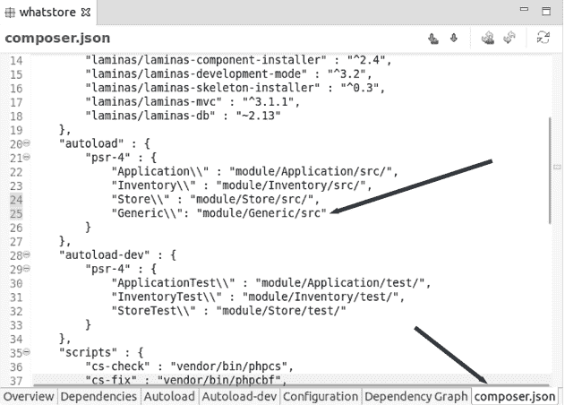
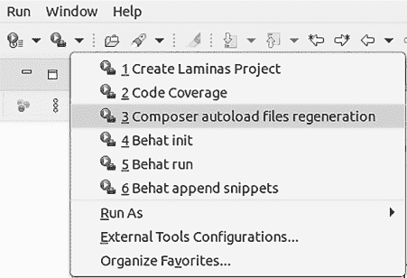
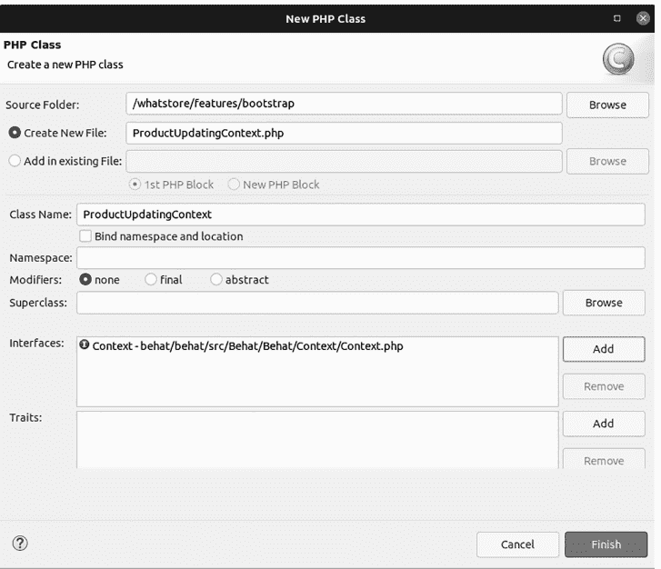
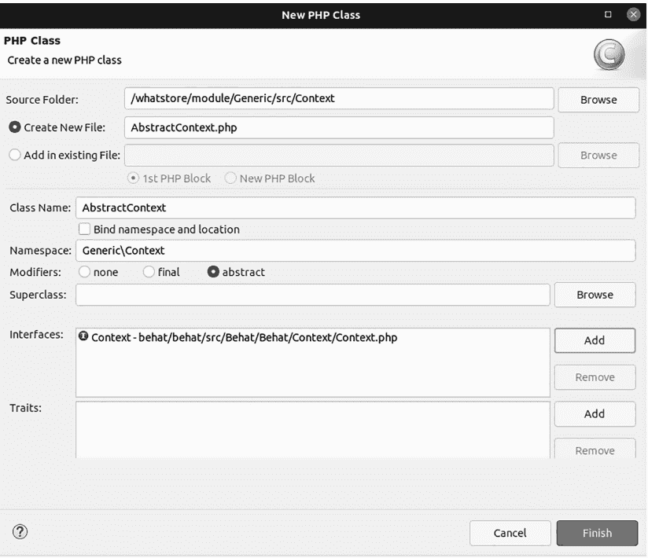

## 使用行为驱动开发的模型和对象关系映射器

在本章中，我们将使用 `laminas-db` 将实体-关系模型映射为对象模型。我们不仅要使用 Laminas 实现映射器，还要创建一个扩展 Laminas 类的最强大可复用映射器。最后，我们将展示模型和映射器是如何连接的。在创建类的过程中，我们将采用 **行为驱动开发**（BDD）的方法，在源代码中保留用户可读的需求。

本章结束时，你将学会如何使用 BDD 方法创建模型和对象关系映射器类。你将知道如何以组织良好的方式将系统需求映射到代码中。希望你读完本章后，会像卢克·天行者炸毁死星后那样感到满足！

本章将介绍以下主题：

- 使用 Behat 的 BDD
- 从用户故事创建模型
- 从用户故事创建映射器
- 创建通用模型和通用映射器
- 使用 Behat 创建其他模型

### 技术要求

本章所有为 **Behat** 实现的用户故事均可在 https://github.com/PacktPublishing/PHP-Web-Development-with-Laminas/tree/main/chapter06/whatstore/features 上找到。在同一仓库中，你可以在 Inventory 和 Store 模块的 Model 文件夹中找到模型类。

### 使用 Behat 的 BDD

在第 3 章《将 Laminas 用作库并进行测试驱动开发》中，我们体验了 TDD 方法。TDD 是确保软件稳定性的一项非常重要的技能。当你进行 TDD 练习时，你知道在修改软件某部分后，所有软件仍能正常工作。除此之外，测试类记录了业务规则，因此 TDD 有助于你维护有用的文档。一个运行测试的测试类告诉你，测试中包含的规则已由软件的类或子例程强制执行。

用 xUnit 模式编写的测试用例可能比直接实现软件更易于非程序员阅读，但你仍在使用编程语言表达业务规则。如果能用更接近人类语言的语言编写测试，那该多好？BDD 正好提供了这一点。它是对 TDD 的扩展方法，在自动化测试之上使用抽象层，由程序员编写并面向程序员。它允许编写更易于理解的故事，供那些了解业务但不了解（甚至无需了解）其用于开发应用程序的技术的人阅读。

**xUnit 模式**
Kent Beck 和 Erich Gamma 创建了 JUnit，这是一个用于 Java 的测试框架。JUnit 架构被用作为 PHP 等其他语言创建测试框架的基础。有一系列测试框架遵循相同的模式来实现单元测试、测试用例和测试套件。Kent Beck 和其他作者（如 Gerard Meszaros）将这一系列称为 xUnit，其中字母 x 是编程语言中的变量占位符。Gerard Meszaros 在他的著作《xUnit 测试模式：重构测试代码》（Addison-Wesley）中很好地描述了 xUnit 框架的通用结构。

我们将使用 BDD 为 Whatstore 项目实现模型层。我们需要为 PHP 安装一个 BDD 工具。PHP 有一个名为 Behat 的 BDD 实现。

使用 Eclipse 的 Composer 编辑器，为 behat/behat 包添加开发依赖。请记住，在安装 PHPUnit 时，你在第 3 章《将 Laminas 用作库并进行测试驱动开发》中已经做过类似的操作。添加包后，保存文件，然后单击“更新依赖项（包括 require-dev）”按钮以下载 Behat。

基于在第 2 章《为我们的电子商务应用程序设置环境》中学到的内容，我们将为 Behat 可执行文件的最常用调用创建一些外部工具配置。使用“运行 | 外部工具 | 外部工具配置”菜单，创建以下三个配置：

- **Behat 初始化：**
  - Name: Behat init
  - Location: ${project_loc}/vendor/bin/behat
  - Working Directory: ${project_loc}
  - Arguments: --init

- 运行行为测试：
  - Name: Behat run
  - Location: ${project_loc}/vendor/bin/behat
  - Working Directory: ${project_loc}
  - Arguments: 留空

- 追加代码片段：
  - Name: Behat append snippets
  - Location: ${project_loc}/vendor/bin/behat
  - Working Directory: ${project_loc}
  - Arguments: --append-snippets

请不要忘记，像在第 2 章《为我们的电子商务应用程序设置环境》中所做的那样，在“常用”选项卡上为每个配置勾选“外部工具”项。

现在我们已经避免了后续步骤中不必要的命令输入，可以为 Whatstore 项目初始化 Behat 了。在“项目资源管理器”视图中选择项目名称，然后单击工具栏外部工具列表中的“Behat init”项，或在“运行 | 外部工具”菜单中选择。“控制台”选项卡上的输出将如下所示：

```
+d features - place your *.feature files here
+d features/bootstrap - place your context classes here
+f features/bootstrap/FeatureContext.php - place your definitions, transformations and hooks here
```

> 变量引用空选择：${project_loc}
> 
> 如果在运行任何外部工具后出现“变量引用空选择：${project_loc}”消息，是因为你在“项目资源管理器”视图中未选择项目名称。选择 Whatstore 项目名称并再次运行。

按 F5 或单击项目的“刷新”项，即可在“项目资源管理器”视图中查看新的 features 文件夹。带有 .feature 扩展名的文件包含用户故事，其语言比编程语言更接近人类语言。我们可以说它看起来像是普通人的语言。bootstrap 文件夹将包含与 .feature 文件定义的故事相关的代码类。不用担心——我们会解释如何创建故事。

在 **“项目资源管理器”** 视图中选择项目名称，然后单击工具栏外部工具列表中的 **“Behat run”** 项，或在 **“运行/外部工具”** 菜单中选择。**“控制台”** 选项卡上的输出将如下：

```
No scenarios
No steps
0m0.00s (8.67Mb)
```

因为 features 文件夹中没有带 .feature 扩展名的文件，所以没有场景。让我们创建第一个场景，以了解 BDD 中的场景是什么。

### 创建我们的第一个场景

在上一章中，我们介绍了几个用例。其中一些与员工对产品的管理有关。让我们从用例 *产品添加* 开始。事实上，用例是一种表达软件系统所需功能的用户故事。因此，从用例 *产品添加* 中，我们将编写一个名为 productaddition.feature 的文件来描述此功能。通过“文件 | 新建 | 文件”菜单创建此文件。其内容如下：

### productaddition.feature

```
Feature: Product addition
    In order to have products in the stock
    As an employee
    I need to be able to add a product to the product
    registration

    Rules:
    - The code of product is generated automatically
    - Product name has a maximum of 80 characters
    - A product must have a discount, and the default
      discount is the null discount

    Scenario: Inserting a product in the registration
    Given there is a product called "Troop Power Battery",
    which costs $2814
    When I add this product to the registration
    Then I should have a product called "Troop Power
    Battery" in the table products
    And the overall product price should be $2814
```

让我们了解 productaddition.feature 文件中使用的模式。文件以单词 Feature 开头。Feature 是用户故事或用例的另一种名称。随后的三行具有每个功能描述中必须存在的初始词：

- In order...：用户故事的目标
- As a/an...：故事参与者扮演的角色
- I need...：参与者实现目标的条件

这些初始词定义了描述功能的模式。可选地，你可以添加 Rules 部分来描述与功能相关的业务规则。.feature 文件的第一部分仅供描述，并像任何其他需求文档一样工作。另一方面，第二部分用于生成源代码。

场景使用示例来描述一个流程。因此，我们有实际值而不是变量。你可以根据可能的流程创建多个块，以单词 Scenario 开头。Scenario 块包含以下词语开头的短语：

- Given...：流程开始的条件
- When...：启动流程的操作
- Then...：流程的结果
- And（可选）：...：流程的附加结果

这四个关键字都是用于为可执行规范赋予结构和意义的语言的一部分——Gherkin。Gherkin 是 Java BDD 工具 Cucumber 的通用语言分析器的一部分。你可以在 https://cucumber.io/docs/gherkin/reference 了解更多关于 Gherkin 的信息。

场景的短语用于创建上下文类的方法。上下文类允许你将用户故事映射到自动化测试。让我们看看它是如何工作的。

### 将用户故事映射到自动化测试

如你所见，我们编写了一个场景，其中员工插入一个名为 "Troop Power Battery"、价格为 2,814 美元的产品。由于未指定折扣类型，我们假设折扣为零。好吧，但这个场景如何变成自动化测试？你可以通过在“项目资源管理器”视图中选择 whatstore 项目，并单击“运行 | 外部工具”菜单中的“Behat run”项来发现这一点。“控制台”选项卡上的输出将添加 productaddition.feature 文件的内容以及以下行：

```
1 scenario (1 undefined)
4 steps (4 undefined)
0m0.01s (8.89Mb)
```


>> <snippet_undefined><snippet_keyword>default</snippet_keyword> 套件有未定义的步骤。请选择上下文以生成代码片段：</snippet_undefined>

[0] None
[1] FeatureContext
>

前面的输出表明存在一个未定义的场景。为什么？因为没有包含实现该场景代码的上下文类。最终，Behat 会等待你为该场景选择生成代码片段的目标。你可以选择 None，这样什么都不会发生，或者选择默认的上下文类 FeatureContext。现在，请选择 None，因为我们将为我们的场景创建一个特定的类。

现在，将 features/bootstrap 文件夹中的 FeatureContext.php 文件复制到同一文件夹中的 ProductAdditionContext.php 文件。将文件内的类名更改为 ProductAdditionContext。这个过程足以让 Behat 将此新类显示为目标选项吗？不，因为 Behat 的默认行为是仅搜索 FeatureContext 类。如果你不相信我，现在就尝试运行 Behat。你会发现 ProductAdditionContext 会被忽略。

要更改 Behat 的行为，我们必须创建一个配置文件。在 features 文件夹中创建一个名为 behat.yml 的文件，内容如下：

### behat.yml

```
default:
  autoload:
    '' : '%paths.base%/bootstrap'
  suites:
    default:
      paths:
        - '%paths.base%'
      contexts:
        - ProductAdditionContext
```

Behat 支持多个配置配置文件。我们将仅使用默认配置文件。autoload 键定义 Behat 查找上下文类的位置。suites 键允许定义多个上下文类套件集。在此情况下，我们只有一个默认的上下文套件集。paths 键定义将搜索用户故事文件的位置。

我们需要更改 **Behat 运行** 外部工具，具体是 **参数** 字段。将当前内容替换为以下代码：

```
--config ${project_loc}/features/behat.yml
```

现在，你可以运行 Behat 外部工具，输出将如下所示：

```
[0] None
[1] ProductAdditionContext
```

你不需要删除 FeatureContext.php。事实上，此文件是一个模板。你可以直接用它来学习，但此类不得用于实际上下文，除非你有一个名为 feature 的用户故事，这非常奇怪。好了，让我们回到 **控制台** 选项卡。控制台正在等待你的选择 – 0 或 1？键入 1，即 ProductAdditionContext。结果将如下所示：

```
/**
 * @Given there is a product called :arg1, which costs
 * $:arg2
 */
public function thereIsAProductCalledWhichCosts($arg1, $arg2)
{
    throw new PendingException();
}

/**
 * @When I add this product to the registration
 */
public function iAddThisProductToTheRegistration($arg1)
{
    throw new PendingException();
}

/**
 * @Then I should have a product called :arg1 in the
 * table products
 */
public function iShouldHaveProductInTheTableProducts($arg1)
{
    throw new PendingException();
}

/**
 * @Then the overall product price should be $:arg1
 */
public function theOverallProductPriceShouldBe($arg1)
{
    throw new PendingException();
}
```

请注意，生成的源代码具有名称与“在注册中插入产品”场景短语相同的方法。另请注意，文件中的值已在 PHP 源代码中替换为诸如 $arg1 之类的变量。我们将在后面了解这有何用处。但是，如果你期望看到生成的代码片段插入到 ProductAdditionContext 类中，你会发现该代码不在那里。

是的，Behat run 外部工具仅显示从用户故事生成的源代码。要将此代码添加到上下文类中，我们需要运行 Behat append snippets 外部工具。此外部工具也需要使用自定义配置，因此请按以下方式更改 **参数** 字段的值：

**参数:** --append-snippets --config ${project_loc}/features/behat.yml

还在等什么？运行它！此命令也会询问你想要哪个上下文。为 ProductAdditionContext 键入 1，你将看到以下输出：

```
u bootstrap/ProductAdditionContext.php - 'there is a product called "Troop Power Battery", which costs $2814' definition added
u bootstrap/ProductAdditionContext.php - 'I add the "Troop Power Battery" to the registration' definition added
u bootstrap/ProductAdditionContext.php - 'I should have a product called "Troop Power Battery" in the table products' definition added
u bootstrap/ProductAdditionContext.php - 'the overall product price should be $2814' definition added
```

你可以打开 ProductAdditionContext.php 文件，检查代码片段是否已插入其中。这意味着我们现在可以用 Behat 运行行为测试了吗？不。如果你现在运行 Behat 运行，你将看到以下输出：

```
Scenario: Inserting a product in the
registration            # ProductAddition.
feature:11
    Given there is a product called "Troop
    Power Battery", which costs $2814 # ProductAdditionContext::thereIsAProductCalledWhichCosts()
    TODO: write pending definition
    When I add this product to the
    registration    # ProductAdditionContext::iAddThisProductToTheRegistration()
    Then I should have a product called "Troop Power Battery" in the table products # ProductAdditionContext::iShouldHaveProductInTheTableProducts()
    And the overall product price should be $2814 # ProductAdditionContext::theOverallProductPriceShouldBe()
1 scenario (1 pending)
4 steps (1 pending, 3 skipped)
0m0.01s (9.31Mb)
```

现在，场景的短语在注释中带有上下文类中对应方法的名称。最终，我们可以看到该场景不再是未定义的，而是挂起的。步骤已更改为 1 个挂起和 3 个跳过。挂起状态意味着上下文类具有实现场景步骤的方法；但是，这些方法尚无内容。这就像 PHPUnit 测试用例因没有可测试的代码而失败一样。

我们必须完成场景实现。为此，我们需要实现与场景相关的模型和对象关系映射器。我们将在下一节开始此工作。

## 从用户故事创建模型

在语法课上，你可能听过这样的问题：“在这个短语中，主语是谁或是什么？”同样，我们提出以下问题：“在‘在注册中插入产品’场景中，模型是什么？”是的，没错——就是产品！然后，我们需要在行为测试类中实例化 Product 类。为此，我们必须在 ProductAdditionContext 类中定义一个 $product 属性：

```
private ?Product $product = null;
```

我们可以在 ProductAdditionContext 类的构造函数中实例化 Product 类，并在 thereIsAProductCalledWhichCosts 方法中使用此实例，如下所示：

```
public function __construct()
{
    $this->product = new Product();
}

/**
 * @Given there is a product called :arg1, which costs
 * $:arg2
 */
public function thereIsAProductCalledWhichCosts($arg1, $arg2)
{
    $data = [
        'name' => $arg1,
        'price' => $arg2
    ];

    $this->product->exchangeArray($data);
}
```

请注意，我们将 $arg1（产品名称）和 $arg2（产品价格）作为参数传递给 Product 类的 exchangeArray 方法。当然，如果你现在尝试运行 **Behat 运行**，将会发生失败，因为 Product 类尚不存在。我们处于 TDD 的第一步——一个失败的测试。请记住，BDD 是 TDD 的扩展，因此我们在 BDD 中保留 TDD 步骤。如果测试失败，我们就欠债了。我们需要编写代码以使测试成功运行。让我们创建 Product 模型。

> 注意 – 定义中的 Behat 参数
>
> feature 文件中被标识为参数的值借助 @Given、@When 和 @Then 注释映射到上下文类。这些注释告知以下方法是否带有参数。如果你更改定义中参数的值，则无需更改实现。例如，如果在 productaddition.feature 文件中更改了产品价格，则无需在 ProductAdditionContext 类中更改任何内容。这样可以避免在规则中的某个值发生变化时需要更改类。

Product 类将位于 Inventory 模块内。在此模块的 src 文件夹中创建一个 Model 文件夹，用于存放模型类。Product 模型的源代码将如下所示：


### Product.php

```php
<?php
namespace Inventory\Model;

class Product
{
    public int $code;
    public string $name;
    public float $price;
    public Discount $discount;

    public function __construct()
    {
        $this->exchangeArray([]);
    }

    public function exchangeArray($data): void
    {
        $this->code = ($data['code'] ?? 0);
        $this->name = ($data['name'] ?? '');
        $this->price = ($data['price'] ?? 0.0);
        $this->discount = new Discount();
        $this->discount->code = ($data['code_discount'] ?? 0);
    }
}
```

你为什么要实现一个调用 exchangeArray 方法的构造函数？为了初始化属性。否则，我们可能会突然遇到“属性在初始化前不得访问”的错误。

如你所见，Product 类依赖于 Discount 类。因此，我们需要按如下方式创建 Discount 类：

### Discount.php

```php
<?php
namespace Inventory\Model;

class Discount
{
    public int $code;
    public string $name;
    public string $operator;
    public float $factor;

    public function __construct()
    {
        $this->exchangeArray([]);
    }

    public function exchangeArray($data): void
    {
        $this->code = ($data['code'] ?? 0);
        $this->name = ($data['name'] ?? '');
        $this->operator = ($data['operator'] ?? '');
        $this->factor = ($data['factor'] ?? 0.0);
    }
}
```

也许另一个框架会根据表架构生成模型类。也许会。
但为了通用性，这样的框架也可能生成不必要的代码。我们只为模型创建必要的代码。

好吧，创建模型后，你可以返回到 ProductAdditionContext 类并添加命名空间：

```
use Inventory\Model\Product;
```

然后，你可以再次运行 Behat，得到不同的摘要结果：

```
1 scenario (1 pending)
4 steps (1 passed, 1 pending, 2 skipped)
0m0.09s (9.31Mb)
```

现在，第一步已通过行为测试。你可以观察到该步骤以绿色打印。

下一步是将产品添加到注册表中。为此，我们需要创建一个表映射器。这是下一节的主题。不要担心其他模型；我们稍后会回到它们。

### 从用户故事创建映射器

在 `ProductAdditionContext` 类中编写新代码之前，我们将复用在培训项目中编写的代码。如果你记得 `school13` 项目，我们为数据库连接创建了全局和本地配置。好了，你可以将 `school13` 项目中的 `global.php` 和 `local.php` 文件复制到 `whatstore` 项目。这两个文件位于 `config/autoload` 文件夹中。复制后，你需要将 `global.php` 文件中的数据库名称重命名为 `whatstore`。

我们还需要安装 `laminas-db` 来实现对象关系映射。我们在 *第 4 章，从对象关系映射到 MVC 容器* 中做过这一点。然后，像之前一样使用 Composer 安装 `laminas-db`。不要忘记，仅将依赖项添加到 `composer.json` 文件是不够的。你必须在 Composer Eclipse 编辑器中点击 **更新依赖** 按钮运行 `composer update`。控制台上应该出现以下问题：

```
Please select which config file you wish to inject 'Laminas\Db' into:
```

选择将配置注入到 `config/modules.config.php` 文件的选项。为什么？请再次阅读 *第 4 章，从对象关系映射到 MVC 容器*。接下来，还会出现另一个问题：

```
Remember the option for other packages of the same type? (Y/n) ?:
```

回答 Y 以避免重复出现此问题。

我们在 *第 4 章，从对象关系映射到 MVC 容器* 的 *实现测试方法* 部分介绍了使用 `laminas-db` 进行对象关系映射。你可能记得，我们使用 **表数据网关** 模式的实现。该模式在 Laminas 中由 `TableGateway` 类实现。为特定映射器类使用此类有一些重复步骤。为此，我们在 `school13` 项目中创建了一些抽象。是时候复用它们了。将 `school13` 项目中 School 模块的 `AbstractModel.php` 和 `AbstractTable.php` 文件复制到 `whatstore` 项目的 Inventory 模块中。这些文件属于模型层，因此必须留在 `src/Model` 文件夹中。更改这些类在目标中的命名空间为 `Inventory\Model`。好了！你将避免重复代码。让我们来编写将产品添加到注册表的代码。

### 将产品添加到产品表中

我们将更改 ProductAdditionContext 类的构造函数以实例化 **表数据网关** 实现，如下所示：

```php
public function __construct()
{
    $this->product = new Product();
    $this->productTable = $this->getApplication()->getServiceManager()->get('ProductTable');
}
```

如你所见，我们正在设置一个 `$this->productTable` 属性。因此，该属性必须在类开头声明：

```php
private ?ProductTable $productTable = null;
```

`$this->productTable` 属性从 Laminas\ServiceManager\ServiceManager 类的 get 方法接收一个对象。我们从 Laminas\Mvc\Application 的实例中恢复 ServiceManager 的实例。最后一个实例由私有 `getApplication` 方法创建，我们必须按以下方式实现：

```php
private function getApplication()
{
    $appConfig = require __DIR__ . '/../../../config/application.config.php';
    if (file_exists(__DIR__ . '/../../../config/development.config.php')) {
        $appConfig = ArrayUtils::merge($appConfig,
        require __DIR__ . '/../../../config/development.config.php');
    }

    return Application::init($appConfig);
}
```

Application 实例由该类的 `init` 方法创建，基于应用程序配置。

既然我们有表映射器，就可以插入产品了。ProductAdditionContext->iAddThisProductToTheRegistration 方法将以这种方式调用 ProductTable 类的 save 方法：

```php
public function iAddThisProductToTheRegistration()
{
    $this->productTable->save($this->product);
}
```

对吧，但 save 方法从哪里来？好吧，ProductTable 类必须通过以下实现创建：

### ProductTable.php

```php
<?php
declare(strict_types = 1);
namespace Inventory\Model;

use Laminas\Db\TableGateway\TableGateway;
use Laminas\Db\TableGateway\TableGatewayInterface;
use Laminas\Db\ResultSet\ResultSet;

class ProductTable extends AbstractTable
{

    protected string $keyName = 'code';

    protected string $modelName = 'Inventory\Model\Product';

    public function __construct(TableGatewayInterface $tableGateway)
    {
        $this->tableGateway = $tableGateway;
    }
}
```

如你所见，ProductTable 类扩展了 AbstractTable 类。save 方法由 AbstractTable 实现，因此我们只需要告知子类将处理哪个模型类（$modelName 属性）。

这意味着现在可以插入产品了吗？事实上，如果你运行 Behat，你会看到以下错误消息：

> 无法将服务 "ProductTable" 解析为工厂；您确定在配置中提供了它吗？

为什么会发生这种情况？这是因为我们需要为 ProductTable 定义一个工厂。ServiceManager 类不使用 new 运算符直接创建实例。ServiceManager 从别名中搜索工厂。我们使用表映射器的名称作为别名，因此 ProductTable 类的工厂别名是 ProductTable。但是，真正的工厂类是什么样子呢？好吧，数据映射器的工厂位于映射器所处理的模型类的同一 Model 文件夹中。因此，我们必须在 Inventory 模块的 Model 文件夹中创建以下类：

### ProductTableFactory.php

```php
<?php
declare(strict_types = 1);
namespace Inventory\Model;

use Interop\Container\ContainerInterface;
use Laminas\Db\ResultSet\ResultSet;
use Laminas\Db\TableGateway\TableGateway;
use Laminas\ServiceManager\Factory\FactoryInterface;

class ProductTableFactory implements FactoryInterface
{
    public function __invoke(ContainerInterface $container,
        $requestedName, ?array $options = null)
    {
        $adapter = $container->get('DbAdapter');
        $resultSetPrototype = new ResultSet();
        $resultSetPrototype->setArrayObjectPrototype(new Product());
        $tableGateway = new TableGateway('products',
            $adapter, null, $resultSetPrototype);
```


```
return new ProductTable($tableGateway);
    }
}
```

ProductTableFactory 类与我们在第 4 章“从对象关系映射到 MVC 容器”的 school3 项目中创建的工厂非常相似。该类的 __invoke 方法封装了创建 ProductTable 实例的依赖链。既然我们已创建工厂，将为查找该工厂的 ServiceManager 实例配置一个别名。ServiceManager 使用别名来调用对象工厂，因为这是使用键在映射配置中快速访问值的一种方式。我们将在 Inventory 模块的 module.config.php 文件中完成此操作。我们将在数组末尾添加一个键，如下所示：

```php
'service_manager' => [
    'factories' => [
        'ProductTable' => Model\ProductTableFactory::class
    ]
]
```

现在呢？产品会被插入吗？暂时不会。如果你执行 **Behat 运行**，将看到以下错误消息：

```
Type error: Inventory\Model\AbstractTable::save(): Argument
#1 ($model) must be of type Inventory\Model\AbstractModel,
Inventory\Model\Product given
```

发生这种情况是因为我们的 Product 模型类不是 AbstractModel 的子类。但这很容易解决。在 Product 类的声明中添加 extends AbstractModel。

做出此更改后，可以执行 **Behat 运行**。接着，将看到以下错误：

```
Type error: PDO::quote(): Argument #1 ($string) must be of type
string, Inventory\Model\Discount given
```

出现上述错误是因为 AbstractTable 的 toArray 方法返回 Product 的所有属性，其中一个属性是 Discount 类的实例。然而，ProductTable->save 方法需要标量值来构建 SQL INSERT。因此，我们必须以以下方式在 Product 类中重写 toArray 方法：

```php
public function toArray()
{
    $attributes = get_object_vars($this);
    unset($attributes['discount']);
    $attributes['code_discount'] = $this->discount->code;
    return $attributes;
}
```

请注意，我们移除了对象属性，仅添加外键的值。最后，我们可以执行 **Behat 运行** 并获得成功输出：

```
1 scenario (1 pending)
4 steps (2 passed, 1 pending, 1 skipped)
0m0.23s (12.66Mb)
```

太棒了！我们已实现场景的两个步骤：ProductAdditionContext 类的 thereIsAProductCalledWhichCosts 和 iAddThisProductToTheRegistration 方法。现在让我们检查产品是否已插入。

### 检查产品是否已插入

由于我们未达到场景的结尾，尚未回滚数据库中的更改。请手动删除上次执行 **Behat 运行** 时插入的记录，以避免 products 表中产生脏数据。

现在，我们将实现断言，以检查产品是否确实已插入 products 表。这些断言必须按预期结果命名实现在 ProductAdditionContext 类的方法中，即 iShouldHaveProductInTheTableProducts 和 theOverallProductPriceShouldBe 方法。源代码如下：

```php
/**
 * @Then I should have a product called :arg1 in the
 * table products
 */
public function iShouldHaveAProductCalledInTheTableProducts($arg1)
{
    $this->product = $this->productTable->getByField('name', $arg1);
    Assert::assertEquals($arg1, $this->product->name);
}

/**
 * @Then the overall product price should be $:arg1
 */
public function theOverallProductPriceShouldBe($arg1)
{
    $product = $this->productTable->getByField('name', $this->product->name);

    Assert::assertEquals($this->product->name, $product->name);
}
```

请注意，我们使用的是 PHPUnit 中 Assert 类的断言方法。这意味着需要声明该类的命名空间：

```php
use PHPUnit\Framework\Assert;
```

最后，我们发现 Behat 与 PHPUnit 集成。你已经学习了如何从测试用例开发。现在，你已学习如何从用户故事开发。如果现在执行 **Behat 运行**，输出将如下：

```
1 scenario (1 passed)
4 steps (4 passed)
0m1.49s (13.62Mb)
```

> **注意 – Behat 不包含 PHPUnit**
>
> Behat 默认不将 PHPUnit 作为依赖项。因此，要在 Behat 上下文类中使用 Assert 类或 PHPUnit 的任何其他类，需要单独安装 PHPUnit。
> 在我们的情况中，已经安装了 PHPUnit。

正如我们所见，场景已完全测试。但等等！运行 ProductAdditionContext 行为测试类后，必须在 products 表中创建一条记录。由于此插入是由测试完成的，必须删除该记录以返回到先前状态。否则，每次测试都会使表增加一条记录。

首先，手动删除已插入的记录。然后，将以下方法插入 ProductAdditionContext 类：

```php
public function __destruct()
{
    $product = $this->productTable->getByField('name', $this->product->name);
    $this->productTable->delete($product->code);
}
```

这是一个析构方法。该方法会在实例销毁前自动执行。我们从表中检索已插入的产品并将其删除。现在，如果执行 **Behat 运行**，将注意到 `products` 表中没有新记录。这是因为记录在行为测试结束时被删除——也就是说，你可以根据需要多次执行行为测试。测试后 `products` 表中的记录数量将与测试前相同。

现在，我们已学习如何从用户故事实现表映射器。在下一节中，我们将回到模型，解释如何处理模型层的泛化。

### 创建通用模型和通用映射器

实际上，我们已经创建了一个通用模型（`AbstractModel` 类）和一个通用映射器（`AbstractTable` 类）。在本章中，我们分别将这些泛化用作 `Product` 和 `ProductTable` 的超类。事实上，通用模型和通用映射器似乎已准备就绪。但这些泛化不在合适的位置。如果你查看，`AbstractModel` 和 `AbstractTable` 类位于 `Inventory` 模块中。问题是，`Inventory` 模块不是唯一拥有模型的模块。我们还有 `Store` 模块。我们将在两个模块中使用通用模型和映射器。为此，我们将通用模型和映射器提取到 `Generic` 模块。请按以下步骤操作：

- 将 `Application` 模块复制到 `Generic`。这意味着将 `Application` 文件夹复制到 `Generic` 文件夹。
- 从 `Generic` 模块中删除 `config`、`test` 和 `view` 文件夹。
- 从 `module/Generic/src/Controller` 文件夹中删除 `IndexController.php` 文件。该文件从 `Application` 模块复制而来，但对 `Generic` 模块不是必需的。
- 将 `src` 文件夹中 `Module` 类的命名空间更改为 `Generic`，并从此类中删除 `getConfig` 方法。

`Generic` 模块将作为其他模块的库使用。我们将把应用程序中多个模块共享的任何抽象类或接口放入 `Generic` 模块。

你可能已经注意到，表映射器的构造方法完全相同。因此，让我们通过将构造方法移至 `AbstractTable` 类来优化代码以实现复用。剪切 `ProductTable` 类的以下部分：

```php
public function __construct(TableGatewayInterface $tableGateway)
{
    $this->tableGateway = $tableGateway;
}
```

将上述代码粘贴到 `AbstractTable` 类中。从现在起，表映射器无需再声明构造方法。

> 注意 – 继承还是使用？这是个问题
>
> 我们的表映射器抽象类（AbstractTable）使用来自 Laminas 的 TableGatewayInterface 实现。这种方法允许我们轻松地将表数据网关模式的实现替换为任何其他实现。依赖注入提供了灵活性和供应商独立性。但是，如果你接受与 Laminas 面向对象映射建立强耦合，则可以选择继承 TableGateway 或 AbstractTableGateway 类。继承可能更方便，但正如我们所说，通过依赖注入使用类能提供更多灵活性。当你考虑到软件变更是必然的时，使用优于继承。

与之前的模块一样，有必要为此新模块配置自动加载规则。编辑 composer.json 文件，并在 autoload/psr-4 键中添加以下行：

```json
"Generic\\": "module/Generic/src"
```

在 Eclipse 中，可以通过单击 Composer 编辑器的 composer.json 选项卡来进行此更改，如图 6.1 所示：



图 6.1 – 带有 Generic 模块自动加载规则的 composer.json 文件


您可能会问，为什么不为 Generic 测试添加自动加载规则，就像我们为 Inventory 和 Store 模块所做的那样？我们不这样做是因为没有必要。如果您测试扩展 Generic 模块中类的类，则 Inventory 和 Store 模块都会被覆盖。事实上，我们无法有效测试抽象类或接口，因为它们没有实现——至少不是所有实现。

保存 `composer.json` 文件并执行 **Composer 自动加载文件重新生成** 外部工具。该工具可在工具栏上使用，如图 6.2 所示：



图 6.2 – Composer 自动加载文件重新生成 外部工具

这个外部工具 **Composer 自动加载文件重新生成** 是在 *第 5 章，创建虚拟商店项目* 中创建的。您可以看到，我们在之前的章节中已经配置了多个外部工具。请注意，我们创建 **Composer 自动加载文件重新生成** 是因为需要重新创建 Composer 自动加载文件以反映 `composer.json` 的内容。仅靠 Generic 模块被找到就足够了吗？不。虽然 Laminas 可以找到 Generic 命名空间中的类，但 `ModuleManager` 类只会搜索 `modules.config.php` 文件中列出的模块。为 Generic 模块添加一个条目，使 `modules.config.php` 文件如下所示：

modules.config.php

```php
<?php
return [
    'Laminas\\Db',
    'Laminas\\Router',
    'Laminas\\Validator',
    'Generic',
    'Store',
    'Inventory',
    'Application',
];
```

现在，我们可以重构 whatstore 项目，将通用模型和映射器从 Inventory 模块移动到 Generic 模块。让我们执行以下步骤：

- 1. 在 modules/Generic/src 中创建 Model 文件夹。
- 2. 选择 modules/Inventory/src/Model 中的 AbstractModel.php 和 AbstractTable.php 文件。
- 3. 将这些文件移动到 modules/Generic/src。
- 4. 将两个文件的命名空间更改为 Generic\\Model。

准备好 Generic 模块后，您必须更改 Inventory 模块中特定模型和映射器的命名空间。在 Product.php 文件的命名空间部分添加以下行：

```php
use Generic\\Model\\AbstractModel;
```

同样，在 ProductTable 文件中添加以下行：

```php
use Generic\\Model\\AbstractTable;
```

进行这些更改后，您可以再次执行 Behat 运行。由于我们只是将类从一个位置移动到另一个位置，结果应与在 Checking whether the product was inserted 部分中看到的相同：

```
1 scenario (1 passed)
4 steps (4 passed)
0m0.35s (13.63Mb)
```

请注意，测试验证原本有效的功能仍然有效。Kent Beck 在其著作《通过示例进行测试驱动开发》中表示，TDD 消除了开发过程中的恐惧。在测试的辅助下，我们可以更改代码并立即知道是否有东西损坏。通过 BDD，我们保留了 TDD 的这一优势，并拥有可以与客户直接讨论的 .feature 文件。

在测试的辅助下，您可以安全地进行改进。例如，您一定已经注意到 Product 和 Discount 模型的构造函数相同，其他模型的构造函数也可能相同。那么，我们可以将此构造函数集中在 AbstractModel 类中。将 Product 类中的构造函数方法剪切并粘贴到 AbstractModel 中。然后，删除 Discount 类的构造函数。您可以执行 Behat 运行并检查一切是否仍然正常。

现在，我们为模型和表格映射器提供了适当的泛化。如我们所见，Laminas 模块不需要具有配置或视图文件夹。模块可以只包含其所需的内容。

当然，我们只实现了一个用例，只创建了两个模型类，Product 和 Discount，但只有 Product 完全由测试覆盖。我们需要创建其他模型。但在这样做之前，我们必须准备 Behat 以选择场景。这就是我们将在下一部分中做的事情。

### 使用 Behat 创建其他模型

让我们为产品更新用例创建另一个功能文件。在 features 文件夹中，创建带有以下内容的 productupdating.feature 文件：

```
productupdating.feature

Feature: Product updating
In order to keep products up-to-date in the stock
As an employee
I need to be able to change data of a product from the
product registration

Scenario: Updating a product in the registration
Given I have a product called "Troop Power Battery",
which costs $2814
When I change the name of product to "Enchanted Hammer"
Then there is a product in the table products called
"Enchanted Hammer"
```

我们需要有一个类与这个功能关联。我们通过复制创建了第一个上下文类。现在，让我们使用 文件 | 新建 | 类 菜单创建 ProductUpdatingContext 类。选择 features/bootstrap 文件夹和 Context 接口，如图 6.3 所示：



图 6.3 – 创建 ProductUpdatingContext 类

我们需要将新的上下文类添加到 features 文件夹中的 behat.yml 文件中。contexts 部分应如下所示：

```
contexts:
  - ProductAdditionContext
  - ProductUpdatingContext
```

如果您现在执行 Behat 运行，输出将以以下内容结束：

```
[0] None
[1] ProductAdditionContext
[2] ProductUpdatingContext
```

是的，新的上下文类似乎正在被选中。但是，如果您查看这些选项前面出现的内容，您会注意到呈现了两个场景：产品添加和产品更新。当我们不告诉 Behat 我们想要哪些场景时，Behat 会列出所有场景。

是的，但是我们如何告诉 Behat 我们只想处理一个场景？这很简单。此刻，我们将进行分离。**Behat 运行** 外部工具将继续运行行为测试。我们将创建另一个外部工具配置来显示代码片段：

- 1. 打开 **运行 | 外部工具 | 外部工具配置** 菜单。
- 2. 右键单击 **Behat 运行** 项目，并选择 **复制** 选项。Eclipse 将创建一个名为 Behat `run (1)` 的副本。
- 3. 选择此新配置并将其名称更改为 **Behat 生成代码片段**。
- 4. 将 **参数** 字段替换为以下代码：

```
--config ${project_loc}/features/behat.yml ${selected_resource_name}
```

`${selected_resource_name}` 变量检索所选对象（文件或文件夹）的值。从现在开始，我们将选择功能文件来执行 **Behat 生成代码片段**，而不是选择项目名称。

但是，这个新的外部工具仅显示代码。将代码插入上下文类的项目是下一个项目。

- 5. 将 **Behat 追加代码片段** 外部工具的 **参数** 字段更改为以下内容：

```
--config ${project_loc}/features/behat.yml ${selected_resource_name}
```

现在，我们准备好查看为特定场景生成的代码，并将此代码插入到同一场景中。

现在选择 `productupdating.feature` 文件并执行 **Behat 生成代码片段**。这次，将仅显示由 `productupdating.feature` 描述的功能。现在，您可以选择选项 2，它将引用 `ProductUpdatingContext`，**控制台** 选项卡将显示以下片段：

```php
/**
 * @Given I have a product called :arg1, which costs
 * $:arg2
 */
public function iHaveAProductCalledWhichCosts($arg1,
    $arg2)
{
    throw new PendingException();
}
```

```php
/**
 * @When I change the name of product to :arg1
 */
public function iChangeTheNameOfProductTo($arg1)
{
    throw new PendingException();
}

/**
 * @Then there is a product in the table products
 * called :arg1
 */
public function thereIsAProductInTheTableProductsCalled
($arg1)
{
    throw new PendingException();
}
```

如您所见，**Behat 生成代码片段** 让我们有机会在将代码添加到上下文类之前检查生成的代码。现在，我们可以执行 **Behat 追加代码片段** 来添加片段。

> **关于 Behat 定义的注意事项**
> 
> 在功能文件中编写定义时要小心。您不应该为不同的文件使用相同的定义。Behat 会在文件之间比较定义，如果存在相同的定义，会发出警告。对于 Behat，多个功能文件中的相同定义会创建一个错误，测试将失败。正因为如此，我们在 ProductAddition.feature 中有一个“there is a product called...”定义，在 productupdating.feature 中有一个“I have a product called...”定义。这就像 Behat 在说：“你已经说了。”然后，你回答：“好吧，我会使用同义词。”

我们可以从 `ProductAdditionContext` 重用一些代码到 `ProductUpdatingContext`。将第一个类中的 `$product` 和 `$productTable` 属性以及构造函数方法复制到第二个类中。

由于您已经复制了构造函数方法，您可能已经注意到，此方法依赖于私有 `getApplication` 方法。您是否也需要从 `ProductAdditionContext` 复制此方法？不需要。但是为什么呢？


getApplication 方法可能对多个行为测试类是必需的。如果相同的方法出现在许多不同的类中，此方法可以集中到一个可重用的公共代码单元中。在这种情况下，此单元可以是一个抽象类。

我们将在 Generic 模块中创建此类。因此，在 Generic 模块和 src 文件夹中的 Context 文件夹中创建此类。然后，使用 文件 | 新建 | 类 菜单在 Generic/src/Context 文件夹中创建抽象 AbstractContext 类。AbstractContext 将实现行为测试类通用的 Context 接口。图 6.4 显示了我们必须如何填写类创建表单的字段：



### 图 6.4 – 创建抽象 AbstractContext 类

创建 AbstractContext 类后，将 ProductAdditionContext 类中的 getApplication 方法从 ProductAdditionContext 移动到 AbstractContext 类。将 getApplication 的作用域更改为 protected，因为此方法只对 AbstractContext 的子类可见。因此，AbstractContext 类将如下所示：

### AbstractContext.php

```php
<?php
namespace Generic\Context;

use Behat\Behat\Context\Context;
use Laminas\Stdlib\ArrayUtils;
use Laminas\Mvc\Application;

abstract class AbstractContext implements Context
{
    protected function getApplication()
    {
        $appConfig = require __DIR__ . '../../../../../config/application.config.php';
        if (file_exists(__DIR__ . '../../../../../config/development.config.php')) {
            $appConfig = ArrayUtils::merge($appConfig,
            require __DIR__ . '../../../../../config/development.config.php');
        }

        return Application::init($appConfig);
    }
}
```

当然，我们必须更改包含文件路径的行，因为相对层级不同。以前，我们需要返回三个层级才能到达根路径；现在，需要返回四个层级。

从现在开始，ProductAdditionContext 和 ProductUpdatingContext 类必须扩展 AbstractContext 而不是实现 Context 接口。按照 ProductAdditionContext 的示例对这些类的声明进行此更改：

```php
class ProductAdditionContext extends AbstractContext
```

在完成与继承相关的调整后，我们可以结束 ProductUpdatingContext 类的实现。让我们逐步展示这个类的代码。首先，像我们在 PHP 类中必须做的那样，我们需要使用 use 命令添加依赖项的引用：

```php
<?php
use Behat\Behat\Tester\Exception\PendingException;
use Behat\Gherkin\Node\PyStringNode;
use Behat\Gherkin\Node\TableNode;

use Inventory\Model\Product;
use Inventory\Model\ProductTable;
use Inventory\Model\ProductTableFactory;
use PHPUnit\Framework\Assert;
use Generic\Context\AbstractContext;
```

请注意，Behat 有实现 Gherkin 语言的类。这些类，具体来说，与 .feature 文件的解析相关。接下来，我们声明 ProductUpdating 类和两个私有属性：

```php
/**
 * Defines application features from the specific context.
 *
 */
class ProductUpdatingContext extends AbstractContext
{
    private ?Product $product = null;
    private ?ProductTable $productTable = null;
```

我们为模型对象 ($product) 定义了一个属性，它将数据保存在内存中；还为表网关对象 ($productTable) 定义了另一个属性，它从表中恢复数据到内存并将内存中的数据保存到表中。接下来，我们定义了构造函数，在创建 ProductUpdating 类的实例时自动执行：

```php
/**
 * Initializes context.
 *
 * Every scenario gets its own context instance.
 * You can also pass arbitrary arguments to the
 * context constructor through behat.yml.
 */
public function __construct()
{
    $this->product = new Product();
    $this->productTable = $this->getApplication() ->
        getServiceManager()->get('ProductTable');
}
```

ProductUpdating 构造函数直接实例化 Product 类，并使用工厂来实例化 ProductTable 类。接下来，我们有一个实现带有 @Given 注释的 Gherkin 短语的方法：

```php
/**
 * @Given I have a product called :arg1, which costs
 * $:arg2
 */
public function iHaveAProductCalledWhichCosts($arg1,
    $arg2)
{
    $data = [
        'name' => $arg1,
        'price' => $arg2
    ];
    $this->product->exchangeArray($data);
}
```

iHaveAProductCalledWhichCosts 方法使用 productupdating.feature 文件提供的数据填充 Product 类的实例。接下来，我们有一个实现带有 @When 注释的 Gherkin 短语的方法：

```php
/**
 * @When I change the name of product to :arg1
 */
public function iChangeTheNameOfProductTo($arg1)
{
    $product = $this->productTable->getByField
        ('name', $this->product->name);
    $product->name = $arg1;
    $this->productTable->save($product);
}
```

iChangeTheNameOfProductTo 方法按名称恢复产品；更改此名称并更新表中的记录。接下来，我们有一个实现带有 @Then 注释的 Gherkin 短语的方法：

```php
/**
 * @Then there is a product in the table products
 * called :arg1
 */
public function thereIsAProductInTheTableProductsCalled($arg1)
{
    $this->product = $this->productTable->getByField
        ('name', $arg1);

    Assert::assertEquals($arg1, $this->product->name);
}
```

thereIsAProductInTheTableProductsCalled 方法代表了 BDD 与 TDD 之间的连接。在此方法中，我们使用 PHPUnit 进行断言。最后，我们使用析构函数回退之前方法执行的更改：

```php
/**
 */
public function __destruct()
{
    $product = $this->productTable->getByField(
        'name', $this->product->name);
    $this->productTable->delete($product->code);
    $product = $this->productTable->getByField
        ('name', $product->name);

    Assert::assertEmpty($product->name);
}
```

您可以看到 ProductUpdatingContext 的大部分实现与我们为 ProductAdditionContext 类所做的相似。请注意，我们在析构函数中添加了一个断言来检查产品是否已被删除。因此，没有必要为产品删除用例创建功能文件。事实上，您可以组织功能来分组用例，从而避免重复。

至此，我们已介绍完在 Behat 辅助的 Laminas 项目中关于模型创建所需了解的所有内容。

### 摘要

在本章中，我们介绍了使用 Behat 进行 BDD 的相关知识。我们了解到 BDD 允许我们在 TDD 的有用技能基础上进行构建，并且还为我们提供了一种编写用户故事的方法，这些用户故事会生成部分测试代码。

借助作为 PHP BDD 工具的 Behat，我们学习了如何从用户故事创建模型和表映射器。事实上，我们发现 Behat 和 Laminas 的组合对于构建模型层非常强大。

我们还学习了如何创建带有抽象类的 `Generic` 模块，以供其他模块使用，并重用在 *第 4 章 从对象关系映射到 MVC 容器* 中创建的通用类。同一个 `Generic` 模块用于存储上下文类（即行为测试实现）的抽象。在此，我们了解到拥有可重用的抽象非常有用，可以避免复制所产生的不必要的工作和复杂性。由于这种抽象行为发生在每个代码单元中，抽象类可以在软件项目的每个演进阶段增长，以促进更多代码重用。然后，每个应用于多个类的新功能都是一个警示，提示我们应使用抽象来减少代码行数。

在下一章中，我们将创建应用程序的控制层和视图层，这些层将使用本章中创建的模型和表映射器。


